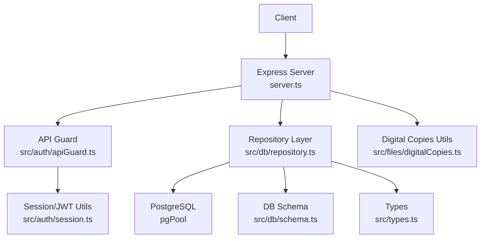
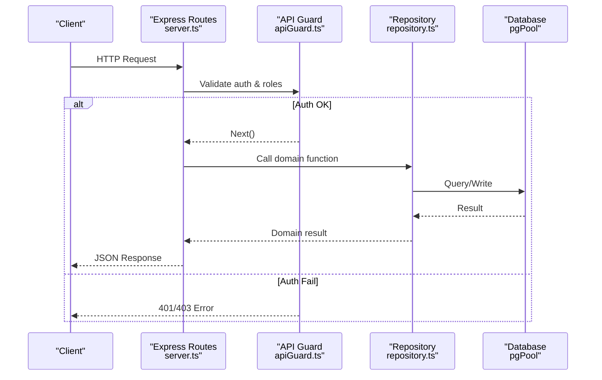
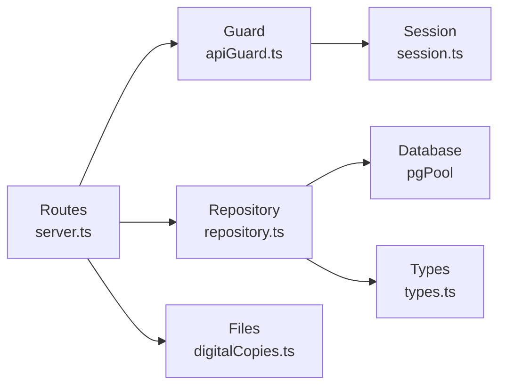
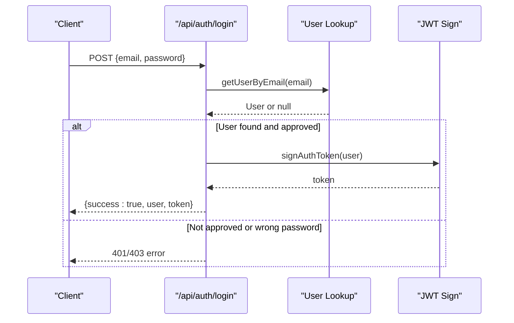

# API Reference

<cite>
**Referenced Files in This Document**
- [server.ts](file://server.ts)
- [apiGuard.ts](file://src/auth/apiGuard.ts)
- [session.ts](file://src/auth/session.ts)
- [schema.ts](file://src/db/schema.ts)
- [repository.ts](file://src/db/repository.ts)
- [digitalCopies.ts](file://src/files/digitalCopies.ts)
- [types.ts](file://src/types.ts)
</cite>

## Table of Contents
1. [Introduction](#introduction)
2. [Project Structure](#project-structure)
3. [Core Components](#core-components)
4. [Architecture Overview](#architecture-overview)
5. [Detailed Component Analysis](#detailed-component-analysis)
6. [Dependency Analysis](#dependency-analysis)
7. [Performance Considerations](#performance-considerations)
8. [Troubleshooting Guide](#troubleshooting-guide)
9. [Conclusion](#conclusion)
10. [Appendices](#appendices)

## Introduction
This document provides a comprehensive REST API reference for ArchiveHub’s backend server. It covers authentication, user management, documents, locations, checkouts, bundles, retention policies, movements, and audit logs. It also describes request/response schemas, status codes, error formats, security considerations, and client implementation guidance. The server is an Express application that exposes JSON endpoints under the /api prefix and uses PostgreSQL (with memory fallback) via a repository layer. Authentication is token-based using JWT, enforced by a middleware guard.

## Project Structure
The API surface is defined in the server entrypoint, with authorization and session utilities, database schema definitions, repository functions, and file handling utilities.

**Diagram sources**
- [server.ts:1-600](file://server.ts#L1-L600)
- [apiGuard.ts:1-98](file://src/auth/apiGuard.ts#L1-L98)
- [session.ts:1-66](file://src/auth/session.ts#L1-L66)
- [repository.ts:1-800](file://src/db/repository.ts#L1-L800)
- [schema.ts:1-228](file://src/db/schema.ts#L1-L228)
- [digitalCopies.ts:1-47](file://src/files/digitalCopies.ts#L1-L47)
- [types.ts:1-283](file://src/types.ts#L1-L283)

**Section sources**
- [server.ts:1-600](file://server.ts#L1-L600)
- [schema.ts:1-228](file://src/db/schema.ts#L1-L228)

## Core Components
- Authentication and Authorization
  - Token-based authentication using JWT signed with a session secret.
  - Middleware enforces role-based access control across endpoints.
- Data Access
  - Repository layer abstracts PostgreSQL queries with memory fallback when the database is unavailable.
- File Handling
  - Utilities to save digital copies to disk and resolve safe paths.

Key responsibilities:
- server.ts: Defines all HTTP routes and basic request parsing limits.
- apiGuard.ts: Validates tokens, checks approval status, and enforces roles per path.
- session.ts: Password hashing/verification, JWT signing/verification, and user sanitization.
- repository.ts: CRUD operations for users, departments, document types, locations, documents, checkouts, movements, retention policies, reusable custom fields, bundles, and audit logs.
- digitalCopies.ts: File saving and path resolution helpers.
- types.ts: Shared type definitions for entities and enums.

**Section sources**
- [server.ts:1-600](file://server.ts#L1-L600)
- [apiGuard.ts:1-98](file://src/auth/apiGuard.ts#L1-L98)
- [session.ts:1-66](file://src/auth/session.ts#L1-L66)
- [repository.ts:1-800](file://src/db/repository.ts#L1-L800)
- [digitalCopies.ts:1-47](file://src/files/digitalCopies.ts#L1-L47)
- [types.ts:1-283](file://src/types.ts#L1-L283)

## Architecture Overview
The API follows a layered architecture:
- Presentation: Express routes in server.ts handle HTTP requests and responses.
- Security: apiGuard.ts validates tokens and enforces role-based permissions.
- Business Logic: repository.ts implements domain operations and data persistence.
- Storage: PostgreSQL via pgPool; memory fallback for development or outages.
- Files: Local filesystem under uploads/digital for digital copies.

**Diagram sources**
- [server.ts:104-189](file://server.ts#L104-L189)
- [apiGuard.ts:27-97](file://src/auth/apiGuard.ts#L27-L97)
- [repository.ts:111-239](file://src/db/repository.ts#L111-L239)

## Detailed Component Analysis

### Authentication Endpoints
- POST /api/auth/login
  - Purpose: Authenticate a user by email and password.
  - Request body: email, password
  - Success response: { success: true, user }
  - Errors:
    - 400: Missing email
    - 404: No account found
    - 403: Pending approval or rejected
    - 401: Incorrect password
    - 500: Server error
  - Notes: Returns user object without password due to sanitization.

- POST /api/auth/signup
  - Purpose: Register a new user.
  - Request body: email, fullName, optional fields like role, departmentId, etc.
  - Success response: { success: true, user, isPendingApproval: true, message }
  - Errors:
    - 400: Missing required fields or duplicate email
    - 500: Server error
  - Notes: New accounts are created with PENDING_APPROVAL status.

- Session Management
  - Tokens: JWT signed with a session secret; valid for 7 days.
  - Authorization header: Bearer <token>
  - Token payload includes sub (user id), email, and role.
  - Verification: verifyAuthToken returns null on invalid/expired tokens.

Security considerations:
- Passwords are hashed using bcrypt before storage.
- User objects returned from authenticated endpoints exclude passwords.
- Role-based access control enforced per route group.

**Section sources**
- [server.ts:104-189](file://server.ts#L104-L189)
- [session.ts:23-66](file://src/auth/session.ts#L23-L66)
- [types.ts:10-22](file://src/types.ts#L10-L22)

### Users Management
- GET /api/users
  - Purpose: List users.
  - Auth: Requires admin or records admin depending on guard logic.
  - Response: Array of users (sanitized).
  - Errors: 500 on failure.

- PATCH /api/users/:id/approval
  - Purpose: Update user approval status.
  - Request body: status (APPROVED | REJECTED | PENDING_APPROVAL)
  - Response: { success: true, user }
  - Errors: 400 invalid status; 500 server error.

- DELETE /api/users/:id
  - Purpose: Delete a user.
  - Response: { success: boolean }
  - Errors: 500 server error.

Role enforcement:
- Admin-only routes include /api/users and related administrative endpoints.

**Section sources**
- [server.ts:94-213](file://server.ts#L94-L213)
- [apiGuard.ts:64-66](file://src/auth/apiGuard.ts#L64-L66)
- [repository.ts:111-239](file://src/db/repository.ts#L111-L239)

### Document Types
- GET /api/document-types
  - Purpose: Retrieve all document types.
  - Response: Array of document types.
- POST /api/document-types
  - Purpose: Create a document type.
  - Request body: code, name, retentionYears, description, customFields, optional department fields.
  - Response: Created document type.
- PUT /api/document-types/:id
  - Purpose: Update a document type.
  - Request body: Partial updates.
  - Response: { success: true }
- DELETE /api/document-types/:id
  - Purpose: Delete a document type.
  - Response: { success: true }

Access: Catalog roles allowed (ADMIN, RECORDS_ADMIN).

**Section sources**
- [server.ts:215-250](file://server.ts#L215-L250)
- [apiGuard.ts:68-70](file://src/auth/apiGuard.ts#L68-L70)
- [repository.ts:259-342](file://src/db/repository.ts#L259-L342)

### Locations
- GET /api/locations
  - Purpose: List locations.
  - Response: Array of locations.
- POST /api/locations
  - Purpose: Create a location.
  - Request body: type, code, name, description, capacity, parentId, department fields.
  - Response: Created location.
- PUT /api/locations/:id
  - Purpose: Update a location.
  - Request body: Partial updates.
  - Response: { success: true }
- DELETE /api/locations/:id
  - Purpose: Delete a location.
  - Response: { success: true }
  - Validation: Cannot delete if it has children or associated documents.

Access: Write roles allowed (ADMIN, RECORDS_ADMIN, RECORDS_OFFICER).

**Section sources**
- [server.ts:252-296](file://server.ts#L252-L296)
- [apiGuard.ts:72-74](file://src/auth/apiGuard.ts#L72-L74)
- [repository.ts:344-468](file://src/db/repository.ts#L344-L468)

### Documents
- GET /api/documents
  - Purpose: List documents.
  - Response: Array of documents.
- POST /api/documents
  - Purpose: Create a document.
  - Request body: docData, user, homePath (optional).
  - Response: Created document.
- PUT /api/documents/:id
  - Purpose: Update a document.
  - Request body: updates, user.
  - Response: { success: true }
- DELETE /api/documents/:id
  - Purpose: Delete a document.
  - Request body: user.
  - Response: { success: true }
  - Validation: Cannot delete while checked out.
- POST /api/documents/:id/move
  - Purpose: Move a document to another location.
  - Request body: toLocationId, reason, user, fromPath, toPath.
  - Response: { success: true }

Access: Write roles allowed.

Audit and movement tracking:
- Creation triggers initial filing movement and audit log.
- Updates create audit entries.
- Moves record movement history and audit logs.

**Section sources**
- [server.ts:298-361](file://server.ts#L298-L361)
- [repository.ts:470-800](file://src/db/repository.ts#L470-L800)

### Checkouts
- GET /api/checkouts
  - Purpose: List checkouts.
  - Response: Array of checkout records.
- POST /api/checkouts/request
  - Purpose: Request a checkout.
  - Request body: documentId, purpose, dueDate, user.
  - Response: Created checkout record.
- POST /api/checkouts/:id/approve
  - Purpose: Approve a checkout.
  - Request body: user.
  - Response: { success: true }
- POST /api/checkouts/:id/reject
  - Purpose: Reject a checkout.
  - Request body: reason, user.
  - Response: { success: true }
- POST /api/checkouts/:id/dispatch
  - Purpose: Dispatch a checkout to a temporary location.
  - Request body: tempLocationId, user, fromPath, toPath.
  - Response: { success: true }
- POST /api/checkouts/:id/return
  - Purpose: Return a checkout.
  - Request body: conditionIn, returnLocationId, notes, user, fromPath, toPath.
  - Response: { success: true }

Access: Circulation roles allowed (ADMIN, RECORDS_ADMIN, RECORDS_OFFICER). Auditors have read-only access.

**Section sources**
- [server.ts:363-441](file://server.ts#L363-L441)
- [apiGuard.ts:76-82](file://src/auth/apiGuard.ts#L76-L82)

### Movements
- GET /api/movements
  - Purpose: List movement records.
  - Response: Array of movements.

Movements are automatically created during document registration, moves, and checkout flows.

**Section sources**
- [server.ts:443-451](file://server.ts#L443-L451)
- [repository.ts:742-800](file://src/db/repository.ts#L742-L800)

### Retention Policies
- GET /api/retention-policies
  - Purpose: List retention policies.
  - Response: Array of policies.

**Section sources**
- [server.ts:453-461](file://server.ts#L453-L461)

### Audit Logs
- GET /api/audit-logs
  - Purpose: List audit logs.
  - Response: Array of logs.
- POST /api/audit-logs
  - Purpose: Create an audit log entry.
  - Request body: details, entity info, action, etc.
  - Response: Created log.

Note: POST to audit logs bypasses typical write restrictions to allow system-generated logging.

**Section sources**
- [server.ts:463-480](file://server.ts#L463-L480)
- [apiGuard.ts:88-90](file://src/auth/apiGuard.ts#L88-L90)

### Reusable Custom Fields
- GET /api/reusable-custom-fields
  - Purpose: List reusable custom fields.
- POST /api/reusable-custom-fields
  - Purpose: Create a reusable custom field.
- PUT /api/reusable-custom-fields/:id
  - Purpose: Update a reusable custom field.
- DELETE /api/reusable-custom-fields/:id
  - Purpose: Delete a reusable custom field.

Access: Catalog roles allowed.

**Section sources**
- [server.ts:482-517](file://server.ts#L482-L517)
- [apiGuard.ts:68-70](file://src/auth/apiGuard.ts#L68-L70)

### Bundles & Dossiers
- GET /api/bundles
  - Purpose: List bundles.
- POST /api/bundles
  - Purpose: Create a bundle.
  - Request body: bundleData, user.
  - Response: Created bundle.
- PUT /api/bundles/:id
  - Purpose: Update a bundle.
  - Request body: updates, user.
  - Response: { success: true }
- DELETE /api/bundles/:id
  - Purpose: Delete a bundle.
  - Request body: user.
  - Response: { success: true }
- POST /api/bundles/:id/add-documents
  - Purpose: Add documents to a bundle.
  - Request body: documentIds, user.
  - Response: { success: true }
- POST /api/bundles/:id/remove-document
  - Purpose: Remove a document from a bundle.
  - Request body: documentId, user.
  - Response: { success: true }

Access: Write roles allowed.

**Section sources**
- [server.ts:519-577](file://server.ts#L519-L577)
- [apiGuard.ts:72-74](file://src/auth/apiGuard.ts#L72-L74)

### System Endpoints
- GET /api/health
  - Purpose: Health check including database connectivity.
  - Response: { status, service, database, timestamp }
- POST /api/seed
  - Purpose: Run migrations and seed default data.
  - Response: { success, message }
  - Errors: 400 if database not connected; 500 on failure.
- POST /api/clear-data
  - Purpose: Clear operational data.
  - Response: Result object.
  - Errors: 500 on failure.

**Section sources**
- [server.ts:42-82](file://server.ts#L42-L82)

## Dependency Analysis
- Route handlers depend on repository functions for data operations.
- Repository functions depend on database pool and schema definitions.
- Authentication guard depends on session utilities for token verification and user sanitization.
- File utilities provide safe storage and retrieval for digital copies.

**Diagram sources**
- [server.ts:1-600](file://server.ts#L1-L600)
- [apiGuard.ts:1-98](file://src/auth/apiGuard.ts#L1-L98)
- [session.ts:1-66](file://src/auth/session.ts#L1-L66)
- [repository.ts:1-800](file://src/db/repository.ts#L1-L800)
- [digitalCopies.ts:1-47](file://src/files/digitalCopies.ts#L1-L47)
- [types.ts:1-283](file://src/types.ts#L1-L283)

**Section sources**
- [server.ts:1-600](file://server.ts#L1-L600)
- [repository.ts:1-800](file://src/db/repository.ts#L1-L800)

## Performance Considerations
- Request body size limit: 10 MB configured for JSON payloads.
- Database fallback: When PostgreSQL is unavailable, repository functions fall back to in-memory state, which may reduce consistency but maintains availability.
- Transactions: Some operations use transactions to ensure atomicity (e.g., document creation with movement and audit log insertion).
- File I/O: Digital copies are written synchronously; consider asynchronous writes for high-throughput scenarios.

[No sources needed since this section provides general guidance]

## Troubleshooting Guide
Common errors and their meanings:
- 400 Bad Request: Invalid input or business rule violation (e.g., missing fields, invalid approval status, cannot delete location with dependencies).
- 401 Unauthorized: Missing or invalid token; expired session; account no longer exists.
- 403 Forbidden: Insufficient roles; pending or rejected approval; auditors attempting write actions.
- 404 Not Found: Resource not found (e.g., login with non-existent email).
- 500 Internal Server Error: Unexpected server-side failures; check logs and database connectivity.

Debugging tips:
- Verify environment variables for database connection and session secret.
- Use /api/health to confirm database connectivity.
- Review audit logs for recent actions and context.

**Section sources**
- [server.ts:42-82](file://server.ts#L42-L82)
- [apiGuard.ts:27-97](file://src/auth/apiGuard.ts#L27-L97)
- [session.ts:23-66](file://src/auth/session.ts#L23-L66)

## Conclusion
ArchiveHub’s API provides a robust set of endpoints for managing physical and digital archives, including authentication, user administration, document lifecycle, location hierarchy, checkout workflows, and auditability. Security is enforced through JWT-based authentication and role-based authorization. The repository layer ensures resilience with database fallback and transactional integrity where applicable. Clients should implement proper error handling, respect rate limits (if any), and follow the documented request/response schemas.

[No sources needed since this section summarizes without analyzing specific files]

## Appendices

### Authentication Flow

**Diagram sources**
- [server.ts:104-149](file://server.ts#L104-L149)
- [session.ts:50-66](file://src/auth/session.ts#L50-L66)

### File Upload/Download Support
- Upload:
  - Digital copies are saved under uploads/digital/<documentId>/<fileName>.
  - Filename sanitization prevents directory traversal and restricts characters.
  - Base64 decoding helper supports base64-encoded payloads.
- Download:
  - Path resolution ensures files remain within the upload root.
  - Returns absolute path if safe and existing.

Limitations:
- JSON body size limit: 10 MB.
- No explicit MIME-type validation in utilities; clients should send appropriate content types.
- Size labels are computed from buffer length.

**Section sources**
- [digitalCopies.ts:1-47](file://src/files/digitalCopies.ts#L1-L47)
- [server.ts:17-17](file://server.ts#L17-L17)

### Input Validation and Security Considerations
- Validation:
  - Required fields validated at route level (e.g., email for login, full name for signup).
  - Approval status enforced for login and user management.
- Security:
  - Passwords hashed before storage.
  - JWT tokens used for authenticated requests.
  - Role-based access control enforced per endpoint group.
  - Path traversal protection for file operations.

**Section sources**
- [server.ts:104-189](file://server.ts#L104-L189)
- [apiGuard.ts:27-97](file://src/auth/apiGuard.ts#L27-L97)
- [session.ts:23-66](file://src/auth/session.ts#L23-L66)
- [digitalCopies.ts:6-41](file://src/files/digitalCopies.ts#L6-L41)

### Client Implementation Guidelines and SDK Recommendations
- Base URL: http://localhost:3031 (or configured host/port).
- Headers:
  - Content-Type: application/json for JSON endpoints.
  - Authorization: Bearer <token> for protected endpoints.
- Libraries:
  - JavaScript/TypeScript: axios or fetch with promise wrappers.
  - Python: requests or httpx.
  - Java: OkHttp or Spring RestTemplate/WebClient.
  - C#: HttpClient or RestSharp.
- Best practices:
  - Store tokens securely and refresh as needed.
  - Handle retries with exponential backoff for transient errors.
  - Log errors and capture correlation IDs from responses.
  - Respect rate limiting if enabled in deployment.

[No sources needed since this section provides general guidance]