# Audit & Compliance

<cite>
**Referenced Files in This Document**
- [server.ts](file://server.ts)
- [src/db/schema.ts](file://src/db/schema.ts)
- [src/db/repository.ts](file://src/db/repository.ts)
- [src/types.ts](file://src/types.ts)
- [src/context/ArchiveContext.tsx](file://src/context/ArchiveContext.tsx)
- [src/pages/AuditLogsPage.tsx](file://src/pages/AuditLogsPage.tsx)
</cite>

## Table of Contents
1. [Introduction](#introduction)
2. [Project Structure](#project-structure)
3. [Core Components](#core-components)
4. [Architecture Overview](#architecture-overview)
5. [Detailed Component Analysis](#detailed-component-analysis)
6. [Dependency Analysis](#dependency-analysis)
7. [Performance Considerations](#performance-considerations)
8. [Troubleshooting Guide](#troubleshooting-guide)
9. [Conclusion](#conclusion)
10. [Appendices](#appendices)

## Introduction
This document explains ArchiveHub’s audit logging and compliance features. It covers the automatic audit trail that records significant actions such as document modifications, location changes, checkout activities, and user operations; the audit log interface for reviewing historical changes and filtering by action types; data retention considerations; security monitoring capabilities; examples for generating compliance reports; performance guidance for high-volume logging; and how to extend audit capabilities to track custom business events.

## Project Structure
Audit functionality spans several layers:
- API layer exposes endpoints to read and write audit logs.
- Repository layer persists audit entries and other operational data to PostgreSQL or an in-memory fallback.
- Database schema defines the audit_logs table and related tables (documents, movements, checkouts).
- Frontend context fetches and maintains audit logs in application state.
- Audit Logs page provides a UI to filter and review audit entries.

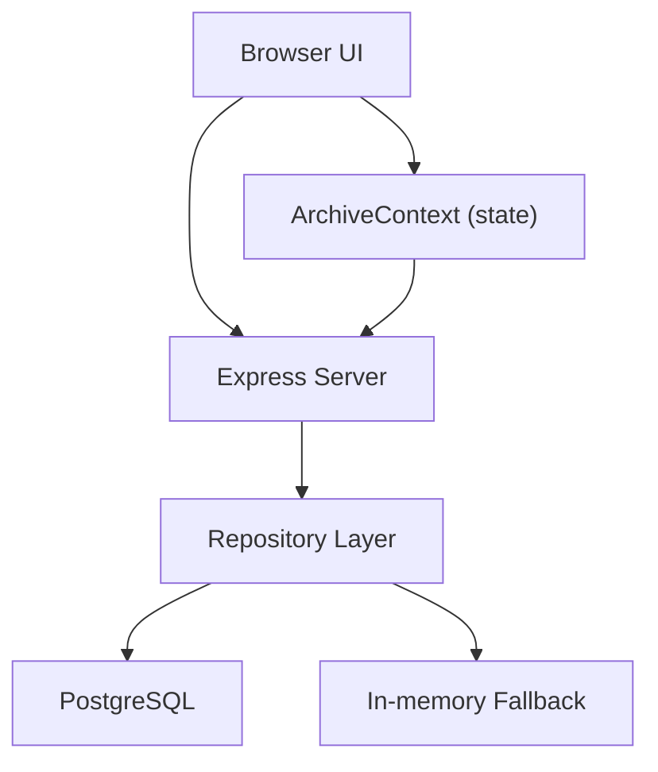

**Diagram sources**
- [server.ts:463-480](file://server.ts#L463-L480)
- [src/db/repository.ts:1171-1217](file://src/db/repository.ts#L1171-L1217)
- [src/db/schema.ts:213-227](file://src/db/schema.ts#L213-L227)
- [src/context/ArchiveContext.tsx:198-220](file://src/context/ArchiveContext.tsx#L198-L220)
- [src/pages/AuditLogsPage.tsx:5-18](file://src/pages/AuditLogsPage.tsx#L5-L18)

**Section sources**
- [server.ts:463-480](file://server.ts#L463-L480)
- [src/db/schema.ts:213-227](file://src/db/schema.ts#L213-L227)
- [src/db/repository.ts:1171-1217](file://src/db/repository.ts#L1171-L1217)
- [src/context/ArchiveContext.tsx:198-220](file://src/context/ArchiveContext.tsx#L198-L220)
- [src/pages/AuditLogsPage.tsx:5-18](file://src/pages/AuditLogsPage.tsx#L5-L18)

## Core Components
- Audit Log Data Model: Defines fields for actor, action, entity, timestamp, details, and optional before/after values.
- Audit Log Storage: Persists entries via repository with PostgreSQL or in-memory fallback.
- Audit Log API: Endpoints to retrieve and create audit logs.
- Audit Log UI: Page to view and filter audit entries.
- Automatic Logging: Operations across documents, locations, checkouts, and bundles automatically emit audit entries.

Key responsibilities:
- Capture who did what, when, and on which entity.
- Provide immutable historical record for compliance and investigations.
- Support filtering and export-ready datasets for audits.

**Section sources**
- [src/types.ts:260-274](file://src/types.ts#L260-L274)
- [src/db/schema.ts:213-227](file://src/db/schema.ts#L213-L227)
- [src/db/repository.ts:1171-1217](file://src/db/repository.ts#L1171-L1217)
- [server.ts:463-480](file://server.ts#L463-L480)
- [src/pages/AuditLogsPage.tsx:5-18](file://src/pages/AuditLogsPage.tsx#L5-L18)

## Architecture Overview
The system captures audit events at operation boundaries and stores them in a dedicated table. The frontend periodically fetches all data including audit logs and renders them in a filterable table.

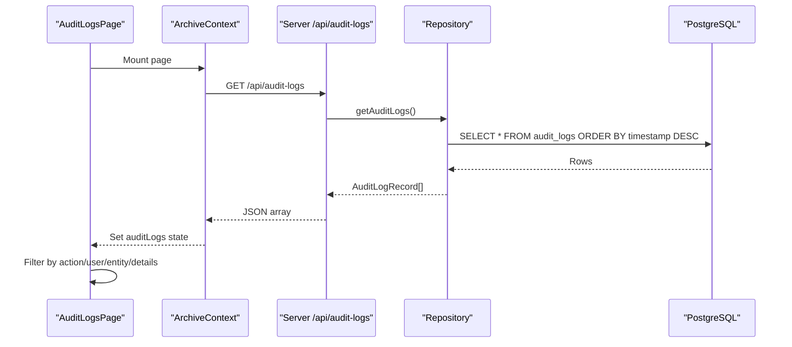

**Diagram sources**
- [src/context/ArchiveContext.tsx:198-220](file://src/context/ArchiveContext.tsx#L198-L220)
- [server.ts:463-480](file://server.ts#L463-L480)
- [src/db/repository.ts:1171-1194](file://src/db/repository.ts#L1171-L1194)
- [src/pages/AuditLogsPage.tsx:5-18](file://src/pages/AuditLogsPage.tsx#L5-L18)

## Detailed Component Analysis

### Audit Log Schema and Types
- The audit_logs table stores actor identity, action type, target entity, timestamp, details, and optional before/after snapshots.
- The TypeScript interface defines the runtime shape used throughout the app.

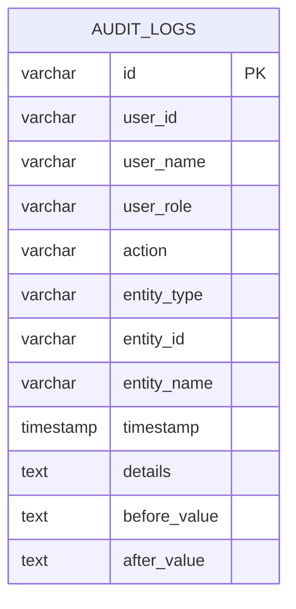

**Diagram sources**
- [src/db/schema.ts:213-227](file://src/db/schema.ts#L213-L227)
- [src/types.ts:260-274](file://src/types.ts#L260-L274)

**Section sources**
- [src/db/schema.ts:213-227](file://src/db/schema.ts#L213-L227)
- [src/types.ts:260-274](file://src/types.ts#L260-L274)

### Repository: Reading and Writing Audit Logs
- Reads all audit logs ordered by newest first, mapping DB rows to typed records.
- Creates new audit log entries with generated id and timestamp; falls back to in-memory storage if database is unavailable.

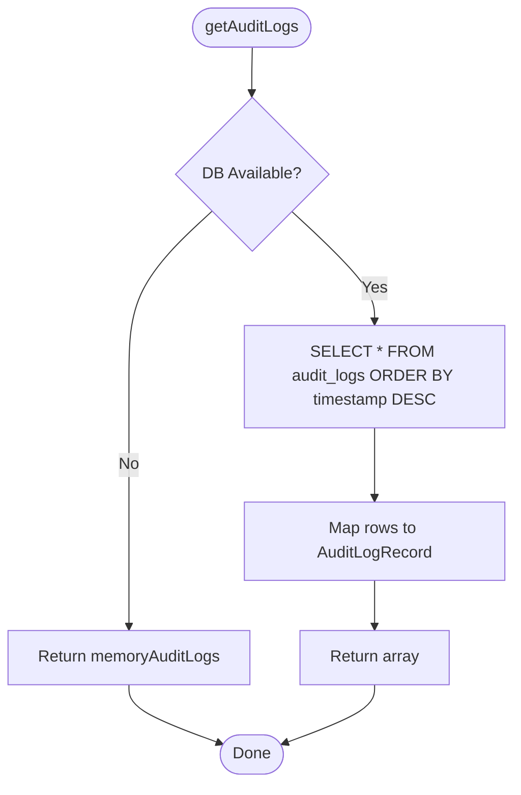

**Diagram sources**
- [src/db/repository.ts:1171-1194](file://src/db/repository.ts#L1171-L1194)

**Section sources**
- [src/db/repository.ts:1171-1194](file://src/db/repository.ts#L1171-L1194)
- [src/db/repository.ts:1196-1217](file://src/db/repository.ts#L1196-L1217)

### API: Audit Log Endpoints
- GET /api/audit-logs returns the full list of audit logs.
- POST /api/audit-logs creates a new audit log entry.

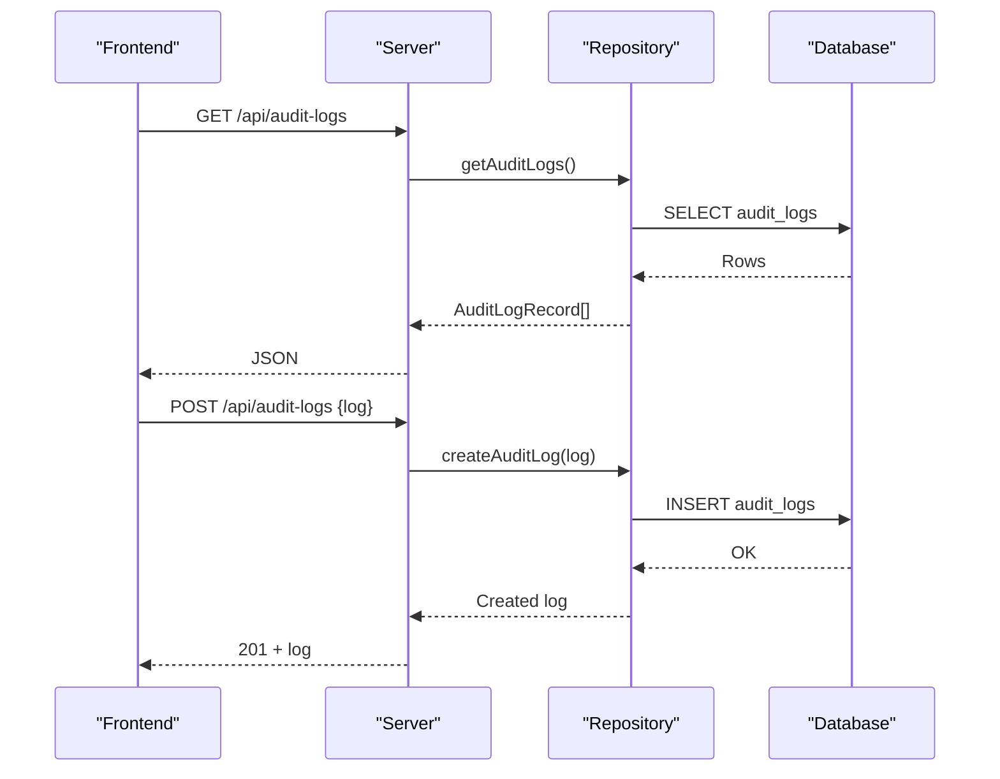

**Diagram sources**
- [server.ts:463-480](file://server.ts#L463-L480)
- [src/db/repository.ts:1171-1217](file://src/db/repository.ts#L1171-L1217)

**Section sources**
- [server.ts:463-480](file://server.ts#L463-L480)

### Frontend: Audit Logs Interface
- Fetches audit logs from the backend during initial sync.
- Provides a search box to filter by action, user, entity name, or details.
- Displays timestamp, action event, user persona, target entity, and transaction details, including optional after-value snapshots.

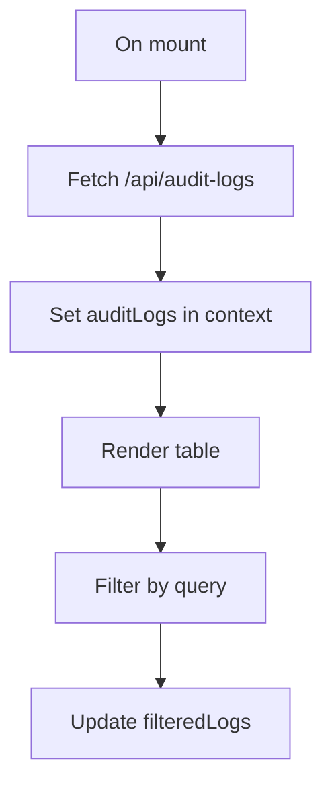

**Diagram sources**
- [src/context/ArchiveContext.tsx:198-220](file://src/context/ArchiveContext.tsx#L198-L220)
- [src/pages/AuditLogsPage.tsx:5-18](file://src/pages/AuditLogsPage.tsx#L5-L18)
- [src/pages/AuditLogsPage.tsx:20-94](file://src/pages/AuditLogsPage.tsx#L20-L94)

**Section sources**
- [src/context/ArchiveContext.tsx:198-220](file://src/context/ArchiveContext.tsx#L198-L220)
- [src/pages/AuditLogsPage.tsx:5-18](file://src/pages/AuditLogsPage.tsx#L5-L18)
- [src/pages/AuditLogsPage.tsx:20-94](file://src/pages/AuditLogsPage.tsx#L20-L94)

### Automatic Audit Trail: Document Lifecycle
Document registration and updates automatically generate audit entries.

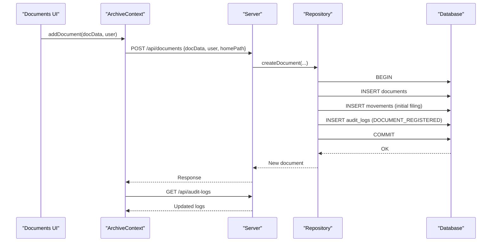

**Diagram sources**
- [src/context/ArchiveContext.tsx:751-764](file://src/context/ArchiveContext.tsx#L751-L764)
- [server.ts:308-316](file://server.ts#L308-L316)
- [src/db/repository.ts:521-633](file://src/db/repository.ts#L521-L633)

**Section sources**
- [src/db/repository.ts:521-633](file://src/db/repository.ts#L521-L633)

### Automatic Audit Trail: Document Updates
Metadata changes are logged with a consistent action type.

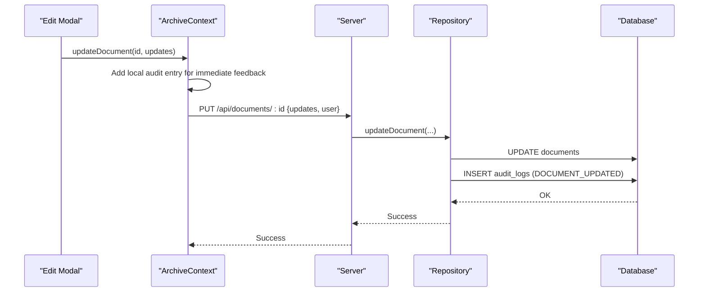

**Diagram sources**
- [src/context/ArchiveContext.tsx:779-800](file://src/context/ArchiveContext.tsx#L779-L800)
- [server.ts:318-326](file://server.ts#L318-L326)
- [src/db/repository.ts:635-715](file://src/db/repository.ts#L635-L715)

**Section sources**
- [src/db/repository.ts:635-715](file://src/db/repository.ts#L635-L715)
- [src/context/ArchiveContext.tsx:779-800](file://src/context/ArchiveContext.tsx#L779-L800)

### Automatic Audit Trail: Location Changes (Movements)
Moving a document records both a movement and an audit entry.

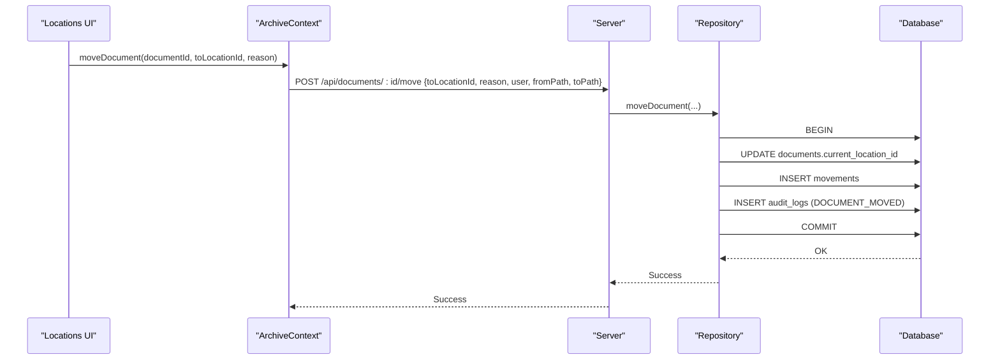

**Diagram sources**
- [server.ts:346-361](file://server.ts#L346-L361)
- [src/db/repository.ts:742-800](file://src/db/repository.ts#L742-L800)

**Section sources**
- [src/db/repository.ts:742-800](file://src/db/repository.ts#L742-L800)

### Automatic Audit Trail: Checkouts
Checkout workflows include request, approval, dispatch, and return steps. While the repository implements these flows, the audit trail for each step is typically recorded alongside movement and status transitions. The server exposes endpoints for each stage.

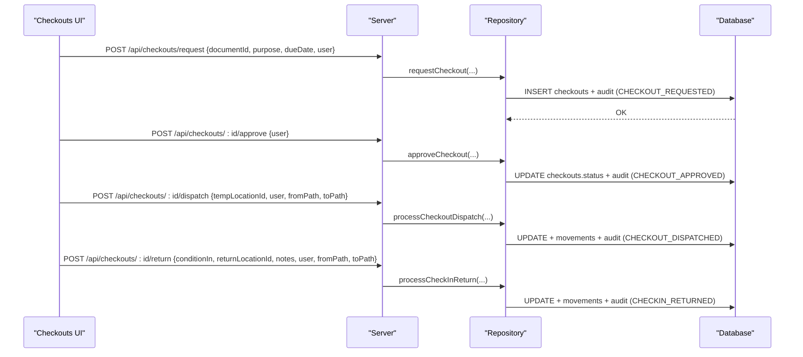

**Diagram sources**
- [server.ts:373-441](file://server.ts#L373-L441)
- [src/db/repository.ts:742-800](file://src/db/repository.ts#L742-L800)

**Section sources**
- [server.ts:373-441](file://server.ts#L373-L441)

### Automatic Audit Trail: Bundles
Creating or deleting bundles emits audit entries to capture bundle lifecycle changes.

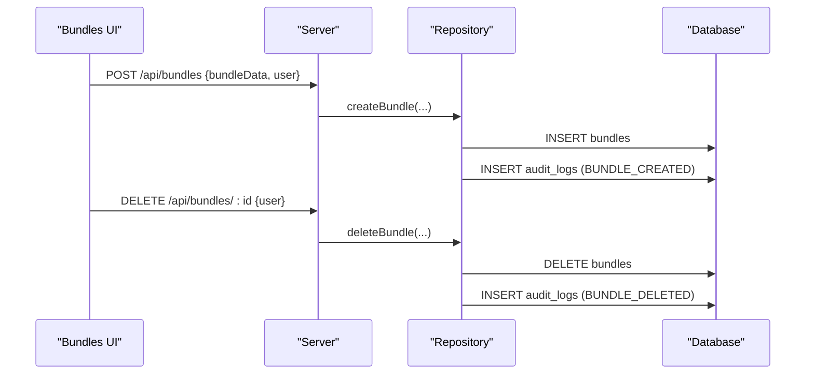

**Diagram sources**
- [server.ts:529-557](file://server.ts#L529-L557)
- [src/db/repository.ts:1374-1456](file://src/db/repository.ts#L1374-L1456)
- [src/db/repository.ts:1492-1526](file://src/db/repository.ts#L1492-L1526)

**Section sources**
- [src/db/repository.ts:1374-1456](file://src/db/repository.ts#L1374-L1456)
- [src/db/repository.ts:1492-1526](file://src/db/repository.ts#L1492-L1526)

### User Operations Audit
User registration and approval/rejection actions generate audit entries in the context layer.

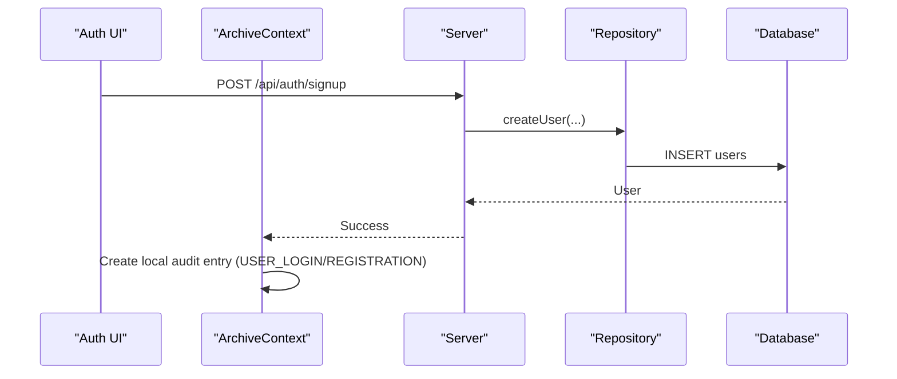

**Diagram sources**
- [server.ts:152-189](file://server.ts#L152-L189)
- [src/context/ArchiveContext.tsx:352-416](file://src/context/ArchiveContext.tsx#L352-L416)

**Section sources**
- [src/context/ArchiveContext.tsx:352-416](file://src/context/ArchiveContext.tsx#L352-L416)
- [server.ts:152-189](file://server.ts#L152-L189)

## Dependency Analysis
- The AuditLogsPage depends on ArchiveContext for data and filtering.
- ArchiveContext fetches audit logs from the server and updates local state.
- The server routes call repository functions to persist or retrieve audit logs.
- Repository interacts with PostgreSQL or in-memory fallback.

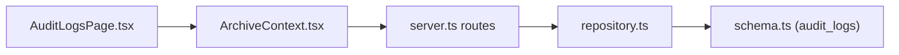

**Diagram sources**
- [src/pages/AuditLogsPage.tsx:5-18](file://src/pages/AuditLogsPage.tsx#L5-L18)
- [src/context/ArchiveContext.tsx:198-220](file://src/context/ArchiveContext.tsx#L198-L220)
- [server.ts:463-480](file://server.ts#L463-L480)
- [src/db/repository.ts:1171-1217](file://src/db/repository.ts#L1171-L1217)
- [src/db/schema.ts:213-227](file://src/db/schema.ts#L213-L227)

**Section sources**
- [src/pages/AuditLogsPage.tsx:5-18](file://src/pages/AuditLogsPage.tsx#L5-L18)
- [src/context/ArchiveContext.tsx:198-220](file://src/context/ArchiveContext.tsx#L198-L220)
- [server.ts:463-480](file://server.ts#L463-L480)
- [src/db/repository.ts:1171-1217](file://src/db/repository.ts#L1171-L1217)
- [src/db/schema.ts:213-227](file://src/db/schema.ts#L213-L227)

## Performance Considerations
- High-volume logging:
  - Use batched inserts where possible to reduce round trips.
  - Ensure indexes on frequently queried columns like timestamp, action, and entity_type to speed up filtering and sorting.
  - Consider partitioning audit_logs by time ranges (e.g., monthly) to keep queries fast and simplify archival.
- Large dataset management:
  - Implement pagination or time-bounded queries on the API side for large histories.
  - Offload long-term storage to cold storage or analytics pipelines while keeping recent logs in the primary database.
  - Avoid loading entire audit history into client memory; paginate on the server and stream results if needed.
- In-memory fallback:
  - When PostgreSQL is unavailable, the repository uses in-memory arrays. This is suitable for development but not for production audit integrity.

[No sources needed since this section provides general guidance]

## Troubleshooting Guide
- Missing audit entries:
  - Verify that the operation path calls repository methods that insert audit_logs (e.g., document creation/update, movement, bundle lifecycle).
  - Confirm the server routes are invoked and repository functions execute without errors.
- Stale or incomplete logs:
  - Check whether the application is running in memory mode; audit logs may be lost on restart.
  - Validate database connectivity and that migrations created the audit_logs table.
- Filtering issues:
  - Ensure the frontend filter matches the fields present in audit logs (action, userName, entityName, details).
- Clearing data:
  - Use the clear-data endpoint to reset operational tables including audit_logs when necessary.

**Section sources**
- [src/db/repository.ts:1219-1264](file://src/db/repository.ts#L1219-L1264)
- [server.ts:74-82](file://server.ts#L74-L82)
- [src/pages/AuditLogsPage.tsx:5-18](file://src/pages/AuditLogsPage.tsx#L5-L18)

## Conclusion
ArchiveHub provides a comprehensive audit trail covering document registration, updates, movements, checkouts, and bundle lifecycle events. The audit_logs table and repository ensure persistence with robust fallback behavior. The UI offers filtering and display of historical changes, enabling compliance reviews and investigations. For high-volume environments, apply indexing, partitioning, and pagination strategies to maintain performance and manageability.

[No sources needed since this section summarizes without analyzing specific files]

## Appendices

### A. Audit Log Fields Reference
- Actor: userId, userName, userRole
- Action: action (e.g., DOCUMENT_REGISTERED, DOCUMENT_UPDATED, DOCUMENT_MOVED, BUNDLE_CREATED, BUNDLE_DELETED)
- Entity: entityType, entityId, entityName
- Timestamp: timestamp
- Details: details (human-readable description)
- Optional snapshots: beforeValue, afterValue

**Section sources**
- [src/types.ts:260-274](file://src/types.ts#L260-L274)
- [src/db/schema.ts:213-227](file://src/db/schema.ts#L213-L227)

### B. Generating Compliance Reports
- Exporting from UI:
  - Use the Audit Logs page to filter by action type, user, or entity, then copy or print the visible table for quick reports.
- Programmatic export:
  - Call GET /api/audit-logs and transform the returned JSON into CSV or PDF using your preferred toolchain.
  - Apply filters server-side by extending the repository query to support WHERE clauses for action, entity_type, date range, and user.
- Example report scenarios:
  - “All document moves in Q1” – filter by action = DOCUMENT_MOVED and timestamp within the quarter.
  - “Unauthorized access attempts” – monitor failed login responses and correlate with IP address if captured.
  - “Privilege escalation detection” – watch for role changes or admin approvals and flag anomalies.

**Section sources**
- [server.ts:463-480](file://server.ts#L463-L480)
- [src/pages/AuditLogsPage.tsx:5-18](file://src/pages/AuditLogsPage.tsx#L5-L18)

### C. Extending Audit Capabilities
- Add new action types:
  - Define meaningful action strings in code paths where business events occur.
  - Insert audit entries via createAuditLog with appropriate entityType and details.
- Capture before/after values:
  - Populate beforeValue and afterValue for critical metadata changes to enable precise diffing.
- Enrich with context:
  - Include ipAddress and additional contextual fields in the audit record for enhanced traceability.
- Secure logging:
  - Ensure sensitive data is excluded from details and snapshots.
  - Restrict write access to audit endpoints in production.

**Section sources**
- [src/db/repository.ts:1196-1217](file://src/db/repository.ts#L1196-L1217)
- [src/types.ts:260-274](file://src/types.ts#L260-L274)