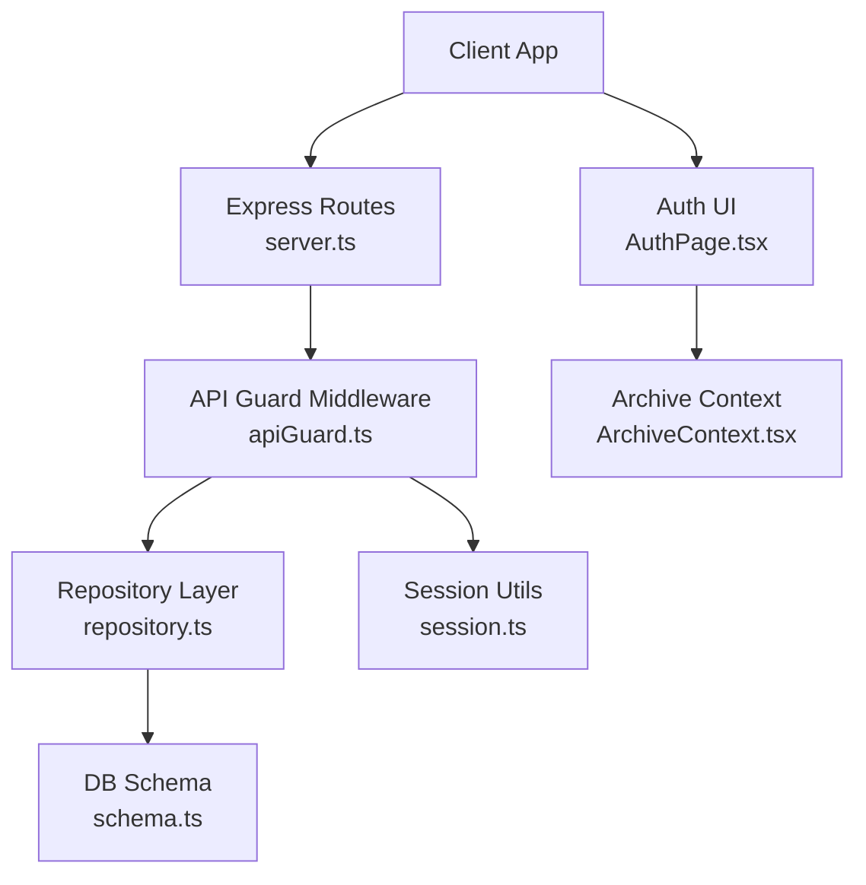
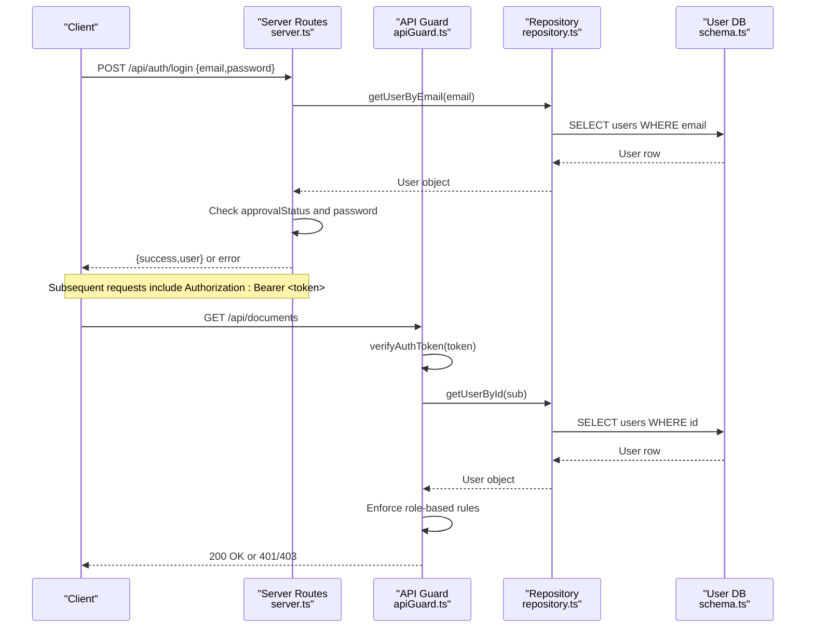
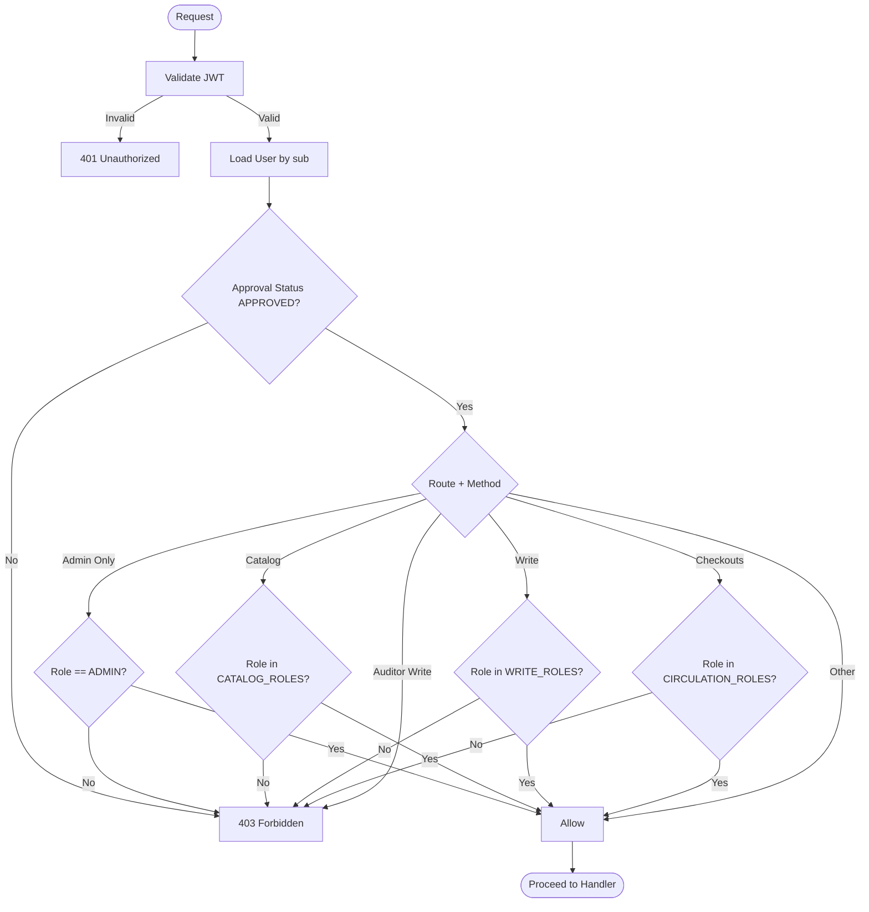
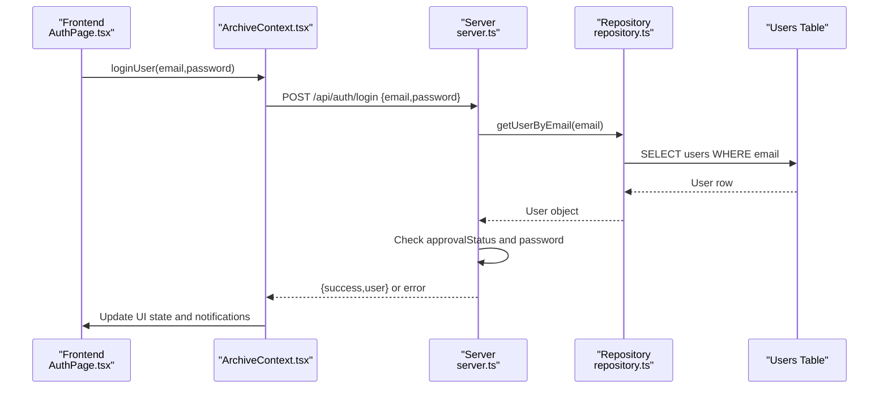
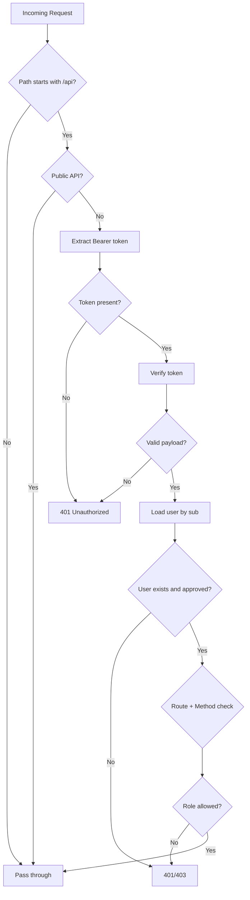
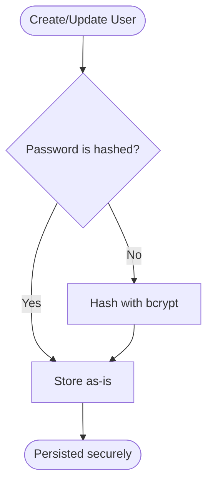
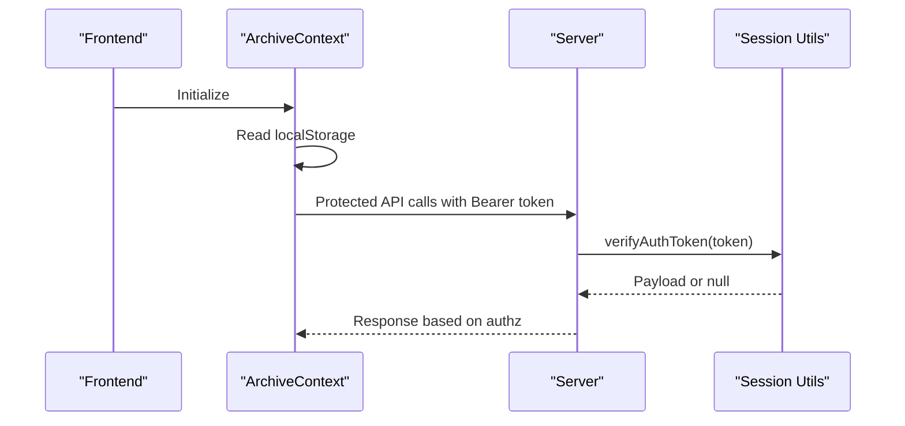
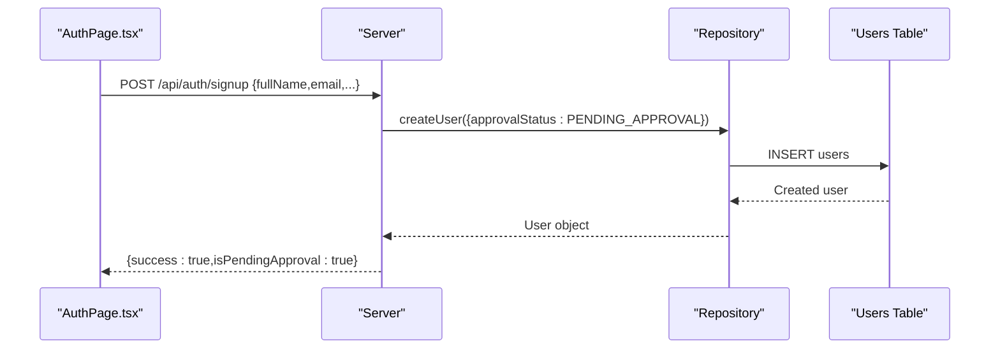
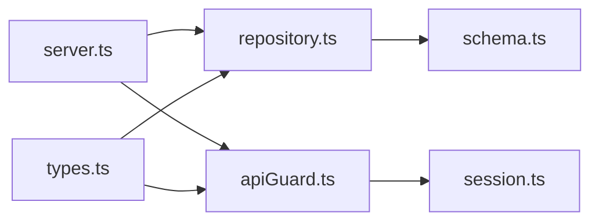

# Authentication & Security

<cite>
**Referenced Files in This Document**
- [server.ts](file://server.ts)
- [src/auth/apiGuard.ts](file://src/auth/apiGuard.ts)
- [src/auth/session.ts](file://src/auth/session.ts)
- [src/db/schema.ts](file://src/db/schema.ts)
- [src/db/repository.ts](file://src/db/repository.ts)
- [src/types.ts](file://src/types.ts)
- [src/components/auth/AuthPage.tsx](file://src/components/auth/AuthPage.tsx)
- [src/context/ArchiveContext.tsx](file://src/context/ArchiveContext.tsx)
</cite>

## Update Summary
**Changes Made**
- Updated JWT-based authentication flow with proper token signing and verification
- Enhanced bcrypt password hashing implementation with backward compatibility
- Implemented comprehensive user approval workflow system
- Added role-based access control middleware with granular permissions
- Enhanced security measures including input validation and SQL injection prevention
- Updated frontend authentication context with local storage persistence

## Table of Contents
1. [Introduction](#introduction)
2. [Project Structure](#project-structure)
3. [Core Components](#core-components)
4. [Architecture Overview](#architecture-overview)
5. [Detailed Component Analysis](#detailed-component-analysis)
6. [Dependency Analysis](#dependency-analysis)
7. [Performance Considerations](#performance-considerations)
8. [Troubleshooting Guide](#troubleshooting-guide)
9. [Conclusion](#conclusion)
10. [Appendices](#appendices)

## Introduction
This document explains ArchiveHub's comprehensive authentication and security model, focusing on JWT-based session management, bcrypt password hashing, role-based access control (RBAC), user approval workflows, and protection against common web vulnerabilities. The system implements a robust security framework centered around secure token handling, strict authorization enforcement, and comprehensive audit logging.

## Project Structure
The authentication and authorization logic is implemented across multiple layers:
- Server routes handle public auth endpoints and protected data operations
- API guard middleware validates tokens and enforces RBAC rules
- Session utilities manage JWT signing/verification and password hashing
- Database schema defines user roles, approval status, and security-related fields
- Frontend components provide authentication UI with local session persistence

**Diagram sources**
- [server.ts:155-243](file://server.ts#L155-L243)
- [src/auth/apiGuard.ts:27-97](file://src/auth/apiGuard.ts#L27-L97)
- [src/auth/session.ts:23-66](file://src/auth/session.ts#L23-L66)
- [src/db/repository.ts:111-191](file://src/db/repository.ts#L111-L191)
- [src/db/schema.ts:22-35](file://src/db/schema.ts#L22-L35)
- [src/components/auth/AuthPage.tsx:51-120](file://src/components/auth/AuthPage.tsx#L51-L120)
- [src/context/ArchiveContext.tsx:127-166](file://src/context/ArchiveContext.tsx#L127-L166)

**Section sources**
- [server.ts:155-243](file://server.ts#L155-L243)
- [src/auth/apiGuard.ts:27-97](file://src/auth/apiGuard.ts#L27-L97)
- [src/auth/session.ts:23-66](file://src/auth/session.ts#L23-L66)
- [src/db/schema.ts:22-35](file://src/db/schema.ts#L22-L35)
- [src/db/repository.ts:111-191](file://src/db/repository.ts#L111-L191)
- [src/components/auth/AuthPage.tsx:51-120](file://src/components/auth/AuthPage.tsx#L51-L120)
- [src/context/ArchiveContext.tsx:127-166](file://src/context/ArchiveContext.tsx#L127-L166)

## Core Components
- **JWT Authentication**: Tokens are signed with environment-based secrets and verified per request; payloads include user id, email, and role for secure session management
- **Password Hashing**: Uses bcryptjs with configurable salt rounds; supports both hashed and legacy plain comparisons during migration
- **Role-Based Access Control**: Five distinct roles (ADMIN, RECORDS_ADMIN, RECORDS_OFFICER, DEPT_USER, AUDITOR) with granular permission groups
- **User Approval Workflow**: New registrations require administrator approval before account activation
- **Secure Session Handling**: Token TTL set to 7 days with environment-based secret management and fallback for development
- **Audit Logging**: Comprehensive tracking of all authentication and authorization events

**Section sources**
- [src/types.ts:6-22](file://src/types.ts#L6-L22)
- [src/auth/apiGuard.ts:6-97](file://src/auth/apiGuard.ts#L6-L97)
- [src/auth/session.ts:23-66](file://src/auth/session.ts#L23-L66)
- [server.ts:155-243](file://server.ts#L155-L243)
- [src/db/repository.ts:151-191](file://src/db/repository.ts#L151-L191)

## Architecture Overview
The system uses Express routes for public auth endpoints and protected data endpoints. The API guard middleware validates JWTs, loads user details, checks approval status, and enforces RBAC rules per endpoint path and HTTP method.

**Diagram sources**
- [server.ts:155-243](file://server.ts#L155-L243)
- [src/auth/apiGuard.ts:27-97](file://src/auth/apiGuard.ts#L27-L97)
- [src/db/repository.ts:111-191](file://src/db/repository.ts#L111-L191)
- [src/db/schema.ts:22-35](file://src/db/schema.ts#L22-L35)

## Detailed Component Analysis

### Role-Based Access Control Model
- **Roles**: ADMIN, RECORDS_ADMIN, RECORDS_OFFICER, DEPT_USER, AUDITOR
- **Permission Groups**:
  - WRITE_ROLES: ADMIN, RECORDS_ADMIN, RECORDS_OFFICER
  - CATALOG_ROLES: ADMIN, RECORDS_ADMIN  
  - ADMIN_ONLY: ADMIN
  - CIRCULATION_ROLES: ADMIN, RECORDS_ADMIN, RECORDS_OFFICER
- **Enforcement**:
  - Admin-only endpoints: /api/users, /api/seed, /api/clear-data
  - Catalog management: /api/document-types, /api/reusable-custom-fields
  - Write operations: /api/locations, /api/documents, /api/bundles
  - Circulation: /api/checkouts/*
  - AI features: /api/ai/*
  - Auditors have read-only access; write attempts are denied

**Diagram sources**
- [src/auth/apiGuard.ts:6-97](file://src/auth/apiGuard.ts#L6-L97)

**Section sources**
- [src/types.ts:6-22](file://src/types.ts#L6-L22)
- [src/auth/apiGuard.ts:6-97](file://src/auth/apiGuard.ts#L6-L97)

### JWT-Based Authentication Flow
- **Login Process**:
  - Validates email presence and retrieves user by email
  - Checks approval status (PENDING_APPROVAL or REJECTED blocks access)
  - Compares password using bcrypt verification
  - Returns sanitized user info to client without sensitive data
- **Token Management**:
  - Clients attach Authorization: Bearer <token> to subsequent requests
  - API guard verifies token signature and expiration
  - Token payload contains user id, email, and role for authorization
- **Token Lifecycle**:
  - Signed with environment-based secret (SESSION_SECRET)
  - Expiration set to 7 days for security balance
  - Verification returns payload or null on failure

**Diagram sources**
- [src/components/auth/AuthPage.tsx:51-120](file://src/components/auth/AuthPage.tsx#L51-L120)
- [src/context/ArchiveContext.tsx:308-358](file://src/context/ArchiveContext.tsx#L308-L358)
- [server.ts:155-204](file://server.ts#L155-L204)
- [src/db/repository.ts:137-150](file://src/db/repository.ts#L137-L150)

**Section sources**
- [server.ts:155-204](file://server.ts#L155-L204)
- [src/auth/session.ts:50-66](file://src/auth/session.ts#L50-L66)
- [src/context/ArchiveContext.tsx:308-358](file://src/context/ArchiveContext.tsx#L308-L358)

### API Guard Middleware
- **Public Endpoints**: 
  - GET /api/health (system health check)
  - POST /api/auth/login (user authentication)
  - POST /api/auth/signup (user registration)
- **Authorization Flow**:
  - Requires Authorization header with Bearer token
  - Verifies token signature and expiration
  - Loads user from database and validates approval status
  - Sanitizes user object attached to request context
- **Endpoint-Specific Rules**:
  - Admin-only paths require ADMIN role
  - Catalog endpoints require catalog roles
  - Write endpoints require write roles
  - Checkouts require circulation roles
  - Auditors blocked from write operations

**Diagram sources**
- [src/auth/apiGuard.ts:11-97](file://src/auth/apiGuard.ts#L11-L97)

**Section sources**
- [src/auth/apiGuard.ts:11-97](file://src/auth/apiGuard.ts#L11-L97)

### Password Hashing and Secure Storage
- **Hashing Implementation**:
  - Uses bcryptjs with fixed cost factor of 10 for optimal security/performance balance
  - Supports detection of existing hashes vs plain text for backward compatibility
- **Comparison Logic**:
  - If stored value is a bcrypt hash, compares using bcrypt.compare()
  - Otherwise performs direct comparison for legacy accounts during migration
- **Storage Security**:
  - Users table stores only hashed passwords
  - Repository ensures new users get hashed passwords unless already hashed
  - Password field excluded from user responses via sanitization

**Diagram sources**
- [src/auth/session.ts:34-48](file://src/auth/session.ts#L34-L48)
- [src/db/repository.ts:151-191](file://src/db/repository.ts#L151-L191)

**Section sources**
- [src/auth/session.ts:34-48](file://src/auth/session.ts#L34-L48)
- [src/db/repository.ts:151-191](file://src/db/repository.ts#L151-L191)

### Secure Session Handling
- **Secret Management**:
  - Reads SESSION_SECRET from environment variables
  - Falls back to development-only default if missing or too short (< 16 chars)
- **Token Lifecycle**:
  - Signs tokens with secure secret and sets 7-day expiration
  - Verifies on each protected request for security
- **Local Session Persistence**:
  - Frontend persists current user and authentication state in localStorage
  - Restores session on app load for seamless user experience
  - Includes fallback admin user for offline development

**Diagram sources**
- [src/auth/session.ts:23-66](file://src/auth/session.ts#L23-L66)
- [src/context/ArchiveContext.tsx:127-166](file://src/context/ArchiveContext.tsx#L127-L166)

**Section sources**
- [src/auth/session.ts:23-66](file://src/auth/session.ts#L23-L66)
- [src/context/ArchiveContext.tsx:127-166](file://src/context/ArchiveContext.tsx#L127-L166)

### User Registration Workflow and Approval Process
- **Registration Process**:
  - Frontend collects full name, email, optional password, department, title, and requested role
  - Creates user with PENDING_APPROVAL status by default
  - Returns success response with pending approval message
- **Approval Workflow**:
  - Administrator can update approval status via dedicated endpoint (/api/users/:id/approval)
  - Login flow blocks access if status is PENDING_APPROVAL or REJECTED
  - Audit logging tracks all approval actions
- **Permission Assignment**:
  - Role selected during registration determines future permissions once approved
  - Default role is DEPT_USER for standard users
  - Administrative roles require explicit assignment

**Diagram sources**
- [src/components/auth/AuthPage.tsx:74-120](file://src/components/auth/AuthPage.tsx#L74-L120)
- [server.ts:206-243](file://server.ts#L206-L243)
- [src/db/repository.ts:151-191](file://src/db/repository.ts#L151-L191)

**Section sources**
- [src/components/auth/AuthPage.tsx:74-120](file://src/components/auth/AuthPage.tsx#L74-L120)
- [server.ts:206-243](file://server.ts#L206-L243)
- [src/db/repository.ts:151-191](file://src/db/repository.ts#L151-L191)

### Protection Against Common Web Vulnerabilities
- **SQL Injection Prevention**:
  - All database queries use parameterized statements with $1, $2 placeholders
  - Inputs are sanitized (e.g., email trimmed and lowercased before queries)
  - No string concatenation in SQL queries
- **XSS Protection**:
  - No raw HTML rendering of user inputs in server responses
  - Frontend renders values safely within React components
  - User data sanitized before being sent to clients
- **Input Validation**:
  - Required fields validated at route level (e.g., email presence, approval status)
  - Type checking and format validation throughout the stack
- **Error Handling**:
  - Consistent JSON error responses with appropriate HTTP status codes
  - Graceful fallback to memory mode when database is unavailable
  - Detailed error logging for debugging while preventing information leakage

**Section sources**
- [src/db/repository.ts:111-191](file://src/db/repository.ts#L111-L191)
- [server.ts:155-243](file://server.ts#L155-L243)

## Dependency Analysis
Key dependencies and relationships:
- server.ts depends on repository layer for data operations and exposes routes for auth and domain features
- apiGuard.ts depends on session utilities for token verification and repository for user lookup
- session.ts depends on jsonwebtoken and bcryptjs for cryptographic operations
- repository.ts depends on db schema definitions and PostgreSQL pool
- types.ts defines shared interfaces used across layers

**Diagram sources**
- [server.ts:155-243](file://server.ts#L155-L243)
- [src/auth/apiGuard.ts:27-97](file://src/auth/apiGuard.ts#L27-L97)
- [src/auth/session.ts:23-66](file://src/auth/session.ts#L23-L66)
- [src/db/repository.ts:111-191](file://src/db/repository.ts#L111-L191)
- [src/db/schema.ts:22-35](file://src/db/schema.ts#L22-L35)
- [src/types.ts:6-22](file://src/types.ts#L6-L22)

**Section sources**
- [server.ts:155-243](file://server.ts#L155-L243)
- [src/auth/apiGuard.ts:27-97](file://src/auth/apiGuard.ts#L27-L97)
- [src/auth/session.ts:23-66](file://src/auth/session.ts#L23-L66)
- [src/db/repository.ts:111-191](file://src/db/repository.ts#L111-L191)
- [src/db/schema.ts:22-35](file://src/db/schema.ts#L22-L35)
- [src/types.ts:6-22](file://src/types.ts#L6-L22)

## Performance Considerations
- Token verification is lightweight and performed per request; ensure secrets are configured securely to avoid unnecessary retries
- Parameterized queries reduce overhead and improve safety without significant performance penalties
- Memory fallback mode allows continued operation when database is unavailable, but should be used only for development or temporary resilience
- bcrypt hashing cost factor of 10 provides good security-performance balance for typical user volumes

## Troubleshooting Guide
Common issues and resolutions:
- **Authentication required**: Ensure Authorization header includes a valid Bearer token
- **Session expired or invalid**: Re-authenticate via login endpoint; check token expiration
- **Account no longer exists**: Confirm user was not deleted; re-register if necessary
- **Account is not approved for access**: Administrator must approve pending accounts before login succeeds
- **Incorrect password provided**: Reset credentials or confirm password matches stored hash
- **Database connection issues**: System falls back to memory mode; check PostgreSQL connection

**Section sources**
- [src/auth/apiGuard.ts:31-48](file://src/auth/apiGuard.ts#L31-L48)
- [server.ts:155-243](file://server.ts#L155-L243)

## Conclusion
ArchiveHub implements a comprehensive authentication and authorization framework centered around JWT tokens, bcrypt password hashing, and strict RBAC enforcement via middleware. The approval workflow ensures controlled access for new users, while parameterized queries and input validation protect against common vulnerabilities. The system provides robust security measures including audit logging, secure session management, and graceful fallback mechanisms for production reliability.

## Appendices

### Implementing Custom Authentication Guards
- Add new role sets and route checks in the API guard to enforce additional permissions
- Extend role types and UI descriptions consistently across frontend and backend
- Use the same pattern for sanitizing user objects and verifying tokens
- Follow established patterns for error handling and audit logging

**Section sources**
- [src/auth/apiGuard.ts:6-97](file://src/auth/apiGuard.ts#L6-L97)
- [src/types.ts:6-22](file://src/types.ts#L6-L22)

### Extending the Role System
- Define new roles in the type definition (RoleCode)
- Update permission groups and route checks accordingly
- Reflect changes in UI role selection and descriptions
- Test thoroughly to ensure proper authorization enforcement

**Section sources**
- [src/types.ts:6-22](file://src/types.ts#L6-L22)
- [src/components/auth/AuthPage.tsx:122-128](file://src/components/auth/AuthPage.tsx#L122-L128)

### Security Best Practices Implementation
- **Environment Configuration**: Always use strong, unique SESSION_SECRET in production
- **Password Policy**: Implement minimum password requirements and complexity rules
- **Rate Limiting**: Add rate limiting to prevent brute force attacks on login endpoints
- **HTTPS Enforcement**: Ensure all connections use HTTPS in production environments
- **Security Headers**: Implement proper security headers (CSP, HSTS, etc.)

[No sources needed since this section provides general security guidance]