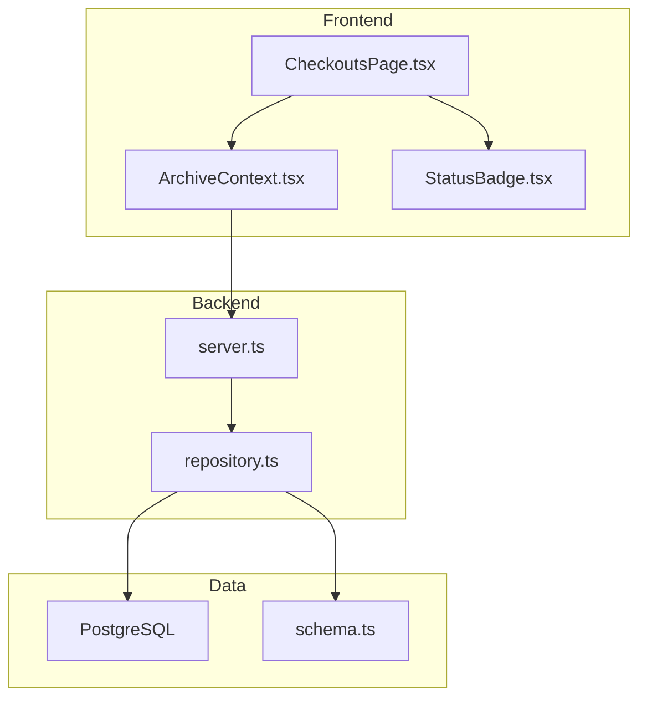
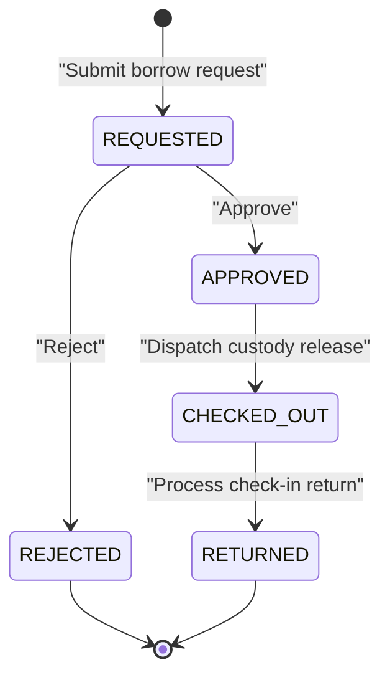
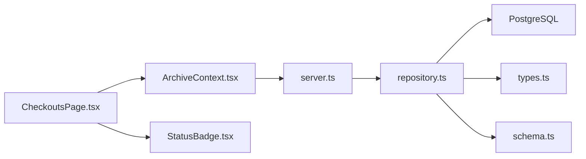

# Approval Workflow System

<cite>
**Referenced Files in This Document**
- [CheckoutsPage.tsx](file://src/pages/CheckoutsPage.tsx)
- [ArchiveContext.tsx](file://src/context/ArchiveContext.tsx)
- [repository.ts](file://src/db/repository.ts)
- [schema.ts](file://src/db/schema.ts)
- [types.ts](file://src/types.ts)
- [StatusBadge.tsx](file://src/components/common/StatusBadge.tsx)
- [server.ts](file://server.ts)
</cite>

## Table of Contents
1. [Introduction](#introduction)
2. [Project Structure](#project-structure)
3. [Core Components](#core-components)
4. [Architecture Overview](#architecture-overview)
5. [Detailed Component Analysis](#detailed-component-analysis)
6. [Dependency Analysis](#dependency-analysis)
7. [Performance Considerations](#performance-considerations)
8. [Troubleshooting Guide](#troubleshooting-guide)
9. [Conclusion](#conclusion)

## Introduction
This document explains the approval workflow system that manages checkout request processing for physical archive items. It covers role-based approvals, the decision interface, approval actions (approve with custody release, reject with reason codes, and conditional approvals), state transitions from REQUESTED to CHECKED_OUT or REJECTED, common scenarios, and notification behavior. The system is implemented as a React frontend with a Node/Express backend and a PostgreSQL database, using a repository layer for data operations and a context provider for application state and workflows.

## Project Structure
The approval workflow spans several layers:
- UI: Checkout management page and status badges
- State and orchestration: Context provider exposing checkout operations
- API: Express routes for checkout requests, approvals, rejections, dispatch, and returns
- Data access: Repository functions performing transactions and updates
- Schema: Database tables defining entities such as checkouts, documents, movements, and audit logs
- Types: Shared TypeScript types for roles, statuses, and domain models



**Diagram sources**
- [CheckoutsPage.tsx:23-33](file://src/pages/CheckoutsPage.tsx#L23-L33)
- [ArchiveContext.tsx:854-966](file://src/context/ArchiveContext.tsx#L854-L966)
- [server.ts:363-441](file://server.ts#L363-L441)
- [repository.ts:840-1122](file://src/db/repository.ts#L840-L1122)
- [schema.ts:118-148](file://src/db/schema.ts#L118-L148)

**Section sources**
- [CheckoutsPage.tsx:23-33](file://src/pages/CheckoutsPage.tsx#L23-L33)
- [server.ts:363-441](file://server.ts#L363-L441)
- [repository.ts:840-1122](file://src/db/repository.ts#L840-L1122)
- [schema.ts:118-148](file://src/db/schema.ts#L118-L148)
- [types.ts:205-235](file://src/types.ts#L205-L235)

## Core Components
- Checkout Request Lifecycle: Users submit checkout requests; records are created with status REQUESTED and associated document status set to REQUESTED.
- Approval Actions: Authorized personnel approve or reject requests. Approvals transition the record to APPROVED and then to CHECKED_OUT upon dispatch. Rejections revert the document to AVAILABLE.
- Dispatch and Return: After approval, custody is released by moving the document to a temporary location and marking it CHECKED_OUT. Returns update condition and move the document back to its home/archive location.
- Notifications: The context adds user-facing notifications on key actions (request submitted, approved, rejected, checked out, returned).
- Status Badges: Visual indicators for checkout states (REQUESTED, APPROVED, CHECKED_OUT, OVERDUE, RETURNED).

Key responsibilities:
- CheckoutsPage: Presents pending, active, overdue, and returned items; exposes approve/reject/dispatch/return actions.
- ArchiveContext: Orchestrates API calls, local state updates, and notifications for checkout lifecycle.
- server.ts: Exposes REST endpoints for checkout operations.
- repository.ts: Implements transactional logic for creating, approving, rejecting, dispatching, and returning checkouts; updates related documents and movements; persists audit trails.
- schema.ts: Defines the database structure for checkouts, documents, movements, and audit logs.
- types.ts: Declares domain enums and interfaces including CheckoutStatus and CheckoutRecord.

**Section sources**
- [CheckoutsPage.tsx:166-249](file://src/pages/CheckoutsPage.tsx#L166-L249)
- [ArchiveContext.tsx:854-966](file://src/context/ArchiveContext.tsx#L854-L966)
- [server.ts:363-441](file://server.ts#L363-L441)
- [repository.ts:840-1122](file://src/db/repository.ts#L840-L1122)
- [schema.ts:118-148](file://src/db/schema.ts#L118-L148)
- [types.ts:205-235](file://src/types.ts#L205-L235)

## Architecture Overview
The approval workflow follows a clear sequence from request submission through approval, dispatch, and return. The UI triggers actions via the context, which calls backend endpoints. The repository performs database transactions and updates related entities (documents, movements, audit logs).

```mermaid
sequenceDiagram
participant User as "Records Officer"
participant UI as "CheckoutsPage.tsx"
participant Ctx as "ArchiveContext.tsx"
participant API as "server.ts"
participant Repo as "repository.ts"
participant DB as "PostgreSQL"
User->>UI : View Pending Requests
UI->>Ctx : approveCheckout(checkoutId)
Ctx->>API : POST /api/checkouts/ : id/approve
API->>Repo : approveCheckout(id, user)
Repo->>DB : BEGIN; UPDATE checkouts; UPDATE documents; COMMIT
DB-->>Repo : Success
Repo-->>API : OK
API-->>Ctx : { success }
Ctx-->>UI : Update local state + notify
UI->>Ctx : processCheckoutDispatch(checkoutId)
Ctx->>API : POST /api/checkouts/ : id/dispatch
API->>Repo : processCheckoutDispatch(id, tempLocationId, user, paths)
Repo->>DB : BEGIN; UPDATE checkouts; UPDATE documents; INSERT movements; COMMIT
DB-->>Repo : Success
Repo-->>API : OK
API-->>Ctx : { success }
Ctx-->>UI : Update local state + notify
```

**Diagram sources**
- [CheckoutsPage.tsx:213-234](file://src/pages/CheckoutsPage.tsx#L213-L234)
- [ArchiveContext.tsx:883-942](file://src/context/ArchiveContext.tsx#L883-L942)
- [server.ts:388-422](file://server.ts#L388-L422)
- [repository.ts:898-1052](file://src/db/repository.ts#L898-L1052)

## Detailed Component Analysis

### Role-Based Approval Process
- Roles: Defined by RoleCode including ADMIN, RECORDS_ADMIN, RECORDS_OFFICER, DEPT_USER, AUDITOR.
- Access Control: Login flow checks user.approvalStatus to allow or deny sign-in based on administrator decisions.
- Approval Workflows: Records Officers can review and act on checkout requests; Admins manage user approvals.

Implementation highlights:
- Login endpoint validates account approval status before granting access.
- Checkout actions are performed by authenticated users whose identity is passed to repository methods for auditing.

**Section sources**
- [types.ts:6-22](file://src/types.ts#L6-L22)
- [server.ts:104-150](file://server.ts#L104-L150)
- [server.ts:191-204](file://server.ts#L191-L204)
- [ArchiveContext.tsx:300-350](file://src/context/ArchiveContext.tsx#L300-L350)

### Approval Decision Interface
The Circulation & Borrowing Desk page displays:
- Request details: document number/title, borrower name and department, purpose, due date
- Status badge indicating current checkout state
- Action buttons for REQUESTED items: Reject and Approve & Release Custody
- For active/overdue items: Process Check-In Return

Visual cues:
- StatusBadge renders distinct visuals for checkout statuses like Pending Approval, Active Checkout, Overdue, Returned.

**Section sources**
- [CheckoutsPage.tsx:166-249](file://src/pages/CheckoutsPage.tsx#L166-L249)
- [StatusBadge.tsx:89-123](file://src/components/common/StatusBadge.tsx#L89-L123)

### Approval Actions
- Approve with Custody Release:
  - Updates checkout status to APPROVED and sets approver fields
  - Sets document status to APPROVED
  - Subsequent dispatch moves document to a temporary location and marks it CHECKED_OUT
- Reject with Reason Codes:
  - Updates checkout status to REJECTED and stores reason in notes
  - Resets document status to AVAILABLE
- Conditional Approvals:
  - The system supports capturing conditionOut at request time and conditionIn at return time, enabling conditional handling based on item condition during checkout and return.

**Section sources**
- [repository.ts:898-969](file://src/db/repository.ts#L898-L969)
- [repository.ts:971-1052](file://src/db/repository.ts#L971-L1052)
- [repository.ts:1054-1122](file://src/db/repository.ts#L1054-L1122)
- [CheckoutsPage.tsx:213-249](file://src/pages/CheckoutsPage.tsx#L213-L249)

### Workflow State Transitions
Checkout statuses:
- REQUESTED: Initial state when a borrow request is submitted
- APPROVED: Approved by authorized personnel
- CHECKED_OUT: Physical custody released after dispatch
- OVERDUE: Time-based status used in UI filtering
- RETURNED: Item returned and processed

Document statuses involved:
- REQUESTED: Document marked while awaiting approval
- APPROVED: Document approved for checkout
- CHECKED_OUT: Document physically checked out
- AVAILABLE: Document available after rejection or return

Transitions:
- REQUESTED → APPROVED (approve)
- APPROVED → CHECKED_OUT (dispatch)
- REQUESTED → REJECTED (reject)
- CHECKED_OUT → RETURNED (return)
- REJECTED → AVAILABLE (document reset)
- RETURNED → AVAILABLE (document reset)



**Diagram sources**
- [types.ts:205-235](file://src/types.ts#L205-L235)
- [repository.ts:840-1122](file://src/db/repository.ts#L840-L1122)

### Common Approval Scenarios
- Standard Approval:
  - Review request details and borrower information
  - Click Approve & Release Custody to transition to CHECKED_OUT
  - System updates document status and creates movement records
- Handling Exceptions:
  - If a document is not found or checkout record missing, repository falls back to memory mode and logs warnings
  - UI shows notifications for errors or fallback behavior
- Managing Bulk Approvals:
  - While bulk approval is not explicitly exposed as a single action, the UI allows iterating over pending items and invoking approveCheckout per item; administrators can implement batch flows by looping through filtered lists.

**Section sources**
- [CheckoutsPage.tsx:140-159](file://src/pages/CheckoutsPage.tsx#L140-L159)
- [CheckoutsPage.tsx:213-234](file://src/pages/CheckoutsPage.tsx#L213-L234)
- [repository.ts:898-1052](file://src/db/repository.ts#L898-L1052)

### Notification Systems
Notifications inform users about:
- Borrow request submission
- Approval and rejection outcomes
- Successful checkout and return processing
- Database health and operational messages

Notification implementation:
- Context maintains a notifications array and provides addNotification/dismissNotification
- Each checkout operation triggers appropriate notifications with type and message

**Section sources**
- [ArchiveContext.tsx:179-195](file://src/context/ArchiveContext.tsx#L179-L195)
- [ArchiveContext.tsx:854-966](file://src/context/ArchiveContext.tsx#L854-L966)

## Dependency Analysis
The approval workflow depends on coordinated interactions between UI, context, API, repository, and database:



Coupling and cohesion:
- CheckoutsPage depends on context for all checkout operations, keeping UI decoupled from API details
- Context encapsulates business logic and orchestrates API calls and state updates
- Repository centralizes data operations and ensures consistency across related entities
- Server routes provide clean boundaries for client-server interaction

Potential circular dependencies:
- None detected; dependencies flow unidirectionally from UI to API to repository to database

External integrations:
- PostgreSQL for persistence
- Optional in-memory fallback when database is unavailable

**Diagram sources**
- [CheckoutsPage.tsx:23-33](file://src/pages/CheckoutsPage.tsx#L23-L33)
- [ArchiveContext.tsx:854-966](file://src/context/ArchiveContext.tsx#L854-L966)
- [server.ts:363-441](file://server.ts#L363-L441)
- [repository.ts:840-1122](file://src/db/repository.ts#L840-L1122)
- [types.ts:205-235](file://src/types.ts#L205-L235)
- [schema.ts:118-148](file://src/db/schema.ts#L118-L148)

**Section sources**
- [CheckoutsPage.tsx:23-33](file://src/pages/CheckoutsPage.tsx#L23-L33)
- [ArchiveContext.tsx:854-966](file://src/context/ArchiveContext.tsx#L854-L966)
- [server.ts:363-441](file://server.ts#L363-L441)
- [repository.ts:840-1122](file://src/db/repository.ts#L840-L1122)

## Performance Considerations
- Transactional Operations: Repository uses database transactions for critical sequences (approve, reject, dispatch, return) to ensure consistency and prevent partial updates.
- Fallback Mode: When PostgreSQL is unavailable, repository falls back to in-memory arrays, maintaining functionality during development or outages.
- Efficient Filtering: UI filters checkouts by status to reduce rendering overhead and improve responsiveness.
- Batch Operations: While explicit bulk approval is not provided, the UI pattern supports iterative actions; consider implementing batch endpoints if needed for high-volume scenarios.

[No sources needed since this section provides general guidance]

## Troubleshooting Guide
Common issues and resolutions:
- Database Connection Failures:
  - Repository logs warnings and falls back to memory mode; verify .env configuration and database connectivity
- Missing Checkout or Document:
  - Repository throws errors if entities are not found; ensure IDs are valid and records exist before actions
- Authentication Issues:
  - Login endpoint checks user.approvalStatus; ensure accounts are approved by administrators
- Notification Errors:
  - Context handles network failures gracefully; check console warnings and verify API availability

Debugging steps:
- Use the health endpoint to verify database connectivity
- Inspect audit logs for action history and details
- Review repository logs for fallback behavior and error messages

**Section sources**
- [server.ts:19-38](file://server.ts#L19-L38)
- [server.ts:43-51](file://server.ts#L43-L51)
- [repository.ts:898-1122](file://src/db/repository.ts#L898-L1122)
- [ArchiveContext.tsx:257-278](file://src/context/ArchiveContext.tsx#L257-L278)

## Conclusion
The approval workflow system provides a robust, role-based mechanism for managing checkout requests in an archive environment. It supports clear state transitions, comprehensive audit trails, and user-friendly notifications. The modular architecture separates concerns across UI, context, API, and repository layers, ensuring maintainability and scalability. With transactional integrity and fallback mechanisms, the system remains reliable under various conditions. Future enhancements could include bulk approval capabilities, advanced conditional approvals, and enhanced notification channels.

[No sources needed since this section summarizes without analyzing specific files]