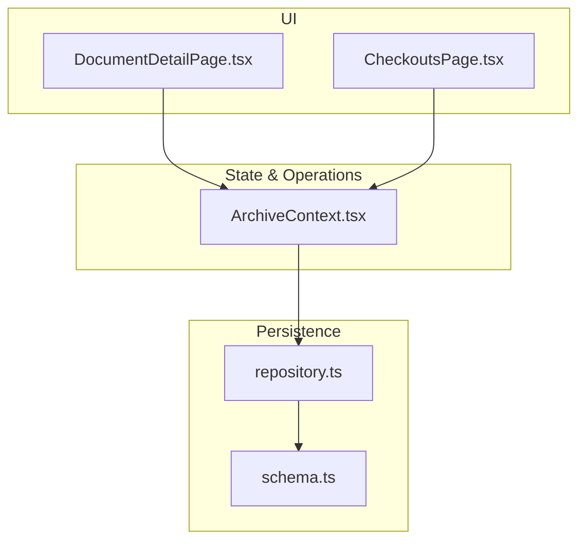
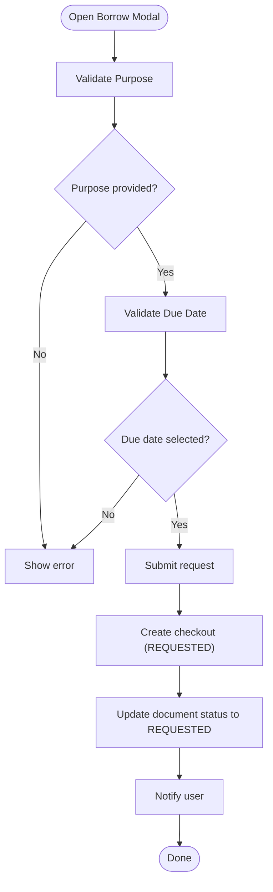
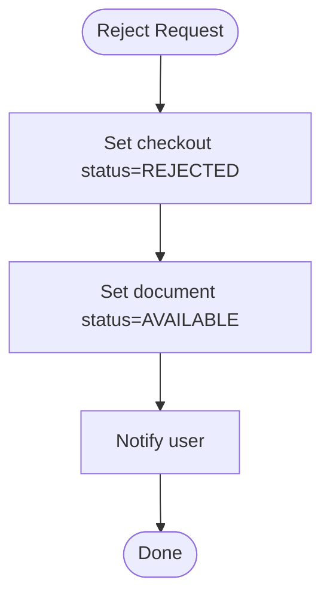
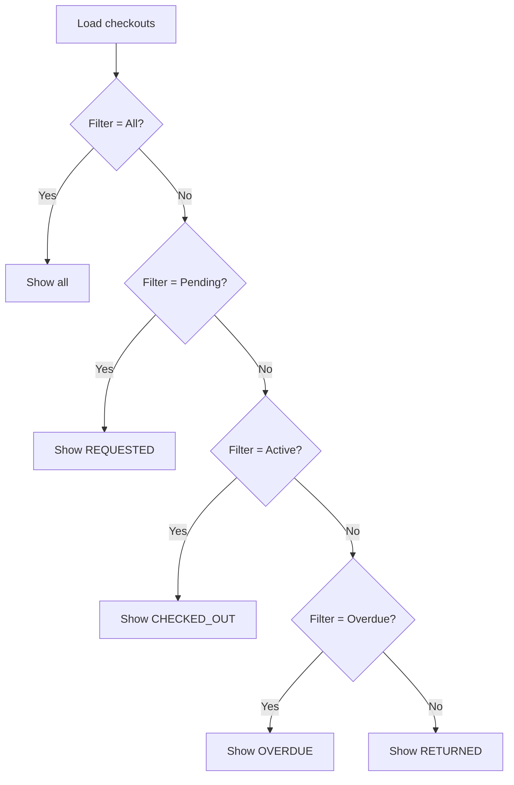
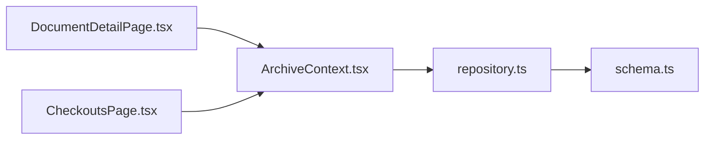

# Checkout Requests Management

<cite>
**Referenced Files in This Document**
- [CheckoutsPage.tsx](file://src/pages/CheckoutsPage.tsx)
- [DocumentDetailPage.tsx](file://src/pages/DocumentDetailPage.tsx)
- [ArchiveContext.tsx](file://src/context/ArchiveContext.tsx)
- [repository.ts](file://src/db/repository.ts)
- [schema.ts](file://src/db/schema.ts)
- [types.ts](file://src/types.ts)
</cite>

## Table of Contents
1. Introduction
2. Project Structure
3. Core Components
4. Architecture Overview
5. Detailed Component Analysis
6. Dependency Analysis
7. Performance Considerations
8. Troubleshooting Guide
9. Conclusion

## Introduction
This document explains how ArchiveHub manages checkout requests for physical documents. It covers how users submit borrowing requests, the validation and approval workflow, status transitions, conflict handling, queue management with filtering, and how permissions influence routing to approvers. It also provides practical examples for creating requests, viewing details, and understanding lifecycle states.

## Project Structure
The checkout system spans UI pages, a shared context for state and operations, and repository functions that persist changes to the database (with memory fallback). Key files:
- Pages: CheckoutsPage.tsx (circulation desk), DocumentDetailPage.tsx (request submission and return processing)
- Context: ArchiveContext.tsx (checkout operations, notifications, data sync)
- Repository: repository.ts (database transactions for checkout lifecycle)
- Schema: schema.ts (checkouts table definition)
- Types: types.ts (CheckoutStatus, CheckoutRecord, roles)



**Diagram sources**
- [DocumentDetailPage.tsx:123-129](file://src/pages/DocumentDetailPage.tsx#L123-L129)
- [CheckoutsPage.tsx:213-234](file://src/pages/CheckoutsPage.tsx#L213-L234)
- [ArchiveContext.tsx:855-966](file://src/context/ArchiveContext.tsx#L855-L966)
- [repository.ts:840-1100](file://src/db/repository.ts#L840-L1100)
- [schema.ts:118-148](file://src/db/schema.ts#L118-L148)

**Section sources**
- [CheckoutsPage.tsx:1-261](file://src/pages/CheckoutsPage.tsx#L1-L261)
- [DocumentDetailPage.tsx:1-809](file://src/pages/DocumentDetailPage.tsx#L1-L809)
- [ArchiveContext.tsx:1-1062](file://src/context/ArchiveContext.tsx#L1-L1062)
- [repository.ts:840-1100](file://src/db/repository.ts#L840-L1100)
- [schema.ts:118-148](file://src/db/schema.ts#L118-L148)
- [types.ts:205-235](file://src/types.ts#L205-L235)

## Core Components
- Request submission: Users initiate a borrow request from the document detail page by providing purpose and due date. The request is created with status REQUESTED and the document is marked as requested.
- Approval workflow: Records officers approve or reject requests. Approved requests are dispatched to a temporary location and checked out; rejected requests revert the document to available.
- Return processing: When returned, the document’s condition is recorded, it is moved back to its home storage, and the checkout becomes RETURNED.
- Queue management: The Circulation Desk shows all checkouts with filters for all, pending, active, overdue, and returned.

Key data model:
- Checkout record includes requester info, approver info, dates, status, purpose, and conditions.
- Roles include ADMIN, RECORDS_ADMIN, RECORDS_OFFICER, DEPT_USER, AUDITOR.

**Section sources**
- [schema.ts:118-148](file://src/db/schema.ts#L118-L148)
- [types.ts:6-6](file://src/types.ts#L6-L6)
- [types.ts:205-235](file://src/types.ts#L205-L235)

## Architecture Overview
The checkout flow integrates UI actions with context methods and repository transactions.

```mermaid
sequenceDiagram
participant User as "User"
participant Detail as "DocumentDetailPage"
participant Ctx as "ArchiveContext"
participant Repo as "repository"
participant DB as "PostgreSQL"
User->>Detail : Submit Borrowing Request (purpose, due date)
Detail->>Ctx : requestCheckout(documentId, purpose, dueDate)
Ctx->>Repo : requestCheckout(...)
Repo->>DB : BEGIN; INSERT checkouts; UPDATE documents.status='REQUESTED'; COMMIT
DB-->>Repo : Success
Repo-->>Ctx : CheckoutRecord
Ctx-->>Detail : Update local state, notify user
Note over User,DB : Later, Records Officer approves and dispatches
```

**Diagram sources**
- [DocumentDetailPage.tsx:123-129](file://src/pages/DocumentDetailPage.tsx#L123-L129)
- [ArchiveContext.tsx:855-880](file://src/context/ArchiveContext.tsx#L855-L880)
- [repository.ts:840-895](file://src/db/repository.ts#L840-L895)

**Section sources**
- [DocumentDetailPage.tsx:123-129](file://src/pages/DocumentDetailPage.tsx#L123-L129)
- [ArchiveContext.tsx:855-880](file://src/context/ArchiveContext.tsx#L855-L880)
- [repository.ts:840-895](file://src/db/repository.ts#L840-L895)

## Detailed Component Analysis

### Request Submission Flow
- Entry point: Document detail page opens a modal where the user enters purpose and selects a due date.
- Validation: Purpose must be non-empty; due date is required. On submit, the system calls requestCheckout.
- State changes: A new checkout record is created with status REQUESTED; the document status becomes REQUESTED.
- Notifications: Users receive confirmation that the request was submitted.



**Diagram sources**
- [DocumentDetailPage.tsx:123-129](file://src/pages/DocumentDetailPage.tsx#L123-L129)
- [ArchiveContext.tsx:855-880](file://src/context/ArchiveContext.tsx#L855-L880)
- [repository.ts:840-895](file://src/db/repository.ts#L840-L895)

**Section sources**
- [DocumentDetailPage.tsx:123-129](file://src/pages/DocumentDetailPage.tsx#L123-L129)
- [ArchiveContext.tsx:855-880](file://src/context/ArchiveContext.tsx#L855-L880)
- [repository.ts:840-895](file://src/db/repository.ts#L840-L895)

### Approval and Dispatch Workflow
- Approve: A records officer approves a REQUESTED checkout. The checkout status becomes APPROVED and the document status updates accordingly.
- Dispatch: After approval, the document is dispatched to a temporary location and checked out. The checkout status becomes CHECKED_OUT, and the document’s current location and custodian are updated. A movement record is created.

```mermaid
sequenceDiagram
participant RO as "Records Officer"
participant Desk as "CheckoutsPage"
participant Ctx as "ArchiveContext"
participant Repo as "repository"
participant DB as "PostgreSQL"
RO->>Desk : Approve & Release Custody
Desk->>Ctx : approveCheckout(checkoutId)
Ctx->>Repo : approveCheckout(...)
Repo->>DB : UPDATE checkouts.status='APPROVED'; UPDATE documents.status='APPROVED'
DB-->>Repo : OK
Desk->>Ctx : processCheckoutDispatch(checkoutId)
Ctx->>Repo : processCheckoutDispatch(...)
Repo->>DB : BEGIN; UPDATE checkouts.status='CHECKED_OUT'; UPDATE documents.current_location_id,status,custodian_name; INSERT movements; COMMIT
DB-->>Repo : OK
Repo-->>Ctx : Done
Ctx-->>Desk : Update UI, notify success
```

**Diagram sources**
- [CheckoutsPage.tsx:213-234](file://src/pages/CheckoutsPage.tsx#L213-L234)
- [ArchiveContext.tsx:883-942](file://src/context/ArchiveContext.tsx#L883-L942)
- [repository.ts:898-1052](file://src/db/repository.ts#L898-L1052)

**Section sources**
- [CheckoutsPage.tsx:213-234](file://src/pages/CheckoutsPage.tsx#L213-L234)
- [ArchiveContext.tsx:883-942](file://src/context/ArchiveContext.tsx#L883-L942)
- [repository.ts:898-1052](file://src/db/repository.ts#L898-L1052)

### Rejection Flow
- Reject: A records officer can reject a REQUESTED checkout. The checkout status becomes REJECTED and the document returns to AVAILABLE.



**Diagram sources**
- [ArchiveContext.tsx:901-917](file://src/context/ArchiveContext.tsx#L901-L917)
- [repository.ts:936-969](file://src/db/repository.ts#L936-L969)

**Section sources**
- [ArchiveContext.tsx:901-917](file://src/context/ArchiveContext.tsx#L901-L917)
- [repository.ts:936-969](file://src/db/repository.ts#L936-L969)

### Return Processing Flow
- Return: When a document is returned, the system records the inspected condition, sets the checkout status to RETURNED, moves the document back to its home storage, and resets the document status to AVAILABLE.

```mermaid
sequenceDiagram
participant Staff as "Circulation Staff"
participant DocPage as "DocumentDetailPage"
participant Ctx as "ArchiveContext"
participant Repo as "repository"
participant DB as "PostgreSQL"
Staff->>DocPage : Process Check-In Return (condition, target location)
DocPage->>Ctx : processCheckInReturn(checkoutId, conditionIn, returnLocationId)
Ctx->>Repo : processCheckInReturn(...)
Repo->>DB : BEGIN; UPDATE checkouts.status='RETURNED', return_date, condition_in; UPDATE documents.current_location_id,status,condition; INSERT movements; COMMIT
DB-->>Repo : OK
Repo-->>Ctx : Done
Ctx-->>DocPage : Update UI, notify success
```

**Diagram sources**
- [DocumentDetailPage.tsx:131-137](file://src/pages/DocumentDetailPage.tsx#L131-L137)
- [ArchiveContext.tsx:944-966](file://src/context/ArchiveContext.tsx#L944-L966)
- [repository.ts:1054-1100](file://src/db/repository.ts#L1054-L1100)

**Section sources**
- [DocumentDetailPage.tsx:131-137](file://src/pages/DocumentDetailPage.tsx#L131-L137)
- [ArchiveContext.tsx:944-966](file://src/context/ArchiveContext.tsx#L944-L966)
- [repository.ts:1054-1100](file://src/db/repository.ts#L1054-L1100)

### Request Queue Management and Filtering
- The Circulation Desk lists all checkouts with KPIs for Pending, Active, Overdue, and Returned counts.
- Filters: all, pending, active, overdue, returned. Each filter narrows the list based on checkout status.
- Actions: For REQUESTED items, Approve & Release Custody and Reject are available. For CHECKED_OUT or OVERDUE items, Process Check-In Return is available.



**Diagram sources**
- [CheckoutsPage.tsx:35-51](file://src/pages/CheckoutsPage.tsx#L35-L51)
- [CheckoutsPage.tsx:143-158](file://src/pages/CheckoutsPage.tsx#L143-L158)

**Section sources**
- [CheckoutsPage.tsx:35-51](file://src/pages/CheckoutsPage.tsx#L35-L51)
- [CheckoutsPage.tsx:143-158](file://src/pages/CheckoutsPage.tsx#L143-L158)

### Status Lifecycle and Automatic Assignment
- REQUESTED: Created when a user submits a borrowing request.
- APPROVED: Set when a records officer approves the request.
- REJECTED: Set when a records officer rejects the request; document returns to AVAILABLE.
- CHECKED_OUT: Set after approval and dispatch; document’s current location and custodian are updated.
- OVERDUE: Defined in types; used for display and filtering. In this codebase, the UI treats OVERDUE as a distinct status for overdue items.
- RETURNED: Set when the document is checked in; document returns to AVAILABLE.

Note: The repository and context implement explicit transitions for REQUESTED → APPROVED → CHECKED_OUT and REQUESTED → REJECTED, and CHECKED_OUT/OVERDUE → RETURNED. Automatic transition to OVERDUE is not implemented in the analyzed code; it is modeled in types and UI.

**Section sources**
- [types.ts:205-235](file://src/types.ts#L205-L235)
- [ArchiveContext.tsx:855-966](file://src/context/ArchiveContext.tsx#L855-L966)
- [repository.ts:840-1100](file://src/db/repository.ts#L840-L1100)

### Conflict Detection and Multiple Requests
- The analyzed code does not implement explicit conflict detection preventing multiple simultaneous requests for the same document. Instead, each request creates a checkout record and marks the document as REQUESTED. Subsequent requests may create additional records depending on backend behavior not shown here.
- To prevent conflicts at the UI level, consider adding checks before submitting a request if the document is already in REQUESTED, APPROVED, or CHECKED_OUT states.

[No sources needed since this section summarizes observed behavior without quoting specific lines]

### Permissions and Routing to Approvers
- Roles: ADMIN, RECORDS_ADMIN, RECORDS_OFFICER, DEPT_USER, AUDITOR.
- The UI exposes approval actions on the Circulation Desk for REQUESTED items. In a production environment, you would gate these actions by role-based authorization to ensure only authorized personnel (e.g., RECORDS_OFFICER) can approve or reject requests.
- The current implementation allows any logged-in user to call approval/dispatch methods via the context. Add server-side checks to enforce role-based routing.

**Section sources**
- [types.ts:6-6](file://src/types.ts#L6-L6)
- [CheckoutsPage.tsx:213-234](file://src/pages/CheckoutsPage.tsx#L213-L234)
- [ArchiveContext.tsx:883-942](file://src/context/ArchiveContext.tsx#L883-L942)

## Dependency Analysis
- UI components depend on ArchiveContext for checkout operations and notifications.
- ArchiveContext orchestrates API calls and local state updates, falling back to memory operations when the database is unavailable.
- Repository functions perform database transactions and update related tables (checkouts, documents, movements).
- Schema defines the structure of persisted entities, including checkouts.



**Diagram sources**
- [DocumentDetailPage.tsx:123-137](file://src/pages/DocumentDetailPage.tsx#L123-L137)
- [CheckoutsPage.tsx:213-248](file://src/pages/CheckoutsPage.tsx#L213-L248)
- [ArchiveContext.tsx:855-966](file://src/context/ArchiveContext.tsx#L855-L966)
- [repository.ts:840-1100](file://src/db/repository.ts#L840-L1100)
- [schema.ts:118-148](file://src/db/schema.ts#L118-L148)

**Section sources**
- [DocumentDetailPage.tsx:123-137](file://src/pages/DocumentDetailPage.tsx#L123-L137)
- [CheckoutsPage.tsx:213-248](file://src/pages/CheckoutsPage.tsx#L213-L248)
- [ArchiveContext.tsx:855-966](file://src/context/ArchiveContext.tsx#L855-L966)
- [repository.ts:840-1100](file://src/db/repository.ts#L840-L1100)
- [schema.ts:118-148](file://src/db/schema.ts#L118-L148)

## Performance Considerations
- Transactions: Repository uses database transactions to ensure consistency across checkout, document, and movement updates.
- Fallback behavior: If the database is unavailable, operations fall back to in-memory state to keep the UI responsive.
- Batch updates: Updates to documents and movements occur within single transactions to reduce round trips.
- UI filtering: Client-side filtering avoids extra network calls for view changes.

[No sources needed since this section provides general guidance]

## Troubleshooting Guide
- Request not appearing: Ensure the document exists and the request was submitted successfully. Check notifications and verify the document status changed to REQUESTED.
- Approval not taking effect: Confirm the checkout ID is correct and the records officer has permission. Verify the database transaction succeeded.
- Return not updating location: Ensure the return location is valid and the checkout is in an active state. Check that the movement record was created.
- Overdue not showing: The OVERDUE status is modeled but automatic transition logic is not present in the analyzed code. Implement periodic checks to mark overdue items if needed.

**Section sources**
- [ArchiveContext.tsx:855-966](file://src/context/ArchiveContext.tsx#L855-L966)
- [repository.ts:840-1100](file://src/db/repository.ts#L840-L1100)
- [types.ts:205-235](file://src/types.ts#L205-L235)

## Conclusion
ArchiveHub’s checkout system provides a clear workflow for requesting, approving, dispatching, and returning physical documents. The UI offers intuitive forms and a robust circulation desk with filtering. The repository ensures data integrity through transactions and supports offline-like behavior via memory fallback. To enhance the system, consider implementing explicit conflict detection for concurrent requests, automated overdue marking, and role-based authorization for approval actions.

[No sources needed since this section summarizes without analyzing specific files]