# Checkout Workflows

<cite>
**Referenced Files in This Document**
- [CheckoutsPage.tsx](file://src/pages/CheckoutsPage.tsx)
- [DashboardPage.tsx](file://src/pages/DashboardPage.tsx)
- [ArchiveContext.tsx](file://src/context/ArchiveContext.tsx)
- [server.ts](file://server.ts)
- [repository.ts](file://src/db/repository.ts)
- [schema.ts](file://src/db/schema.ts)
- [types.ts](file://src/types.ts)
</cite>

## Table of Contents
1. [Introduction](#introduction)
2. [Project Structure](#project-structure)
3. [Core Components](#core-components)
4. [Architecture Overview](#architecture-overview)
5. [Detailed Component Analysis](#detailed-component-analysis)
6. [Dependency Analysis](#dependency-analysis)
7. [Performance Considerations](#performance-considerations)
8. [Troubleshooting Guide](#troubleshooting-guide)
9. [Conclusion](#conclusion)
10. [Appendices](#appendices)

## Introduction
This document explains ArchiveHub’s checkout and approval workflow for temporary lending of physical documents. It covers the end-to-end process from request submission, through administrative review and approval, to dispatching items to borrowers and processing returns. It also details movement tracking (audit trails), role-based permissions, due date handling, overdue notifications, conflict resolution when multiple users request the same document, and the checkout dashboard that surfaces pending requests, active checkouts, and overdue items.

## Project Structure
The checkout workflow spans UI pages, a shared context for state and operations, an Express server exposing REST endpoints, and a repository layer backed by PostgreSQL with schema definitions and type contracts.

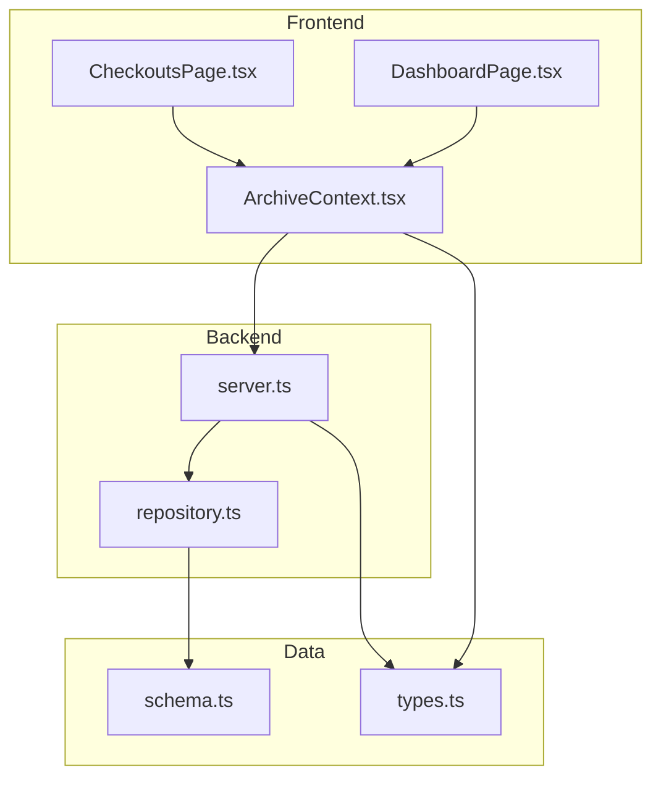

**Diagram sources**
- [CheckoutsPage.tsx:23-33](file://src/pages/CheckoutsPage.tsx#L23-L33)
- [DashboardPage.tsx:30-36](file://src/pages/DashboardPage.tsx#L30-L36)
- [ArchiveContext.tsx:115-174](file://src/context/ArchiveContext.tsx#L115-L174)
- [server.ts:363-441](file://server.ts#L363-L441)
- [repository.ts:806-1122](file://src/db/repository.ts#L806-L1122)
- [schema.ts:118-167](file://src/db/schema.ts#L118-L167)
- [types.ts:205-235](file://src/types.ts#L205-L235)

**Section sources**
- [CheckoutsPage.tsx:23-33](file://src/pages/CheckoutsPage.tsx#L23-L33)
- [DashboardPage.tsx:30-36](file://src/pages/DashboardPage.tsx#L30-L36)
- [ArchiveContext.tsx:115-174](file://src/context/ArchiveContext.tsx#L115-L174)
- [server.ts:363-441](file://server.ts#L363-L441)
- [repository.ts:806-1122](file://src/db/repository.ts#L806-L1122)
- [schema.ts:118-167](file://src/db/schema.ts#L118-L167)
- [types.ts:205-235](file://src/types.ts#L205-L235)

## Core Components
- Checkouts page: Displays pending, active, overdue, and returned checkouts; supports approve/reject and return actions.
- Dashboard: Highlights overdue items and recent movements; provides quick navigation to checkouts.
- Context: Encapsulates checkout lifecycle methods (request, approve, reject, dispatch, return) and notifications.
- Server: Exposes REST endpoints for checkout operations and data retrieval.
- Repository: Implements business logic for checkout states, document status updates, and movement audit entries.
- Schema and Types: Define database tables and TypeScript interfaces for consistency across layers.

**Section sources**
- [CheckoutsPage.tsx:23-33](file://src/pages/CheckoutsPage.tsx#L23-L33)
- [DashboardPage.tsx:30-36](file://src/pages/DashboardPage.tsx#L30-L36)
- [ArchiveContext.tsx:89-99](file://src/context/ArchiveContext.tsx#L89-L99)
- [server.ts:363-441](file://server.ts#L363-L441)
- [repository.ts:806-1122](file://src/db/repository.ts#L806-L1122)
- [schema.ts:118-167](file://src/db/schema.ts#L118-L167)
- [types.ts:205-235](file://src/types.ts#L205-L235)

## Architecture Overview
The checkout flow is orchestrated by the frontend context, which calls server endpoints that delegate to repository functions. The repository performs transactions to update checkouts, documents, and movements, ensuring consistent state changes and auditability.

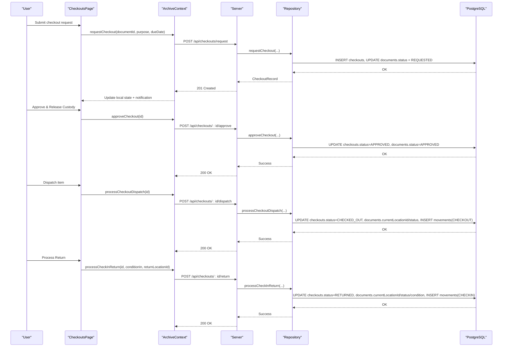

**Diagram sources**
- [CheckoutsPage.tsx:213-248](file://src/pages/CheckoutsPage.tsx#L213-L248)
- [ArchiveContext.tsx:893-927](file://src/context/ArchiveContext.tsx#L893-L927)
- [server.ts:373-441](file://server.ts#L373-L441)
- [repository.ts:840-1122](file://src/db/repository.ts#L840-L1122)

## Detailed Component Analysis

### Request Submission
- Users submit a checkout request with a purpose and due date via the context method.
- The server endpoint creates a checkout record with status REQUESTED and marks the document status as REQUESTED.
- A transaction ensures atomicity between checkout creation and document status update.

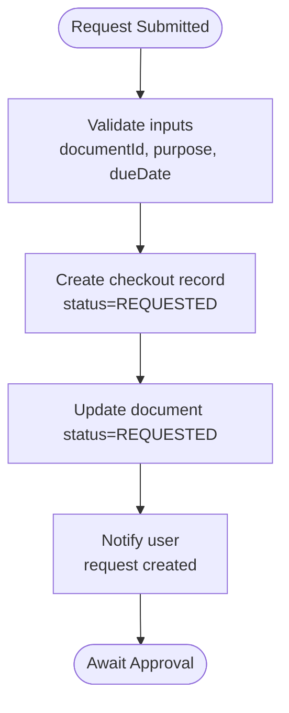

**Diagram sources**
- [ArchiveContext.tsx:893-927](file://src/context/ArchiveContext.tsx#L893-L927)
- [server.ts:373-386](file://server.ts#L373-L386)
- [repository.ts:840-896](file://src/db/repository.ts#L840-L896)

**Section sources**
- [ArchiveContext.tsx:893-927](file://src/context/ArchiveContext.tsx#L893-L927)
- [server.ts:373-386](file://server.ts#L373-L386)
- [repository.ts:840-896](file://src/db/repository.ts#L840-L896)

### Administrative Review and Approval
- Administrators or Records Officers can approve or reject requests from the Checkouts page.
- Approving sets checkout status to APPROVED and document status to APPROVED.
- Rejecting sets checkout status to REJECTED and restores document status to AVAILABLE.

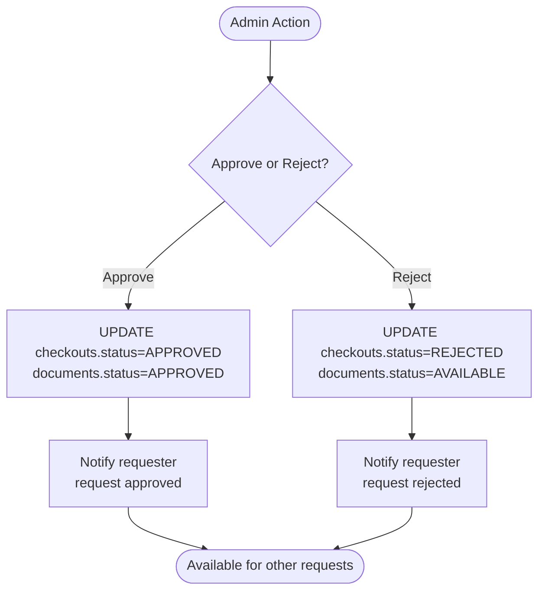

**Diagram sources**
- [CheckoutsPage.tsx:213-234](file://src/pages/CheckoutsPage.tsx#L213-L234)
- [ArchiveContext.tsx:893-917](file://src/context/ArchiveContext.tsx#L893-L917)
- [server.ts:388-406](file://server.ts#L388-L406)
- [repository.ts:898-969](file://src/db/repository.ts#L898-L969)

**Section sources**
- [CheckoutsPage.tsx:213-234](file://src/pages/CheckoutsPage.tsx#L213-L234)
- [ArchiveContext.tsx:893-917](file://src/context/ArchiveContext.tsx#L893-L917)
- [server.ts:388-406](file://server.ts#L388-L406)
- [repository.ts:898-969](file://src/db/repository.ts#L898-L969)

### Dispatching Items to Borrowers
- After approval, circulation staff dispatch the item to a temporary location (e.g., department office).
- The system updates checkout status to CHECKED_OUT, moves the document to the temporary location, and records a CHECKOUT movement.

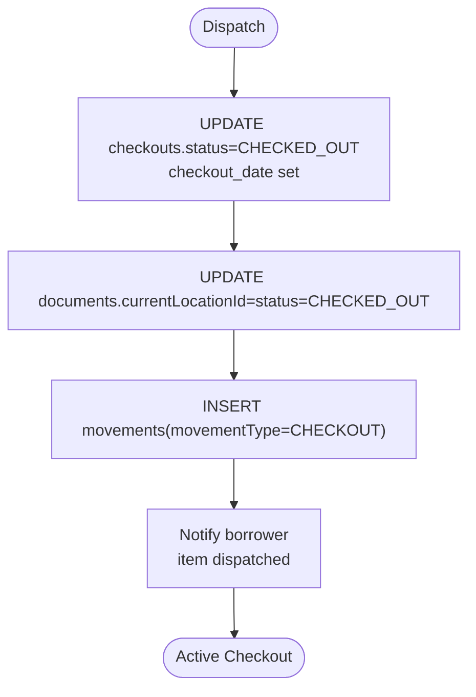

**Diagram sources**
- [CheckoutsPage.tsx:223-234](file://src/pages/CheckoutsPage.tsx#L223-L234)
- [ArchiveContext.tsx:919-927](file://src/context/ArchiveContext.tsx#L919-L927)
- [server.ts:408-422](file://server.ts#L408-L422)
- [repository.ts:971-1052](file://src/db/repository.ts#L971-L1052)

**Section sources**
- [CheckoutsPage.tsx:223-234](file://src/pages/CheckoutsPage.tsx#L223-L234)
- [ArchiveContext.tsx:919-927](file://src/context/ArchiveContext.tsx#L919-L927)
- [server.ts:408-422](file://server.ts#L408-L422)
- [repository.ts:971-1052](file://src/db/repository.ts#L971-L1052)

### Processing Returns
- At the circulation desk, staff process returns by recording condition on return and moving the document back to its home/archive location.
- The system updates checkout status to RETURNED, resets document status to AVAILABLE, and records a CHECKIN movement.

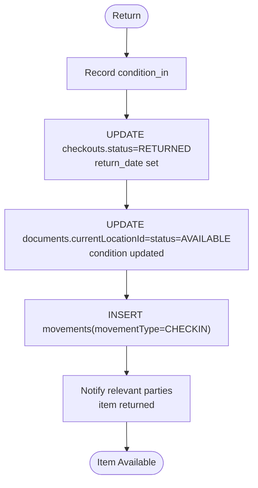

**Diagram sources**
- [CheckoutsPage.tsx:237-248](file://src/pages/CheckoutsPage.tsx#L237-L248)
- [server.ts:424-441](file://server.ts#L424-L441)
- [repository.ts:1054-1122](file://src/db/repository.ts#L1054-L1122)

**Section sources**
- [CheckoutsPage.tsx:237-248](file://src/pages/CheckoutsPage.tsx#L237-L248)
- [server.ts:424-441](file://server.ts#L424-L441)
- [repository.ts:1054-1122](file://src/db/repository.ts#L1054-L1122)

### Movement Tracking and Audit Trails
- Every significant action (initial filing, checkout, check-in, relocation) inserts a movement record capturing from/to locations, movement type, performer, reason, and timestamp.
- The dashboard displays recent movements, enabling visibility into document custody changes.

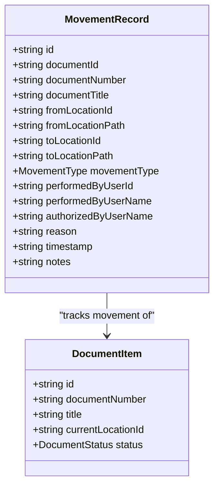

**Diagram sources**
- [types.ts:185-203](file://src/types.ts#L185-L203)
- [schema.ts:150-167](file://src/db/schema.ts#L150-L167)
- [repository.ts:1124-1150](file://src/db/repository.ts#L1124-L1150)
- [DashboardPage.tsx:203-267](file://src/pages/DashboardPage.tsx#L203-L267)

**Section sources**
- [types.ts:185-203](file://src/types.ts#L185-L203)
- [schema.ts:150-167](file://src/db/schema.ts#L150-L167)
- [repository.ts:1124-1150](file://src/db/repository.ts#L1124-L1150)
- [DashboardPage.tsx:203-267](file://src/pages/DashboardPage.tsx#L203-L267)

### Role-Based Permissions
- User roles include ADMIN, RECORDS_ADMIN, RECORDS_OFFICER, DEPT_USER, AUDITOR.
- Login enforcement checks approval status (PENDING_APPROVAL or REJECTED) before granting access.
- While the UI exposes actions based on checkout state, role-based authorization should gate sensitive operations at the API level.

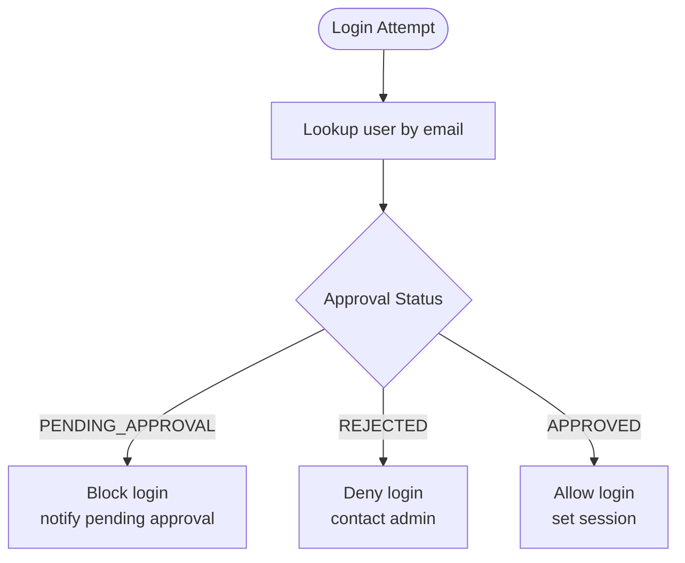

**Diagram sources**
- [types.ts:6-22](file://src/types.ts#L6-L22)
- [server.ts:104-150](file://server.ts#L104-L150)

**Section sources**
- [types.ts:6-22](file://src/types.ts#L6-L22)
- [server.ts:104-150](file://server.ts#L104-L150)

### Due Dates, Overdue Notifications, and Dashboard
- Checkouts store due dates; the dashboard highlights overdue items and provides a link to manage them.
- The Checkouts page categorizes items by status including OVERDUE and shows due dates prominently.

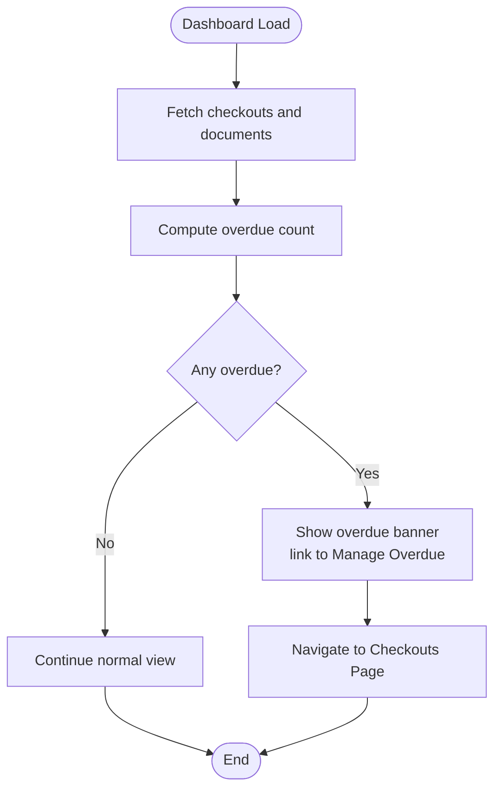

**Diagram sources**
- [DashboardPage.tsx:38-43](file://src/pages/DashboardPage.tsx#L38-L43)
- [DashboardPage.tsx:100-125](file://src/pages/DashboardPage.tsx#L100-L125)
- [CheckoutsPage.tsx:40-51](file://src/pages/CheckoutsPage.tsx#L40-L51)

**Section sources**
- [DashboardPage.tsx:38-43](file://src/pages/DashboardPage.tsx#L38-L43)
- [DashboardPage.tsx:100-125](file://src/pages/DashboardPage.tsx#L100-L125)
- [CheckoutsPage.tsx:40-51](file://src/pages/CheckoutsPage.tsx#L40-L51)

### Conflict Resolution for Multiple Requests
- When a user requests a document, its status becomes REQUESTED, preventing immediate reuse until resolved.
- If a request is rejected, the document returns to AVAILABLE, allowing other users to request it.
- For concurrent requests, the backend uses transactions to ensure consistent state transitions and avoid race conditions.

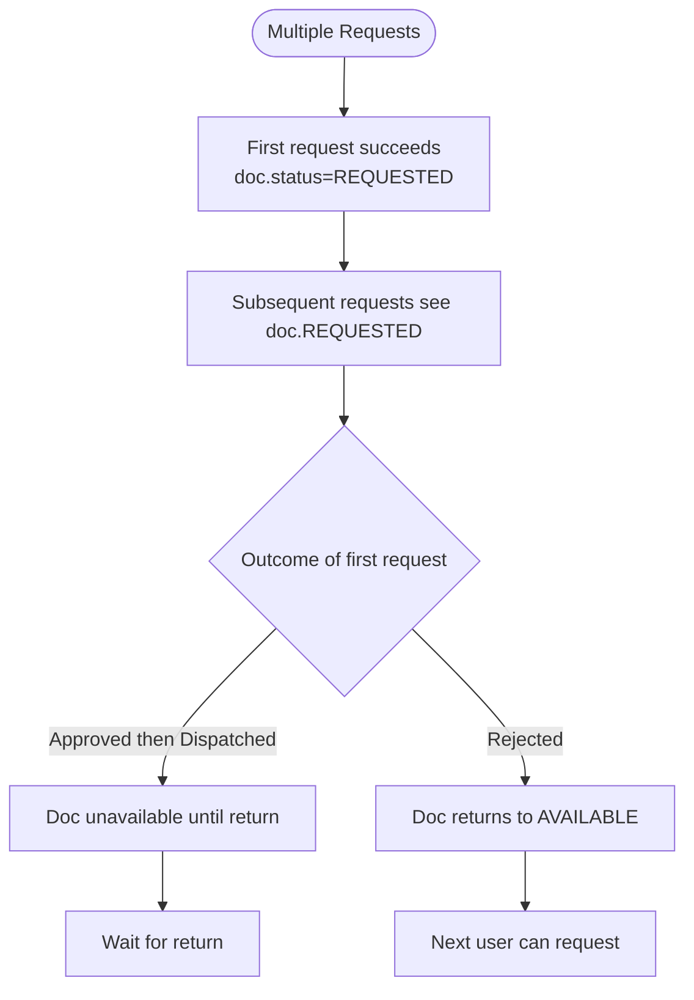

**Diagram sources**
- [repository.ts:840-896](file://src/db/repository.ts#L840-L896)
- [repository.ts:936-969](file://src/db/repository.ts#L936-L969)

**Section sources**
- [repository.ts:840-896](file://src/db/repository.ts#L840-L896)
- [repository.ts:936-969](file://src/db/repository.ts#L936-L969)

### Notification System
- The context maintains a simple notification queue used to inform users about successful actions (approval, rejection, dispatch, return).
- Notifications are displayed inline and persist briefly to provide feedback during workflows.

**Section sources**
- [ArchiveContext.tsx:183-195](file://src/context/ArchiveContext.tsx#L183-L195)
- [ArchiveContext.tsx:893-927](file://src/context/ArchiveContext.tsx#L893-L927)

## Dependency Analysis
- Frontend components depend on ArchiveContext for all checkout operations and data.
- ArchiveContext depends on server endpoints for persistence and on utility functions for path calculations.
- Server routes depend on repository functions for business logic and database interactions.
- Repository functions depend on schema definitions and types for consistent data modeling.

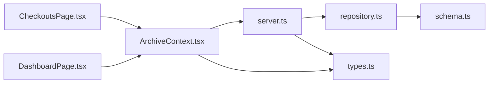

**Diagram sources**
- [CheckoutsPage.tsx:23-33](file://src/pages/CheckoutsPage.tsx#L23-L33)
- [DashboardPage.tsx:30-36](file://src/pages/DashboardPage.tsx#L30-L36)
- [ArchiveContext.tsx:115-174](file://src/context/ArchiveContext.tsx#L115-L174)
- [server.ts:363-441](file://server.ts#L363-L441)
- [repository.ts:806-1122](file://src/db/repository.ts#L806-L1122)
- [schema.ts:118-167](file://src/db/schema.ts#L118-L167)
- [types.ts:205-235](file://src/types.ts#L205-L235)

**Section sources**
- [CheckoutsPage.tsx:23-33](file://src/pages/CheckoutsPage.tsx#L23-L33)
- [DashboardPage.tsx:30-36](file://src/pages/DashboardPage.tsx#L30-L36)
- [ArchiveContext.tsx:115-174](file://src/context/ArchiveContext.tsx#L115-L174)
- [server.ts:363-441](file://server.ts#L363-L441)
- [repository.ts:806-1122](file://src/db/repository.ts#L806-L1122)
- [schema.ts:118-167](file://src/db/schema.ts#L118-L167)
- [types.ts:205-235](file://src/types.ts#L205-L235)

## Performance Considerations
- Use database transactions for multi-step operations (checkout creation, approval, dispatch, return) to minimize lock contention and ensure consistency.
- Avoid excessive client-side polling; rely on server responses and UI state updates to reflect changes immediately.
- Keep movement logs concise but sufficient for audit purposes; consider indexing frequently queried fields like document_id and timestamp if datasets grow large.
- Batch operations where possible (e.g., bulk document updates) to reduce round trips.

[No sources needed since this section provides general guidance]

## Troubleshooting Guide
- Login blocked due to pending approval or rejection: Verify user approval status via the user management endpoints and adjust accordingly.
- Checkout not appearing: Ensure the request was submitted successfully and the document status transitioned to REQUESTED; check server logs for errors.
- Approval fails: Confirm the checkout exists and is in REQUESTED state; verify database connectivity and transaction integrity.
- Dispatch does not move document: Check that the target temporary location exists and paths are computed correctly; inspect movement logs for CHECKOUT entries.
- Return not processed: Ensure condition_in is recorded and return location is valid; verify movements table has CHECKIN entry and document status reset to AVAILABLE.

**Section sources**
- [server.ts:104-150](file://server.ts#L104-L150)
- [repository.ts:840-1122](file://src/db/repository.ts#L840-L1122)
- [DashboardPage.tsx:100-125](file://src/pages/DashboardPage.tsx#L100-L125)

## Conclusion
ArchiveHub’s checkout workflow provides a robust, auditable process for temporarily lending physical documents. It integrates request submission, administrative review, dispatch, and return processing with comprehensive movement tracking and clear dashboards for monitoring active and overdue items. Role-based controls and transactional integrity ensure reliable operations, while notifications keep users informed throughout the lifecycle.

[No sources needed since this section summarizes without analyzing specific files]

## Appendices

### Practical Scenarios

- Requesting a document:
  - Use the context method to submit a request with purpose and due date.
  - The document status becomes REQUESTED; await administrative decision.

- Approving a checkout:
  - From the Checkouts page, approve the request; document status becomes APPROVED.
  - Dispatch the item to the borrower’s temporary location; document status becomes CHECKED_OUT and movement recorded.

- Extending due dates:
  - Extend due dates by updating the checkout record’s due date field via appropriate API and UI flows; ensure notifications are sent to stakeholders.

- Processing returns:
  - Record condition on return and move the document back to its home/archive location; document status becomes AVAILABLE and movement recorded.

- Handling conflicts:
  - If multiple users request the same document, only one request proceeds to APPROVED and DISPATCH; others must wait until the item is returned or their request is rejected.

- Notifications:
  - Use the context notification system to alert users about upcoming due dates and overdue items; integrate with email or in-app alerts as needed.

**Section sources**
- [ArchiveContext.tsx:893-927](file://src/context/ArchiveContext.tsx#L893-L927)
- [CheckoutsPage.tsx:213-248](file://src/pages/CheckoutsPage.tsx#L213-L248)
- [repository.ts:840-1122](file://src/db/repository.ts#L840-L1122)
- [DashboardPage.tsx:100-125](file://src/pages/DashboardPage.tsx#L100-L125)