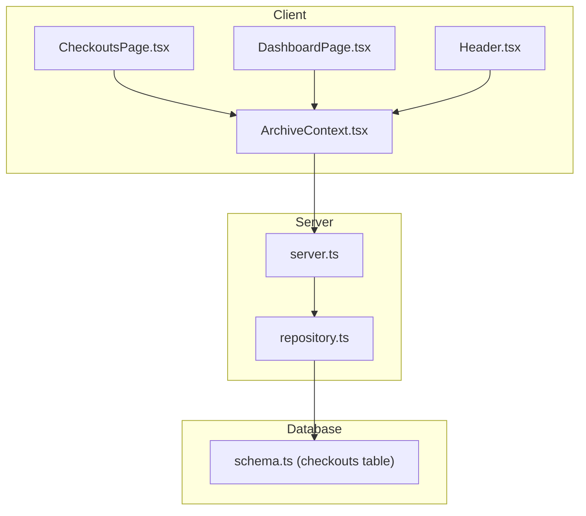
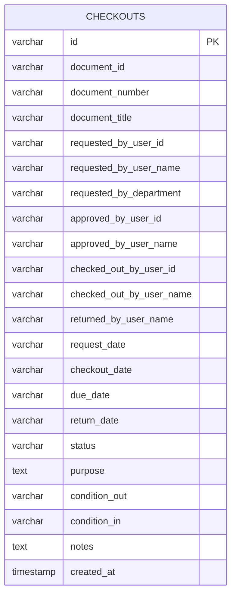
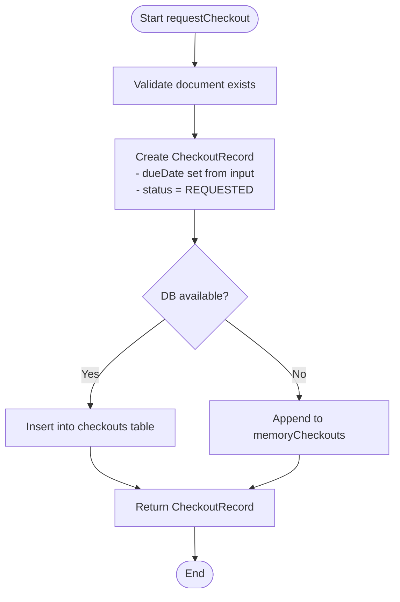
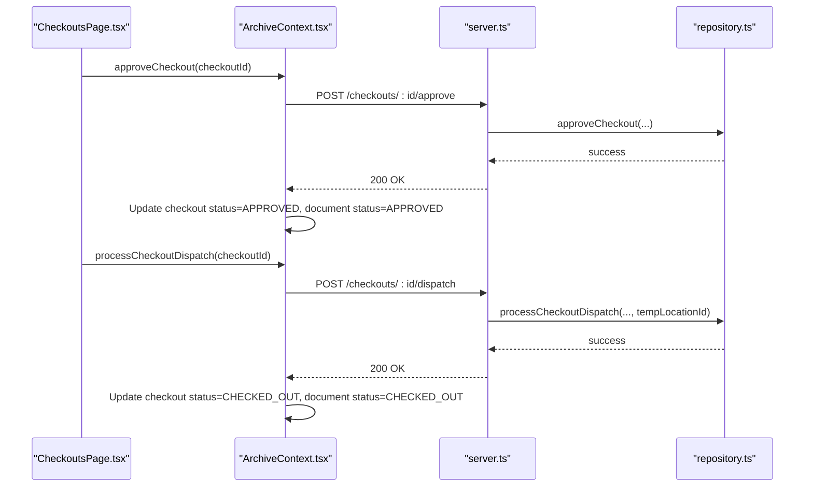
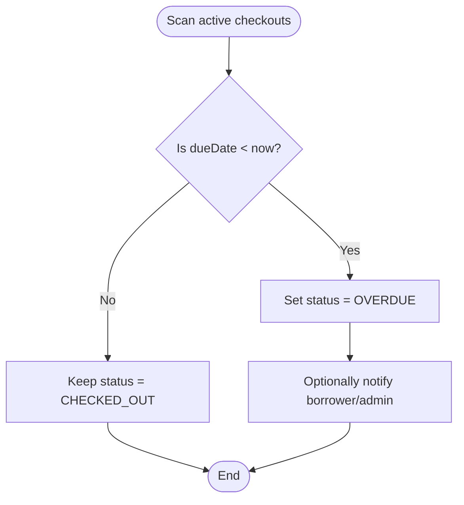
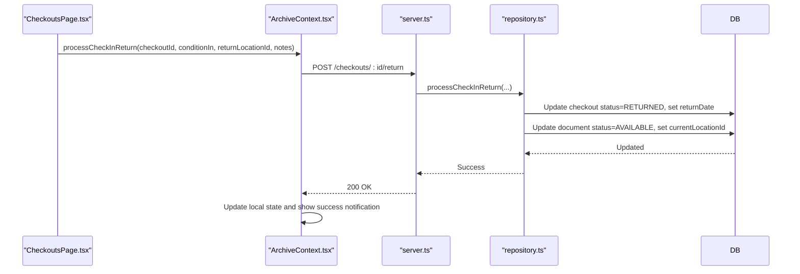
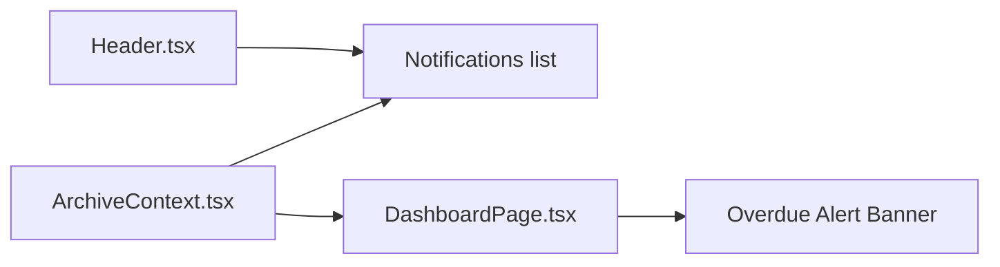
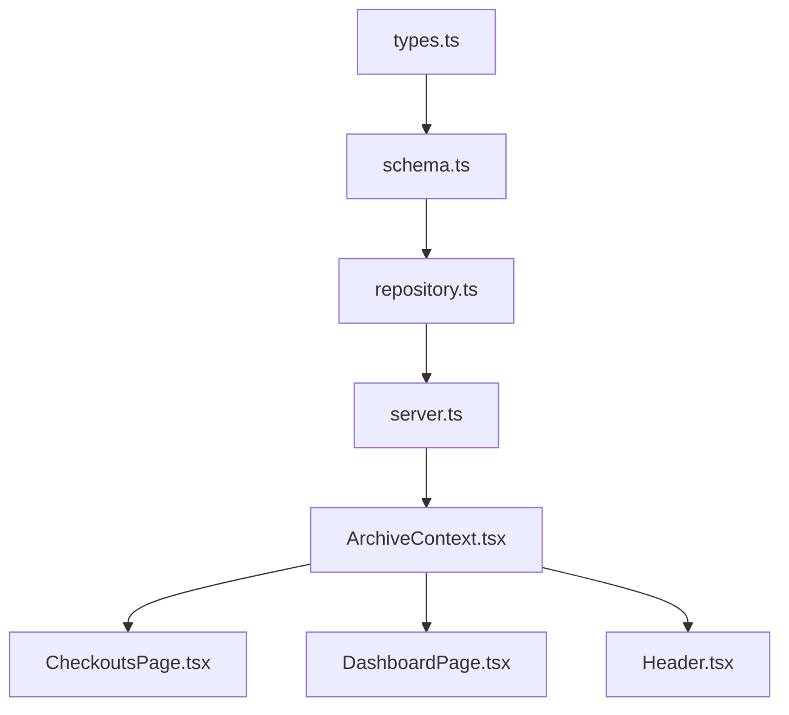

# Due Date Tracking & Overdue Management

<cite>
**Referenced Files in This Document**
- [types.ts](file://src/types.ts)
- [schema.ts](file://src/db/schema.ts)
- [repository.ts](file://src/db/repository.ts)
- [ArchiveContext.tsx](file://src/context/ArchiveContext.tsx)
- [CheckoutsPage.tsx](file://src/pages/CheckoutsPage.tsx)
- [DashboardPage.tsx](file://src/pages/DashboardPage.tsx)
- [Header.tsx](file://src/components/layout/Header.tsx)
- [StatusBadge.tsx](file://src/components/common/StatusBadge.tsx)
- [server.ts](file://server.ts)
</cite>

## Table of Contents
1. Introduction
2. Project Structure
3. Core Components
4. Architecture Overview
5. Detailed Component Analysis
6. Dependency Analysis
7. Performance Considerations
8. Troubleshooting Guide
9. Conclusion
10. Appendices

## Introduction
This document explains how ArchiveHub tracks due dates and manages overdue items within its checkout workflows. It covers how due dates are set during checkout creation, how the system identifies overdue checkouts, updates statuses accordingly, and surfaces alerts to borrowers and administrators. It also documents dashboard views for overdue statistics, practical operations such as extending due dates and processing late returns, and outlines where automated checks and escalation procedures can be implemented.

## Project Structure
The due date and overdue management spans data models, repository logic, API endpoints, UI pages, and notifications:
- Data model defines checkout status values including OVERDUE and stores dueDate on each checkout.
- Repository functions create and update checkouts, handle approvals, dispatching, and returns.
- Server exposes REST endpoints for checkout lifecycle operations.
- Context orchestrates client-side state changes and API calls.
- Pages render KPIs, filters, and actions for pending, active, overdue, and returned checkouts.
- Header displays overdue counts and notifications.



**Diagram sources**
- [CheckoutsPage.tsx:23-51](file://src/pages/CheckoutsPage.tsx#L23-L51)
- [DashboardPage.tsx:30-49](file://src/pages/DashboardPage.tsx#L30-L49)
- [Header.tsx:175-196](file://src/components/layout/Header.tsx#L175-L196)
- [ArchiveContext.tsx:854-966](file://src/context/ArchiveContext.tsx#L854-L966)
- [server.ts:363-441](file://server.ts#L363-L441)
- [repository.ts:840-1122](file://src/db/repository.ts#L840-L1122)
- [schema.ts:118-148](file://src/db/schema.ts#L118-L148)

**Section sources**
- [types.ts:205-235](file://src/types.ts#L205-L235)
- [schema.ts:118-148](file://src/db/schema.ts#L118-L148)
- [repository.ts:840-1122](file://src/db/repository.ts#L840-L1122)
- [server.ts:363-441](file://server.ts#L363-L441)
- [ArchiveContext.tsx:854-966](file://src/context/ArchiveContext.tsx#L854-L966)
- [CheckoutsPage.tsx:23-51](file://src/pages/CheckoutsPage.tsx#L23-L51)
- [DashboardPage.tsx:30-49](file://src/pages/DashboardPage.tsx#L30-L49)
- [Header.tsx:175-196](file://src/components/layout/Header.tsx#L175-L196)

## Core Components
- Checkout data model: Stores dueDate and status values including OVERDUE.
- Repository layer: Creates requests, approves/rejects, dispatches checkouts, processes returns; maintains memory or DB state.
- API layer: Exposes endpoints for request, approve, reject, dispatch, return.
- Client context: Manages local state transitions and notifies users.
- UI: Displays overdue counts, filters, and actions; shows overdue warnings on dashboard and header.

Key responsibilities:
- Set dueDate at checkout request time.
- Track status transitions through REQUESTED → APPROVED → CHECKED_OUT → RETURNED, with OVERDUE used to flag past-due items.
- Surface overdue metrics on Dashboard and Checkouts pages.
- Provide actions to process returns and manage overdue items.

**Section sources**
- [types.ts:205-235](file://src/types.ts#L205-L235)
- [repository.ts:840-1122](file://src/db/repository.ts#L840-L1122)
- [server.ts:363-441](file://server.ts#L363-L441)
- [ArchiveContext.tsx:854-966](file://src/context/ArchiveContext.tsx#L854-L966)
- [CheckoutsPage.tsx:23-51](file://src/pages/CheckoutsPage.tsx#L23-L51)
- [DashboardPage.tsx:30-49](file://src/pages/DashboardPage.tsx#L30-L49)
- [Header.tsx:175-196](file://src/components/layout/Header.tsx#L175-L196)

## Architecture Overview
End-to-end flow from checkout request to overdue visibility and return processing:

```mermaid
sequenceDiagram
participant U as "User"
participant CP as "CheckoutsPage.tsx"
participant AC as "ArchiveContext.tsx"
participant S as "server.ts"
participant R as "repository.ts"
participant DB as "schema.ts (checkouts)"
U->>CP : Submit borrow request (documentId, purpose, dueDate)
CP->>AC : requestCheckout(documentId, purpose, dueDate)
AC->>S : POST /api/checkouts/request {documentId, purpose, dueDate, user}
S->>R : requestCheckout(...)
R->>DB : Insert checkout row with dueDate, status=REQUESTED
DB-->>R : Created record
R-->>S : CheckoutRecord
S-->>AC : 201 + CheckoutRecord
AC->>AC : Update local state (checkouts, documents.status=REQUESTED)
AC-->>U : Notification : Borrow request submitted
Note over U,DB : Approval and dispatch later transition to CHECKED_OUT
U->>CP : Approve & Release Custody
CP->>AC : approveCheckout() then processCheckoutDispatch()
AC->>S : POST /approve, then POST /dispatch
S->>R : approveCheckout(), processCheckoutDispatch(...)
R->>DB : Update checkout status to APPROVED/CHECKED_OUT, set checkoutDate
DB-->>R : Updated
R-->>S : Success
S-->>AC : 200 OK
AC->>AC : Update local state (status=CHECKED_OUT, custodian info)
AC-->>U : Notification : Checked out successfully
Note over U,DB : When dueDate passes without return, UI treats item as OVERDUE via filtering/status
U->>CP : Process Check-In Return (even if overdue)
CP->>AC : processCheckInReturn(checkoutId, conditionIn, returnLocationId, notes)
AC->>S : POST /return
S->>R : processCheckInReturn(...)
R->>DB : Update checkout status=RETURNED, set returnDate; move document back
DB-->>R : Updated
R-->>S : Success
S-->>AC : 200 OK
AC->>AC : Update local state (documents.status=AVAILABLE)
AC-->>U : Notification : Returned to archive location
```

**Diagram sources**
- [CheckoutsPage.tsx:213-248](file://src/pages/CheckoutsPage.tsx#L213-L248)
- [ArchiveContext.tsx:854-966](file://src/context/ArchiveContext.tsx#L854-L966)
- [server.ts:373-441](file://server.ts#L373-L441)
- [repository.ts:840-1122](file://src/db/repository.ts#L840-L1122)
- [schema.ts:118-148](file://src/db/schema.ts#L118-L148)

## Detailed Component Analysis

### Data Model and Schema
- CheckoutRecord includes dueDate and a status field that supports OVERDUE.
- The checkouts table persists dueDate, status, and related timestamps.



**Diagram sources**
- [schema.ts:118-148](file://src/db/schema.ts#L118-L148)

**Section sources**
- [types.ts:205-235](file://src/types.ts#L205-L235)
- [schema.ts:118-148](file://src/db/schema.ts#L118-L148)

### Checkout Request and Due Date Setting
- The client initiates a checkout request with a dueDate.
- The server delegates to the repository which creates a checkout record with status REQUESTED and the provided dueDate.
- Local state is updated immediately for responsiveness.



**Diagram sources**
- [repository.ts:840-865](file://src/db/repository.ts#L840-L865)
- [server.ts:373-386](file://server.ts#L373-L386)
- [ArchiveContext.tsx:854-881](file://src/context/ArchiveContext.tsx#L854-L881)

**Section sources**
- [repository.ts:840-865](file://src/db/repository.ts#L840-L865)
- [server.ts:373-386](file://server.ts#L373-L386)
- [ArchiveContext.tsx:854-881](file://src/context/ArchiveContext.tsx#L854-L881)

### Approval and Dispatch to CHECKED_OUT
- After approval, dispatch sets checkoutDate and status to CHECKED_OUT, moving the document to a temporary department location.
- The UI triggers both approve and dispatch in sequence.



**Diagram sources**
- [CheckoutsPage.tsx:213-235](file://src/pages/CheckoutsPage.tsx#L213-L235)
- [ArchiveContext.tsx:883-942](file://src/context/ArchiveContext.tsx#L883-L942)
- [server.ts:388-422](file://server.ts#L388-L422)
- [repository.ts:1020-1052](file://src/db/repository.ts#L1020-L1052)

**Section sources**
- [CheckoutsPage.tsx:213-235](file://src/pages/CheckoutsPage.tsx#L213-L235)
- [ArchiveContext.tsx:883-942](file://src/context/ArchiveContext.tsx#L883-L942)
- [server.ts:388-422](file://server.ts#L388-L422)
- [repository.ts:1020-1052](file://src/db/repository.ts#L1020-L1052)

### Overdue Detection and Status Updates
- The types define an OVERDUE status for checkouts.
- The Checkouts page filters and displays overdue items by status.
- The Dashboard highlights overdue counts and provides a link to manage overdue records.
- The StatusBadge renders a distinct visual indicator for OVERDUE.

Important note: In the current codebase, there is no explicit background job that compares dueDate to the current date and flips status to OVERDUE. Overdue visibility relies on the presence of OVERDUE status records and UI filtering. To implement automatic detection, add a recurring task that scans active checkouts and updates status to OVERDUE when dueDate < now.



[No sources needed since this diagram shows conceptual workflow, not actual code structure]

**Section sources**
- [types.ts:205-235](file://src/types.ts#L205-L235)
- [CheckoutsPage.tsx:40-51](file://src/pages/CheckoutsPage.tsx#L40-L51)
- [DashboardPage.tsx:38-49](file://src/pages/DashboardPage.tsx#L38-L49)
- [StatusBadge.tsx:89-100](file://src/components/common/StatusBadge.tsx#L89-L100)

### Returns Processing (Including Late Returns)
- The UI allows returning items even when they are overdue.
- The repository updates the checkout to RETURNED with a returnDate and moves the document back to storage.



**Diagram sources**
- [CheckoutsPage.tsx:237-248](file://src/pages/CheckoutsPage.tsx#L237-L248)
- [ArchiveContext.tsx:944-966](file://src/context/ArchiveContext.tsx#L944-L966)
- [server.ts:424-441](file://server.ts#L424-L441)
- [repository.ts:1054-1122](file://src/db/repository.ts#L1054-L1122)

**Section sources**
- [CheckoutsPage.tsx:237-248](file://src/pages/CheckoutsPage.tsx#L237-L248)
- [ArchiveContext.tsx:944-966](file://src/context/ArchiveContext.tsx#L944-L966)
- [server.ts:424-441](file://server.ts#L424-L441)
- [repository.ts:1054-1122](file://src/db/repository.ts#L1054-L1122)

### Notifications and Alerts
- The Header component shows overdue count and lists recent notifications.
- The Dashboard displays an alert banner when overdue checkouts exist and links to manage them.
- The Context adds notifications for successful actions like checkout and return.



**Diagram sources**
- [Header.tsx:175-196](file://src/components/layout/Header.tsx#L175-L196)
- [DashboardPage.tsx:100-125](file://src/pages/DashboardPage.tsx#L100-L125)
- [ArchiveContext.tsx:183-195](file://src/context/ArchiveContext.tsx#L183-L195)

**Section sources**
- [Header.tsx:175-196](file://src/components/layout/Header.tsx#L175-L196)
- [DashboardPage.tsx:100-125](file://src/pages/DashboardPage.tsx#L100-L125)
- [ArchiveContext.tsx:183-195](file://src/context/ArchiveContext.tsx#L183-L195)

### Practical Examples
- Extending due dates: Add an API endpoint and repository method to update checkout.dueDate. On the UI, provide an “Extend Due Date” action that calls the new endpoint and updates local state.
- Processing late returns: Use the existing return flow; it works regardless of overdue status. Ensure notes capture reason for lateness.
- Recovering long-overdue items: Implement an escalation routine that marks very old overdue items for administrative review and optionally restricts further checkouts until resolved.

[No sources needed since this section provides general guidance]

### Dashboard Views and Reporting
- Dashboard KPIs include total documents, available, checked out, and overdue counts.
- An alert banner appears when overdue items exist.
- For reporting trends, extend the audit logs or add a dedicated report view aggregating overdue events over time.

**Section sources**
- [DashboardPage.tsx:38-49](file://src/pages/DashboardPage.tsx#L38-L49)
- [DashboardPage.tsx:100-125](file://src/pages/DashboardPage.tsx#L100-L125)

### Automated Processes and Escalation Procedures
- Current implementation does not include a scheduled task to automatically mark items overdue.
- Recommended automation:
  - Run a periodic job (e.g., daily cron) that queries active checkouts and updates status to OVERDUE when dueDate < now.
  - Trigger notifications to borrowers and administrators upon status change.
  - For long-overdue items (e.g., > 30 days), escalate to a higher authority and log the event in audit logs.

[No sources needed since this section provides general guidance]

## Dependency Analysis
- Types define the domain model for checkouts and statuses.
- Schema persists the model in PostgreSQL.
- Repository encapsulates persistence and fallback memory behavior.
- Server routes expose CRUD and workflow endpoints.
- Context coordinates UI state and API interactions.
- Pages render actionable views and metrics.



**Diagram sources**
- [types.ts:205-235](file://src/types.ts#L205-L235)
- [schema.ts:118-148](file://src/db/schema.ts#L118-L148)
- [repository.ts:840-1122](file://src/db/repository.ts#L840-L1122)
- [server.ts:363-441](file://server.ts#L363-L441)
- [ArchiveContext.tsx:854-966](file://src/context/ArchiveContext.tsx#L854-L966)
- [CheckoutsPage.tsx:23-51](file://src/pages/CheckoutsPage.tsx#L23-L51)
- [DashboardPage.tsx:30-49](file://src/pages/DashboardPage.tsx#L30-L49)
- [Header.tsx:175-196](file://src/components/layout/Header.tsx#L175-L196)

**Section sources**
- [types.ts:205-235](file://src/types.ts#L205-L235)
- [schema.ts:118-148](file://src/db/schema.ts#L118-L148)
- [repository.ts:840-1122](file://src/db/repository.ts#L840-L1122)
- [server.ts:363-441](file://server.ts#L363-L441)
- [ArchiveContext.tsx:854-966](file://src/context/ArchiveContext.tsx#L854-L966)
- [CheckoutsPage.tsx:23-51](file://src/pages/CheckoutsPage.tsx#L23-L51)
- [DashboardPage.tsx:30-49](file://src/pages/DashboardPage.tsx#L30-L49)
- [Header.tsx:175-196](file://src/components/layout/Header.tsx#L175-L196)

## Performance Considerations
- Prefer database-backed operations for large datasets; avoid excessive client-side filtering on large arrays.
- Batch updates for overdue marking should be done server-side to minimize round-trips.
- Cache frequently accessed lists (documents, locations) and invalidate on mutations.
- Use pagination for movements and audit logs to keep UI responsive.

[No sources needed since this section provides general guidance]

## Troubleshooting Guide
- If overdue items do not appear:
  - Verify that checkouts have status OVERDUE; ensure any automated scanner is running if implemented.
  - Confirm dueDate is correctly set at request time.
- If returns fail:
  - Check network errors and backend logs.
  - Ensure document is not locked (e.g., cannot delete while checked out).
- If notifications are missing:
  - Confirm context notification methods are invoked after state changes.
  - Inspect Header rendering of notifications.

**Section sources**
- [repository.ts:840-1122](file://src/db/repository.ts#L840-L1122)
- [ArchiveContext.tsx:183-195](file://src/context/ArchiveContext.tsx#L183-L195)
- [Header.tsx:175-196](file://src/components/layout/Header.tsx#L175-L196)

## Conclusion
ArchiveHub’s checkout workflow captures due dates at request time and supports full lifecycle management through approval, dispatch, and return. The UI surfaces overdue counts and provides actions to manage and return items. While automatic overdue detection is not currently implemented in code, the model and UI are ready to support it. Adding a scheduled job to mark overdue items and triggering notifications will complete the overdue management loop.

[No sources needed since this section summarizes without analyzing specific files]

## Appendices

### API Endpoints for Checkout Lifecycle
- GET /api/checkouts
- POST /api/checkouts/request
- POST /api/checkouts/:id/approve
- POST /api/checkouts/:id/reject
- POST /api/checkouts/:id/dispatch
- POST /api/checkouts/:id/return

**Section sources**
- [server.ts:363-441](file://server.ts#L363-L441)