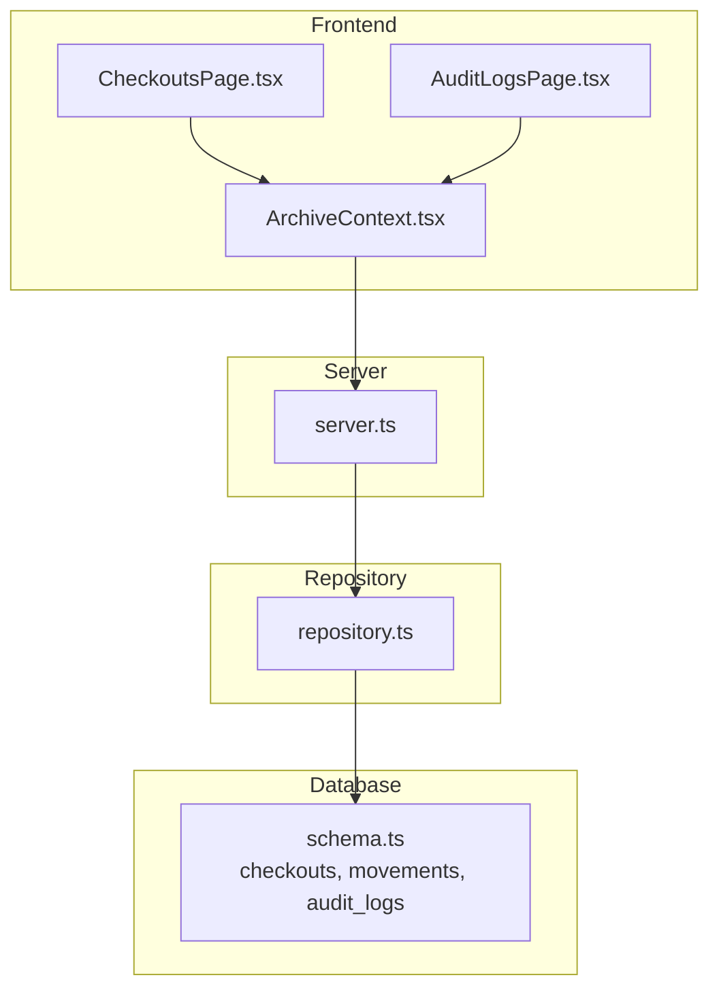
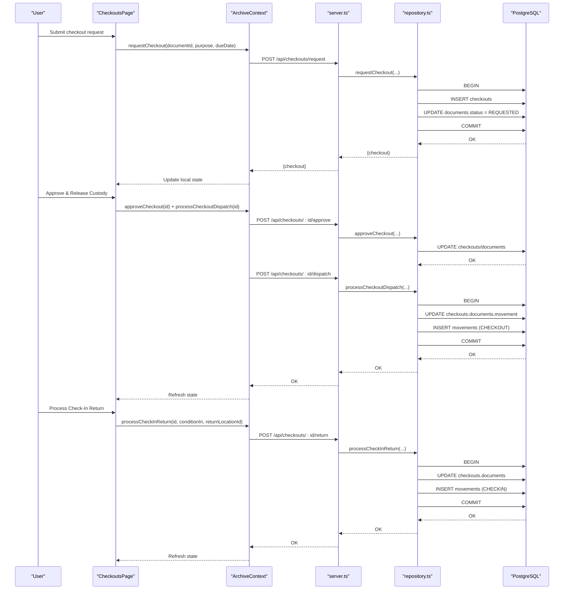
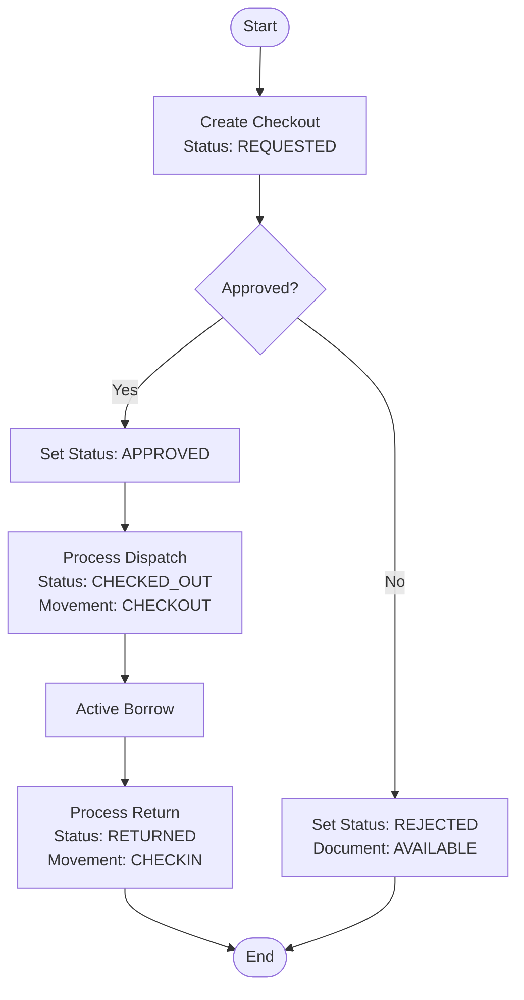
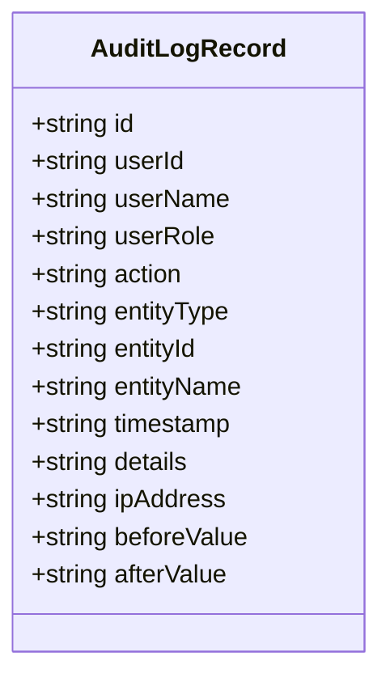
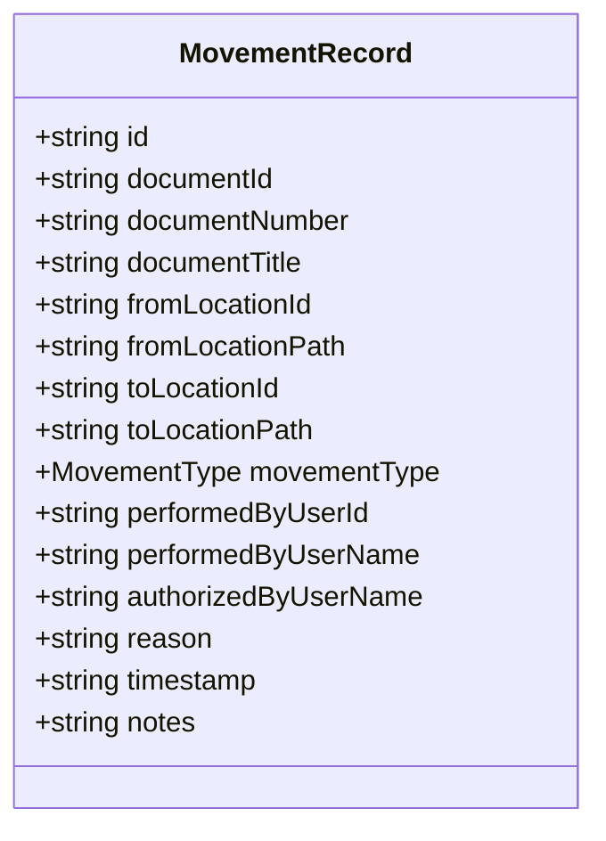
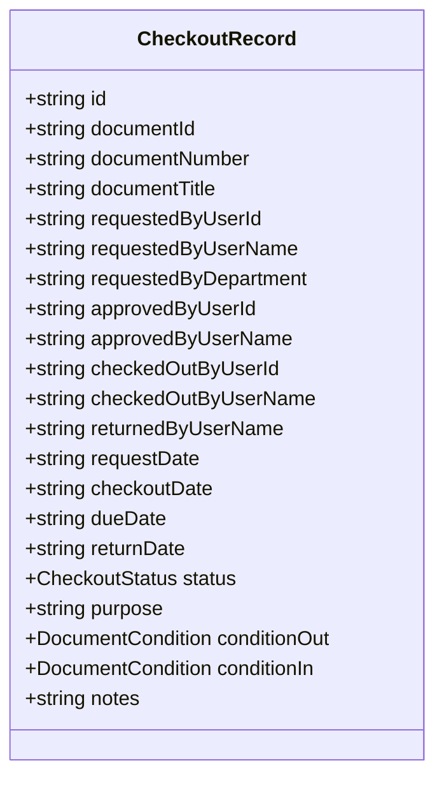
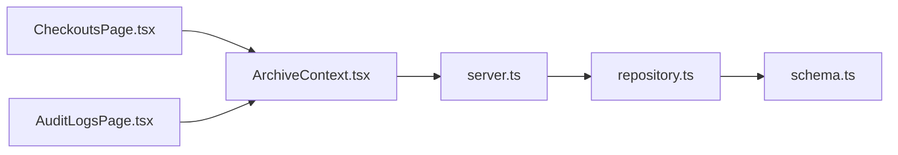

# Movement Tracking & Audit Trail

<cite>
**Referenced Files in This Document**
- [server.ts](file://server.ts)
- [src/db/schema.ts](file://src/db/schema.ts)
- [src/db/repository.ts](file://src/db/repository.ts)
- [src/types.ts](file://src/types.ts)
- [src/context/ArchiveContext.tsx](file://src/context/ArchiveContext.tsx)
- [src/pages/CheckoutsPage.tsx](file://src/pages/CheckoutsPage.tsx)
- [src/pages/AuditLogsPage.tsx](file://src/pages/AuditLogsPage.tsx)
</cite>

## Table of Contents
1. Introduction
2. Project Structure
3. Core Components
4. Architecture Overview
5. Detailed Component Analysis
6. Dependency Analysis
7. Performance Considerations
8. Troubleshooting Guide
9. Conclusion
10. Appendices

## Introduction
This document explains how ArchiveHub records and visualizes every movement of physical documents through the checkout lifecycle, and how it maintains an immutable audit trail for compliance. It covers request submission, approval decisions, physical dispatch, check-in returns, status changes, and the data structures that capture who did what and when. It also provides guidance on generating movement reports, investigating discrepancies, using audit trails for compliance, security considerations for audit log access, retention policies for historical movement data, and integration points with other system components.

## Project Structure
The movement tracking and audit trail system spans UI pages, a React context orchestrating state and API calls, a server exposing REST endpoints, and a repository layer persisting to PostgreSQL (with memory fallback). The database schema defines core tables for documents, checkouts, movements, and audit logs.

**Diagram sources**
- [server.ts:363-471](file://server.ts#L363-L471)
- [src/db/schema.ts:118-167](file://src/db/schema.ts#L118-L167)
- [src/context/ArchiveContext.tsx:198-222](file://src/context/ArchiveContext.tsx#L198-L222)
- [src/pages/CheckoutsPage.tsx:23-33](file://src/pages/CheckoutsPage.tsx#L23-L33)
- [src/pages/AuditLogsPage.tsx:5-18](file://src/pages/AuditLogsPage.tsx#L5-L18)

**Section sources**
- [server.ts:363-471](file://server.ts#L363-L471)
- [src/db/schema.ts:118-167](file://src/db/schema.ts#L118-L167)
- [src/context/ArchiveContext.tsx:198-222](file://src/context/ArchiveContext.tsx#L198-L222)
- [src/pages/CheckoutsPage.tsx:23-33](file://src/pages/CheckoutsPage.tsx#L23-L33)
- [src/pages/AuditLogsPage.tsx:5-18](file://src/pages/AuditLogsPage.tsx#L5-L18)

## Core Components
- Checkout workflow: Request, Approve/Reject, Dispatch (physical release), Return (check-in). Each step updates the checkout record, document status/location, and creates movement entries where applicable.
- Movements table: Immutable chronological record of physical location changes, including from/to locations and reasons.
- Audit logs table: Tamper-evident ledger capturing user actions across the system, including checkout events and metadata changes.
- UI surfaces: Checkouts page for circulation desk operations; Audit Logs page for reviewing the immutable ledger.

Key responsibilities:
- ArchiveContext coordinates frontend state and API calls for all checkout-related actions.
- Repository implements transactional persistence and ensures movements and audit logs are created consistently.
- Server exposes REST endpoints for each operation and delegates to repository methods.

**Section sources**
- [src/context/ArchiveContext.tsx:854-966](file://src/context/ArchiveContext.tsx#L854-L966)
- [src/db/repository.ts:840-1122](file://src/db/repository.ts#L840-L1122)
- [server.ts:373-441](file://server.ts#L373-L441)
- [src/pages/CheckoutsPage.tsx:211-249](file://src/pages/CheckoutsPage.tsx#L211-L249)
- [src/pages/AuditLogsPage.tsx:46-90](file://src/pages/AuditLogsPage.tsx#L46-L90)

## Architecture Overview
The checkout lifecycle is implemented as a sequence of server-side transactions that update operational data and append immutable records to movements and audit logs.

**Diagram sources**
- [src/context/ArchiveContext.tsx:854-966](file://src/context/ArchiveContext.tsx#L854-L966)
- [server.ts:373-441](file://server.ts#L373-L441)
- [src/db/repository.ts:840-1122](file://src/db/repository.ts#L840-L1122)

## Detailed Component Analysis

### Checkout Lifecycle and Movement Logging
- Request submission: Creates a checkout record with status REQUESTED and sets the document status to REQUESTED. No movement is recorded at this stage.
- Approval decision: Updates checkout status to APPROVED and document status to APPROVED. No movement is recorded yet.
- Physical dispatch: Transitions checkout to CHECKED_OUT, moves the document’s current location to a temporary or assigned location, and records a movement entry with type CHECKOUT.
- Check-in return: Transitions checkout to RETURNED, restores the document to its home/archive location, updates condition if provided, and records a movement entry with type CHECKIN.

**Diagram sources**
- [src/db/repository.ts:840-1122](file://src/db/repository.ts#L840-L1122)
- [src/context/ArchiveContext.tsx:854-966](file://src/context/ArchiveContext.tsx#L854-L966)

**Section sources**
- [src/db/repository.ts:840-1122](file://src/db/repository.ts#L840-L1122)
- [src/context/ArchiveContext.tsx:854-966](file://src/context/ArchiveContext.tsx#L854-L966)
- [src/pages/CheckoutsPage.tsx:211-249](file://src/pages/CheckoutsPage.tsx#L211-L249)

### Audit Trail Data Structure
The audit log captures:
- Who performed the action (userId, userName, userRole)
- What happened (action, entityType, entityId, entityName)
- When it occurred (timestamp)
- Contextual details (details, beforeValue, afterValue)

This structure supports compliance reporting and forensic investigation by providing a complete, timestamped history of system interactions.

**Section sources**
- [src/types.ts:260-274](file://src/types.ts#L260-L274)
- [src/db/schema.ts:213-227](file://src/db/schema.ts#L213-L227)
- [src/db/repository.ts:1171-1217](file://src/db/repository.ts#L1171-L1217)

### Movement History Visualization
The Audit Logs page displays a filterable list of audit entries, showing timestamp, action event, user persona, target entity, and transaction details. While the primary movement view is via the movements endpoint, the audit logs provide a unified ledger for all significant actions, including checkout lifecycle events.

**Diagram sources**
- [src/types.ts:260-274](file://src/types.ts#L260-L274)

**Section sources**
- [src/pages/AuditLogsPage.tsx:46-90](file://src/pages/AuditLogsPage.tsx#L46-L90)
- [src/db/repository.ts:1171-1194](file://src/db/repository.ts#L1171-L1194)

### Movement Record Model
Movements capture physical relocation events with:
- Document identity (documentId, documentNumber, documentTitle)
- From/to locations (ids and human-readable paths)
- Movement type (INITIAL_FILING, CHECKOUT, CHECKIN, RELOCATION, TRANSFER, AUDIT_CORRECTION)
- Actor and authorization (performedByUserId, performedByUserName, authorizedByUserName)
- Reason and notes
- Timestamp

**Diagram sources**
- [src/types.ts:185-203](file://src/types.ts#L185-L203)
- [src/db/schema.ts:150-167](file://src/db/schema.ts#L150-L167)

**Section sources**
- [src/types.ts:185-203](file://src/types.ts#L185-L203)
- [src/db/schema.ts:150-167](file://src/db/schema.ts#L150-L167)
- [src/db/repository.ts:1124-1150](file://src/db/repository.ts#L1124-L1150)

### Checkout Record Model
Checkouts track borrowing workflows with:
- Document identity and requester information
- Approval and custody fields (approvedBy, checkedOutBy, returnedBy)
- Dates (request, checkout, due, return)
- Status transitions (REQUESTED, APPROVED, REJECTED, CHECKED_OUT, OVERDUE, RETURNED)
- Purpose, conditions, and notes

**Diagram sources**
- [src/types.ts:205-235](file://src/types.ts#L205-L235)
- [src/db/schema.ts:118-148](file://src/db/schema.ts#L118-L148)

**Section sources**
- [src/types.ts:205-235](file://src/types.ts#L205-L235)
- [src/db/schema.ts:118-148](file://src/db/schema.ts#L118-L148)

### API Integration Points
- GET /api/movements: Returns all movement records for visualization and reporting.
- GET /api/audit-logs: Returns audit logs for compliance review.
- POST /api/checkouts/request: Submits a new checkout request.
- POST /api/checkouts/:id/approve: Approves a checkout request.
- POST /api/checkouts/:id/reject: Rejects a checkout request.
- POST /api/checkouts/:id/dispatch: Processes physical dispatch and records a CHECKOUT movement.
- POST /api/checkouts/:id/return: Processes check-in return and records a CHECKIN movement.

**Section sources**
- [server.ts:363-471](file://server.ts#L363-L471)

## Dependency Analysis
- Frontend pages depend on ArchiveContext for state and operations.
- ArchiveContext depends on server endpoints for persistence and triggers repository logic.
- Repository depends on PostgreSQL schema for structured storage and uses transactions to ensure consistency between operational updates and immutable logs.
- Schema defines strict relationships and constraints for checkouts, movements, and audit logs.

**Diagram sources**
- [src/pages/CheckoutsPage.tsx:23-33](file://src/pages/CheckoutsPage.tsx#L23-L33)
- [src/pages/AuditLogsPage.tsx:5-18](file://src/pages/AuditLogsPage.tsx#L5-L18)
- [src/context/ArchiveContext.tsx:198-222](file://src/context/ArchiveContext.tsx#L198-L222)
- [server.ts:363-471](file://server.ts#L363-L471)
- [src/db/repository.ts:840-1122](file://src/db/repository.ts#L840-L1122)
- [src/db/schema.ts:118-167](file://src/db/schema.ts#L118-L167)

**Section sources**
- [src/context/ArchiveContext.tsx:198-222](file://src/context/ArchiveContext.tsx#L198-L222)
- [server.ts:363-471](file://server.ts#L363-L471)
- [src/db/repository.ts:840-1122](file://src/db/repository.ts#L840-L1122)
- [src/db/schema.ts:118-167](file://src/db/schema.ts#L118-L167)

## Performance Considerations
- Transactions: Checkout operations use database transactions to ensure atomicity when updating checkouts, documents, and inserting movements. This reduces partial writes and improves consistency under load.
- Memory fallback: If PostgreSQL is unavailable, the repository falls back to in-memory arrays. This is useful for development but not suitable for production audit integrity.
- Batch reads: The context fetches multiple datasets in parallel to reduce round-trips during initialization.

Recommendations:
- Ensure indexes on frequently queried columns (e.g., movements.timestamp, checkouts.status, audit_logs.entityId) to support fast filtering and timeline views.
- Paginate large movement and audit log queries to avoid heavy payloads in the UI.
- Avoid synchronous blocking operations in the UI; rely on async context updates and optimistic UI where appropriate.

[No sources needed since this section provides general guidance]

## Troubleshooting Guide
Common issues and resolutions:
- Checkout request fails: Verify document exists and is available; check network errors and backend responses. Inspect the request payload for required fields (documentId, purpose, dueDate, user).
- Approval does not reflect in UI: Confirm the approve endpoint was called and the repository updated both checkout and document statuses; refresh data via context sync.
- Dispatch does not create movement: Ensure fromPath and toPath are provided; verify repository transaction commits and movements insertion.
- Return does not restore location: Validate returnLocationId and conditionIn; confirm repository updates document status to AVAILABLE and inserts a CHECKIN movement.
- Audit logs missing: Confirm audit log creation paths are executed; check repository createAuditLog usage and server endpoint availability.

Operational checks:
- Use GET /api/health to verify database connectivity.
- Use GET /api/movements and GET /api/audit-logs to inspect persisted records.
- Use GET /api/checkouts to validate checkout states and timestamps.

**Section sources**
- [server.ts:19-38](file://server.ts#L19-L38)
- [server.ts:363-471](file://server.ts#L363-L471)
- [src/db/repository.ts:840-1122](file://src/db/repository.ts#L840-L1122)
- [src/db/repository.ts:1171-1217](file://src/db/repository.ts#L1171-L1217)

## Conclusion
ArchiveHub’s movement tracking and audit trail system provides a robust, transactional pipeline for recording every document movement within checkout workflows. The combination of movements and audit logs ensures traceability, accountability, and compliance readiness. The UI surfaces enable efficient management of circulation and transparent review of the immutable ledger. With proper indexing, pagination, and secure access controls, the system can scale to meet organizational needs while preserving data integrity.

[No sources needed since this section summarizes without analyzing specific files]

## Appendices

### Generating Movement Reports
- Export movements via GET /api/movements and filter by documentId, movementType, date range, and performer.
- Combine with audit logs via GET /api/audit-logs to correlate operational changes with broader system activity.
- Build timelines per document by sorting movements by timestamp and grouping by movementType.

[No sources needed since this section provides general guidance]

### Investigating Discrepancies
- Cross-reference checkout status transitions with corresponding movements to identify gaps (e.g., CHECKED_OUT without a CHECKOUT movement).
- Review audit logs for unauthorized or unexpected actions on documents or locations.
- Validate document currentLocationId against expected homeLocationId after returns.

[No sources needed since this section provides general guidance]

### Compliance Usage
- Use audit logs to demonstrate who accessed or modified records, when, and why.
- Retain movements and audit logs according to policy; consider archiving older records to cold storage while maintaining query access.
- Implement role-based access to audit logs to restrict sensitive visibility.

[No sources needed since this section provides general guidance]

### Security Considerations for Audit Log Access
- Restrict read/write access to audit logs to authorized roles (e.g., ADMIN, RECORDS_ADMIN, AUDITOR).
- Enforce authentication and authorization at the API layer before serving audit data.
- Protect audit logs from modification or deletion; consider append-only storage and tamper-evident mechanisms.

[No sources needed since this section provides general guidance]

### Retention Policies for Historical Movement Data
- Define retention periods for movements and audit logs based on regulatory requirements.
- Implement archival strategies to move older records to long-term storage while keeping recent data accessible.
- Ensure purge operations do not affect active investigations or ongoing audits.

[No sources needed since this section provides general guidance]