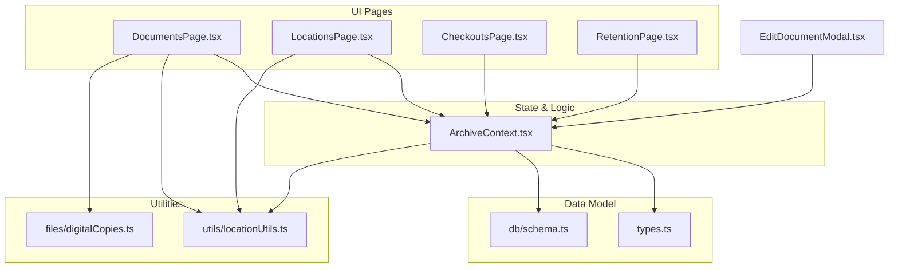
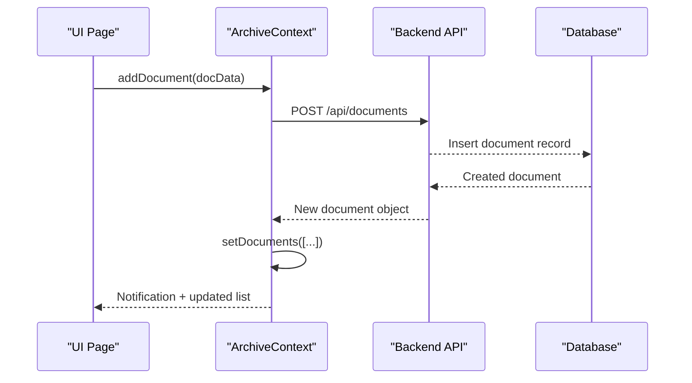
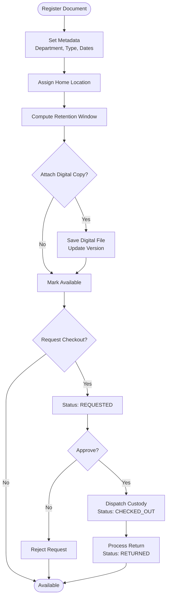
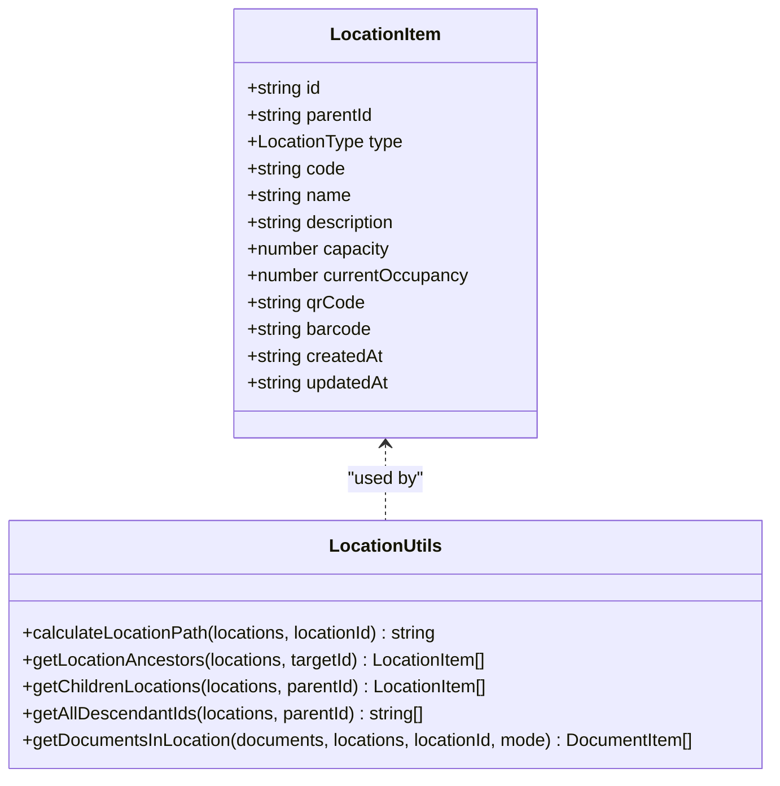
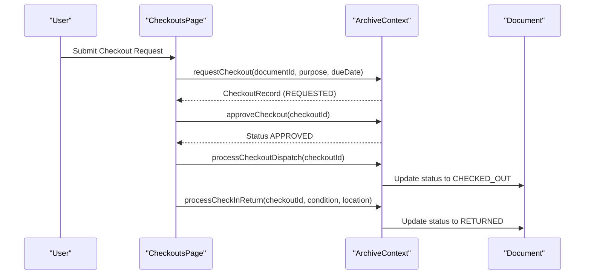
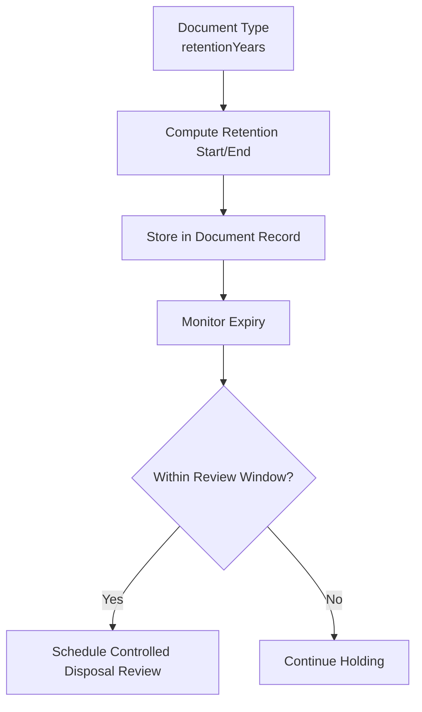
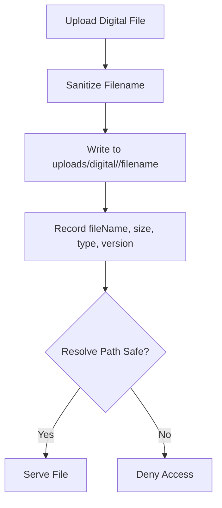
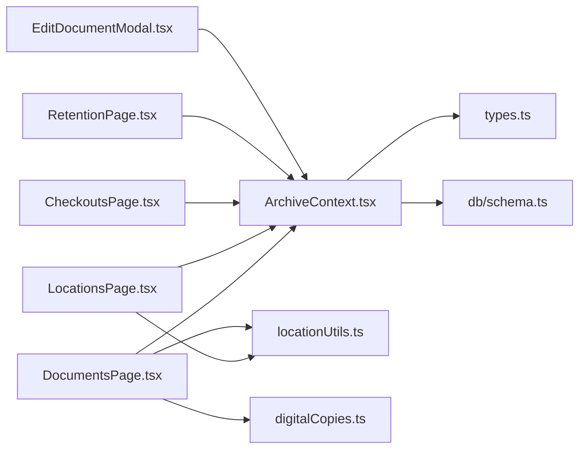

# Core Features

<cite>
**Referenced Files in This Document**
- [types.ts](file://src/types.ts)
- [schema.ts](file://src/db/schema.ts)
- [ArchiveContext.tsx](file://src/context/ArchiveContext.tsx)
- [DocumentsPage.tsx](file://src/pages/DocumentsPage.tsx)
- [LocationsPage.tsx](file://src/pages/LocationsPage.tsx)
- [CheckoutsPage.tsx](file://src/pages/CheckoutsPage.tsx)
- [RetentionPage.tsx](file://src/pages/RetentionPage.tsx)
- [locationUtils.ts](file://src/utils/locationUtils.ts)
- [digitalCopies.ts](file://src/files/digitalCopies.ts)
- [EditDocumentModal.tsx](file://src/components/documents/EditDocumentModal.tsx)
</cite>

## Table of Contents
1. [Introduction](#introduction)
2. [Project Structure](#project-structure)
3. [Core Components](#core-components)
4. [Architecture Overview](#architecture-overview)
5. [Detailed Component Analysis](#detailed-component-analysis)
6. [Dependency Analysis](#dependency-analysis)
7. [Performance Considerations](#performance-considerations)
8. [Troubleshooting Guide](#troubleshooting-guide)
9. [Conclusion](#conclusion)

## Introduction
This document explains ArchiveHub’s core features for managing the lifecycle of physical and digital records, organizing them within a hierarchical location system, processing checkouts with approvals, and automating retention policy calculations and compliance reporting. It covers how documents move through states from creation to disposal, metadata management, digital copy attachments, six-level location hierarchy with capacity tracking and QR labeling, end-to-end checkout workflows, and retention automation. Practical examples illustrate common operations such as registering a document, assigning it to a location, and approving a checkout. User roles and permissions that affect access are also described.

## Project Structure
ArchiveHub is organized into feature-based pages, shared components, a central context for state and business logic, database schema definitions, utility functions, and file handling utilities. The main entry points for users are the Pages (Documents, Locations, Checkouts, Retention), while the Context orchestrates data operations and API synchronization.

**Diagram sources**
- [DocumentsPage.tsx:1-120](file://src/pages/DocumentsPage.tsx#L1-L120)
- [LocationsPage.tsx:1-120](file://src/pages/LocationsPage.tsx#L1-L120)
- [CheckoutsPage.tsx:1-120](file://src/pages/CheckoutsPage.tsx#L1-L120)
- [RetentionPage.tsx:1-80](file://src/pages/RetentionPage.tsx#L1-L80)
- [ArchiveContext.tsx:165-223](file://src/context/ArchiveContext.tsx#L165-L223)
- [types.ts:1-120](file://src/types.ts#L1-L120)
- [schema.ts:12-116](file://src/db/schema.ts#L12-L116)
- [locationUtils.ts:1-96](file://src/utils/locationUtils.ts#L1-L96)
- [digitalCopies.ts:1-47](file://src/files/digitalCopies.ts#L1-L47)
- [EditDocumentModal.tsx:1-120](file://src/components/documents/EditDocumentModal.tsx#L1-L120)

**Section sources**
- [DocumentsPage.tsx:1-120](file://src/pages/DocumentsPage.tsx#L1-L120)
- [LocationsPage.tsx:1-120](file://src/pages/LocationsPage.tsx#L1-L120)
- [CheckoutsPage.tsx:1-120](file://src/pages/CheckoutsPage.tsx#L1-L120)
- [RetentionPage.tsx:1-80](file://src/pages/RetentionPage.tsx#L1-L80)
- [ArchiveContext.tsx:165-223](file://src/context/ArchiveContext.tsx#L165-L223)
- [types.ts:1-120](file://src/types.ts#L1-L120)
- [schema.ts:12-116](file://src/db/schema.ts#L12-L116)
- [locationUtils.ts:1-96](file://src/utils/locationUtils.ts#L1-L96)
- [digitalCopies.ts:1-47](file://src/files/digitalCopies.ts#L1-L47)
- [EditDocumentModal.tsx:1-120](file://src/components/documents/EditDocumentModal.tsx#L1-L120)

## Core Components
- Document Lifecycle Management: Documents have statuses representing their lifecycle from registration to disposal. They include metadata fields for ownership, classification, confidentiality, condition, dates, and retention windows. Digital copies can be attached and versioned.
- Hierarchical Location Organization: Locations form a tree structure supporting multiple levels (Building → Floor → Room → Storage Area → Cabinet → Rack → Shelf → Box → Folder). Each node has code, name, description, capacity, occupancy, QR/barcode, and optional images.
- Checkout Workflows: Requests are created, approved or rejected, dispatched, and returned. Statuses track the full circulation process including overdue conditions.
- Retention Policy Automation: Document types define retention periods; documents compute start/end dates. The Retention page surfaces expiring records and supports scheduling reviews.
- Roles and Permissions: Users have roles (ADMIN, RECORDS_ADMIN, RECORDS_OFFICER, DEPT_USER, AUDITOR) and approval status affecting login and actions.

**Section sources**
- [types.ts:54-68](file://src/types.ts#L54-L68)
- [types.ts:135-183](file://src/types.ts#L135-L183)
- [types.ts:205-235](file://src/types.ts#L205-L235)
- [types.ts:237-244](file://src/types.ts#L237-L244)
- [schema.ts:67-116](file://src/db/schema.ts#L67-L116)
- [schema.ts:118-148](file://src/db/schema.ts#L118-L148)
- [schema.ts:169-177](file://src/db/schema.ts#L169-L177)
- [ArchiveContext.tsx:22-30](file://src/context/ArchiveContext.tsx#L22-L30)

## Architecture Overview
The application uses a React frontend with a centralized context for state and business logic. Pages interact with the context to perform CRUD operations on documents, locations, checkouts, and bundles. Data is synchronized with backend APIs when available; otherwise, local fallbacks maintain functionality. Utilities provide location path calculation and digital file handling.

**Diagram sources**
- [ArchiveContext.tsx:752-777](file://src/context/ArchiveContext.tsx#L752-L777)
- [DocumentsPage.tsx:147-199](file://src/pages/DocumentsPage.tsx#L147-L199)

**Section sources**
- [ArchiveContext.tsx:197-255](file://src/context/ArchiveContext.tsx#L197-L255)
- [DocumentsPage.tsx:147-199](file://src/pages/DocumentsPage.tsx#L147-L199)

## Detailed Component Analysis

### Document Lifecycle Management
Documents progress through defined statuses from creation to disposal. Registration sets initial metadata, home/current locations, retention dates, and optional digital copies. Editing allows updates to classification, custody, condition, and bundle association. Movement and checkout flows update current location and status accordingly.

**Diagram sources**
- [DocumentsPage.tsx:147-199](file://src/pages/DocumentsPage.tsx#L147-L199)
- [ArchiveContext.tsx:752-777](file://src/context/ArchiveContext.tsx#L752-L777)
- [CheckoutsPage.tsx:213-248](file://src/pages/CheckoutsPage.tsx#L213-L248)

**Section sources**
- [types.ts:54-68](file://src/types.ts#L54-L68)
- [types.ts:135-183](file://src/types.ts#L135-L183)
- [DocumentsPage.tsx:147-199](file://src/pages/DocumentsPage.tsx#L147-L199)
- [EditDocumentModal.tsx:147-197](file://src/components/documents/EditDocumentModal.tsx#L147-L197)

### Hierarchical Location Organization
Locations support a multi-level hierarchy with codes, names, descriptions, capacities, and QR/barcodes. The system calculates full paths and displays breadcrumbs. Capacity tracking helps manage storage limits. Images aid identification.

**Diagram sources**
- [types.ts:24-52](file://src/types.ts#L24-L52)
- [locationUtils.ts:1-96](file://src/utils/locationUtils.ts#L1-L96)

**Section sources**
- [LocationsPage.tsx:146-166](file://src/pages/LocationsPage.tsx#L146-L166)
- [LocationsPage.tsx:188-255](file://src/pages/LocationsPage.tsx#L188-L255)
- [locationUtils.ts:1-96](file://src/utils/locationUtils.ts#L1-L96)

### Checkout Workflows
The checkout flow includes request submission, approval/rejection, dispatching custody, and return processing. The Circulation Desk page provides KPIs and actions per status.

**Diagram sources**
- [CheckoutsPage.tsx:213-248](file://src/pages/CheckoutsPage.tsx#L213-L248)
- [ArchiveContext.tsx:89-94](file://src/context/ArchiveContext.tsx#L89-L94)

**Section sources**
- [CheckoutsPage.tsx:23-51](file://src/pages/CheckoutsPage.tsx#L23-L51)
- [CheckoutsPage.tsx:213-248](file://src/pages/CheckoutsPage.tsx#L213-L248)
- [ArchiveContext.tsx:89-94](file://src/context/ArchiveContext.tsx#L89-L94)

### Retention Policy Automation
Retention policies are tied to document types and calculate retention windows automatically upon registration. The Retention page lists active schedules and highlights records approaching expiry, enabling scheduled reviews and compliance reporting.

**Diagram sources**
- [DocumentsPage.tsx:151-187](file://src/pages/DocumentsPage.tsx#L151-L187)
- [RetentionPage.tsx:19-26](file://src/pages/RetentionPage.tsx#L19-L26)
- [schema.ts:37-46](file://src/db/schema.ts#L37-L46)
- [schema.ts:169-177](file://src/db/schema.ts#L169-L177)

**Section sources**
- [RetentionPage.tsx:19-26](file://src/pages/RetentionPage.tsx#L19-L26)
- [RetentionPage.tsx:55-77](file://src/pages/RetentionPage.tsx#L55-L77)
- [DocumentsPage.tsx:151-187](file://src/pages/DocumentsPage.tsx#L151-L187)

### Digital Copy Attachment
Documents can attach digitized surrogates. The system saves files securely under a document-scoped directory, tracks file metadata (name, size, type, version), and resolves safe paths for retrieval.

**Diagram sources**
- [digitalCopies.ts:6-31](file://src/files/digitalCopies.ts#L6-L31)
- [digitalCopies.ts:33-41](file://src/files/digitalCopies.ts#L33-L41)
- [EditDocumentModal.tsx:559-604](file://src/components/documents/EditDocumentModal.tsx#L559-L604)

**Section sources**
- [digitalCopies.ts:1-47](file://src/files/digitalCopies.ts#L1-L47)
- [EditDocumentModal.tsx:559-604](file://src/components/documents/EditDocumentModal.tsx#L559-L604)

### Practical Examples
- Register a new physical document: Fill title, department, document type, home location, and optional digital copy; system computes retention window and marks as available.
- Assign location: Choose a hierarchical location; system calculates path and displays breadcrumbs; capacity tracking reflects usage.
- Approve checkout: From the Circulation Desk, approve pending requests and dispatch custody; later process returns to restore availability.

**Section sources**
- [DocumentsPage.tsx:147-199](file://src/pages/DocumentsPage.tsx#L147-L199)
- [LocationsPage.tsx:146-166](file://src/pages/LocationsPage.tsx#L146-L166)
- [CheckoutsPage.tsx:213-248](file://src/pages/CheckoutsPage.tsx#L213-L248)

## Dependency Analysis
Key dependencies include:
- Pages depend on ArchiveContext for state and operations.
- ArchiveContext depends on types and schema for data models and persists via backend APIs.
- Location utilities provide path calculations used across pages.
- Digital copies module integrates with file system operations.

**Diagram sources**
- [DocumentsPage.tsx:1-120](file://src/pages/DocumentsPage.tsx#L1-L120)
- [LocationsPage.tsx:1-120](file://src/pages/LocationsPage.tsx#L1-L120)
- [CheckoutsPage.tsx:1-120](file://src/pages/CheckoutsPage.tsx#L1-L120)
- [RetentionPage.tsx:1-80](file://src/pages/RetentionPage.tsx#L1-L80)
- [ArchiveContext.tsx:165-223](file://src/context/ArchiveContext.tsx#L165-L223)
- [types.ts:1-120](file://src/types.ts#L1-L120)
- [schema.ts:12-116](file://src/db/schema.ts#L12-L116)
- [locationUtils.ts:1-96](file://src/utils/locationUtils.ts#L1-L96)
- [digitalCopies.ts:1-47](file://src/files/digitalCopies.ts#L1-L47)
- [EditDocumentModal.tsx:1-120](file://src/components/documents/EditDocumentModal.tsx#L1-L120)

**Section sources**
- [ArchiveContext.tsx:197-255](file://src/context/ArchiveContext.tsx#L197-L255)
- [locationUtils.ts:1-96](file://src/utils/locationUtils.ts#L1-L96)

## Performance Considerations
- Batch operations: Use bulk selection for tagging and bundling to reduce repeated API calls.
- Efficient filtering: Leverage precomputed descendant IDs and sets for fast location queries.
- Local fallbacks: Context maintains local state when backend is unreachable to keep UI responsive.
- Image optimization: Use preset images and lazy loading where possible to reduce payload sizes.

[No sources needed since this section provides general guidance]

## Troubleshooting Guide
- Backend connectivity: If APIs fail, context falls back to local state; verify server health endpoint and environment configuration.
- Location deletion errors: Cannot delete locations with children or documents; remove dependencies first.
- Checkout actions: Ensure proper status transitions; approve before dispatching and process returns to close cycles.
- Digital file access: Paths must resolve safely; ensure files exist under the correct document-scoped directory.

**Section sources**
- [ArchiveContext.tsx:257-278](file://src/context/ArchiveContext.tsx#L257-L278)
- [ArchiveContext.tsx:729-749](file://src/context/ArchiveContext.tsx#L729-L749)
- [CheckoutsPage.tsx:213-248](file://src/pages/CheckoutsPage.tsx#L213-L248)
- [digitalCopies.ts:33-41](file://src/files/digitalCopies.ts#L33-L41)

## Conclusion
ArchiveHub provides a comprehensive system for managing physical and digital records with robust lifecycle controls, hierarchical location organization, structured checkout workflows, and automated retention calculations. The architecture balances user-friendly interfaces with reliable state management and extensible utilities, ensuring operational efficiency and compliance readiness.

[No sources needed since this section summarizes without analyzing specific files]