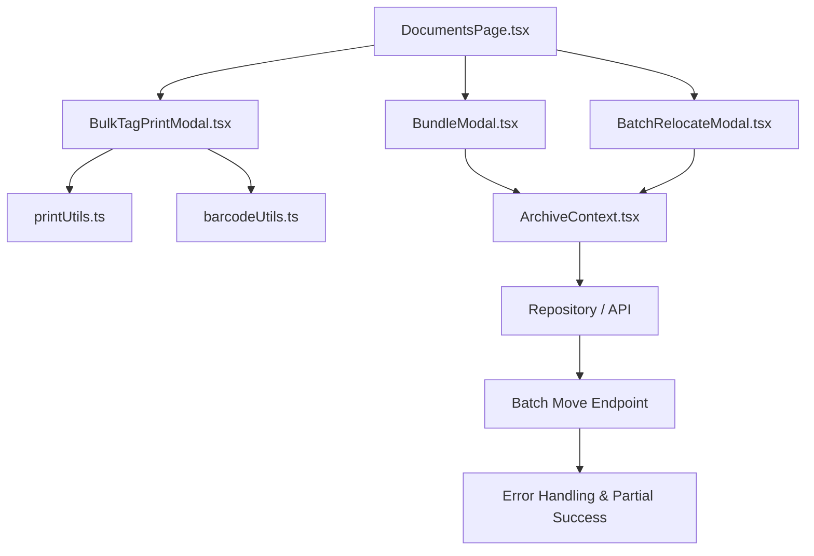
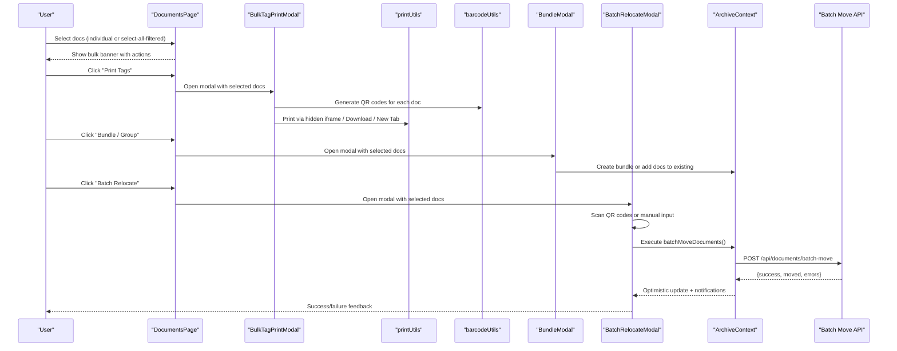
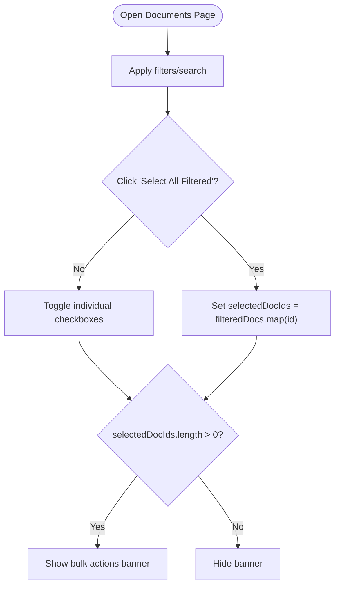
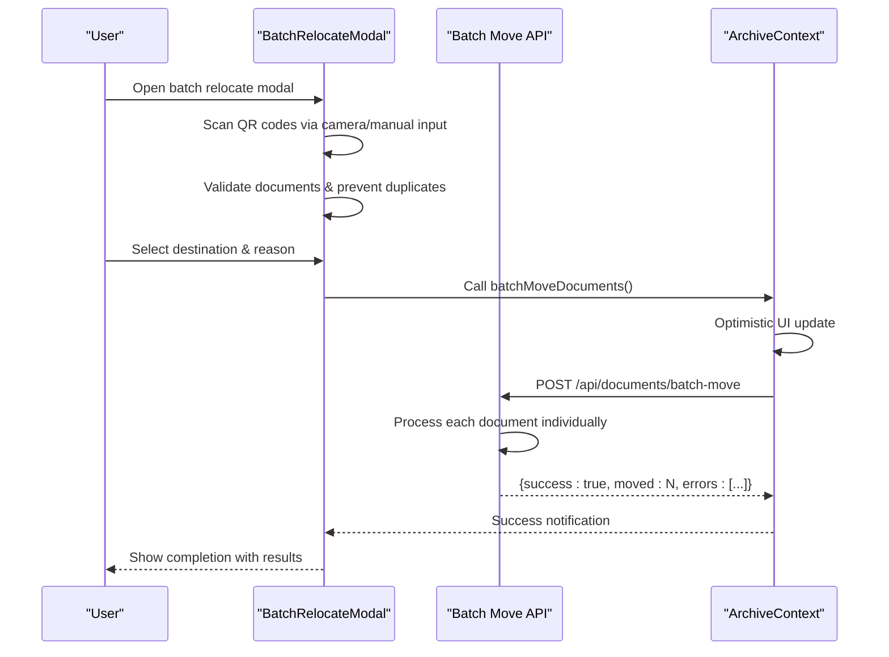
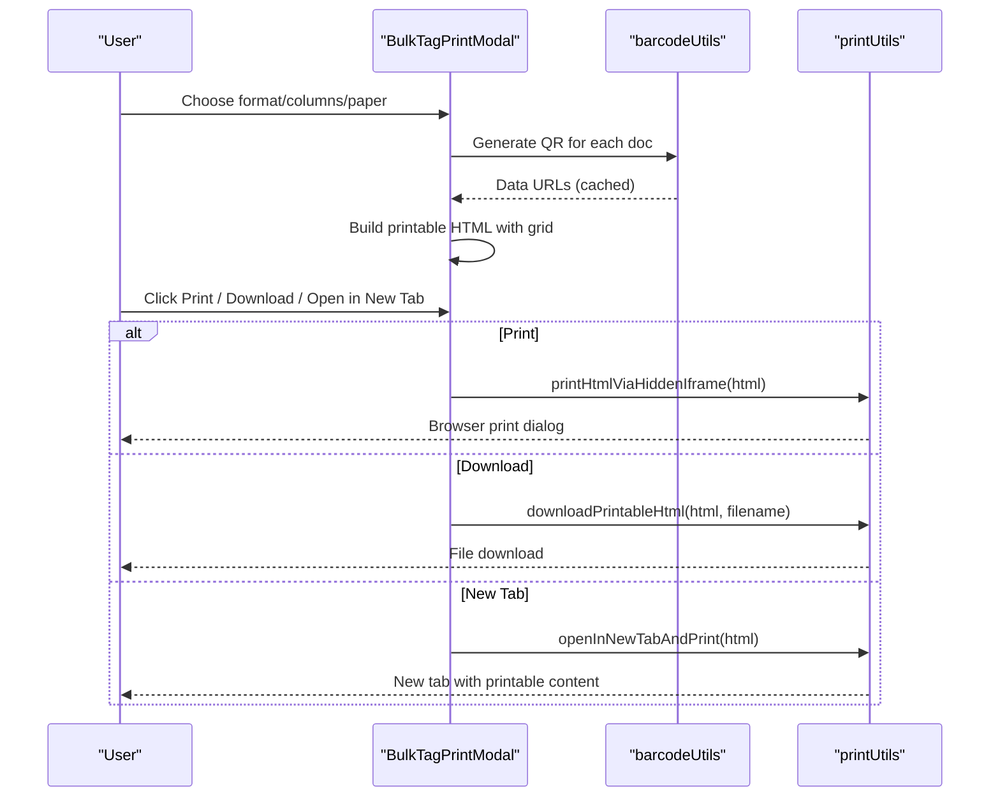
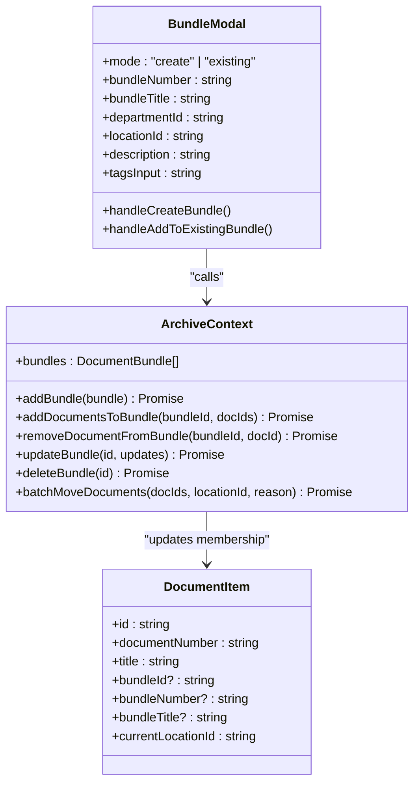
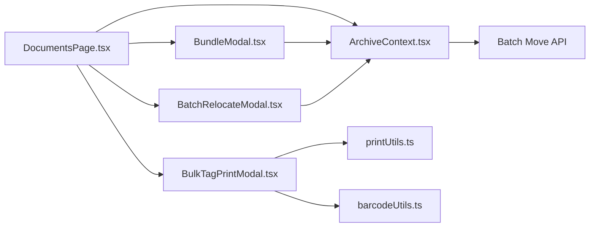
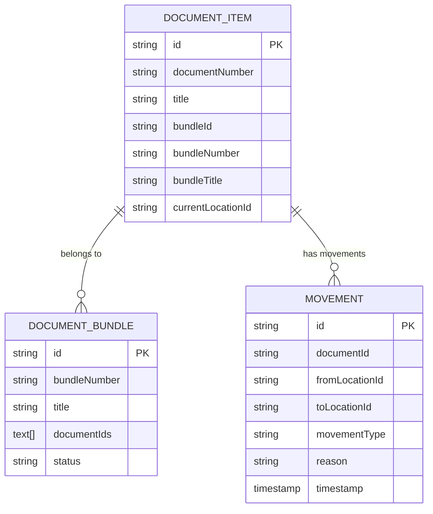

# Bulk Operations

<cite>
**Referenced Files in This Document**
- [DocumentsPage.tsx](file://src/pages/DocumentsPage.tsx)
- [BulkTagPrintModal.tsx](file://src/components/documents/BulkTagPrintModal.tsx)
- [BundleModal.tsx](file://src/components/documents/BundleModal.tsx)
- [BatchRelocateModal.tsx](file://src/components/scanner/BatchRelocateModal.tsx)
- [ArchiveContext.tsx](file://src/context/ArchiveContext.tsx)
- [server.ts](file://server.ts)
- [repository.ts](file://src/db/repository.ts)
- [printUtils.ts](file://src/utils/printUtils.ts)
- [barcodeUtils.ts](file://src/utils/barcodeUtils.ts)
- [types.ts](file://src/types.ts)
</cite>

## Update Summary
**Changes Made**
- Added comprehensive documentation for batch document relocation functionality
- Updated architecture overview to include batch relocation workflow
- Enhanced bulk operations section with new relocation capabilities
- Added error handling and partial success reporting details
- Updated practical examples to include relocation scenarios

## Table of Contents
1. Introduction
2. Project Structure
3. Core Components
4. Architecture Overview
5. Detailed Component Analysis
6. Dependency Analysis
7. Performance Considerations
8. Troubleshooting Guide
9. Conclusion
10. Appendices

## Introduction
This document explains ArchiveHub's bulk operations for document management: selecting multiple documents, batch printing of tag stickers, bundling/grouping documents into dossiers, and **batch document relocation**. It covers selection strategies (select all filtered vs individual), operation confirmation flows, progress tracking, template customization for print outputs, the end-to-end workflow for creating bundles with automatic numbering, title suggestions, and member management, and **the complete batch relocation process with QR scanning, error handling, and partial success reporting**. Practical examples are included to help you prepare documents for disposal, create project bundles, generate labels for storage organization, and efficiently relocate multiple documents to new storage locations.

## Project Structure
Bulk operations span several key areas:
- Documents page: selection UI, filters, and bulk action banner
- Bulk tag sticker modal: template selection, preview, and print/download/open-in-new-tab
- Bundle modal: create new bundle or add to existing; AI-assisted title/description/tags
- **Batch relocation modal: QR code scanning, manual input, destination selection, and execution with error handling**
- Context layer: state and persistence for bundles, documents, and relocation operations
- Utilities: QR code generation and print helpers
- **Server API: batch move endpoint with partial success reporting**

**Diagram sources**
- [DocumentsPage.tsx:427-475](file://src/pages/DocumentsPage.tsx#L427-L475)
- [BulkTagPrintModal.tsx:76-457](file://src/components/documents/BulkTagPrintModal.tsx#L76-L457)
- [BundleModal.tsx:79-131](file://src/components/documents/BundleModal.tsx#L79-L131)
- [BatchRelocateModal.tsx:31-558](file://src/components/scanner/BatchRelocateModal.tsx#L31-L558)
- [ArchiveContext.tsx:609-692](file://src/context/ArchiveContext.tsx#L609-L692)
- [server.ts:456-482](file://server.ts#L456-L482)

**Section sources**
- [DocumentsPage.tsx:427-475](file://src/pages/DocumentsPage.tsx#L427-L475)
- [BulkTagPrintModal.tsx:76-457](file://src/components/documents/BulkTagPrintModal.tsx#L76-L457)
- [BundleModal.tsx:79-131](file://src/components/documents/BundleModal.tsx#L79-L131)
- [BatchRelocateModal.tsx:31-558](file://src/components/scanner/BatchRelocateModal.tsx#L31-L558)
- [ArchiveContext.tsx:609-692](file://src/context/ArchiveContext.tsx#L609-L692)
- [server.ts:456-482](file://server.ts#L456-L482)

## Core Components
- Selection and filtering: The Documents page provides search and filter controls and a "Select All Filtered" checkbox. Selected IDs drive a persistent banner exposing bulk actions.
- Bulk Tag Printing: A modal renders three layout formats (standard sticker, compact label, binder spine), supports column count and paper size, generates QR codes per document, and offers print, download HTML sheet, and open-in-new-tab options.
- Bundling: A modal lets you create a new bundle (with auto-generated number and AI-suggested metadata) or add selected documents to an existing bundle. It updates both local state and backend via context methods.
- **Batch Relocation: A multi-step modal supporting QR code scanning via camera or manual input, destination location selection, optional bundle creation, and execution with comprehensive error handling and partial success reporting.**

Key responsibilities:
- DocumentsPage.tsx: selection state, filters, bulk banner, modals orchestration
- BulkTagPrintModal.tsx: printable HTML generation, QR rendering, print/download/open flows
- BundleModal.tsx: form handling, AI suggestion integration, calling context bundle APIs
- **BatchRelocateModal.tsx: QR scanning lifecycle, document validation, batch execution with error handling, bundle integration**
- ArchiveContext.tsx: bundle CRUD and adding/removing documents from bundles, batch move operations, notifications
- printUtils.ts: hidden iframe printing, downloadable HTML, new tab printing
- barcodeUtils.ts: QR code data URL generation

**Section sources**
- [DocumentsPage.tsx:201-264](file://src/pages/DocumentsPage.tsx#L201-L264)
- [BulkTagPrintModal.tsx:23-74](file://src/components/documents/BulkTagPrintModal.tsx#L23-L74)
- [BundleModal.tsx:19-77](file://src/components/documents/BundleModal.tsx#L19-L77)
- [BatchRelocateModal.tsx:20-558](file://src/components/scanner/BatchRelocateModal.tsx#L20-L558)
- [ArchiveContext.tsx:609-692](file://src/context/ArchiveContext.tsx#L609-L692)
- [printUtils.ts:7-93](file://src/utils/printUtils.ts#L7-L93)
- [barcodeUtils.ts:7-41](file://src/utils/barcodeUtils.ts#L7-L41)

## Architecture Overview
The bulk operations flow is driven by user selections on the Documents page, which triggers either:
- Bulk tag printing: render templates, generate QRs, and print/download/open
- Bundling: create or update bundles and propagate membership changes to documents
- **Batch relocation: scan or select documents, choose destination, execute with error handling and partial success reporting**

**Diagram sources**
- [DocumentsPage.tsx:427-475](file://src/pages/DocumentsPage.tsx#L427-L475)
- [BulkTagPrintModal.tsx:52-74](file://src/components/documents/BulkTagPrintModal.tsx#L52-L74)
- [BatchRelocateModal.tsx:162-201](file://src/components/scanner/BatchRelocateModal.tsx#L162-L201)
- [ArchiveContext.tsx:994-1012](file://src/context/ArchiveContext.tsx#L994-L1012)
- [server.ts:456-482](file://server.ts#L456-L482)

## Detailed Component Analysis

### Selection Mechanism and Bulk Banner
- Individual selection: Each row/card has a checkbox that toggles inclusion in selectedDocIds.
- Select all filtered: A header checkbox selects all currently visible filtered documents; clicking again deselects them.
- Filters: Search query, department, document type, status, confidentiality, and bundle membership filters affect what "select all" applies to.
- Bulk banner: When any items are selected, a banner appears with quick actions to print tags, bundle/group, or batch relocate, plus a clear selection button.

**Diagram sources**
- [DocumentsPage.tsx:201-264](file://src/pages/DocumentsPage.tsx#L201-L264)
- [DocumentsPage.tsx:427-475](file://src/pages/DocumentsPage.tsx#L427-L475)

**Section sources**
- [DocumentsPage.tsx:201-264](file://src/pages/DocumentsPage.tsx#L201-L264)
- [DocumentsPage.tsx:427-475](file://src/pages/DocumentsPage.tsx#L427-L475)

### Batch Document Relocation Workflow
**Updated** Added comprehensive batch relocation functionality with QR scanning, error handling, and partial success reporting.

- **Multi-step Process**: Three-step workflow (Scan → Confirm → Done) with visual progress indicators
- **QR Code Scanning**: Camera-based scanning with continuous capture or manual text input
- **Document Validation**: Real-time validation ensures only valid document QR codes are accepted
- **Duplicate Prevention**: Prevents adding the same document multiple times to the same batch
- **Destination Selection**: Choose target storage location with path visualization
- **Optional Bundle Creation**: Automatically create a dossier during relocation if desired
- **Batch Execution**: Optimistic UI updates followed by server-side processing
- **Error Handling**: Comprehensive error collection with partial success reporting
- **Audit Trail**: Each relocation creates audit entries with from/to locations and reasons

**Diagram sources**
- [BatchRelocateModal.tsx:71-88](file://src/components/scanner/BatchRelocateModal.tsx#L71-L88)
- [BatchRelocateModal.tsx:162-201](file://src/components/scanner/BatchRelocateModal.tsx#L162-L201)
- [ArchiveContext.tsx:994-1012](file://src/context/ArchiveContext.tsx#L994-L1012)
- [server.ts:456-482](file://server.ts#L456-L482)

**Section sources**
- [BatchRelocateModal.tsx:20-558](file://src/components/scanner/BatchRelocateModal.tsx#L20-L558)
- [ArchiveContext.tsx:994-1012](file://src/context/ArchiveContext.tsx#L994-L1012)
- [server.ts:456-482](file://server.ts#L456-L482)

### Bulk Tag Sticker Printing Workflow
- Template customization: Choose between standard sticker, compact label, or binder spine. Column count (1–4) and paper size (Letter/A4/Legal) adjust layout density.
- QR generation: For each document, a QR code image is generated asynchronously and cached in memory for fast preview and print.
- Printable HTML: A self-contained HTML string is built with embedded styles and grid layout based on columns and format.
- Output options:
  - Print via hidden iframe with fallback to window.print()
  - Download standalone HTML sheet
  - Open in new tab for clean printing
- Progress and feedback: Notifications inform users about preparation and success; a loading indicator disables buttons during printing.

**Diagram sources**
- [BulkTagPrintModal.tsx:52-74](file://src/components/documents/BulkTagPrintModal.tsx#L52-L74)
- [BulkTagPrintModal.tsx:76-457](file://src/components/documents/BulkTagPrintModal.tsx#L76-L457)
- [printUtils.ts:7-93](file://src/utils/printUtils.ts#L7-L93)
- [barcodeUtils.ts:7-41](file://src/utils/barcodeUtils.ts#L7-L41)

**Section sources**
- [BulkTagPrintModal.tsx:23-74](file://src/components/documents/BulkTagPrintModal.tsx#L23-L74)
- [BulkTagPrintModal.tsx:76-457](file://src/components/documents/BulkTagPrintModal.tsx#L76-L457)
- [BulkTagPrintModal.tsx:459-484](file://src/components/documents/BulkTagPrintModal.tsx#L459-L484)
- [printUtils.ts:7-93](file://src/utils/printUtils.ts#L7-L93)
- [barcodeUtils.ts:7-41](file://src/utils/barcodeUtils.ts#L7-L41)

### Bundling Process: Creating and Managing Dossiers
- Create new bundle:
  - Auto-numbering: Default bundle number uses a year-based pattern with randomization.
  - Title and description: Defaults include a simple grouping phrase; AI suggests improved titles, descriptions, and tags when opening in create mode.
  - Department and location: Pre-filled from first selected document or defaults; user can change.
  - Submitting creates a bundle and links selected documents to it.
- Add to existing bundle:
  - User selects an existing bundle from a list and adds selected documents to it.
- Member management:
  - Adding documents updates both bundle membership and document-level fields (bundleId, bundleNumber, bundleTitle).
  - Removing documents reverses these associations.
- Persistence and notifications:
  - Context calls backend endpoints; if unavailable, it falls back to in-memory state and still updates UI.
  - Notifications confirm creation, additions, removals, and deletions.

**Diagram sources**
- [BundleModal.tsx:19-77](file://src/components/documents/BundleModal.tsx#L19-L77)
- [BundleModal.tsx:79-131](file://src/components/documents/BundleModal.tsx#L79-L131)
- [ArchiveContext.tsx:609-692](file://src/context/ArchiveContext.tsx#L609-L692)
- [ArchiveContext.tsx:994-1012](file://src/context/ArchiveContext.tsx#L994-L1012)
- [types.ts:100-116](file://src/types.ts#L100-L116)
- [types.ts:135-183](file://src/types.ts#L135-L183)

**Section sources**
- [BundleModal.tsx:19-77](file://src/components/documents/BundleModal.tsx#L19-L77)
- [BundleModal.tsx:79-131](file://src/components/documents/BundleModal.tsx#L79-L131)
- [ArchiveContext.tsx:609-692](file://src/context/ArchiveContext.tsx#L609-L692)
- [ArchiveContext.tsx:994-1012](file://src/context/ArchiveContext.tsx#L994-L1012)
- [types.ts:100-116](file://src/types.ts#L100-L116)
- [types.ts:135-183](file://src/types.ts#L135-L183)

### Operation Confirmation and Progress Tracking
- Confirmations: Deletion uses a dedicated confirmation modal; bulk tagging, bundling, and relocation proceed directly after user clicks the action, with immediate feedback via notifications.
- Progress indicators:
  - Printing shows a disabled state while initiating print and displays a success/info notification.
  - Bundling shows a submitting state and disables the submit button until completion.
  - **Relocation shows step-by-step progress with scanning, confirmation, and execution phases**
  - QR generation runs asynchronously and caches results for instant preview.
- **Error handling**: Batch relocation provides detailed error reporting with partial success information.

**Section sources**
- [DocumentsPage.tsx:1105-1119](file://src/pages/DocumentsPage.tsx#L1105-L1119)
- [BulkTagPrintModal.tsx:459-484](file://src/components/documents/BulkTagPrintModal.tsx#L459-L484)
- [BundleModal.tsx:79-131](file://src/components/documents/BundleModal.tsx#L79-L131)
- [BatchRelocateModal.tsx:162-201](file://src/components/scanner/BatchRelocateModal.tsx#L162-L201)

### Practical Examples
- Prepare multiple documents for disposal:
  - Filter by retention policy or status, select all filtered, then bundle them into a "Disposal Batch" dossier for tracking and audit purposes.
- Create project bundles:
  - Search by project-related keywords, select relevant records, open the bundle modal, accept AI-suggested title/description/tags, assign department/location, and create the bundle.
- Generate labels for storage organization:
  - Select documents by location or type, choose compact or spine format, set columns to match label sheets, and print or download the HTML sheet for physical labeling.
- **Relocate documents to new storage:**
  - Use the batch relocate feature to scan QR codes of multiple documents, select a destination location, and move them all at once with full audit trail and error handling.
- **Bundle and relocate simultaneously:**
  - During batch relocation, optionally create a new bundle automatically to organize relocated documents into a cohesive dossier.

[No sources needed since this section provides practical usage guidance]

## Dependency Analysis
- DocumentsPage depends on:
  - ArchiveContext for data and bundle operations
  - BulkTagPrintModal and BundleModal for bulk workflows
  - **BatchRelocateModal for batch relocation operations**
  - ConfirmModal for destructive actions
- BulkTagPrintModal depends on:
  - barcodeUtils for QR generation
  - printUtils for printing and downloads
- BundleModal depends on:
  - ArchiveContext for bundle CRUD and membership updates
  - AI suggestion utility for title/description/tag suggestions
- **BatchRelocateModal depends on:**
  - ArchiveContext for batch move operations and bundle management
  - QR scanning libraries for camera functionality
  - Location utilities for path calculation

**Diagram sources**
- [DocumentsPage.tsx:427-475](file://src/pages/DocumentsPage.tsx#L427-L475)
- [BulkTagPrintModal.tsx:76-457](file://src/components/documents/BulkTagPrintModal.tsx#L76-L457)
- [BundleModal.tsx:79-131](file://src/components/documents/BundleModal.tsx#L79-L131)
- [BatchRelocateModal.tsx:31-558](file://src/components/scanner/BatchRelocateModal.tsx#L31-L558)
- [ArchiveContext.tsx:609-692](file://src/context/ArchiveContext.tsx#L609-L692)
- [server.ts:456-482](file://server.ts#L456-L482)

**Section sources**
- [DocumentsPage.tsx:427-475](file://src/pages/DocumentsPage.tsx#L427-L475)
- [BulkTagPrintModal.tsx:76-457](file://src/components/documents/BulkTagPrintModal.tsx#L76-L457)
- [BundleModal.tsx:79-131](file://src/components/documents/BundleModal.tsx#L79-L131)
- [BatchRelocateModal.tsx:31-558](file://src/components/scanner/BatchRelocateModal.tsx#L31-L558)
- [ArchiveContext.tsx:609-692](file://src/context/ArchiveContext.tsx#L609-L692)
- [server.ts:456-482](file://server.ts#L456-L482)

## Performance Considerations
- QR generation: Asynchronous generation per document is cached in memory to avoid recomputation during preview and print. Large batches may benefit from limiting initial QR generation or deferring until print.
- Printable HTML size: Generating large HTML strings for many documents increases memory usage. Consider pagination or splitting into multiple sheets for very large sets.
- Printing reliability: Hidden iframe printing includes fallbacks to window.print(); ensure browser permissions allow iframe access and popups for new-tab printing.
- Network resilience: Bundle operations attempt backend calls but fall back to in-memory state updates if the server is unavailable, keeping the UI responsive.
- **Batch relocation performance: Optimistic UI updates provide immediate feedback while server processes requests sequentially. Error handling prevents single failures from blocking entire batches.**
- **QR scanning efficiency: Camera scanner uses efficient frame processing with duplicate detection to prevent redundant operations.**

[No sources needed since this section provides general guidance]

## Troubleshooting Guide
- QR codes not appearing:
  - Check QR generation errors and ensure the QR library is available; empty data URLs will result in blank placeholders.
- Print dialog does not open:
  - If hidden iframe printing fails, the system falls back to window.print(). Ensure no popup blockers interfere with new-tab printing.
- Bundle operations fail silently:
  - Verify network connectivity; context methods log warnings and update local state even when backend calls fail. Check notifications for success messages.
- Selection state inconsistencies:
  - Ensure filters are applied before using "Select All Filtered." Reapply filters if needed to refresh the visible set.
- **Batch relocation issues:**
  - **QR scanning problems: Ensure camera permissions are granted and QR codes are properly formatted. Manual input provides fallback for problematic scans.**
  - **Partial failures: Server returns detailed error information for failed documents while successfully moving others. Review error messages for specific issues.**
  - **Network timeouts: Large batches may experience timeouts; the system handles this gracefully with optimistic updates and retry logic.**

**Section sources**
- [barcodeUtils.ts:7-41](file://src/utils/barcodeUtils.ts#L7-L41)
- [printUtils.ts:7-93](file://src/utils/printUtils.ts#L7-L93)
- [ArchiveContext.tsx:609-692](file://src/context/ArchiveContext.tsx#L609-L692)
- [ArchiveContext.tsx:994-1012](file://src/context/ArchiveContext.tsx#L994-L1012)
- [DocumentsPage.tsx:201-264](file://src/pages/DocumentsPage.tsx#L201-L264)
- [BatchRelocateModal.tsx:71-88](file://src/components/scanner/BatchRelocateModal.tsx#L71-L88)

## Conclusion
ArchiveHub's bulk operations provide efficient ways to manage large sets of documents through flexible selection, customizable tag printing, robust bundling capabilities, and **comprehensive batch relocation functionality**. Users can quickly prepare records for disposal, organize project-related documents into cohesive dossiers, generate standardized labels for physical storage, and **efficiently relocate multiple documents to new storage locations with full audit trails and error handling**. The system balances usability with resilience, offering offline-friendly behavior, comprehensive error reporting, and clear feedback throughout each workflow.

[No sources needed since this section summarizes without analyzing specific files]

## Appendices

### Data Models Relevant to Bulk Operations

**Diagram sources**
- [types.ts:100-116](file://src/types.ts#L100-L116)
- [types.ts:135-183](file://src/types.ts#L135-L183)
- [repository.ts:880-913](file://src/db/repository.ts#L880-L913)