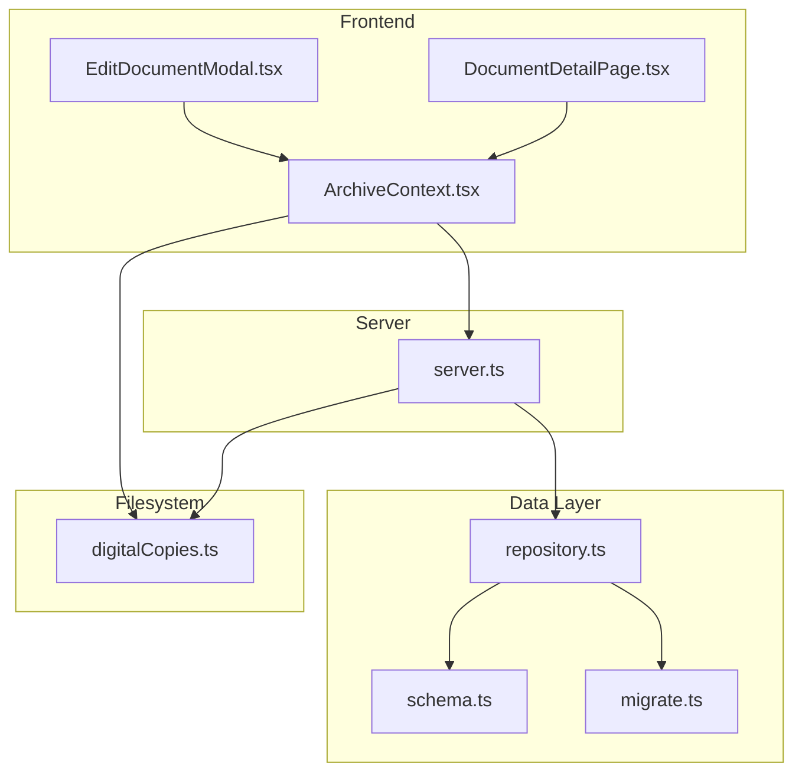
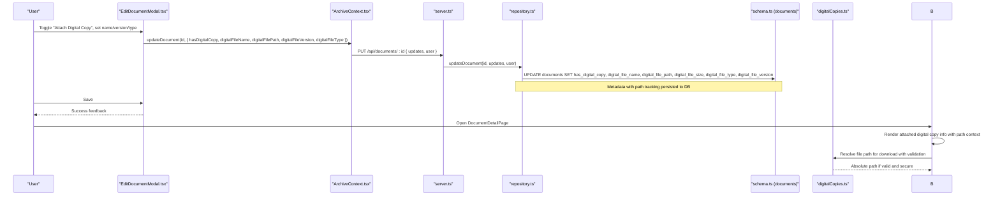
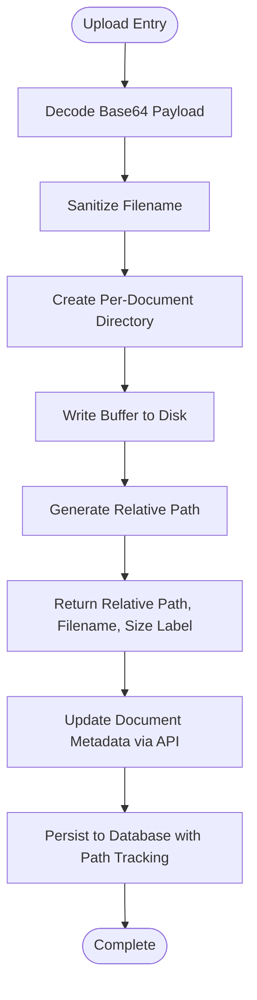
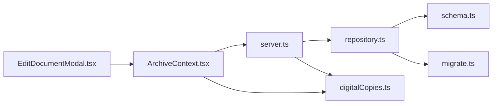

# Digital Copy Management

<cite>
**Referenced Files in This Document**
- [digitalCopies.ts](file://src/files/digitalCopies.ts)
- [schema.ts](file://src/db/schema.ts)
- [repository.ts](file://src/db/repository.ts)
- [server.ts](file://server.ts)
- [ArchiveContext.tsx](file://src/context/ArchiveContext.tsx)
- [DocumentDetailPage.tsx](file://src/pages/DocumentDetailPage.tsx)
- [EditDocumentModal.tsx](file://src/components/documents/EditDocumentModal.tsx)
- [types.ts](file://src/types.ts)
- [migrate.ts](file://src/db/migrate.ts)
</cite>

## Update Summary
**Changes Made**
- Enhanced digital file management with path tracking capabilities
- Added support for `digital_file_path` field in database schema and repository layer
- Improved digital asset organization with relative path storage and resolution
- Updated file utilities to support enhanced path management and validation

## Table of Contents
1. [Introduction](#introduction)
2. [Project Structure](#project-structure)
3. [Core Components](#core-components)
4. [Architecture Overview](#architecture-overview)
5. [Detailed Component Analysis](#detailed-component-analysis)
6. [Dependency Analysis](#dependency-analysis)
7. [Performance Considerations](#performance-considerations)
8. [Troubleshooting Guide](#troubleshooting-guide)
9. [Conclusion](#conclusion)
10. [Appendices](#appendices)

## Introduction
This document explains how ArchiveHub manages digital copies attached to physical documents with enhanced path tracking capabilities. It covers the integration between physical records and their digital surrogates, upload handling, file naming and validation, metadata storage including path tracking, versioning, viewing and downloading workflows, security considerations for sensitive content, storage optimization strategies, backup procedures, and common scenarios such as scanning, updating versions, and managing large uploads.

## Project Structure
The digital copy feature spans several layers with enhanced path tracking:
- Frontend UI for editing document metadata and attaching digital copies
- Context layer that updates document state and persists changes via API
- Server routes that handle document updates
- Database schema and repository logic that store digital copy metadata including paths
- File utilities that safely save and resolve digital files on disk with path validation

**Diagram sources**
- [EditDocumentModal.tsx:147-197](file://src/components/documents/EditDocumentModal.tsx#L147-L197)
- [DocumentDetailPage.tsx:398-422](file://src/pages/DocumentDetailPage.tsx#L398-L422)
- [ArchiveContext.tsx:779-811](file://src/context/ArchiveContext.tsx#L779-L811)
- [server.ts:318-326](file://server.ts#L318-L326)
- [repository.ts:635-700](file://src/db/repository.ts#L635-L700)
- [schema.ts:67-116](file://src/db/schema.ts#L67-L116)
- [digitalCopies.ts:16-41](file://src/files/digitalCopies.ts#L16-L41)

**Section sources**
- [EditDocumentModal.tsx:147-197](file://src/components/documents/EditDocumentModal.tsx#L147-L197)
- [DocumentDetailPage.tsx:398-422](file://src/pages/DocumentDetailPage.tsx#L398-L422)
- [ArchiveContext.tsx:779-811](file://src/context/ArchiveContext.tsx#L779-L811)
- [server.ts:318-326](file://server.ts#L318-L326)
- [repository.ts:635-700](file://src/db/repository.ts#L635-L700)
- [schema.ts:67-116](file://src/db/schema.ts#L67-L116)
- [digitalCopies.ts:16-41](file://src/files/digitalCopies.ts#L16-L41)

## Core Components
- **Enhanced Digital Copy Metadata Model**: The document entity includes fields to track whether a digital copy exists, its filename, size label, MIME type, version number, and now includes path tracking through the `digital_file_path` field for improved asset organization.
- **Advanced File Utilities**: Provide safe filename generation, base64 decoding, saving files under a per-document directory with path tracking, and resolving absolute paths with comprehensive path traversal protection.
- **Edit Modal**: Allows users to attach or update a digital surrogate by toggling an option, setting a filename, version, and type; it also auto-generates a default filename when none is provided.
- **Detail Page**: Displays attached digital copy information with enhanced path context and provides a download action placeholder.
- **Context and Server**: Persist digital copy metadata updates including path information through the API to the database repository.

**Updated** Enhanced path tracking capabilities for better digital asset organization and retrieval.

**Section sources**
- [schema.ts:67-116](file://src/db/schema.ts#L67-L116)
- [digitalCopies.ts:6-46](file://src/files/digitalCopies.ts#L6-L46)
- [EditDocumentModal.tsx:72-105](file://src/components/documents/EditDocumentModal.tsx#L72-L105)
- [EditDocumentModal.tsx:147-197](file://src/components/documents/EditDocumentModal.tsx#L147-L197)
- [DocumentDetailPage.tsx:398-422](file://src/pages/DocumentDetailPage.tsx#L398-L422)
- [ArchiveContext.tsx:779-811](file://src/context/ArchiveContext.tsx#L779-L811)
- [server.ts:318-326](file://server.ts#L318-L326)

## Architecture Overview
Digital copy management integrates frontend editing, context-driven persistence, server-side routing, database schema with path tracking, and filesystem operations with enhanced security.

**Diagram sources**
- [EditDocumentModal.tsx:147-197](file://src/components/documents/EditDocumentModal.tsx#L147-L197)
- [ArchiveContext.tsx:779-811](file://src/context/ArchiveContext.tsx#L779-L811)
- [server.ts:318-326](file://server.ts#L318-L326)
- [repository.ts:635-700](file://src/db/repository.ts#L635-L700)
- [schema.ts:67-116](file://src/db/schema.ts#L67-L116)
- [digitalCopies.ts:33-41](file://src/files/digitalCopies.ts#L33-L41)
- [DocumentDetailPage.tsx:398-422](file://src/pages/DocumentDetailPage.tsx#L398-L422)

## Detailed Component Analysis

### Enhanced Digital Copy Metadata Model
- **Fields tracked per document**:
  - Flag indicating presence of a digital copy
  - Filename, size label, MIME type, and version number
  - **New**: Path tracking field (`digital_file_path`) for improved asset organization
- These fields are part of the documents table and mapped into the application's document type.

**Updated** Added support for `digital_file_path` field to enhance digital asset organization and retrieval.

Key behaviors:
- When creating or updating a document, these fields can be set or modified.
- Repository code writes these fields to the database during create/update operations.
- Path tracking enables better organization and retrieval of digital assets.

**Section sources**
- [schema.ts:67-116](file://src/db/schema.ts#L67-L116)
- [repository.ts:577-599](file://src/db/repository.ts#L577-L599)
- [repository.ts:635-638](file://src/db/repository.ts#L635-L638)
- [repository.ts:685-689](file://src/db/repository.ts#L685-L689)
- [types.ts:135-183](file://src/types.ts#L135-L183)

### Advanced File Utilities: Safe Upload and Resolution
- **Safe filename generation** sanitizes input and enforces length limits to prevent path issues.
- **Base64 payload decoder** supports data URLs commonly used in browser-based uploads.
- **Enhanced saving function** creates a per-document directory under a configured root and writes the buffer to disk, returning relative path, filename, and formatted size label with path tracking.
- **Improved path resolution** validates that requested files reside within the allowed upload root and exist on disk before returning an absolute path with comprehensive security checks.

**Updated** Enhanced path tracking and validation capabilities for improved digital asset management.

Operational notes:
- Directory creation is recursive to ensure isolation per document.
- Path traversal protection prevents accessing files outside the upload root.
- Relative path storage enables flexible deployment and migration scenarios.

**Section sources**
- [digitalCopies.ts:6-46](file://src/files/digitalCopies.ts#L6-L46)

### Edit Modal: Attaching and Updating Digital Copies
- Users can toggle attachment of a digital surrogate.
- When enabled, they can specify:
  - File name (auto-generated from title if omitted)
  - Version number (defaults to 1)
  - File type (defaults to PDF MIME type)
- On submit, the modal sends updates to the context which persists them via API.

Behavioral highlights:
- Default filename generation ensures a consistent naming pattern based on the document title.
- Version field allows incremental updates to reflect new scans or revisions.
- **Enhanced** Support for path tracking in the backend while maintaining user-friendly interface.

**Section sources**
- [EditDocumentModal.tsx:72-105](file://src/components/documents/EditDocumentModal.tsx#L72-L105)
- [EditDocumentModal.tsx:147-197](file://src/components/documents/EditDocumentModal.tsx#L147-L197)
- [EditDocumentModal.tsx:559-604](file://src/components/documents/EditDocumentModal.tsx#L559-L604)

### Detail Page: Viewing and Downloading Digital Copies
- If a document has a digital copy, the detail page displays:
  - Attached filename
  - Type and size label
  - Version number
  - **Enhanced**: Path context for better asset organization visibility
- Provides a download button that simulates initiating a download.

Integration points:
- Display relies on document metadata fields populated by the context and persisted to the database.
- Download flow can be extended to use file resolution utilities to serve the actual file securely with path validation.

**Section sources**
- [DocumentDetailPage.tsx:398-422](file://src/pages/DocumentDetailPage.tsx#L398-L422)

### Context and Server: Persistence of Digital Copy Metadata
- Context updateDocument method updates local state, logs an audit entry, and calls the server API to persist changes.
- Server route delegates to repository updateDocument, which constructs dynamic SQL to update only changed fields, including digital copy metadata and path tracking.

**Updated** Enhanced support for path tracking in metadata persistence.

Flow characteristics:
- Immediate UI feedback via optimistic updates in context.
- Robust persistence via repository with conditional field updates including path information.

**Section sources**
- [ArchiveContext.tsx:779-811](file://src/context/ArchiveContext.tsx#L779-L811)
- [server.ts:318-326](file://server.ts#L318-L326)
- [repository.ts:635-700](file://src/db/repository.ts#L635-L700)

### Data Flow: From Upload to Storage with Path Tracking

**Diagram sources**
- [digitalCopies.ts:43-46](file://src/files/digitalCopies.ts#L43-L46)
- [digitalCopies.ts:16-31](file://src/files/digitalCopies.ts#L16-L31)
- [EditDocumentModal.tsx:147-197](file://src/components/documents/EditDocumentModal.tsx#L147-L197)
- [ArchiveContext.tsx:779-811](file://src/context/ArchiveContext.tsx#L779-L811)
- [repository.ts:635-700](file://src/db/repository.ts#L635-L700)

## Dependency Analysis
- EditDocumentModal depends on ArchiveContext to persist metadata updates.
- ArchiveContext depends on server routes for persistence and on repository for database operations.
- Repository depends on schema definitions for column mapping and SQL construction.
- File utilities are independent but consumed by upload/download flows to manage filesystem interactions with enhanced path tracking.

**Updated** Enhanced dependencies to support path tracking functionality.

**Diagram sources**
- [EditDocumentModal.tsx:147-197](file://src/components/documents/EditDocumentModal.tsx#L147-L197)
- [ArchiveContext.tsx:779-811](file://src/context/ArchiveContext.tsx#L779-L811)
- [server.ts:318-326](file://server.ts#L318-L326)
- [repository.ts:635-700](file://src/db/repository.ts#L635-L700)
- [schema.ts:67-116](file://src/db/schema.ts#L67-L116)
- [digitalCopies.ts:16-46](file://src/files/digitalCopies.ts#L16-46)

**Section sources**
- [EditDocumentModal.tsx:147-197](file://src/components/documents/EditDocumentModal.tsx#L147-L197)
- [ArchiveContext.tsx:779-811](file://src/context/ArchiveContext.tsx#L779-L811)
- [server.ts:318-326](file://server.ts#L318-L326)
- [repository.ts:635-700](file://src/db/repository.ts#L635-L700)
- [schema.ts:67-116](file://src/db/schema.ts#L67-L116)
- [digitalCopies.ts:16-46](file://src/files/digitalCopies.ts#L16-46)

## Performance Considerations
- Avoid storing large files in memory: Use streaming where possible for very large uploads.
- Limit request body size: The server configures a JSON limit; consider separate endpoints for binary uploads to avoid payload size constraints.
- Efficient metadata updates: Repository updates only changed fields to minimize write overhead.
- File system I/O: Ensure adequate disk space and consider asynchronous writes for high-throughput environments.
- **Enhanced**: Path tracking adds minimal overhead while providing significant organizational benefits.

[No sources needed since this section provides general guidance]

## Troubleshooting Guide
Common issues and resolutions:
- Upload fails due to invalid filename: Ensure filenames are sanitized; the utility replaces unsafe characters and truncates excessively long names.
- Path traversal attempts blocked: The resolver checks that resolved paths remain within the configured upload root; verify correct relative paths.
- Missing file on download: Confirm that the file was saved successfully and that the stored relative path matches the actual location.
- Metadata not persisted: Verify that the updateDocument call includes the relevant fields and that the server route forwards updates to the repository.
- **New**: Path tracking issues: Ensure the `digital_file_path` field is properly handled in database migrations and repository queries.

**Updated** Added troubleshooting guidance for path tracking functionality.

**Section sources**
- [digitalCopies.ts:6-46](file://src/files/digitalCopies.ts#L6-L46)
- [repository.ts:635-700](file://src/db/repository.ts#L635-L700)
- [server.ts:318-326](file://server.ts#L318-L326)

## Conclusion
ArchiveHub's digital copy management integrates frontend editing, context-driven persistence, server routing, database schema with enhanced path tracking, and secure filesystem operations. It supports versioned attachments, safe file handling, clear metadata tracking, and improved digital asset organization through path tracking. For production deployments, extend the download endpoint to serve files securely, implement robust access controls, and adopt scalable storage and backup strategies.

**Updated** Enhanced conclusion reflecting the improved path tracking capabilities.

[No sources needed since this section summarizes without analyzing specific files]

## Appendices

### Security Considerations for Sensitive Documents
- Access control: Restrict who can view or download digital copies based on roles and confidentiality levels.
- Path validation: Always validate and normalize paths to prevent traversal attacks.
- Content validation: Validate MIME types and file signatures to reject unexpected formats.
- Encryption at rest: Consider encrypting stored files for highly sensitive content.
- Audit logging: Log all access and modifications to digital assets.
- **Enhanced**: Path tracking provides additional security through controlled file location management.

[No sources needed since this section provides general guidance]

### Storage Optimization Strategies
- Deduplicate identical files using content hashing to avoid redundant storage.
- Compress scanned images where appropriate to reduce size while preserving readability.
- Implement lifecycle policies to archive or purge outdated versions.
- Use efficient storage backends (e.g., object storage) for scalability.
- **Enhanced**: Path tracking enables better organization and potential for distributed storage strategies.

[No sources needed since this section provides general guidance]

### Backup Procedures for Digital Assets
- Regularly back up the upload directory structure to a secure, offsite location.
- Include database backups that contain digital copy metadata including path information.
- Test restoration processes periodically to ensure recoverability.
- Maintain versioned backups to support rollback after accidental deletions.
- **Enhanced**: Path tracking ensures consistency between database records and actual file locations during backup and restore operations.

[No sources needed since this section provides general guidance]

### Common Scenarios

#### Scanning Physical Documents
- Steps:
  - Scan the physical document to a digital format (e.g., PDF).
  - In EditDocumentModal, enable "Attach Digitized Electronic Surrogate Copy".
  - Optionally set a custom filename, version, and type.
  - Save to persist metadata; integrate with a backend upload handler to write the file using the file utilities with path tracking.

**Updated** Enhanced workflow to support path tracking in the backend.

**Section sources**
- [EditDocumentModal.tsx:559-604](file://src/components/documents/EditDocumentModal.tsx#L559-L604)
- [digitalCopies.ts:16-31](file://src/files/digitalCopies.ts#L16-L31)

#### Updating Versions
- Steps:
  - Open the document's edit modal.
  - Increment the version number for the digital copy.
  - Save to update metadata; replace the underlying file on disk if necessary.
  - **Enhanced**: Path tracking maintains consistency across version updates.

**Updated** Enhanced versioning workflow with path tracking support.

**Section sources**
- [EditDocumentModal.tsx:574-604](file://src/components/documents/EditDocumentModal.tsx#L574-L604)
- [repository.ts:685-689](file://src/db/repository.ts#L685-L689)

#### Managing Large File Uploads
- Recommendations:
  - Use chunked uploads to improve reliability and progress reporting.
  - Validate file size and type before processing.
  - Stream data to disk rather than buffering entirely in memory.
  - Monitor disk usage and enforce quotas.
  - **Enhanced**: Path tracking helps organize large files systematically for better management.

[No sources needed since this section provides general guidance]