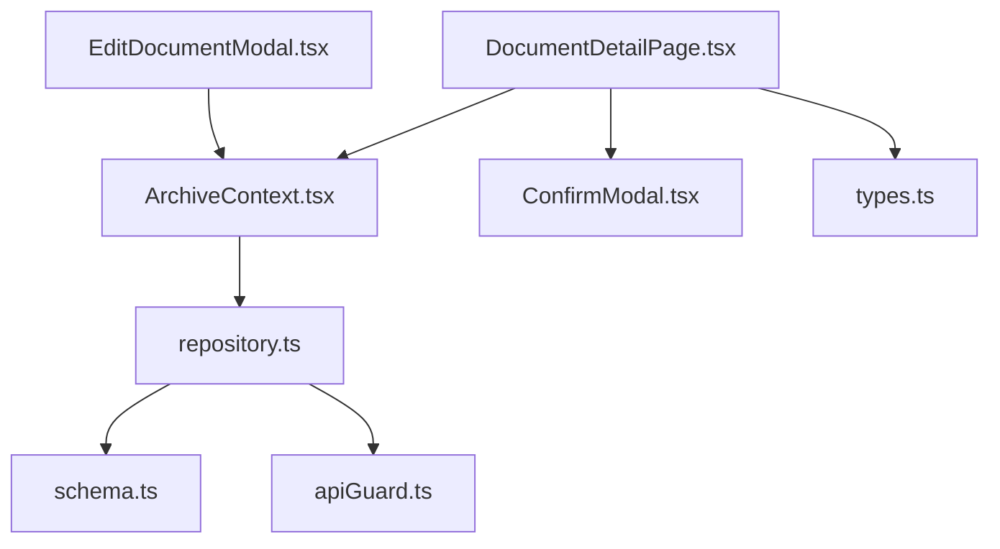
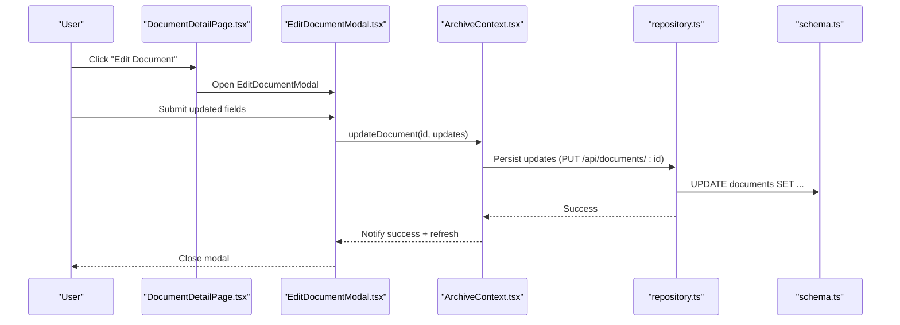
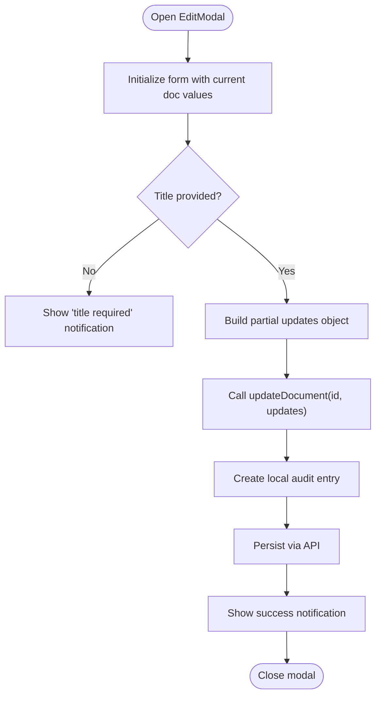
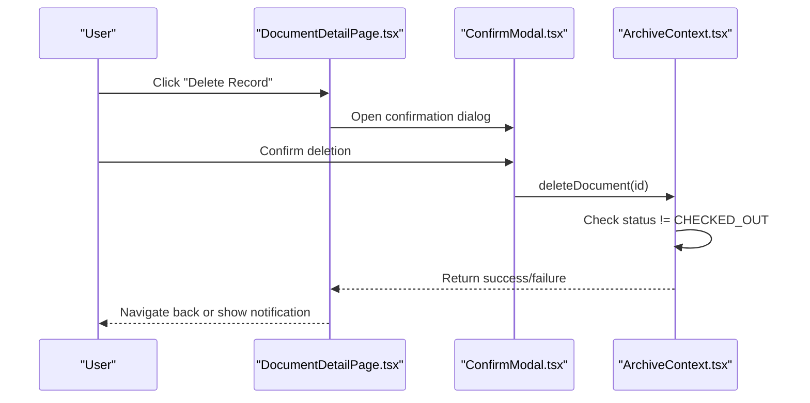
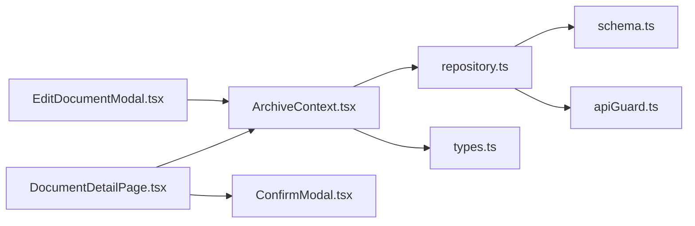

# Document Editing and Maintenance

<cite>
**Referenced Files in This Document**
- [EditDocumentModal.tsx](file://src/components/documents/EditDocumentModal.tsx)
- [DocumentDetailPage.tsx](file://src/pages/DocumentDetailPage.tsx)
- [ArchiveContext.tsx](file://src/context/ArchiveContext.tsx)
- [schema.ts](file://src/db/schema.ts)
- [types.ts](file://src/types.ts)
- [ConfirmModal.tsx](file://src/components/common/ConfirmModal.tsx)
- [repository.ts](file://src/db/repository.ts)
- [apiGuard.ts](file://src/auth/apiGuard.ts)
</cite>

## Table of Contents
1. Introduction
2. Project Structure
3. Core Components
4. Architecture Overview
5. Detailed Component Analysis
6. Dependency Analysis
7. Performance Considerations
8. Troubleshooting Guide
9. Conclusion
10. Appendices

## Introduction
This document explains how ArchiveHub supports editing and maintaining document records. It covers the edit modal interface, editable versus non-editable fields, validation rules, change tracking via audit logs, deletion workflow with confirmations and cascade effects, field dependencies (such as department-to-document-type), and data integrity constraints. It also provides practical maintenance examples and outlines permission requirements for editing operations.

## Project Structure
The editing and maintenance features span UI components, context-driven state management, database schema definitions, and server-side guards:
- Edit modal and detail page provide user interactions for updates and deletions.
- The context layer orchestrates updates, movements, checkouts, and notifications.
- The schema defines the persistent structure for documents and related entities.
- Repository functions persist changes and log actions.
- API guard enforces role-based permissions on write endpoints.

**Diagram sources**
- [EditDocumentModal.tsx:1-638](file://src/components/documents/EditDocumentModal.tsx#L1-L638)
- [DocumentDetailPage.tsx:1-809](file://src/pages/DocumentDetailPage.tsx#L1-L809)
- [ArchiveContext.tsx:1-1062](file://src/context/ArchiveContext.tsx#L1-L1062)
- [ConfirmModal.tsx:1-102](file://src/components/common/ConfirmModal.tsx#L1-L102)
- [repository.ts:641-708](file://src/db/repository.ts#L641-L708)
- [schema.ts:67-116](file://src/db/schema.ts#L67-L116)
- [types.ts:135-183](file://src/types.ts#L135-L183)
- [apiGuard.ts:1-97](file://src/auth/apiGuard.ts#L1-L97)

**Section sources**
- [EditDocumentModal.tsx:1-638](file://src/components/documents/EditDocumentModal.tsx#L1-L638)
- [DocumentDetailPage.tsx:1-809](file://src/pages/DocumentDetailPage.tsx#L1-L809)
- [ArchiveContext.tsx:1-1062](file://src/context/ArchiveContext.tsx#L1-L1062)
- [schema.ts:67-116](file://src/db/schema.ts#L67-L116)
- [types.ts:135-183](file://src/types.ts#L135-L183)
- [ConfirmModal.tsx:1-102](file://src/components/common/ConfirmModal.tsx#L1-L102)
- [repository.ts:641-708](file://src/db/repository.ts#L641-L708)
- [apiGuard.ts:1-97](file://src/auth/apiGuard.ts#L1-L97)

## Core Components
- EditDocumentModal: Presents a comprehensive form to update document metadata, classification, location, status, condition, digital copy info, and bundle association. It validates required fields before submission and calls the context’s update function.
- DocumentDetailPage: Hosts the record view and action buttons (Edit, Relocate, Delete). It opens modals for editing, moving, borrowing/returning, and deleting with confirmation.
- ArchiveContext: Centralizes state and operations including updateDocument, deleteDocument, moveDocument, checkout flows, and notification handling. It also creates local audit entries and persists changes via API calls.
- ConfirmModal: Reusable confirmation dialog used for destructive actions like deletion.
- repository.ts: Implements persistence logic for updates and deletions, including audit logging and cascade handling for bundles.
- schema.ts: Defines the database tables and constraints for documents, locations, bundles, and audit logs.
- types.ts: Provides TypeScript interfaces for documents, statuses, conditions, and custom fields.
- apiGuard.ts: Enforces role-based access control for write endpoints.

**Section sources**
- [EditDocumentModal.tsx:147-197](file://src/components/documents/EditDocumentModal.tsx#L147-L197)
- [DocumentDetailPage.tsx:217-247](file://src/pages/DocumentDetailPage.tsx#L217-L247)
- [ArchiveContext.tsx:779-830](file://src/context/ArchiveContext.tsx#L779-L830)
- [ConfirmModal.tsx:15-101](file://src/components/common/ConfirmModal.tsx#L15-L101)
- [repository.ts:641-708](file://src/db/repository.ts#L641-L708)
- [schema.ts:67-116](file://src/db/schema.ts#L67-L116)
- [types.ts:54-72](file://src/types.ts#L54-L72)
- [apiGuard.ts:68-74](file://src/auth/apiGuard.ts#L68-L74)

## Architecture Overview
The editing flow is driven by the UI component, which validates inputs and delegates to the context. The context updates local state, writes to the backend, and logs an audit entry. Deletions are guarded by confirmation dialogs and enforced by role-based permissions.

**Diagram sources**
- [DocumentDetailPage.tsx:217-247](file://src/pages/DocumentDetailPage.tsx#L217-L247)
- [EditDocumentModal.tsx:147-197](file://src/components/documents/EditDocumentModal.tsx#L147-L197)
- [ArchiveContext.tsx:779-810](file://src/context/ArchiveContext.tsx#L779-L810)
- [repository.ts:641-708](file://src/db/repository.ts#L641-L708)
- [schema.ts:67-116](file://src/db/schema.ts#L67-L116)

## Detailed Component Analysis

### Edit Document Modal
- Purpose: Allow users to modify document metadata and attributes while preserving system identifiers.
- Non-editable fields:
  - Document Number (system ID): disabled input to prevent modification.
- Editable fields include:
  - Reference number, title, subject, description
  - Owning department and document type (with dynamic custom fields)
  - Permanent home storage location
  - Bundle/dossier association
  - Confidentiality level, physical condition, lifecycle status
  - Condition notes
  - Dates (document date, received/filed dates)
  - Custodian name
  - Digital surrogate copy flags and versioning
- Validation:
  - Title is required; submission shows an error notification if missing.
  - Custom fields can be marked required based on document type configuration.
- Field dependencies:
  - Selecting a department filters available document types.
  - Changing document type initializes or merges custom field values from defaults.
- Change tracking:
  - On save, the context adds a local audit entry and persists changes via API.

**Diagram sources**
- [EditDocumentModal.tsx:81-106](file://src/components/documents/EditDocumentModal.tsx#L81-L106)
- [EditDocumentModal.tsx:147-197](file://src/components/documents/EditDocumentModal.tsx#L147-L197)
- [ArchiveContext.tsx:779-810](file://src/context/ArchiveContext.tsx#L779-L810)

**Section sources**
- [EditDocumentModal.tsx:236-277](file://src/components/documents/EditDocumentModal.tsx#L236-L277)
- [EditDocumentModal.tsx:279-319](file://src/components/documents/EditDocumentModal.tsx#L279-L319)
- [EditDocumentModal.tsx:321-382](file://src/components/documents/EditDocumentModal.tsx#L321-L382)
- [EditDocumentModal.tsx:384-412](file://src/components/documents/EditDocumentModal.tsx#L384-L412)
- [EditDocumentModal.tsx:414-435](file://src/components/documents/EditDocumentModal.tsx#L414-L435)
- [EditDocumentModal.tsx:437-489](file://src/components/documents/EditDocumentModal.tsx#L437-L489)
- [EditDocumentModal.tsx:491-503](file://src/components/documents/EditDocumentModal.tsx#L491-L503)
- [EditDocumentModal.tsx:505-543](file://src/components/documents/EditDocumentModal.tsx#L505-L543)
- [EditDocumentModal.tsx:545-557](file://src/components/documents/EditDocumentModal.tsx#L545-L557)
- [EditDocumentModal.tsx:559-604](file://src/components/documents/EditDocumentModal.tsx#L559-L604)
- [EditDocumentModal.tsx:147-197](file://src/components/documents/EditDocumentModal.tsx#L147-L197)

### Document Detail Page Actions
- Edit: Opens the edit modal to modify metadata.
- Relocate: Moves the document to a new physical location and logs movement.
- Borrow/Return: Manages circulation workflows that affect status and current location.
- Delete: Triggers a confirmation dialog and removes the record if permitted.

**Diagram sources**
- [DocumentDetailPage.tsx:239-247](file://src/pages/DocumentDetailPage.tsx#L239-L247)
- [DocumentDetailPage.tsx:783-797](file://src/pages/DocumentDetailPage.tsx#L783-L797)
- [ConfirmModal.tsx:15-101](file://src/components/common/ConfirmModal.tsx#L15-L101)
- [ArchiveContext.tsx:812-830](file://src/context/ArchiveContext.tsx#L812-L830)

**Section sources**
- [DocumentDetailPage.tsx:217-247](file://src/pages/DocumentDetailPage.tsx#L217-L247)
- [DocumentDetailPage.tsx:783-797](file://src/pages/DocumentDetailPage.tsx#L783-L797)

### Data Model and Constraints
- Documents table includes core identification, classification, location, status, confidentiality, condition, digital copy metadata, custom fields, and bundle associations.
- Required fields at schema level ensure data integrity (e.g., title, document type, department, custodian, home/current locations, QR/barcode, dates).
- Status and condition enums constrain allowed values.
- Bundles link multiple documents and maintain references.

```mermaid
erDiagram
DOCUMENTS {
varchar id PK
varchar document_number UK
varchar reference_number
varchar title
varchar document_type_id
varchar document_type_name
text subject
text description
varchar department_id
varchar department_name
varchar custodian_name
varchar home_location_id
varchar current_location_id
varchar status
varchar confidentiality
varchar condition
varchar qr_code UK
varchar barcode
varchar document_date
varchar received_date
varchar filed_date
varchar retention_start_date
varchar retention_end_date
varchar disposal_date
boolean has_digital_copy
varchar digital_file_name
varchar digital_file_size
varchar digital_file_type
integer digital_file_version
jsonb custom_metadata
jsonb custom_field_values
text condition_notes
varchar bundle_id
varchar bundle_number
varchar bundle_title
timestamp created_at
timestamp updated_at
}
BUNDLES {
varchar id PK
varchar bundle_number UK
varchar title
text description
varchar department_id
varchar department_name
varchar location_id
text location_path
jsonb document_ids
varchar status
varchar qr_code UK
varchar barcode
jsonb tags
timestamp created_at
timestamp updated_at
}
AUDIT_LOGS {
varchar id PK
varchar user_id
varchar user_name
varchar user_role
varchar action
varchar entity_type
varchar entity_id
varchar entity_name
timestamp timestamp
text details
text before_value
text after_value
}
DOCUMENTS ||--o{ BUNDLES : "optional membership"
AUDIT_LOGS ||--o{ DOCUMENTS : "tracks changes"
```

**Diagram sources**
- [schema.ts:67-116](file://src/db/schema.ts#L67-L116)
- [schema.ts:194-211](file://src/db/schema.ts#L194-L211)
- [schema.ts:213-227](file://src/db/schema.ts#L213-L227)

**Section sources**
- [schema.ts:67-116](file://src/db/schema.ts#L67-L116)
- [schema.ts:194-211](file://src/db/schema.ts#L194-L211)
- [schema.ts:213-227](file://src/db/schema.ts#L213-L227)
- [types.ts:135-183](file://src/types.ts#L135-L183)

### Permission Requirements
- Write operations on documents, locations, and bundles require roles: ADMIN, RECORDS_ADMIN, or RECORDS_OFFICER.
- Auditors have read-only access and cannot perform write operations.
- Catalog management (document types, reusable custom fields) requires ADMIN or RECORDS_ADMIN.

**Section sources**
- [apiGuard.ts:6-9](file://src/auth/apiGuard.ts#L6-L9)
- [apiGuard.ts:68-74](file://src/auth/apiGuard.ts#L68-L74)
- [apiGuard.ts:76-82](file://src/auth/apiGuard.ts#L76-L82)
- [apiGuard.ts:88-94](file://src/auth/apiGuard.ts#L88-L94)

### Change Tracking and Audit Logging
- Every document update creates an audit entry with user identity, action type, entity details, and timestamp.
- Updates are persisted both locally (for immediate feedback) and via API to the backend repository, which logs in the database.

**Section sources**
- [ArchiveContext.tsx:779-810](file://src/context/ArchiveContext.tsx#L779-L810)
- [repository.ts:641-708](file://src/db/repository.ts#L641-L708)

### Deletion Workflow and Cascade Effects
- Confirmation: Deletion requires explicit confirmation via ConfirmModal.
- Constraint: Records checked out cannot be deleted; attempt shows an error notification.
- Cascade: Deleting a bundle clears bundle references from associated documents.
- Audit: Deletions are logged through repository operations.

**Section sources**
- [DocumentDetailPage.tsx:783-797](file://src/pages/DocumentDetailPage.tsx#L783-L797)
- [ArchiveContext.tsx:812-830](file://src/context/ArchiveContext.tsx#L812-L830)
- [repository.ts:1493-1523](file://src/db/repository.ts#L1493-L1523)

### Bulk Editing Capabilities
- No bulk editing endpoint or UI is present in the analyzed codebase. Operations target single documents at a time.

[No sources needed since this section summarizes absence of feature]

### Field Dependencies and Data Integrity
- Department-to-document-type filtering ensures only valid types are selectable per department.
- Custom fields are dynamically generated based on document type configuration, with optional required constraints.
- Status and condition fields use enumerated types to enforce valid values.
- Home vs current location distinction maintains accurate physical placement and movement history.

**Section sources**
- [EditDocumentModal.tsx:110-141](file://src/components/documents/EditDocumentModal.tsx#L110-L141)
- [EditDocumentModal.tsx:321-382](file://src/components/documents/EditDocumentModal.tsx#L321-L382)
- [types.ts:54-72](file://src/types.ts#L54-L72)
- [schema.ts:67-116](file://src/db/schema.ts#L67-L116)

### Practical Maintenance Examples
- Update document metadata:
  - Open EditDocumentModal from DocumentDetailPage, adjust title, subject, description, department/type, custom fields, and save. Changes are audited and persisted.
- Correct errors:
  - Fix incorrect reference numbers, subjects, or custodian names using the same modal; validation prevents saving without a title.
- Change locations:
  - Use the “Relocate Physical Position” action to move a document to a new storage node; movement is recorded and reflected in current location.
- Remove obsolete records:
  - Confirm deletion via ConfirmModal; deletion is blocked if the record is checked out; successful deletion triggers notifications and navigation back to catalogue.

**Section sources**
- [EditDocumentModal.tsx:147-197](file://src/components/documents/EditDocumentModal.tsx#L147-L197)
- [DocumentDetailPage.tsx:217-247](file://src/pages/DocumentDetailPage.tsx#L217-L247)
- [DocumentDetailPage.tsx:783-797](file://src/pages/DocumentDetailPage.tsx#L783-L797)

### Recovery Procedures for Accidental Deletions
- Local state: After deletion, the record is removed from local documents list; no undo is implemented in the UI.
- Database: If connected to PostgreSQL, repository operations may retain historical records elsewhere (e.g., audit logs); however, there is no explicit restore function in the analyzed code.
- Recommendation: Rely on external backups or database-level recovery mechanisms if records are accidentally deleted.

[No sources needed since this section provides general guidance based on observed behavior]

## Dependency Analysis
- UI components depend on ArchiveContext for state and operations.
- Context depends on repository for persistence and on types for contracts.
- Repository interacts with schema-defined tables and enforces constraints.
- API guard protects write endpoints based on user roles.

**Diagram sources**
- [EditDocumentModal.tsx:1-638](file://src/components/documents/EditDocumentModal.tsx#L1-L638)
- [DocumentDetailPage.tsx:1-809](file://src/pages/DocumentDetailPage.tsx#L1-L809)
- [ArchiveContext.tsx:1-1062](file://src/context/ArchiveContext.tsx#L1-L1062)
- [repository.ts:641-708](file://src/db/repository.ts#L641-L708)
- [schema.ts:67-116](file://src/db/schema.ts#L67-L116)
- [apiGuard.ts:1-97](file://src/auth/apiGuard.ts#L1-L97)
- [ConfirmModal.tsx:1-102](file://src/components/common/ConfirmModal.tsx#L1-L102)
- [types.ts:135-183](file://src/types.ts#L135-L183)

**Section sources**
- [EditDocumentModal.tsx:1-638](file://src/components/documents/EditDocumentModal.tsx#L1-L638)
- [DocumentDetailPage.tsx:1-809](file://src/pages/DocumentDetailPage.tsx#L1-L809)
- [ArchiveContext.tsx:1-1062](file://src/context/ArchiveContext.tsx#L1-L1062)
- [repository.ts:641-708](file://src/db/repository.ts#L641-L708)
- [schema.ts:67-116](file://src/db/schema.ts#L67-L116)
- [apiGuard.ts:1-97](file://src/auth/apiGuard.ts#L1-L97)
- [ConfirmModal.tsx:1-102](file://src/components/common/ConfirmModal.tsx#L1-L102)
- [types.ts:135-183](file://src/types.ts#L135-L183)

## Performance Considerations
- Single-record updates minimize payload size and reduce contention.
- Local audit entries provide immediate feedback without blocking UI.
- Avoid unnecessary re-renders by updating only changed fields in the updates object.
- When connecting to PostgreSQL, batch operations could improve throughput but are not currently implemented for document edits.

[No sources needed since this section provides general guidance]

## Troubleshooting Guide
- Cannot delete while checked out:
  - Attempting deletion on a checked-out record returns an error notification; resolve by processing return first.
- Missing title:
  - Saving without a title triggers an error notification; ensure title is filled before submitting.
- Permission denied:
  - Write operations require appropriate roles; verify user role and authentication token.
- Backend sync failures:
  - If API calls fail, context falls back to memory updates and notifies users; check network connectivity and server health.

**Section sources**
- [ArchiveContext.tsx:812-830](file://src/context/ArchiveContext.tsx#L812-L830)
- [EditDocumentModal.tsx:147-152](file://src/components/documents/EditDocumentModal.tsx#L147-L152)
- [apiGuard.ts:27-48](file://src/auth/apiGuard.ts#L27-L48)

## Conclusion
ArchiveHub provides a robust, role-gated editing and maintenance experience for document records. The edit modal supports rich metadata updates with validation and dependency-aware fields, while change tracking ensures accountability through audit logs. Deletions are safeguarded by confirmation dialogs and constraints, with cascade handling for bundle relationships. While bulk editing is not implemented, the single-record workflow is efficient and auditable, suitable for typical archive maintenance tasks.

[No sources needed since this section summarizes without analyzing specific files]

## Appendices

### Editable vs Non-Editable Fields Summary
- Non-editable: Document Number (system ID)
- Editable: Reference number, title, subject, description, department, document type, custom fields, home location, bundle association, confidentiality, condition, status, condition notes, dates, custodian, digital copy metadata

**Section sources**
- [EditDocumentModal.tsx:236-277](file://src/components/documents/EditDocumentModal.tsx#L236-L277)
- [EditDocumentModal.tsx:279-319](file://src/components/documents/EditDocumentModal.tsx#L279-L319)
- [EditDocumentModal.tsx:321-382](file://src/components/documents/EditDocumentModal.tsx#L321-L382)
- [EditDocumentModal.tsx:384-412](file://src/components/documents/EditDocumentModal.tsx#L384-L412)
- [EditDocumentModal.tsx:414-435](file://src/components/documents/EditDocumentModal.tsx#L414-L435)
- [EditDocumentModal.tsx:437-489](file://src/components/documents/EditDocumentModal.tsx#L437-L489)
- [EditDocumentModal.tsx:491-503](file://src/components/documents/EditDocumentModal.tsx#L491-L503)
- [EditDocumentModal.tsx:505-543](file://src/components/documents/EditDocumentModal.tsx#L505-L543)
- [EditDocumentModal.tsx:545-557](file://src/components/documents/EditDocumentModal.tsx#L545-L557)
- [EditDocumentModal.tsx:559-604](file://src/components/documents/EditDocumentModal.tsx#L559-L604)