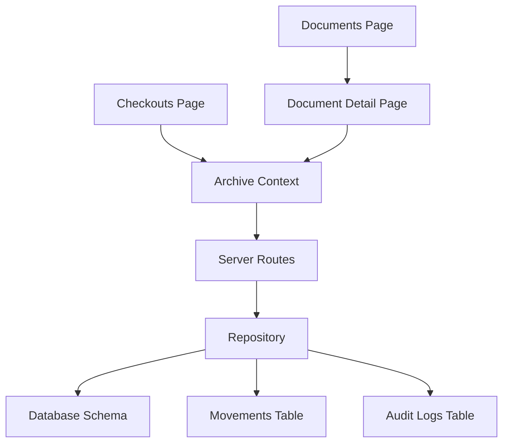
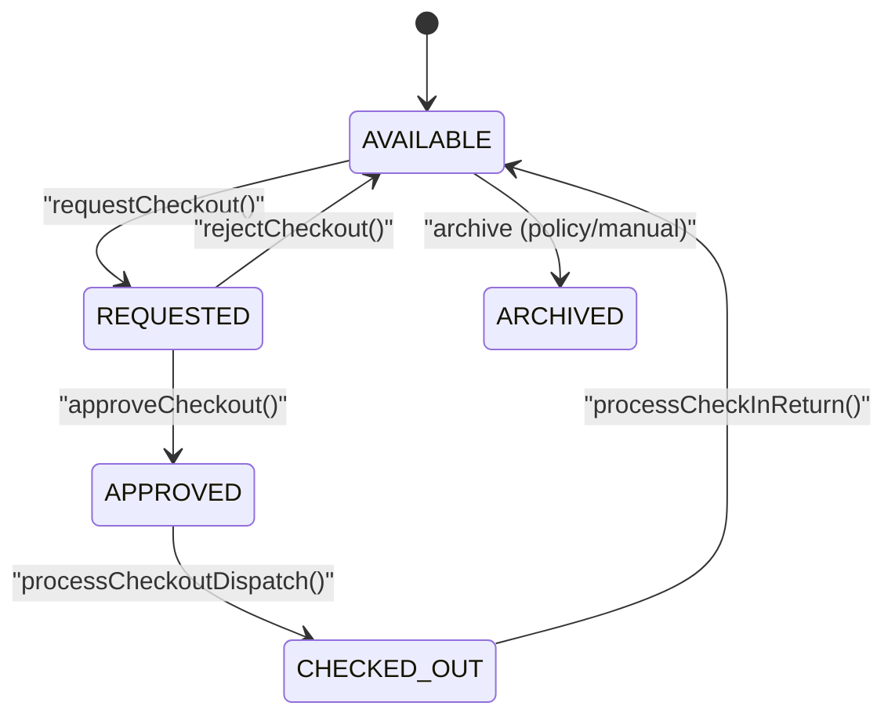
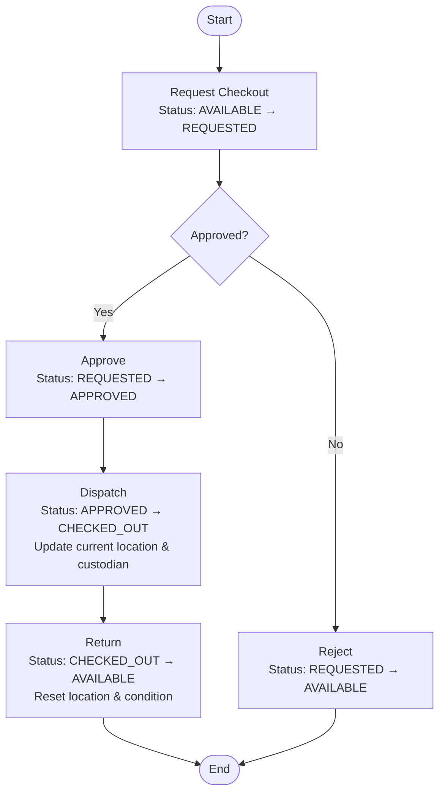
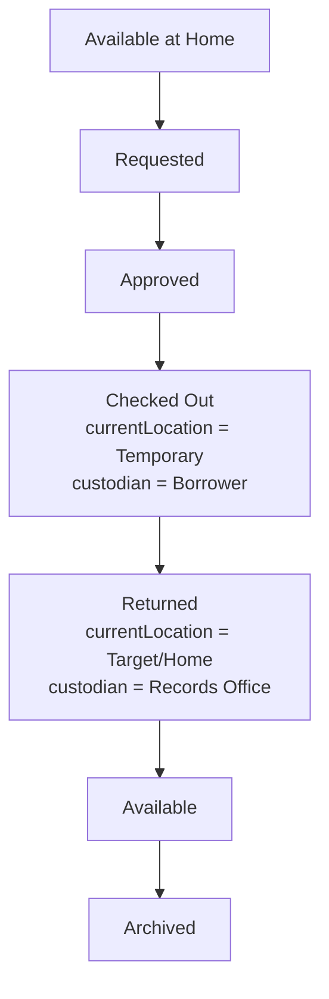
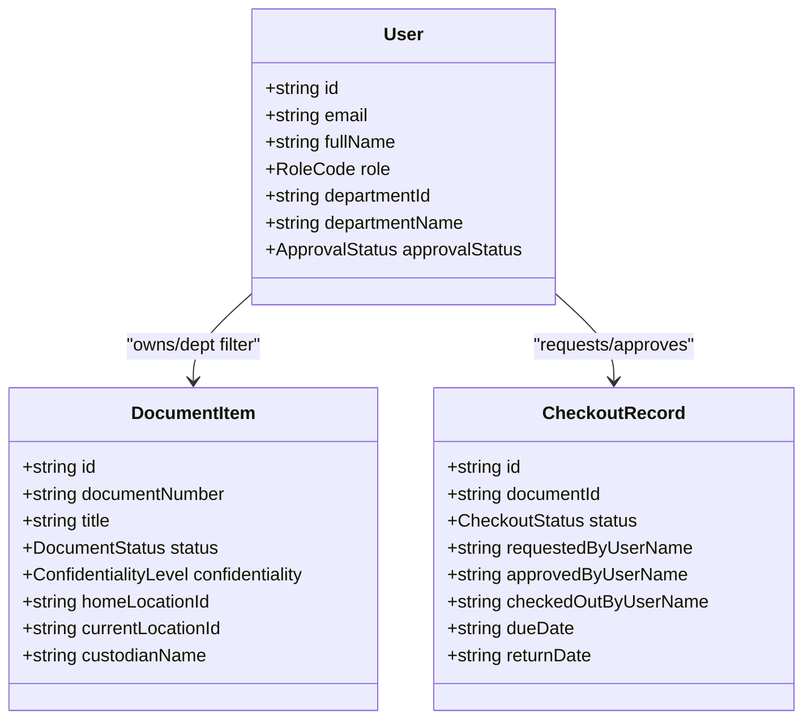
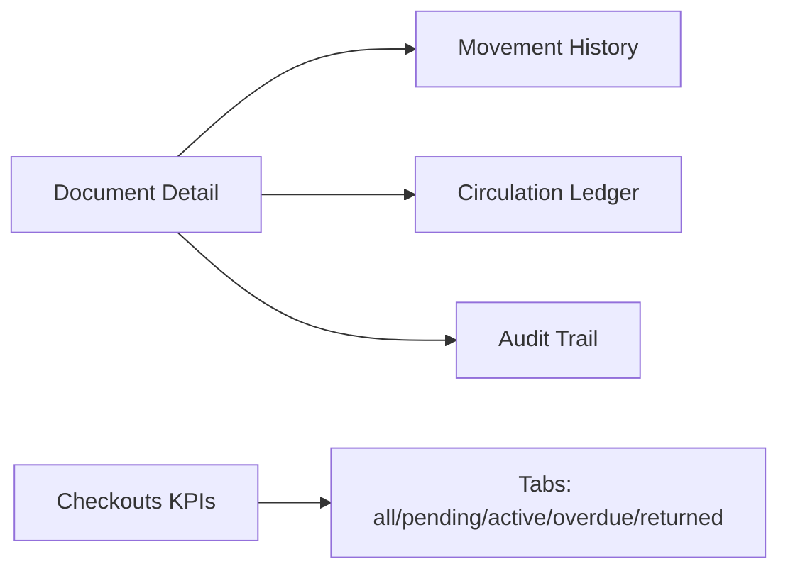
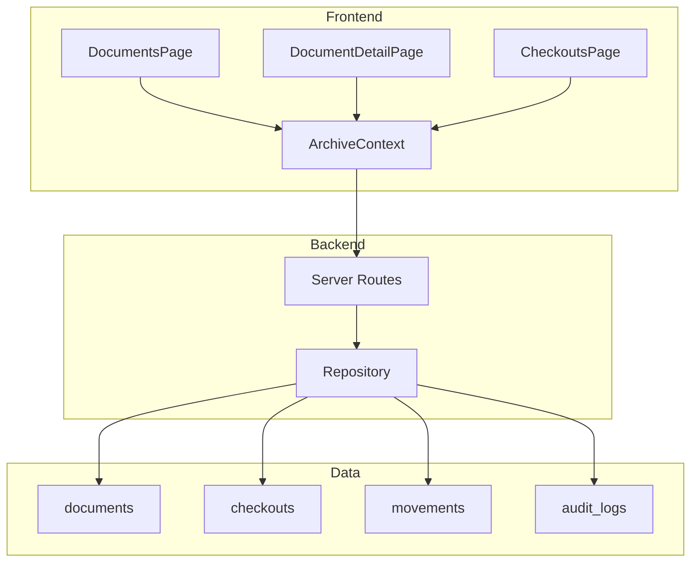

# Document Lifecycle Management

<cite>
**Referenced Files in This Document**
- [types.ts](file://src/types.ts)
- [schema.ts](file://src/db/schema.ts)
- [repository.ts](file://src/db/repository.ts)
- [ArchiveContext.tsx](file://src/context/ArchiveContext.tsx)
- [DocumentsPage.tsx](file://src/pages/DocumentsPage.tsx)
- [DocumentDetailPage.tsx](file://src/pages/DocumentDetailPage.tsx)
- [CheckoutsPage.tsx](file://src/pages/CheckoutsPage.tsx)
- [server.ts](file://server.ts)
</cite>

## Table of Contents
1. Introduction
2. Project Structure
3. Core Components
4. Architecture Overview
5. Detailed Component Analysis
6. Dependency Analysis
7. Performance Considerations
8. Troubleshooting Guide
9. Conclusion

## Introduction
This document explains the document lifecycle management system with a focus on the six-level status workflow: AVAILABLE → REQUESTED → APPROVED → CHECKED_OUT → RETURNED → ARCHIVED. It covers how documents transition between states, business rules for each transition, audit trail requirements, checkout integration, approval processes, automatic status updates, and status-specific behaviors such as location tracking, access controls, and reporting. It also includes common scenarios and role-based permissions that affect visibility and accessibility.

## Project Structure
The lifecycle is implemented across UI pages, application context, server routes, and database schema/repositories:
- Types define statuses, roles, and data models used throughout the system.
- Schema defines persistent tables for documents, checkouts, movements, and audit logs.
- Repository implements state transitions and persistence (with memory fallback).
- Context orchestrates user actions and updates local state and backend.
- Pages provide user workflows for browsing, requesting, approving, checking out, returning, and viewing history.
- Server exposes API endpoints that call repository methods to enforce business rules.



**Diagram sources**
- [DocumentsPage.tsx:1-800](file://src/pages/DocumentsPage.tsx#L1-L800)
- [DocumentDetailPage.tsx:1-800](file://src/pages/DocumentDetailPage.tsx#L1-L800)
- [CheckoutsPage.tsx:1-261](file://src/pages/CheckoutsPage.tsx#L1-L261)
- [ArchiveContext.tsx:854-966](file://src/context/ArchiveContext.tsx#L854-L966)
- [server.ts:395-446](file://server.ts#L395-L446)
- [repository.ts:900-1122](file://src/db/repository.ts#L900-L1122)
- [schema.ts:67-167](file://src/db/schema.ts#L67-L167)

**Section sources**
- [types.ts:54-68](file://src/types.ts#L54-L68)
- [schema.ts:67-167](file://src/db/schema.ts#L67-L167)
- [repository.ts:900-1122](file://src/db/repository.ts#L900-L1122)
- [ArchiveContext.tsx:854-966](file://src/context/ArchiveContext.tsx#L854-L966)
- [server.ts:395-446](file://server.ts#L395-L446)

## Core Components
- Status model: Documents have a status field supporting multiple lifecycle stages including AVAILABLE, REQUESTED, APPROVED, CHECKED_OUT, RETURNED, and ARCHIVED.
- Checkout model: Tracks borrowing requests, approvals, dispatch, returns, and overdue conditions.
- Movement model: Records physical moves (INITIAL_FILING, CHECKOUT, CHECKIN, RELOCATION, etc.).
- Audit log model: Captures user actions, entity changes, timestamps, and details for compliance.

Key responsibilities:
- Requesting a checkout transitions a document from AVAILABLE to REQUESTED.
- Approving a checkout transitions to APPROVED.
- Dispatching a checkout transitions to CHECKED_OUT and updates current location and custodian.
- Returning a checkout transitions back to AVAILABLE and resets custodian and condition.
- Archiving is typically performed via metadata/status update after retention or disposal processes.

**Section sources**
- [types.ts:54-68](file://src/types.ts#L54-L68)
- [types.ts:185-235](file://src/types.ts#L185-L235)
- [schema.ts:67-167](file://src/db/schema.ts#L67-L167)

## Architecture Overview
The lifecycle spans UI interactions, context orchestration, server enforcement, and repository persistence. The following sequence shows a typical checkout flow:

```mermaid
sequenceDiagram
participant User as "User"
participant DocsUI as "Documents Page"
participant DetailUI as "Document Detail Page"
participant Ctx as "Archive Context"
participant Srv as "Server Routes"
participant Repo as "Repository"
participant DB as "Database"
User->>DocsUI : Browse catalogue
User->>DetailUI : Open document detail
User->>Ctx : requestCheckout(documentId, purpose, dueDate)
Ctx->>Srv : POST /api/checkouts/request
Srv->>Repo : createCheckout + set doc status REQUESTED
Repo->>DB : INSERT checkout, UPDATE documents.status=REQUESTED
DB-->>Repo : OK
Repo-->>Srv : OK
Srv-->>Ctx : OK
Ctx-->>DetailUI : Update UI to show REQUESTED
User->>Ctx : approveCheckout(checkoutId)
Ctx->>Srv : POST /api/checkouts/ : id/approve
Srv->>Repo : approveCheckout
Repo->>DB : UPDATE checkouts.status=APPROVED, documents.status=APPROVED
DB-->>Repo : OK
Repo-->>Srv : OK
Srv-->>Ctx : OK
Ctx-->>DetailUI : Update UI to show APPROVED
User->>Ctx : processCheckoutDispatch(checkoutId, tempLocationId)
Ctx->>Srv : POST /api/checkouts/ : id/dispatch
Srv->>Repo : processCheckoutDispatch
Repo->>DB : UPDATE checkouts.status=CHECKED_OUT, documents.status=CHECKED_OUT, current_location_id, custodian_name; INSERT movement CHECKOUT
DB-->>Repo : OK
Repo-->>Srv : OK
Srv-->>Ctx : OK
Ctx-->>DetailUI : Update UI to show CHECKED_OUT
User->>Ctx : processCheckInReturn(checkoutId, conditionIn, returnLocationId)
Ctx->>Srv : POST /api/checkouts/ : id/return
Srv->>Repo : processCheckInReturn
Repo->>DB : UPDATE checkouts.status=RETURNED, documents.status=AVAILABLE, current_location_id, condition; INSERT movement CHECKIN
DB-->>Repo : OK
Repo-->>Srv : OK
Srv-->>Ctx : OK
Ctx-->>DetailUI : Update UI to show AVAILABLE
```

**Diagram sources**
- [ArchiveContext.tsx:854-966](file://src/context/ArchiveContext.tsx#L854-L966)
- [server.ts:395-446](file://server.ts#L395-L446)
- [repository.ts:900-1122](file://src/db/repository.ts#L900-L1122)
- [schema.ts:67-167](file://src/db/schema.ts#L67-L167)

## Detailed Component Analysis

### Status Workflow and Business Rules
- AVAILABLE: Document is registered and ready for circulation. Users can request checkout.
- REQUESTED: A borrow request has been submitted; document is reserved pending approval.
- APPROVED: Borrow request approved; awaiting dispatch to borrower.
- CHECKED_OUT: Document is physically with the borrower; current location reflects temporary custody; custodian name recorded.
- RETURNED: Document returned; status reset to AVAILABLE; condition updated; location restored.
- ARCHIVED: Document archived per retention policy or manual action; typically not available for checkout.

Transitions enforced by code:
- Request checkout: AVAILABLE → REQUESTED
- Approve checkout: REQUESTED → APPROVED
- Dispatch checkout: APPROVED → CHECKED_OUT
- Return checkout: CHECKED_OUT → AVAILABLE (via RETURNED checkout record)
- Archive: Manual or policy-driven update to ARCHIVED (not part of checkout flow)



**Diagram sources**
- [ArchiveContext.tsx:854-966](file://src/context/ArchiveContext.tsx#L854-L966)
- [repository.ts:900-1122](file://src/db/repository.ts#L900-L1122)

**Section sources**
- [types.ts:54-68](file://src/types.ts#L54-L68)
- [types.ts:205-235](file://src/types.ts#L205-L235)
- [ArchiveContext.tsx:854-966](file://src/context/ArchiveContext.tsx#L854-L966)
- [repository.ts:900-1122](file://src/db/repository.ts#L900-L1122)

### Checkout Integration and Approval Process
- Request: Submits a checkout record and sets document status to REQUESTED.
- Approve/Reject: Updates checkout status and document status accordingly.
- Dispatch: Sets document status to CHECKED_OUT, updates current location to a temporary location, records custodian, and logs a movement.
- Return: Resets document status to AVAILABLE, restores location, updates condition, and logs a movement.



**Diagram sources**
- [ArchiveContext.tsx:854-966](file://src/context/ArchiveContext.tsx#L854-L966)
- [repository.ts:900-1122](file://src/db/repository.ts#L900-L1122)

**Section sources**
- [CheckoutsPage.tsx:1-261](file://src/pages/CheckoutsPage.tsx#L1-L261)
- [DocumentDetailPage.tsx:1-800](file://src/pages/DocumentDetailPage.tsx#L1-L800)
- [ArchiveContext.tsx:854-966](file://src/context/ArchiveContext.tsx#L854-L966)
- [server.ts:395-446](file://server.ts#L395-L446)
- [repository.ts:900-1122](file://src/db/repository.ts#L900-L1122)

### Location Tracking Changes
- Home vs Current Location: Documents track both permanent home and real-time current location.
- On checkout: currentLocationId changes to a temporary location; custodianName set to borrower info.
- On return: currentLocationId restored to target return location (often home); custodianName reset.
- On relocation: currentLocationId updated without affecting status; movement logged.



**Diagram sources**
- [repository.ts:971-1122](file://src/db/repository.ts#L971-L1122)
- [schema.ts:67-116](file://src/db/schema.ts#L67-L116)

**Section sources**
- [DocumentDetailPage.tsx:1-800](file://src/pages/DocumentDetailPage.tsx#L1-L800)
- [repository.ts:742-800](file://src/db/repository.ts#L742-L800)
- [repository.ts:971-1122](file://src/db/repository.ts#L971-L1122)

### Access Controls and Visibility
- Roles: ADMIN, RECORDS_ADMIN, RECORDS_OFFICER, DEPT_USER, AUDITOR.
- Visibility filters: Documents page supports filtering by department, type, status, confidentiality, and bundles.
- Checkout gating: Only AVAILABLE documents can be requested; CHECKED_OUT documents cannot be deleted.
- Confidentiality levels: PUBLIC, INTERNAL, CONFIDENTIAL, RESTRICTED influence display and access decisions.



**Diagram sources**
- [types.ts:10-22](file://src/types.ts#L10-L22)
- [types.ts:135-183](file://src/types.ts#L135-L183)
- [types.ts:205-235](file://src/types.ts#L205-L235)

**Section sources**
- [types.ts:6-22](file://src/types.ts#L6-L22)
- [types.ts:135-183](file://src/types.ts#L135-L183)
- [DocumentsPage.tsx:1-800](file://src/pages/DocumentsPage.tsx#L1-L800)
- [DocumentDetailPage.tsx:1-800](file://src/pages/DocumentDetailPage.tsx#L1-L800)

### Reporting Capabilities
- Movements tab: Shows physical movement history per document (from/to paths, reasons, timestamps).
- Checkouts tab: Displays borrowing ledger with requester, purpose, dates, and status.
- Audit tab: Lists audit entries with action, details, user, and timestamp.
- KPIs on Checkouts page: Counts for pending, active, overdue, and returned items.



**Diagram sources**
- [DocumentDetailPage.tsx:426-556](file://src/pages/DocumentDetailPage.tsx#L426-L556)
- [CheckoutsPage.tsx:69-138](file://src/pages/CheckoutsPage.tsx#L69-L138)

**Section sources**
- [DocumentDetailPage.tsx:426-556](file://src/pages/DocumentDetailPage.tsx#L426-L556)
- [CheckoutsPage.tsx:1-261](file://src/pages/CheckoutsPage.tsx#L1-L261)

### Common Lifecycle Scenarios
- Checking out documents for review:
  - From AVAILABLE, submit a borrow request → REQUESTED.
  - Approve → APPROVED.
  - Dispatch → CHECKED_OUT with temporary location and custodian.
- Archiving completed records:
  - After retention period or disposal decision, update status to ARCHIVED (manual or policy-driven).
- Handling exceptions:
  - Rejection returns document to AVAILABLE.
  - Overdue handling reflected in checkout status; users can still process return.

**Section sources**
- [ArchiveContext.tsx:854-966](file://src/context/ArchiveContext.tsx#L854-L966)
- [repository.ts:900-1122](file://src/db/repository.ts#L900-L1122)
- [types.ts:205-235](file://src/types.ts#L205-L235)

### Role-Based Permissions and Impact
- DEPT_USER: Can request checkout for AVAILABLE documents; cannot approve or reject.
- RECORDS_OFFICER: Can approve/reject requests and dispatch returns.
- RECORDS_ADMIN/ADMIN: Full control over document lifecycle and settings.
- AUDITOR: Read-only access to audit logs and reports.

Impact on visibility/accessibility:
- Filtering by department and confidentiality restricts visible records.
- CHECKED_OUT documents are locked from deletion and show custody information.
- Archived documents are generally not available for checkout.

**Section sources**
- [types.ts:6-22](file://src/types.ts#L6-L22)
- [DocumentsPage.tsx:1-800](file://src/pages/DocumentsPage.tsx#L1-L800)
- [DocumentDetailPage.tsx:1-800](file://src/pages/DocumentDetailPage.tsx#L1-L800)

## Dependency Analysis
- UI components depend on ArchiveContext for state and operations.
- ArchiveContext calls server routes which delegate to repository functions.
- Repository enforces transactional updates across documents, checkouts, movements, and audit logs.
- Schema defines the structure and constraints for all entities involved in the lifecycle.



**Diagram sources**
- [DocumentsPage.tsx:1-800](file://src/pages/DocumentsPage.tsx#L1-L800)
- [DocumentDetailPage.tsx:1-800](file://src/pages/DocumentDetailPage.tsx#L1-L800)
- [CheckoutsPage.tsx:1-261](file://src/pages/CheckoutsPage.tsx#L1-L261)
- [ArchiveContext.tsx:854-966](file://src/context/ArchiveContext.tsx#L854-L966)
- [server.ts:395-446](file://server.ts#L395-L446)
- [repository.ts:900-1122](file://src/db/repository.ts#L900-L1122)
- [schema.ts:67-167](file://src/db/schema.ts#L67-L167)

**Section sources**
- [schema.ts:67-167](file://src/db/schema.ts#L67-L167)
- [repository.ts:900-1122](file://src/db/repository.ts#L900-L1122)
- [ArchiveContext.tsx:854-966](file://src/context/ArchiveContext.tsx#L854-L966)

## Performance Considerations
- Batch operations: Use bundle/dossier features to group related documents for efficient handling.
- Filtering: Leverage status, department, and confidentiality filters to reduce dataset size.
- Transactions: Repository uses transactions for critical updates to ensure consistency and avoid partial writes.
- Memory fallback: When database is unavailable, in-memory mode maintains responsiveness but lacks persistence.

[No sources needed since this section provides general guidance]

## Troubleshooting Guide
- Cannot delete a document while checked out: Ensure the document is returned before deletion.
- Checkout request stuck in REQUESTED: Verify approval workflow and user permissions.
- Location mismatch after checkout: Confirm dispatch and return flows updated currentLocationId correctly.
- Audit gaps: Check repository transaction commits and ensure audit logging is enabled for all lifecycle events.

**Section sources**
- [ArchiveContext.tsx:812-830](file://src/context/ArchiveContext.tsx#L812-L830)
- [repository.ts:900-1122](file://src/db/repository.ts#L900-L1122)
- [DocumentDetailPage.tsx:1-800](file://src/pages/DocumentDetailPage.tsx#L1-L800)

## Conclusion
The system implements a robust, auditable document lifecycle with clear transitions from AVAILABLE through REQUESTED, APPROVED, CHECKED_OUT, RETURNED, and ARCHIVED. It integrates checkout workflows with approval gates, tracks physical locations rigorously, and provides comprehensive reporting and audit trails. Role-based permissions ensure appropriate access and control, while transactional updates maintain data integrity across all state changes.