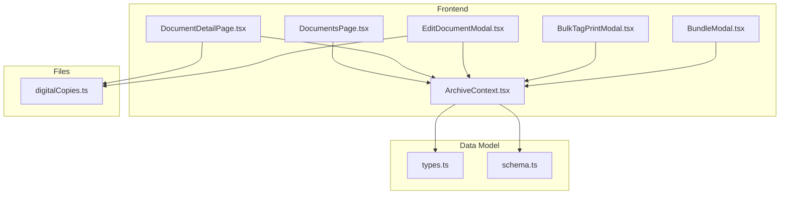
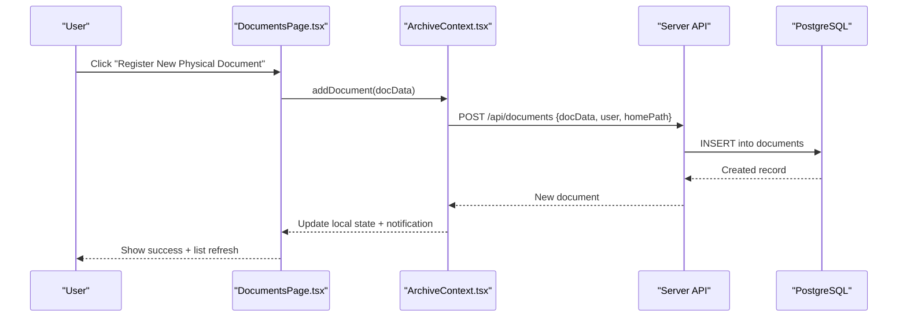
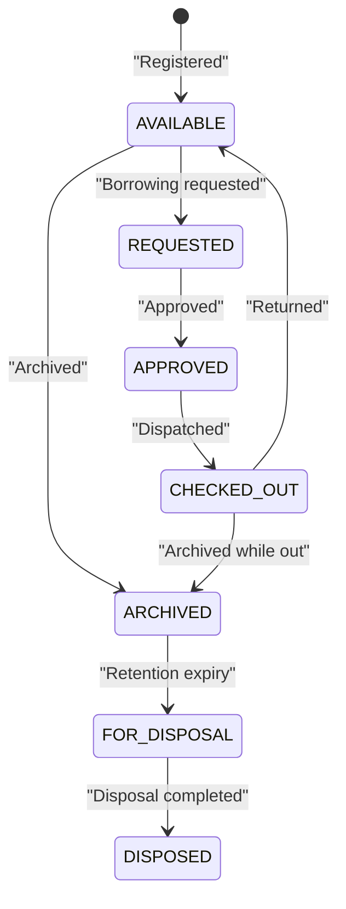
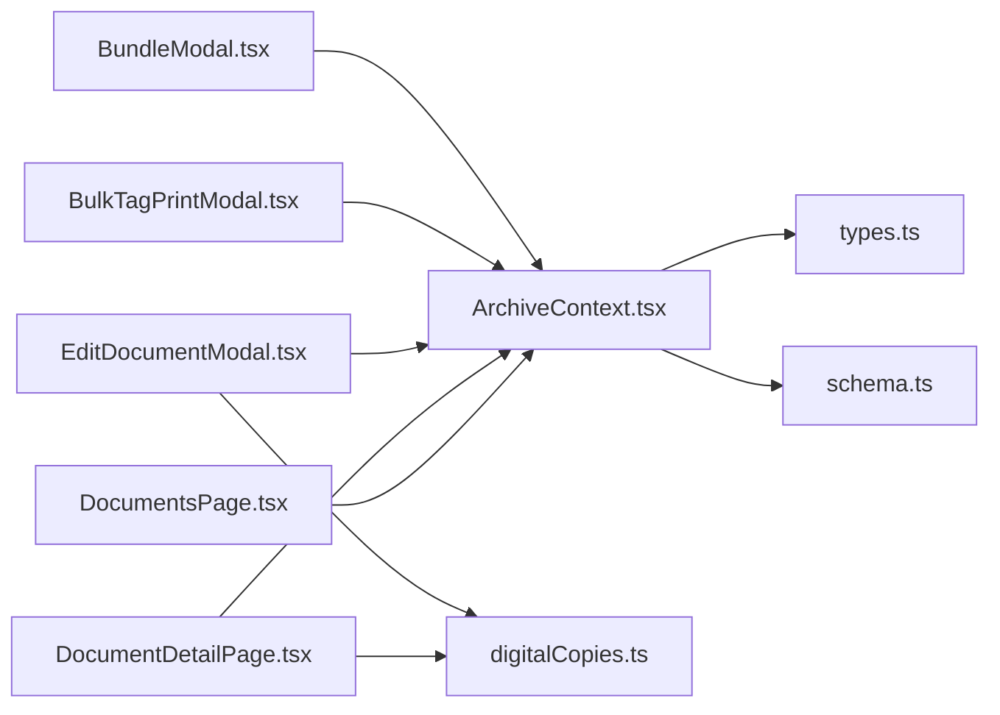

# Document Management

<cite>
**Referenced Files in This Document**
- [types.ts](file://src/types.ts)
- [schema.ts](file://src/db/schema.ts)
- [ArchiveContext.tsx](file://src/context/ArchiveContext.tsx)
- [DocumentsPage.tsx](file://src/pages/DocumentsPage.tsx)
- [DocumentDetailPage.tsx](file://src/pages/DocumentDetailPage.tsx)
- [EditDocumentModal.tsx](file://src/components/documents/EditDocumentModal.tsx)
- [BulkTagPrintModal.tsx](file://src/components/documents/BulkTagPrintModal.tsx)
- [BundleModal.tsx](file://src/components/documents/BundleModal.tsx)
- [digitalCopies.ts](file://src/files/digitalCopies.ts)
</cite>

## Table of Contents
1. Introduction
2. Project Structure
3. Core Components
4. Architecture Overview
5. Detailed Component Analysis
6. Dependency Analysis
7. Performance Considerations
8. Troubleshooting Guide
9. Conclusion

## Introduction
This document explains ArchiveHub’s document management system end-to-end: how documents are registered, edited, located, circulated, and disposed; how digital copies are attached with versioning; how bundles/dossiers group related records; and how search, filtering, and bulk operations work. It also clarifies the status workflow and audit trail that tracks every change.

## Project Structure
The application is a React-based frontend with a context-driven state layer and a backend API surface. Key areas:
- Types and database schema define the data model for documents, locations, checkouts, movements, bundles, and audit logs.
- Pages provide user interfaces for listing, viewing details, editing, and performing lifecycle actions.
- Context centralizes state and orchestrates API calls for CRUD, movement, checkout, and bundling.
- Utilities support QR/barcode generation, printing, and file handling for digital copies.

**Diagram sources**
- [DocumentsPage.tsx:1-120](file://src/pages/DocumentsPage.tsx#L1-L120)
- [DocumentDetailPage.tsx:1-120](file://src/pages/DocumentDetailPage.tsx#L1-L120)
- [EditDocumentModal.tsx:1-120](file://src/components/documents/EditDocumentModal.tsx#L1-L120)
- [BulkTagPrintModal.tsx:1-120](file://src/components/documents/BulkTagPrintModal.tsx#L1-L120)
- [BundleModal.tsx:1-120](file://src/components/documents/BundleModal.tsx#L1-L120)
- [ArchiveContext.tsx:1-120](file://src/context/ArchiveContext.tsx#L1-L120)
- [types.ts:135-183](file://src/types.ts#L135-L183)
- [schema.ts:67-116](file://src/db/schema.ts#L67-L116)

**Section sources**
- [types.ts:135-183](file://src/types.ts#L135-L183)
- [schema.ts:67-116](file://src/db/schema.ts#L67-L116)
- [ArchiveContext.tsx:197-255](file://src/context/ArchiveContext.tsx#L197-L255)

## Core Components
- Document model and statuses: The document entity includes identifiers (documentNumber, referenceNumber), classification (title, subject, department, type), dual location tracking (homeLocationId vs currentLocationId), lifecycle status, confidentiality, condition, retention dates, and optional digital copy metadata. Statuses include AVAILABLE, REQUESTED, CHECKED_OUT, ARCHIVED, among others.
- Database tables: Documents, Locations, Checkouts, Movements, Bundles, Audit Logs, Retention Policies, and Disposal Records persist all lifecycle events and relationships.
- Context layer: Centralizes state, provides methods to add/update/delete documents, move them, request/approve/reject/process checkouts, manage bundles, and fetch/sync from the backend.
- UI pages and modals: Provide registration, editing, detail view with history tabs, bulk tag printing, and bundling workflows.

**Section sources**
- [types.ts:54-72](file://src/types.ts#L54-L72)
- [types.ts:135-183](file://src/types.ts#L135-L183)
- [schema.ts:67-116](file://src/db/schema.ts#L67-L116)
- [schema.ts:118-167](file://src/db/schema.ts#L118-L167)
- [schema.ts:194-228](file://src/db/schema.ts#L194-L228)
- [ArchiveContext.tsx:751-800](file://src/context/ArchiveContext.tsx#L751-L800)

## Architecture Overview
The system follows a layered architecture:
- Presentation: React pages and modals render lists, forms, and detail views.
- State & Orchestration: ArchiveContext holds global state and exposes functions for domain operations.
- Persistence: Backend APIs (fetched by context) persist to PostgreSQL via Drizzle ORM schemas.
- Files: Digital copies are stored on disk under a dedicated directory with safe naming and path resolution.

**Diagram sources**
- [DocumentsPage.tsx:147-199](file://src/pages/DocumentsPage.tsx#L147-L199)
- [ArchiveContext.tsx:751-777](file://src/context/ArchiveContext.tsx#L751-L777)
- [schema.ts:67-116](file://src/db/schema.ts#L67-L116)

## Detailed Component Analysis

### Document Lifecycle and Status Workflow
- Registration: Creates a new document with default status AVAILABLE and sets homeLocationId as initial currentLocationId.
- Requested: A borrowing request creates a CheckoutRecord with status REQUESTED.
- Approved: An approver transitions the checkout to APPROVED.
- Checked Out: Dispatching the checkout updates the document status to CHECKED_OUT and may set a temporary current location.
- Returned: Processing return updates status back to AVAILABLE and records condition and return date.
- Archived: Documents can be moved to cold storage or marked ARCHIVED via edit or administrative action.
- Disposal: Retention policies and disposal records govern end-of-life handling.

**Diagram sources**
- [types.ts:54-68](file://src/types.ts#L54-L68)
- [schema.ts:118-148](file://src/db/schema.ts#L118-L148)
- [schema.ts:179-192](file://src/db/schema.ts#L179-L192)

**Section sources**
- [types.ts:54-68](file://src/types.ts#L54-L68)
- [schema.ts:118-148](file://src/db/schema.ts#L118-L148)
- [schema.ts:179-192](file://src/db/schema.ts#L179-L192)

### Document Registration Process
- Inputs: document number (auto-generated if missing), reference number, title, subject, description, owning department, document type (with retention years), home location, confidentiality level, condition, dates, and optional digital copy flags.
- Behavior: On submit, the system computes retention end date based on type retention, sets received/filed dates, initializes QR/barcodes, and persists the record.

Key fields captured at registration:
- Identifiers: documentNumber, referenceNumber
- Classification: title, subject, department, document type
- Location: homeLocationId (initially becomes currentLocationId)
- Security: confidentiality, condition
- Dates: documentDate, receivedDate, filedDate, retentionStartDate, retentionEndDate
- Digital copy: hasDigitalCopy, digitalFileName, digitalFileSize, digitalFileType, digitalFileVersion

**Section sources**
- [DocumentsPage.tsx:147-199](file://src/pages/DocumentsPage.tsx#L147-L199)
- [ArchiveContext.tsx:751-777](file://src/context/ArchiveContext.tsx#L751-L777)
- [types.ts:135-183](file://src/types.ts#L135-L183)
- [schema.ts:67-116](file://src/db/schema.ts#L67-L116)

### Editing Existing Records
- Edit modal supports updating title, reference, subject, description, department, document type, custom classification fields, permanent home location, bundle association, confidentiality, condition, status, dates, custodian, and digital copy metadata.
- Changes are persisted and accompanied by an audit log entry indicating a document update.

**Section sources**
- [EditDocumentModal.tsx:147-197](file://src/components/documents/EditDocumentModal.tsx#L147-L197)
- [ArchiveContext.tsx:779-800](file://src/context/ArchiveContext.tsx#L779-L800)

### Dual Location Tracking (Home vs Current)
- Home location represents the permanent archive placement.
- Current location reflects real-time physical position; when checked out, it shows custody and desk position; otherwise, it mirrors home unless relocated.
- Relocation updates currentLocationId and logs a movement.

**Section sources**
- [types.ts:149-152](file://src/types.ts#L149-L152)
- [DocumentDetailPage.tsx:251-314](file://src/pages/DocumentDetailPage.tsx#L251-L314)
- [schema.ts:82-84](file://src/db/schema.ts#L82-L84)

### Search and Filtering
- Global keyword search across document number, title, reference, subject, department, bundle info, home/current location paths, and custom field values.
- Filters: department, document type, status, confidentiality, and bundle membership (bundled/unbundled or specific bundle).

**Section sources**
- [DocumentsPage.tsx:217-262](file://src/pages/DocumentsPage.tsx#L217-L262)

### Digital Copy Attachment and Versioning
- Attachments are tracked per document with file name, size, type, and version number.
- Server-side utilities save files safely under a per-document directory and resolve paths securely.
- Versioning is supported via digitalFileVersion; updates increment version and store metadata.

**Section sources**
- [types.ts:167-172](file://src/types.ts#L167-L172)
- [schema.ts:100-104](file://src/db/schema.ts#L100-L104)
- [digitalCopies.ts:16-31](file://src/files/digitalCopies.ts#L16-L31)
- [digitalCopies.ts:33-41](file://src/files/digitalCopies.ts#L33-L41)

### Bulk Operations
- Tag Printing: Generate printable labels in standard, compact, or spine formats with configurable columns and page sizes. Supports QR codes and prints via hidden iframe or new tab.
- Bundling: Create new bundles or add selected documents to existing bundles; AI-assisted suggestions can propose titles, descriptions, and tags.

**Section sources**
- [BulkTagPrintModal.tsx:76-163](file://src/components/documents/BulkTagPrintModal.tsx#L76-L163)
- [BulkTagPrintModal.tsx:459-484](file://src/components/documents/BulkTagPrintModal.tsx#L459-L484)
- [BundleModal.tsx:79-131](file://src/components/documents/BundleModal.tsx#L79-L131)

### Relationship Between Documents and Bundles/Dossiers
- Bundles store a list of document IDs and can have their own location/path and status.
- Documents carry bundleId, bundleNumber, and bundleTitle to reflect membership.
- Adding/removing documents updates both bundle and document records consistently.

**Section sources**
- [types.ts:100-116](file://src/types.ts#L100-L116)
- [types.ts:177-179](file://src/types.ts#L177-L179)
- [schema.ts:194-211](file://src/db/schema.ts#L194-L211)
- [ArchiveContext.tsx:604-690](file://src/context/ArchiveContext.tsx#L604-L690)

### Practical Workflows

#### Register a New Document
- Open the register form, fill required fields (title, department, type, home location), optionally attach a digital copy, and submit. System generates identifiers, sets status to AVAILABLE, and persists the record.

**Section sources**
- [DocumentsPage.tsx:147-199](file://src/pages/DocumentsPage.tsx#L147-L199)
- [ArchiveContext.tsx:751-777](file://src/context/ArchiveContext.tsx#L751-L777)

#### Edit an Existing Record
- From the catalogue or detail page, open the edit modal to update metadata, classification, location, status, and digital copy attributes. Save triggers persistence and audit logging.

**Section sources**
- [EditDocumentModal.tsx:147-197](file://src/components/documents/EditDocumentModal.tsx#L147-L197)
- [ArchiveContext.tsx:779-800](file://src/context/ArchiveContext.tsx#L779-L800)

#### Manage Digital Copies
- Toggle digital copy attachment in the edit modal, set file name and version, and save. Details page shows attachment preview and download button.

**Section sources**
- [EditDocumentModal.tsx:559-604](file://src/components/documents/EditDocumentModal.tsx#L559-L604)
- [DocumentDetailPage.tsx:398-422](file://src/pages/DocumentDetailPage.tsx#L398-L422)
- [digitalCopies.ts:16-31](file://src/files/digitalCopies.ts#L16-L31)

#### Perform Bulk Tag Printing
- Select multiple documents, open bulk print modal, choose format and columns, then print or download the label sheet.

**Section sources**
- [DocumentsPage.tsx:427-475](file://src/pages/DocumentsPage.tsx#L427-L475)
- [BulkTagPrintModal.tsx:459-484](file://src/components/documents/BulkTagPrintModal.tsx#L459-L484)

#### Bundle Documents
- Select items, open bundle modal, create a new dossier or add to an existing one; optionally use AI suggestions for title/tags.

**Section sources**
- [DocumentsPage.tsx:455-463](file://src/pages/DocumentsPage.tsx#L455-L463)
- [BundleModal.tsx:79-131](file://src/components/documents/BundleModal.tsx#L79-L131)

## Dependency Analysis
- Pages depend on ArchiveContext for data and operations.
- Context depends on types and schema definitions for consistent modeling.
- Detail page uses movement, checkout, and audit data to present histories.
- Bulk operations rely on utility modules for QR generation and printing.
- File operations are isolated in digitalCopies.ts for safe storage and retrieval.

**Diagram sources**
- [DocumentsPage.tsx:1-120](file://src/pages/DocumentsPage.tsx#L1-L120)
- [DocumentDetailPage.tsx:1-120](file://src/pages/DocumentDetailPage.tsx#L1-L120)
- [EditDocumentModal.tsx:1-120](file://src/components/documents/EditDocumentModal.tsx#L1-L120)
- [BulkTagPrintModal.tsx:1-120](file://src/components/documents/BulkTagPrintModal.tsx#L1-L120)
- [BundleModal.tsx:1-120](file://src/components/documents/BundleModal.tsx#L1-L120)
- [ArchiveContext.tsx:1-120](file://src/context/ArchiveContext.tsx#L1-L120)
- [types.ts:135-183](file://src/types.ts#L135-L183)
- [schema.ts:67-116](file://src/db/schema.ts#L67-L116)
- [digitalCopies.ts:16-41](file://src/files/digitalCopies.ts#L16-L41)

**Section sources**
- [ArchiveContext.tsx:197-255](file://src/context/ArchiveContext.tsx#L197-L255)
- [types.ts:135-183](file://src/types.ts#L135-L183)
- [schema.ts:67-116](file://src/db/schema.ts#L67-L116)

## Performance Considerations
- Batch operations: Use bulk selection to minimize repeated UI interactions for tagging and bundling.
- Filtering efficiency: Combine keyword search with filters to reduce result sets before rendering.
- QR generation: Pre-generate QR images for bulk print to avoid re-computation during printing.
- File uploads: Store digital copies per document with safe naming to prevent collisions and ensure fast resolution.

[No sources needed since this section provides general guidance]

## Troubleshooting Guide
- Missing document after registration: Verify backend response and local state update; check notifications for errors.
- Status not transitioning: Ensure checkout flow completes (request → approve → dispatch → return); confirm movement logs exist.
- Location mismatch: Confirm homeLocationId vs currentLocationId; use relocation to correct current position.
- Digital copy not visible: Validate file saved under uploads/digital/<documentId>; verify path resolution and permissions.
- Bundle membership issues: Re-add documents to bundle; ensure bundleIds are synchronized across bundle and document records.

**Section sources**
- [ArchiveContext.tsx:751-800](file://src/context/ArchiveContext.tsx#L751-L800)
- [DocumentDetailPage.tsx:115-137](file://src/pages/DocumentDetailPage.tsx#L115-L137)
- [digitalCopies.ts:33-41](file://src/files/digitalCopies.ts#L33-L41)

## Conclusion
ArchiveHub’s document management system provides a robust lifecycle from registration through disposal, with clear status transitions, comprehensive audit trails, and practical tools for daily operations. Dual location tracking ensures accurate physical positioning, while digital attachments and versioning support modern archival needs. Bulk operations and advanced search/filter capabilities streamline large-scale management, and bundles enable coherent grouping of related records.

[No sources needed since this section summarizes without analyzing specific files]