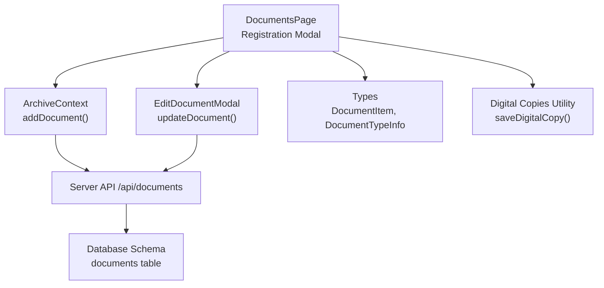
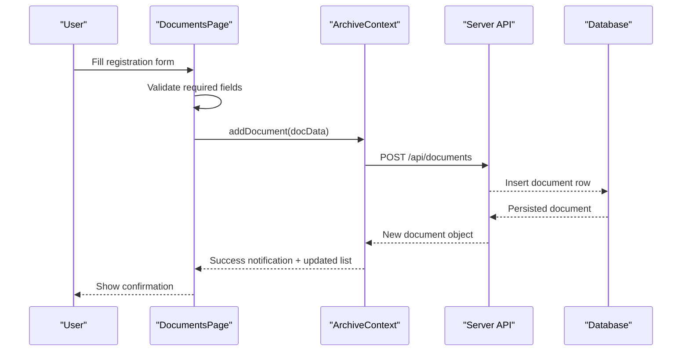
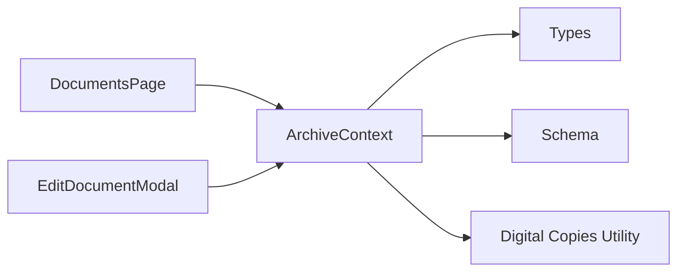
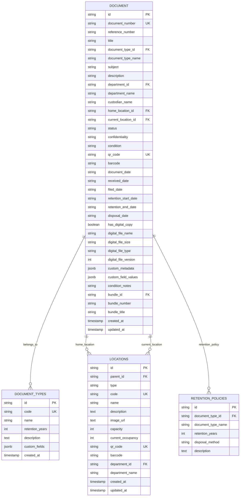

# Document Registration

<cite>
**Referenced Files in This Document**
- [DocumentsPage.tsx](file://src/pages/DocumentsPage.tsx)
- [EditDocumentModal.tsx](file://src/components/documents/EditDocumentModal.tsx)
- [ArchiveContext.tsx](file://src/context/ArchiveContext.tsx)
- [types.ts](file://src/types.ts)
- [schema.ts](file://src/db/schema.ts)
- [digitalCopies.ts](file://src/files/digitalCopies.ts)
</cite>

## Table of Contents
1. [Introduction](#introduction)
2. [Project Structure](#project-structure)
3. [Core Components](#core-components)
4. [Architecture Overview](#architecture-overview)
5. [Detailed Component Analysis](#detailed-component-analysis)
6. [Dependency Analysis](#dependency-analysis)
7. [Performance Considerations](#performance-considerations)
8. [Troubleshooting Guide](#troubleshooting-guide)
9. [Conclusion](#conclusion)
10. [Appendices](#appendices)

## Introduction
This document explains the complete document registration workflow in ArchiveHub, focusing on how users register physical records with rich metadata, dynamic custom fields, retention policies, and optional digital copies. It covers:
- The registration form fields and validation rules
- How departments and document types are related
- How custom fields are dynamically loaded based on selected document type
- Digital copy attachment options during registration
- Practical examples for different document types
- Retention policy setup and calculation
- Error handling scenarios

## Project Structure
The registration flow spans UI components, context state management, data models, and file utilities:
- DocumentsPage hosts the registration modal and orchestrates form submission
- EditDocumentModal supports editing existing documents with similar metadata controls
- ArchiveContext manages data fetching, document creation/update, and notifications
- Types define all entities (documents, document types, locations, etc.)
- Database schema defines persistence structure
- Digital copies utility handles server-side storage and retrieval

**Diagram sources**
- [DocumentsPage.tsx:147-199](file://src/pages/DocumentsPage.tsx#L147-L199)
- [ArchiveContext.tsx:752-777](file://src/context/ArchiveContext.tsx#L752-L777)
- [schema.ts:67-116](file://src/db/schema.ts#L67-L116)
- [digitalCopies.ts:16-31](file://src/files/digitalCopies.ts#L16-L31)

**Section sources**
- [DocumentsPage.tsx:1-1131](file://src/pages/DocumentsPage.tsx#L1-L1131)
- [EditDocumentModal.tsx:1-638](file://src/components/documents/EditDocumentModal.tsx#L1-L638)
- [ArchiveContext.tsx:1-1062](file://src/context/ArchiveContext.tsx#L1-L1062)
- [types.ts:1-283](file://src/types.ts#L1-L283)
- [schema.ts:1-228](file://src/db/schema.ts#L1-L228)
- [digitalCopies.ts:1-47](file://src/files/digitalCopies.ts#L1-L47)

## Core Components
- Registration form in DocumentsPage:
  - Fields include document number (optional), reference number, title, department, document type, subject, description, home location, confidentiality, condition, document date, and optional digital copy metadata
  - Dynamic custom fields appear based on selected document type
  - Retention end date is calculated from document type’s retention years
- EditDocumentModal:
  - Mirrors many registration fields for updating existing records
  - Supports conditional custom fields and digital surrogate metadata
- ArchiveContext:
  - addDocument creates a new record via API or local fallback
  - updateDocument modifies an existing record
  - Provides departments, document types, locations, and helper functions like calculatePath
- Data Models and Schema:
  - DocumentItem and DocumentTypeInfo define metadata and relationships
  - Database schema persists documents, document types, locations, and related tables

**Section sources**
- [DocumentsPage.tsx:89-199](file://src/pages/DocumentsPage.tsx#L89-L199)
- [EditDocumentModal.tsx:48-197](file://src/components/documents/EditDocumentModal.tsx#L48-L197)
- [ArchiveContext.tsx:752-810](file://src/context/ArchiveContext.tsx#L752-L810)
- [types.ts:118-183](file://src/types.ts#L118-L183)
- [schema.ts:37-116](file://src/db/schema.ts#L37-L116)

## Architecture Overview
The registration workflow follows a clear sequence from user input to persistence and feedback:

**Diagram sources**
- [DocumentsPage.tsx:147-199](file://src/pages/DocumentsPage.tsx#L147-L199)
- [ArchiveContext.tsx:752-777](file://src/context/ArchiveContext.tsx#L752-L777)
- [schema.ts:67-116](file://src/db/schema.ts#L67-L116)

## Detailed Component Analysis

### Registration Form Fields and Validation
- Document Number: Optional; if blank, auto-generated using a prefix and year plus random suffix
- Reference Number: Optional; defaults to a generated reference if not provided
- Title: Required; validated before submission
- Owning Department: Required; filters available document types
- Document Type: Required; determines retention period and custom fields
- Subject and Description: Optional text fields
- Home Location: Required; permanent archive storage assignment
- Confidentiality Level: Selectable from PUBLIC, INTERNAL, CONFIDENTIAL, RESTRICTED
- Physical Condition: Selectable from EXCELLENT, GOOD, FAIR, DAMAGED
- Document Date: Date picker
- Received Date and Filed Date: Set to current date at registration time
- Custom Classification Fields: Dynamically rendered based on selected document type; required flags enforced per field definition
- Digital Copy Attachment: Optional; toggles metadata fields for filename, version, and type

Validation rules:
- Title must be non-empty
- Home location must be selected
- Document type must be selected
- Required custom fields must be filled when present
- On submit, if validations fail, the form prevents registration

Error handling:
- If backend call fails, a local fallback creates a document entry and notifies success
- Notifications inform users of success or errors

**Section sources**
- [DocumentsPage.tsx:147-199](file://src/pages/DocumentsPage.tsx#L147-L199)
- [DocumentsPage.tsx:800-1084](file://src/pages/DocumentsPage.tsx#L800-L1084)
- [ArchiveContext.tsx:752-777](file://src/context/ArchiveContext.tsx#L752-L777)

### Relationship Between Departments and Document Types
- Available document types are filtered by the selected owning department
- Only types tied to the department or marked universal are shown
- When department changes, the form resets or initializes custom fields based on the first valid type

Behavior:
- handleDeptChange updates available types and triggers initial custom field values
- If no types are available for a department, the form indicates that types need to be created in settings

**Section sources**
- [DocumentsPage.tsx:95-145](file://src/pages/DocumentsPage.tsx#L95-L145)
- [EditDocumentModal.tsx:110-141](file://src/components/documents/EditDocumentModal.tsx#L110-L141)

### Dynamic Custom Fields Based on Document Type
- Custom fields are defined per document type and can be text, number, date, or select
- Required flags control mandatory inputs
- Default values are applied when switching document types
- Live preview shows disambiguated classification combining title and custom field values

Implementation highlights:
- handleTypeChange merges default values into customFieldValues
- Rendering switches between select and input based on field type
- Required attributes enforce validation

**Section sources**
- [DocumentsPage.tsx:134-145](file://src/pages/DocumentsPage.tsx#L134-L145)
- [DocumentsPage.tsx:886-952](file://src/pages/DocumentsPage.tsx#L886-L952)
- [EditDocumentModal.tsx:129-141](file://src/components/documents/EditDocumentModal.tsx#L129-L141)
- [types.ts:74-98](file://src/types.ts#L74-L98)

### Digital Copy Attachment Options
- Toggle to attach digitized surrogate copy
- Metadata includes filename, version, and MIME type
- During registration, enabling the toggle sets hasDigitalCopy and populates metadata fields
- Server-side utility saves files under a document-specific directory and returns relative path and size label

Practical notes:
- Filename sanitization ensures safe storage
- Base64 payload decoding supports direct upload flows
- Resolution checks prevent serving files outside the allowed root

**Section sources**
- [DocumentsPage.tsx:1035-1061](file://src/pages/DocumentsPage.tsx#L1035-L1061)
- [EditDocumentModal.tsx:559-604](file://src/components/documents/EditDocumentModal.tsx#L559-L604)
- [digitalCopies.ts:16-47](file://src/files/digitalCopies.ts#L16-L47)

### Retention Policies and Dates
- Retention start date is set to the current date at registration
- Retention end date is calculated by adding the document type’s retention years to the start date
- Disposal date may be recorded later based on policy
- Received and filed dates default to the registration date

Policy setup:
- Document types carry retentionYears which drive end date calculation
- Retention policies table stores disposal methods and descriptions for each type

**Section sources**
- [DocumentsPage.tsx:151-186](file://src/pages/DocumentsPage.tsx#L151-L186)
- [schema.ts:37-46](file://src/db/schema.ts#L37-L46)
- [schema.ts:169-177](file://src/db/schema.ts#L169-L177)
- [types.ts:118-127](file://src/types.ts#L118-L127)

### Practical Examples

#### Example 1: Registering a Contract with Financial Custom Fields
- Choose Owning Department: Finance
- Select Document Type: Contract (with custom fields such as Fund Source and Period)
- Fill Title, Subject, Home Location, Confidentiality, Condition, Document Date
- Provide custom field values (e.g., Fund Source = “Grant A”, Period = “FY2026”)
- Optionally attach a digitized PDF
- Submit to generate document number and reference number if not provided

Expected outcomes:
- Custom fields render based on Contract type
- Retention end date computed from Contract’s retention years
- Digital copy metadata stored if enabled

**Section sources**
- [DocumentsPage.tsx:844-952](file://src/pages/DocumentsPage.tsx#L844-L952)
- [DocumentsPage.tsx:147-199](file://src/pages/DocumentsPage.tsx#L147-L199)

#### Example 2: Registering a Memo with Minimal Custom Fields
- Choose Owning Department: Administration
- Select Document Type: Internal Memo (no custom fields)
- Fill Title, Subject, Home Location, Confidentiality, Condition, Document Date
- No custom fields to fill
- Submit to register

Expected outcomes:
- Simpler form without custom fields section
- Standard retention calculation applies

**Section sources**
- [DocumentsPage.tsx:844-952](file://src/pages/DocumentsPage.tsx#L844-L952)
- [DocumentsPage.tsx:147-199](file://src/pages/DocumentsPage.tsx#L147-L199)

#### Example 3: Handling Auto-Generated Identifiers
- Leave Document Number blank to auto-generate using prefix and year plus random suffix
- Leave Reference Number blank to auto-generate a reference code
- System assigns QR code and barcode identifiers

**Section sources**
- [DocumentsPage.tsx:154-186](file://src/pages/DocumentsPage.tsx#L154-L186)
- [ArchiveContext.tsx:766-777](file://src/context/ArchiveContext.tsx#L766-L777)

#### Example 4: Setting Up Retention Policies
- Configure document types with appropriate retentionYears
- Use retention policies table to define disposal methods and descriptions
- At registration, system calculates retentionEndDate automatically

**Section sources**
- [schema.ts:37-46](file://src/db/schema.ts#L37-L46)
- [schema.ts:169-177](file://src/db/schema.ts#L169-L177)
- [DocumentsPage.tsx:151-186](file://src/pages/DocumentsPage.tsx#L151-L186)

#### Example 5: Attaching Initial Digital Copies
- Enable digital copy toggle in registration form
- Provide filename and version if desired
- On save, metadata is stored; server-side utility handles file saving and resolution

**Section sources**
- [DocumentsPage.tsx:1035-1061](file://src/pages/DocumentsPage.tsx#L1035-L1061)
- [digitalCopies.ts:16-47](file://src/files/digitalCopies.ts#L16-L47)

### Edit Flow and Validation
- EditDocumentModal mirrors registration fields for updates
- Validates title presence and constructs updates object
- Applies custom field merging and digital copy metadata
- Updates persist via API or local fallback with audit logging

**Section sources**
- [EditDocumentModal.tsx:147-197](file://src/components/documents/EditDocumentModal.tsx#L147-L197)
- [ArchiveContext.tsx:779-810](file://src/context/ArchiveContext.tsx#L779-L810)

## Dependency Analysis
Key dependencies and relationships:
- DocumentsPage depends on ArchiveContext for data and operations
- EditDocumentModal depends on ArchiveContext for updates and notifications
- Types define shared structures across components and schema
- Schema maps to database tables for persistence
- Digital copies utility provides file handling functions used by server endpoints

**Diagram sources**
- [DocumentsPage.tsx:1-1131](file://src/pages/DocumentsPage.tsx#L1-L1131)
- [EditDocumentModal.tsx:1-638](file://src/components/documents/EditDocumentModal.tsx#L1-L638)
- [ArchiveContext.tsx:1-1062](file://src/context/ArchiveContext.tsx#L1-L1062)
- [types.ts:1-283](file://src/types.ts#L1-L283)
- [schema.ts:1-228](file://src/db/schema.ts#L1-L228)
- [digitalCopies.ts:1-47](file://src/files/digitalCopies.ts#L1-L47)

**Section sources**
- [DocumentsPage.tsx:1-1131](file://src/pages/DocumentsPage.tsx#L1-L1131)
- [EditDocumentModal.tsx:1-638](file://src/components/documents/EditDocumentModal.tsx#L1-L638)
- [ArchiveContext.tsx:1-1062](file://src/context/ArchiveContext.tsx#L1-L1062)
- [types.ts:1-283](file://src/types.ts#L1-L283)
- [schema.ts:1-228](file://src/db/schema.ts#L1-L228)
- [digitalCopies.ts:1-47](file://src/files/digitalCopies.ts#L1-L47)

## Performance Considerations
- Filtering document types by department reduces UI complexity and improves responsiveness
- Local fallbacks ensure continuity when backend calls fail, minimizing downtime impact
- Efficient state updates in ArchiveContext avoid unnecessary re-renders
- File naming and path resolution in digital copies utility prevent filesystem overhead and security risks

[No sources needed since this section provides general guidance]

## Troubleshooting Guide
Common issues and resolutions:
- Missing required fields: Ensure title, home location, and document type are selected; required custom fields must be filled
- No document types for department: Create document types in settings or adjust department selection
- Backend connectivity problems: Local fallback creates entries; verify server health and network connectivity
- Digital copy upload failures: Check file name sanitization and path resolution; ensure uploads directory exists

Error handling patterns:
- Notifications provide immediate feedback on success or error states
- Audit logs capture updates for traceability
- Deletion protection prevents removing checked-out documents

**Section sources**
- [DocumentsPage.tsx:147-199](file://src/pages/DocumentsPage.tsx#L147-L199)
- [EditDocumentModal.tsx:147-197](file://src/components/documents/EditDocumentModal.tsx#L147-L197)
- [ArchiveContext.tsx:812-830](file://src/context/ArchiveContext.tsx#L812-L830)
- [digitalCopies.ts:33-41](file://src/files/digitalCopies.ts#L33-L41)

## Conclusion
ArchiveHub’s document registration workflow provides a robust, flexible process for registering physical records with comprehensive metadata, dynamic custom fields, retention policies, and optional digital copies. The integration between UI components, context state management, and data models ensures reliable operation with clear validation and error handling. Users can efficiently manage departments and document types, leverage auto-generated identifiers, and maintain accurate retention schedules while attaching digital surrogates when needed.

[No sources needed since this section summarizes without analyzing specific files]

## Appendices

### Data Model Relationships

**Diagram sources**
- [schema.ts:37-116](file://src/db/schema.ts#L37-L116)
- [schema.ts:169-177](file://src/db/schema.ts#L169-L177)
- [types.ts:118-183](file://src/types.ts#L118-L183)