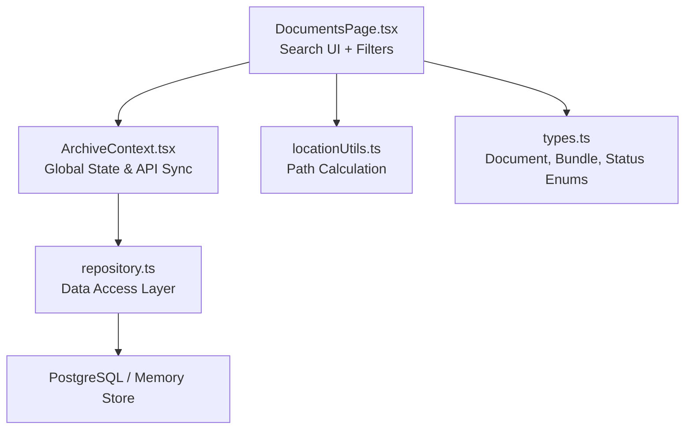
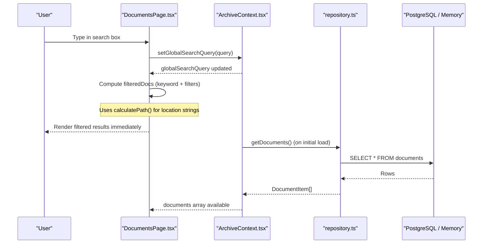
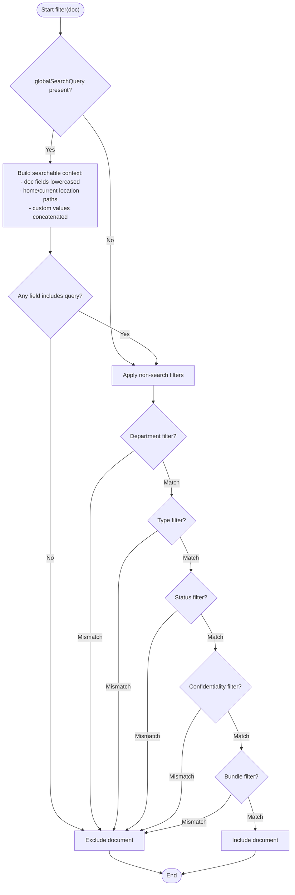
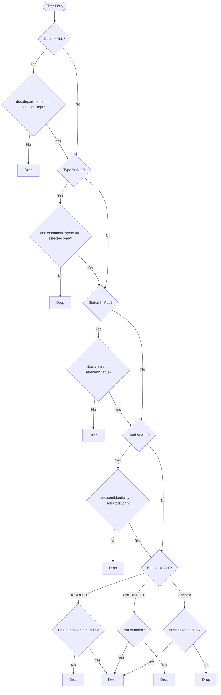
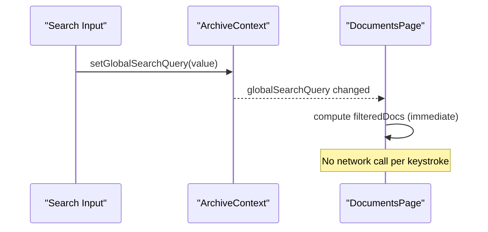
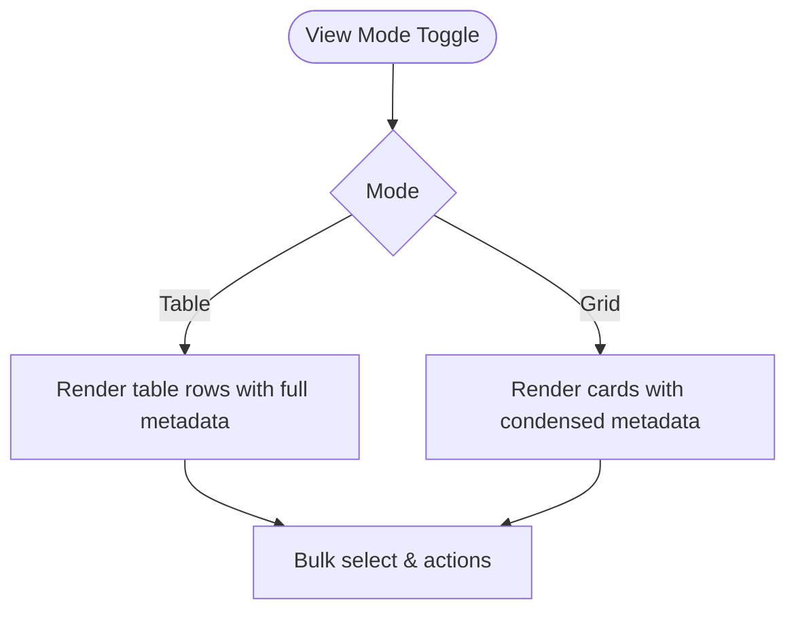
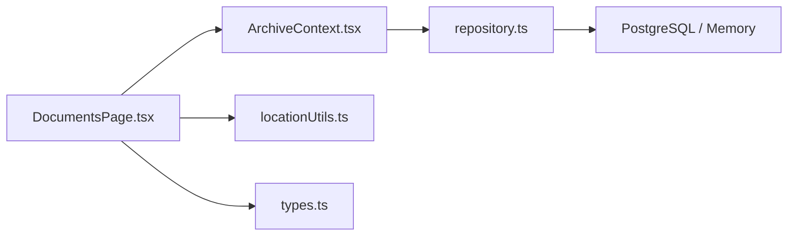

# Search and Filtering

<cite>
**Referenced Files in This Document**
- [DocumentsPage.tsx](file://src/pages/DocumentsPage.tsx)
- [ArchiveContext.tsx](file://src/context/ArchiveContext.tsx)
- [repository.ts](file://src/db/repository.ts)
- [types.ts](file://src/types.ts)
- [locationUtils.ts](file://src/utils/locationUtils.ts)
</cite>

## Table of Contents
1. [Introduction](#introduction)
2. [Project Structure](#project-structure)
3. [Core Components](#core-components)
4. [Architecture Overview](#architecture-overview)
5. [Detailed Component Analysis](#detailed-component-analysis)
6. [Dependency Analysis](#dependency-analysis)
7. [Performance Considerations](#performance-considerations)
8. [Troubleshooting Guide](#troubleshooting-guide)
9. [Conclusion](#conclusion)
10. [Appendices](#appendices)

## Introduction
This document explains the advanced search and filtering capabilities in ArchiveHub’s document management system. It covers:
- Global keyword search across multiple fields including document numbers, titles, reference numbers, subjects, departments, bundle information, location paths, and custom field values.
- Multi-criteria filtering by department, document type, status, confidentiality level, and bundle/dossier.
- Real-time search behavior driven by React state updates.
- Performance considerations for large datasets and practical guidance for efficient retrieval.
- Result ranking approach (as implemented).
- View modes (table/grid) and their impact on result presentation.

## Project Structure
The search and filtering features are primarily implemented in the Documents page component with global state managed in the application context. Data is sourced from a repository layer that can operate against PostgreSQL or an in-memory fallback. Location path computation utilities support hierarchical location searches.

**Diagram sources**
- [DocumentsPage.tsx:217-262](file://src/pages/DocumentsPage.tsx#L217-L262)
- [ArchiveContext.tsx:197-255](file://src/context/ArchiveContext.tsx#L197-L255)
- [repository.ts:470-519](file://src/db/repository.ts#L470-L519)
- [locationUtils.ts:7-14](file://src/utils/locationUtils.ts#L7-L14)
- [types.ts:54-72](file://src/types.ts#L54-L72)

**Section sources**
- [DocumentsPage.tsx:217-262](file://src/pages/DocumentsPage.tsx#L217-L262)
- [ArchiveContext.tsx:197-255](file://src/context/ArchiveContext.tsx#L197-L255)
- [repository.ts:470-519](file://src/db/repository.ts#L470-L519)
- [locationUtils.ts:7-14](file://src/utils/locationUtils.ts#L7-L14)
- [types.ts:54-72](file://src/types.ts#L54-L72)

## Core Components
- Global keyword search input bound to globalSearchQuery in context; triggers immediate re-filtering on change.
- Filter controls for department, document type, status, confidentiality, and bundle/dossier.
- View mode toggle between table and grid layouts for results.
- Context-managed data fetching and synchronization with backend APIs.
- Repository layer providing documents and related entities (departments, types, locations, bundles).

Key responsibilities:
- DocumentsPage.tsx: Implements UI, filter state, and client-side filtering logic.
- ArchiveContext.tsx: Holds globalSearchQuery and provides fetchAllFromBackend to load all data into memory for fast client-side filtering.
- repository.ts: Supplies getDocuments and other entity lists; supports PostgreSQL or in-memory storage.
- locationUtils.ts: Builds human-readable hierarchical location paths used in search matching.
- types.ts: Defines enums and structures for statuses, confidentiality levels, and document attributes.

**Section sources**
- [DocumentsPage.tsx:217-262](file://src/pages/DocumentsPage.tsx#L217-L262)
- [ArchiveContext.tsx:197-255](file://src/context/ArchiveContext.tsx#L197-L255)
- [repository.ts:470-519](file://src/db/repository.ts#L470-L519)
- [locationUtils.ts:7-14](file://src/utils/locationUtils.ts#L7-L14)
- [types.ts:54-72](file://src/types.ts#L54-L72)

## Architecture Overview
The search pipeline is client-side and real-time:
- User types in the search box → globalSearchQuery updates in context → DocumentsPage recomputes filteredDocs using current filters and query.
- Data is loaded once via context’s fetchAllFromBackend and cached in React state for instant filtering.
- Location paths are computed on demand for each document during search matching.

**Diagram sources**
- [DocumentsPage.tsx:217-262](file://src/pages/DocumentsPage.tsx#L217-L262)
- [ArchiveContext.tsx:197-255](file://src/context/ArchiveContext.tsx#L197-L255)
- [repository.ts:470-519](file://src/db/repository.ts#L470-L519)
- [locationUtils.ts:7-14](file://src/utils/locationUtils.ts#L7-L14)

## Detailed Component Analysis

### Global Keyword Search
- Fields searched:
  - Document number
  - Title
  - Reference number
  - Subject
  - Department name
  - Bundle number/title
  - Home and current location paths
  - Custom field values (concatenated)
- Matching strategy:
  - Case-insensitive substring match using includes after lowercasing.
  - Location paths are built via calculateLocationPath and lowercased before matching.
  - Custom field values are joined into a single string and matched.

**Diagram sources**
- [DocumentsPage.tsx:217-262](file://src/pages/DocumentsPage.tsx#L217-L262)
- [locationUtils.ts:7-14](file://src/utils/locationUtils.ts#L7-L14)

**Section sources**
- [DocumentsPage.tsx:217-262](file://src/pages/DocumentsPage.tsx#L217-L262)
- [locationUtils.ts:7-14](file://src/utils/locationUtils.ts#L7-L14)

### Multi-Criteria Filtering System
- Department filter: exact match on departmentId when not ALL.
- Document type filter: exact match on documentTypeId when not ALL.
- Status filter: exact match on status enum when not ALL.
- Confidentiality filter: exact match on confidentiality level when not ALL.
- Bundle/Dossier filter:
  - All Bundles & Single Items (default)
  - Only Bundled Records: matches if document has bundleId/bundleNumber or is included in any bundle’s documentIds.
  - Only Unbundled Records: inverse of above.
  - Specific Bundle: matches if document is part of selected bundle by id or bundleNumber.

**Diagram sources**
- [DocumentsPage.tsx:241-259](file://src/pages/DocumentsPage.tsx#L241-L259)

**Section sources**
- [DocumentsPage.tsx:241-259](file://src/pages/DocumentsPage.tsx#L241-L259)

### Real-Time Search Implementation
- The search input updates globalSearchQuery in context, which triggers re-render and recomputation of filteredDocs on every keystroke.
- Data loading occurs once at startup via fetchAllFromBackend, caching documents, departments, types, locations, and bundles in context state for instant client-side filtering.

**Diagram sources**
- [ArchiveContext.tsx:176-178](file://src/context/ArchiveContext.tsx#L176-L178)
- [DocumentsPage.tsx:217-262](file://src/pages/DocumentsPage.tsx#L217-L262)

**Section sources**
- [ArchiveContext.tsx:176-178](file://src/context/ArchiveContext.tsx#L176-L178)
- [DocumentsPage.tsx:217-262](file://src/pages/DocumentsPage.tsx#L217-L262)

### Search Result Ranking
- As implemented, there is no explicit ranking algorithm. Results are returned in the order they appear in the documents array (which is ordered by created_at descending at the repository level).
- To implement relevance ranking, consider scoring matches by field priority (e.g., documentNumber > title > referenceNumber > subject > department > bundle > location > custom fields) and sorting accordingly.

**Section sources**
- [repository.ts:470-519](file://src/db/repository.ts#L470-L519)
- [DocumentsPage.tsx:217-262](file://src/pages/DocumentsPage.tsx#L217-L262)

### View Modes: Table vs Grid
- Table view:
  - Displays detailed columns including title/subject, doc/ref numbers, department, security/condition, circulation status, home and current locations, and actions.
  - Supports bulk selection and batch operations.
- Grid view:
  - Card-style layout showing key identifiers, title, bundle badges, custom field tags, and home location.
  - Suitable for quick scanning and visual browsing.

**Diagram sources**
- [DocumentsPage.tsx:477-777](file://src/pages/DocumentsPage.tsx#L477-L777)

**Section sources**
- [DocumentsPage.tsx:477-777](file://src/pages/DocumentsPage.tsx#L477-L777)

## Dependency Analysis
- DocumentsPage depends on:
  - ArchiveContext for globalSearchQuery, documents, departments, documentTypes, locations, bundles, and helper functions like calculatePath.
  - Types for enums and interfaces.
  - Location utilities for building location paths.
- ArchiveContext depends on:
  - repository.ts for data access and mapping.
  - External APIs for initial sync and mutations.
- Repository depends on:
  - Database pool or in-memory arrays for persistence.

**Diagram sources**
- [DocumentsPage.tsx:217-262](file://src/pages/DocumentsPage.tsx#L217-L262)
- [ArchiveContext.tsx:197-255](file://src/context/ArchiveContext.tsx#L197-L255)
- [repository.ts:470-519](file://src/db/repository.ts#L470-L519)
- [locationUtils.ts:7-14](file://src/utils/locationUtils.ts#L7-L14)
- [types.ts:54-72](file://src/types.ts#L54-L72)

**Section sources**
- [DocumentsPage.tsx:217-262](file://src/pages/DocumentsPage.tsx#L217-L262)
- [ArchiveContext.tsx:197-255](file://src/context/ArchiveContext.tsx#L197-L255)
- [repository.ts:470-519](file://src/db/repository.ts#L470-L519)
- [locationUtils.ts:7-14](file://src/utils/locationUtils.ts#L7-L14)
- [types.ts:54-72](file://src/types.ts#L54-L72)

## Performance Considerations
- Client-side filtering:
  - Uses Array.prototype.filter on the entire documents array per keystroke. For very large datasets, this can become CPU-intensive.
  - Mitigations:
    - Debounce search input to reduce recalculations.
    - Precompute normalized fields (lowercased strings) once and reuse during filtering.
    - Consider pagination or virtualization for rendering large result sets.
- Data loading:
  - fetchAllFromBackend loads all entities once; ensure efficient backend queries and indexing on frequently filtered fields (document_number, title, reference_number, department_id, status, confidentiality).
- Location path computation:
  - calculateLocationPath is called per document during search; memoization or precomputation can reduce repeated work.
- Bundle checks:
  - Checking bundles involves iterating bundles per document; consider building a map from documentId to bundleId for O(1) lookups.

[No sources needed since this section provides general guidance]

## Troubleshooting Guide
- No results found:
  - Verify globalSearchQuery is not empty and filters are not overly restrictive.
  - Ensure data was loaded successfully via fetchAllFromBackend.
- Slow performance:
  - Reduce dataset size via filters first.
  - Implement debouncing and precomputed normalized fields.
- Incorrect bundle filtering:
  - Confirm bundle membership in both document-level fields and bundle.documentIds.
- Location path mismatches:
  - Validate location hierarchy and parent-child relationships in locations data.

**Section sources**
- [DocumentsPage.tsx:217-262](file://src/pages/DocumentsPage.tsx#L217-L262)
- [ArchiveContext.tsx:197-255](file://src/context/ArchiveContext.tsx#L197-L255)
- [repository.ts:470-519](file://src/db/repository.ts#L470-L519)

## Conclusion
ArchiveHub implements a robust, real-time, client-side search and filtering system that spans multiple document attributes and supports complex multi-criteria filtering. While currently unranked, the architecture allows for future enhancements such as relevance scoring, debounced search, and optimized lookups for large datasets. The dual view modes provide flexible presentation options tailored to different workflows.

[No sources needed since this section summarizes without analyzing specific files]

## Appendices

### Practical Examples of Complex Queries and Filters
- Find all confidential records in Engineering about “contract” in Q3:
  - Set globalSearchQuery to “contract”.
  - Select Department: Engineering.
  - Select Confidentiality: Confidential.
  - Optionally add a document type or status filter as needed.
- Locate bundled records only in a specific dossier:
  - Use Bundle filter: select the target dossier.
  - Combine with keyword search to narrow within the bundle.
- Find unbundled items checked out:
  - Set Bundle filter to “Only Unbundled Records”.
  - Set Status filter to “Checked Out”.

[No sources needed since this section provides conceptual examples]