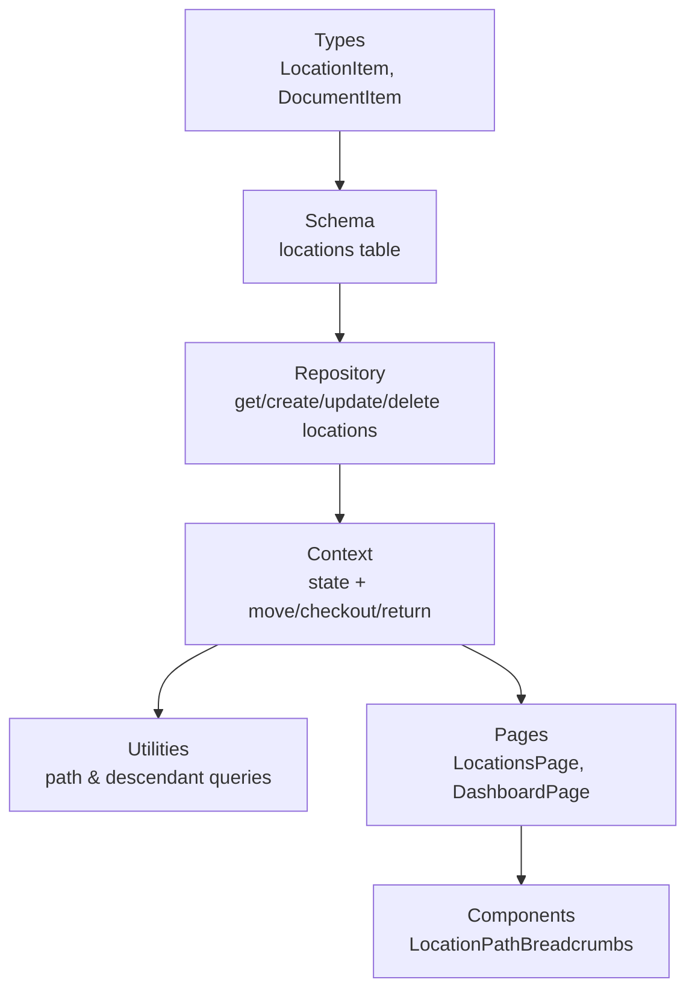
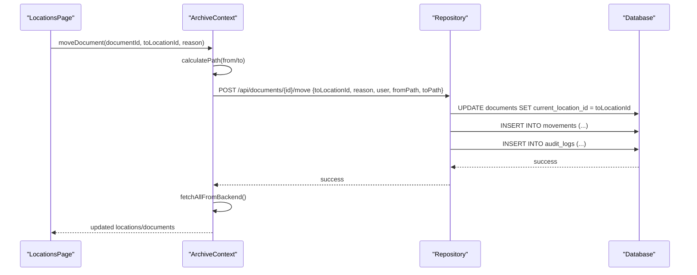
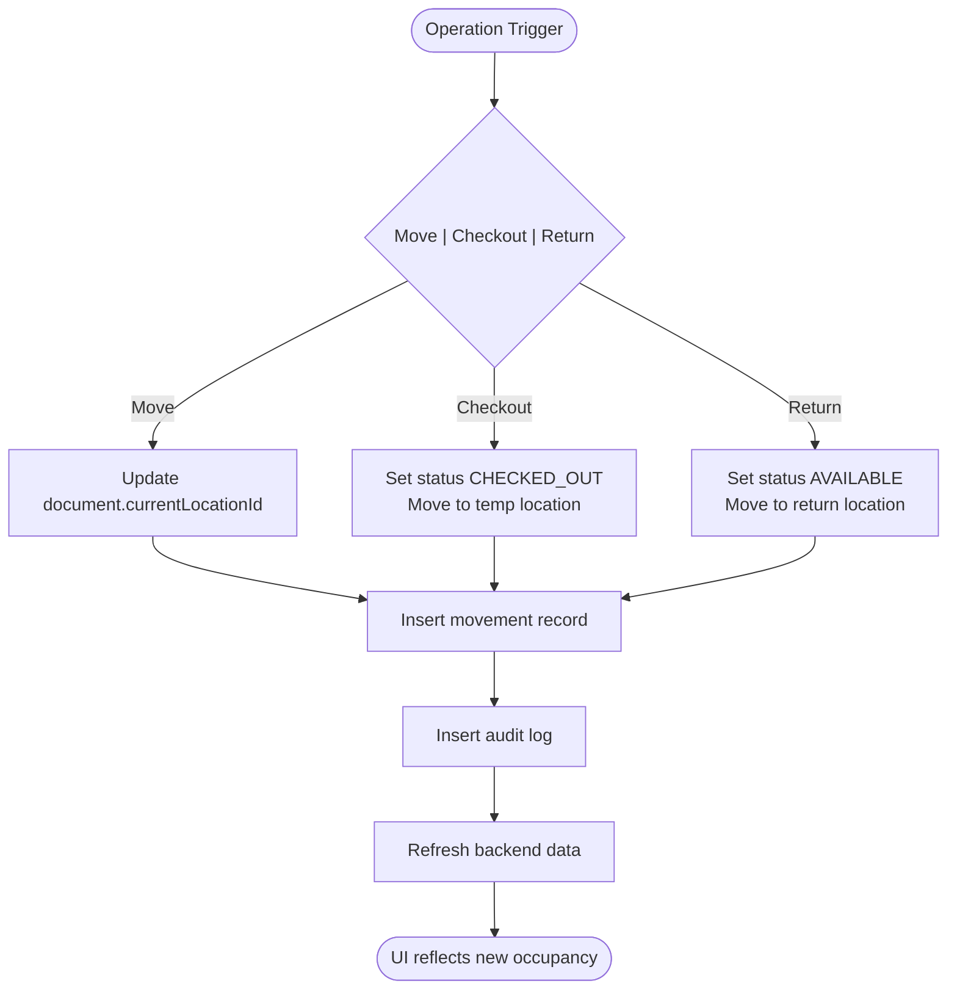
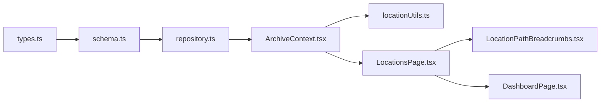

# Capacity Planning

<cite>
**Referenced Files in This Document**
- [types.ts](file://src/types.ts)
- [schema.ts](file://src/db/schema.ts)
- [repository.ts](file://src/db/repository.ts)
- [ArchiveContext.tsx](file://src/context/ArchiveContext.tsx)
- [locationUtils.ts](file://src/utils/locationUtils.ts)
- [LocationsPage.tsx](file://src/pages/LocationsPage.tsx)
- [LocationPathBreadcrumbs.tsx](file://src/components/common/LocationPathBreadcrumbs.tsx)
- [DashboardPage.tsx](file://src/pages/DashboardPage.tsx)
</cite>

## Table of Contents
1. [Introduction](#introduction)
2. [Project Structure](#project-structure)
3. [Core Components](#core-components)
4. [Architecture Overview](#architecture-overview)
5. [Detailed Component Analysis](#detailed-component-analysis)
6. [Dependency Analysis](#dependency-analysis)
7. [Performance Considerations](#performance-considerations)
8. [Troubleshooting Guide](#troubleshooting-guide)
9. [Conclusion](#conclusion)
10. [Appendices](#appendices)

## Introduction
This document explains ArchiveHub’s capacity planning and occupancy monitoring for physical storage locations. It covers how each location level tracks maximum capacity and current occupancy, how document assignments update capacity calculations, the visual indicators used to show capacity status, and how capacity data integrates with retention policies and audit logging. It also provides practical guidance for setting capacity limits by location type, monitoring occupancy trends, optimizing utilization, and understanding real-time updates when documents are moved, checked out, or returned.

## Project Structure
Capacity-related functionality spans types, database schema, repository operations, context state management, utilities, and UI pages:
- Types define location and document models including capacity and occupancy fields.
- Database schema persists capacity and occupancy per location.
- Repository handles CRUD and movement operations that affect occupancy.
- Context manages application state and orchestrates moves/checkouts/returns.
- Utilities compute hierarchical paths and count documents within a location subtree.
- Pages render capacity information and enable editing of capacity limits.

**Diagram sources**
- [types.ts:24-52](file://src/types.ts#L24-L52)
- [schema.ts:48-65](file://src/db/schema.ts#L48-L65)
- [repository.ts:344-468](file://src/db/repository.ts#L344-L468)
- [ArchiveContext.tsx:692-852](file://src/context/ArchiveContext.tsx#L692-L852)
- [locationUtils.ts:7-80](file://src/utils/locationUtils.ts#L7-L80)
- [LocationsPage.tsx:146-171](file://src/pages/LocationsPage.tsx#L146-L171)
- [LocationPathBreadcrumbs.tsx:27-93](file://src/components/common/LocationPathBreadcrumbs.tsx#L27-L93)

**Section sources**
- [types.ts:24-52](file://src/types.ts#L24-L52)
- [schema.ts:48-65](file://src/db/schema.ts#L48-L65)
- [repository.ts:344-468](file://src/db/repository.ts#L344-L468)
- [ArchiveContext.tsx:692-852](file://src/context/ArchiveContext.tsx#L692-L852)
- [locationUtils.ts:7-80](file://src/utils/locationUtils.ts#L7-L80)
- [LocationsPage.tsx:146-171](file://src/pages/LocationsPage.tsx#L146-L171)
- [LocationPathBreadcrumbs.tsx:27-93](file://src/components/common/LocationPathBreadcrumbs.tsx#L27-L93)

## Core Components
- Location model includes capacity (maximum items) and currentOccupancy (current items). These fields exist in both the type definitions and the database schema.
- Documents track homeLocationId and currentLocationId, enabling occupancy counting at any node and its descendants.
- Utilities provide functions to calculate ancestor paths and count documents under a location subtree.
- Repository exposes operations to create, update, and delete locations; it also records movements and audit logs during document moves and check-ins.
- Context centralizes state and exposes methods to add/update/delete locations, move documents, and process checkouts and returns.
- Locations page allows administrators to set and edit capacity limits and view contained documents for a selected location.

Key responsibilities:
- Capacity definition: stored per location and editable via UI.
- Occupancy calculation: derived from documents whose current or home location falls within a location subtree.
- Movement tracking: changes to document locations are recorded as movements and audit logs.
- UI visualization: shows max capacity and contained documents; breadcrumbs display full hierarchy.

**Section sources**
- [types.ts:24-52](file://src/types.ts#L24-L52)
- [schema.ts:48-65](file://src/db/schema.ts#L48-L65)
- [locationUtils.ts:7-80](file://src/utils/locationUtils.ts#L7-L80)
- [repository.ts:372-468](file://src/db/repository.ts#L372-L468)
- [ArchiveContext.tsx:692-852](file://src/context/ArchiveContext.tsx#L692-L852)
- [LocationsPage.tsx:146-171](file://src/pages/LocationsPage.tsx#L146-L171)

## Architecture Overview
The capacity system is driven by document placement relative to hierarchical locations. When a document is created, moved, checked out, or returned, the system updates document location fields and records movements and audit logs. The UI reads location metadata (including capacity) and computes contained documents using utility functions.

**Diagram sources**
- [ArchiveContext.tsx:832-852](file://src/context/ArchiveContext.tsx#L832-L852)
- [repository.ts:742-800](file://src/db/repository.ts#L742-L800)

**Section sources**
- [ArchiveContext.tsx:832-852](file://src/context/ArchiveContext.tsx#L832-L852)
- [repository.ts:742-800](file://src/db/repository.ts#L742-L800)

## Detailed Component Analysis

### Capacity Data Model and Storage
- LocationItem defines capacity and currentOccupancy fields for each storage unit.
- The locations table stores capacity and current_occupancy columns, along with hierarchical parent references and identifiers.
- Documents store homeLocationId and currentLocationId to support occupancy calculations across the hierarchy.

Practical implications:
- Capacity is a configurable limit per location node.
- Occupancy can be computed by counting documents assigned to a node or any of its descendants.
- Home vs current location enables accurate reporting whether a document is physically present or temporarily away.

**Section sources**
- [types.ts:24-52](file://src/types.ts#L24-L52)
- [schema.ts:48-65](file://src/db/schema.ts#L48-L65)

### Occupancy Calculation and Hierarchy Traversal
- Utility functions compute the complete path from root to a target location and retrieve all descendant IDs under a given node.
- getDocumentsInLocation filters documents based on current or home location membership within the subtree.
- This supports accurate occupancy counts for any level in the hierarchy.

Operational flow:
- Select a location → compute descendants → filter documents by current/home location → derive occupancy.

**Section sources**
- [locationUtils.ts:7-80](file://src/utils/locationUtils.ts#L7-L80)

### Real-Time Updates on Move, Checkout, Return
- Moving a document updates its currentLocationId and records a movement plus an audit log entry.
- Checking out a document sets its status and moves it to a temporary location; returning resets status and places it back into archive storage.
- After these operations, the context refreshes backend data so UI reflects updated occupancy.

**Diagram sources**
- [ArchiveContext.tsx:832-966](file://src/context/ArchiveContext.tsx#L832-L966)
- [repository.ts:742-800](file://src/db/repository.ts#L742-L800)
- [repository.ts:1098-1122](file://src/db/repository.ts#L1098-L1122)

**Section sources**
- [ArchiveContext.tsx:832-966](file://src/context/ArchiveContext.tsx#L832-L966)
- [repository.ts:742-800](file://src/db/repository.ts#L742-L800)
- [repository.ts:1098-1122](file://src/db/repository.ts#L1098-L1122)

### Visual Indicators and Capacity Reporting in UI
- Locations page displays max capacity for each node and lists contained documents for the selected location and its sub-containers.
- Breadcrumb navigation shows the full hierarchy path for quick context switching.
- Dashboard aggregates storage hierarchy nodes and recent movements, aiding situational awareness.

Notes on visual indicators:
- Max capacity is shown next to location entries and in detail views.
- Contained documents list indicates occupancy implicitly through counts.
- No explicit color-coded progress bars for occupancy were found in the analyzed files; occupancy visualization relies on numeric capacity and contained document counts.

**Section sources**
- [LocationsPage.tsx:146-171](file://src/pages/LocationsPage.tsx#L146-L171)
- [LocationsPage.tsx:425-599](file://src/pages/LocationsPage.tsx#L425-L599)
- [LocationPathBreadcrumbs.tsx:27-93](file://src/components/common/LocationPathBreadcrumbs.tsx#L27-L93)
- [DashboardPage.tsx:179-195](file://src/pages/DashboardPage.tsx#L179-L195)

### Setting Capacity Limits by Location Type
Administrators can set capacity limits when creating or editing locations:
- Create modal includes a field for maximum holding capacity.
- Edit modal allows updating capacity for existing locations.
- Capacity values persist to the database and are reflected in the UI upon refresh.

Recommended practices:
- Set realistic capacities for cabinets, shelves, boxes, and folders based on physical constraints.
- Use consistent codes and naming conventions to aid scanning and identification.
- Periodically review capacity settings as collection growth patterns change.

**Section sources**
- [LocationsPage.tsx:146-171](file://src/pages/LocationsPage.tsx#L146-L171)
- [LocationsPage.tsx:632-759](file://src/pages/LocationsPage.tsx#L632-L759)
- [LocationsPage.tsx:933-961](file://src/pages/LocationsPage.tsx#L933-L961)

### Monitoring Occupancy Trends and Identifying Bottlenecks
- Use the Locations page to inspect contained documents per node and identify high-occupancy areas.
- Review recent movements on the dashboard to understand relocation patterns and potential bottlenecks.
- Combine breadcrumb navigation with contained document lists to drill down into specific rooms, cabinets, shelves, or boxes.

Operational tips:
- Filter locations by name/code to quickly find overloaded units.
- Track frequent relocations to detect misplacement or insufficient capacity.
- Plan additional space where repeated overflows occur.

**Section sources**
- [LocationsPage.tsx:425-599](file://src/pages/LocationsPage.tsx#L425-L599)
- [DashboardPage.tsx:202-267](file://src/pages/DashboardPage.tsx#L202-L267)

### Integration with Retention Policies and Audit Logging
- Retention policies are defined per document type and influence lifecycle dates; while not directly tied to capacity, they help plan disposal and free up space over time.
- Every document movement, checkout dispatch, and return generates movement records and audit logs, providing traceability for capacity changes.
- Dashboard links to retention policies for proactive space planning.

Integration points:
- Movements and audit logs capture before/after context for capacity-affecting actions.
- Retention engine informs long-term capacity planning by scheduling disposal events.

**Section sources**
- [repository.ts:742-800](file://src/db/repository.ts#L742-L800)
- [repository.ts:1098-1122](file://src/db/repository.ts#L1098-L1122)
- [DashboardPage.tsx:300-317](file://src/pages/DashboardPage.tsx#L300-L317)

## Dependency Analysis
Capacity-related dependencies form a clear chain:
- Types define the contract for locations and documents.
- Schema persists capacity and occupancy.
- Repository implements persistence and movement logic.
- Context orchestrates state changes and API calls.
- Utilities compute hierarchy and document counts.
- Pages render capacity info and enable edits.

**Diagram sources**
- [types.ts:24-52](file://src/types.ts#L24-L52)
- [schema.ts:48-65](file://src/db/schema.ts#L48-L65)
- [repository.ts:344-468](file://src/db/repository.ts#L344-L468)
- [ArchiveContext.tsx:692-852](file://src/context/ArchiveContext.tsx#L692-L852)
- [locationUtils.ts:7-80](file://src/utils/locationUtils.ts#L7-L80)
- [LocationsPage.tsx:146-171](file://src/pages/LocationsPage.tsx#L146-L171)
- [LocationPathBreadcrumbs.tsx:27-93](file://src/components/common/LocationPathBreadcrumbs.tsx#L27-L93)
- [DashboardPage.tsx:179-195](file://src/pages/DashboardPage.tsx#L179-L195)

**Section sources**
- [types.ts:24-52](file://src/types.ts#L24-L52)
- [schema.ts:48-65](file://src/db/schema.ts#L48-L65)
- [repository.ts:344-468](file://src/db/repository.ts#L344-L468)
- [ArchiveContext.tsx:692-852](file://src/context/ArchiveContext.tsx#L692-L852)
- [locationUtils.ts:7-80](file://src/utils/locationUtils.ts#L7-L80)
- [LocationsPage.tsx:146-171](file://src/pages/LocationsPage.tsx#L146-L171)
- [LocationPathBreadcrumbs.tsx:27-93](file://src/components/common/LocationPathBreadcrumbs.tsx#L27-L93)
- [DashboardPage.tsx:179-195](file://src/pages/DashboardPage.tsx#L179-L195)

## Performance Considerations
- Occupancy computation uses descendant ID sets and filters documents; this is efficient for typical archive sizes but may scale with large collections.
- Avoid excessive nested hierarchies if performance becomes a concern; consider flattening overly deep trees.
- Batch operations (e.g., bulk moves) should minimize repeated recalculations by refreshing data once after completion.
- Use search/filter features in the Locations page to reduce UI rendering load when browsing large hierarchies.

[No sources needed since this section provides general guidance]

## Troubleshooting Guide
Common issues and resolutions:
- Capacity not reflecting expected occupancy:
  - Verify document currentLocationId and homeLocationId are correctly set.
  - Ensure the selected location has descendants properly linked via parentId.
  - Confirm that getDocumentsInLocation mode ('current', 'home', 'both') matches your intent.
- Moves not updating occupancy:
  - Check that moveDocument triggers repository movement insertion and audit logging.
  - Confirm backend refresh occurs after move to propagate changes to UI.
- Overdue checkouts affecting occupancy:
  - Review checkout status and ensure returns reset document status and location appropriately.

Diagnostic steps:
- Inspect recent movements on the dashboard to validate location transitions.
- Use breadcrumbs to navigate to the exact location and verify contained documents.
- Validate capacity edits via edit modal and confirm persistence.

**Section sources**
- [locationUtils.ts:66-80](file://src/utils/locationUtils.ts#L66-L80)
- [ArchiveContext.tsx:832-966](file://src/context/ArchiveContext.tsx#L832-L966)
- [DashboardPage.tsx:202-267](file://src/pages/DashboardPage.tsx#L202-L267)

## Conclusion
ArchiveHub’s capacity planning centers on hierarchical location definitions with configurable capacity limits and document placement tracking. Occupancy is derived from document assignments within location subtrees, with movements and audits ensuring traceability. While explicit color-coded progress bars for occupancy are not implemented in the analyzed code, the UI provides numeric capacity and contained document counts to monitor utilization. Administrators can set capacity limits per location type, monitor trends via movements and contained document lists, and integrate capacity planning with retention policies for long-term space optimization.

[No sources needed since this section summarizes without analyzing specific files]

## Appendices

### Practical Examples
- Setting capacity for a cabinet:
  - Open the edit modal for the cabinet node and enter a realistic maximum holding capacity based on physical shelf space.
  - Save changes; the UI will reflect the new capacity and contained document count.
- Monitoring occupancy trends:
  - Navigate to the Locations page, select high-volume nodes, and review contained documents.
  - Cross-reference with recent movements on the dashboard to identify frequent relocations.
- Optimizing storage utilization:
  - Consolidate underutilized boxes/folders into larger containers where appropriate.
  - Adjust capacities based on observed usage patterns and planned acquisitions.
  - Use retention policies to schedule disposal of expired records, freeing capacity.

[No sources needed since this section provides general guidance]