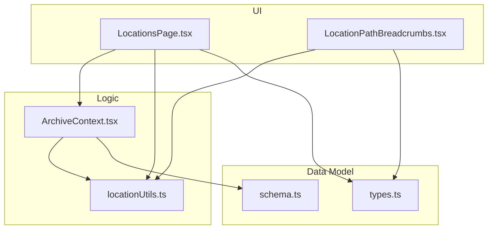
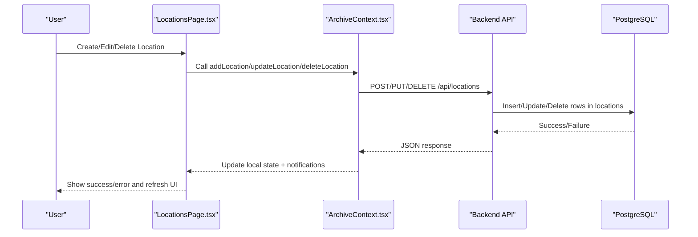
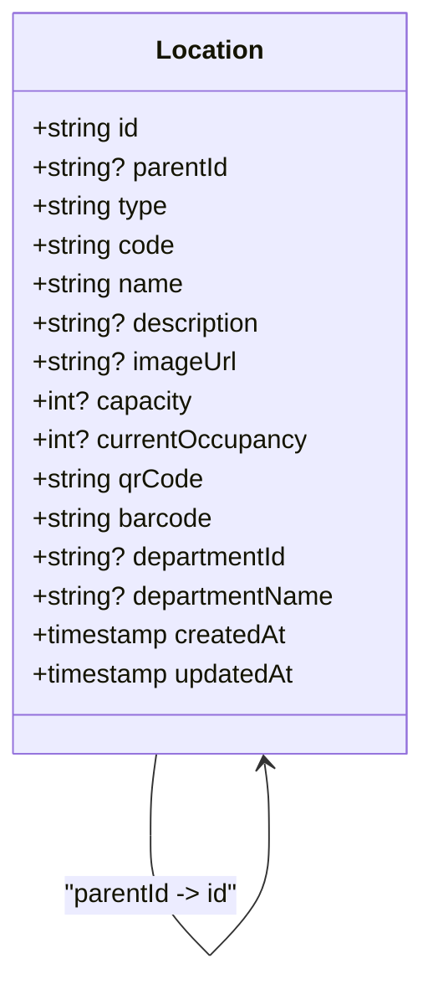
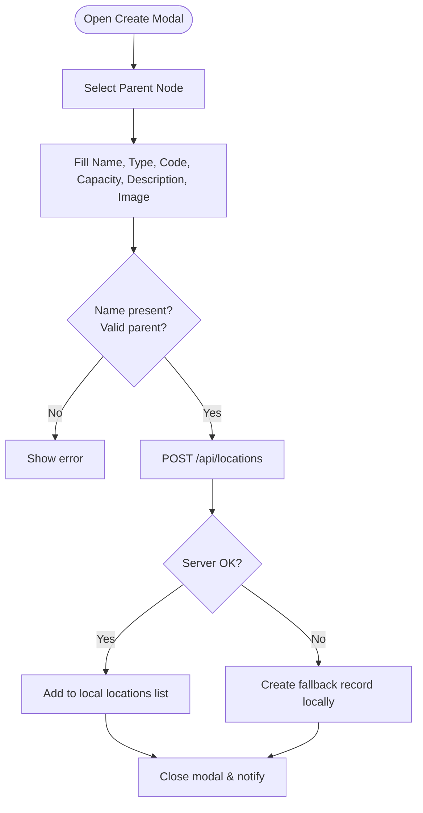
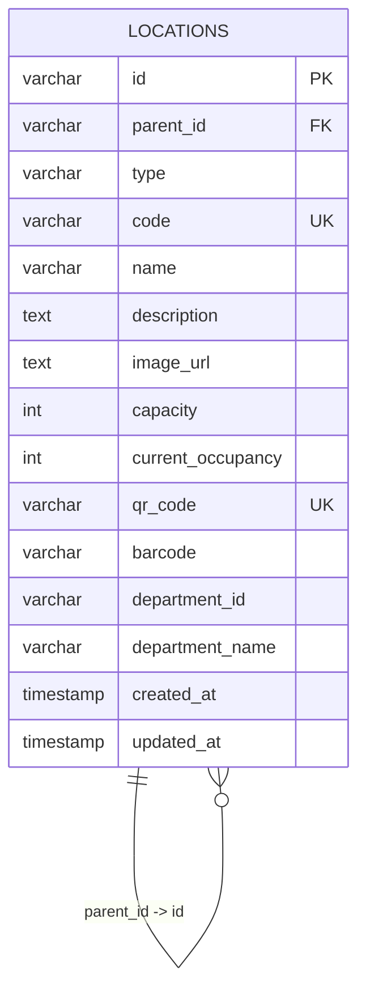
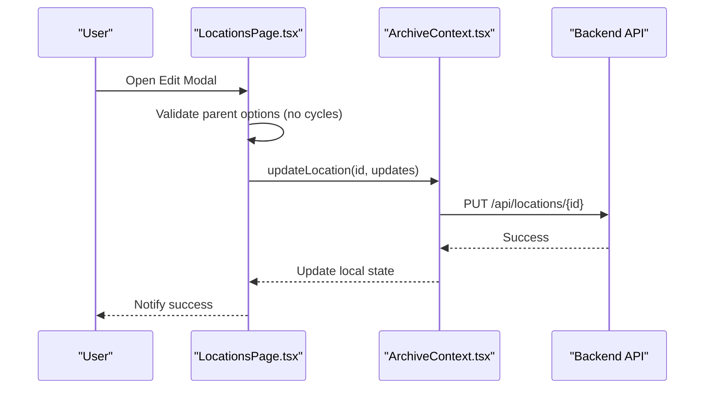
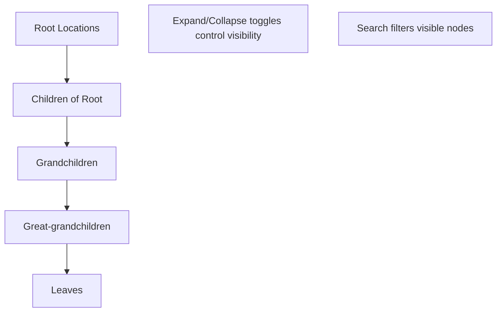
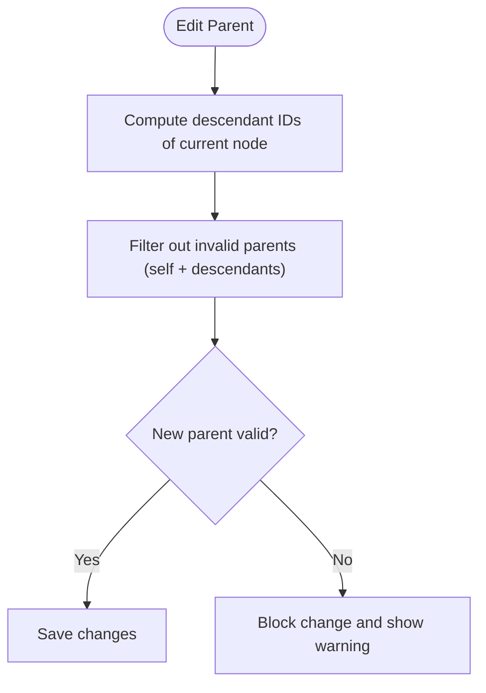
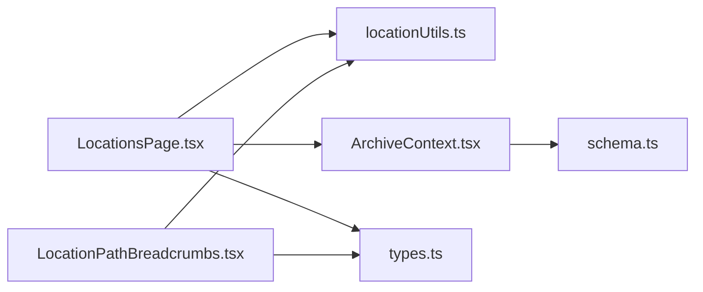

# Hierarchy Management

<cite>
**Referenced Files in This Document**
- [schema.ts](file://src/db/schema.ts)
- [types.ts](file://src/types.ts)
- [locationUtils.ts](file://src/utils/locationUtils.ts)
- [LocationsPage.tsx](file://src/pages/LocationsPage.tsx)
- [LocationPathBreadcrumbs.tsx](file://src/components/common/LocationPathBreadcrumbs.tsx)
- [ArchiveContext.tsx](file://src/context/ArchiveContext.tsx)
</cite>

## Table of Contents
1. Introduction
2. Project Structure
3. Core Components
4. Architecture Overview
5. Detailed Component Analysis
6. Dependency Analysis
7. Performance Considerations
8. Troubleshooting Guide
9. Conclusion

## Introduction
This document explains ArchiveHub’s hierarchical location management system for physical storage. It covers the six-level hierarchy (Building → Floor → Room → Cabinet → Shelf → Box), parent-child relationships, creation workflow and validation, database storage with foreign keys and cascading behavior, editing capabilities (rename, reposition, bulk operations), the tree view interface, practical examples, deletion rules, and data integrity constraints that prevent invalid operations such as circular references or orphaned locations.

## Project Structure
The location system spans UI components, utilities, types, and a relational schema:
- Schema defines the locations table with self-referencing parent-child links and unique identifiers.
- Types define the LocationItem model and allowed location types.
- Utilities compute paths, ancestors, descendants, and filter documents by location scope.
- The Locations page renders the interactive tree, creation/edit modals, and detail views.
- Breadcrumbs display the full path from root to selected node.
- Context orchestrates state, API calls, and business logic for add/update/delete/move operations.

**Diagram sources**
- [LocationsPage.tsx:1-1014](file://src/pages/LocationsPage.tsx#L1-L1014)
- [LocationPathBreadcrumbs.tsx:1-95](file://src/components/common/LocationPathBreadcrumbs.tsx#L1-L95)
- [ArchiveContext.tsx:1-1062](file://src/context/ArchiveContext.tsx#L1-L1062)
- [locationUtils.ts:1-96](file://src/utils/locationUtils.ts#L1-L96)
- [types.ts:24-52](file://src/types.ts#L24-L52)
- [schema.ts:48-65](file://src/db/schema.ts#L48-L65)

**Section sources**
- [schema.ts:48-65](file://src/db/schema.ts#L48-L65)
- [types.ts:24-52](file://src/types.ts#L24-L52)
- [locationUtils.ts:1-96](file://src/utils/locationUtils.ts#L1-L96)
- [LocationsPage.tsx:1-1014](file://src/pages/LocationsPage.tsx#L1-L1014)
- [LocationPathBreadcrumbs.tsx:1-95](file://src/components/common/LocationPathBreadcrumbs.tsx#L1-L95)
- [ArchiveContext.tsx:692-749](file://src/context/ArchiveContext.tsx#L692-L749)

## Core Components
- Locations table: Self-referencing hierarchy via parentId; unique code and qrCode; capacity tracking; timestamps.
- LocationItem type: Enforces required fields and optional metadata like imageUrl and department context.
- Utility functions: Path calculation, ancestor traversal, descendant enumeration, and document scoping by location subtree.
- Locations page: Tree explorer with expand/collapse, search, create/edit modals, and detail inspector showing children and contained documents.
- Breadcrumbs: Visual path from root to selected node with clickable segments.
- Context: Stateful CRUD for locations, movement of documents, and integration with backend APIs.

**Section sources**
- [schema.ts:48-65](file://src/db/schema.ts#L48-L65)
- [types.ts:24-52](file://src/types.ts#L24-L52)
- [locationUtils.ts:1-96](file://src/utils/locationUtils.ts#L1-L96)
- [LocationsPage.tsx:168-255](file://src/pages/LocationsPage.tsx#L168-L255)
- [LocationPathBreadcrumbs.tsx:27-95](file://src/components/common/LocationPathBreadcrumbs.tsx#L27-L95)
- [ArchiveContext.tsx:692-749](file://src/context/ArchiveContext.tsx#L692-L749)

## Architecture Overview
The system uses a client-side React UI backed by a PostgreSQL database through REST endpoints. The hierarchy is represented by a single locations table with a self-referential foreign key (parentId). Business logic enforces valid operations on the frontend and relies on database constraints for integrity.

**Diagram sources**
- [LocationsPage.tsx:146-166](file://src/pages/LocationsPage.tsx#L146-L166)
- [ArchiveContext.tsx:692-749](file://src/context/ArchiveContext.tsx#L692-L749)
- [schema.ts:48-65](file://src/db/schema.ts#L48-L65)

## Detailed Component Analysis

### Six-Level Physical Storage Structure
- Levels: Building → Floor → Room → Cabinet → Shelf → Box.
- Parent-child relationship: Each location has a parentId pointing to its container; root nodes have null parentId.
- Type field: Indicates the level/type of the location.
- Unique identifiers: code and qrCode are unique per location; barcode is also stored.
- Capacity: Optional numeric capacity to track maximum items.

**Diagram sources**
- [schema.ts:48-65](file://src/db/schema.ts#L48-L65)
- [types.ts:24-52](file://src/types.ts#L24-L52)

**Section sources**
- [schema.ts:48-65](file://src/db/schema.ts#L48-L65)
- [types.ts:24-52](file://src/types.ts#L24-L52)

### Location Creation Workflow
- Entry point: “Add Child Storage Unit” opens a modal pre-filled with the selected parent.
- Required fields: Name is mandatory; Type must be one of the allowed values; Code is optional but recommended.
- Optional fields: Capacity, Description, Image URL.
- Default code generation: If no code provided, a default is generated based on type prefix and random number.
- Validation:
  - Prevents creating a child under itself or any of its descendants to avoid circular references.
  - Ensures non-empty name before submission.
- Submission: Calls addLocation which posts to /api/locations and updates local state.

**Diagram sources**
- [LocationsPage.tsx:126-166](file://src/pages/LocationsPage.tsx#L126-L166)
- [ArchiveContext.tsx:692-716](file://src/context/ArchiveContext.tsx#L692-L716)

**Section sources**
- [LocationsPage.tsx:126-166](file://src/pages/LocationsPage.tsx#L126-L166)
- [ArchiveContext.tsx:692-716](file://src/context/ArchiveContext.tsx#L692-L716)

### Database Storage and Relationships
- Table: locations with columns for id, parentId, type, code, name, description, image_url, capacity, current_occupancy, qr_code, barcode, department_id, department_name, created_at, updated_at.
- Foreign key: parentId references locations.id (self-referencing).
- Uniqueness: code and qr_code are unique; barcode is required.
- Timestamps: created_at and updated_at auto-managed.
- Cascading behavior:
  - Frontend prevents deletion if the location has children or documents assigned to it.
  - Backend may enforce additional constraints at the database layer (e.g., referential integrity).

**Diagram sources**
- [schema.ts:48-65](file://src/db/schema.ts#L48-L65)

**Section sources**
- [schema.ts:48-65](file://src/db/schema.ts#L48-L65)
- [ArchiveContext.tsx:729-749](file://src/context/ArchiveContext.tsx#L729-L749)

### Editing Capabilities
- Rename: Edit modal allows changing name, type, code, capacity, description, and image URL.
- Reposition: Edit modal includes a parent selector to move a location within the hierarchy.
  - Circular reference prevention: getValidParentOptions excludes the node itself and all its descendants from being chosen as new parent.
- Bulk operations: While there is no explicit bulk edit UI shown here, the same updateLocation function can be invoked programmatically for multiple locations.
- Save flow: updateLocation updates local state and persists changes via PUT /api/locations/{id}.

**Diagram sources**
- [LocationsPage.tsx:96-134](file://src/pages/LocationsPage.tsx#L96-L134)
- [ArchiveContext.tsx:718-727](file://src/context/ArchiveContext.tsx#L718-L727)

**Section sources**
- [LocationsPage.tsx:96-134](file://src/pages/LocationsPage.tsx#L96-L134)
- [ArchiveContext.tsx:718-727](file://src/context/ArchiveContext.tsx#L718-L727)

### Tree View Interface
- Displays the complete hierarchy with expandable nodes.
- Supports search filtering by name or code.
- Shows icons per type and capacity badges.
- Selected node shows details including breadcrumb path, direct children, and contained documents across the subtree.

**Diagram sources**
- [LocationsPage.tsx:188-255](file://src/pages/LocationsPage.tsx#L188-L255)
- [locationUtils.ts:42-61](file://src/utils/locationUtils.ts#L42-L61)

**Section sources**
- [LocationsPage.tsx:188-255](file://src/pages/LocationsPage.tsx#L188-L255)
- [locationUtils.ts:42-61](file://src/utils/locationUtils.ts#L42-L61)

### Practical Examples
- Setting up a typical archive layout:
  - Create a Building at root.
  - Add Floors under the Building.
  - Add Rooms under each Floor.
  - Add Cabinets under Rooms.
  - Add Shelves under Cabinets.
  - Add Boxes under Shelves.
- Moving locations between parents:
  - Use Edit modal to select a new parent.
  - System prevents selecting a descendant as parent to avoid cycles.
- Handling deletion with child inheritance:
  - Deletion is blocked if the location has children or documents assigned to it.
  - To delete, first remove or reassign children/documents, then delete the node.

**Section sources**
- [LocationsPage.tsx:126-166](file://src/pages/LocationsPage.tsx#L126-L166)
- [ArchiveContext.tsx:729-749](file://src/context/ArchiveContext.tsx#L729-L749)

### Data Integrity Constraints and Business Rules
- Circular references:
  - Prevented by excluding descendants when choosing a new parent during edit.
- Orphaned locations:
  - Not allowed due to self-referencing parentId constraint; root nodes have null parentId.
- Uniqueness:
  - code and qr_code must be unique; enforced by database constraints.
- Assignment safety:
  - Deleting a location with children or documents is blocked on the frontend.
- Path computation:
  - Ancestor traversal stops on visited nodes to detect loops and ensure correct ordering.

**Diagram sources**
- [LocationsPage.tsx:126-134](file://src/pages/LocationsPage.tsx#L126-L134)
- [locationUtils.ts:52-61](file://src/utils/locationUtils.ts#L52-L61)

**Section sources**
- [LocationsPage.tsx:126-134](file://src/pages/LocationsPage.tsx#L126-L134)
- [locationUtils.ts:52-61](file://src/utils/locationUtils.ts#L52-L61)
- [schema.ts:48-65](file://src/db/schema.ts#L48-L65)

## Dependency Analysis
- UI depends on utilities for path and hierarchy calculations.
- Context centralizes state and API interactions for locations and documents.
- Types define contracts used across UI and logic.
- Schema defines persistence model and constraints.

**Diagram sources**
- [LocationsPage.tsx:1-1014](file://src/pages/LocationsPage.tsx#L1-L1014)
- [locationUtils.ts:1-96](file://src/utils/locationUtils.ts#L1-L96)
- [ArchiveContext.tsx:1-1062](file://src/context/ArchiveContext.tsx#L1-L1062)
- [LocationPathBreadcrumbs.tsx:1-95](file://src/components/common/LocationPathBreadcrumbs.tsx#L1-L95)
- [types.ts:24-52](file://src/types.ts#L24-L52)
- [schema.ts:48-65](file://src/db/schema.ts#L48-L65)

**Section sources**
- [LocationsPage.tsx:1-1014](file://src/pages/LocationsPage.tsx#L1-L1014)
- [locationUtils.ts:1-96](file://src/utils/locationUtils.ts#L1-L96)
- [ArchiveContext.tsx:1-1062](file://src/context/ArchiveContext.tsx#L1-L1062)
- [LocationPathBreadcrumbs.tsx:1-95](file://src/components/common/LocationPathBreadcrumbs.tsx#L1-L95)
- [types.ts:24-52](file://src/types.ts#L24-L52)
- [schema.ts:48-65](file://src/db/schema.ts#L48-L65)

## Performance Considerations
- Ancestor and descendant computations use maps and sets to minimize repeated scans.
- Tree rendering filters visible nodes based on search query to reduce DOM size.
- Batch updates: When moving documents, paths are computed once per operation to avoid redundant work.
- Avoid deep recursion without memoization: For very large hierarchies, consider caching ancestor/descendant results in context.

[No sources needed since this section provides general guidance]

## Troubleshooting Guide
- Cannot delete a location:
  - Reason: The location still has children or documents assigned to it.
  - Resolution: Remove or reassign children/documents, then retry deletion.
- Circular reference prevented:
  - Reason: Attempting to set a descendant as parent.
  - Resolution: Choose an ancestor or sibling as the new parent.
- Path shows “Unknown Location”:
  - Reason: Missing or broken parent chain.
  - Resolution: Ensure every location has a valid parent or is a root node.
- Unique constraint errors:
  - Reason: Duplicate code or qr_code.
  - Resolution: Change the conflicting value to a unique identifier.

**Section sources**
- [ArchiveContext.tsx:729-749](file://src/context/ArchiveContext.tsx#L729-L749)
- [LocationsPage.tsx:126-134](file://src/pages/LocationsPage.tsx#L126-L134)
- [schema.ts:48-65](file://src/db/schema.ts#L48-L65)

## Conclusion
ArchiveHub’s location system provides a robust, hierarchical model for physical storage with clear parent-child relationships, strong validation against circular references, and safe deletion rules. The UI offers an intuitive tree view with search, breadcrumbs, and inline editing, while the backend enforces data integrity through unique constraints and foreign keys. Together, these features enable reliable management of complex archive layouts and accurate tracking of where documents reside.