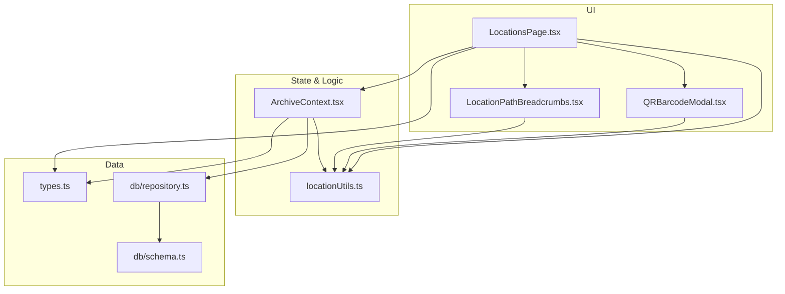
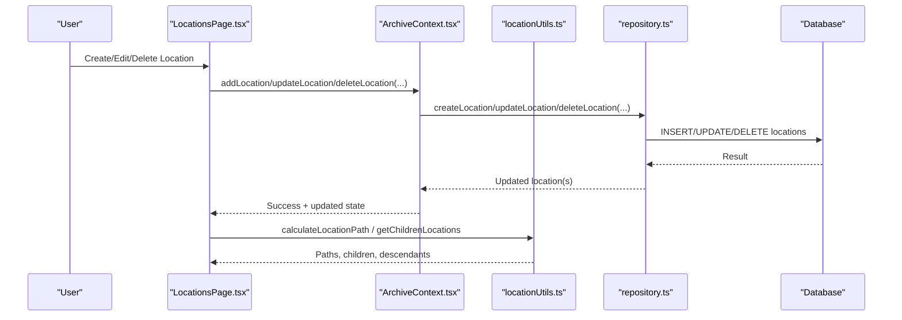
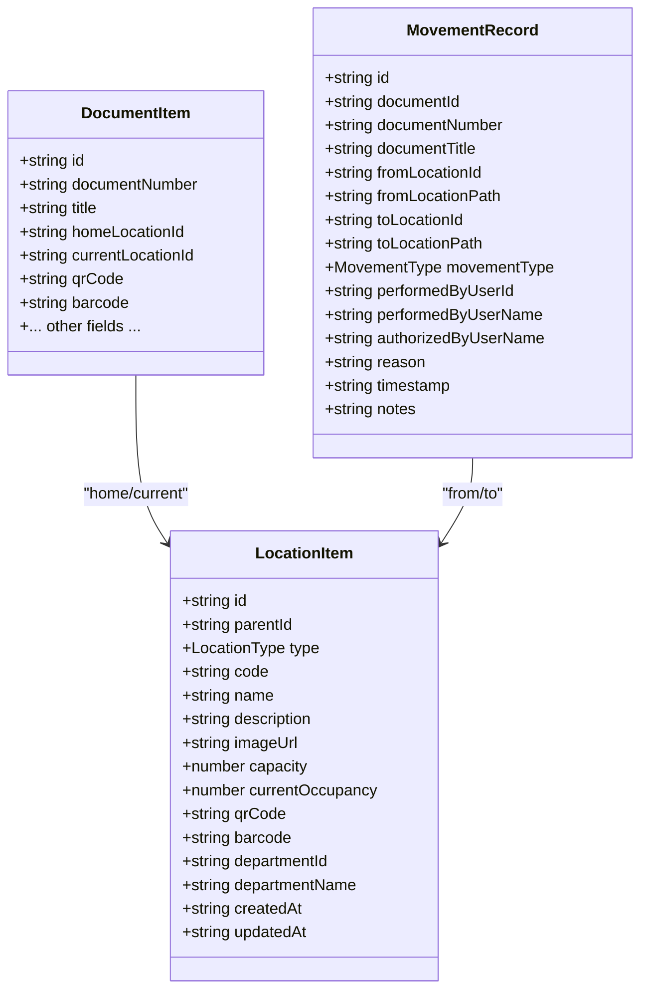
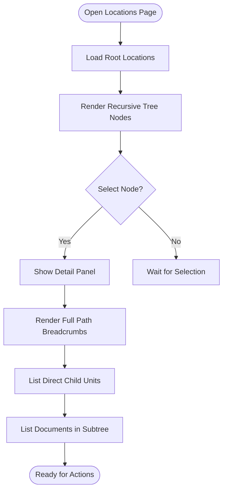
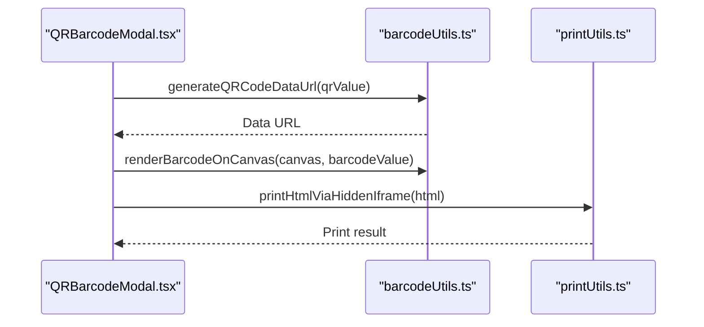
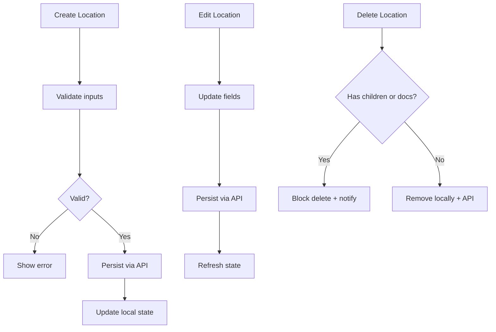
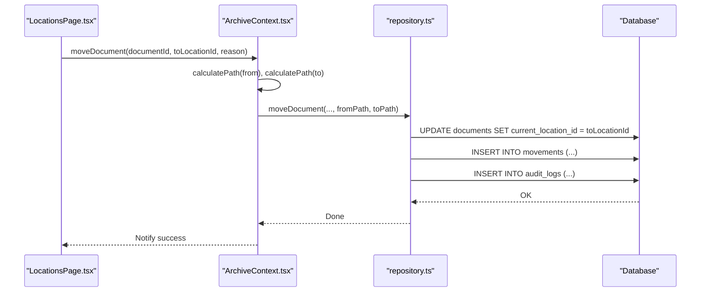
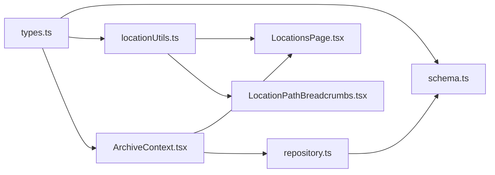

# Location Hierarchy

<cite>
**Referenced Files in This Document**
- [types.ts](file://src/types.ts)
- [schema.ts](file://src/db/schema.ts)
- [locationUtils.ts](file://src/utils/locationUtils.ts)
- [LocationsPage.tsx](file://src/pages/LocationsPage.tsx)
- [QRBarcodeModal.tsx](file://src/components/common/QRBarcodeModal.tsx)
- [barcodeUtils.ts](file://src/utils/barcodeUtils.ts)
- [LocationPathBreadcrumbs.tsx](file://src/components/common/LocationPathBreadcrumbs.tsx)
- [ArchiveContext.tsx](file://src/context/ArchiveContext.tsx)
- [repository.ts](file://src/db/repository.ts)
</cite>

## Table of Contents
1. Introduction
2. Project Structure
3. Core Components
4. Architecture Overview
5. Detailed Component Analysis
6. Dependency Analysis
7. Performance Considerations
8. Troubleshooting Guide
9. Conclusion
10. Appendices

## Introduction
This document explains ArchiveHub’s hierarchical location management system that models physical storage as a six-level hierarchy: Building → Floor → Room → Cabinet → Shelf → Box. It covers how locations are organized with capacity and occupancy tracking, QR code generation and labeling for quick scanning and navigation, visual mapping of spatial relationships and occupancy status, workflows to create/edit/delete locations with parent-child validation, assignment of documents to locations, movement tracking when items change locations, practical examples for setting up an archive layout and using QR codes, and capacity planning features to optimize storage utilization.

## Project Structure
The location system spans UI components, utilities, data types, and database schema definitions:
- Types define the location model and supported levels.
- Schema defines the persistent table structure for locations and related entities.
- Utilities compute paths, ancestors, descendants, and filter documents by location.
- The Locations page renders the interactive tree, details panel, and actions (create/edit/delete/print).
- QR/Barcode modal generates printable tags for locations.
- Context orchestrates state, API calls, and operations like moving documents and updating locations.
- Repository handles persistence and movement recording.

**Diagram sources**
- [LocationsPage.tsx:1-120](file://src/pages/LocationsPage.tsx#L1-L120)
- [QRBarcodeModal.tsx:1-60](file://src/components/common/QRBarcodeModal.tsx#L1-L60)
- [LocationPathBreadcrumbs.tsx:1-40](file://src/components/common/LocationPathBreadcrumbs.tsx#L1-L40)
- [ArchiveContext.tsx:692-750](file://src/context/ArchiveContext.tsx#L692-L750)
- [locationUtils.ts:1-96](file://src/utils/locationUtils.ts#L1-L96)
- [types.ts:24-52](file://src/types.ts#L24-L52)
- [schema.ts:48-65](file://src/db/schema.ts#L48-L65)
- [repository.ts:372-393](file://src/db/repository.ts#L372-L393)

**Section sources**
- [types.ts:24-52](file://src/types.ts#L24-L52)
- [schema.ts:48-65](file://src/db/schema.ts#L48-L65)
- [locationUtils.ts:1-96](file://src/utils/locationUtils.ts#L1-L96)
- [LocationsPage.tsx:1-120](file://src/pages/LocationsPage.tsx#L1-L120)
- [QRBarcodeModal.tsx:1-60](file://src/components/common/QRBarcodeModal.tsx#L1-L60)
- [ArchiveContext.tsx:692-750](file://src/context/ArchiveContext.tsx#L692-L750)
- [repository.ts:372-393](file://src/db/repository.ts#L372-L393)

## Core Components
- Location model: Supports hierarchical levels including BUILDING, FLOOR, ROOM, CABINET, SHELF, BOX, plus additional levels such as STORAGE_AREA, RACK, FOLDER, OTHER. Each location has a unique code, name, optional image, capacity, currentOccupancy, QR code, barcode, and timestamps.
- Persistence: A dedicated locations table stores all fields, including parentId for hierarchy, type, code, name, description, image, capacity, currentOccupancy, qrCode, barcode, department linkage, and audit timestamps.
- Path computation: Utilities calculate full path strings from root to leaf, resolve ancestors, list children, collect descendant IDs, and filter documents by home/current location within a subtree.
- UI: The Locations page provides a tree explorer, detail inspector, search/filter, create/edit/delete modals, and print tag workflow.
- QR/Barcode: Modal generates QR images and Code 128 barcodes for printing or downloading tags; supports copying values and printing via hidden iframe.
- State orchestration: Context exposes add/update/delete location, move document, calculate path, and lookup by QR. It also persists changes via API calls and updates local state.

**Section sources**
- [types.ts:24-52](file://src/types.ts#L24-L52)
- [schema.ts:48-65](file://src/db/schema.ts#L48-L65)
- [locationUtils.ts:1-96](file://src/utils/locationUtils.ts#L1-L96)
- [LocationsPage.tsx:150-170](file://src/pages/LocationsPage.tsx#L150-L170)
- [QRBarcodeModal.tsx:1-60](file://src/components/common/QRBarcodeModal.tsx#L1-L60)
- [ArchiveContext.tsx:692-750](file://src/context/ArchiveContext.tsx#L692-L750)

## Architecture Overview
The system follows a layered architecture:
- UI layer: React components render the hierarchy tree, detail panels, and modals.
- State layer: Context manages global state, performs calculations, and coordinates API calls.
- Utility layer: Pure functions handle hierarchy traversal, path building, and filtering.
- Persistence layer: Repository interacts with the backend/database to persist locations, documents, movements, and audit logs.

**Diagram sources**
- [LocationsPage.tsx:146-166](file://src/pages/LocationsPage.tsx#L146-L166)
- [ArchiveContext.tsx:692-750](file://src/context/ArchiveContext.tsx#L692-L750)
- [locationUtils.ts:1-96](file://src/utils/locationUtils.ts#L1-L96)
- [repository.ts:372-393](file://src/db/repository.ts#L372-L393)

## Detailed Component Analysis

### Hierarchical Location Model and Capacity Tracking
- Levels: The system supports a flexible set of levels, including the core six-level model Building → Floor → Room → Cabinet → Shelf → Box, plus additional levels for broader facility modeling.
- Fields: Each location includes id, parentId, type, code, name, description, imageUrl, capacity, currentOccupancy, qrCode, barcode, departmentId, departmentName, createdAt, updatedAt.
- Capacity and occupancy: Capacity is stored per location; currentOccupancy tracks how many child items or contents are present. While the UI displays capacity, occupancy updates are not automatically enforced in the provided code; administrators can manage occupancy through manual updates or future enhancements.

**Diagram sources**
- [types.ts:24-52](file://src/types.ts#L24-L52)
- [types.ts:135-183](file://src/types.ts#L135-L183)
- [types.ts:185-203](file://src/types.ts#L185-L203)

**Section sources**
- [types.ts:24-52](file://src/types.ts#L24-L52)
- [schema.ts:48-65](file://src/db/schema.ts#L48-L65)

### Visual Location Mapping Interface
- Tree Explorer: Left panel shows a collapsible hierarchy with icons per level, capacity badges, and selection highlighting. Search filters nodes by name/code.
- Detail Inspector: Right panel shows the selected location’s hero image, metadata, breadcrumb path, direct child units, and contained documents across the subtree.
- Breadcrumbs: Clickable breadcrumbs display the full path from root to the selected node, enabling quick navigation.
- Occupancy visualization: Capacity is shown in the tree; occupancy numbers are available in the model but not dynamically computed in the UI snippet.

**Diagram sources**
- [LocationsPage.tsx:168-255](file://src/pages/LocationsPage.tsx#L168-L255)
- [LocationsPage.tsx:365-599](file://src/pages/LocationsPage.tsx#L365-L599)
- [LocationPathBreadcrumbs.tsx:27-95](file://src/components/common/LocationPathBreadcrumbs.tsx#L27-L95)

**Section sources**
- [LocationsPage.tsx:168-255](file://src/pages/LocationsPage.tsx#L168-L255)
- [LocationsPage.tsx:365-599](file://src/pages/LocationsPage.tsx#L365-L599)
- [LocationPathBreadcrumbs.tsx:27-95](file://src/components/common/LocationPathBreadcrumbs.tsx#L27-L95)

### QR Code Generation and Labeling System
- Generation: QR codes are generated asynchronously to data URLs for rendering; barcodes are rendered onto a canvas element using Code 128.
- Tag Printing: The modal builds a printable HTML tag containing entity code, title, subtitle, location path, QR image, and barcode. It supports copy-to-clipboard, download as HTML, and print via hidden iframe with fallback to window.print.
- Usage: From the Locations page, users can open the QR/Barcode modal for any location to produce labels for physical tagging.

**Diagram sources**
- [QRBarcodeModal.tsx:34-46](file://src/components/common/QRBarcodeModal.tsx#L34-L46)
- [QRBarcodeModal.tsx:56-172](file://src/components/common/QRBarcodeModal.tsx#L56-L172)
- [barcodeUtils.ts:7-40](file://src/utils/barcodeUtils.ts#L7-L40)

**Section sources**
- [QRBarcodeModal.tsx:1-272](file://src/components/common/QRBarcodeModal.tsx#L1-L272)
- [barcodeUtils.ts:1-41](file://src/utils/barcodeUtils.ts#L1-L41)

### Location Creation, Editing, and Deletion Workflows
- Create: Users select a parent unit (or root), choose a level/type, optionally provide a code, name, capacity, description, and photo. On submit, the context creates the location and persists it via API; fallback logic generates IDs, codes, QR, and barcodes if needed.
- Edit: Users can edit name, type, code, capacity, description, parent, and image. Updates are persisted via API; local state refreshes immediately.
- Delete: Deletion checks for existing children or documents assigned to the location; if found, deletion is blocked with a notification. Otherwise, the location is removed locally and via API.

**Diagram sources**
- [LocationsPage.tsx:146-166](file://src/pages/LocationsPage.tsx#L146-L166)
- [LocationsPage.tsx:96-124](file://src/pages/LocationsPage.tsx#L96-L124)
- [ArchiveContext.tsx:692-750](file://src/context/ArchiveContext.tsx#L692-L750)

**Section sources**
- [LocationsPage.tsx:146-166](file://src/pages/LocationsPage.tsx#L146-L166)
- [LocationsPage.tsx:96-124](file://src/pages/LocationsPage.tsx#L96-L124)
- [ArchiveContext.tsx:692-750](file://src/context/ArchiveContext.tsx#L692-L750)

### Document Assignment and Movement Tracking
- Assignment: Documents store both homeLocationId and currentLocationId. The UI allows viewing documents under a location subtree and selecting documents for actions.
- Movement: Moving a document updates its currentLocationId, records a movement entry with from/to paths and reasons, and writes an audit log. The repository ensures transactional updates and consistent state.

**Diagram sources**
- [ArchiveContext.tsx:832-852](file://src/context/ArchiveContext.tsx#L832-L852)
- [repository.ts:742-800](file://src/db/repository.ts#L742-L800)
- [schema.ts:150-167](file://src/db/schema.ts#L150-L167)

**Section sources**
- [ArchiveContext.tsx:832-852](file://src/context/ArchiveContext.tsx#L832-L852)
- [repository.ts:742-800](file://src/db/repository.ts#L742-L800)
- [schema.ts:150-167](file://src/db/schema.ts#L150-L167)

### Practical Examples
- Setting up a typical archive layout:
  - Create a Building node at root.
  - Add Floors under the Building.
  - Add Rooms under each Floor.
  - Under Rooms, add Cabinets, then Shelves, then Boxes.
  - Assign capacities to each container to plan usage.
- Assigning documents to locations:
  - Register a document with a homeLocationId.
  - Use the Locations page to view documents under a subtree.
  - Move documents to new locations as needed; movement is tracked with reasons and paths.
- Using QR codes for inventory:
  - Open the QR/Barcode modal for a location or document.
  - Print or download tags and affix them to physical containers.
  - Scan QR codes to quickly locate or identify items in the system.

[No sources needed since this section provides general guidance]

## Dependency Analysis
Key dependencies and relationships:
- Types define shared interfaces used across UI and persistence layers.
- Schema maps directly to database tables for locations, documents, movements, and audit logs.
- Utilities depend on types and provide pure functions for hierarchy traversal and filtering.
- UI components depend on context for state and utilities for computations.
- Context depends on utilities and repository for persistence and side effects.
- Repository depends on schema and database connectivity.

**Diagram sources**
- [types.ts:24-52](file://src/types.ts#L24-L52)
- [schema.ts:48-65](file://src/db/schema.ts#L48-L65)
- [locationUtils.ts:1-96](file://src/utils/locationUtils.ts#L1-L96)
- [ArchiveContext.tsx:692-750](file://src/context/ArchiveContext.tsx#L692-L750)
- [repository.ts:372-393](file://src/db/repository.ts#L372-L393)

**Section sources**
- [types.ts:24-52](file://src/types.ts#L24-L52)
- [schema.ts:48-65](file://src/db/schema.ts#L48-L65)
- [locationUtils.ts:1-96](file://src/utils/locationUtils.ts#L1-L96)
- [ArchiveContext.tsx:692-750](file://src/context/ArchiveContext.tsx#L692-L750)
- [repository.ts:372-393](file://src/db/repository.ts#L372-L393)

## Performance Considerations
- Hierarchy traversal: Ancestor resolution uses a map for O(1) lookups and stops on cycles via visited sets; descendant collection is recursive but bounded by hierarchy depth.
- Filtering documents: Filtering by subtree uses precomputed descendant ID sets for efficient matching.
- UI rendering: Tree recursion is limited by expanded nodes; search reduces visible nodes.
- QR/Barcode generation: Asynchronous QR generation avoids blocking UI; barcode rendering targets a canvas efficiently.
- Persistence: Repository wraps moves in transactions to ensure consistency; batched fetches reduce network overhead.

[No sources needed since this section provides general guidance]

## Troubleshooting Guide
- Cannot delete a location: If a location has children or documents assigned to it, deletion is blocked. Remove or reassign children/documents first.
- Movement not recorded: Ensure the move operation includes a reason and valid from/to paths; check API responses and audit logs for errors.
- QR/Barcode not printing: Verify browser permissions for printing and clipboard access; use the download option if print fails.
- Occupancy mismatch: Occupancy fields exist in the model; ensure updates reflect actual physical counts or implement automated counting based on child/document assignments.

**Section sources**
- [ArchiveContext.tsx:729-749](file://src/context/ArchiveContext.tsx#L729-L749)
- [repository.ts:742-800](file://src/db/repository.ts#L742-L800)
- [QRBarcodeModal.tsx:157-172](file://src/components/common/QRBarcodeModal.tsx#L157-L172)

## Conclusion
ArchiveHub’s location hierarchy provides a robust framework for managing physical storage across multiple levels with clear visual mapping, QR-based labeling, and comprehensive movement tracking. Administrators can build realistic facility layouts, assign and relocate documents safely, and plan capacity effectively. Future enhancements could include automatic occupancy calculation and advanced capacity analytics to further optimize storage utilization.

[No sources needed since this section summarizes without analyzing specific files]

## Appendices

### Appendix A: Typical Setup Workflow
- Create Building → Floor → Room → Cabinet → Shelf → Box hierarchy.
- Set capacities for each container to plan usage.
- Generate and print QR/Barcode tags for each physical container.
- Register documents with homeLocationId; move as needed and track movements.

[No sources needed since this section provides general guidance]

### Appendix B: Key Operations Reference
- Create location: Provide parent, type, code, name, capacity, description, image.
- Edit location: Update metadata and hierarchy as needed.
- Delete location: Only allowed if no children or documents are assigned.
- Move document: Update currentLocationId, record movement and audit log.

**Section sources**
- [LocationsPage.tsx:146-166](file://src/pages/LocationsPage.tsx#L146-L166)
- [LocationsPage.tsx:96-124](file://src/pages/LocationsPage.tsx#L96-L124)
- [ArchiveContext.tsx:692-750](file://src/context/ArchiveContext.tsx#L692-L750)
- [ArchiveContext.tsx:832-852](file://src/context/ArchiveContext.tsx#L832-L852)