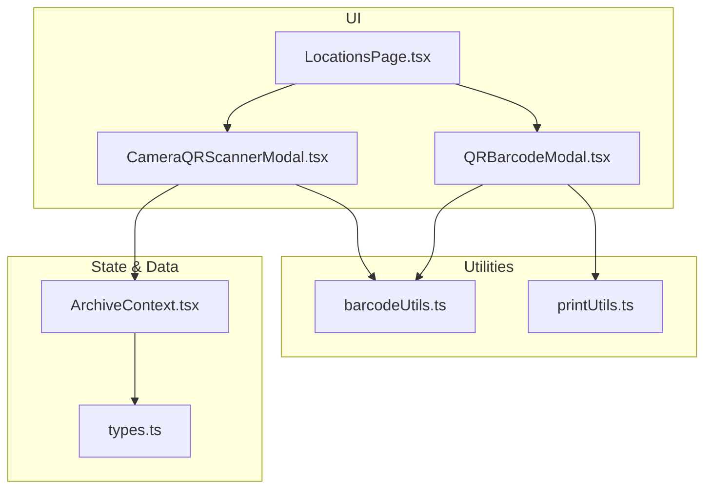
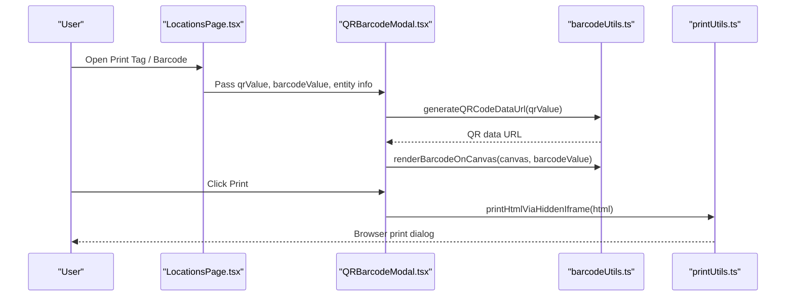
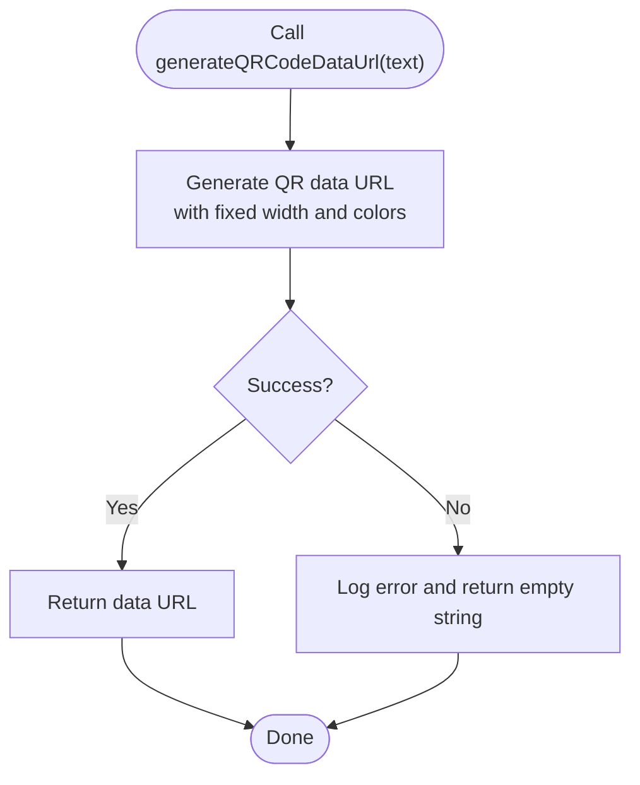
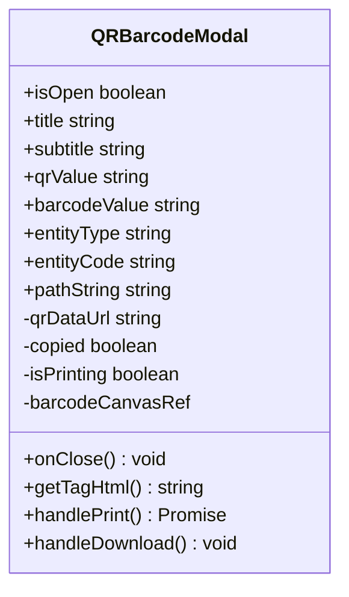
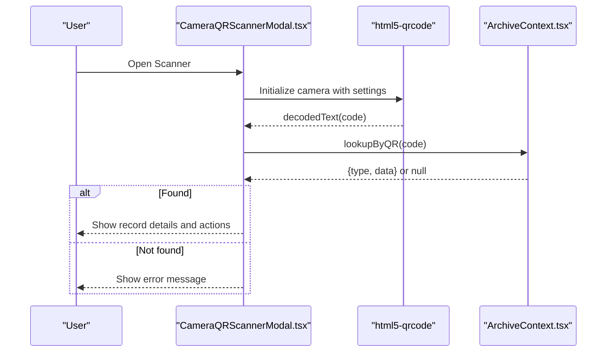
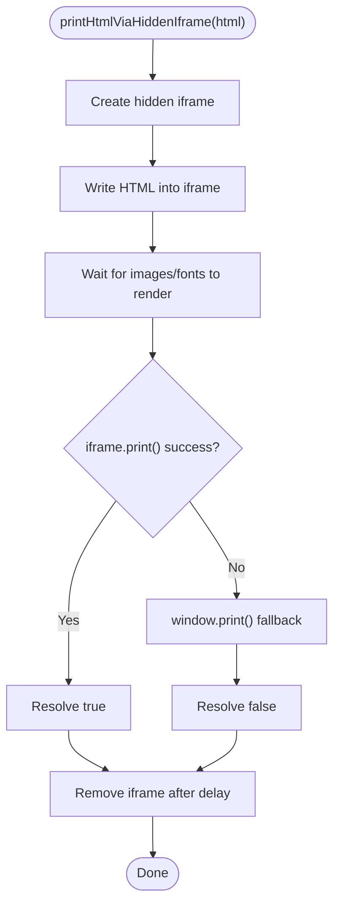
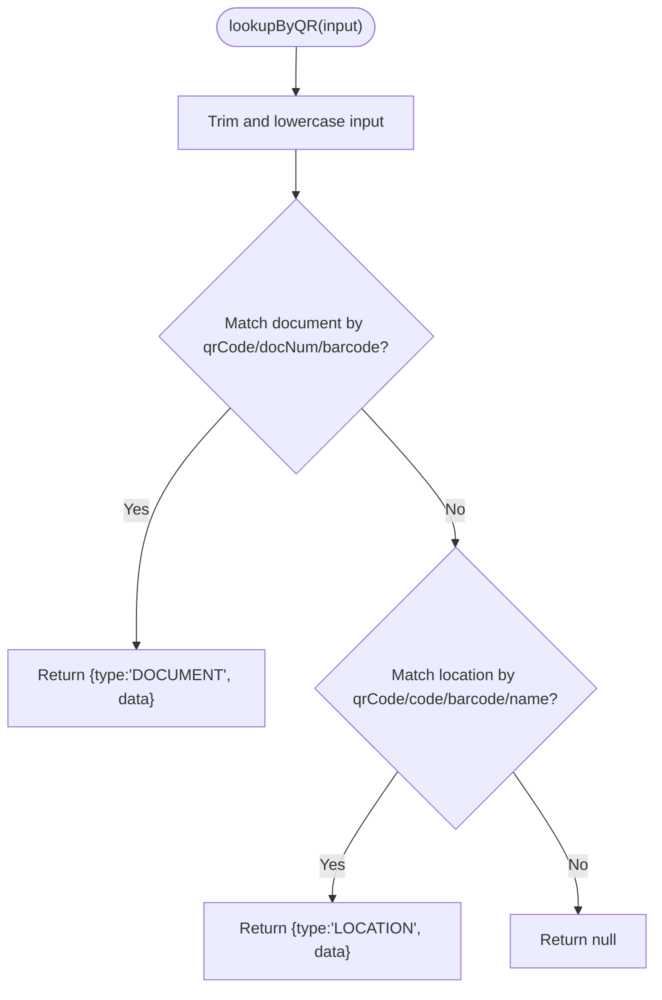
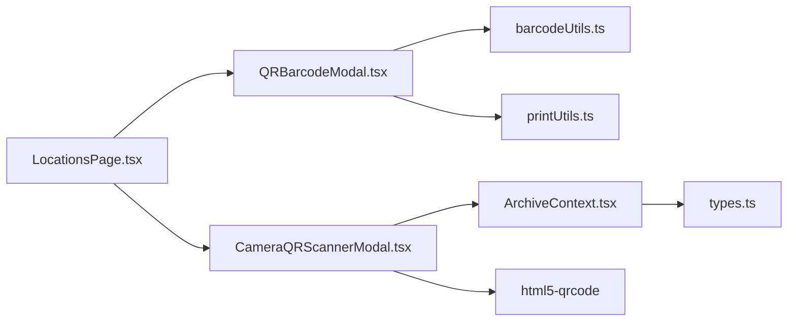

# QR Code System

<cite>
**Referenced Files in This Document**
- [barcodeUtils.ts](file://src/utils/barcodeUtils.ts)
- [QRBarcodeModal.tsx](file://src/components/common/QRBarcodeModal.tsx)
- [CameraQRScannerModal.tsx](file://src/components/scanner/CameraQRScannerModal.tsx)
- [printUtils.ts](file://src/utils/printUtils.ts)
- [ArchiveContext.tsx](file://src/context/ArchiveContext.tsx)
- [LocationsPage.tsx](file://src/pages/LocationsPage.tsx)
- [types.ts](file://src/types.ts)
</cite>

## Table of Contents
1. [Introduction](#introduction)
2. [Project Structure](#project-structure)
3. [Core Components](#core-components)
4. [Architecture Overview](#architecture-overview)
5. [Detailed Component Analysis](#detailed-component-analysis)
6. [Dependency Analysis](#dependency-analysis)
7. [Performance Considerations](#performance-considerations)
8. [Troubleshooting Guide](#troubleshooting-guide)
9. [Conclusion](#conclusion)

## Introduction
This document explains ArchiveHub’s QR code generation and scanning system for physical locations, including how unique codes are generated, printed as labels, and scanned via camera or manual entry to quickly navigate to items and locations. It also covers barcode utilities, printing workflows, error handling, and compatibility considerations across devices and applications.

## Project Structure
The QR system spans a small set of focused modules:
- Utilities for encoding and rendering QR codes and barcodes
- A modal for generating printable tags with QR and barcode graphics
- A camera-based scanner modal that decodes QR/barcodes and resolves them to records
- Printing utilities for isolated iframe printing and downloadable sticker sheets
- Context logic that generates identifiers and performs lookups by QR/barcode values
- UI pages that trigger tag generation and printing

**Diagram sources**
- [LocationsPage.tsx:440-450](file://src/pages/LocationsPage.tsx#L440-L450)
- [CameraQRScannerModal.tsx:1-391](file://src/components/scanner/CameraQRScannerModal.tsx#L1-L391)
- [QRBarcodeModal.tsx:1-272](file://src/components/common/QRBarcodeModal.tsx#L1-L272)
- [barcodeUtils.ts:1-41](file://src/utils/barcodeUtils.ts#L1-L41)
- [printUtils.ts:1-93](file://src/utils/printUtils.ts#L1-L93)
- [ArchiveContext.tsx:968-986](file://src/context/ArchiveContext.tsx#L968-L986)
- [types.ts:36-52](file://src/types.ts#L36-L52)

**Section sources**
- [LocationsPage.tsx:440-450](file://src/pages/LocationsPage.tsx#L440-L450)
- [QRBarcodeModal.tsx:1-272](file://src/components/common/QRBarcodeModal.tsx#L1-L272)
- [CameraQRScannerModal.tsx:1-391](file://src/components/scanner/CameraQRScannerModal.tsx#L1-L391)
- [barcodeUtils.ts:1-41](file://src/utils/barcodeUtils.ts#L1-L41)
- [printUtils.ts:1-93](file://src/utils/printUtils.ts#L1-L93)
- [ArchiveContext.tsx:968-986](file://src/context/ArchiveContext.tsx#L968-L986)
- [types.ts:36-52](file://src/types.ts#L36-L52)

## Core Components
- QR and Barcode Utilities: Generate QR data URLs and render Code 128 barcodes on canvas.
- Tag Modal: Builds printable HTML templates for location/document tags, renders QR and barcode, and supports print/download/copy actions.
- Camera Scanner: Uses the device camera to scan QR/barcodes, then resolves the code to a document or location record.
- Printing Utilities: Provide hidden iframe printing, fallback window.print, downloadable HTML sticker sheets, and open-in-new-tab printing.
- Context Lookup: Generates unique identifiers for new entities and resolves scanned codes to records.

**Section sources**
- [barcodeUtils.ts:1-41](file://src/utils/barcodeUtils.ts#L1-L41)
- [QRBarcodeModal.tsx:1-272](file://src/components/common/QRBarcodeModal.tsx#L1-L272)
- [CameraQRScannerModal.tsx:1-391](file://src/components/scanner/CameraQRScannerModal.tsx#L1-L391)
- [printUtils.ts:1-93](file://src/utils/printUtils.ts#L1-L93)
- [ArchiveContext.tsx:968-986](file://src/context/ArchiveContext.tsx#L968-L986)

## Architecture Overview
The system follows a clear separation of concerns:
- Generation: Location/document creation assigns unique identifiers (qrCode, barcode). The Tag modal uses these to generate visual QR and barcode assets for printing.
- Scanning: The camera scanner decodes QR/barcodes and calls a lookup utility to resolve to a record. Results are presented with navigation options.
- Printing: The Tag modal composes a self-contained HTML page and prints it via an invisible iframe, with robust fallbacks.

**Diagram sources**
- [LocationsPage.tsx:440-450](file://src/pages/LocationsPage.tsx#L440-L450)
- [QRBarcodeModal.tsx:34-46](file://src/components/common/QRBarcodeModal.tsx#L34-L46)
- [QRBarcodeModal.tsx:157-167](file://src/components/common/QRBarcodeModal.tsx#L157-L167)
- [barcodeUtils.ts:7-21](file://src/utils/barcodeUtils.ts#L7-L21)
- [barcodeUtils.ts:26-40](file://src/utils/barcodeUtils.ts#L26-L40)
- [printUtils.ts:7-64](file://src/utils/printUtils.ts#L7-L64)

## Detailed Component Analysis

### QR and Barcode Utilities
- QR generation: Produces a data URL suitable for image rendering with consistent sizing and colors. Errors are caught and logged; empty string is returned on failure.
- Barcode rendering: Draws a Code 128 barcode onto a canvas element with human-readable text, size, margins, and colors configured for legibility.

**Diagram sources**
- [barcodeUtils.ts:7-21](file://src/utils/barcodeUtils.ts#L7-L21)

**Section sources**
- [barcodeUtils.ts:1-41](file://src/utils/barcodeUtils.ts#L1-L41)

### Tag Modal: Label Templates, Batch Options, Formatting
- Template composition: Creates a self-contained HTML document with title, subtitle, location path, QR image, and machine-readable label text.
- Rendering: Generates QR image asynchronously and renders Code 128 barcode on a canvas after mount.
- Actions:
  - Copy code to clipboard
  - Download standalone HTML tag file
  - Print via hidden iframe with fallback to window.print
- Formatting specifications:
  - Page margins and responsive layout optimized for typical label printers
  - Monospace fonts for codes and paths for readability
  - Fixed-size QR container for consistent scaling when printed

**Diagram sources**
- [QRBarcodeModal.tsx:6-16](file://src/components/common/QRBarcodeModal.tsx#L6-L16)
- [QRBarcodeModal.tsx:56-155](file://src/components/common/QRBarcodeModal.tsx#L56-L155)
- [QRBarcodeModal.tsx:157-172](file://src/components/common/QRBarcodeModal.tsx#L157-L172)

**Section sources**
- [QRBarcodeModal.tsx:1-272](file://src/components/common/QRBarcodeModal.tsx#L1-L272)
- [printUtils.ts:1-93](file://src/utils/printUtils.ts#L1-L93)

### Camera-Based QR Scanner Integration
- Scanner initialization: Uses a third-party scanner library to access the camera, configure viewport size, frame rate, and remember last used camera.
- Decode flow: On successful decode, clears the scanner and processes the code via the context lookup.
- Manual input: Supports typing codes directly for environments without camera access.
- Result display: Shows either a document or location result with contextual details and navigation buttons.

**Diagram sources**
- [CameraQRScannerModal.tsx:46-96](file://src/components/scanner/CameraQRScannerModal.tsx#L46-L96)
- [CameraQRScannerModal.tsx:100-116](file://src/components/scanner/CameraQRScannerModal.tsx#L100-L116)
- [ArchiveContext.tsx:968-986](file://src/context/ArchiveContext.tsx#L968-L986)

**Section sources**
- [CameraQRScannerModal.tsx:1-391](file://src/components/scanner/CameraQRScannerModal.tsx#L1-L391)
- [ArchiveContext.tsx:968-986](file://src/context/ArchiveContext.tsx#L968-L986)

### Printing Utilities
- Hidden iframe printing: Injects a hidden iframe, writes HTML content, waits for rendering, then triggers print. Falls back to window.print if needed.
- Downloadable sticker sheet: Creates a Blob from HTML and triggers a download with a specified filename.
- New tab printing: Opens a new tab with the printable HTML; falls back to hidden iframe printing if pop-up is blocked.

**Diagram sources**
- [printUtils.ts:7-64](file://src/utils/printUtils.ts#L7-L64)

**Section sources**
- [printUtils.ts:1-93](file://src/utils/printUtils.ts#L1-L93)

### Identifier Generation and Lookup
- Unique identifiers:
  - Locations: qrCode is derived from the location code with a prefix; barcode is a numeric value.
  - Documents: qrCode is derived from the document number with a prefix; barcode is a numeric value.
- Lookup strategy:
  - Searches documents first by qrCode, documentNumber, or barcode.
  - Then searches locations by qrCode, code, barcode, or name.
  - Returns type and data or null if not found.

**Diagram sources**
- [ArchiveContext.tsx:968-986](file://src/context/ArchiveContext.tsx#L968-L986)
- [ArchiveContext.tsx:693-715](file://src/context/ArchiveContext.tsx#L693-L715)
- [ArchiveContext.tsx:752-777](file://src/context/ArchiveContext.tsx#L752-L777)

**Section sources**
- [ArchiveContext.tsx:693-715](file://src/context/ArchiveContext.tsx#L693-L715)
- [ArchiveContext.tsx:752-777](file://src/context/ArchiveContext.tsx#L752-L777)
- [ArchiveContext.tsx:968-986](file://src/context/ArchiveContext.tsx#L968-L986)
- [types.ts:36-52](file://src/types.ts#L36-L52)
- [types.ts:135-183](file://src/types.ts#L135-L183)

## Dependency Analysis
- QRBarcodeModal depends on:
  - barcodeUtils for QR and barcode rendering
  - printUtils for printing and downloading
  - ArchiveContext indirectly via parent components passing props
- CameraQRScannerModal depends on:
  - html5-qrcode for camera scanning
  - ArchiveContext for lookup and path calculation
- ArchiveContext provides:
  - Identifier generation for locations and documents
  - Unified lookup function for QR/barcodes
- Types define the shape of LocationItem and DocumentItem, including qrCode and barcode fields

**Diagram sources**
- [QRBarcodeModal.tsx:1-272](file://src/components/common/QRBarcodeModal.tsx#L1-L272)
- [CameraQRScannerModal.tsx:1-391](file://src/components/scanner/CameraQRScannerModal.tsx#L1-L391)
- [ArchiveContext.tsx:968-986](file://src/context/ArchiveContext.tsx#L968-L986)
- [types.ts:36-52](file://src/types.ts#L36-L52)
- [types.ts:135-183](file://src/types.ts#L135-L183)

**Section sources**
- [QRBarcodeModal.tsx:1-272](file://src/components/common/QRBarcodeModal.tsx#L1-L272)
- [CameraQRScannerModal.tsx:1-391](file://src/components/scanner/CameraQRScannerModal.tsx#L1-L391)
- [ArchiveContext.tsx:968-986](file://src/context/ArchiveContext.tsx#L968-L986)
- [types.ts:36-52](file://src/types.ts#L36-L52)
- [types.ts:135-183](file://src/types.ts#L135-L183)

## Performance Considerations
- QR generation is asynchronous; avoid blocking UI by deferring heavy operations until the modal opens.
- Canvas barcode rendering occurs after a short timeout to ensure DOM readiness; this prevents reflows during initial render.
- Scanner FPS is limited to reduce CPU usage and battery drain on mobile devices.
- Printing via hidden iframe isolates styles and avoids layout thrashing in the main app.

[No sources needed since this section provides general guidance]

## Troubleshooting Guide
Common issues and resolutions:
- QR code not recognized:
  - Ensure the scanned string matches one of the accepted fields: qrCode, documentNumber, barcode for documents; qrCode, code, barcode, or name for locations.
  - Verify case-insensitive matching; the lookup trims and lowercases inputs.
- Camera permission denied:
  - Confirm browser permissions for camera access and HTTPS context where required.
- Scanner does not start:
  - Ensure the target DOM element exists before initializing the scanner.
  - Clear previous scanner instances to avoid conflicts.
- Printing fails:
  - If iframe printing is blocked, the system falls back to window.print. Check browser popup and print settings.
  - For downloadable sticker sheets, verify that downloads are allowed and not blocked by security policies.

**Section sources**
- [CameraQRScannerModal.tsx:46-96](file://src/components/scanner/CameraQRScannerModal.tsx#L46-L96)
- [CameraQRScannerModal.tsx:100-116](file://src/components/scanner/CameraQRScannerModal.tsx#L100-L116)
- [printUtils.ts:7-64](file://src/utils/printUtils.ts#L7-L64)
- [ArchiveContext.tsx:968-986](file://src/context/ArchiveContext.tsx#L968-L986)

## Conclusion
ArchiveHub’s QR system integrates identifier generation, label printing, and camera-based scanning into a cohesive workflow. Unique codes are assigned at creation time, rendered as QR and barcode assets for physical labeling, and resolved through a unified lookup mechanism. The printing utilities provide robust, cross-browser support, while the scanner offers both camera and manual input modes for flexibility. Following the guidelines here ensures reliable operation across devices and scanning applications.

[No sources needed since this section summarizes without analyzing specific files]