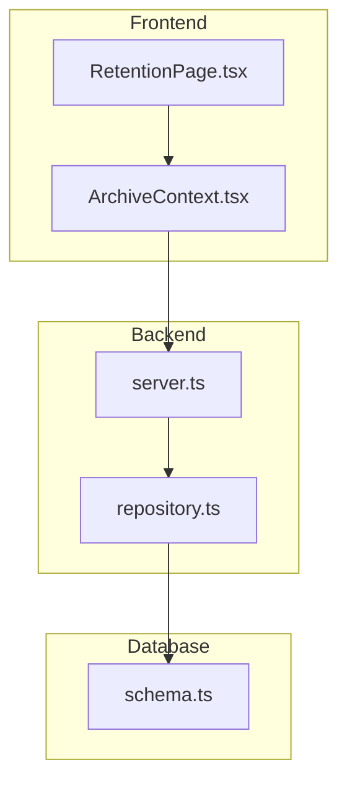
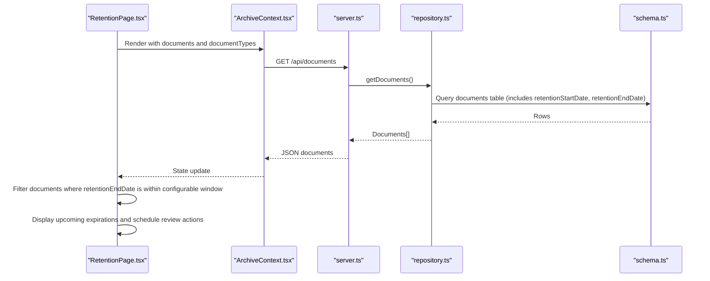
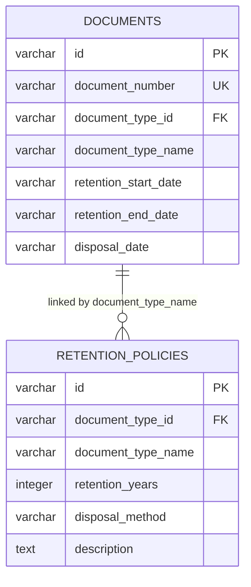
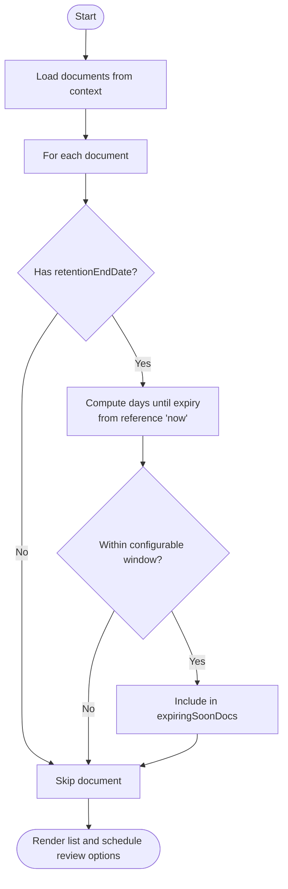

# Automated Calculations

<cite>
**Referenced Files in This Document**
- [RetentionPage.tsx](file://src/pages/RetentionPage.tsx)
- [schema.ts](file://src/db/schema.ts)
- [repository.ts](file://src/db/repository.ts)
- [server.ts](file://server.ts)
- [ArchiveContext.tsx](file://src/context/ArchiveContext.tsx)
- [types.ts](file://src/types.ts)
</cite>

## Table of Contents
1. [Introduction](#introduction)
2. [Project Structure](#project-structure)
3. [Core Components](#core-components)
4. [Architecture Overview](#architecture-overview)
5. [Detailed Component Analysis](#detailed-component-analysis)
6. [Dependency Analysis](#dependency-analysis)
7. [Performance Considerations](#performance-considerations)
8. [Troubleshooting Guide](#troubleshooting-guide)
9. [Conclusion](#conclusion)

## Introduction
This document explains ArchiveHub’s automated retention calculation engine that manages document lifecycle expiration dates. It covers how the system determines retention start and end dates based on document metadata and configured retention policies, how it identifies documents approaching expiry within a configurable timeframe (demonstrated as a 5-year window), and how the UI monitors and surfaces upcoming expirations for review or disposal actions. It also includes examples of calculation scenarios, edge cases such as leap years and varying month lengths, and performance considerations for large document volumes.

## Project Structure
The retention feature spans several layers:
- Data model defines retention-related fields on documents and retention policy definitions.
- Repository layer persists and retrieves document and policy data.
- Server exposes API endpoints to read policies and documents.
- Frontend context loads data and provides state to pages.
- Retention page computes and displays documents nearing expiry and supports scheduling reviews.

**Diagram sources**
- [RetentionPage.tsx:15-26](file://src/pages/RetentionPage.tsx#L15-L26)
- [ArchiveContext.tsx:197-222](file://src/context/ArchiveContext.tsx#L197-L222)
- [server.ts:298-316](file://server.ts#L298-L316)
- [server.ts:453-461](file://server.ts#L453-L461)
- [repository.ts:1152-1168](file://src/db/repository.ts#L1152-L1168)
- [schema.ts:67-116](file://src/db/schema.ts#L67-L116)
- [schema.ts:169-177](file://src/db/schema.ts#L169-L177)

**Section sources**
- [schema.ts:67-116](file://src/db/schema.ts#L67-L116)
- [schema.ts:169-177](file://src/db/schema.ts#L169-L177)
- [repository.ts:1152-1168](file://src/db/repository.ts#L1152-L1168)
- [server.ts:298-316](file://server.ts#L298-L316)
- [server.ts:453-461](file://server.ts#L453-L461)
- [ArchiveContext.tsx:197-222](file://src/context/ArchiveContext.tsx#L197-L222)
- [RetentionPage.tsx:15-26](file://src/pages/RetentionPage.tsx#L15-L26)

## Core Components
- Document model with retention fields: retentionStartDate and retentionEndDate are stored per document.
- Retention policies define retentionYears per document type and disposal method.
- Repository functions persist and retrieve documents and policies.
- Server routes expose /api/documents and /api/retention-policies.
- Context fetches all data from backend APIs into application state.
- Retention page filters documents by proximity to their retentionEndDate using a configurable window (demo uses a 5-year window).

Key responsibilities:
- Store and serve retention policies and document records including calculated dates.
- Provide UI-driven filtering to identify documents approaching expiry.
- Support scheduling review/disposal workflows via user interactions.

**Section sources**
- [schema.ts:67-116](file://src/db/schema.ts#L67-L116)
- [schema.ts:169-177](file://src/db/schema.ts#L169-L177)
- [repository.ts:1152-1168](file://src/db/repository.ts#L1152-L1168)
- [server.ts:298-316](file://server.ts#L298-L316)
- [server.ts:453-461](file://server.ts#L453-L461)
- [ArchiveContext.tsx:197-222](file://src/context/ArchiveContext.tsx#L197-L222)
- [RetentionPage.tsx:15-26](file://src/pages/RetentionPage.tsx#L15-L26)

## Architecture Overview
The retention calculation flow integrates data persistence, API exposure, and frontend evaluation:

**Diagram sources**
- [RetentionPage.tsx:15-26](file://src/pages/RetentionPage.tsx#L15-L26)
- [ArchiveContext.tsx:197-222](file://src/context/ArchiveContext.tsx#L197-L222)
- [server.ts:298-316](file://server.ts#L298-L316)
- [repository.ts:490-519](file://src/db/repository.ts#L490-L519)
- [schema.ts:67-116](file://src/db/schema.ts#L67-L116)

## Detailed Component Analysis

### Retention Policies Model
- The retention_policies table stores per-document-type retention rules, including retentionYears and disposalMethod.
- These policies inform how long a document must be retained before disposal or permanent archiving.

**Diagram sources**
- [schema.ts:67-116](file://src/db/schema.ts#L67-L116)
- [schema.ts:169-177](file://src/db/schema.ts#L169-L177)

**Section sources**
- [schema.ts:67-116](file://src/db/schema.ts#L67-L116)
- [schema.ts:169-177](file://src/db/schema.ts#L169-L177)

### Document Lifecycle Fields
- Each document record contains:
  - documentDate, receivedDate, filedDate
  - retentionStartDate, retentionEndDate
  - disposalDate
- These fields enable precise lifecycle tracking and compliance reporting.

**Section sources**
- [schema.ts:67-116](file://src/db/schema.ts#L67-L116)
- [types.ts:135-183](file://src/types.ts#L135-L183)

### Repository Layer for Retention Data
- getRetentionPolicies reads retention policies from the database and maps them to typed objects.
- createDocument and updateDocument support storing and updating retentionStartDate and retentionEndDate.
- Retrieval functions return full document sets including retention fields for downstream processing.

**Section sources**
- [repository.ts:1152-1168](file://src/db/repository.ts#L1152-L1168)
- [repository.ts:520-633](file://src/db/repository.ts#L520-L633)
- [repository.ts:635-715](file://src/db/repository.ts#L635-L715)

### Server API Endpoints
- /api/documents returns the current set of documents with retention fields.
- /api/retention-policies returns active retention schedules.
- These endpoints feed the frontend context and pages.

**Section sources**
- [server.ts:298-316](file://server.ts#L298-L316)
- [server.ts:453-461](file://server.ts#L453-L461)

### Frontend Context Data Loading
- ArchiveContext fetches documents and document types from backend APIs and updates local state.
- Pages consume this state to compute and display retention information.

**Section sources**
- [ArchiveContext.tsx:197-222](file://src/context/ArchiveContext.tsx#L197-L222)

### Expiry Tracking Algorithm (UI-side)
- The RetentionPage filters documents to find those with a retentionEndDate within a configurable window.
- In the demo, the window is set to 5 years; the algorithm compares each document’s retentionEndDate against a reference “now” date and selects those expiring within the window.

**Diagram sources**
- [RetentionPage.tsx:15-26](file://src/pages/RetentionPage.tsx#L15-L26)

**Section sources**
- [RetentionPage.tsx:15-26](file://src/pages/RetentionPage.tsx#L15-L26)

### Real-time Monitoring and Notifications
- The RetentionPage renders a message banner when a scheduled review is triggered.
- Users can schedule controlled disposal audit reviews per document, which updates UI state immediately.
- While no background scheduler is present in the codebase, the UI provides immediate feedback and a mechanism to flag upcoming reviews.

**Section sources**
- [RetentionPage.tsx:42-53](file://src/pages/RetentionPage.tsx#L42-L53)
- [RetentionPage.tsx:107-113](file://src/pages/RetentionPage.tsx#L107-L113)

### Calculation Scenarios and Edge Cases
- Start date selection:
  - The document model supports multiple candidate dates (documentDate, receivedDate, filedDate). A retentionStartDate can be set explicitly or derived at creation/update time.
- End date computation:
  - The retentionEndDate is stored per document and typically computed by adding the configured retentionYears from the applicable retention policy to the chosen start date.
- Leap years and month-end handling:
  - When adding years to a date, systems should handle month-end rollover (e.g., Feb 29 in non-leap years) and ensure correct boundary behavior. The repository and schema store these dates as strings, allowing flexible formatting and validation.
- Example scenarios:
  - Contract with 15-year retention: If retentionStartDate is Jan 1, 2010, retentionEndDate would be Jan 1, 2025.
  - Audit report with 10-year retention: If retentionStartDate is Mar 31, 2016, retentionEndDate would be Mar 31, 2026.
  - Receiving-date-based retention: If receivedDate is used as start and policy is 7 years, retentionEndDate aligns to the same calendar day seven years later.

Note: The exact add-years logic is not implemented in the examined files; however, the presence of retentionStartDate and retentionEndDate fields and the policy-driven retentionYears indicate where such calculations should occur during document creation or updates.

[No sources needed since this section provides general guidance]

## Dependency Analysis
- RetentionPage depends on ArchiveContext for documents and documentTypes.
- ArchiveContext depends on server endpoints to load data.
- Server routes depend on repository functions to access database tables defined in schema.
- Repository functions map database rows to typed models and manage transactions.

**Diagram sources**
- [RetentionPage.tsx:15-26](file://src/pages/RetentionPage.tsx#L15-L26)
- [ArchiveContext.tsx:197-222](file://src/context/ArchiveContext.tsx#L197-L222)
- [server.ts:298-316](file://server.ts#L298-L316)
- [server.ts:453-461](file://server.ts#L453-L461)
- [repository.ts:1152-1168](file://src/db/repository.ts#L1152-L1168)
- [schema.ts:67-116](file://src/db/schema.ts#L67-L116)

**Section sources**
- [RetentionPage.tsx:15-26](file://src/pages/RetentionPage.tsx#L15-L26)
- [ArchiveContext.tsx:197-222](file://src/context/ArchiveContext.tsx#L197-L222)
- [server.ts:298-316](file://server.ts#L298-L316)
- [server.ts:453-461](file://server.ts#L453-L461)
- [repository.ts:1152-1168](file://src/db/repository.ts#L1152-L1168)
- [schema.ts:67-116](file://src/db/schema.ts#L67-L116)

## Performance Considerations
- Caching strategy:
  - ArchiveContext maintains an in-memory cache of documents and policies after initial fetch. This reduces repeated network calls and improves UI responsiveness.
- Filtering efficiency:
  - The RetentionPage performs client-side filtering over the loaded documents array. For large datasets, consider pagination or server-side queries to limit results to documents near expiry.
- Database operations:
  - Repository functions use PostgreSQL transactions for writes and efficient queries for reads. Ensure indexes on frequently filtered columns (e.g., retention_end_date) if querying directly in the future.
- UI updates:
  - Immediate state updates in context provide fast feedback. Avoid heavy computations on every render; memoize derived lists if necessary.

[No sources needed since this section provides general guidance]

## Troubleshooting Guide
- Missing retention dates:
  - If a document lacks retentionEndDate, it will be excluded from the expiring soon list. Ensure creation/update flows set both retentionStartDate and retentionEndDate based on the applicable policy.
- Incorrect windowing:
  - The demo uses a fixed “now” date and a 5-year window. Validate that the window configuration matches business requirements and that the reference date reflects the intended evaluation point.
- Policy mismatches:
  - Confirm that documentTypeName aligns with retention_policies entries so the correct retentionYears applies.
- Backend connectivity:
  - If the database is unavailable, repository functions fall back to memory state. Verify health checks and connection settings to ensure accurate data retrieval.

**Section sources**
- [RetentionPage.tsx:19-26](file://src/pages/RetentionPage.tsx#L19-L26)
- [repository.ts:1152-1168](file://src/db/repository.ts#L1152-L1168)

## Conclusion
ArchiveHub’s retention engine is built around explicit lifecycle fields on documents and policy-driven retention periods. The current implementation stores retentionStartDate and retentionEndDate per document and exposes policies for reference. The frontend evaluates documents against a configurable expiry window to surface upcoming reviews and disposal actions. To fully automate retention calculations, implement add-years logic during document creation/update that respects leap years and month-end boundaries, and consider server-side queries for scalable expiry monitoring. The existing architecture provides clear extension points for enhancing automation, caching, and real-time notifications.

[No sources needed since this section summarizes without analyzing specific files]