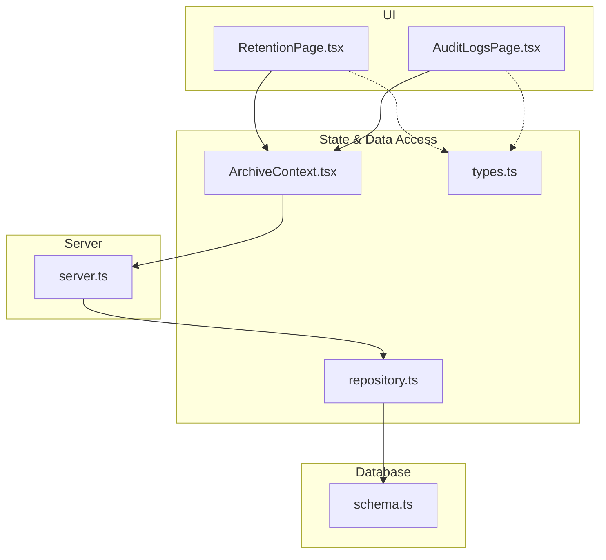
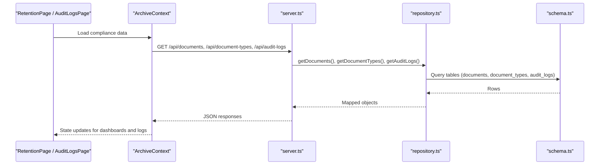
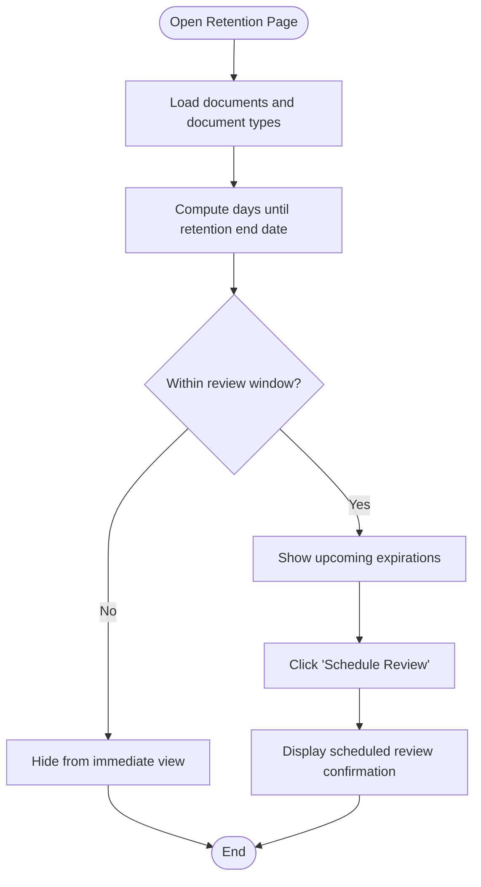
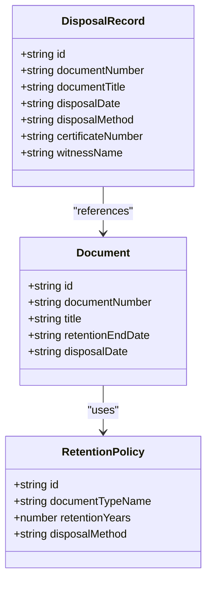
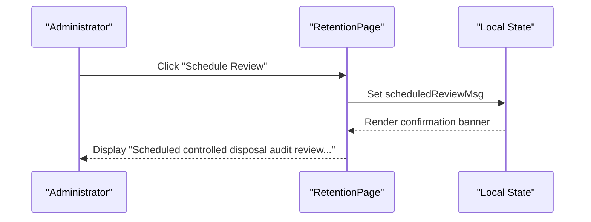
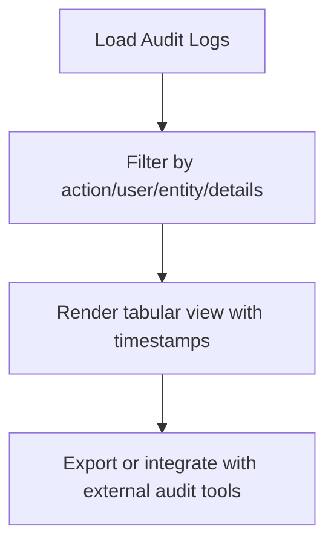
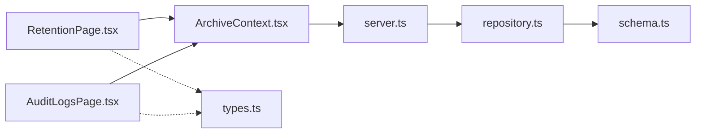

# Compliance Reporting

<cite>
**Referenced Files in This Document**
- [RetentionPage.tsx](file://src/pages/RetentionPage.tsx)
- [AuditLogsPage.tsx](file://src/pages/AuditLogsPage.tsx)
- [schema.ts](file://src/db/schema.ts)
- [repository.ts](file://src/db/repository.ts)
- [server.ts](file://server.ts)
- [ArchiveContext.tsx](file://src/context/ArchiveContext.tsx)
- [types.ts](file://src/types.ts)
</cite>

## Table of Contents
1. [Introduction](#introduction)
2. [Project Structure](#project-structure)
3. [Core Components](#core-components)
4. [Architecture Overview](#architecture-overview)
5. [Detailed Component Analysis](#detailed-component-analysis)
6. [Dependency Analysis](#dependency-analysis)
7. [Performance Considerations](#performance-considerations)
8. [Troubleshooting Guide](#troubleshooting-guide)
9. [Conclusion](#conclusion)
10. [Appendices](#appendices)

## Introduction
This document explains ArchiveHub’s compliance reporting system for retention policy adherence and disposal recommendations. It covers how the system monitors regulatory compliance across document types, surfaces audit-ready reports on retention implementation status, generates disposal recommendation lists based on expired retention periods, supports scheduling controlled disposal audits, and provides exportable outputs suitable for regulatory submissions. Integration points with external compliance systems and audit tools are also outlined.

## Project Structure
The compliance reporting capability spans UI pages, data models, repository access, and server endpoints:
- Retention page displays active statutory schedules and upcoming expirations, and allows scheduling controlled disposal reviews.
- Audit logs page presents an immutable ledger of actions for compliance verification.
- Database schema defines retention policies, disposal records, and related entities.
- Repository functions provide read/write access to retention policies and audit logs.
- Server exposes API routes for retrieving retention policies and audit logs.
- Context orchestrates data fetching and state synchronization.
- Types define the structures used throughout the application.

**Diagram sources**
- [RetentionPage.tsx:15-122](file://src/pages/RetentionPage.tsx#L15-L122)
- [AuditLogsPage.tsx:5-95](file://src/pages/AuditLogsPage.tsx#L5-L95)
- [ArchiveContext.tsx:197-255](file://src/context/ArchiveContext.tsx#L197-L255)
- [server.ts:453-480](file://server.ts#L453-L480)
- [repository.ts:1152-1194](file://src/db/repository.ts#L1152-L1194)
- [schema.ts:169-192](file://src/db/schema.ts#L169-L192)

**Section sources**
- [RetentionPage.tsx:15-122](file://src/pages/RetentionPage.tsx#L15-L122)
- [AuditLogsPage.tsx:5-95](file://src/pages/AuditLogsPage.tsx#L5-L95)
- [schema.ts:169-192](file://src/db/schema.ts#L169-L192)
- [repository.ts:1152-1194](file://src/db/repository.ts#L1152-L1194)
- [server.ts:453-480](file://server.ts#L453-L480)
- [ArchiveContext.tsx:197-255](file://src/context/ArchiveContext.tsx#L197-L255)
- [types.ts:237-258](file://src/types.ts#L237-L258)

## Core Components
- Retention Policy Monitoring: The retention page enumerates document types and their statutory retention periods, computes upcoming expirations, and shows scheduled review options.
- Disposal Recommendations: Documents with retention end dates that have passed or are within a defined window are surfaced as eligible for disposal review.
- Scheduling Controlled Disposal Audits: Administrators can schedule a controlled disposal audit for specific documents via the retention page.
- Audit-Ready Reports: The audit logs page provides a filterable, timestamped ledger of all relevant actions, supporting compliance verification.
- Export Capabilities: While no dedicated export endpoint is implemented, the underlying data (documents, retention policies, audit logs) is accessible via APIs and can be exported by clients or integrations.

**Section sources**
- [RetentionPage.tsx:19-116](file://src/pages/RetentionPage.tsx#L19-L116)
- [AuditLogsPage.tsx:5-95](file://src/pages/AuditLogsPage.tsx#L5-L95)
- [repository.ts:1152-1194](file://src/db/repository.ts#L1152-L1194)
- [server.ts:453-480](file://server.ts#L453-L480)

## Architecture Overview
The compliance reporting flow integrates UI components with backend services and database schemas:
- The retention page reads document metadata and document type retention periods to compute expiry windows and present scheduled reviews.
- The audit logs page retrieves immutable action records from the repository and server endpoints.
- The server exposes endpoints for retention policies and audit logs, delegating to repository functions that query the database schema.

**Diagram sources**
- [ArchiveContext.tsx:197-255](file://src/context/ArchiveContext.tsx#L197-L255)
- [server.ts:298-306](file://server.ts#L298-L306)
- [server.ts:453-480](file://server.ts#L453-L480)
- [repository.ts:470-519](file://src/db/repository.ts#L470-L519)
- [repository.ts:1152-1194](file://src/db/repository.ts#L1152-L1194)
- [schema.ts:67-116](file://src/db/schema.ts#L67-L116)
- [schema.ts:169-192](file://src/db/schema.ts#L169-L192)

## Detailed Component Analysis

### Retention Policy Monitoring and Expiry Calculation
- Active Statutory Schedules: The retention page renders document types with their retention years and inferred disposal methods based on thresholds.
- Upcoming Expirations: The page filters documents with retention end dates within a configurable window to highlight items approaching expiry.
- Scheduled Reviews: Each document entry includes a “Schedule Review” action that triggers a user-facing confirmation message indicating a controlled disposal audit has been scheduled.

**Diagram sources**
- [RetentionPage.tsx:19-26](file://src/pages/RetentionPage.tsx#L19-L26)
- [RetentionPage.tsx:88-116](file://src/pages/RetentionPage.tsx#L88-L116)

**Section sources**
- [RetentionPage.tsx:19-26](file://src/pages/RetentionPage.tsx#L19-L26)
- [RetentionPage.tsx:55-77](file://src/pages/RetentionPage.tsx#L55-L77)
- [RetentionPage.tsx:88-116](file://src/pages/RetentionPage.tsx#L88-L116)

### Disposal Recommendation Generation
- Eligibility Criteria: Documents whose retention end date has passed or falls within a defined near-expiry window are considered eligible for disposal recommendations.
- Output: The retention page lists these documents with their retention end dates and provides a mechanism to schedule controlled disposal audits.
- Records: Disposal outcomes are modeled by the disposal records table, enabling auditability and traceability.

**Diagram sources**
- [types.ts:135-183](file://src/types.ts#L135-L183)
- [types.ts:237-258](file://src/types.ts#L237-L258)
- [schema.ts:67-116](file://src/db/schema.ts#L67-L116)
- [schema.ts:169-192](file://src/db/schema.ts#L169-L192)

**Section sources**
- [RetentionPage.tsx:88-116](file://src/pages/RetentionPage.tsx#L88-L116)
- [schema.ts:169-192](file://src/db/schema.ts#L169-L192)
- [types.ts:237-258](file://src/types.ts#L237-L258)

### Scheduling Controlled Disposal Audits
- Functionality: The retention page offers per-document scheduling of controlled disposal audits, providing immediate feedback through a confirmation message.
- Workflow: Clicking “Schedule Review” sets a local notification indicating the audit has been scheduled for the selected document.

**Diagram sources**
- [RetentionPage.tsx:107-113](file://src/pages/RetentionPage.tsx#L107-L113)
- [RetentionPage.tsx:42-53](file://src/pages/RetentionPage.tsx#L42-L53)

**Section sources**
- [RetentionPage.tsx:107-113](file://src/pages/RetentionPage.tsx#L107-L113)
- [RetentionPage.tsx:42-53](file://src/pages/RetentionPage.tsx#L42-L53)

### Audit-Ready Reports
- Immutable Ledger: The audit logs page displays a comprehensive, filterable list of actions including timestamps, users, roles, target entities, and details.
- Compliance Use: These logs support regulatory verification by providing a complete trail of who performed what actions and when.

**Diagram sources**
- [AuditLogsPage.tsx:5-95](file://src/pages/AuditLogsPage.tsx#L5-L95)
- [repository.ts:1171-1194](file://src/db/repository.ts#L1171-L1194)
- [server.ts:463-480](file://server.ts#L463-L480)

**Section sources**
- [AuditLogsPage.tsx:5-95](file://src/pages/AuditLogsPage.tsx#L5-L95)
- [repository.ts:1171-1194](file://src/db/repository.ts#L1171-L1194)
- [server.ts:463-480](file://server.ts#L463-L480)

### Export Capabilities for Regulatory Submissions
- Current State: No dedicated export endpoints are implemented in the server. However, core datasets required for compliance reporting are available via REST endpoints:
  - Documents: GET /api/documents
  - Document Types: GET /api/document-types
  - Retention Policies: GET /api/retention-policies
  - Audit Logs: GET /api/audit-logs
- Recommended Approach: Clients or integration layers can fetch these endpoints and produce standard formats (CSV, JSON) suitable for regulatory submissions.

**Section sources**
- [server.ts:298-306](file://server.ts#L298-L306)
- [server.ts:215-223](file://server.ts#L215-L223)
- [server.ts:453-480](file://server.ts#L453-L480)

### Integration Points with External Compliance Systems and Audit Tools
- Data Ingestion: External systems can consume ArchiveHub’s REST endpoints to ingest retention policies, documents, and audit logs for centralized compliance monitoring.
- Event-Driven Updates: For real-time integration, consider polling or webhooks around key events (e.g., document updates, audit log creation).
- Mapping: Map ArchiveHub’s entity fields to your compliance system’s schema using the provided types and schema definitions.

**Section sources**
- [server.ts:298-306](file://server.ts#L298-L306)
- [server.ts:453-480](file://server.ts#L453-L480)
- [types.ts:135-183](file://src/types.ts#L135-L183)
- [schema.ts:67-116](file://src/db/schema.ts#L67-L116)

## Dependency Analysis
Key dependencies and relationships:
- UI Pages depend on ArchiveContext for data state and operations.
- ArchiveContext calls server endpoints to synchronize data.
- Server routes delegate to repository functions for database access.
- Repository functions map database rows to typed objects and handle fallback memory mode.
- Schema defines the structure of retention policies, disposal records, and related entities.

**Diagram sources**
- [RetentionPage.tsx:15-122](file://src/pages/RetentionPage.tsx#L15-L122)
- [AuditLogsPage.tsx:5-95](file://src/pages/AuditLogsPage.tsx#L5-L95)
- [ArchiveContext.tsx:197-255](file://src/context/ArchiveContext.tsx#L197-L255)
- [server.ts:453-480](file://server.ts#L453-L480)
- [repository.ts:1152-1194](file://src/db/repository.ts#L1152-L1194)
- [schema.ts:169-192](file://src/db/schema.ts#L169-L192)
- [types.ts:237-258](file://src/types.ts#L237-L258)

**Section sources**
- [ArchiveContext.tsx:197-255](file://src/context/ArchiveContext.tsx#L197-L255)
- [server.ts:453-480](file://server.ts#L453-L480)
- [repository.ts:1152-1194](file://src/db/repository.ts#L1152-L1194)
- [schema.ts:169-192](file://src/db/schema.ts#L169-L192)

## Performance Considerations
- Client-Side Filtering: The retention page performs client-side filtering for upcoming expirations; ensure dataset size remains manageable for responsive UI.
- API Efficiency: Batch data retrieval in ArchiveContext reduces round-trips during initial load.
- Database Fallback: Repository functions gracefully fall back to in-memory state if PostgreSQL is unavailable; production deployments should ensure stable connectivity.

[No sources needed since this section provides general guidance]

## Troubleshooting Guide
- Missing Retention Policies: Verify that retention policies exist for document types; use the retention policies endpoint to inspect configured policies.
- Audit Log Gaps: Ensure audit logging is enabled and that actions trigger log entries; check the audit logs endpoint for completeness.
- Data Sync Issues: If UI does not reflect recent changes, refresh data via ArchiveContext’s fetchAllFromBackend or reseed the database if necessary.

**Section sources**
- [server.ts:453-480](file://server.ts#L453-L480)
- [ArchiveContext.tsx:197-255](file://src/context/ArchiveContext.tsx#L197-L255)

## Conclusion
ArchiveHub’s compliance reporting system provides robust mechanisms for tracking retention policy adherence, generating disposal recommendations, scheduling controlled disposal audits, and presenting audit-ready reports. While dedicated export endpoints are not yet implemented, the available REST APIs enable integration with external compliance systems and facilitate the creation of standardized reports for regulatory submissions.

[No sources needed since this section summarizes without analyzing specific files]

## Appendices

### Example Compliance Dashboards
- Upcoming Expirations: Display documents with retention end dates within a defined window.
- Overdue Disposals: Highlight documents past their retention end dates awaiting disposal review.
- Policy Violation Alerts: Surface anomalies such as missing retention policies or inconsistent metadata.

[No sources needed since this section describes conceptual dashboard examples]