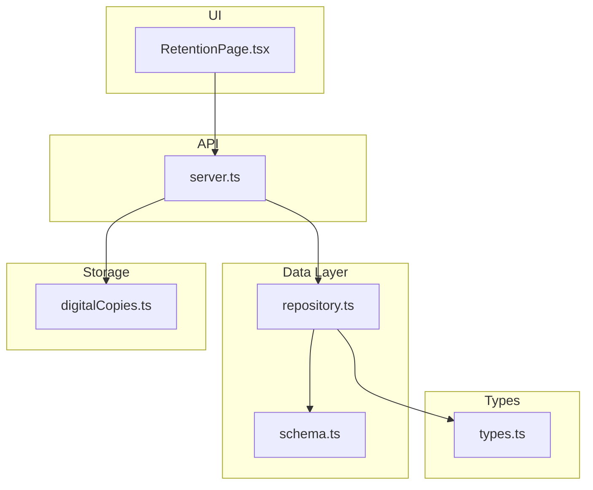
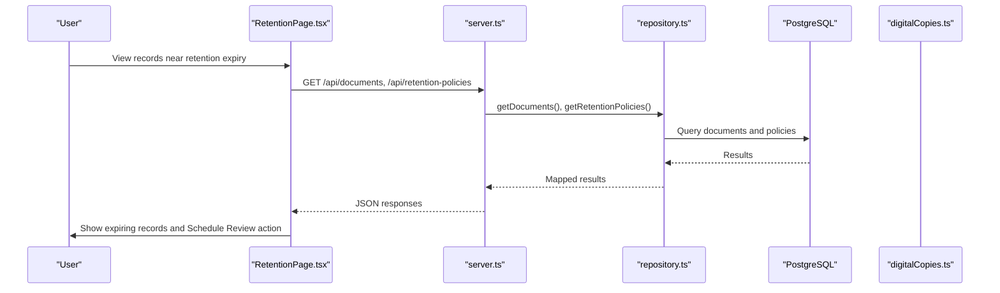
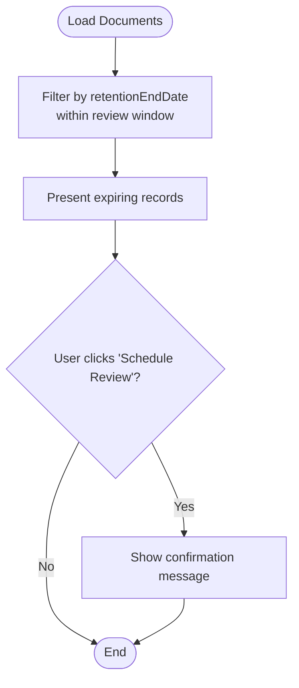
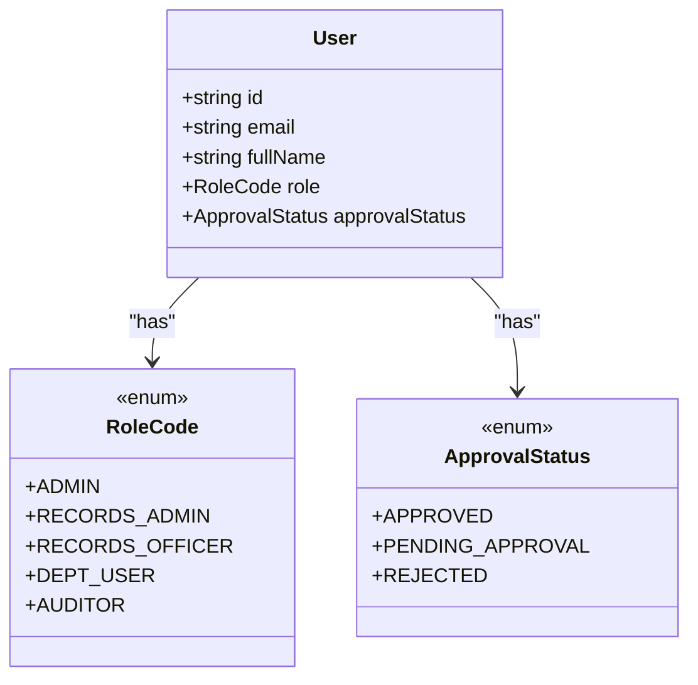
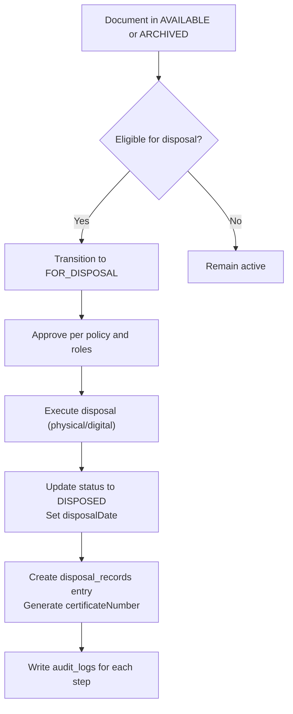
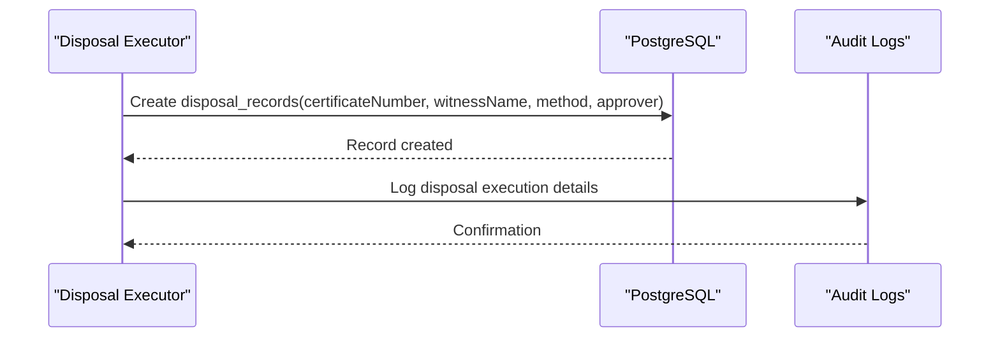
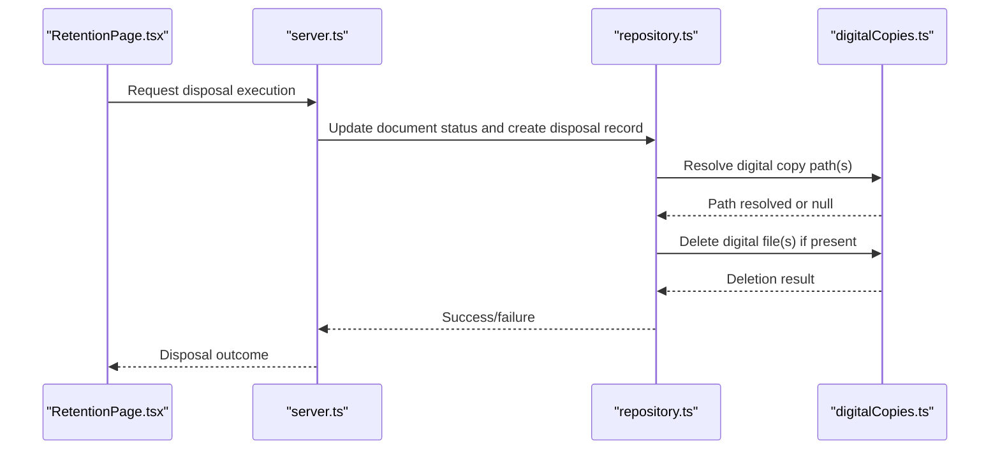
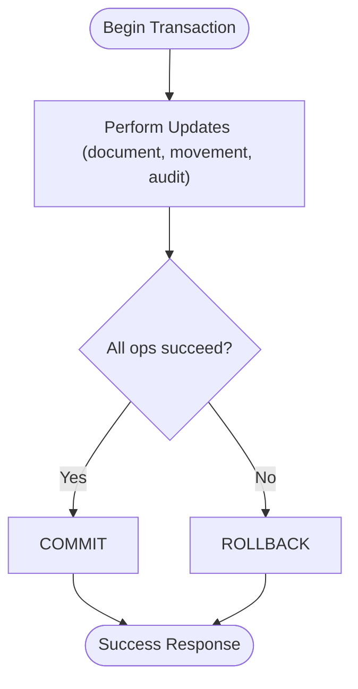
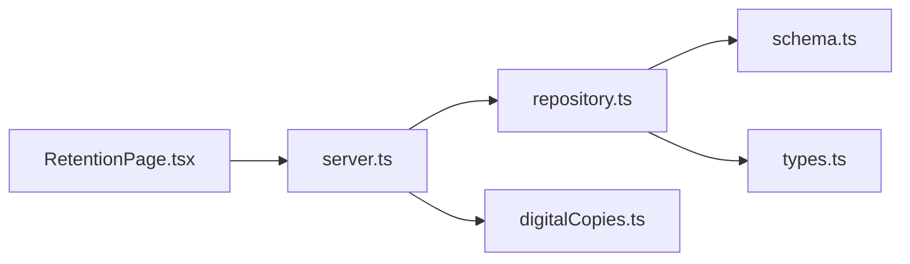

# Disposal Workflows

<cite>
**Referenced Files in This Document**
- [RetentionPage.tsx](file://src/pages/RetentionPage.tsx)
- [schema.ts](file://src/db/schema.ts)
- [types.ts](file://src/types.ts)
- [repository.ts](file://src/db/repository.ts)
- [server.ts](file://server.ts)
- [digitalCopies.ts](file://src/files/digitalCopies.ts)
- [ArchiveContext.tsx](file://src/context/ArchiveContext.tsx)
</cite>

## Table of Contents
1. [Introduction](#introduction)
2. [Project Structure](#project-structure)
3. [Core Components](#core-components)
4. [Architecture Overview](#architecture-overview)
5. [Detailed Component Analysis](#detailed-component-analysis)
6. [Dependency Analysis](#dependency-analysis)
7. [Performance Considerations](#performance-considerations)
8. [Troubleshooting Guide](#troubleshooting-guide)
9. [Conclusion](#conclusion)
10. [Appendices](#appendices)

## Introduction
This document explains ArchiveHub’s controlled disposal workflow for managing the destruction lifecycle of documents. It covers how retention policies drive scheduled reviews, how approvals are enforced by role, and how disposal execution transitions documents to a disposed state with a complete audit trail. It also describes the generation of permanent destruction certificates and outlines integration points for physical destruction services and digital file deletion. Finally, it addresses error handling and rollback mechanisms to ensure data integrity throughout the destruction lifecycle.

## Project Structure
The disposal workflow spans UI, API, repository, and storage layers:
- UI: Retention page surfaces records approaching expiry and allows scheduling disposal reviews.
- API: Server exposes endpoints for documents, checkouts, movements, retention policies, and audit logs; disposal-related tables exist but disposal execution is not exposed as a dedicated endpoint in this codebase.
- Repository: Implements database operations with transactions and audit logging; supports fallback memory mode when the database is unavailable.
- Storage: Digital copies are stored under a dedicated directory with safe naming and path resolution utilities.
- Types and Schema: Define roles, statuses, retention policies, disposal records, and audit logs.

**Diagram sources**
- [RetentionPage.tsx:15-122](file://src/pages/RetentionPage.tsx#L15-L122)
- [server.ts:13-596](file://server.ts#L13-L596)
- [repository.ts:1-1597](file://src/db/repository.ts#L1-L1597)
- [schema.ts:13-228](file://src/db/schema.ts#L13-L228)
- [digitalCopies.ts:1-47](file://src/files/digitalCopies.ts#L1-L47)
- [types.ts:6-283](file://src/types.ts#L6-L283)

**Section sources**
- [RetentionPage.tsx:15-122](file://src/pages/RetentionPage.tsx#L15-L122)
- [server.ts:13-596](file://server.ts#L13-L596)
- [repository.ts:1-1597](file://src/db/repository.ts#L1-L1597)
- [schema.ts:13-228](file://src/db/schema.ts#L13-L228)
- [digitalCopies.ts:1-47](file://src/files/digitalCopies.ts#L1-L47)
- [types.ts:6-283](file://src/types.ts#L6-L283)

## Core Components
- Retention Policies and Expiry Tracking: The system defines document types with retention periods and calculates retention end dates. The retention page lists records nearing expiry and enables scheduling disposal reviews.
- Approval Workflow: Roles (ADMIN, RECORDS_ADMIN, RECORDS_OFFICER, DEPT_USER, AUDITOR) govern access and approvals. While checkout workflows demonstrate approval patterns, disposal-specific approval endpoints are not implemented in this codebase.
- Disposal Execution: Documents support status values including FOR_DISPOSAL and DISPOSED, and fields such as disposalDate. A disposal_records table captures certificate numbers, witnesses, and methods. However, no explicit disposal execution endpoint exists in server.ts.
- Audit Trail: All significant actions are recorded via audit_logs, including updates to documents and other entities.
- Digital Copies: Utilities exist to save and resolve digital files, enabling integration with digital deletion processes.

**Section sources**
- [types.ts:54-68](file://src/types.ts#L54-L68)
- [types.ts:237-258](file://src/types.ts#L237-L258)
- [schema.ts:67-116](file://src/db/schema.ts#L67-L116)
- [schema.ts:169-192](file://src/db/schema.ts#L169-L192)
- [RetentionPage.tsx:19-116](file://src/pages/RetentionPage.tsx#L19-L116)
- [repository.ts:1152-1217](file://src/db/repository.ts#L1152-L1217)
- [digitalCopies.ts:16-41](file://src/files/digitalCopies.ts#L16-L41)

## Architecture Overview
The disposal workflow integrates multiple layers:
- UI triggers disposal review scheduling based on retention expiry.
- API routes handle CRUD for documents, checkouts, movements, retention policies, and audit logs.
- Repository performs transactional writes and maintains audit logs.
- Storage utilities manage digital copies that may be deleted during disposal.

**Diagram sources**
- [RetentionPage.tsx:19-116](file://src/pages/RetentionPage.tsx#L19-L116)
- [server.ts:298-471](file://server.ts#L298-L471)
- [repository.ts:471-519](file://src/db/repository.ts#L471-L519)
- [repository.ts:1152-1169](file://src/db/repository.ts#L1152-L1169)

**Section sources**
- [server.ts:298-471](file://server.ts#L298-L471)
- [repository.ts:471-519](file://src/db/repository.ts#L471-L519)
- [repository.ts:1152-1169](file://src/db/repository.ts#L1152-L1169)

## Detailed Component Analysis

### Retention Policy and Expiry Calculation
- Document types define retentionYears and descriptions.
- Documents carry retentionStartDate and retentionEndDate, used to identify records due for disposal review.
- The retention page filters documents within a configurable window and presents them for scheduling disposal reviews.

**Diagram sources**
- [RetentionPage.tsx:19-26](file://src/pages/RetentionPage.tsx#L19-L26)
- [RetentionPage.tsx:88-116](file://src/pages/RetentionPage.tsx#L88-L116)

**Section sources**
- [schema.ts:37-46](file://src/db/schema.ts#L37-L46)
- [schema.ts:67-116](file://src/db/schema.ts#L67-L116)
- [RetentionPage.tsx:19-26](file://src/pages/RetentionPage.tsx#L19-L26)
- [RetentionPage.tsx:88-116](file://src/pages/RetentionPage.tsx#L88-L116)

### Role-Based Authorization and Approval Patterns
- User roles include ADMIN, RECORDS_ADMIN, RECORDS_OFFICER, DEPT_USER, AUDITOR.
- Authentication enforces account approval status before login.
- Checkout workflows demonstrate multi-step approvals (REQUESTED → APPROVED → CHECKED_OUT), illustrating the pattern applicable to disposal approvals if implemented.

**Diagram sources**
- [types.ts:6-22](file://src/types.ts#L6-L22)

**Section sources**
- [types.ts:6-22](file://src/types.ts#L6-L22)
- [server.ts:104-150](file://server.ts#L104-L150)
- [repository.ts:898-969](file://src/db/repository.ts#L898-L969)

### Disposal Execution and Status Transitions
- Document statuses include AVAILABLE, ARCHIVED, FOR_DISPOSAL, and DISPOSED.
- Documents have disposalDate and related metadata for tracking disposal events.
- The disposal_records table stores certificateNumber, witnessName, disposalMethod, and approver information for legal proof.
- No explicit disposal execution endpoint exists in server.ts; disposal would typically update document status and create a disposal record plus audit log entries.

**Diagram sources**
- [types.ts:54-68](file://src/types.ts#L54-L68)
- [schema.ts:67-116](file://src/db/schema.ts#L67-L116)
- [schema.ts:169-192](file://src/db/schema.ts#L169-L192)

**Section sources**
- [types.ts:54-68](file://src/types.ts#L54-L68)
- [schema.ts:67-116](file://src/db/schema.ts#L67-L116)
- [schema.ts:169-192](file://src/db/schema.ts#L169-L192)

### Permanent Destruction Certificates
- Disposal records capture certificateNumber, witnessName, disposalMethod, and approver details, providing legal proof of disposal.
- Certificate generation can be integrated into disposal execution to produce a unique identifier and attach it to the disposal record.

**Diagram sources**
- [schema.ts:169-192](file://src/db/schema.ts#L169-L192)
- [repository.ts:1196-1217](file://src/db/repository.ts#L1196-L1217)

**Section sources**
- [schema.ts:169-192](file://src/db/schema.ts#L169-L192)
- [repository.ts:1196-1217](file://src/db/repository.ts#L1196-L1217)

### Integration with Physical Destruction Services and Digital File Deletion
- Physical destruction: Disposal records store method and witness details; external service integration would call an API to schedule destruction and update records accordingly.
- Digital file deletion: digitalCopies.ts provides utilities to save and resolve digital files; disposal execution can invoke deletion routines against stored paths.

**Diagram sources**
- [RetentionPage.tsx:107-113](file://src/pages/RetentionPage.tsx#L107-L113)
- [server.ts:298-471](file://server.ts#L298-L471)
- [repository.ts:635-715](file://src/db/repository.ts#L635-L715)
- [digitalCopies.ts:33-41](file://src/files/digitalCopies.ts#L33-L41)

**Section sources**
- [digitalCopies.ts:16-41](file://src/files/digitalCopies.ts#L16-L41)
- [repository.ts:635-715](file://src/db/repository.ts#L635-L715)

### Error Handling and Rollback Mechanisms
- Repository functions use PostgreSQL transactions with explicit BEGIN/COMMIT/ROLLBACK to ensure consistency across related updates (e.g., document updates, movements, audit logs).
- On errors, transactions roll back and exceptions propagate to the API layer, which returns appropriate error responses.
- Fallback memory mode ensures operations continue in development without a live database, though production should rely on persistent storage.

**Diagram sources**
- [repository.ts:571-633](file://src/db/repository.ts#L571-L633)
- [repository.ts:766-800](file://src/db/repository.ts#L766-L800)
- [repository.ts:867-895](file://src/db/repository.ts#L867-L895)
- [repository.ts:907-933](file://src/db/repository.ts#L907-L933)
- [repository.ts:945-969](file://src/db/repository.ts#L945-L969)
- [repository.ts:1005-1051](file://src/db/repository.ts#L1005-L1051)
- [repository.ts:1075-1121](file://src/db/repository.ts#L1075-L1121)

**Section sources**
- [repository.ts:571-633](file://src/db/repository.ts#L571-L633)
- [repository.ts:766-800](file://src/db/repository.ts#L766-L800)
- [repository.ts:867-895](file://src/db/repository.ts#L867-L895)
- [repository.ts:907-933](file://src/db/repository.ts#L907-L933)
- [repository.ts:945-969](file://src/db/repository.ts#L945-L969)
- [repository.ts:1005-1051](file://src/db/repository.ts#L1005-L1051)
- [repository.ts:1075-1121](file://src/db/repository.ts#L1075-L1121)

## Dependency Analysis
- UI depends on API endpoints to fetch documents and policies; disposal scheduling is initiated from the retention page.
- API routes depend on repository functions for data operations and audit logging.
- Repository depends on schema definitions and type contracts for consistent data modeling.
- Storage utilities are independent modules invoked during disposal to manage digital files.

**Diagram sources**
- [RetentionPage.tsx:15-122](file://src/pages/RetentionPage.tsx#L15-L122)
- [server.ts:13-596](file://server.ts#L13-L596)
- [repository.ts:1-1597](file://src/db/repository.ts#L1-L1597)
- [schema.ts:13-228](file://src/db/schema.ts#L13-L228)
- [types.ts:6-283](file://src/types.ts#L6-L283)
- [digitalCopies.ts:1-47](file://src/files/digitalCopies.ts#L1-L47)

**Section sources**
- [server.ts:13-596](file://server.ts#L13-L596)
- [repository.ts:1-1597](file://src/db/repository.ts#L1-L1597)

## Performance Considerations
- Use batch operations where possible (e.g., updating multiple documents in a bundle) to reduce round trips.
- Leverage PostgreSQL transactions to minimize lock contention and ensure atomicity.
- Avoid unnecessary re-renders in the UI by minimizing state updates and using efficient filtering on the client side for retention pages.
- For large volumes of disposal operations, consider background jobs to process batches asynchronously while maintaining audit trails.

[No sources needed since this section provides general guidance]

## Troubleshooting Guide
- Database connectivity issues: The server checks health and falls back to memory mode; verify environment configuration for PostgreSQL connection.
- Failed disposal operations: Check repository transaction logs and audit logs for failure points; ensure disposal_records and audit_logs are updated consistently.
- Digital file deletion failures: Validate file paths using digitalCopies.ts utilities; confirm permissions and existence before deletion.
- Approval bottlenecks: Ensure users have correct roles and approval status; monitor pending approvals in user management.

**Section sources**
- [server.ts:19-38](file://server.ts#L19-L38)
- [repository.ts:1219-1264](file://src/db/repository.ts#L1219-L1264)
- [digitalCopies.ts:33-41](file://src/files/digitalCopies.ts#L33-L41)

## Conclusion
ArchiveHub provides a robust foundation for controlled disposal workflows through retention policy tracking, role-based authorization patterns, transactional data operations, and comprehensive audit logging. While disposal execution endpoints are not explicitly implemented in this codebase, the schema and repository support full lifecycle management, including certificate generation and integration with physical and digital destruction processes. Extending the API with disposal-specific endpoints will enable end-to-end automation while preserving compliance and auditability.

[No sources needed since this section summarizes without analyzing specific files]

## Appendices

### Example Workflow Configurations
- Routine expiration:
  - Identify documents nearing retentionEndDate.
  - Schedule disposal review from the retention page.
  - Approve per role requirements and execute disposal, updating status and creating disposal records.
- Early disposal request:
  - Initiate disposal outside normal expiry windows.
  - Enforce additional approvals based on sensitivity and policy.
  - Execute disposal with enhanced audit logging and certificate issuance.
- Emergency destruction procedures:
  - Trigger immediate disposal for high-risk documents.
  - Require multi-level approvals and witness verification.
  - Perform both physical and digital destruction with immediate audit entries.

[No sources needed since this section provides conceptual examples]