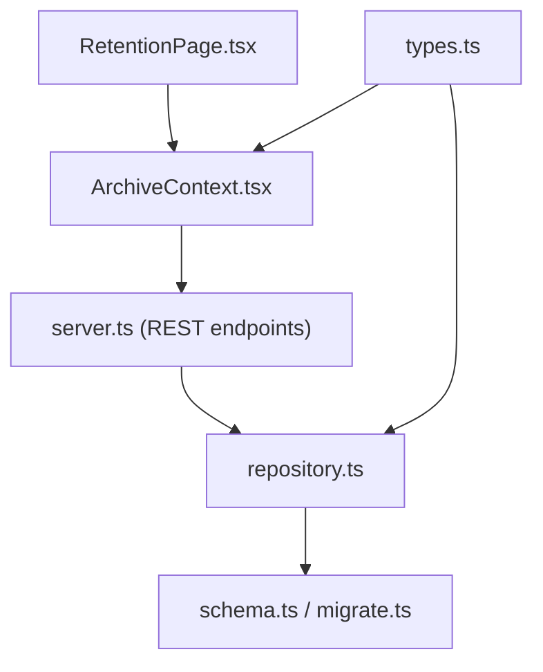
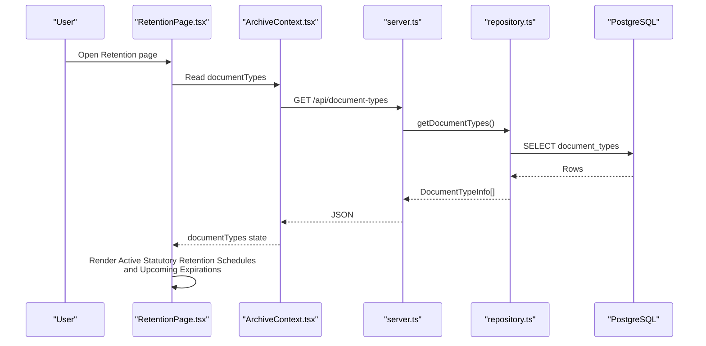
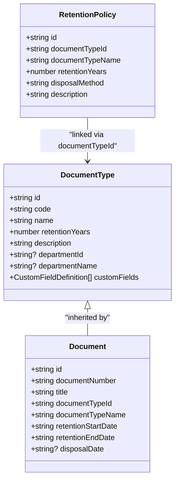
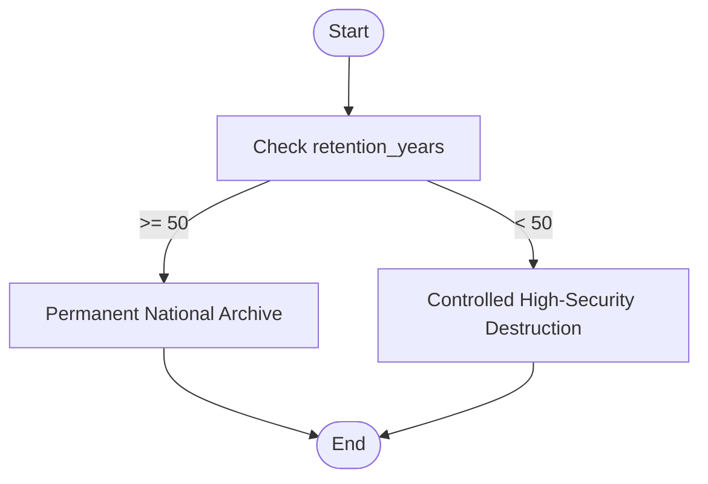
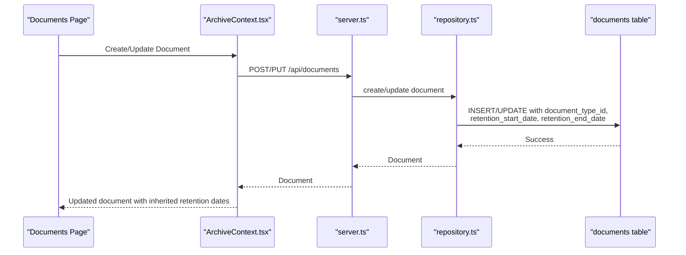
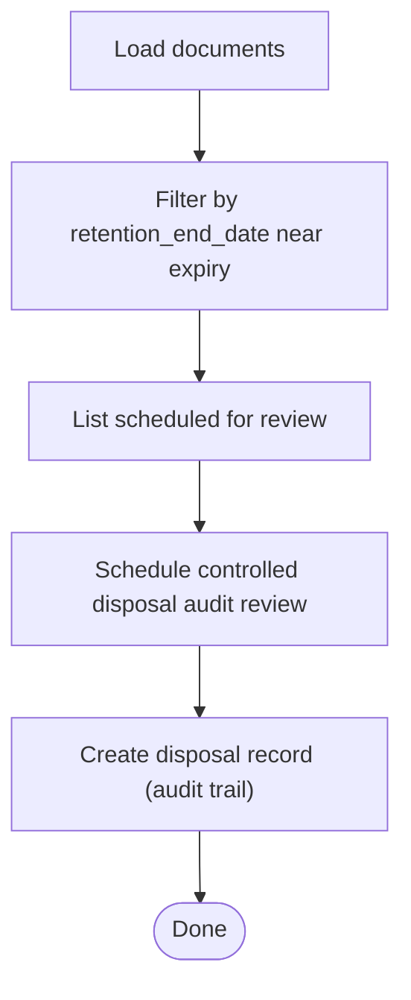
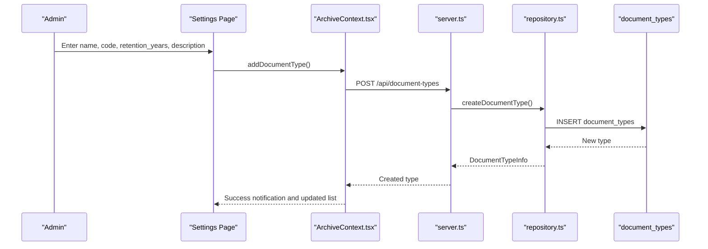
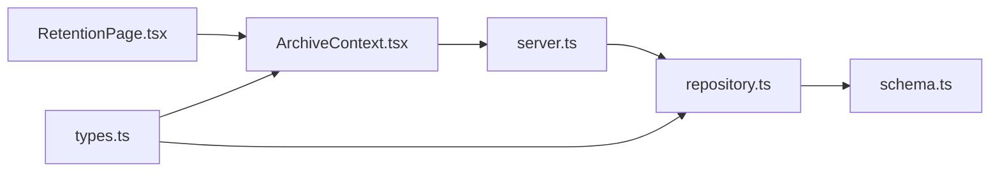

# Policy Configuration

<cite>
**Referenced Files in This Document**
- [RetentionPage.tsx](file://src/pages/RetentionPage.tsx)
- [schema.ts](file://src/db/schema.ts)
- [repository.ts](file://src/db/repository.ts)
- [server.ts](file://server.ts)
- [types.ts](file://src/types.ts)
- [ArchiveContext.tsx](file://src/context/ArchiveContext.tsx)
- [migrate.ts](file://src/db/migrate.ts)
</cite>

## Table of Contents
1. [Introduction](#introduction)
2. [Project Structure](#project-structure)
3. [Core Components](#core-components)
4. [Architecture Overview](#architecture-overview)
5. [Detailed Component Analysis](#detailed-component-analysis)
6. [Dependency Analysis](#dependency-analysis)
7. [Performance Considerations](#performance-considerations)
8. [Troubleshooting Guide](#troubleshooting-guide)
9. [Conclusion](#conclusion)
10. [Appendices](#appendices)

## Introduction
This document explains how to configure retention policies in ArchiveHub’s document management system. It covers:
- Defining document types with specific retention periods measured in years
- The relationship between document categories and their retention schedules
- The configuration interface for statutory retention requirements, including description fields and disposal method determination based on retention duration
- The policy inheritance model where documents automatically inherit retention rules from their assigned document type
- Practical examples for financial records, legal documents, and administrative files
- Best practices for naming conventions, retention period justification, and compliance alignment

## Project Structure
The retention policy feature spans UI, data models, repository logic, and server endpoints:
- UI: Retention page displays active statutory retention schedules and upcoming expirations
- Data model: Schema defines document types, documents, retention policies, and disposal records
- Repository: Reads/writes retention policies and document types; supports memory fallback
- Server: Exposes API endpoints for document types and retention policies
- Types: Strongly typed interfaces for retention policies and related entities

**Diagram sources**
- [RetentionPage.tsx:15-77](file://src/pages/RetentionPage.tsx#L15-L77)
- [ArchiveContext.tsx:197-255](file://src/context/ArchiveContext.tsx#L197-L255)
- [server.ts:215-250](file://server.ts#L215-L250)
- [server.ts:453-461](file://server.ts#L453-L461)
- [repository.ts:259-342](file://src/db/repository.ts#L259-L342)
- [repository.ts:1152-1169](file://src/db/repository.ts#L1152-L1169)
- [schema.ts:37-46](file://src/db/schema.ts#L37-L46)
- [schema.ts:67-116](file://src/db/schema.ts#L67-L116)
- [schema.ts:169-192](file://src/db/schema.ts#L169-L192)
- [types.ts:118-127](file://src/types.ts#L118-L127)
- [types.ts:135-183](file://src/types.ts#L135-L183)
- [types.ts:237-244](file://src/types.ts#L237-L244)

**Section sources**
- [RetentionPage.tsx:15-77](file://src/pages/RetentionPage.tsx#L15-L77)
- [schema.ts:37-46](file://src/db/schema.ts#L37-L46)
- [schema.ts:67-116](file://src/db/schema.ts#L67-L116)
- [schema.ts:169-192](file://src/db/schema.ts#L169-L192)
- [repository.ts:259-342](file://src/db/repository.ts#L259-L342)
- [repository.ts:1152-1169](file://src/db/repository.ts#L1152-L1169)
- [server.ts:215-250](file://server.ts#L215-L250)
- [server.ts:453-461](file://server.ts#L453-L461)
- [types.ts:118-127](file://src/types.ts#L118-L127)
- [types.ts:135-183](file://src/types.ts#L135-L183)
- [types.ts:237-244](file://src/types.ts#L237-L244)

## Core Components
- Document Types: Define the category of a record and its default retention period in years. Stored in the document_types table with name, code, retention_years, description, and optional department scoping.
- Documents: Each record stores the assigned document type and inherited retention dates. Fields include retention_start_date and retention_end_date, plus disposal_date when applicable.
- Retention Policies: A separate table captures explicit retention policy entries per document type, including retention_years, disposal_method, and description.
- Disposal Records: Audit trail for destruction or transfer actions, capturing who requested/approved, method, date, certificate number, witness, and notes.
- UI and Context: The Retention page shows active statutory schedules and upcoming expirations. The context manages document types and synchronizes with backend APIs.

Key behaviors observed:
- Disposal method is determined by retention duration at display time: long-term (e.g., 50+ years) maps to permanent national archive; shorter terms map to controlled high-security destruction.
- Documents carry inherited retention dates derived from their document type, enabling lifecycle tracking and expiry alerts.

**Section sources**
- [schema.ts:37-46](file://src/db/schema.ts#L37-L46)
- [schema.ts:67-116](file://src/db/schema.ts#L67-L116)
- [schema.ts:169-192](file://src/db/schema.ts#L169-L192)
- [RetentionPage.tsx:55-77](file://src/pages/RetentionPage.tsx#L55-L77)
- [types.ts:118-127](file://src/types.ts#L118-L127)
- [types.ts:135-183](file://src/types.ts#L135-L183)
- [types.ts:237-244](file://src/types.ts#L237-L244)

## Architecture Overview
The retention policy flow integrates UI, context, server, repository, and database layers.

**Diagram sources**
- [RetentionPage.tsx:15-77](file://src/pages/RetentionPage.tsx#L15-L77)
- [ArchiveContext.tsx:197-255](file://src/context/ArchiveContext.tsx#L197-L255)
- [server.ts:215-250](file://server.ts#L215-L250)
- [repository.ts:259-278](file://src/db/repository.ts#L259-L278)
- [schema.ts:37-46](file://src/db/schema.ts#L37-L46)

## Detailed Component Analysis

### Document Type and Retention Periods
- Purpose: Define each document category and its statutory retention period in years.
- Storage: document_types table includes retention_years and description.
- UI: Settings allow creating/editing document types with name, code, retention years, and description.
- Inheritance: When a document is created or updated, it carries documentTypeId and documentTypeName, and retains calculated retention_start_date and retention_end_date.

**Diagram sources**
- [types.ts:118-127](file://src/types.ts#L118-L127)
- [types.ts:135-183](file://src/types.ts#L135-L183)
- [types.ts:237-244](file://src/types.ts#L237-L244)
- [schema.ts:37-46](file://src/db/schema.ts#L37-L46)
- [schema.ts:67-116](file://src/db/schema.ts#L67-L116)
- [schema.ts:169-192](file://src/db/schema.ts#L169-L192)

**Section sources**
- [schema.ts:37-46](file://src/db/schema.ts#L37-L46)
- [schema.ts:67-116](file://src/db/schema.ts#L67-L116)
- [types.ts:118-127](file://src/types.ts#L118-L127)
- [types.ts:135-183](file://src/types.ts#L135-L183)

### Disposal Method Determination
- Rule: If retention_years >= 50, disposal method is treated as Permanent National Archive; otherwise Controlled High-Security Destruction.
- Display: The Retention page computes this rule dynamically when rendering cards for each document type.
- Storage: Retention policies also store disposal_method explicitly for auditability.

**Diagram sources**
- [RetentionPage.tsx:70-73](file://src/pages/RetentionPage.tsx#L70-L73)
- [schema.ts:169-192](file://src/db/schema.ts#L169-L192)
- [types.ts:237-244](file://src/types.ts#L237-L244)

**Section sources**
- [RetentionPage.tsx:70-73](file://src/pages/RetentionPage.tsx#L70-L73)
- [schema.ts:169-192](file://src/db/schema.ts#L169-L192)
- [types.ts:237-244](file://src/types.ts#L237-L244)

### Policy Inheritance Model
- Mechanism: Documents store documentTypeId and documentTypeName, along with retention_start_date and retention_end_date. These dates are used to compute expiry and schedule reviews.
- UI: The Retention page lists documents with their type and computed retention end date, enabling proactive scheduling of disposal audits.
- Backend: Repository functions support reading/updating documents with retention fields.

**Diagram sources**
- [server.ts:308-326](file://server.ts#L308-L326)
- [repository.ts:521-633](file://src/db/repository.ts#L521-L633)
- [schema.ts:67-116](file://src/db/schema.ts#L67-L116)

**Section sources**
- [schema.ts:67-116](file://src/db/schema.ts#L67-L116)
- [repository.ts:521-633](file://src/db/repository.ts#L521-L633)
- [server.ts:308-326](file://server.ts#L308-L326)

### Retention Expiry Tracking and Scheduled Reviews
- Calculation: The Retention page filters documents whose retention_end_date falls within a defined window (e.g., next five years).
- Action: Users can schedule a controlled disposal audit review for each document nearing expiry.
- Audit: Disposal records capture approvals, methods, certificates, witnesses, and notes for compliance.

**Diagram sources**
- [RetentionPage.tsx:19-26](file://src/pages/RetentionPage.tsx#L19-L26)
- [RetentionPage.tsx:107-113](file://src/pages/RetentionPage.tsx#L107-L113)
- [schema.ts:179-192](file://src/db/schema.ts#L179-L192)

**Section sources**
- [RetentionPage.tsx:19-26](file://src/pages/RetentionPage.tsx#L19-L26)
- [RetentionPage.tsx:107-113](file://src/pages/RetentionPage.tsx#L107-L113)
- [schema.ts:179-192](file://src/db/schema.ts#L179-L192)

### Configuration Interface
- Creating Document Types: Use the settings interface to define name, code, retention years, and description. The interface exposes fields for retention period and archival purpose.
- Updating/Deleting: The context provides update and delete operations for document types, which sync with backend APIs.
- Viewing Policies: The Retention page renders active statutory retention schedules and disposal method determinations.

**Diagram sources**
- [ArchiveContext.tsx:520-558](file://src/context/ArchiveContext.tsx#L520-L558)
- [server.ts:225-250](file://server.ts#L225-L250)
- [repository.ts:280-342](file://src/db/repository.ts#L280-L342)
- [schema.ts:37-46](file://src/db/schema.ts#L37-L46)

**Section sources**
- [ArchiveContext.tsx:520-558](file://src/context/ArchiveContext.tsx#L520-L558)
- [server.ts:225-250](file://server.ts#L225-L250)
- [repository.ts:280-342](file://src/db/repository.ts#L280-L342)
- [schema.ts:37-46](file://src/db/schema.ts#L37-L46)

### Practical Examples
- Financial Records: Set a document type such as “Financial Ledger” with a retention period aligned to regulatory requirements (e.g., 7–10 years). Provide a description referencing applicable statutes or internal policy.
- Legal Documents: Define “Legal Contract” with a longer retention period if required (e.g., 20–30 years), ensuring the disposal method remains controlled high-security destruction unless permanently archived.
- Administrative Files: For general administrative records, use a moderate retention period (e.g., 5–7 years) with clear descriptions indicating scope and compliance basis.

Implementation tips:
- Use consistent naming: Category-Purpose-YearRange (e.g., Finance-Tax-7Yrs)
- Include a concise description that cites regulation or policy reference
- Ensure retention_years matches organizational policy and legal obligations

[No sources needed since this section provides general guidance]

## Dependency Analysis
- UI depends on context to fetch document types and render retention schedules.
- Context calls server endpoints for document types and documents.
- Server routes delegate to repository functions for persistence.
- Repository queries PostgreSQL schema tables and returns mapped types.
- Types enforce structure across layers.

**Diagram sources**
- [RetentionPage.tsx:15-77](file://src/pages/RetentionPage.tsx#L15-L77)
- [ArchiveContext.tsx:197-255](file://src/context/ArchiveContext.tsx#L197-L255)
- [server.ts:215-250](file://server.ts#L215-L250)
- [repository.ts:259-342](file://src/db/repository.ts#L259-L342)
- [schema.ts:37-46](file://src/db/schema.ts#L37-L46)
- [types.ts:118-127](file://src/types.ts#L118-L127)

**Section sources**
- [RetentionPage.tsx:15-77](file://src/pages/RetentionPage.tsx#L15-L77)
- [ArchiveContext.tsx:197-255](file://src/context/ArchiveContext.tsx#L197-L255)
- [server.ts:215-250](file://server.ts#L215-L250)
- [repository.ts:259-342](file://src/db/repository.ts#L259-L342)
- [schema.ts:37-46](file://src/db/schema.ts#L37-L46)
- [types.ts:118-127](file://src/types.ts#L118-L127)

## Performance Considerations
- Batch fetching: The context retrieves multiple datasets concurrently to reduce round-trips.
- Memory fallback: Repository gracefully falls back to in-memory state when PostgreSQL is unavailable, preventing UI failures during outages.
- Efficient queries: Repository uses targeted SELECT statements and mapping functions to minimize overhead.
- UI filtering: Retention page filters documents client-side for near-expiry items; consider pagination or server-side filtering for large datasets.

[No sources needed since this section provides general guidance]

## Troubleshooting Guide
- No document types displayed: Verify that the document types endpoint returns data and that the context successfully updates state.
- Retention dates missing: Ensure documents have retention_start_date and retention_end_date set; check creation/update flows in repository.
- Disposal method mismatch: Confirm retention_years values align with policy; the UI determines disposal method based on thresholds.
- Database connectivity issues: Repository logs warnings and falls back to memory mode; verify environment configuration for PostgreSQL.

**Section sources**
- [repository.ts:259-278](file://src/db/repository.ts#L259-L278)
- [repository.ts:1152-1169](file://src/db/repository.ts#L1152-L1169)
- [server.ts:19-38](file://server.ts#L19-L38)

## Conclusion
ArchiveHub’s retention policy framework enables organizations to define document categories with precise retention periods, determine appropriate disposal methods, and track lifecycles through inherited retention dates. The UI provides visibility into active schedules and upcoming expirations, while the repository and server ensure robust data handling and auditability. Following best practices for naming, descriptions, and compliance alignment ensures consistent and defensible retention management.

[No sources needed since this section summarizes without analyzing specific files]

## Appendices

### Data Models Reference
- Document Types: name, code, retention_years, description, optional department scoping
- Documents: document_type_id, document_type_name, retention_start_date, retention_end_date, disposal_date
- Retention Policies: document_type_id, document_type_name, retention_years, disposal_method, description
- Disposal Records: document_id, document_number, document_title, requester/approver names, disposal_date, disposal_method, certificate_number, witness_name, notes

**Section sources**
- [schema.ts:37-46](file://src/db/schema.ts#L37-L46)
- [schema.ts:67-116](file://src/db/schema.ts#L67-L116)
- [schema.ts:169-192](file://src/db/schema.ts#L169-L192)
- [types.ts:118-127](file://src/types.ts#L118-L127)
- [types.ts:135-183](file://src/types.ts#L135-L183)
- [types.ts:237-244](file://src/types.ts#L237-L244)