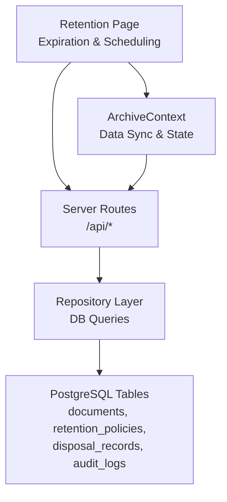
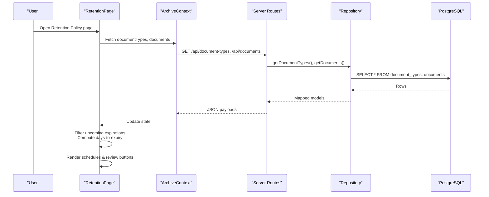
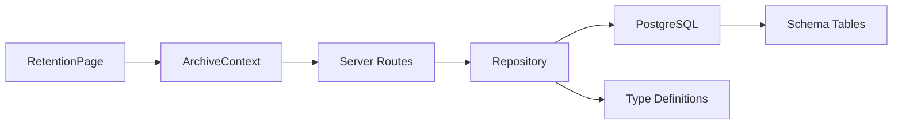
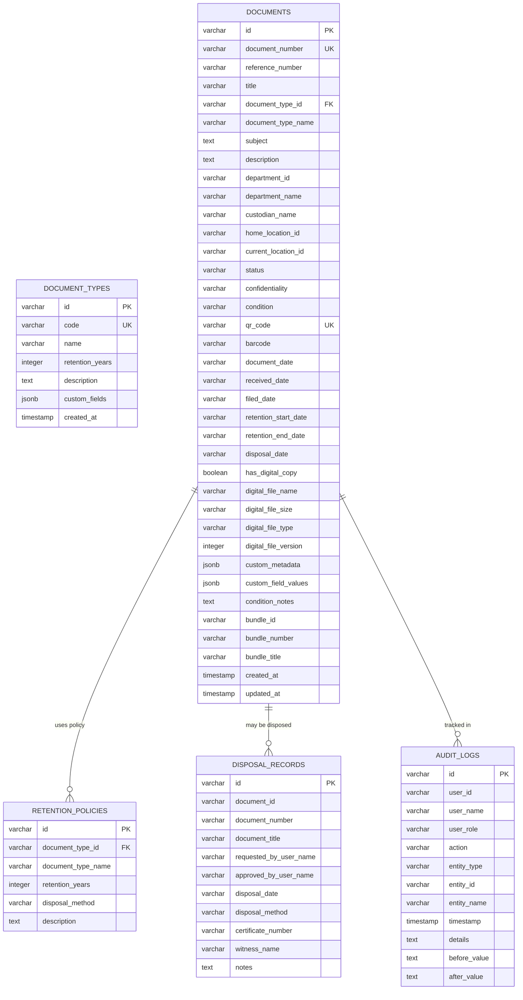

# Retention Policies

<cite>
**Referenced Files in This Document**
- [RetentionPage.tsx](file://src/pages/RetentionPage.tsx)
- [schema.ts](file://src/db/schema.ts)
- [repository.ts](file://src/db/repository.ts)
- [server.ts](file://server.ts)
- [ArchiveContext.tsx](file://src/context/ArchiveContext.tsx)
- [AuditLogsPage.tsx](file://src/pages/AuditLogsPage.tsx)
- [types.ts](file://src/types.ts)
</cite>

## Table of Contents
1. Introduction
2. Project Structure
3. Core Components
4. Architecture Overview
5. Detailed Component Analysis
6. Dependency Analysis
7. Performance Considerations
8. Troubleshooting Guide
9. Conclusion
10. Appendices

## Introduction
This document explains ArchiveHub’s retention policy automation system for managing the lifecycle of documents from creation to disposal. It covers how retention policies are configured per document type with customizable retention periods measured in years, how expiration dates are calculated and tracked, compliance reporting features that monitor adherence and generate disposal recommendations, and the disposal workflow including approvals and audit logging. It also describes integration with document status management where expired items transition to archived or disposed states, and provides practical examples for setting up policies, monitoring expirations, and processing approved disposals while maintaining regulatory compliance and optimizing storage costs.

## Project Structure
The retention system spans UI, API, data schema, and repository layers:
- UI surfaces for retention policy display and scheduling reviews for upcoming expirations.
- API endpoints expose document types, documents, retention policies, and audit logs.
- Data schema defines tables for documents, retention policies, disposal records, and audit logs.
- Repository functions provide database access and fallback memory behavior.
- Context layer orchestrates data fetching and state updates across the application.

**Diagram sources**
- [RetentionPage.tsx:15-122](file://src/pages/RetentionPage.tsx#L15-L122)
- [server.ts:215-471](file://server.ts#L215-L471)
- [repository.ts:1152-1194](file://src/db/repository.ts#L1152-L1194)
- [schema.ts:67-192](file://src/db/schema.ts#L67-L192)

**Section sources**
- [RetentionPage.tsx:15-122](file://src/pages/RetentionPage.tsx#L15-L122)
- [server.ts:215-471](file://server.ts#L215-L471)
- [schema.ts:67-192](file://src/db/schema.ts#L67-L192)
- [repository.ts:1152-1194](file://src/db/repository.ts#L1152-L1194)
- [ArchiveContext.tsx:197-255](file://src/context/ArchiveContext.tsx#L197-L255)

## Core Components
- Document Types with retention years define the baseline retention period per category.
- Documents store computed retention start/end dates and optional disposal date.
- Retention Policies table captures policy metadata (years, disposal method).
- Disposal Records capture approval, method, certificate, witness, and notes for each destruction event.
- Audit Logs record all actions with user context and details for compliance.
- UI pages present active schedules, upcoming expirations, and immutable audit trails.

Key responsibilities:
- Configure retention by document type (years).
- Compute and persist retention windows on documents.
- Surface upcoming expirations and enable scheduling of disposal reviews.
- Record disposal events with approvals and certificates.
- Provide an immutable audit ledger for regulatory compliance.

**Section sources**
- [schema.ts:37-46](file://src/db/schema.ts#L37-L46)
- [schema.ts:67-116](file://src/db/schema.ts#L67-L116)
- [schema.ts:169-192](file://src/db/schema.ts#L169-L192)
- [types.ts:118-127](file://src/types.ts#L118-L127)
- [types.ts:135-183](file://src/types.ts#L135-L183)
- [types.ts:237-258](file://src/types.ts#L237-L258)
- [types.ts:260-274](file://src/types.ts#L260-L274)

## Architecture Overview
The system follows a layered architecture:
- Frontend pages consume data via the ArchiveContext which syncs with backend APIs.
- Backend routes delegate to repository functions that query PostgreSQL.
- Schema defines relational tables; repository maps rows to typed models.
- UI components visualize retention schedules and upcoming expirations.
- Audit logs are appended throughout critical operations for compliance.

**Diagram sources**
- [RetentionPage.tsx:15-122](file://src/pages/RetentionPage.tsx#L15-L122)
- [ArchiveContext.tsx:197-255](file://src/context/ArchiveContext.tsx#L197-L255)
- [server.ts:215-306](file://server.ts#L215-L306)
- [repository.ts:259-278](file://src/db/repository.ts#L259-L278)
- [repository.ts:471-519](file://src/db/repository.ts#L471-L519)

## Detailed Component Analysis

### Retention Policies Configuration
- Document types carry a retention period in years. This is the primary configuration point for retention length per category.
- The retention policies table stores policy metadata including disposal method and description, enabling consistent enforcement across documents.
- UI displays active statutory retention schedules derived from document types and indicates disposal method based on retention thresholds.

Operational highlights:
- Create/update document types to adjust retention years.
- Use retention policies to standardize disposal methods.
- Display policy summaries to users for transparency.

**Section sources**
- [schema.ts:37-46](file://src/db/schema.ts#L37-L46)
- [schema.ts:169-177](file://src/db/schema.ts#L169-L177)
- [types.ts:118-127](file://src/types.ts#L118-L127)
- [types.ts:237-244](file://src/types.ts#L237-L244)
- [RetentionPage.tsx:55-77](file://src/pages/RetentionPage.tsx#L55-L77)

### Automated Calculation of Retention Start and End Dates
- Documents include fields for retention start and end dates, plus disposal date when applicable.
- The UI filters documents approaching expiry using the stored retention end date and current time to compute days remaining.
- While explicit calculation logic is not shown in the analyzed files, the presence of these fields and filtering demonstrates automated computation elsewhere in the system.

Practical implications:
- Ensure retention start date is set at registration or filing.
- Retention end date should be computed as start date plus policy years.
- Expiration checks drive scheduling of disposal reviews.

**Section sources**
- [schema.ts:67-116](file://src/db/schema.ts#L67-L116)
- [types.ts:135-183](file://src/types.ts#L135-L183)
- [RetentionPage.tsx:19-26](file://src/pages/RetentionPage.tsx#L19-L26)

### Compliance Reporting and Disposal Recommendations
- The system maintains an immutable audit ledger capturing who performed actions, what entities were affected, and detailed context.
- The retention page surfaces upcoming expirations and allows scheduling controlled disposal audit reviews, generating notifications for tracking.
- Disposal records capture approval, method, certificate number, witness, and notes to support regulatory audits.

Compliance benefits:
- Full traceability of retention-related actions.
- Clear evidence of approvals and destruction processes.
- Centralized view of scheduled reviews and completed disposals.

**Section sources**
- [schema.ts:179-192](file://src/db/schema.ts#L179-L192)
- [schema.ts:213-227](file://src/db/schema.ts#L213-L227)
- [types.ts:246-258](file://src/types.ts#L246-L258)
- [types.ts:260-274](file://src/types.ts#L260-L274)
- [RetentionPage.tsx:79-117](file://src/pages/RetentionPage.tsx#L79-L117)
- [AuditLogsPage.tsx:20-90](file://src/pages/AuditLogsPage.tsx#L20-L90)

### Disposal Workflow and Approvals
- The disposal workflow includes scheduling reviews, obtaining approvals, recording disposal method, certificate numbers, witnesses, and notes.
- While specific disposal endpoint implementations are not included in the analyzed files, the schema and types define the necessary structures for disposal records and audit logging.
- The retention UI enables scheduling of disposal reviews, initiating the workflow.

Workflow steps:
- Identify documents nearing retention expiry.
- Schedule controlled disposal audit review.
- Obtain required approvals before destruction.
- Record disposal details and generate certificates.
- Log all actions in the audit ledger.

**Section sources**
- [schema.ts:179-192](file://src/db/schema.ts#L179-L192)
- [types.ts:246-258](file://src/types.ts#L246-L258)
- [RetentionPage.tsx:107-113](file://src/pages/RetentionPage.tsx#L107-L113)

### Integration with Document Status Management
- Documents have a status field supporting states such as AVAILABLE, ARCHIVED, FOR_DISPOSAL, and DISPOSED.
- When retention expires, documents can transition to archived or disposed states, aligning with policy and approvals.
- The repository supports updating document attributes, including status changes, and logs relevant movements and audits.

Status transitions:
- AVAILABLE → FOR_DISPOSAL upon expiry identification.
- FOR_DISPOSAL → ARCHIVED if retained under special conditions.
- FOR_DISPOSAL → DISPOSED after approved destruction.

**Section sources**
- [types.ts:54-68](file://src/types.ts#L54-L68)
- [schema.ts:67-116](file://src/db/schema.ts#L67-L116)
- [repository.ts:635-715](file://src/db/repository.ts#L635-L715)

### Practical Examples
- Setting up retention policies:
  - Define document types with appropriate retention years.
  - Assign disposal methods in retention policies.
  - Verify UI displays active schedules and disposal methods.
- Monitoring upcoming expirations:
  - Use the retention page to filter documents with retention end dates within a defined window.
  - Schedule reviews for items approaching expiry.
- Processing approved disposals:
  - Follow approval workflows and record disposal details.
  - Generate certificates and log actions in the audit ledger.

**Section sources**
- [RetentionPage.tsx:55-117](file://src/pages/RetentionPage.tsx#L55-L117)
- [schema.ts:37-46](file://src/db/schema.ts#L37-L46)
- [schema.ts:169-192](file://src/db/schema.ts#L169-L192)
- [AuditLogsPage.tsx:20-90](file://src/pages/AuditLogsPage.tsx#L20-L90)

## Dependency Analysis
The retention system depends on cohesive interactions between UI, context, server routes, repository, and database schema:
- UI depends on ArchiveContext for data synchronization.
- ArchiveContext calls server routes for CRUD operations.
- Server routes delegate to repository functions for database queries.
- Repository maps database rows to typed models used by UI.
- Schema ensures consistent structure for retention policies, disposal records, and audit logs.

**Diagram sources**
- [RetentionPage.tsx:15-122](file://src/pages/RetentionPage.tsx#L15-L122)
- [ArchiveContext.tsx:197-255](file://src/context/ArchiveContext.tsx#L197-L255)
- [server.ts:215-471](file://server.ts#L215-L471)
- [repository.ts:1152-1194](file://src/db/repository.ts#L1152-L1194)
- [schema.ts:67-192](file://src/db/schema.ts#L67-L192)
- [types.ts:118-127](file://src/types.ts#L118-L127)

**Section sources**
- [server.ts:215-471](file://server.ts#L215-L471)
- [repository.ts:1152-1194](file://src/db/repository.ts#L1152-L1194)
- [schema.ts:67-192](file://src/db/schema.ts#L67-L192)
- [types.ts:118-127](file://src/types.ts#L118-L127)

## Performance Considerations
- Efficient querying: Use indexed columns for document types and document IDs to speed up retention calculations and filtering.
- Batch operations: Group updates for multiple documents during bulk retention processing to reduce transaction overhead.
- Memory fallback: Repository includes fallback to in-memory state when database is unavailable; ensure this does not mask performance issues in production.
- UI rendering: Avoid excessive re-renders by memoizing computed lists of expiring documents.

[No sources needed since this section provides general guidance]

## Troubleshooting Guide
Common issues and resolutions:
- Database connectivity: If PostgreSQL is not connected, the system falls back to memory mode; verify environment configuration and connection settings.
- Missing retention dates: Ensure retention start and end dates are set during document registration or filing; otherwise, expiration detection will not work.
- Approval errors: Confirm user roles and approval statuses before attempting disposal actions; pending or rejected accounts cannot proceed.
- Audit log gaps: Verify that audit logs are being created for critical actions; check repository functions and API routes for proper logging.

**Section sources**
- [server.ts:19-38](file://server.ts#L19-L38)
- [repository.ts:106-119](file://src/db/repository.ts#L106-L119)
- [repository.ts:1196-1217](file://src/db/repository.ts#L1196-L1217)

## Conclusion
ArchiveHub’s retention policy automation system provides a robust framework for managing document lifecycles through configurable retention periods, automated expiration tracking, compliance reporting, and controlled disposal workflows. By integrating document status management and comprehensive audit logging, organizations can maintain regulatory compliance while optimizing storage costs. The modular architecture ensures scalability and reliability, supporting both development and production environments.

[No sources needed since this section summarizes without analyzing specific files]

## Appendices

### Data Model Relationships

**Diagram sources**
- [schema.ts:37-46](file://src/db/schema.ts#L37-L46)
- [schema.ts:67-116](file://src/db/schema.ts#L67-L116)
- [schema.ts:169-192](file://src/db/schema.ts#L169-L192)
- [schema.ts:213-227](file://src/db/schema.ts#L213-L227)