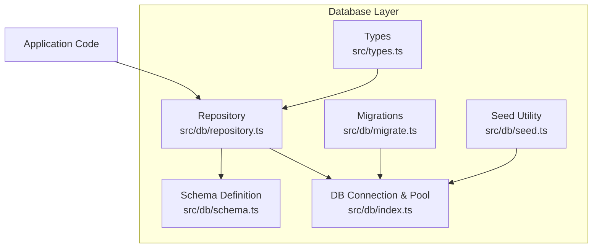
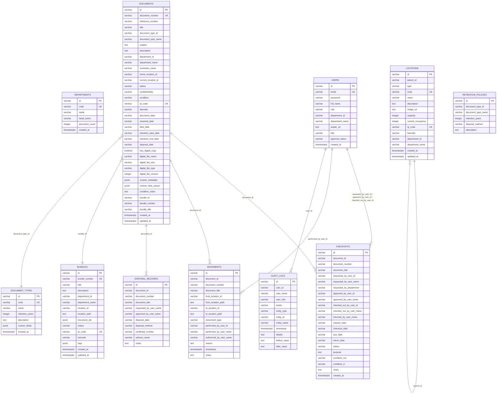
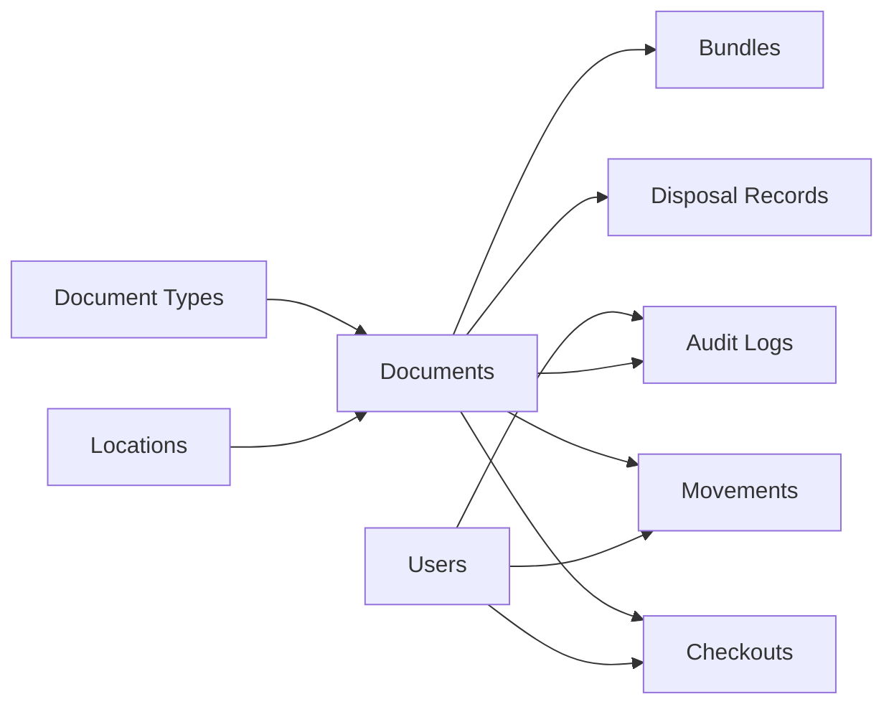

# Database Schema

<cite>
**Referenced Files in This Document**
- [schema.ts](file://src/db/schema.ts)
- [migrate.ts](file://src/db/migrate.ts)
- [repository.ts](file://src/db/repository.ts)
- [index.ts](file://src/db/index.ts)
- [seed.ts](file://src/db/seed.ts)
- [types.ts](file://src/types.ts)
- [package.json](file://package.json)
</cite>

## Table of Contents
1. [Introduction](#introduction)
2. [Project Structure](#project-structure)
3. [Core Components](#core-components)
4. [Architecture Overview](#architecture-overview)
5. [Detailed Component Analysis](#detailed-component-analysis)
6. [Dependency Analysis](#dependency-analysis)
7. [Performance Considerations](#performance-considerations)
8. [Troubleshooting Guide](#troubleshooting-guide)
9. [Conclusion](#conclusion)
10. [Appendices](#appendices)

## Introduction
This document describes the PostgreSQL database schema used by ArchiveHub, including all 11 core tables and supporting entities. It explains entity relationships, keys, constraints, field definitions, data types, and business rules enforced at the database level. It also covers the migration system using Drizzle Kit for version control and schema evolution, data seeding strategies for development and testing, and performance considerations such as indexing strategies and query optimization patterns observed throughout the application.

## Project Structure
The database layer is implemented with:
- A declarative schema definition using Drizzle ORM (PostgreSQL).
- A migration script that creates or alters tables to ensure idempotent schema evolution.
- A repository layer that performs CRUD operations and enforces transactional integrity for multi-step workflows.
- A database connection manager that initializes a PostgreSQL pool and provides health checks.
- A seed utility that guards against overwriting existing data.
- TypeScript type definitions that mirror the database model and drive application logic.

**Diagram sources**
- [schema.ts:1-228](file://src/db/schema.ts#L1-L228)
- [migrate.ts:1-278](file://src/db/migrate.ts#L1-L278)
- [repository.ts:1-800](file://src/db/repository.ts#L1-L800)
- [index.ts:1-136](file://src/db/index.ts#L1-L136)
- [seed.ts:1-25](file://src/db/seed.ts#L1-L25)
- [types.ts:1-283](file://src/types.ts#L1-L283)

**Section sources**
- [schema.ts:1-228](file://src/db/schema.ts#L1-L228)
- [migrate.ts:1-278](file://src/db/migrate.ts#L1-L278)
- [repository.ts:1-800](file://src/db/repository.ts#L1-L800)
- [index.ts:1-136](file://src/db/index.ts#L1-L136)
- [seed.ts:1-25](file://src/db/seed.ts#L1-L25)
- [types.ts:1-283](file://src/types.ts#L1-L283)
- [package.json:1-49](file://package.json#L1-L49)

## Core Components
ArchiveHub’s data model centers on the following entities:
- Departments: Organizational units owning records.
- Users: System users with roles and department associations.
- Document Types: Classifications with retention policies and custom fields.
- Locations: Hierarchical physical storage locations.
- Documents: Core archival records with status, location tracking, and digital copy metadata.
- Checkouts: Request/approval/lifecycle of document borrowing.
- Movements: Audit trail of physical movements between locations.
- Retention Policies: Rules governing retention periods and disposal methods.
- Disposal Records: Compliance records for destroyed or archived items.
- Bundles/Dossiers: Logical groupings of documents stored together.
- Audit Logs: Immutable record of user actions across entities.

Key design characteristics:
- All primary keys are string identifiers (e.g., UUID-like strings), enabling safe cross-system integration.
- Many tables store denormalized display names (e.g., department_name, document_type_name) to reduce joins in read paths.
- JSONB columns support flexible metadata and custom fields without schema changes.
- Timestamps use timestamptz for timezone-aware auditing.

**Section sources**
- [schema.ts:12-228](file://src/db/schema.ts#L12-L228)
- [types.ts:10-283](file://src/types.ts#L10-L283)

## Architecture Overview
The schema supports ArchiveHub’s core workflows:
- Registration and filing of documents into home locations, with automatic movement and audit logging.
- Hierarchical location management for buildings, rooms, cabinets, shelves, boxes, and folders.
- Checkout lifecycle with request, approval, checkout, return, and overdue handling.
- Retention and disposal compliance via policies and records.
- Bundling documents into dossiers for grouped storage and retrieval.
- Comprehensive auditability through movements and audit logs.

**Diagram sources**
- [schema.ts:12-228](file://src/db/schema.ts#L12-L228)

## Detailed Component Analysis

### Departments
- Purpose: Define organizational units that own or manage records.
- Key fields: id (PK), code (unique), name, head_name, document_count, created_at.
- Business rules:
  - Unique codes prevent duplication.
  - Default document_count tracks aggregate counts at the application level.
- Relationships: Referenced indirectly by users and document types; denormalized names appear in related tables for reporting efficiency.

**Section sources**
- [schema.ts:12-20](file://src/db/schema.ts#L12-L20)
- [types.ts:276-283](file://src/types.ts#L276-L283)

### Users
- Purpose: Authenticate and authorize system access; associate users with departments.
- Key fields: id (PK), email (unique), password, full_name, role, department_id, department_name, avatar_url, title, approval_status, created_at.
- Business rules:
  - Role enum constrains access levels.
  - Approval status controls onboarding workflow.
- Relationships:
  - Optional association to departments via department_id.
  - Used in checkouts, movements, and audit logs.

**Section sources**
- [schema.ts:22-35](file://src/db/schema.ts#L22-L35)
- [types.ts:10-22](file://src/types.ts#L10-L22)

### Document Types
- Purpose: Classify records and define retention and custom field schemas.
- Key fields: id (PK), code (unique), name, retention_years, description, custom_fields (JSONB), created_at.
- Business rules:
  - Unique codes enforce consistent classification.
  - Custom fields allow extensible metadata per type.
- Relationships: Referenced by documents and retention policies.

**Section sources**
- [schema.ts:37-46](file://src/db/schema.ts#L37-L46)
- [types.ts:118-127](file://src/types.ts#L118-L127)

### Locations (Hierarchical)
- Purpose: Model physical storage hierarchy (building → floor → room → cabinet → rack → shelf → box → folder).
- Key fields: id (PK), parent_id (self-reference), type, code (unique), name, description, image_url, capacity, current_occupancy, qr_code (unique), barcode, department_id, department_name, created_at, updated_at.
- Business rules:
  - Self-referencing parent_id enables nested hierarchies.
  - Unique codes and QR codes support scanning and navigation.
  - Capacity and occupancy assist in space planning.
- Relationships:
  - Documents track both home and current locations.
  - Movements record transitions between locations.

**Section sources**
- [schema.ts:48-65](file://src/db/schema.ts#L48-L65)
- [types.ts:24-52](file://src/types.ts#L24-L52)

### Documents
- Purpose: Core archival records with rich metadata, status, and location tracking.
- Key fields: id (PK), document_number (unique), reference_number, title, document_type_id, document_type_name, subject, description, department_id, department_name, custodian_name, home_location_id, current_location_id, status, confidentiality, condition, qr_code (unique), barcode, date fields (document_date, received_date, filed_date, retention dates, disposal_date), digital copy flags and metadata, custom_metadata (JSONB), custom_field_values (JSONB), condition_notes, bundle references, timestamps.
- Business rules:
  - Distinct home vs current location supports accurate physical tracking.
  - Status values govern workflow states (available, checked out, disposed, etc.).
  - Digital copy metadata supports hybrid physical/digital archives.
- Relationships:
  - Linked to document types, locations, bundles, checkouts, movements, disposal records, and audit logs.

**Section sources**
- [schema.ts:67-116](file://src/db/schema.ts#L67-L116)
- [types.ts:135-183](file://src/types.ts#L135-L183)

### Checkouts
- Purpose: Manage request, approval, and lending lifecycle for documents.
- Key fields: id (PK), document_id, document_number, document_title, requester and approver user IDs and names, checker-out user info, returnee name, dates (request, checkout, due, return), status, purpose, condition_out, condition_in, notes, created_at.
- Business rules:
  - Status progression models approval and fulfillment.
  - Condition tracking ensures accountability during transit.
- Relationships:
  - References documents and users.

**Section sources**
- [schema.ts:118-148](file://src/db/schema.ts#L118-L148)
- [types.ts:205-235](file://src/types.ts#L205-L235)

### Movements
- Purpose: Record every physical movement of documents between locations.
- Key fields: id (PK), document_id, document_number, document_title, from/to location IDs and paths, movement_type, performer and authorizer names, reason, timestamp, notes.
- Business rules:
  - Movement types include initial filing, relocation, transfer, and corrections.
  - Paths provide human-readable context alongside IDs.
- Relationships:
  - Tied to documents and users.

**Section sources**
- [schema.ts:150-167](file://src/db/schema.ts#L150-L167)
- [types.ts:185-203](file://src/types.ts#L185-L203)

### Retention Policies
- Purpose: Define retention periods and disposal methods per document type.
- Key fields: id (PK), document_type_id, document_type_name, retention_years, disposal_method, description.
- Business rules:
  - Enforces compliance timelines and disposal procedures.
- Relationships:
  - Associated with document types.

**Section sources**
- [schema.ts:169-177](file://src/db/schema.ts#L169-L177)
- [types.ts:237-244](file://src/types.ts#L237-L244)

### Disposal Records
- Purpose: Audit-compliant records for destroyed or permanently archived items.
- Key fields: id (PK), document_id, document_number, document_title, requester and approver names, disposal_date, disposal_method, certificate_number, witness_name, notes.
- Business rules:
  - Requires certificate and witness for legal compliance.
- Relationships:
  - References documents.

**Section sources**
- [schema.ts:179-192](file://src/db/schema.ts#L179-L192)
- [types.ts:246-258](file://src/types.ts#L246-L258)

### Bundles & Dossiers
- Purpose: Group multiple documents into logical bundles for co-location and management.
- Key fields: id (PK), bundle_number (unique), title, description, department_id, department_name, location_id, location_path, document_ids (JSONB array), status, qr_code (unique), barcode, tags (JSONB array), timestamps.
- Business rules:
  - Unique bundle numbers and QR codes enable scanning and grouping.
  - JSONB arrays store included document IDs flexibly.
- Relationships:
  - Documents may reference their bundle.

**Section sources**
- [schema.ts:194-211](file://src/db/schema.ts#L194-L211)
- [types.ts:100-116](file://src/types.ts#L100-L116)

### Audit Logs
- Purpose: Immutable record of user actions across entities for compliance and troubleshooting.
- Key fields: id (PK), user_id, user_name, user_role, action, entity_type, entity_id, entity_name, timestamp, details, before_value, after_value.
- Business rules:
  - Captures before/after snapshots when applicable.
  - Tracks actor identity and role for accountability.
- Relationships:
  - Cross-cutting log for documents, locations, checkouts, users, and retention events.

**Section sources**
- [schema.ts:213-227](file://src/db/schema.ts#L213-L227)
- [types.ts:260-274](file://src/types.ts#L260-L274)

### Reusable Custom Fields (Migration-only table)
- Purpose: Central registry of reusable custom field definitions for dynamic forms.
- Key fields: id (PK), name, label, type, options (JSONB), placeholder, required, description, category, created_at.
- Notes:
  - Created in migrations but not present in the runtime schema module; used to standardize custom fields across entities.

**Section sources**
- [migrate.ts:231-245](file://src/db/migrate.ts#L231-L245)

## Dependency Analysis
Relationships and referential integrity:
- Documents depend on:
  - Document types (classification and retention).
  - Locations (home and current).
  - Bundles (grouping).
  - Users (via checkouts, movements, audit logs).
- Checkouts depend on documents and users.
- Movements depend on documents and users.
- Disposal records depend on documents.
- Audit logs are cross-cutting and reference various entities.

**Diagram sources**
- [schema.ts:12-228](file://src/db/schema.ts#L12-L228)

**Section sources**
- [schema.ts:12-228](file://src/db/schema.ts#L12-L228)

## Performance Considerations
Observed patterns and recommendations:
- Indexing strategy:
  - The schema defines unique constraints on identifiers like document_number, code, qr_code, and bundle_number. These automatically create indexes in PostgreSQL, improving lookup performance for scans and uniqueness checks.
  - For high-volume queries (e.g., filtering documents by status, location, or department), consider adding explicit indexes on frequently filtered columns such as status, department_id, home_location_id, current_location_id, and document_type_id.
- Denormalization for reads:
  - Storing display names (e.g., document_type_name, department_name) reduces join overhead in common read paths, trading off some write complexity for faster queries.
- JSONB usage:
  - JSONB columns (custom_metadata, custom_field_values, document_ids, tags) offer flexibility. Use GIN indexes on JSONB fields if querying by contained keys or values becomes frequent.
- Transactions:
  - Multi-step operations (e.g., creating a document, recording an initial movement, and writing an audit log) are wrapped in transactions to ensure consistency. This prevents partial updates under failure conditions.
- Query patterns:
  - Repository functions perform targeted SELECT/UPDATE/INSERT statements. Ensure WHERE clauses leverage indexed columns to avoid full table scans.
- Timezone handling:
  - Timestamps use timestamptz, ensuring correct time zone behavior globally.

[No sources needed since this section provides general guidance]

## Troubleshooting Guide
Common issues and resolutions:
- Database connection failures:
  - If DATABASE_URL is missing or contains placeholders, the pool will not initialize, and the app falls back to memory mode. Verify environment configuration and connectivity.
- Migration errors:
  - Migrations run within a transaction; any error triggers a rollback. Inspect the error logs to identify schema conflicts or constraint violations.
- Seed safety:
  - The seed utility checks for existing data and avoids destructive operations unless forced. Use caution when running seeds in production-like environments.
- Repository fallback:
  - When PostgreSQL is unavailable, repository functions fall back to in-memory state. This preserves UI functionality but does not persist changes.

**Section sources**
- [index.ts:16-69](file://src/db/index.ts#L16-L69)
- [index.ts:97-136](file://src/db/index.ts#L97-L136)
- [migrate.ts:3-278](file://src/db/migrate.ts#L3-L278)
- [seed.ts:3-23](file://src/db/seed.ts#L3-L23)
- [repository.ts:106-119](file://src/db/repository.ts#L106-L119)

## Conclusion
ArchiveHub’s PostgreSQL schema provides a robust foundation for managing physical and digital archives. It balances normalization with practical denormalization for performance, leverages JSONB for extensibility, and enforces key business rules through constraints and application-level logic. The migration system ensures controlled schema evolution, while the repository layer maintains transactional integrity for complex workflows. With thoughtful indexing and query optimization, the schema can scale to support large volumes of documents, locations, and audit trails.

[No sources needed since this section summarizes without analyzing specific files]

## Appendices

### Migration System Using Drizzle Kit
- Drizzle ORM is configured with a PostgreSQL pool and schema module.
- The migration script creates tables and applies incremental ALTER statements for backward compatibility.
- Dependencies include drizzle-orm and drizzle-kit for schema management.

**Section sources**
- [index.ts:1-136](file://src/db/index.ts#L1-L136)
- [migrate.ts:1-278](file://src/db/migrate.ts#L1-L278)
- [package.json:14-46](file://package.json#L14-L46)

### Data Seeding Strategies
- The seed utility checks for existing data to avoid overwriting live content.
- In development, you can reset or populate test data safely by controlling the force flag and ensuring a non-production environment.

**Section sources**
- [seed.ts:1-25](file://src/db/seed.ts#L1-L25)

### Example Workflows Supported by the Schema
- Document registration:
  - Create a document, set home and current locations, generate QR/barcode, and record initial movement and audit log within a transaction.
- Physical relocation:
  - Update current location, record movement with from/to paths, and log the action.
- Checkout lifecycle:
  - Request creation, approval, checkout, return, and overdue handling with condition tracking.
- Retention and disposal:
  - Apply retention policies based on document types and record disposal with compliance details.

**Section sources**
- [repository.ts:521-633](file://src/db/repository.ts#L521-L633)
- [repository.ts:742-800](file://src/db/repository.ts#L742-L800)