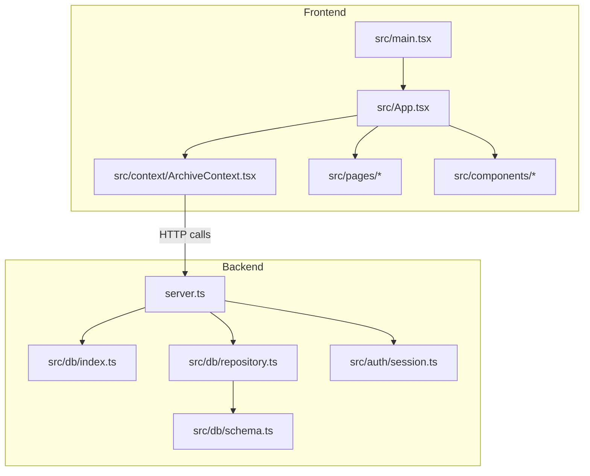
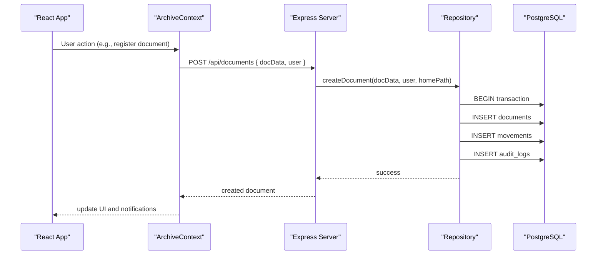
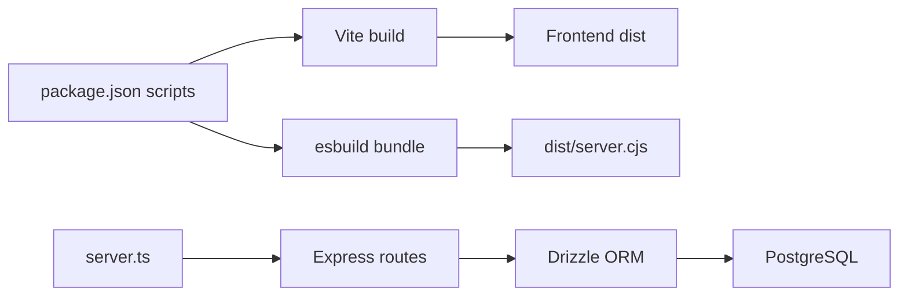

# Development Guide

<cite>
**Referenced Files in This Document**
- [package.json](file://package.json)
- [server.ts](file://server.ts)
- [vite.config.ts](file://vite.config.ts)
- [tsconfig.json](file://tsconfig.json)
- [src/main.tsx](file://src/main.tsx)
- [src/App.tsx](file://src/App.tsx)
- [src/types.ts](file://src/types.ts)
- [src/context/ArchiveContext.tsx](file://src/context/ArchiveContext.tsx)
- [src/db/index.ts](file://src/db/index.ts)
- [src/db/schema.ts](file://src/db/schema.ts)
- [src/db/repository.ts](file://src/db/repository.ts)
- [src/auth/session.ts](file://src/auth/session.ts)
- [metadata.json](file://metadata.json)
</cite>

## Table of Contents
1. Introduction
2. Project Structure
3. Core Components
4. Architecture Overview
5. Detailed Component Analysis
6. Dependency Analysis
7. Performance Considerations
8. Troubleshooting Guide
9. Conclusion
10. Appendices

## Introduction
This guide provides comprehensive development documentation for contributors and maintainers of ArchiveHub, a Physical & Digital Archive Management System (PDAMS). It explains the project structure, coding standards, development workflow using TypeScript and React, build tooling with Vite and esbuild, database setup and migrations, testing strategies, debugging techniques, performance profiling, contribution guidelines, and production deployment procedures. It also includes examples of extending the application following established architectural patterns.

## Project Structure
ArchiveHub is a full-stack TypeScript application:
- Frontend: React + TypeScript with Vite, Tailwind CSS, and component-based UI organized by feature folders (components, pages, context).
- Backend: Express server with REST endpoints, PostgreSQL via Drizzle ORM, and optional in-memory fallback when the database is unavailable.
- Build: Vite builds the frontend; esbuild bundles the backend into a single CommonJS file for Node.js.

**Diagram sources**
- [src/main.tsx:1-11](file://src/main.tsx#L1-L11)
- [src/App.tsx:1-173](file://src/App.tsx#L1-L173)
- [src/context/ArchiveContext.tsx:1-110](file://src/context/ArchiveContext.tsx#L1-L110)
- [server.ts:1-60](file://server.ts#L1-L60)
- [src/db/index.ts:1-136](file://src/db/index.ts#L1-L136)
- [src/db/repository.ts:1-120](file://src/db/repository.ts#L1-L120)
- [src/db/schema.ts:1-228](file://src/db/schema.ts#L1-L228)
- [src/auth/session.ts:1-66](file://src/auth/session.ts#L1-L66)

**Section sources**
- [package.json:1-49](file://package.json#L1-L49)
- [vite.config.ts:1-23](file://vite.config.ts#L1-L23)
- [tsconfig.json:1-27](file://tsconfig.json#L1-L27)
- [metadata.json:1-7](file://metadata.json#L1-L7)

## Core Components
- Application shell: React entrypoint renders App wrapped in StrictMode.
- Routing and layout: App orchestrates header, sidebar, mobile nav, and page routing based on active tab and selected document.
- Global state: ArchiveContext centralizes authentication, data synchronization, notifications, and operations over documents, locations, checkouts, movements, audit logs, and more.
- Data layer: Repository functions abstract database access with fallback to in-memory state when PostgreSQL is not available.
- Database schema: Drizzle schema defines tables for departments, users, document types, locations, documents, checkouts, movements, retention policies, disposal records, bundles, and audit logs.
- Authentication utilities: Password hashing and JWT helpers are provided for future token-based flows.

Key responsibilities:
- server.ts: Express routes, health checks, seeding, and serving static assets in production.
- src/db/index.ts: PostgreSQL pool management, connection health checks, and Drizzle client initialization.
- src/db/repository.ts: CRUD operations with transactions, audit logging, and movement tracking.
- src/context/ArchiveContext.tsx: Frontend state, API sync, and user session persistence.

**Section sources**
- [src/main.tsx:1-11](file://src/main.tsx#L1-L11)
- [src/App.tsx:1-173](file://src/App.tsx#L1-L173)
- [src/context/ArchiveContext.tsx:1-110](file://src/context/ArchiveContext.tsx#L1-L110)
- [src/db/index.ts:1-136](file://src/db/index.ts#L1-L136)
- [src/db/repository.ts:1-120](file://src/db/repository.ts#L1-L120)
- [src/db/schema.ts:1-228](file://src/db/schema.ts#L1-L228)
- [src/auth/session.ts:1-66](file://src/auth/session.ts#L1-L66)

## Architecture Overview
The system follows a layered architecture:
- Presentation: React components render UI and delegate actions to context.
- State and orchestration: ArchiveContext coordinates API calls and local state updates.
- API layer: Express server exposes REST endpoints for all domain resources.
- Data access: Repository functions encapsulate SQL queries and business rules.
- Persistence: PostgreSQL stores entities; an in-memory fallback ensures offline usability during development or DB outages.

**Diagram sources**
- [src/context/ArchiveContext.tsx:752-777](file://src/context/ArchiveContext.tsx#L752-L777)
- [server.ts:308-316](file://server.ts#L308-L316)
- [src/db/repository.ts:521-633](file://src/db/repository.ts#L521-L633)

## Detailed Component Analysis

### Server and API Layer
Responsibilities:
- Initialize Express, parse JSON, and configure middleware.
- On startup, check database health, run migrations, and seed data if connected.
- Provide REST endpoints for departments, users, document types, locations, documents, checkouts, movements, retention policies, audit logs, reusable custom fields, and bundles.
- Serve Vite dev server in development or static files in production.

Key behaviors:
- Health endpoint returns service status and database connectivity.
- Seed endpoint triggers migrations and seeds default data.
- Clear-data endpoint resets operational data via repository.
- Auth endpoints handle login/signup with approval status checks.

Error handling:
- Each route wraps logic in try/catch and returns standardized error responses.

**Section sources**
- [server.ts:13-39](file://server.ts#L13-L39)
- [server.ts:43-82](file://server.ts#L43-L82)
- [server.ts:85-150](file://server.ts#L85-L150)
- [server.ts:152-213](file://server.ts#L152-L213)
- [server.ts:216-296](file://server.ts#L216-L296)
- [server.ts:299-441](file://server.ts#L299-L441)
- [server.ts:444-517](file://server.ts#L444-L517)
- [server.ts:520-577](file://server.ts#L520-L577)
- [server.ts:579-596](file://server.ts#L579-L596)

### Database Layer
Responsibilities:
- Manage PostgreSQL connection pool and Drizzle client.
- Provide health checks and dynamic proxy for pgPool usage.
- Define schema for all domain tables.
- Implement repository functions with fallback to in-memory state.

Key behaviors:
- getDatabaseUrl reads DATABASE_URL from environment or .env file.
- checkDatabaseHealth attempts a simple query to validate connectivity.
- Repository functions wrap critical writes in transactions and log movements and audit entries.

Complexity considerations:
- Many repository methods perform O(1) inserts/updates per call; list operations are O(n) over result sets.
- Transactions ensure consistency across related writes (documents, movements, audit logs).

**Section sources**
- [src/db/index.ts:16-69](file://src/db/index.ts#L16-L69)
- [src/db/index.ts:97-136](file://src/db/index.ts#L97-L136)
- [src/db/schema.ts:12-228](file://src/db/schema.ts#L12-L228)
- [src/db/repository.ts:106-149](file://src/db/repository.ts#L106-L149)
- [src/db/repository.ts:521-633](file://src/db/repository.ts#L521-L633)

### Frontend Context and State Management
Responsibilities:
- Maintain current user session and authentication state.
- Synchronize application data with backend APIs.
- Provide operations for domains: departments, document types, reusable custom fields, bundles, locations, documents, checkouts, movements, audit logs.
- Manage notifications and database health display.

Key behaviors:
- fetchAllFromBackend performs parallel requests to load all domain data and health status.
- Auth flows include login, signup, approve/reject user, logout, and delete user.
- Domain handlers update local state immediately and persist changes via API calls with graceful fallbacks.

Performance considerations:
- Parallel fetching reduces initial load time.
- Optimistic UI updates improve responsiveness; failures are handled by re-fetching or showing notifications.

**Section sources**
- [src/context/ArchiveContext.tsx:115-191](file://src/context/ArchiveContext.tsx#L115-L191)
- [src/context/ArchiveContext.tsx:197-255](file://src/context/ArchiveContext.tsx#L197-L255)
- [src/context/ArchiveContext.tsx:257-293](file://src/context/ArchiveContext.tsx#L257-L293)
- [src/context/ArchiveContext.tsx:300-514](file://src/context/ArchiveContext.tsx#L300-L514)
- [src/context/ArchiveContext.tsx:520-690](file://src/context/ArchiveContext.tsx#L520-L690)
- [src/context/ArchiveContext.tsx:692-777](file://src/context/ArchiveContext.tsx#L692-L777)

### Types and Domain Model
Responsibilities:
- Define core types for users, roles, approvals, locations, documents, checkouts, movements, retention policies, disposal records, bundles, and audit logs.
- Enforce consistent shapes across frontend and backend interactions.

Key characteristics:
- Enums capture allowed values for statuses, confidentiality levels, conditions, and movement types.
- Interfaces model hierarchical locations and document lifecycle attributes.

**Section sources**
- [src/types.ts:6-283](file://src/types.ts#L6-L283)

### Authentication Utilities
Responsibilities:
- Hash passwords securely using bcrypt.
- Verify password hashes or plain text for legacy compatibility.
- Generate and verify JWT tokens for future token-based authorization flows.

Security notes:
- SESSION_SECRET should be set in production; a development default is used otherwise.
- Passwords are hashed before storage; verification supports both hashed and plain comparisons.

**Section sources**
- [src/auth/session.ts:1-66](file://src/auth/session.ts#L1-L66)

## Dependency Analysis
High-level dependencies:
- Frontend depends on React, Vite, Tailwind CSS, and Lucide icons.
- Backend depends on Express, PostgreSQL driver, Drizzle ORM, bcryptjs, jsonwebtoken, and dotenv.
- Build tools: Vite for frontend bundling and preview; esbuild for backend bundling.

**Diagram sources**
- [package.json:6-12](file://package.json#L6-L12)
- [server.ts:1-11](file://server.ts#L1-L11)
- [src/db/index.ts:1-11](file://src/db/index.ts#L1-L11)

**Section sources**
- [package.json:14-47](file://package.json#L14-L47)
- [vite.config.ts:1-23](file://vite.config.ts#L1-L23)
- [tsconfig.json:1-27](file://tsconfig.json#L1-L27)

## Performance Considerations
- Use parallel API calls in context to reduce initial load latency.
- Prefer transactions for multi-step writes to minimize round-trips and ensure consistency.
- Avoid unnecessary re-renders by updating local state optimistically and reconciling with server responses.
- In development, disable HMR/file watching via DISABLE_HMR to reduce CPU usage during agent edits.
- Monitor database health and fall back gracefully to in-memory mode to keep the app responsive.

[No sources needed since this section provides general guidance]

## Troubleshooting Guide
Common issues and resolutions:
- Database not connected:
  - Ensure DATABASE_URL is configured in .env or environment variables and does not contain placeholder passwords.
  - Check health endpoint to confirm connectivity and review startup logs for migration/seed outcomes.
- Seeding fails:
  - Use the seed endpoint to re-run migrations and load default data; inspect error messages returned by the API.
- Authentication errors:
  - Verify email/password inputs and account approval status; pending or rejected accounts will return specific messages.
- Repository fallback warnings:
  - If DB queries fail, repository falls back to in-memory state; investigate network or DB availability and fix underlying issues.

Operational tips:
- Use the health endpoint to monitor service and database status.
- Clear operational data via the clear-data endpoint when resetting for testing.
- Review console logs for warnings indicating fallback behavior and potential data inconsistencies.

**Section sources**
- [server.ts:19-38](file://server.ts#L19-L38)
- [server.ts:54-82](file://server.ts#L54-L82)
- [server.ts:104-150](file://server.ts#L104-L150)
- [src/db/index.ts:97-136](file://src/db/index.ts#L97-L136)
- [src/context/ArchiveContext.tsx:257-293](file://src/context/ArchiveContext.tsx#L257-L293)

## Conclusion
ArchiveHub combines a modern React frontend with a robust Express backend and PostgreSQL persistence. The repository pattern abstracts database operations and provides resilience through in-memory fallbacks. Vite and esbuild streamline development and production builds. Following the guidelines in this document will help contributors extend features, maintain code quality, and deploy reliably.

[No sources needed since this section summarizes without analyzing specific files]

## Appendices

### Development Environment Setup
- Install dependencies and start the development server:
  - Run the development script to launch the server and Vite dev server.
- Configure environment:
  - Create a .env file with DATABASE_URL pointing to your PostgreSQL instance.
  - Optionally set SESSION_SECRET for secure token signing in production.
- Database migrations and seed data:
  - On startup, the server checks database health and runs migrations and seeds if connected.
  - Use the seed endpoint to reset and populate default data.

Commands reference:
- Development: use the dev script to run the server with tsx.
- Build: use the build script to compile frontend with Vite and bundle backend with esbuild.
- Start production: run the compiled server.cjs.

**Section sources**
- [package.json:6-12](file://package.json#L6-L12)
- [server.ts:19-38](file://server.ts#L19-L38)
- [src/db/index.ts:16-34](file://src/db/index.ts#L16-L34)

### Build Process
- Frontend:
  - Vite compiles React + TypeScript with Tailwind CSS plugins and resolves aliases.
  - HMR can be disabled via environment variable to reduce CPU usage during editing.
- Backend:
  - esbuild bundles server.ts into a CommonJS module with externalized packages and generates sourcemaps.

Configuration highlights:
- Vite config enables React and Tailwind plugins and sets alias resolution.
- TypeScript config targets ES2022, uses bundler module resolution, and enables JSX transform.

**Section sources**
- [vite.config.ts:1-23](file://vite.config.ts#L1-L23)
- [package.json:8-12](file://package.json#L8-L12)
- [tsconfig.json:1-27](file://tsconfig.json#L1-L27)

### Testing Strategies
- Unit tests:
  - Add tests for repository functions to validate DB vs memory fallback behavior.
  - Test auth utilities for password hashing and token generation/verification.
- Integration tests:
  - Spin up a test PostgreSQL instance and run migrations before executing API tests.
  - Assert endpoints for CRUD operations, approvals, and audit log creation.
- End-to-end tests:
  - Use a browser automation tool to simulate user flows like registration, approval, document creation, and checkout workflows.

[No sources needed since this section provides general guidance]

### Debugging Techniques
- Console logs:
  - Server logs indicate database health, migration/seed outcomes, and API errors.
  - Repository logs warn when falling back to memory mode due to DB failures.
- Network inspection:
  - Inspect API calls from the context to verify payloads and responses.
- Health checks:
  - Query the health endpoint to confirm service and database status.

**Section sources**
- [server.ts:19-38](file://server.ts#L19-L38)
- [src/db/repository.ts:111-149](file://src/db/repository.ts#L111-L149)
- [src/context/ArchiveContext.tsx:257-293](file://src/context/ArchiveContext.tsx#L257-L293)

### Performance Profiling Approaches
- Frontend:
  - Use browser performance tools to identify slow renders and network bottlenecks.
  - Leverage React DevTools to analyze component re-renders and state updates.
- Backend:
  - Profile request handling and database queries; consider adding timing logs for critical paths.
  - Monitor connection pool errors and adjust timeouts as needed.

[No sources needed since this section provides general guidance]

### Contribution Guidelines
- Adding new features:
  - Define types in types.ts for new entities or enums.
  - Extend schema.ts with new tables or columns as required.
  - Implement repository functions with transactions and audit logging where appropriate.
  - Add Express routes in server.ts with consistent error handling.
  - Update context with new operations and UI state synchronization.
- Modifying existing components:
  - Keep changes localized to relevant modules; avoid broad refactors unless necessary.
  - Maintain optimistic UI updates and handle failures gracefully.
- Code quality:
  - Follow TypeScript strictness and linting rules.
  - Write tests for new logic and update existing tests accordingly.
  - Document API contracts and data models clearly.

**Section sources**
- [src/types.ts:6-283](file://src/types.ts#L6-L283)
- [src/db/schema.ts:12-228](file://src/db/schema.ts#L12-L228)
- [src/db/repository.ts:521-633](file://src/db/repository.ts#L521-L633)
- [server.ts:299-441](file://server.ts#L299-L441)
- [src/context/ArchiveContext.tsx:520-777](file://src/context/ArchiveContext.tsx#L520-L777)

### Production Deployment Procedures
- Environment configuration:
  - Set DATABASE_URL to point to production PostgreSQL.
  - Set SESSION_SECRET to a strong secret for token signing.
  - Ensure NODE_ENV is set appropriately for production builds.
- Database setup:
  - Run migrations before starting the server; the server auto-runs migrations on startup if connected.
  - Seed initial data via the seed endpoint or pre-seed the database.
- Monitoring setup:
  - Expose the health endpoint for uptime monitoring and alerting.
  - Collect logs for database health, migration/seed outcomes, and API errors.
  - Track metrics such as request latency and error rates.

**Section sources**
- [server.ts:19-38](file://server.ts#L19-L38)
- [server.ts:43-82](file://server.ts#L43-L82)
- [src/db/index.ts:16-34](file://src/db/index.ts#L16-L34)
- [src/auth/session.ts:23-27](file://src/auth/session.ts#L23-L27)

### Extending the Application: Example Patterns
- Adding a new resource:
  - Define types and schema for the new entity.
  - Implement repository functions with validation, transactions, and audit logging.
  - Add Express routes for CRUD operations with consistent error handling.
  - Update context to synchronize data and provide operations for the UI.
- Integrating AI suggestions:
  - Use existing AI suggestion utilities to enhance document metadata or recommendations.
  - Call AI services within repository or service layers and handle responses gracefully.

**Section sources**
- [src/types.ts:6-283](file://src/types.ts#L6-L283)
- [src/db/schema.ts:12-228](file://src/db/schema.ts#L12-L228)
- [src/db/repository.ts:521-633](file://src/db/repository.ts#L521-L633)
- [server.ts:299-441](file://server.ts#L299-L441)
- [src/context/ArchiveContext.tsx:520-777](file://src/context/ArchiveContext.tsx#L520-L777)