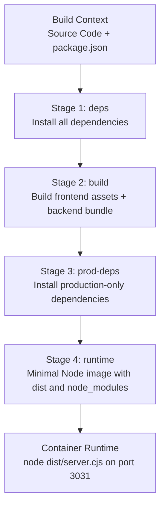
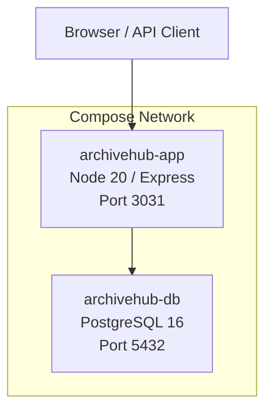
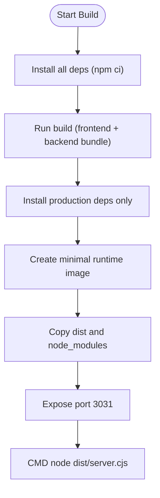
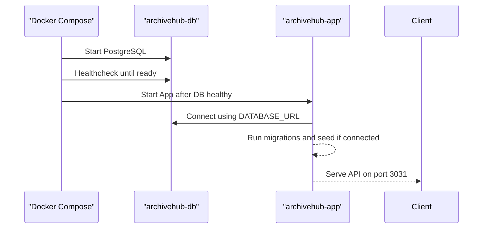
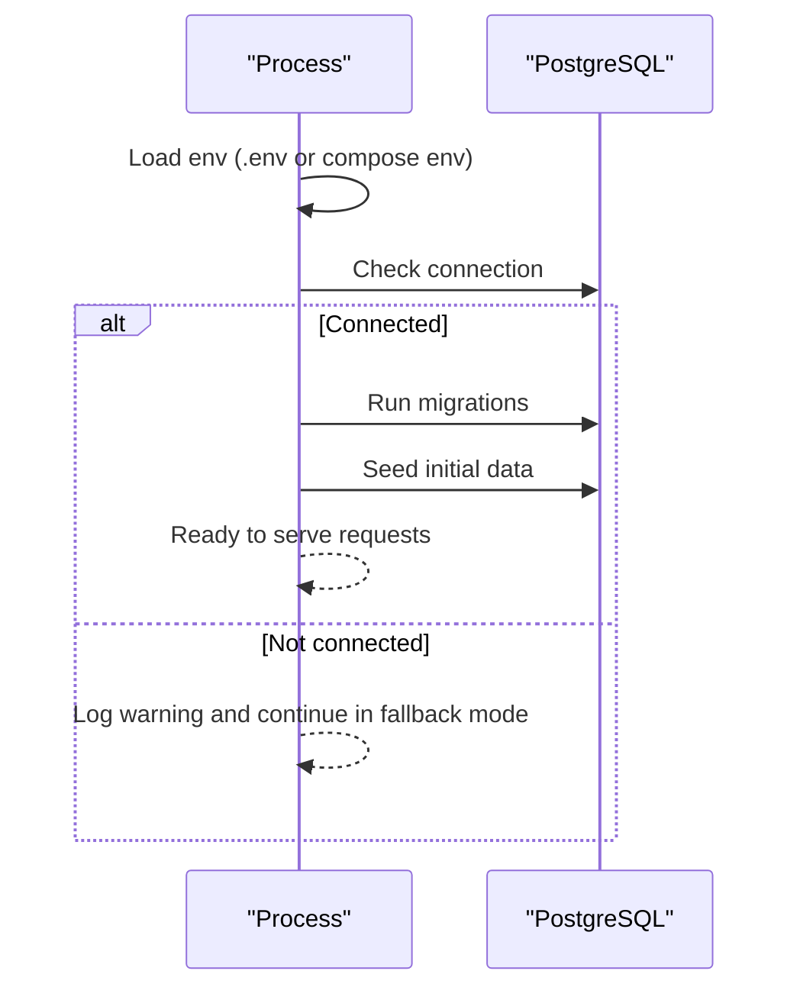
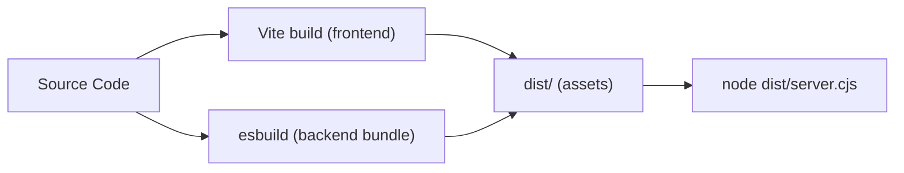
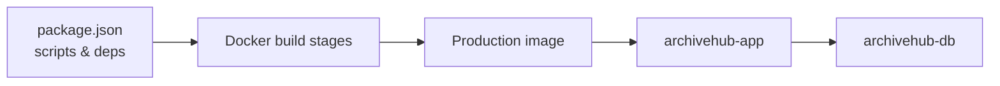

# Docker Containerization

<cite>
**Referenced Files in This Document**
- [Dockerfile](file://Dockerfile)
- [docker-compose.yml](file://docker-compose.yml)
- [.dockerignore](file://.dockerignore)
- [server.ts](file://server.ts)
- [package.json](file://package.json)
- [src/db/index.ts](file://src/db/index.ts)
- [vite.config.ts](file://vite.config.ts)
</cite>

## Table of Contents
1. [Introduction](#introduction)
2. [Project Structure](#project-structure)
3. [Core Components](#core-components)
4. [Architecture Overview](#architecture-overview)
5. [Detailed Component Analysis](#detailed-component-analysis)
6. [Dependency Analysis](#dependency-analysis)
7. [Performance Considerations](#performance-considerations)
8. [Troubleshooting Guide](#troubleshooting-guide)
9. [Conclusion](#conclusion)

## Introduction
This document explains how the ArchiveHub application is containerized and run with Docker. It covers the multi-stage build, production runtime image, environment configuration, database integration, and service orchestration via docker-compose. The goal is to help you understand how the app is built, packaged, and deployed as a single application service plus a PostgreSQL database service.

## Project Structure
The containerization setup centers around three key files:
- Dockerfile: Defines a multi-stage build for dependencies, build artifacts, and a minimal production runtime.
- docker-compose.yml: Orchestrates the application and PostgreSQL services, including health checks and environment variables.
- .dockerignore: Excludes unnecessary files from the Docker build context to keep images small and builds fast.

**Diagram sources**
- [Dockerfile:3-31](file://Dockerfile#L3-L31)

**Section sources**
- [Dockerfile:1-32](file://Dockerfile#L1-L32)
- [docker-compose.yml:1-41](file://docker-compose.yml#L1-L41)
- [.dockerignore:1-13](file://.dockerignore#L1-L13)

## Core Components
- Multi-stage Dockerfile: Separates dependency installation, build, and runtime to minimize image size and improve security.
- Production server entrypoint: The compiled server runs at dist/server.cjs and listens on port 3031.
- Environment-driven configuration: DATABASE_URL, PGSSL, SESSION_SECRET, GEMINI_API_KEY are injected via docker-compose.
- Database service: PostgreSQL 16 Alpine with persistent volume and health check.

Key behaviors:
- On startup, the server checks database connectivity and auto-runs migrations and seed data when available.
- In production, static assets are served from the dist folder; in development, Vite middleware serves the SPA.

**Section sources**
- [Dockerfile:14-31](file://Dockerfile#L14-L31)
- [server.ts:14-52](file://server.ts#L14-L52)
- [server.ts:700-717](file://server.ts#L700-L717)
- [docker-compose.yml:9-21](file://docker-compose.yml#L9-L21)
- [docker-compose.yml:23-37](file://docker-compose.yml#L23-L37)

## Architecture Overview
The system consists of two services:
- archivehub-app: Node.js Express server serving API endpoints and the React SPA.
- archivehub-db: PostgreSQL database with persistent storage.

**Diagram sources**
- [docker-compose.yml:1-41](file://docker-compose.yml#L1-L41)
- [server.ts:715-717](file://server.ts#L715-L717)

## Detailed Component Analysis

### Dockerfile: Multi-stage Build and Runtime
- Stage 1 (deps): Installs all dependencies using npm ci for reproducible installs.
- Stage 2 (build): Copies source and runs the build script to produce dist/server.cjs and frontend assets.
- Stage 3 (prod-deps): Reinstalls only production dependencies to keep the runtime image lean.
- Stage 4 (runtime): Uses a minimal Node image, sets NODE_ENV=production, copies node_modules and dist, exposes port 3031, and runs the compiled server.

**Diagram sources**
- [Dockerfile:3-31](file://Dockerfile#L3-L31)

**Section sources**
- [Dockerfile:3-31](file://Dockerfile#L3-L31)
- [package.json:6-12](file://package.json#L6-L12)

### docker-compose.yml: Service Orchestration
- app service:
  - Builds from the project directory using the provided Dockerfile.
  - Maps host port 3031 to container port 3031.
  - Injects environment variables for database connection, SSL mode, session secret, and optional AI key.
  - Depends on db service being healthy before starting.
- db service:
  - Uses postgres:16-alpine image.
  - Configures user, password, and database name.
  - Persists data via a named volume.
  - Healthcheck uses pg_isready to ensure readiness.

**Diagram sources**
- [docker-compose.yml:1-41](file://docker-compose.yml#L1-L41)
- [server.ts:33-52](file://server.ts#L33-L52)

**Section sources**
- [docker-compose.yml:1-41](file://docker-compose.yml#L1-L41)

### Server Startup and Database Integration
- Loads environment variables via dotenv.
- Checks database health on startup; if connected, runs migrations and seeds automatically.
- Falls back gracefully if the database is not reachable during startup.
- Serves API routes and static assets in production.

**Diagram sources**
- [server.ts:14-52](file://server.ts#L14-L52)
- [src/db/index.ts:107-145](file://src/db/index.ts#L107-L145)

**Section sources**
- [server.ts:14-52](file://server.ts#L14-L52)
- [src/db/index.ts:16-79](file://src/db/index.ts#L16-L79)
- [src/db/index.ts:107-145](file://src/db/index.ts#L107-L145)

### Build Scripts and Output
- Build pipeline:
  - Frontend build via Vite.
  - Backend bundling via esbuild into dist/server.cjs with externalized packages.
- Runtime execution:
  - Starts with node dist/server.cjs.
  - Listens on 0.0.0.0:3031 in production.

**Diagram sources**
- [package.json:6-12](file://package.json#L6-L12)
- [server.ts:715-717](file://server.ts#L715-L717)

**Section sources**
- [package.json:6-12](file://package.json#L6-L12)
- [server.ts:700-717](file://server.ts#L700-L717)

### Environment Configuration
- DATABASE_URL: Points to the PostgreSQL service inside the compose network.
- PGSSL: Set to disable for plain PostgreSQL containers without TLS.
- SESSION_SECRET: Randomized per deployment via environment variable substitution.
- GEMINI_API_KEY: Optional integration key passed through environment.

These values are consumed by the application at runtime and influence database connectivity and behavior.

**Section sources**
- [docker-compose.yml:9-18](file://docker-compose.yml#L9-L18)
- [src/db/index.ts:45-57](file://src/db/index.ts#L45-L57)

## Dependency Analysis
The containerized system has clear separation between services and relies on environment-driven configuration:
- archivehub-app depends on archivehub-db for persistence.
- The app’s runtime depends on the presence of dist/server.cjs and production node_modules.
- The build stage depends on the full dependency tree to compile assets and bundle the server.

**Diagram sources**
- [package.json:6-12](file://package.json#L6-L12)
- [docker-compose.yml:1-41](file://docker-compose.yml#L1-L41)

**Section sources**
- [package.json:14-47](file://package.json#L14-L47)
- [docker-compose.yml:1-41](file://docker-compose.yml#L1-L41)

## Performance Considerations
- Multi-stage builds reduce final image size by excluding dev dependencies and source code from the runtime image.
- Using npm ci ensures deterministic and faster installs compared to npm install.
- Externalizing packages in the backend bundle keeps the runtime image smaller while still requiring node_modules at runtime.
- PostgreSQL healthchecks prevent the app from starting before the database is ready, reducing startup errors.

[No sources needed since this section provides general guidance]

## Troubleshooting Guide
Common issues and resolutions:
- Cannot connect to database:
  - Ensure DATABASE_URL is set correctly in docker-compose and points to the db service hostname.
  - Confirm PGSSL is set appropriately; for plain PostgreSQL, disable SSL as configured.
  - Verify that the db service is healthy before the app starts.
- Migrations or seed failures:
  - Check logs for migration errors; ensure the database schema matches expectations.
  - Use the /api/seed endpoint to re-run seeding if needed.
- Port conflicts:
  - If port 3031 is already in use on the host, change the mapping in docker-compose.
- Large imports fail:
  - The import endpoint accepts larger payloads; ensure your client respects the configured limit.

Operational tips:
- Inspect container logs for startup messages indicating database connectivity and migration status.
- Validate environment variables by inspecting the running container’s environment.

**Section sources**
- [server.ts:33-52](file://server.ts#L33-L52)
- [server.ts:57-86](file://server.ts#L57-L86)
- [src/db/index.ts:107-145](file://src/db/index.ts#L107-L145)
- [docker-compose.yml:18-21](file://docker-compose.yml#L18-L21)

## Conclusion
ArchiveHub is containerized using a clean multi-stage Dockerfile that separates build-time and runtime concerns, ensuring a small and secure production image. docker-compose orchestrates the application and PostgreSQL services with health checks and environment-driven configuration. The server initializes the database on startup, runs migrations and seed data when possible, and serves both API and static assets. This setup provides a reliable, repeatable deployment model suitable for local development and production environments.