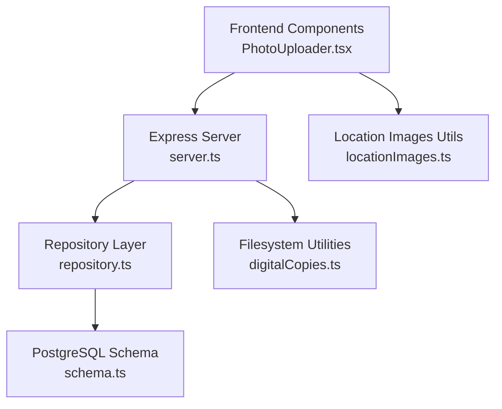
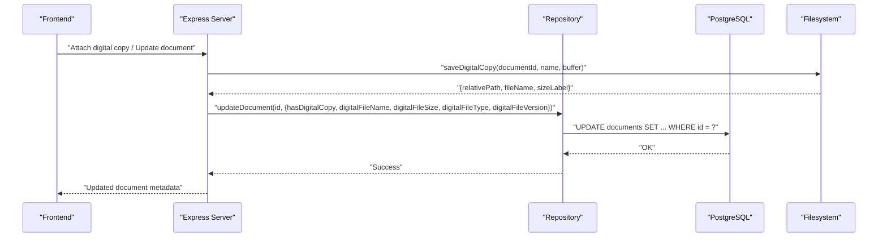
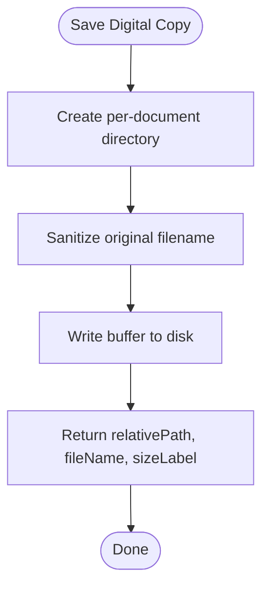
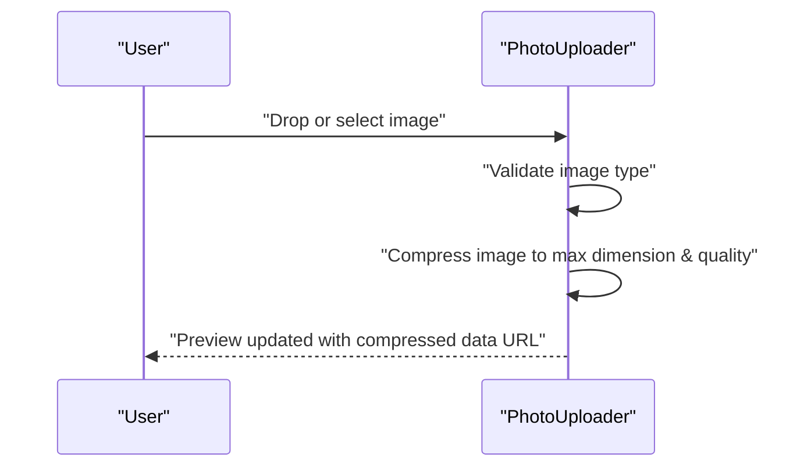
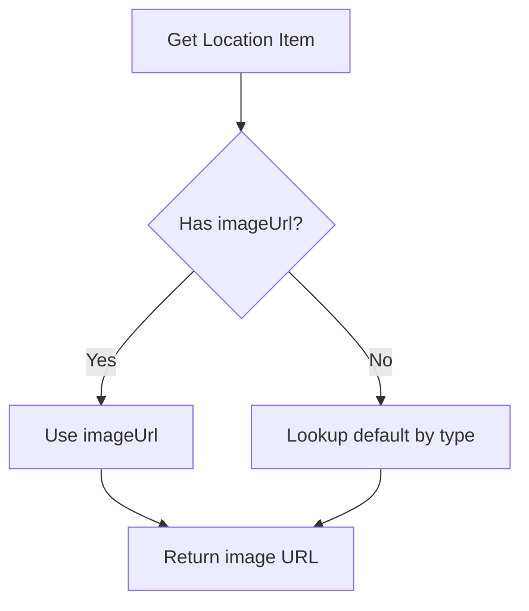
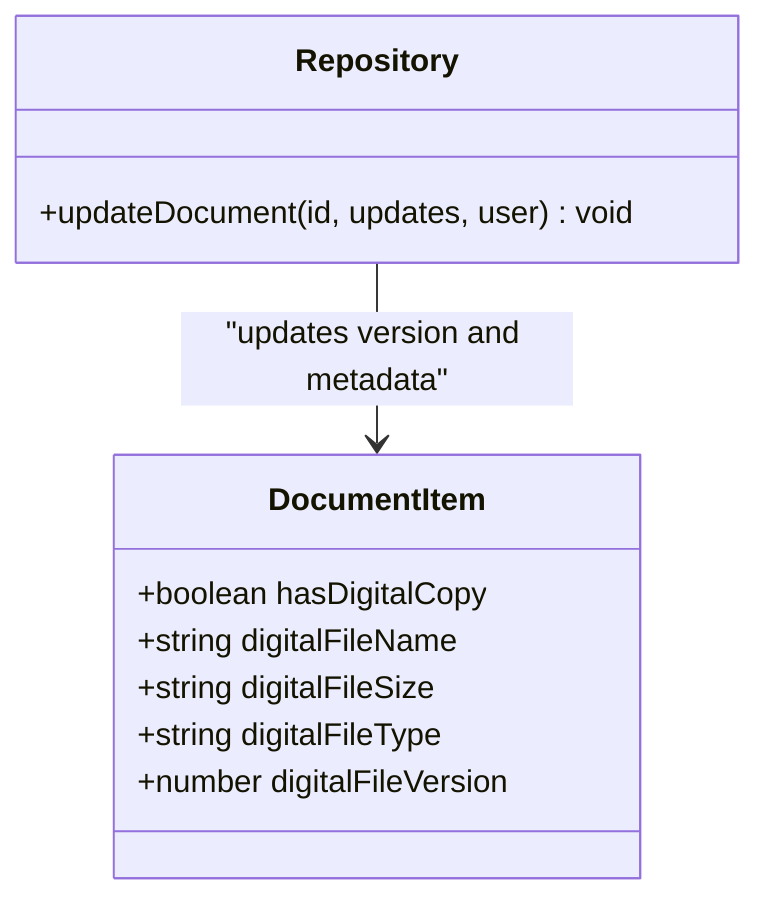
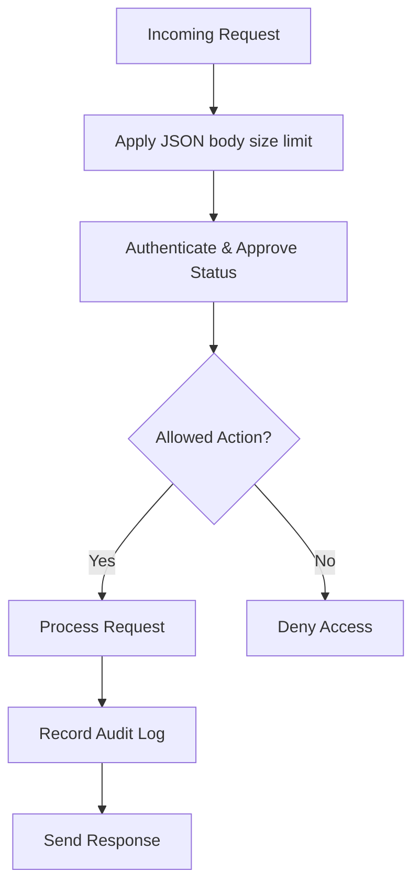
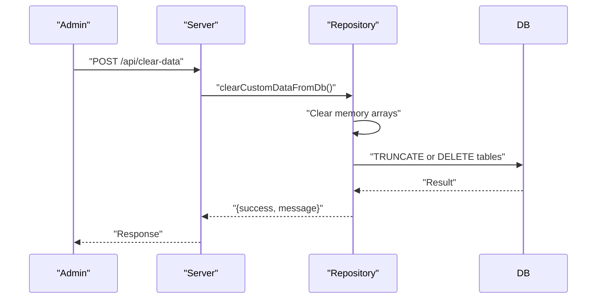
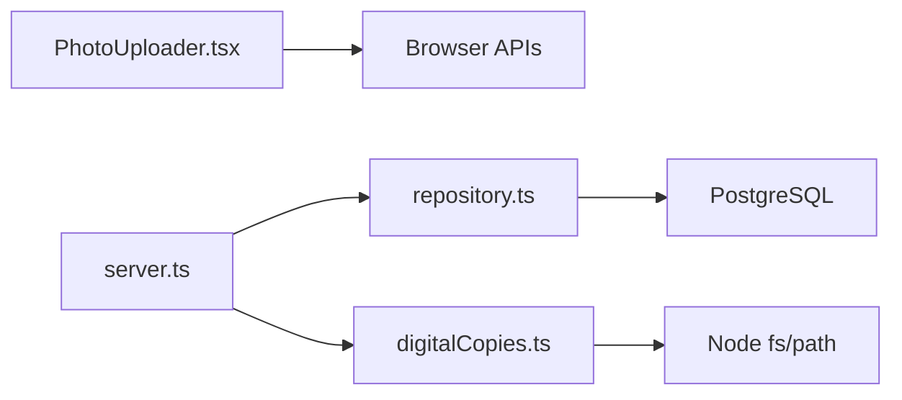

# File Management

<cite>
**Referenced Files in This Document**
- [digitalCopies.ts](file://src/files/digitalCopies.ts)
- [PhotoUploader.tsx](file://src/components/common/PhotoUploader.tsx)
- [locationImages.ts](file://src/utils/locationImages.ts)
- [schema.ts](file://src/db/schema.ts)
- [repository.ts](file://src/db/repository.ts)
- [server.ts](file://server.ts)
- [types.ts](file://src/types.ts)
</cite>

## Table of Contents
1. [Introduction](#introduction)
2. [Project Structure](#project-structure)
3. [Core Components](#core-components)
4. [Architecture Overview](#architecture-overview)
5. [Detailed Component Analysis](#detailed-component-analysis)
6. [Dependency Analysis](#dependency-analysis)
7. [Performance Considerations](#performance-considerations)
8. [Troubleshooting Guide](#troubleshooting-guide)
9. [Conclusion](#conclusion)
10. [Appendices](#appendices)

## Introduction
This document explains ArchiveHub’s file management system with a focus on attaching digital copies to physical documents, the photo uploader component for location images, and how files are stored, versioned, accessed, and secured. It also covers integration with physical location imagery, cleanup procedures, backup strategies, disaster recovery considerations, performance guidance for large uploads, and extension points for additional formats or storage backends.

## Project Structure
ArchiveHub organizes file-related logic across a small set of focused modules:
- Digital copy persistence and resolution utilities live under src/files.
- The PhotoUploader React component handles image capture, preview, and URL-based attachment for locations.
- Location image defaults and selection logic reside in src/utils.
- Database schema defines fields for digital attachments and versions.
- Repository functions persist metadata updates (including digital copy flags and version).
- The Express server configures request size limits and exposes endpoints that interact with repository operations.

**Diagram sources**
- [PhotoUploader.tsx:1-286](file://src/components/common/PhotoUploader.tsx#L1-L286)
- [server.ts:1-600](file://server.ts#L1-L600)
- [repository.ts:470-715](file://src/db/repository.ts#L470-L715)
- [schema.ts:67-116](file://src/db/schema.ts#L67-L116)
- [digitalCopies.ts:1-47](file://src/files/digitalCopies.ts#L1-L47)
- [locationImages.ts:1-25](file://src/utils/locationImages.ts#L1-L25)

**Section sources**
- [server.ts:1-600](file://server.ts#L1-L600)
- [schema.ts:67-116](file://src/db/schema.ts#L67-L116)
- [digitalCopies.ts:1-47](file://src/files/digitalCopies.ts#L1-L47)
- [PhotoUploader.tsx:1-286](file://src/components/common/PhotoUploader.tsx#L1-L286)
- [locationImages.ts:1-25](file://src/utils/locationImages.ts#L1-L25)

## Core Components
- Digital copy attachment:
  - Stores uploaded buffers to a per-document directory under an uploads root.
  - Sanitizes filenames and returns relative paths and human-readable sizes.
  - Resolves safe absolute paths for serving or downloading.
  - Decodes base64 payloads commonly used by front-end uploads.
- Photo uploader:
  - Supports drag-and-drop and click-to-select for local images.
  - Compresses images client-side to reduce payload size while preserving quality.
  - Provides preview and supports switching between local upload and external URL modes.
  - Integrates presets for quick sample images.
- Location image mapping:
  - Maps location types to default images and allows overriding via imageUrl.
  - Centralizes visual representation for hierarchical locations.

**Section sources**
- [digitalCopies.ts:1-47](file://src/files/digitalCopies.ts#L1-L47)
- [PhotoUploader.tsx:1-286](file://src/components/common/PhotoUploader.tsx#L1-L286)
- [locationImages.ts:1-25](file://src/utils/locationImages.ts#L1-L25)

## Architecture Overview
The file management flow integrates frontend components, backend services, and persistent storage:
- Frontend uses PhotoUploader to attach images to locations and may attach PDFs/scans as digital copies to documents.
- Backend enforces request size limits and routes requests to repository methods that update document metadata (including digital copy fields).
- Digital copies are persisted to disk using secure path handling; metadata is stored in PostgreSQL.
- Location images can be embedded data URLs or remote URLs, resolved through utility functions.

**Diagram sources**
- [server.ts:318-326](file://server.ts#L318-L326)
- [repository.ts:635-715](file://src/db/repository.ts#L635-L715)
- [digitalCopies.ts:16-31](file://src/files/digitalCopies.ts#L16-L31)
- [schema.ts:67-116](file://src/db/schema.ts#L67-L116)

## Detailed Component Analysis

### Digital Copy Attachment
- Storage layout:
  - Files are saved under a per-document directory within an uploads root.
  - Filenames are sanitized to remove unsafe characters and truncated to a safe length.
- Path safety:
  - Resolution validates that the requested path remains within the uploads root before returning an absolute path.
- Metadata tracking:
  - Document records store flags and details about digital copies, including filename, size label, type, and version.
- Base64 support:
  - Utility decodes base64 strings into buffers, stripping data URIs if present.

**Diagram sources**
- [digitalCopies.ts:16-31](file://src/files/digitalCopies.ts#L16-L31)

**Section sources**
- [digitalCopies.ts:1-47](file://src/files/digitalCopies.ts#L1-L47)
- [schema.ts:67-116](file://src/db/schema.ts#L67-L116)
- [repository.ts:635-715](file://src/db/repository.ts#L635-L715)

### Photo Uploader Component
- Drag-and-drop and click-to-select:
  - Accepts image files and provides visual feedback during processing.
- Client-side compression:
  - Resizes images to a maximum dimension and encodes to JPEG at a configurable quality to reduce memory usage and payload size.
- Preview and modes:
  - Displays a thumbnail preview and indicates whether the value is a local upload (data URL) or a web URL.
  - Allows toggling between local device upload and URL input modes.
- Presets:
  - Optional preset buttons allow quick insertion of sample images.

**Diagram sources**
- [PhotoUploader.tsx:20-89](file://src/components/common/PhotoUploader.tsx#L20-L89)
- [PhotoUploader.tsx:98-114](file://src/components/common/PhotoUploader.tsx#L98-L114)
- [PhotoUploader.tsx:154-198](file://src/components/common/PhotoUploader.tsx#L154-L198)

**Section sources**
- [PhotoUploader.tsx:1-286](file://src/components/common/PhotoUploader.tsx#L1-L286)

### Location Image Integration
- Default images:
  - Each location type has a default image, either from a CDN or bundled assets.
- Override behavior:
  - If a location has an explicit imageUrl, it takes precedence over the default.
- Visual mapping:
  - Consumers can resolve the appropriate image for any location item.

**Diagram sources**
- [locationImages.ts:6-24](file://src/utils/locationImages.ts#L6-L24)

**Section sources**
- [locationImages.ts:1-25](file://src/utils/locationImages.ts#L1-L25)

### Versioning Mechanisms
- Version field:
  - Documents include a digital file version counter that increments when replacing a digital copy.
- Metadata updates:
  - Updating a document can modify the version along with other digital copy attributes.
- Audit trail:
  - Updates are logged via audit logs to track changes made by users.

**Diagram sources**
- [types.ts:135-183](file://src/types.ts#L135-L183)
- [repository.ts:635-715](file://src/db/repository.ts#L635-L715)

**Section sources**
- [types.ts:135-183](file://src/types.ts#L135-L183)
- [repository.ts:635-715](file://src/db/repository.ts#L635-L715)

### Access Controls and Security Measures
- Request size limits:
  - The server sets a JSON body limit to constrain incoming payloads.
- Path traversal protection:
  - Digital copy resolution ensures requested paths remain within the configured uploads root.
- Authentication and authorization:
  - Login checks enforce approval status and password validation before granting access.
- Audit logging:
  - Critical actions are recorded with user context and timestamps.

**Diagram sources**
- [server.ts:17-17](file://server.ts#L17-L17)
- [server.ts:104-150](file://server.ts#L104-L150)
- [digitalCopies.ts:33-41](file://src/files/digitalCopies.ts#L33-L41)
- [repository.ts:1196-1217](file://src/db/repository.ts#L1196-L1217)

**Section sources**
- [server.ts:17-17](file://server.ts#L17-L17)
- [server.ts:104-150](file://server.ts#L104-L150)
- [digitalCopies.ts:33-41](file://src/files/digitalCopies.ts#L33-L41)
- [repository.ts:1196-1217](file://src/db/repository.ts#L1196-L1217)

### Cleanup Procedures
- Operational data clearing:
  - A dedicated endpoint clears operational tables (documents, locations, checkouts, movements, etc.) via cascade or fallback delete queries.
- In-memory state reset:
  - Memory fallback arrays are cleared when database is unavailable.

**Diagram sources**
- [server.ts:74-82](file://server.ts#L74-L82)
- [repository.ts:1219-1257](file://src/db/repository.ts#L1219-L1257)

**Section sources**
- [server.ts:74-82](file://server.ts#L74-L82)
- [repository.ts:1219-1257](file://src/db/repository.ts#L1219-L1257)

### Backup Strategies and Disaster Recovery
- Database backups:
  - Regularly back up PostgreSQL to ensure recoverability of document metadata, movement history, and audit logs.
- Filesystem backups:
  - Back up the uploads directory containing digital copies to preserve attached scans and images.
- Recovery plan:
  - Restore database first, then restore filesystem to align with metadata. Validate integrity by resolving digital copies and verifying counts.

[No sources needed since this section provides general guidance]

### Performance Considerations for Large Uploads
- Client-side compression:
  - PhotoUploader resizes images to a maximum dimension and compresses to JPEG to reduce memory and network overhead.
- Server payload limits:
  - JSON body size is limited to prevent oversized requests.
- Storage efficiency:
  - Store only necessary metadata in the database; keep binary content on disk.
- Caching and delivery:
  - Serve static assets efficiently and consider caching headers for location images.

**Section sources**
- [PhotoUploader.tsx:20-89](file://src/components/common/PhotoUploader.tsx#L20-L89)
- [server.ts:17-17](file://server.ts#L17-L17)

### Extending the File System
- Additional formats:
  - Extend saveDigitalCopy to validate MIME types and handle format-specific transformations (e.g., PDF optimization).
  - Update metadata fields to include format-specific attributes (e.g., page count for PDFs).
- Alternative storage backends:
  - Abstract the filesystem interface behind a storage adapter to support cloud object stores.
  - Implement adapters for upload, download, and deletion while preserving path safety and metadata updates.
- Batch uploads:
  - Introduce batch endpoints to process multiple files atomically with transactional metadata updates.

[No sources needed since this section provides general guidance]

## Dependency Analysis
Key dependencies and relationships:
- PhotoUploader depends on browser APIs for image reading and canvas manipulation.
- Digital copies depend on Node fs/path for safe file operations.
- Repository interacts with PostgreSQL for all metadata and audit logs.
- Server orchestrates routing, limits, and startup tasks like migrations and seeding.

**Diagram sources**
- [PhotoUploader.tsx:1-286](file://src/components/common/PhotoUploader.tsx#L1-L286)
- [digitalCopies.ts:1-47](file://src/files/digitalCopies.ts#L1-L47)
- [repository.ts:470-715](file://src/db/repository.ts#L470-L715)
- [server.ts:1-600](file://server.ts#L1-L600)

**Section sources**
- [PhotoUploader.tsx:1-286](file://src/components/common/PhotoUploader.tsx#L1-L286)
- [digitalCopies.ts:1-47](file://src/files/digitalCopies.ts#L1-L47)
- [repository.ts:470-715](file://src/db/repository.ts#L470-L715)
- [server.ts:1-600](file://server.ts#L1-L600)

## Performance Considerations
- Prefer client-side image resizing to minimize bandwidth and memory usage.
- Enforce strict request size limits to protect server resources.
- Keep binary content off the database to avoid bloating backups and queries.
- Use efficient path resolution to prevent unnecessary I/O and security risks.
- Cache frequently accessed location images where appropriate.

[No sources needed since this section provides general guidance]

## Troubleshooting Guide
- Upload failures:
  - Verify image type validation and compression steps in the uploader.
  - Check server JSON body limit configuration.
- Path resolution errors:
  - Ensure relative paths are correctly constructed and within the uploads root.
- Metadata mismatches:
  - Confirm that repository updates include all relevant digital copy fields and version increments.
- Data clearing issues:
  - Review cascade vs fallback delete behavior and ensure transactions are properly committed or rolled back.

**Section sources**
- [PhotoUploader.tsx:73-89](file://src/components/common/PhotoUploader.tsx#L73-L89)
- [server.ts:17-17](file://server.ts#L17-L17)
- [digitalCopies.ts:33-41](file://src/files/digitalCopies.ts#L33-L41)
- [repository.ts:1219-1257](file://src/db/repository.ts#L1219-L1257)

## Conclusion
ArchiveHub’s file management system combines a robust frontend uploader with secure, efficient backend storage and comprehensive metadata tracking. Digital copies are safely persisted and linked to documents, while location images integrate seamlessly into the visual hierarchy. Versioning and audit logs provide traceability, and cleanup utilities support operational maintenance. With clear extension points, the system can evolve to support new formats and storage backends while maintaining performance and security.

## Appendices
- Supported image formats for PhotoUploader: PNG, JPG, WEBP, GIF (client-side validation).
- Digital copy formats: Any binary content supported by buffer write; recommend PDFs and scanned images.
- Size limitations: Controlled by server JSON body limit; adjust as needed for large payloads.

[No sources needed since this section provides general guidance]