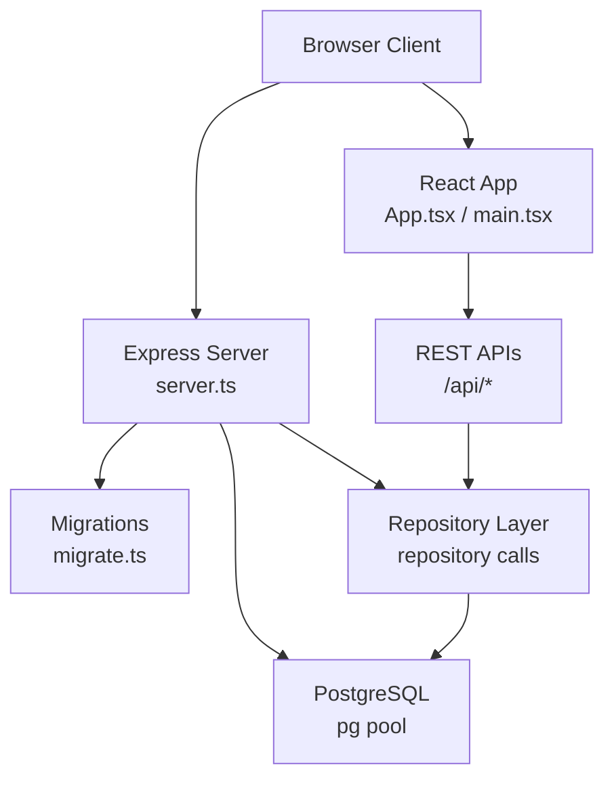
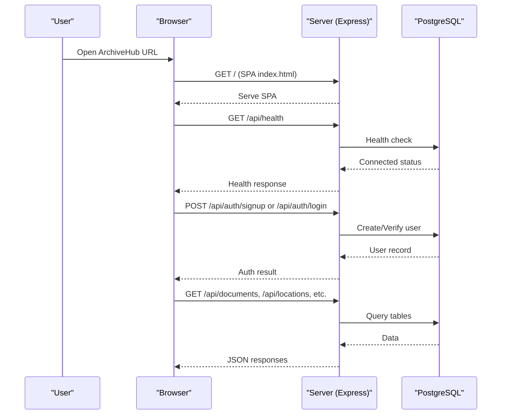
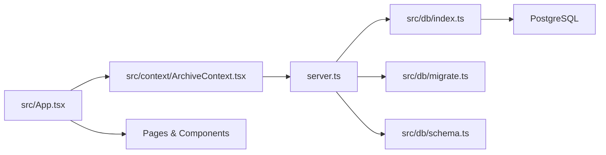

# Getting Started

<cite>
**Referenced Files in This Document**
- [package.json](file://package.json)
- [server.ts](file://server.ts)
- [src/db/index.ts](file://src/db/index.ts)
- [src/db/migrate.ts](file://src/db/migrate.ts)
- [src/db/schema.ts](file://src/db/schema.ts)
- [src/App.tsx](file://src/App.tsx)
- [src/main.tsx](file://src/main.tsx)
- [src/context/ArchiveContext.tsx](file://src/context/ArchiveContext.tsx)
- [src/pages/DashboardPage.tsx](file://src/pages/DashboardPage.tsx)
- [src/components/auth/AuthPage.tsx](file://src/components/auth/AuthPage.tsx)
- [vite.config.ts](file://vite.config.ts)
- [metadata.json](file://metadata.json)
</cite>

## Table of Contents
1. Introduction
2. Project Structure
3. Core Components
4. Architecture Overview
5. Detailed Component Analysis
6. Dependency Analysis
7. Performance Considerations
8. Troubleshooting Guide
9. Conclusion
10. Appendices

## Introduction
ArchiveHub is a Physical & Digital Archive Management System (PDAMS) designed for organizations that require strict document control, hierarchical location tracking, circulation workflows, and regulatory retention policies. It provides an integrated dashboard to manage documents, locations, checkouts, movements, audit logs, and retention policies with QR/barcode scanning support.

Key capabilities include:
- Centralized management of physical and digital records
- Hierarchical storage units (locations) such as buildings, rooms, cabinets, boxes, and folders
- Controlled circulation via checkouts with approval and dispatch flows
- Retention policy enforcement tied to document types
- Full audit trail of movements and administrative actions
- QR/barcode scanning for quick lookup and navigation

This guide walks you through installation, environment setup, database initialization, server startup, first-time user registration, and basic navigation.

## Project Structure
The application is a Node.js + Express backend serving a React frontend built with Vite. The server initializes the PostgreSQL connection, runs migrations, seeds data, and exposes REST APIs. The React app renders pages for Dashboard, Documents, Locations, Checkouts, Retention, Audit Logs, and Settings.

**Diagram sources**
- [server.ts:13-596](file://server.ts#L13-L596)
- [src/db/index.ts:36-69](file://src/db/index.ts#L36-L69)
- [src/db/migrate.ts:3-278](file://src/db/migrate.ts#L3-L278)
- [src/App.tsx:19-173](file://src/App.tsx#L19-L173)
- [src/main.tsx:1-11](file://src/main.tsx#L1-L11)

**Section sources**
- [package.json:1-49](file://package.json#L1-L49)
- [server.ts:13-596](file://server.ts#L13-L596)
- [src/App.tsx:19-173](file://src/App.tsx#L19-L173)
- [src/main.tsx:1-11](file://src/main.tsx#L1-L11)

## Core Components
- Backend server: Express app with health, seed, and CRUD endpoints for departments, users, document types, locations, documents, checkouts, movements, retention policies, reusable custom fields, bundles, and audit logs.
- Database layer: PostgreSQL connection pooling, schema definitions, and migration scripts.
- Frontend: React application with context-driven state, authentication, and page routing for core workflows.

Key responsibilities:
- Server bootstraps DB health checks, auto-runs migrations, seeds initial data, and serves APIs.
- Migration ensures all required tables exist and are up-to-date.
- Context manages session persistence, data synchronization, and operations like document/location/checkouts lifecycle.

**Section sources**
- [server.ts:13-596](file://server.ts#L13-L596)
- [src/db/schema.ts:12-228](file://src/db/schema.ts#L12-L228)
- [src/db/migrate.ts:3-278](file://src/db/migrate.ts#L3-L278)
- [src/context/ArchiveContext.tsx:115-800](file://src/context/ArchiveContext.tsx#L115-L800)

## Architecture Overview
The system follows a client-server architecture:
- Browser loads the React SPA served by Vite in development or static files in production.
- The Express server handles API requests, orchestrates database operations, and enforces business logic.
- PostgreSQL stores entities including documents, locations, checkouts, movements, retention policies, and audit logs.

**Diagram sources**
- [server.ts:43-72](file://server.ts#L43-L72)
- [server.ts:104-189](file://server.ts#L104-L189)
- [src/db/index.ts:97-135](file://src/db/index.ts#L97-L135)
- [src/context/ArchiveContext.tsx:198-255](file://src/context/ArchiveContext.tsx#L198-L255)

## Detailed Component Analysis

### Installation Requirements
- Node.js runtime (used by npm scripts and tsx/esbuild tooling)
- PostgreSQL server accessible from the machine running the server
- Environment configuration file (.env) containing DATABASE_URL

Steps:
1. Install dependencies using the project’s package manager.
2. Ensure PostgreSQL is installed and running.
3. Create a .env file at the project root with your PostgreSQL connection string.

Environment variables:
- DATABASE_URL: Required for PostgreSQL connectivity. The server reads this from process.env or a local .env file.

Notes:
- If DATABASE_URL is missing or contains placeholder values, the server will run in fallback mode without persistent storage.

**Section sources**
- [package.json:6-12](file://package.json#L6-L12)
- [src/db/index.ts:16-34](file://src/db/index.ts#L16-L34)
- [server.ts:13-38](file://server.ts#L13-L38)

### Database Initialization
On server startup:
- The server checks PostgreSQL health.
- If connected, it runs migrations and seeds initial data automatically.
- A dedicated endpoint allows manual seeding if needed.

What happens:
- Migrations create or update tables for departments, users, document types, locations, documents, checkouts, movements, retention policies, disposal records, reusable custom fields, bundles, and audit logs.
- Seed data populates default entries to enable immediate use.

Manual seeding:
- Use the provided seed endpoint to reinitialize data when necessary.

**Section sources**
- [server.ts:19-38](file://server.ts#L19-L38)
- [server.ts:53-72](file://server.ts#L53-L72)
- [src/db/migrate.ts:3-278](file://src/db/migrate.ts#L3-L278)

### Server Startup
To start the development server:
- Run the dev script which uses tsx to execute the server entry point.
- The server listens on port 3031 and serves both API routes and the SPA.

Production build:
- Build the frontend and bundle the server into a distributable format.
- Start the compiled server binary.

Development vs Production:
- In development, Vite middleware serves the SPA with hot module replacement.
- In production, static assets are served from the dist directory.

**Section sources**
- [package.json:6-12](file://package.json#L6-L12)
- [server.ts:579-596](file://server.ts#L579-L596)
- [vite.config.ts:14-20](file://vite.config.ts#L14-L20)

### First-Time User Registration
After starting the server and ensuring the database is initialized:
1. Open the application in your browser.
2. Navigate to the sign-in screen.
3. Choose “Create Account” and fill in full name, email, optional password, department, title, and role.
4. Submit the registration form. New accounts are created with pending approval status.
5. An administrator must approve the account before the user can sign in.

Sign-in behavior:
- If the account is pending approval, the login attempt returns a message indicating approval is required.
- Once approved, the user can sign in with their credentials.

**Section sources**
- [src/components/auth/AuthPage.tsx:74-120](file://src/components/auth/AuthPage.tsx#L74-L120)
- [src/components/auth/AuthPage.tsx:216-458](file://src/components/auth/AuthPage.tsx#L216-L458)
- [server.ts:152-189](file://server.ts#L152-L189)
- [server.ts:104-150](file://server.ts#L104-L150)

### Basic Navigation Guide

#### Dashboard Overview
- The dashboard displays key metrics: total registered records, available items, checked-out items, overdue checkouts, and storage hierarchy nodes.
- Quick actions allow registering a new document, adding a storage unit (location), and scanning QR/barcodes.
- Recent movements show the latest physical transfers, check-outs, and returns.
- Department breakdown shows distribution of documents across departments.

**Section sources**
- [src/pages/DashboardPage.tsx:30-326](file://src/pages/DashboardPage.tsx#L30-L326)

#### Document Creation Workflow
- From the dashboard or Documents page, register a new document by providing required metadata such as document number, title, type, department, custodian, home location, dates, and optional digital copy details.
- On successful creation, the document receives unique identifiers including QR code and barcode.
- You can move documents between locations and track movements in the audit log.

**Section sources**
- [src/context/ArchiveContext.tsx:752-777](file://src/context/ArchiveContext.tsx#L752-L777)
- [server.ts:298-316](file://server.ts#L298-L316)

#### Location Management Basics
- Create hierarchical locations (e.g., building, floor, room, cabinet, box, folder).
- Each location has a code, capacity, occupancy, and QR/barcode identifiers.
- Deleting a location is prevented if it contains sub-locations or documents.

**Section sources**
- [src/context/ArchiveContext.tsx:693-749](file://src/context/ArchiveContext.tsx#L693-L749)
- [server.ts:252-296](file://server.ts#L252-L296)

#### Scanner Usage
- Use the scanner modal to scan QR codes or barcodes for documents and locations.
- Scanning a document navigates to its detail view; scanning a location navigates to the locations page.

**Section sources**
- [src/App.tsx:145-160](file://src/App.tsx#L145-L160)

### Retention Policies
- Retention policies are defined per document type and specify retention years and disposal methods.
- The dashboard highlights the retention engine and links to the retention page for managing policies.

**Section sources**
- [src/pages/DashboardPage.tsx:300-317](file://src/pages/DashboardPage.tsx#L300-L317)
- [server.ts:453-461](file://server.ts#L453-L461)

### Checkouts and Movements
- Request a checkout with purpose and due date; approvals and rejections are supported.
- Dispatch and return processes update document status and current location.
- All movements are recorded with timestamps, reasons, and user attribution.

**Section sources**
- [server.ts:363-441](file://server.ts#L363-L441)

## Dependency Analysis
High-level dependencies:
- Express server depends on PostgreSQL via pg pool and Drizzle ORM.
- Frontend depends on React and communicates with backend APIs.
- Vite config enables React and Tailwind CSS plugins and controls HMR behavior.

**Diagram sources**
- [server.ts:13-596](file://server.ts#L13-L596)
- [src/db/index.ts:36-69](file://src/db/index.ts#L36-L69)
- [src/db/migrate.ts:3-278](file://src/db/migrate.ts#L3-L278)
- [src/db/schema.ts:12-228](file://src/db/schema.ts#L12-L228)
- [src/App.tsx:19-173](file://src/App.tsx#L19-L173)
- [src/context/ArchiveContext.tsx:198-255](file://src/context/ArchiveContext.tsx#L198-L255)

**Section sources**
- [package.json:14-33](file://package.json#L14-L33)
- [vite.config.ts:1-23](file://vite.config.ts#L1-L23)

## Performance Considerations
- Connection pooling: The PostgreSQL pool is configured with SSL handling for remote connections and a short connection timeout to avoid hanging connections.
- Health checks: The server performs a health check on startup and exposes an endpoint for monitoring.
- Large payloads: The server sets a request body size limit suitable for document uploads.
- Development HMR: Hot module replacement is controlled via environment variables to reduce CPU usage during edits.

Recommendations:
- Ensure adequate database resources and network latency for optimal performance.
- Monitor the health endpoint to detect connectivity issues early.
- Avoid excessive concurrent requests to minimize contention on the database pool.

[No sources needed since this section provides general guidance]

## Troubleshooting Guide

Common setup issues:
- Missing or invalid DATABASE_URL:
  - Symptom: Server warns about not being connected and runs in fallback memory mode.
  - Resolution: Create a .env file at the project root with a valid DATABASE_URL pointing to your PostgreSQL instance.

- PostgreSQL not reachable:
  - Symptom: Health check fails; migrations do not run.
  - Resolution: Verify PostgreSQL is running, credentials are correct, and firewall rules allow access.

- Pending approval after signup:
  - Symptom: Login attempts indicate the account is pending approval.
  - Resolution: An administrator must approve the user account before sign-in is allowed.

- Cannot delete location:
  - Symptom: Deletion fails because the location contains sub-locations or documents.
  - Resolution: Remove child locations or detach documents before deletion.

- Seeding errors:
  - Symptom: Manual seeding endpoint returns an error.
  - Resolution: Check database connectivity and permissions; ensure migrations have executed successfully.

Operational tips:
- Use the health endpoint to verify server and database status.
- Use the seed endpoint to reset or initialize data when needed.
- Review audit logs to trace actions and diagnose issues.

**Section sources**
- [server.ts:19-38](file://server.ts#L19-L38)
- [server.ts:53-72](file://server.ts#L53-L72)
- [server.ts:280-296](file://server.ts#L280-L296)
- [src/db/index.ts:97-135](file://src/db/index.ts#L97-L135)
- [src/context/ArchiveContext.tsx:257-293](file://src/context/ArchiveContext.tsx#L257-L293)

## Conclusion
ArchiveHub provides a robust foundation for managing physical and digital archives with strong controls over documents, locations, checkouts, and retention policies. By following the installation steps, configuring your environment, initializing the database, and understanding the core workflows, you can quickly set up and operate the system effectively. Use the dashboard for overview and quick actions, leverage scanning for efficient operations, and rely on audit logs and retention policies for compliance and governance.

[No sources needed since this section summarizes without analyzing specific files]

## Appendices

### Quick Start Checklist
- Install dependencies
- Configure DATABASE_URL in .env
- Start the server
- Initialize database (automatic on startup)
- Register a user and await admin approval
- Log in and explore the dashboard

**Section sources**
- [package.json:6-12](file://package.json#L6-L12)
- [src/db/index.ts:16-34](file://src/db/index.ts#L16-L34)
- [server.ts:13-38](file://server.ts#L13-L38)
- [src/components/auth/AuthPage.tsx:74-120](file://src/components/auth/AuthPage.tsx#L74-L120)