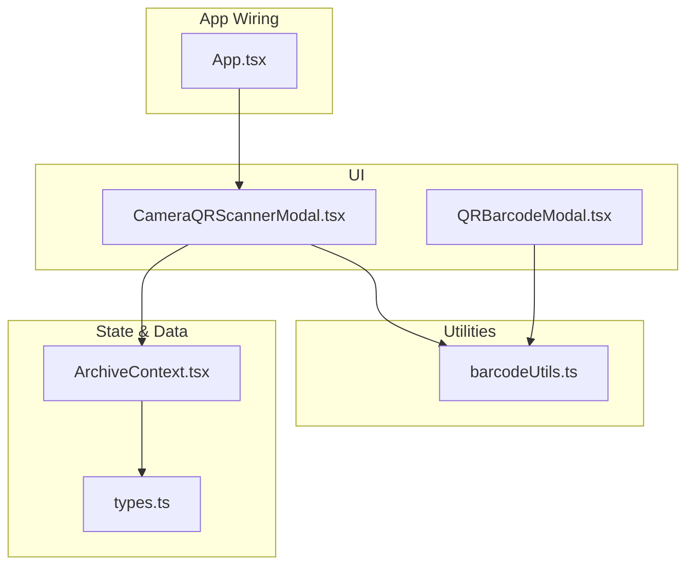
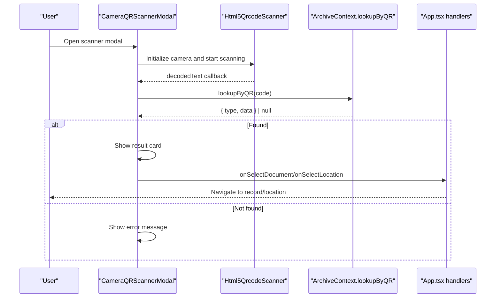
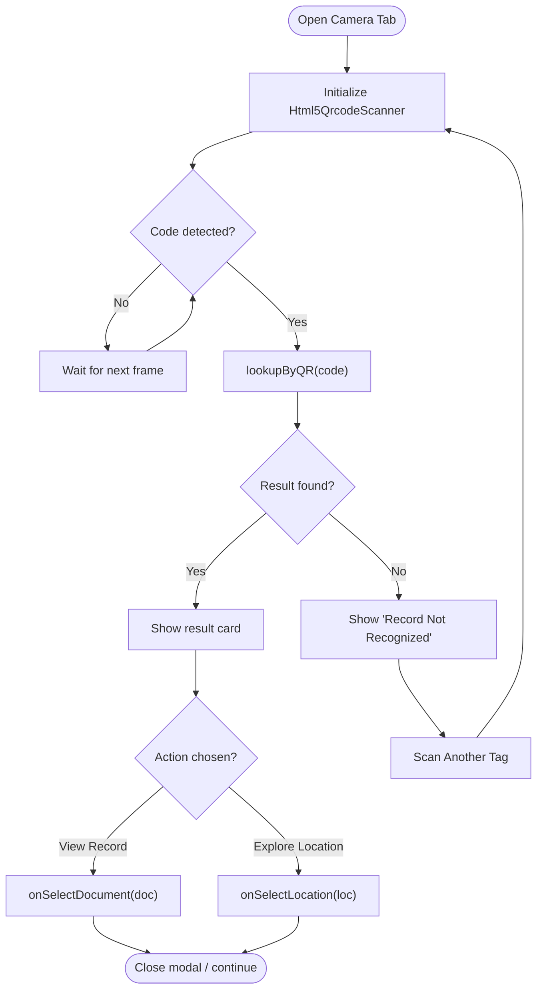
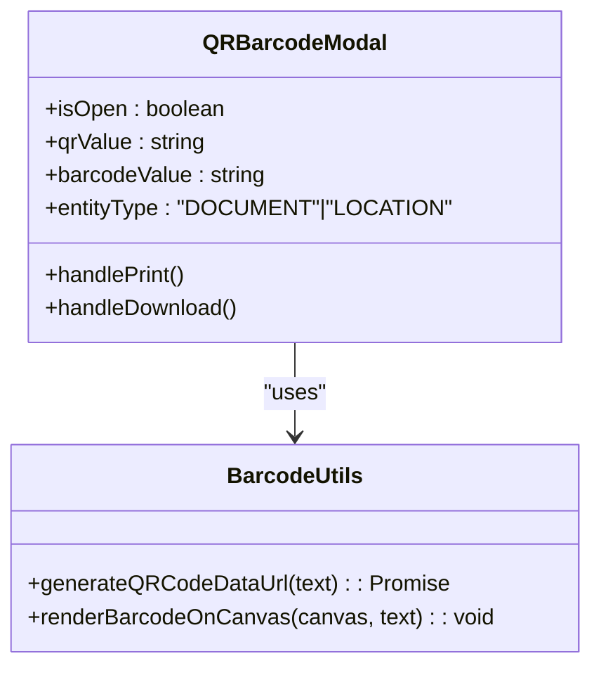
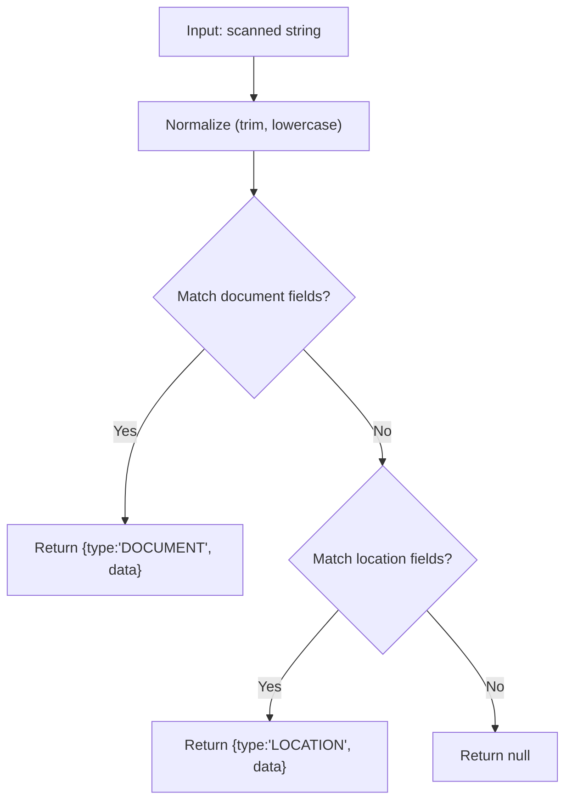
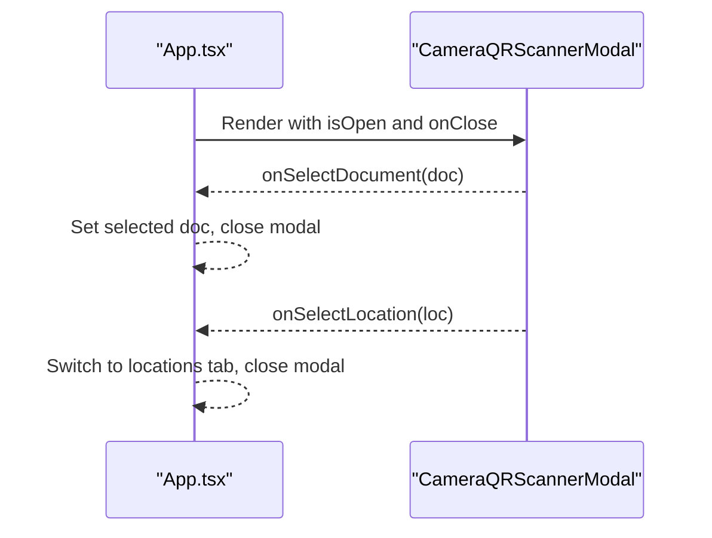
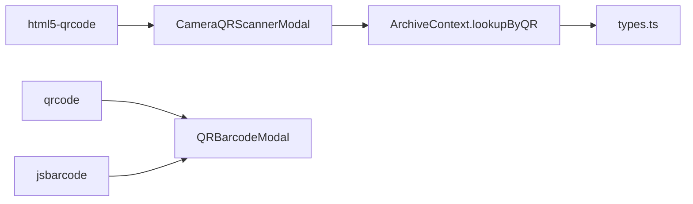

# Scanner Integration

<cite>
**Referenced Files in This Document**
- [CameraQRScannerModal.tsx](file://src/components/scanner/CameraQRScannerModal.tsx)
- [barcodeUtils.ts](file://src/utils/barcodeUtils.ts)
- [QRBarcodeModal.tsx](file://src/components/common/QRBarcodeModal.tsx)
- [ArchiveContext.tsx](file://src/context/ArchiveContext.tsx)
- [types.ts](file://src/types.ts)
- [App.tsx](file://src/App.tsx)
</cite>

## Table of Contents
1. [Introduction](#introduction)
2. [Project Structure](#project-structure)
3. [Core Components](#core-components)
4. [Architecture Overview](#architecture-overview)
5. [Detailed Component Analysis](#detailed-component-analysis)
6. [Dependency Analysis](#dependency-analysis)
7. [Performance Considerations](#performance-considerations)
8. [Troubleshooting Guide](#troubleshooting-guide)
9. [Conclusion](#conclusion)
10. [Appendices](#appendices)

## Introduction
This document explains ArchiveHub’s barcode and QR code scanning integration. It covers the camera-based scanner for real-time scanning on desktop and mobile, barcode generation utilities for creating printable labels, the scanner modal interface with autofocus and manual entry fallback, supported formats, performance tuning, troubleshooting, and extension guidance. It also shows how scanned codes trigger document lookups and location updates within the application.

## Project Structure
The scanning feature is implemented as a React component that uses an HTML5 QR code library to access the device camera and decode codes. Generated labels are produced via utility functions and rendered in a dedicated modal for printing or download. The lookup logic bridges scanned values to documents and locations stored in the application context.

**Diagram sources**
- [CameraQRScannerModal.tsx:1-391](file://src/components/scanner/CameraQRScannerModal.tsx#L1-L391)
- [QRBarcodeModal.tsx:1-272](file://src/components/common/QRBarcodeModal.tsx#L1-L272)
- [barcodeUtils.ts:1-41](file://src/utils/barcodeUtils.ts#L1-L41)
- [ArchiveContext.tsx:968-986](file://src/context/ArchiveContext.tsx#L968-L986)
- [types.ts:36-52](file://src/types.ts#L36-L52)
- [types.ts:135-183](file://src/types.ts#L135-L183)
- [App.tsx:143-160](file://src/App.tsx#L143-L160)

**Section sources**
- [CameraQRScannerModal.tsx:1-391](file://src/components/scanner/CameraQRScannerModal.tsx#L1-L391)
- [QRBarcodeModal.tsx:1-272](file://src/components/common/QRBarcodeModal.tsx#L1-L272)
- [barcodeUtils.ts:1-41](file://src/utils/barcodeUtils.ts#L1-L41)
- [ArchiveContext.tsx:968-986](file://src/context/ArchiveContext.tsx#L968-L986)
- [types.ts:36-52](file://src/types.ts#L36-L52)
- [types.ts:135-183](file://src/types.ts#L135-L183)
- [App.tsx:143-160](file://src/App.tsx#L143-L160)

## Core Components
- Camera-based scanner modal: Provides a tabbed interface with live camera scanning and a manual key-in fallback. On successful scan, it resolves the code to a document or location and presents actionable actions.
- Barcode/QR label generator: Generates QR images and Code 128 barcodes for printing or downloading as standalone tags.
- Lookup service: Resolves scanned strings to entities by matching against multiple identifiers (QR code, barcode, document number, location code/name).

Key responsibilities:
- Manage camera lifecycle and decoding callbacks
- Normalize input and perform lookups
- Render results and trigger navigation or state changes
- Generate and render scannable labels for physical tagging

**Section sources**
- [CameraQRScannerModal.tsx:21-121](file://src/components/scanner/CameraQRScannerModal.tsx#L21-L121)
- [barcodeUtils.ts:1-41](file://src/utils/barcodeUtils.ts#L1-L41)
- [QRBarcodeModal.tsx:18-46](file://src/components/common/QRBarcodeModal.tsx#L18-L46)
- [ArchiveContext.tsx:968-986](file://src/context/ArchiveContext.tsx#L968-L986)

## Architecture Overview
The scanner integrates with the application state through a context provider. Scanned codes are resolved to entities using a centralized lookup function. Results can navigate to document detail pages or location views. Labels are generated independently for printing workflows.

**Diagram sources**
- [CameraQRScannerModal.tsx:46-109](file://src/components/scanner/CameraQRScannerModal.tsx#L46-L109)
- [ArchiveContext.tsx:968-986](file://src/context/ArchiveContext.tsx#L968-L986)
- [App.tsx:143-160](file://src/App.tsx#L143-L160)

## Detailed Component Analysis

### CameraQRScannerModal
- Purpose: Real-time camera scanning with manual fallback; resolves codes to documents or locations; displays contextual actions.
- Key behaviors:
  - Initializes Html5QrcodeScanner when the camera tab is active and the modal is open.
  - Uses a small viewport box and moderate FPS to balance accuracy and performance.
  - Clears the scanner after a successful decode to avoid repeated triggers.
  - Supports manual entry with autofocus and sample quick buttons for testing.
  - Displays errors when no match is found and allows re-scanning.
- Integration points:
  - Calls lookupByQR from ArchiveContext to resolve codes.
  - Emits onSelectDocument or onSelectLocation callbacks to update app state and navigate.

**Diagram sources**
- [CameraQRScannerModal.tsx:46-109](file://src/components/scanner/CameraQRScannerModal.tsx#L46-L109)
- [CameraQRScannerModal.tsx:100-121](file://src/components/scanner/CameraQRScannerModal.tsx#L100-L121)
- [CameraQRScannerModal.tsx:181-248](file://src/components/scanner/CameraQRScannerModal.tsx#L181-L248)

**Section sources**
- [CameraQRScannerModal.tsx:21-121](file://src/components/scanner/CameraQRScannerModal.tsx#L21-L121)
- [CameraQRScannerModal.tsx:181-248](file://src/components/scanner/CameraQRScannerModal.tsx#L181-L248)

### QRBarcodeModal and Label Generation
- Purpose: Generate and print/download QR and barcode labels for documents and locations.
- Key behaviors:
  - Generates a QR data URL asynchronously.
  - Renders a Code 128 barcode onto a canvas element.
  - Builds a printable HTML template and supports printing via hidden iframe or fallback window.print.
  - Offers copy-to-clipboard and download of a standalone tag file.

**Diagram sources**
- [QRBarcodeModal.tsx:18-46](file://src/components/common/QRBarcodeModal.tsx#L18-L46)
- [QRBarcodeModal.tsx:157-172](file://src/components/common/QRBarcodeModal.tsx#L157-L172)
- [barcodeUtils.ts:1-41](file://src/utils/barcodeUtils.ts#L1-L41)

**Section sources**
- [QRBarcodeModal.tsx:18-46](file://src/components/common/QRBarcodeModal.tsx#L18-L46)
- [QRBarcodeModal.tsx:157-172](file://src/components/common/QRBarcodeModal.tsx#L157-L172)
- [barcodeUtils.ts:1-41](file://src/utils/barcodeUtils.ts#L1-L41)

### Lookup Logic and Data Model
- Purpose: Resolve scanned strings to either a document or a location entity.
- Supported identifiers:
  - Documents: qrCode, documentNumber, barcode
  - Locations: qrCode, code, barcode, name
- Returns a typed result indicating the entity type and payload.

**Diagram sources**
- [ArchiveContext.tsx:968-986](file://src/context/ArchiveContext.tsx#L968-L986)
- [types.ts:36-52](file://src/types.ts#L36-L52)
- [types.ts:135-183](file://src/types.ts#L135-L183)

**Section sources**
- [ArchiveContext.tsx:968-986](file://src/context/ArchiveContext.tsx#L968-L986)
- [types.ts:36-52](file://src/types.ts#L36-L52)
- [types.ts:135-183](file://src/types.ts#L135-L183)

### App Integration and Navigation
- The app mounts the scanner modal and wires up selection callbacks to navigate to document details or switch to the locations view.

**Diagram sources**
- [App.tsx:143-160](file://src/App.tsx#L143-L160)
- [CameraQRScannerModal.tsx:21-33](file://src/components/scanner/CameraQRScannerModal.tsx#L21-L33)

**Section sources**
- [App.tsx:143-160](file://src/App.tsx#L143-L160)
- [CameraQRScannerModal.tsx:21-33](file://src/components/scanner/CameraQRScannerModal.tsx#L21-L33)

## Dependency Analysis
- External libraries:
  - html5-qrcode: Camera access and decoding
  - qrcode: QR image generation
  - jsbarcode: Code 128 barcode rendering
- Internal dependencies:
  - ArchiveContext provides lookupByQR and calculatePath
  - Types define DocumentItem and LocationItem structures used by scanner results

**Diagram sources**
- [CameraQRScannerModal.tsx:1-3](file://src/components/scanner/CameraQRScannerModal.tsx#L1-L3)
- [QRBarcodeModal.tsx:1-4](file://src/components/common/QRBarcodeModal.tsx#L1-L4)
- [barcodeUtils.ts:1-2](file://src/utils/barcodeUtils.ts#L1-L2)
- [ArchiveContext.tsx:968-986](file://src/context/ArchiveContext.tsx#L968-L986)
- [types.ts:36-52](file://src/types.ts#L36-L52)
- [types.ts:135-183](file://src/types.ts#L135-L183)

**Section sources**
- [CameraQRScannerModal.tsx:1-3](file://src/components/scanner/CameraQRScannerModal.tsx#L1-L3)
- [QRBarcodeModal.tsx:1-4](file://src/components/common/QRBarcodeModal.tsx#L1-L4)
- [barcodeUtils.ts:1-2](file://src/utils/barcodeUtils.ts#L1-L2)
- [ArchiveContext.tsx:968-986](file://src/context/ArchiveContext.tsx#L968-L986)
- [types.ts:36-52](file://src/types.ts#L36-L52)
- [types.ts:135-183](file://src/types.ts#L135-L183)

## Performance Considerations
- Scanning FPS and viewport:
  - The scanner initializes with a moderate frame rate and a focused viewport box to improve detection speed and reduce CPU usage.
- Single-decode behavior:
  - After a successful decode, the scanner is cleared to prevent repeated processing of the same code.
- Asynchronous label generation:
  - QR generation is asynchronous to avoid blocking UI; barcode rendering occurs after a short delay to ensure the canvas is ready.
- Memory and lifecycle:
  - The scanner instance is stored in a ref and explicitly cleared on unmount or tab change to release camera resources.

[No sources needed since this section provides general guidance]

## Troubleshooting Guide
Common issues and resolutions:
- Camera not starting or permission denied:
  - Ensure HTTPS or localhost context for camera access.
  - Confirm browser permissions for camera and microphone if prompted.
- No codes detected:
  - Verify lighting and contrast; ensure the code fills the viewport box.
  - Try switching between front and rear cameras on mobile devices.
  - Use the Manual Key-In tab to test known codes.
- “Record Not Recognized”:
  - Check that the scanned value matches one of the supported identifiers (document number, QR code, barcode for documents; location code, QR code, barcode, or name for locations).
- Repeated scans:
  - The scanner clears after a successful decode; if you see duplicates, confirm that the modal state resets properly.
- Printing labels:
  - If the hidden iframe print fails, the modal falls back to window.print; ensure your printer settings fit the page size.

**Section sources**
- [CameraQRScannerModal.tsx:46-109](file://src/components/scanner/CameraQRScannerModal.tsx#L46-L109)
- [CameraQRScannerModal.tsx:181-248](file://src/components/scanner/CameraQRScannerModal.tsx#L181-L248)
- [QRBarcodeModal.tsx:157-172](file://src/components/common/QRBarcodeModal.tsx#L157-L172)

## Conclusion
ArchiveHub’s scanner integration combines a robust camera-based decoder with a flexible lookup system and high-quality label generation. The design supports both real-time scanning and manual entry, making it resilient across devices and environments. With clear separation of concerns—scanner UI, utilities, and context-driven lookup—the system is easy to extend for additional formats or hardware while maintaining performance and usability.

[No sources needed since this section summarizes without analyzing specific files]

## Appendices

### Supported Formats and Identifiers
- QR codes: Any QR code containing a supported identifier string
- Barcodes: Code 128 for printed labels
- Identifier resolution:
  - Documents: qrCode, documentNumber, barcode
  - Locations: qrCode, code, barcode, name

**Section sources**
- [barcodeUtils.ts:23-40](file://src/utils/barcodeUtils.ts#L23-L40)
- [ArchiveContext.tsx:968-986](file://src/context/ArchiveContext.tsx#L968-L986)

### Mobile-Specific Considerations
- Camera permissions: Require user consent; ensure secure context (HTTPS or localhost).
- Orientation handling: The modal adapts to screen size; consider testing portrait and landscape modes.
- Touch interactions: Buttons and inputs are sized for touch; manual entry includes autofocus for quick typing.

[No sources needed since this section provides general guidance]

### Extending Scanner Functionality
- Add new barcode formats:
  - Extend the scanner configuration to enable additional symbologies supported by the underlying library.
  - Update the lookup logic to recognize new identifier patterns if necessary.
- Integrate external hardware:
  - Replace or augment the camera path with a USB/Bluetooth scanner SDK where applicable, while keeping the same lookup and result flow.
- Customize label output:
  - Modify the printable HTML template to include additional metadata or branding.

[No sources needed since this section provides general guidance]