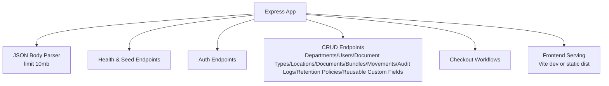
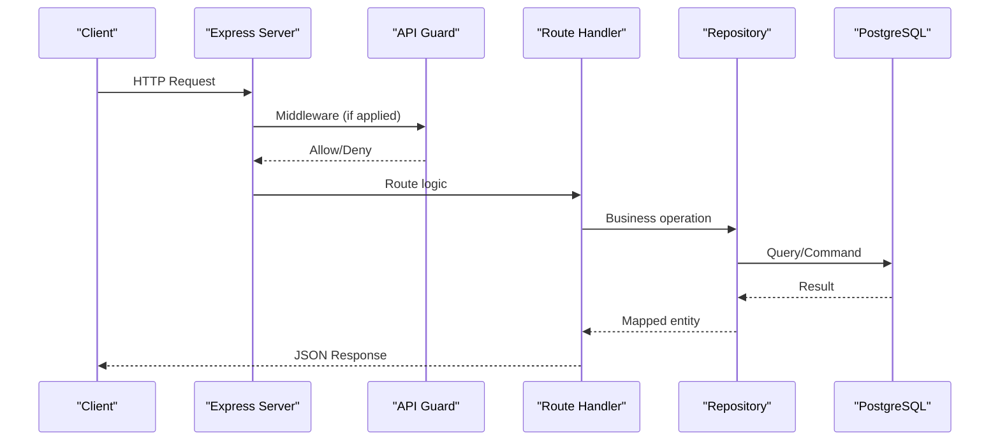
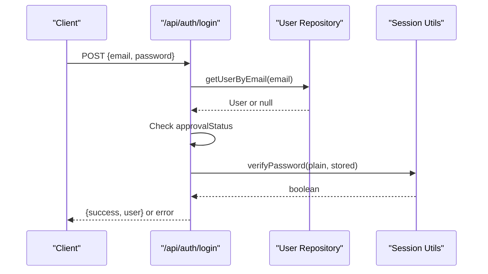
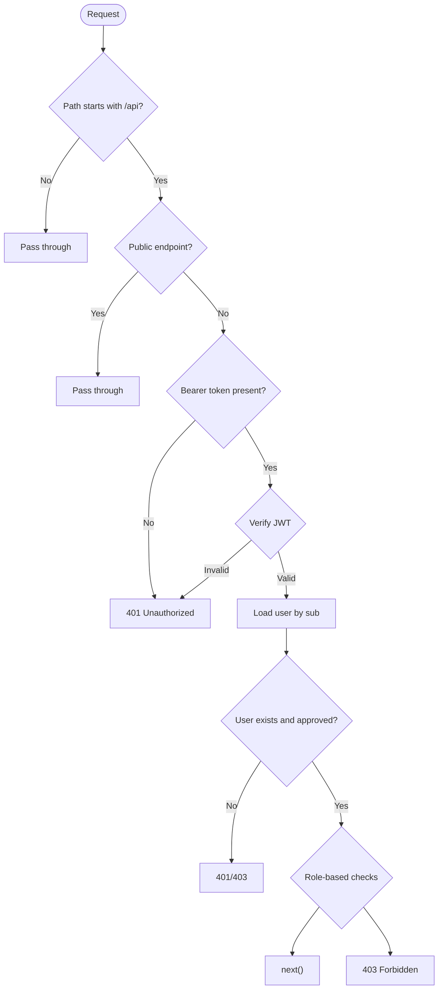
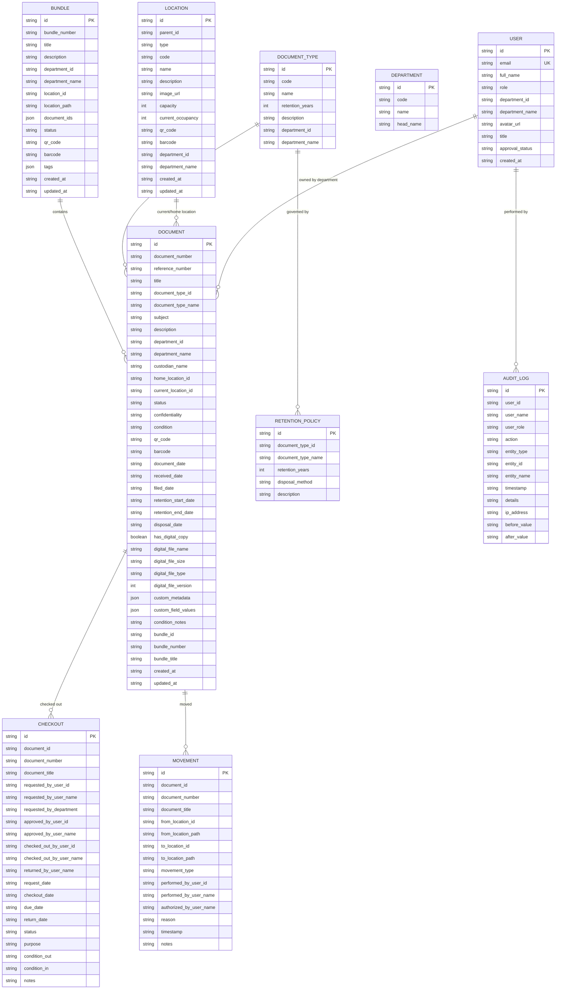
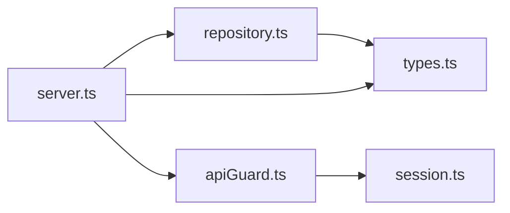

# API Architecture

<cite>
**Referenced Files in This Document**
- [server.ts](file://server.ts)
- [apiGuard.ts](file://src/auth/apiGuard.ts)
- [session.ts](file://src/auth/session.ts)
- [repository.ts](file://src/db/repository.ts)
- [types.ts](file://src/types.ts)
</cite>

## Table of Contents
1. [Introduction](#introduction)
2. [Project Structure](#project-structure)
3. [Core Components](#core-components)
4. [Architecture Overview](#architecture-overview)
5. [Detailed Component Analysis](#detailed-component-analysis)
6. [Dependency Analysis](#dependency-analysis)
7. [Performance Considerations](#performance-considerations)
8. [Troubleshooting Guide](#troubleshooting-guide)
9. [Conclusion](#conclusion)

## Introduction
This document describes the RESTful API architecture for ArchiveHub’s Express.js backend. It covers authentication endpoints, CRUD operations for all entities, specialized workflows (checkouts and retention-related operations), middleware architecture (JWT-based authentication guards, request validation, error handling), session management, role-based access control, API versioning strategy, rate limiting considerations, security measures, CORS configuration, input sanitization, output formatting standards, and request/response formats with status codes.

## Project Structure
The server is bootstrapped in a single entry file that:
- Initializes Express and JSON parsing with a body size limit
- Performs database health checks and runs migrations/seed on startup
- Registers all API routes under /api
- Serves the frontend in production or integrates Vite middleware in development

**Diagram sources**
- [server.ts:13-51](file://server.ts#L13-L51)
- [server.ts:53-82](file://server.ts#L53-L82)
- [server.ts:84-517](file://server.ts#L84-L517)
- [server.ts:579-596](file://server.ts#L579-L596)

**Section sources**
- [server.ts:13-596](file://server.ts#L13-L596)

## Core Components
- Authentication and Authorization
  - JWT-based token signing and verification
  - Role-based access control via a central guard
- Data Access Layer
  - Repository functions abstracting PostgreSQL queries with an in-memory fallback
- API Routes
  - Centralized route handlers delegating to repository functions
  - Consistent error handling patterns per endpoint

Key responsibilities:
- session.ts: Token lifecycle, password hashing, user sanitization
- apiGuard.ts: Authentication and authorization enforcement
- repository.ts: Data persistence and mapping
- server.ts: Route definitions and response shaping

**Section sources**
- [session.ts:1-66](file://src/auth/session.ts#L1-L66)
- [apiGuard.ts:1-98](file://src/auth/apiGuard.ts#L1-L98)
- [repository.ts:1-200](file://src/db/repository.ts#L1-L200)
- [server.ts:84-517](file://server.ts#L84-L517)

## Architecture Overview
The API follows a layered approach:
- Request enters Express
- Optional global middleware (currently none applied globally except JSON parser)
- Route handler validates inputs and delegates to repository
- Repository executes SQL against PostgreSQL or falls back to in-memory store
- Response is returned with consistent JSON structure

**Diagram sources**
- [server.ts:13-51](file://server.ts#L13-L51)
- [apiGuard.ts:27-97](file://src/auth/apiGuard.ts#L27-L97)
- [repository.ts:111-149](file://src/db/repository.ts#L111-L149)

## Detailed Component Analysis

### Authentication and Session Management
- Login flow
  - Validates email presence
  - Looks up user by email
  - Enforces approval status checks
  - Compares password (supports hashed or plain for legacy)
  - Returns user data (no tokens issued here; clients are expected to manage tokens externally or use guard-protected endpoints)
- Signup flow
  - Validates required fields
  - Prevents duplicate emails
  - Creates user with pending approval status
- JWT utilities
  - Signs tokens with subject, email, role and a configurable secret
  - Verifies tokens using the same secret
  - Sanitizes user objects to exclude sensitive fields

**Diagram sources**
- [server.ts:104-150](file://server.ts#L104-L150)
- [session.ts:42-48](file://src/auth/session.ts#L42-L48)
- [repository.ts:136-149](file://src/db/repository.ts#L136-L149)

**Section sources**
- [server.ts:104-189](file://server.ts#L104-L189)
- [session.ts:23-66](file://src/auth/session.ts#L23-L66)
- [repository.ts:136-190](file://src/db/repository.ts#L136-L190)

### Middleware Architecture: API Guard and RBAC
- Public endpoints bypass authentication:
  - GET /api/health
  - POST /api/auth/login
  - POST /api/auth/signup
- Protected endpoints require a valid Bearer token
- Role-based permissions:
  - Admin-only: users, seed, clear-data, impersonate
  - Catalog roles: document-types, reusable-custom-fields
  - Write roles: locations, documents, bundles
  - Circulation roles: checkouts
  - Auditor role: read-only restrictions
- The guard attaches sanitized user info to req.authUser for downstream handlers

**Diagram sources**
- [apiGuard.ts:11-97](file://src/auth/apiGuard.ts#L11-L97)

**Section sources**
- [apiGuard.ts:1-98](file://src/auth/apiGuard.ts#L1-L98)

### API Versioning Strategy
- No explicit version prefix is used in routes; all endpoints are under /api
- To introduce versioning without breaking changes, consider:
  - Prefixing routes with /api/v1, /api/v2
  - Maintaining backward compatibility by aliasing old routes during transition
  - Deprecation headers and sunset dates communicated to clients

[No sources needed since this section provides general guidance]

### Rate Limiting Considerations
- Not currently implemented in the server
- Recommended additions:
  - Use a rate limiter middleware at the application level for auth endpoints to prevent brute-force
  - Apply broader limits for write-heavy endpoints
  - Configure IP-based and user-based throttling where appropriate

[No sources needed since this section provides general guidance]

### Security Measures
- Password handling:
  - Hashing supported for new passwords; legacy plain comparison supported
- JWT:
  - Tokens signed with a secret from environment variable
  - Short-lived tokens configured
- Input validation:
  - Minimal validation at route level (e.g., required fields)
  - No centralized schema validation library detected
- Output sanitization:
  - User objects sanitized before being attached to requests
- Error responses:
  - Consistent JSON error shapes per endpoint

**Section sources**
- [session.ts:23-66](file://src/auth/session.ts#L23-L66)
- [server.ts:104-189](file://server.ts#L104-L189)

### CORS Configuration
- No explicit CORS middleware is configured in the server
- Recommendations:
  - Add a CORS middleware to restrict origins to trusted domains
  - Configure allowed methods and headers explicitly
  - Enable credentials only when necessary

[No sources needed since this section provides general guidance]

### Input Sanitization and Output Formatting Standards
- Input:
  - JSON bodies parsed with a size limit
  - Basic field presence checks in login/signup
- Output:
  - Successful responses typically return JSON payloads with success flags or created resources
  - Errors return JSON with error/message fields
  - Audit logs creation returns created resource

**Section sources**
- [server.ts:17-17](file://server.ts#L17-L17)
- [server.ts:104-189](file://server.ts#L104-L189)
- [server.ts:473-480](file://server.ts#L473-L480)

### RESTful API Structure

#### Health and Maintenance
- GET /api/health
  - Purpose: Service health and database connectivity status
  - Response: Status object including service name, database health, timestamp
- POST /api/seed
  - Purpose: Run migrations and load default seed data
  - Response: Success message or error if database not connected
- POST /api/clear-data
  - Purpose: Clear operational/custom data from the database
  - Response: Operation result

**Section sources**
- [server.ts:43-82](file://server.ts#L43-L82)

#### Authentication
- POST /api/auth/login
  - Inputs: email, password
  - Behavior: Validates email, checks approval status, verifies password
  - Responses:
    - 200: { success: true, user }
    - 400: Validation errors
    - 401: Incorrect password
    - 403: Pending/rejected approval
    - 404: Account not found
    - 500: Server error
- POST /api/auth/signup
  - Inputs: email, fullName, optional password
  - Behavior: Creates user with PENDING_APPROVAL
  - Responses:
    - 201: { success: true, user, isPendingApproval: true, message }
    - 400: Validation or duplicate email
    - 500: Server error

**Section sources**
- [server.ts:104-189](file://server.ts#L104-L189)

#### Users and Departments
- GET /api/users
  - Requires admin-level access via guard
  - Response: Array of users
- PATCH /api/users/:id/approval
  - Inputs: status (APPROVED | REJECTED | PENDING_APPROVAL)
  - Behavior: Updates user approval status
  - Responses:
    - 200: { success: true, user }
    - 400: Invalid status
    - 500: Server error
- DELETE /api/users/:id
  - Behavior: Deletes user
  - Responses:
    - 200: { success: boolean }
    - 500: Server error
- GET /api/departments
  - Response: Array of departments

**Section sources**
- [server.ts:84-102](file://server.ts#L84-L102)
- [server.ts:191-213](file://server.ts#L191-L213)

#### Document Types
- GET /api/document-types
- POST /api/document-types
- PUT /api/document-types/:id
- DELETE /api/document-types/:id
- Responses:
  - 201: Created resource
  - 200: Success flag or updated resource
  - 500: Server error

**Section sources**
- [server.ts:215-250](file://server.ts#L215-L250)

#### Locations
- GET /api/locations
- POST /api/locations
- PUT /api/locations/:id
- DELETE /api/locations/:id
- Notes:
  - Deletion may fail if location contains sub-locations or documents
- Responses:
  - 201: Created resource
  - 200: Success flag
  - 400: Business rule violation
  - 500: Server error

**Section sources**
- [server.ts:252-296](file://server.ts#L252-L296)

#### Documents
- GET /api/documents
- POST /api/documents
  - Inputs: docData, user, homePath (optional)
- PUT /api/documents/:id
  - Inputs: updates, user
- DELETE /api/documents/:id
  - Inputs: user
  - Notes: Cannot delete while checked out
- POST /api/documents/:id/move
  - Inputs: toLocationId, reason, user, fromPath, toPath
- Responses:
  - 201: Created resource
  - 200: Success flag
  - 400: Business rule violation
  - 500: Server error

**Section sources**
- [server.ts:298-361](file://server.ts#L298-L361)

#### Checkouts Workflow
- GET /api/checkouts
- POST /api/checkouts/request
  - Inputs: documentId, purpose, dueDate, user
- POST /api/checkouts/:id/approve
  - Inputs: user
- POST /api/checkouts/:id/reject
  - Inputs: reason, user
- POST /api/checkouts/:id/dispatch
  - Inputs: tempLocationId, user, fromPath, toPath
- POST /api/checkouts/:id/return
  - Inputs: conditionIn, returnLocationId, notes, user, fromPath, toPath
- Responses:
  - 201: Created checkout
  - 200: Success flag
  - 500: Server error

**Section sources**
- [server.ts:363-441](file://server.ts#L363-L441)

#### Movements
- GET /api/movements
- Response: Array of movement records

**Section sources**
- [server.ts:443-451](file://server.ts#L443-L451)

#### Retention Policies
- GET /api/retention-policies
- Response: Array of policies

**Section sources**
- [server.ts:453-461](file://server.ts#L453-L461)

#### Audit Logs
- GET /api/audit-logs
- POST /api/audit-logs
  - Inputs: log payload
  - Responses:
    - 201: Created log
    - 500: Server error

**Section sources**
- [server.ts:463-480](file://server.ts#L463-L480)

#### Reusable Custom Fields
- GET /api/reusable-custom-fields
- POST /api/reusable-custom-fields
- PUT /api/reusable-custom-fields/:id
- DELETE /api/reusable-custom-fields/:id
- Responses:
  - 201: Created resource
  - 200: Success flag
  - 500: Server error

**Section sources**
- [server.ts:482-517](file://server.ts#L482-L517)

#### Bundles and Dossiers
- GET /api/bundles
- POST /api/bundles
  - Inputs: bundleData, user
- PUT /api/bundles/:id
  - Inputs: updates, user
- DELETE /api/bundles/:id
  - Inputs: user
- POST /api/bundles/:id/add-documents
  - Inputs: documentIds, user
- POST /api/bundles/:id/remove-document
  - Inputs: documentId, user
- Responses:
  - 201: Created resource
  - 200: Success flag
  - 500: Server error

**Section sources**
- [server.ts:519-577](file://server.ts#L519-L577)

### Data Models and Relationships
The following types define the core entities exposed by the API:

**Diagram sources**
- [types.ts:10-283](file://src/types.ts#L10-L283)

**Section sources**
- [types.ts:1-283](file://src/types.ts#L1-L283)

## Dependency Analysis
- Express app depends on:
  - Database health and migration utilities
  - Repository module for data operations
  - Auth utilities for token handling
- Repository depends on:
  - Database pool and query execution
  - Type mappings and in-memory fallback
- Guard depends on:
  - Repository for user lookup
  - Session utilities for token verification and user sanitization

**Diagram sources**
- [server.ts:8-11](file://server.ts#L8-L11)
- [apiGuard.ts:1-4](file://src/auth/apiGuard.ts#L1-L4)
- [session.ts:1-3](file://src/auth/session.ts#L1-L3)
- [repository.ts:1-15](file://src/db/repository.ts#L1-L15)
- [types.ts:1-6](file://src/types.ts#L1-L6)

**Section sources**
- [server.ts:8-11](file://server.ts#L8-L11)
- [apiGuard.ts:1-4](file://src/auth/apiGuard.ts#L1-L4)
- [session.ts:1-3](file://src/auth/session.ts#L1-L3)
- [repository.ts:1-15](file://src/db/repository.ts#L1-L15)
- [types.ts:1-6](file://src/types.ts#L1-L6)

## Performance Considerations
- JSON body size limit set to 10mb to accommodate larger payloads
- Database fallback to in-memory mode ensures availability when PostgreSQL is unavailable
- Repository queries include basic error handling and logging to aid diagnostics
- Consider adding:
  - Connection pooling tuning based on workload
  - Pagination for large lists (documents, checkouts, movements)
  - Indexes on frequently queried fields (document_number, status, location_id)

[No sources needed since this section provides general guidance]

## Troubleshooting Guide
Common issues and how they are handled:
- Authentication failures:
  - Missing or invalid token results in 401 Unauthorized
  - Expired or malformed tokens produce specific messages
- Authorization failures:
  - Insufficient role leads to 403 Forbidden with descriptive messages
- Approval status:
  - Pending or rejected accounts receive 403 with context-specific messages
- Database connectivity:
  - Startup health check determines whether migrations/seed run
  - Repository falls back to in-memory mode on query failure
- Business rule violations:
  - Deleting locations or documents with constraints returns 400 with explanatory messages

**Section sources**
- [apiGuard.ts:27-97](file://src/auth/apiGuard.ts#L27-L97)
- [server.ts:19-38](file://server.ts#L19-L38)
- [server.ts:280-296](file://server.ts#L280-L296)
- [server.ts:328-344](file://server.ts#L328-L344)
- [repository.ts:106-149](file://src/db/repository.ts#L106-L149)

## Conclusion
ArchiveHub’s API provides a comprehensive set of endpoints for managing departments, users, document types, locations, documents, bundles, movements, checkouts, retention policies, audit logs, and reusable custom fields. Authentication and authorization are enforced via JWT and a central guard with role-based access control. While CORS and rate limiting are not currently implemented, the foundation supports their addition. The repository layer offers resilience with in-memory fallback, and consistent error handling improves client experience. For future enhancements, consider introducing explicit API versioning, robust input validation schemas, CORS configuration, and rate limiting to harden the API surface.