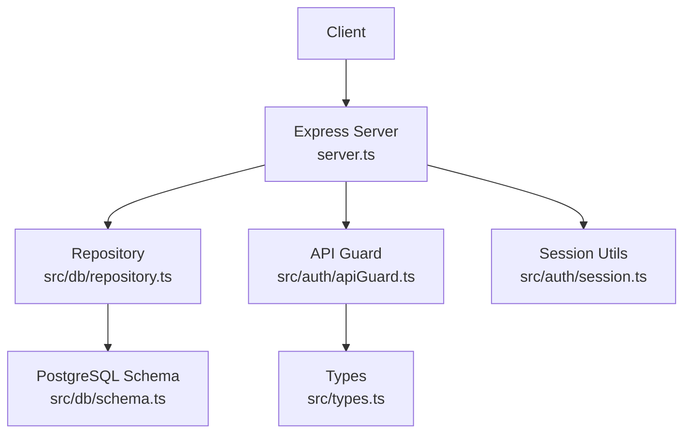
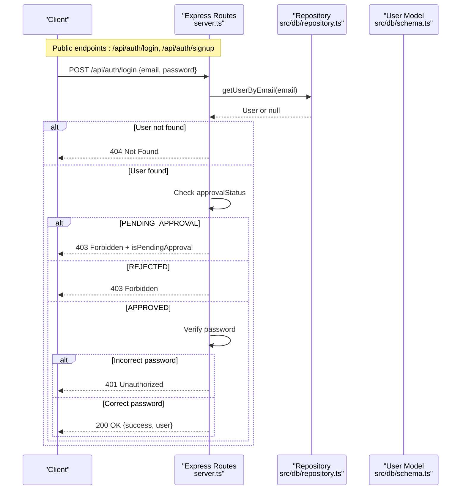
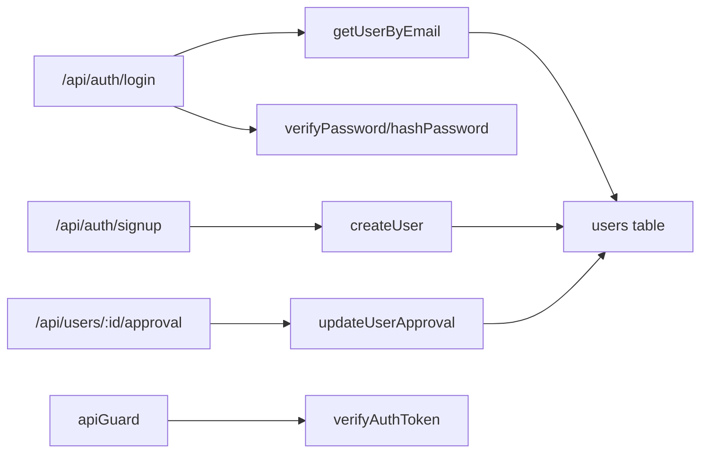

# Authentication Endpoints

<cite>
**Referenced Files in This Document**
- [server.ts](file://server.ts)
- [apiGuard.ts](file://src/auth/apiGuard.ts)
- [session.ts](file://src/auth/session.ts)
- [repository.ts](file://src/db/repository.ts)
- [schema.ts](file://src/db/schema.ts)
- [types.ts](file://src/types.ts)
</cite>

## Table of Contents
1. Introduction
2. Project Structure
3. Core Components
4. Architecture Overview
5. Detailed Component Analysis
6. Dependency Analysis
7. Performance Considerations
8. Troubleshooting Guide
9. Conclusion

## Introduction
This document provides comprehensive API documentation for ArchiveHub’s authentication endpoints, focusing on:
- POST /api/auth/login: user authentication with email/password validation and approval status checks (PENDING_APPROVAL, REJECTED, APPROVED).
- POST /api/auth/signup: new user registration with automatic PENDING_APPROVAL assignment and duplicate email handling.
- PATCH /api/users/:id/approval: administrator approval workflow to update a user’s approval status with validation.

It also covers request/response schemas, error codes, security considerations, and example flows for successful authentication, pending approval scenarios, and rejected account handling.

## Project Structure
The authentication logic is implemented as Express routes in the server entrypoint, backed by repository functions for database operations and shared utilities for password hashing and token handling. The API guard middleware enforces role-based access for protected endpoints and marks login/signup as public.

**Diagram sources**
- [server.ts:104-204](file://server.ts#L104-L204)
- [apiGuard.ts:11-17](file://src/auth/apiGuard.ts#L11-L17)
- [session.ts:23-65](file://src/auth/session.ts#L23-L65)
- [repository.ts:136-213](file://src/db/repository.ts#L136-L213)
- [schema.ts:22-35](file://src/db/schema.ts#L22-L35)
- [types.ts:6-22](file://src/types.ts#L6-L22)

**Section sources**
- [server.ts:104-204](file://server.ts#L104-L204)
- [apiGuard.ts:11-17](file://src/auth/apiGuard.ts#L11-L17)
- [session.ts:23-65](file://src/auth/session.ts#L23-L65)
- [repository.ts:136-213](file://src/db/repository.ts#L136-L213)
- [schema.ts:22-35](file://src/db/schema.ts#L22-L35)
- [types.ts:6-22](file://src/types.ts#L6-L22)

## Core Components
- Login endpoint: Validates email presence, retrieves user by email, checks approval status, verifies password, and returns success or appropriate errors.
- Signup endpoint: Validates required fields, prevents duplicate emails, creates user with PENDING_APPROVAL, and returns a success response indicating pending approval.
- Approval endpoint: Validates allowed statuses and updates user approval via repository function.

Key supporting components:
- Password hashing and verification utilities.
- Repository functions for user lookup, creation, and approval updates.
- Type definitions for roles and approval states.

**Section sources**
- [server.ts:104-204](file://server.ts#L104-L204)
- [session.ts:34-48](file://src/auth/session.ts#L34-L48)
- [repository.ts:136-213](file://src/db/repository.ts#L136-L213)
- [types.ts:6-22](file://src/types.ts#L6-L22)

## Architecture Overview
The authentication flow uses direct route handlers without JWT issuance in these endpoints. Protected endpoints rely on an API guard that validates Bearer tokens; however, login and signup are explicitly marked as public.

**Diagram sources**
- [server.ts:104-150](file://server.ts#L104-L150)
- [repository.ts:136-149](file://src/db/repository.ts#L136-L149)
- [schema.ts:22-35](file://src/db/schema.ts#L22-L35)

**Section sources**
- [server.ts:104-150](file://server.ts#L104-L150)
- [repository.ts:136-149](file://src/db/repository.ts#L136-L149)
- [schema.ts:22-35](file://src/db/schema.ts#L22-L35)

## Detailed Component Analysis

### POST /api/auth/login
Purpose: Authenticate a user by email and password, enforcing approval status checks before granting access.

Request
- Method: POST
- Path: /api/auth/login
- Content-Type: application/json
- Body schema:
  - email: string (required)
  - password: string (optional if no password set)

Response
- Success (200):
  - success: boolean
  - user: object (user record excluding sensitive data when sanitized elsewhere)
- Pending approval (403):
  - success: boolean
  - isPendingApproval: boolean
  - message: string
- Rejected (403):
  - success: boolean
  - message: string
- Not found (404):
  - success: boolean
  - message: string
- Unauthorized (401):
  - success: boolean
  - message: string
- Validation error (400):
  - success: boolean
  - message: string
- Server error (500):
  - success: boolean
  - message: string

Processing Logic
- Validate email presence.
- Retrieve user by email.
- If user exists:
  - If approvalStatus is PENDING_APPROVAL, return 403 with isPendingApproval flag.
  - If approvalStatus is REJECTED, return 403.
  - If password provided and incorrect, return 401.
  - Otherwise, return 200 with user.

Security Notes
- Password comparison supports both hashed and plain values via utility functions.
- No session or token is issued by this endpoint; clients should store the returned user context locally if needed.

Example Scenarios
- Successful login: Returns 200 with user object.
- Pending approval: Returns 403 with isPendingApproval true.
- Rejected account: Returns 403 with rejection message.
- Wrong password: Returns 401.

**Section sources**
- [server.ts:104-150](file://server.ts#L104-L150)
- [session.ts:34-48](file://src/auth/session.ts#L34-L48)
- [repository.ts:136-149](file://src/db/repository.ts#L136-L149)

### POST /api/auth/signup
Purpose: Register a new user with automatic PENDING_APPROVAL status and prevent duplicate emails.

Request
- Method: POST
- Path: /api/auth/signup
- Content-Type: application/json
- Body schema:
  - email: string (required)
  - fullName: string (required)
  - Optional fields may include role, departmentId, departmentName, title, avatarUrl, password; defaults apply where missing.

Response
- Created (201):
  - success: boolean
  - user: object (created user)
  - isPendingApproval: boolean
  - message: string
- Conflict (400):
  - success: boolean
  - message: string (duplicate email)
- Validation error (400):
  - success: boolean
  - message: string (missing required fields)
- Server error (500):
  - success: boolean
  - message: string

Processing Logic
- Validate required fields (email, fullName).
- Check for existing user by email; reject duplicates.
- Create user with approvalStatus set to PENDING_APPROVAL.
- Return 201 with user and pending approval indicator.

Security Notes
- Passwords are hashed if provided; otherwise a default placeholder is used.
- New users cannot log in until approved by an administrator.

Example Scenarios
- Successful registration: Returns 201 with user and isPendingApproval true.
- Duplicate email: Returns 400 with conflict message.

**Section sources**
- [server.ts:152-189](file://server.ts#L152-L189)
- [repository.ts:151-190](file://src/db/repository.ts#L151-L190)
- [schema.ts:22-35](file://src/db/schema.ts#L22-L35)

### PATCH /api/users/:id/approval
Purpose: Administrator workflow to update a user’s approval status with strict validation.

Request
- Method: PATCH
- Path: /api/users/:id/approval
- Content-Type: application/json
- Body schema:
  - status: enum ("APPROVED" | "REJECTED" | "PENDING_APPROVAL") (required)

Response
- Success (200):
  - success: boolean
  - user: object (updated user)
- Bad Request (400):
  - error: string (invalid status)
- Server error (500):
  - error: string

Processing Logic
- Validate status against allowed values.
- Update user approval via repository function.
- Return updated user on success.

Security Notes
- This endpoint is intended for administrative use. While the route handler does not enforce role checks internally, other parts of the system (e.g., API guard) restrict access to user management endpoints to administrators. Ensure proper authorization is enforced at the gateway or middleware layer.

Example Scenarios
- Approve user: Returns 200 with updated user having APPROVED status.
- Reject user: Returns 200 with updated user having REJECTED status.
- Invalid status: Returns 400 with error message.

**Section sources**
- [server.ts:191-204](file://server.ts#L191-L204)
- [repository.ts:192-213](file://src/db/repository.ts#L192-L213)

## Dependency Analysis
Authentication endpoints depend on:
- Repository functions for user retrieval, creation, and approval updates.
- Session utilities for password hashing and verification.
- Type definitions for roles and approval states.
- API guard defines public endpoints and protects others via Bearer token validation.

**Diagram sources**
- [server.ts:104-204](file://server.ts#L104-L204)
- [repository.ts:136-213](file://src/db/repository.ts#L136-L213)
- [session.ts:34-65](file://src/auth/session.ts#L34-L65)
- [apiGuard.ts:27-48](file://src/auth/apiGuard.ts#L27-L48)

**Section sources**
- [server.ts:104-204](file://server.ts#L104-L204)
- [repository.ts:136-213](file://src/db/repository.ts#L136-L213)
- [session.ts:34-65](file://src/auth/session.ts#L34-L65)
- [apiGuard.ts:27-48](file://src/auth/apiGuard.ts#L27-L48)

## Performance Considerations
- Email lookups use normalized lowercasing to avoid case-sensitivity issues and ensure consistent queries.
- Password hashing uses bcrypt with a reasonable cost factor; consider adjusting based on performance needs.
- Database fallback to memory mode is supported; ensure production runs with PostgreSQL for reliability and performance.
- Avoid unnecessary user data exposure; sanitize responses where possible.

[No sources needed since this section provides general guidance]

## Troubleshooting Guide
Common issues and resolutions:
- Missing email in login request: Ensure email is present in the request body; expect 400.
- Account not found: Verify email spelling and existence; expect 404.
- Pending approval: Users must be approved before logging in; expect 403 with isPendingApproval flag.
- Rejected account: Contact administrator to change status; expect 403.
- Incorrect password: Verify credentials; expect 401.
- Duplicate email during signup: Use a different email; expect 400.
- Invalid approval status: Provide one of the allowed statuses; expect 400.
- Server errors: Check logs for database connectivity or query failures; expect 500.

**Section sources**
- [server.ts:104-204](file://server.ts#L104-L204)
- [repository.ts:136-213](file://src/db/repository.ts#L136-L213)

## Conclusion
ArchiveHub’s authentication endpoints implement straightforward, secure workflows for login, signup, and admin approval. They enforce approval status checks, validate inputs, and handle errors consistently. For protected endpoints beyond these, the API guard ensures authenticated and authorized access using Bearer tokens. Administrators can manage user approvals through the dedicated endpoint, ensuring controlled access to the system.

[No sources needed since this section summarizes without analyzing specific files]