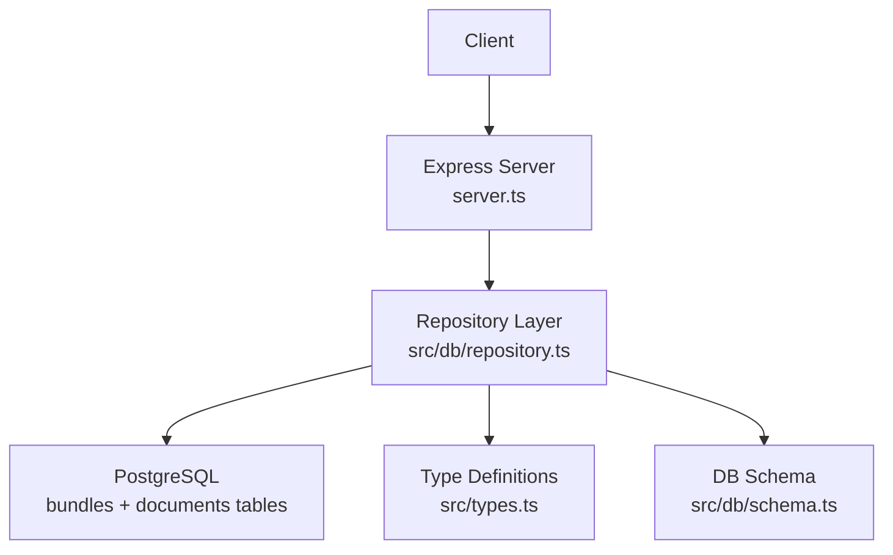
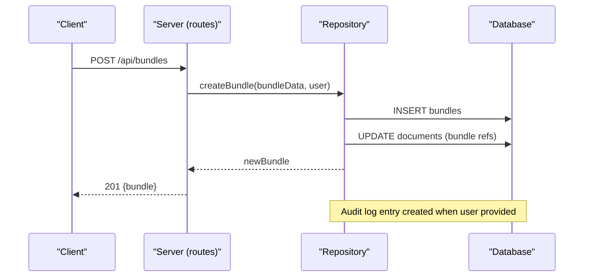
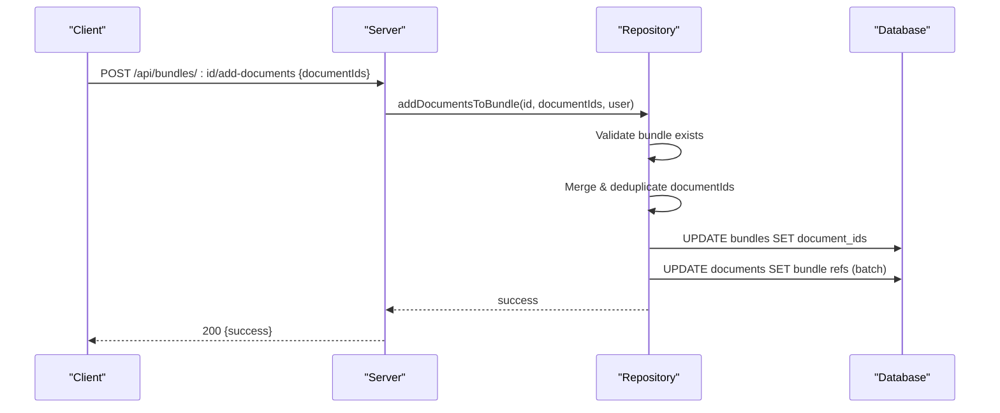
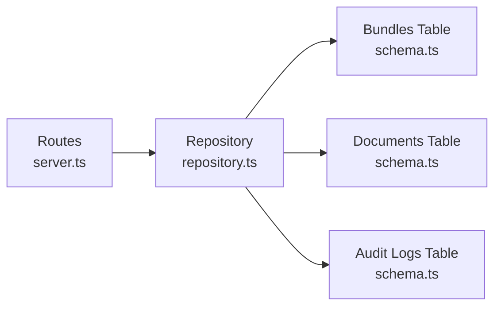

# Bundle Endpoints

<cite>
**Referenced Files in This Document**
- [server.ts](file://server.ts)
- [repository.ts](file://src/db/repository.ts)
- [schema.ts](file://src/db/schema.ts)
- [types.ts](file://src/types.ts)
</cite>

## Table of Contents
1. [Introduction](#introduction)
2. [Project Structure](#project-structure)
3. [Core Components](#core-components)
4. [Architecture Overview](#architecture-overview)
5. [Detailed Component Analysis](#detailed-component-analysis)
6. [Dependency Analysis](#dependency-analysis)
7. [Performance Considerations](#performance-considerations)
8. [Troubleshooting Guide](#troubleshooting-guide)
9. [Conclusion](#conclusion)

## Introduction
This document provides comprehensive API documentation for ArchiveHub’s bundle and dossier management endpoints used to group related documents. It covers listing, creating, updating, deleting bundles, as well as adding and removing documents from bundles. It also explains the data model, validation behavior, bulk operations, and audit trail requirements for bundle modifications.

## Project Structure
Bundle functionality is implemented across:
- Express routes that expose HTTP endpoints
- Repository functions that perform database operations with fallback to in-memory state
- Database schema defining the bundles table and relationships
- Type definitions describing bundle and document structures

**Diagram sources**
- [server.ts:519-577](file://server.ts#L519-L577)
- [repository.ts:1362-1596](file://src/db/repository.ts#L1362-L1596)
- [schema.ts:194-211](file://src/db/schema.ts#L194-L211)
- [types.ts:100-116](file://src/types.ts#L100-L116)

**Section sources**
- [server.ts:519-577](file://server.ts#L519-L577)
- [repository.ts:1362-1596](file://src/db/repository.ts#L1362-L1596)
- [schema.ts:194-211](file://src/db/schema.ts#L194-L211)
- [types.ts:100-116](file://src/types.ts#L100-L116)

## Core Components
- Bundle entity represents a dossier grouping documents together. It includes identifiers, metadata (title, description), department and location references, an array of document IDs, status, QR/barcode identifiers, tags, and timestamps.
- Documents maintain a back-reference to their current bundle via fields on the document record.
- Audit logs capture key bundle lifecycle events.

Key types and schema:
- DocumentBundle interface defines the bundle shape and allowed statuses.
- Bundles table stores bundle records and JSON arrays for document associations and tags.
- Documents table holds bundle association fields updated when documents are added or removed from bundles.

**Section sources**
- [types.ts:100-116](file://src/types.ts#L100-L116)
- [schema.ts:194-211](file://src/db/schema.ts#L194-L211)
- [repository.ts:47-65](file://src/db/repository.ts#L47-L65)

## Architecture Overview
The bundle API follows a layered architecture:
- Routes in server.ts handle HTTP requests and delegate to repository functions.
- Repository functions implement business logic, persist changes to PostgreSQL, update document associations, and write audit logs.
- A memory fallback ensures operation continuity when the database is unavailable.

**Diagram sources**
- [server.ts:529-537](file://server.ts#L529-L537)
- [repository.ts:1374-1455](file://src/db/repository.ts#L1374-L1455)

**Section sources**
- [server.ts:519-577](file://server.ts#L519-L577)
- [repository.ts:1362-1596](file://src/db/repository.ts#L1362-L1596)

## Detailed Component Analysis

### GET /api/bundles
- Purpose: Retrieve all bundles with their associated metadata and document ID lists.
- Request: None.
- Response: Array of bundle objects including id, bundleNumber, title, description, departmentId, departmentName, locationId, locationPath, documentIds, status, qrCode, barcode, tags, createdAt, updatedAt.
- Behavior: Returns bundles ordered by creation time; maps database rows to typed entities.

**Section sources**
- [server.ts:519-527](file://server.ts#L519-L527)
- [repository.ts:1362-1372](file://src/db/repository.ts#L1362-L1372)
- [repository.ts:47-65](file://src/db/repository.ts#L47-L65)

### POST /api/bundles
- Purpose: Create a new bundle (dossier) and optionally assign initial documents.
- Request body:
  - bundleData or top-level fields:
    - title (required)
    - description (optional)
    - departmentId, departmentName (required)
    - locationId, locationPath (optional)
    - documentIds (array of document IDs; optional)
    - status (defaults to ACTIVE if not provided)
    - tags (optional array)
  - user (optional): identity for audit logging
- Response: Created bundle object with generated id, qrCode, barcode, timestamps.
- Validation and side effects:
  - Generates unique id, qrCode, barcode.
  - Persists bundle and updates referenced documents’ bundle fields in a transaction.
  - Creates an audit log entry when user is provided.

**Diagram sources**
- [repository.ts:1374-1455](file://src/db/repository.ts#L1374-L1455)

**Section sources**
- [server.ts:529-537](file://server.ts#L529-L537)
- [repository.ts:1374-1455](file://src/db/repository.ts#L1374-L1455)

### PUT /api/bundles/:id
- Purpose: Update bundle properties such as title, description, department, location, status, tags, and document associations.
- Request body:
  - updates or direct fields to patch:
    - title, description, departmentId, departmentName, locationId, locationPath, documentIds, status, tags
  - user (optional): identity for audit logging
- Response: Success indicator.
- Behavior:
  - Dynamically builds an update statement for provided fields.
  - Updates document associations when documentIds change.
  - Does not create an audit log entry for this endpoint in the current implementation.

**Section sources**
- [server.ts:539-547](file://server.ts#L539-L547)
- [repository.ts:1458-1490](file://src/db/repository.ts#L1458-L1490)

### DELETE /api/bundles/:id
- Purpose: Delete a bundle and clean up its document associations.
- Request body:
  - user (optional): identity for audit logging
- Response: Success indicator.
- Validation and side effects:
  - Clears bundle references on all documents linked to the bundle.
  - Deletes the bundle record.
  - Creates an audit log entry when user is provided.
- Notes:
  - There is no explicit “active dependencies” check in the current implementation; deletion proceeds after unlinking documents.

**Section sources**
- [server.ts:549-557](file://server.ts#L549-L557)
- [repository.ts:1492-1526](file://src/db/repository.ts#L1492-L1526)

### POST /api/bundles/:id/add-documents
- Purpose: Add multiple documents to an existing bundle in a single request.
- Request body:
  - documentIds (array of strings)
  - user (optional): identity for audit logging
- Response: Success indicator.
- Behavior:
  - Validates that the target bundle exists; throws an error if not found.
  - Merges incoming document IDs with existing ones, deduplicating.
  - Updates the bundle’s documentIds and synchronizes document records’ bundle references.
  - Uses batched updates for performance.

**Diagram sources**
- [repository.ts:1528-1561](file://src/db/repository.ts#L1528-L1561)

**Section sources**
- [server.ts:559-567](file://server.ts#L559-L567)
- [repository.ts:1528-1561](file://src/db/repository.ts#L1528-L1561)

### POST /api/bundles/:id/remove-document
- Purpose: Remove a single document from a bundle and clean up its association.
- Request body:
  - documentId (string)
  - user (optional): identity for audit logging
- Response: Success indicator.
- Behavior:
  - Locates the target bundle; if not found, returns without error.
  - Removes the documentId from the bundle’s documentIds list.
  - Clears bundle references on the specific document.

**Section sources**
- [server.ts:569-577](file://server.ts#L569-L577)
- [repository.ts:1563-1596](file://src/db/repository.ts#L1563-L1596)

## Dependency Analysis
- Route-to-repository coupling: Each bundle route delegates to a corresponding repository function.
- Data persistence: All mutations use PostgreSQL transactions where applicable and fall back to in-memory state when the database is unavailable.
- Cross-entity updates: Adding/removing documents updates both the bundles table and the documents table to keep associations consistent.
- Audit trail: Creation and deletion of bundles generate audit log entries when a user context is provided.

**Diagram sources**
- [server.ts:519-577](file://server.ts#L519-L577)
- [repository.ts:1362-1596](file://src/db/repository.ts#L1362-L1596)
- [schema.ts:194-228](file://src/db/schema.ts#L194-L228)

**Section sources**
- [server.ts:519-577](file://server.ts#L519-L577)
- [repository.ts:1362-1596](file://src/db/repository.ts#L1362-L1596)
- [schema.ts:194-228](file://src/db/schema.ts#L194-L228)

## Performance Considerations
- Batch updates: Adding documents uses batched SQL updates to minimize round trips.
- Deduplication: Incoming document IDs are merged and deduplicated before persisting to avoid redundant associations.
- Transactional safety: Bundle creation wraps inserts and document updates in a transaction to ensure consistency.
- Fallback mode: When the database is unavailable, operations continue against in-memory state to preserve responsiveness.

[No sources needed since this section provides general guidance]

## Troubleshooting Guide
- Common errors:
  - Bundle not found when adding documents: The add endpoint validates existence and will throw an error if the bundle does not exist.
  - Database connectivity issues: Repository functions log warnings and fall back to memory state; verify environment configuration for database connection.
- Audit logs:
  - Ensure a user object is passed with create and delete operations to capture audit trails.
- Status and validation:
  - Bundle status supports ACTIVE, ARCHIVED, SEALED, CHECKED_OUT.
  - Tags and documentIds are stored as JSON arrays; ensure correct formatting.

**Section sources**
- [repository.ts:1528-1531](file://src/db/repository.ts#L1528-L1531)
- [repository.ts:1425-1433](file://src/db/repository.ts#L1425-L1433)
- [repository.ts:1505-1513](file://src/db/repository.ts#L1505-L1513)

## Conclusion
ArchiveHub’s bundle endpoints provide a robust mechanism to group related documents with full CRUD capabilities and controlled associations. Bulk addition of documents is supported, and critical lifecycle events are audited when user context is provided. The system maintains data integrity through transactions and offers resilience via in-memory fallbacks.

[No sources needed since this section summarizes without analyzing specific files]