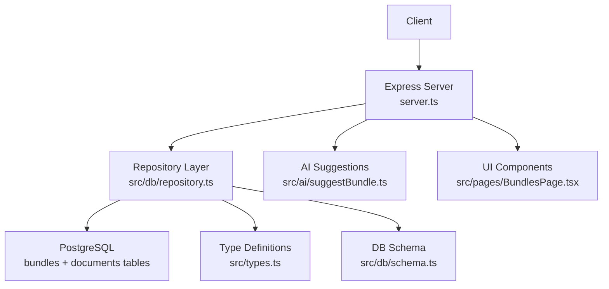
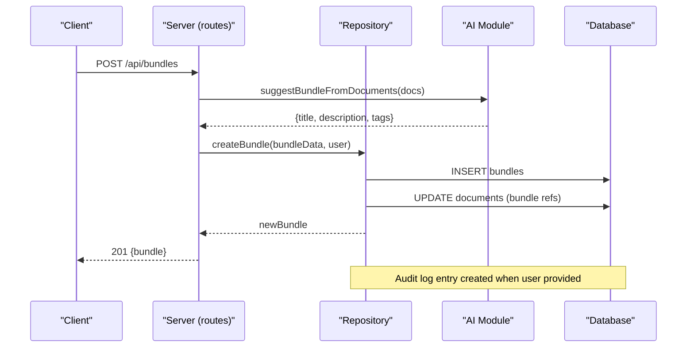
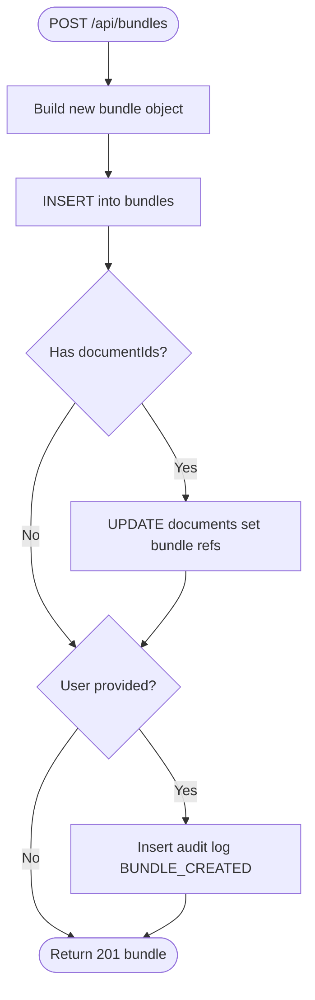
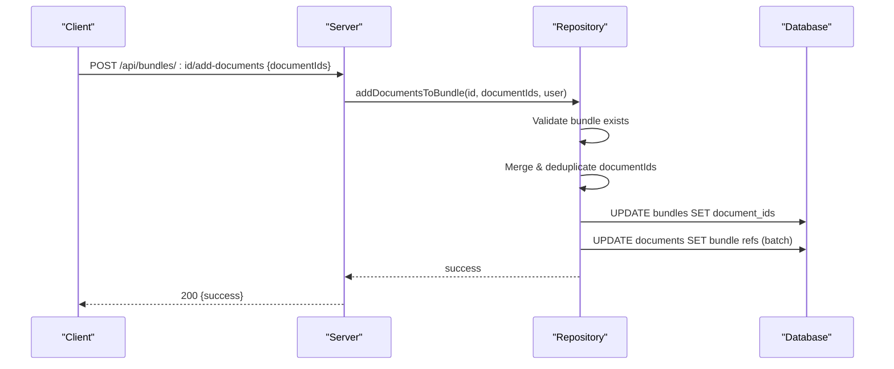
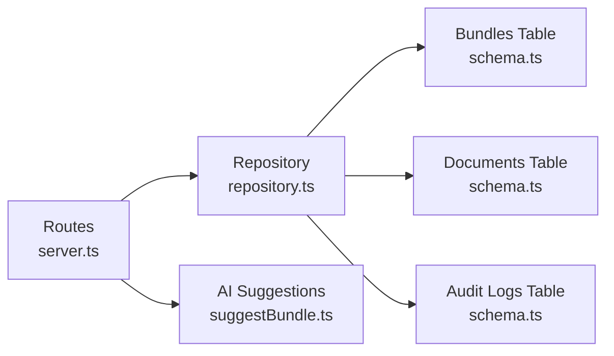

# Bundle Endpoints

<cite>
**Referenced Files in This Document**
- [server.ts](file://server.ts)
- [repository.ts](file://src/db/repository.ts)
- [schema.ts](file://src/db/schema.ts)
- [types.ts](file://src/types.ts)
- [suggestBundle.ts](file://src/ai/suggestBundle.ts)
- [BundlesPage.tsx](file://src/pages/BundlesPage.tsx)
</cite>

## Update Summary
**Changes Made**
- Enhanced bundle management with comprehensive CRUD operations
- Added AI-powered bundle suggestion capabilities using Google Gemini API
- Improved bundle organization with advanced filtering and search functionality
- Enhanced document association management with batch operations
- Added comprehensive audit trail support for all bundle modifications

## Table of Contents
1. [Introduction](#introduction)
2. [Project Structure](#project-structure)
3. [Core Components](#core-components)
4. [Architecture Overview](#architecture-overview)
5. [Detailed Component Analysis](#detailed-component-analysis)
6. [AI-Powered Bundle Suggestions](#ai-powered-bundle-suggestions)
7. [Dependency Analysis](#dependency-analysis)
8. [Performance Considerations](#performance-considerations)
9. [Troubleshooting Guide](#troubleshooting-guide)
10. [Conclusion](#conclusion)

## Introduction
This document provides comprehensive API documentation for ArchiveHub's enhanced bundle and dossier management endpoints used to group related documents. The system now features full CRUD operations, AI-powered suggestions for bundle creation, improved organization capabilities, and comprehensive audit trails. It covers listing, creating, updating, deleting bundles, as well as adding and removing documents from bundles with sophisticated validation and batch processing.

## Project Structure
The enhanced bundle functionality is implemented across:
- Express routes that expose HTTP endpoints for bundle management
- Repository functions that perform database operations with fallback to in-memory state
- Database schema defining the bundles table and relationships
- Type definitions describing bundle and document structures
- AI integration for intelligent bundle suggestions
- Comprehensive UI components for bundle management

**Diagram sources**
- [server.ts:640-698](file://server.ts#L640-L698)
- [repository.ts:1495-1731](file://src/db/repository.ts#L1495-L1731)
- [schema.ts:194-212](file://src/db/schema.ts#L194-L212)
- [types.ts:100-117](file://src/types.ts#L100-L117)
- [suggestBundle.ts:1-56](file://src/ai/suggestBundle.ts#L1-L56)
- [BundlesPage.tsx:31-854](file://src/pages/BundlesPage.tsx#L31-L854)

**Section sources**
- [server.ts:640-698](file://server.ts#L640-L698)
- [repository.ts:1495-1731](file://src/db/repository.ts#L1495-L1731)
- [schema.ts:194-212](file://src/db/schema.ts#L194-L212)
- [types.ts:100-117](file://src/types.ts#L100-L117)

## Core Components
The enhanced bundle system includes:
- **Bundle entity**: Represents a dossier grouping documents together with identifiers, metadata (title, description), department and location references, document associations, status management, QR/barcode identifiers, tags, and timestamps
- **AI-powered suggestions**: Intelligent bundle naming and tagging using Google Gemini API with fallback mechanisms
- **Advanced filtering**: Search and filter capabilities by status, department, tags, and content
- **Batch operations**: Efficient bulk document addition and removal with deduplication
- **Comprehensive audit trail**: Complete logging of all bundle lifecycle events

Key types and schema:
- `DocumentBundle` interface defines the enhanced bundle shape with additional fields like imageUrl, tags, and improved status management
- Bundles table stores bundle records with JSON arrays for document associations and tags
- Documents table maintains back-references to their current bundle via bundleId, bundleNumber, and bundleTitle fields

**Section sources**
- [types.ts:100-117](file://src/types.ts#L100-L117)
- [schema.ts:194-212](file://src/db/schema.ts#L194-L212)
- [repository.ts:47-66](file://src/db/repository.ts#L47-L66)

## Architecture Overview
The enhanced bundle API follows a layered architecture with AI integration:
- Routes in server.ts handle HTTP requests and delegate to repository functions
- Repository functions implement business logic, persist changes to PostgreSQL, update document associations, and write audit logs
- AI module provides intelligent bundle suggestions with fallback to heuristic-based recommendations
- Memory fallback ensures operation continuity when the database is unavailable

**Diagram sources**
- [server.ts:650-658](file://server.ts#L650-L658)
- [repository.ts:1507-1590](file://src/db/repository.ts#L1507-L1590)
- [suggestBundle.ts:19-56](file://src/ai/suggestBundle.ts#L19-L56)

**Section sources**
- [server.ts:640-698](file://server.ts#L640-L698)
- [repository.ts:1495-1731](file://src/db/repository.ts#L1495-L1731)

## Detailed Component Analysis

### GET /api/bundles
- **Purpose**: Retrieve all bundles with their associated metadata and document ID lists
- **Request**: None
- **Response**: Array of bundle objects including id, bundleNumber, title, description, departmentId, departmentName, locationId, locationPath, documentIds, status, qrCode, barcode, tags, createdAt, updatedAt
- **Behavior**: Returns bundles ordered by creation time; maps database rows to typed entities with enhanced metadata

**Section sources**
- [server.ts:641-648](file://server.ts#L641-L648)
- [repository.ts:1496-1505](file://src/db/repository.ts#L1496-L1505)
- [repository.ts:47-66](file://src/db/repository.ts#L47-L66)

### POST /api/bundles
- **Purpose**: Create a new bundle (dossier) with optional AI-powered suggestions and initial document assignments
- **Request body**:
  - bundleData or top-level fields:
    - title (required)
    - description (optional)
    - departmentId, departmentName (required)
    - locationId, locationPath (optional)
    - documentIds (array of document IDs; optional)
    - status (defaults to ACTIVE if not provided)
    - tags (optional array)
    - imageUrl (optional)
  - user (optional): identity for audit logging
- **Response**: Created bundle object with generated id, qrCode, barcode, timestamps
- **Validation and side effects**:
  - Generates unique id, qrCode, barcode
  - Persists bundle and updates referenced documents' bundle fields in a transaction
  - Creates an audit log entry when user is provided

**Diagram sources**
- [repository.ts:1507-1590](file://src/db/repository.ts#L1507-L1590)

**Section sources**
- [server.ts:650-658](file://server.ts#L650-L658)
- [repository.ts:1507-1590](file://src/db/repository.ts#L1507-L1590)

### PUT /api/bundles/:id
- **Purpose**: Update bundle properties such as title, description, department, location, status, tags, and document associations
- **Request body**:
  - updates or direct fields to patch:
    - title, description, departmentId, departmentName, locationId, locationPath, documentIds, status, tags, imageUrl
  - user (optional): identity for audit logging
- **Response**: Success indicator
- **Behavior**:
  - Dynamically builds an update statement for provided fields
  - Updates document associations when documentIds change
  - Supports partial updates without affecting unchanged fields

**Section sources**
- [server.ts:660-668](file://server.ts#L660-L668)
- [repository.ts:1592-1625](file://src/db/repository.ts#L1592-L1625)

### DELETE /api/bundles/:id
- **Purpose**: Delete a bundle and clean up its document associations
- **Request body**:
  - user (optional): identity for audit logging
- **Response**: Success indicator
- **Validation and side effects**:
  - Clears bundle references on all documents linked to the bundle
  - Deletes the bundle record
  - Creates an audit log entry when user is provided
- **Notes**:
  - There is no explicit "active dependencies" check in the current implementation; deletion proceeds after unlinking documents

**Section sources**
- [server.ts:670-678](file://server.ts#L670-L678)
- [repository.ts:1627-1661](file://src/db/repository.ts#L1627-L1661)

### POST /api/bundles/:id/add-documents
- **Purpose**: Add multiple documents to an existing bundle in a single request with batch processing
- **Request body**:
  - documentIds (array of strings)
  - user (optional): identity for audit logging
- **Response**: Success indicator
- **Behavior**:
  - Validates that the target bundle exists; throws an error if not found
  - Merges incoming document IDs with existing ones, deduplicating
  - Updates the bundle's documentIds and synchronizes document records' bundle references
  - Uses batched updates for performance

**Diagram sources**
- [repository.ts:1663-1696](file://src/db/repository.ts#L1663-L1696)

**Section sources**
- [server.ts:680-688](file://server.ts#L680-L688)
- [repository.ts:1663-1696](file://src/db/repository.ts#L1663-L1696)

### POST /api/bundles/:id/remove-document
- **Purpose**: Remove a single document from a bundle and clean up its association
- **Request body**:
  - documentId (string)
  - user (optional): identity for audit logging
- **Response**: Success indicator
- **Behavior**:
  - Locates the target bundle; if not found, returns without error
  - Removes the documentId from the bundle's documentIds list
  - Clears bundle references on the specific document

**Section sources**
- [server.ts:690-698](file://server.ts#L690-L698)
- [repository.ts:1698-1731](file://src/db/repository.ts#L1698-L1731)

## AI-Powered Bundle Suggestions
The enhanced bundle system includes intelligent AI-powered suggestions for bundle creation:

### Features
- **Intelligent Naming**: Automatically generates descriptive bundle titles based on document content
- **Smart Tagging**: Suggests relevant tags for better organization and searchability
- **Contextual Descriptions**: Creates meaningful descriptions summarizing bundle contents
- **Fallback Mechanism**: Provides heuristic-based suggestions when AI services are unavailable

### Implementation Details
- Uses Google Gemini API (`gemini-2.0-flash`) for AI-powered suggestions
- Configurable via `GEMINI_API_KEY` environment variable
- Graceful fallback to built-in suggestion engine when AI is unavailable
- Processes document titles, numbers, and subjects to generate contextual suggestions

### Usage
The AI suggestion system integrates seamlessly with the bundle creation workflow, providing users with intelligent recommendations while maintaining full control over final bundle configuration.

**Section sources**
- [suggestBundle.ts:1-56](file://src/ai/suggestBundle.ts#L1-L56)

## Dependency Analysis
Enhanced dependency relationships in the bundle system:
- Route-to-repository coupling: Each bundle route delegates to corresponding repository functions
- AI integration: Optional AI service integration for intelligent suggestions
- Data persistence: All mutations use PostgreSQL transactions where applicable and fall back to in-memory state when the database is unavailable
- Cross-entity updates: Adding/removing documents updates both the bundles table and the documents table to keep associations consistent
- Comprehensive audit trail: Creation, updates, and deletion of bundles generate audit log entries when user context is provided

**Diagram sources**
- [server.ts:640-698](file://server.ts#L640-L698)
- [repository.ts:1495-1731](file://src/db/repository.ts#L1495-L1731)
- [schema.ts:194-228](file://src/db/schema.ts#L194-L228)
- [suggestBundle.ts:1-56](file://src/ai/suggestBundle.ts#L1-L56)

**Section sources**
- [server.ts:640-698](file://server.ts#L640-L698)
- [repository.ts:1495-1731](file://src/db/repository.ts#L1495-L1731)
- [schema.ts:194-228](file://src/db/schema.ts#L194-L228)

## Performance Considerations
Enhanced performance optimizations:
- **Batch updates**: Adding documents uses batched SQL updates to minimize round trips
- **Deduplication**: Incoming document IDs are merged and deduplicated before persisting to avoid redundant associations
- **Transactional safety**: Bundle creation wraps inserts and document updates in a transaction to ensure consistency
- **Memory fallback**: When the database is unavailable, operations continue against in-memory state to preserve responsiveness
- **AI caching**: Fallback suggestions provide immediate responses without blocking on AI service calls
- **Efficient querying**: Optimized database queries with proper indexing for bundle lookups and document associations

## Troubleshooting Guide
Common issues and solutions:
- **Bundle not found when adding documents**: The add endpoint validates existence and will throw an error if the bundle does not exist
- **Database connectivity issues**: Repository functions log warnings and fall back to memory state; verify environment configuration for database connection
- **AI service unavailability**: Bundle suggestions gracefully fall back to heuristic-based recommendations when AI services are unavailable
- **Audit logs**: Ensure a user object is passed with create and delete operations to capture audit trails
- **Status and validation**: Bundle status supports ACTIVE, ARCHIVED, SEALED, CHECKED_OUT
- **Tags and documentIds**: Stored as JSON arrays; ensure correct formatting

**Section sources**
- [repository.ts:1663-1666](file://src/db/repository.ts#L1663-L1666)
- [repository.ts:1559-1567](file://src/db/repository.ts#L1559-L1567)
- [repository.ts:1640-1647](file://src/db/repository.ts#L1640-L1647)
- [suggestBundle.ts:22-25](file://src/ai/suggestBundle.ts#L22-L25)

## Conclusion
ArchiveHub's enhanced bundle endpoints provide a robust mechanism to group related documents with comprehensive CRUD capabilities, AI-powered suggestions, and controlled associations. The system now features intelligent bundle organization, batch operations for efficient document management, and complete audit trails for compliance. The integration of AI-powered suggestions enhances user experience while maintaining full control over bundle configuration. The system maintains data integrity through transactions and offers resilience via in-memory fallbacks, making it suitable for both development and production environments.