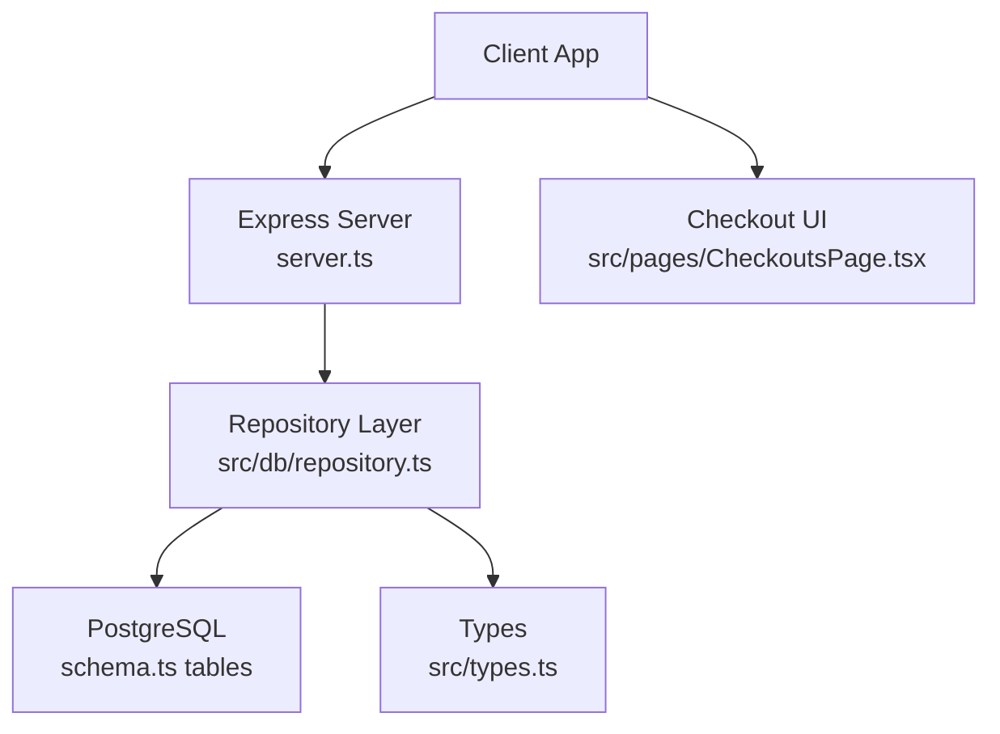
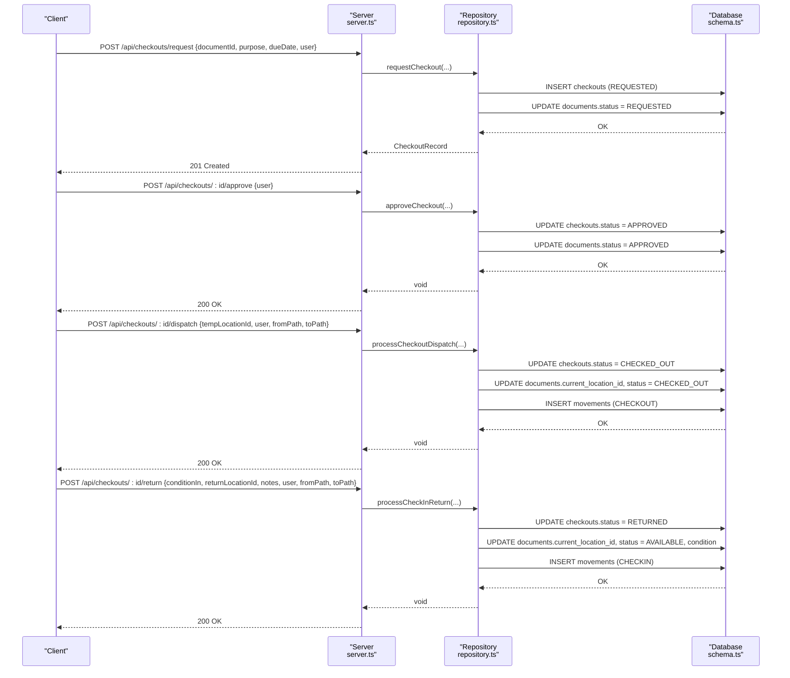
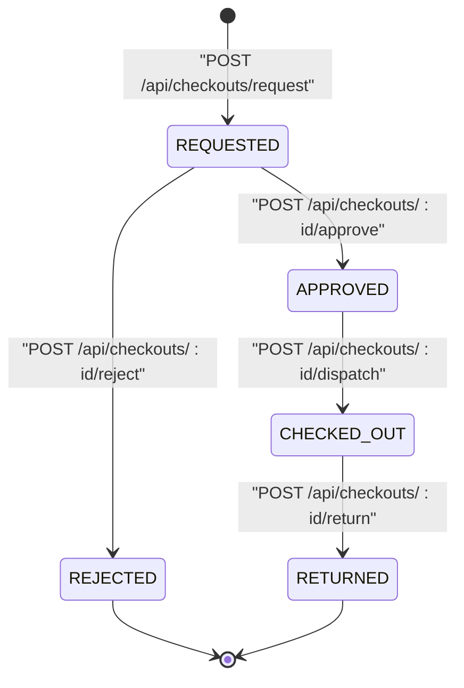
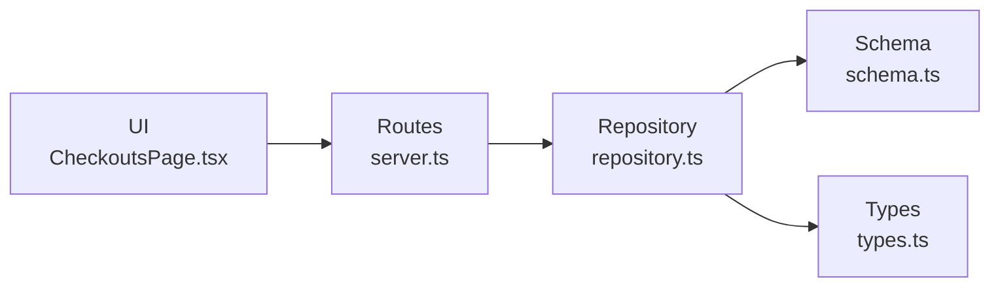

# Checkout Endpoints

<cite>
**Referenced Files in This Document**
- [server.ts](file://server.ts)
- [repository.ts](file://src/db/repository.ts)
- [schema.ts](file://src/db/schema.ts)
- [types.ts](file://src/types.ts)
- [CheckoutsPage.tsx](file://src/pages/CheckoutsPage.tsx)
</cite>

## Table of Contents
1. [Introduction](#introduction)
2. [Project Structure](#project-structure)
3. [Core Components](#core-components)
4. [Architecture Overview](#architecture-overview)
5. [Detailed Component Analysis](#detailed-component-analysis)
6. [Dependency Analysis](#dependency-analysis)
7. [Performance Considerations](#performance-considerations)
8. [Troubleshooting Guide](#troubleshooting-guide)
9. [Conclusion](#conclusion)

## Introduction
This document provides detailed API documentation for ArchiveHub’s checkout workflow endpoints that cover the complete document borrowing lifecycle. It explains how to retrieve checkouts, initiate requests, approve or reject them, dispatch approved items to temporary locations, and process returns. It also documents state transitions, authorization expectations, audit logging, and movement tracking as implemented in the codebase.

## Project Structure
The checkout workflow is exposed via Express routes in the server entrypoint and implemented through repository functions that persist changes to PostgreSQL (with an in-memory fallback). The data model for checkouts, documents, movements, and users is defined in schema files and typed in a shared types module. The frontend page demonstrates typical user flows such as approving and dispatching in one action or processing returns.

**Diagram sources**
- [server.ts:363-441](file://server.ts#L363-L441)
- [repository.ts:806-1122](file://src/db/repository.ts#L806-L1122)
- [schema.ts:118-167](file://src/db/schema.ts#L118-L167)
- [types.ts:205-235](file://src/types.ts#L205-L235)

**Section sources**
- [server.ts:363-441](file://server.ts#L363-L441)
- [repository.ts:806-1122](file://src/db/repository.ts#L806-L1122)
- [schema.ts:118-167](file://src/db/schema.ts#L118-L167)
- [types.ts:205-235](file://src/types.ts#L205-L235)

## Core Components
- GET /api/checkouts: Returns all checkouts from the repository. Filtering by status or user is not implemented at the API level; clients can filter client-side if needed.
- POST /api/checkouts/request: Creates a new checkout request with document ID, purpose, due date, and user attribution. Sets document status to REQUESTED.
- POST /api/checkouts/:id/approve: Approves a checkout request, recording the approver and setting document status to APPROVED.
- POST /api/checkouts/:id/reject: Rejects a checkout request with a reason, restoring document status to AVAILABLE.
- POST /api/checkouts/:id/dispatch: Transitions an approved checkout to CHECKED_OUT, moves the document to a temporary location, records a movement, and sets custodian information.
- POST /api/checkouts/:id/return: Processes a return, updates condition, assigns return location, closes the checkout, and records a movement.

**Section sources**
- [server.ts:363-441](file://server.ts#L363-L441)
- [repository.ts:806-1122](file://src/db/repository.ts#L806-L1122)

## Architecture Overview
The checkout workflow follows a clear sequence of states enforced by repository operations and persisted in the database. Each operation uses transactions where applicable and logs movements for physical custody changes.

**Diagram sources**
- [server.ts:373-441](file://server.ts#L373-L441)
- [repository.ts:840-1122](file://src/db/repository.ts#L840-L1122)
- [schema.ts:118-167](file://src/db/schema.ts#L118-L167)

## Detailed Component Analysis

### GET /api/checkouts
- Purpose: Retrieve all checkouts.
- Request: None.
- Response: Array of checkout records including requester, approver, borrower, dates, status, purpose, conditions, and notes.
- Filtering: No query parameters are parsed; filtering must be performed client-side.
- Error handling: On failure, returns 500 with error message.

Implementation details:
- Route handler calls repository.getCheckouts() which queries the checkouts table and maps rows to typed records.
- In-memory fallback returns cached state when database is unavailable.

State considerations:
- Supports statuses: REQUESTED, APPROVED, REJECTED, CHECKED_OUT, OVERDUE, RETURNED.

**Section sources**
- [server.ts:363-371](file://server.ts#L363-L371)
- [repository.ts:806-838](file://src/db/repository.ts#L806-L838)
- [types.ts:205-235](file://src/types.ts#L205-L235)

### POST /api/checkouts/request
- Purpose: Initiate a checkout request for a document.
- Request body:
  - documentId: string
  - purpose: string
  - dueDate: string (date)
  - user: object with id, fullName, departmentName
- Response: Newly created checkout record (201 Created).
- Side effects:
  - Inserts a checkout row with status REQUESTED.
  - Updates the associated document status to REQUESTED.
  - Captures conditionOut from the current document condition.

Workflow notes:
- Due date is stored as provided; overdue calculation is not performed server-side here. Clients should compare dueDate with current date to mark OVERDUE as needed.
- No explicit role-based authorization is enforced at this endpoint; callers should ensure the user has permission to request.

Error handling:
- Throws if document not found.
- Transaction rollback on failure; returns 500 with error message.

**Section sources**
- [server.ts:373-386](file://server.ts#L373-L386)
- [repository.ts:840-896](file://src/db/repository.ts#L840-L896)
- [schema.ts:118-148](file://src/db/schema.ts#L118-L148)
- [types.ts:135-183](file://src/types.ts#L135-L183)

### POST /api/checkouts/:id/approve
- Purpose: Approve a pending checkout request.
- Request body:
  - user: object with id, fullName (approver identity)
- Response: Success JSON (200 OK).
- Side effects:
  - Updates checkout status to APPROVED and records approver identity.
  - Updates document status to APPROVED.

Authorization:
- Not explicitly enforced in the route; callers should validate roles before invoking.

Audit trail:
- Movement and audit log entries are not created during approval; only status changes occur.

Error handling:
- Validates existence of checkout; throws if not found.
- Uses transaction; rolls back on error.

**Section sources**
- [server.ts:388-396](file://server.ts#L388-L396)
- [repository.ts:898-934](file://src/db/repository.ts#L898-L934)
- [schema.ts:118-148](file://src/db/schema.ts#L118-L148)

### POST /api/checkouts/:id/reject
- Purpose: Reject a pending checkout request with a documented reason.
- Request body:
  - reason: string
  - user: object with id, fullName
- Response: Success JSON (200 OK).
- Side effects:
  - Updates checkout status to REJECTED and stores the reason in notes.
  - Restores document status to AVAILABLE.

Notification triggers:
- No notification logic is implemented in the backend; clients may trigger notifications based on response.

Error handling:
- Validates existence of checkout; throws if not found.
- Uses transaction; rolls back on error.

**Section sources**
- [server.ts:398-406](file://server.ts#L398-L406)
- [repository.ts:936-969](file://src/db/repository.ts#L936-L969)
- [schema.ts:118-148](file://src/db/schema.ts#L118-L148)

### POST /api/checkouts/:id/dispatch
- Purpose: Dispatch an approved checkout to a temporary location and transition to checked out.
- Request body:
  - tempLocationId: string (temporary storage location)
  - user: object with id, fullName
  - fromPath: string (source path)
  - toPath: string (destination path)
- Response: Success JSON (200 OK).
- Side effects:
  - Updates checkout status to CHECKED_OUT, records checkout date and borrower identity.
  - Updates document current location to tempLocationId, sets status to CHECKED_OUT, and sets custodian name to requester info.
  - Inserts a movement record with type CHECKOUT capturing from/to paths and reason.

Movement tracking:
- A movement record is always inserted to track the physical move from original location to temporary location.

Error handling:
- Validates existence of checkout; throws if not found.
- Uses transaction; rolls back on error.

**Section sources**
- [server.ts:408-422](file://server.ts#L408-L422)
- [repository.ts:971-1052](file://src/db/repository.ts#L971-L1052)
- [schema.ts:150-167](file://src/db/schema.ts#L150-L167)

### POST /api/checkouts/:id/return
- Purpose: Process a return, assess condition, assign return location, and close the checkout.
- Request body:
  - conditionIn: string (EXCELLENT | GOOD | FAIR | DAMAGED | MISSING)
  - returnLocationId: string (where the document is returned to)
  - notes: string (optional)
  - user: object with id, fullName
  - fromPath: string (source path)
  - toPath: string (destination path)
- Response: Success JSON (200 OK).
- Side effects:
  - Updates checkout status to RETURNED, records return date, conditionIn, and returning user.
  - Updates document current location to returnLocationId, sets status to AVAILABLE, updates condition, and resets custodian to Records Office.
  - Inserts a movement record with type CHECKIN capturing from/to paths and reason.

Condition assessment:
- conditionIn is persisted and used to update the document’s condition upon return.

Error handling:
- Validates existence of checkout; throws if not found.
- Uses transaction; rolls back on error.

**Section sources**
- [server.ts:424-441](file://server.ts#L424-L441)
- [repository.ts:1054-1122](file://src/db/repository.ts#L1054-L1122)
- [schema.ts:118-167](file://src/db/schema.ts#L118-L167)

### Workflow State Transitions
The following diagram shows the checkout lifecycle as enforced by the repository operations:

Notes:
- OVERDUE is a derived status typically computed by clients comparing dueDate with current date; it is not automatically set by the backend in these endpoints.
- Movements are recorded for CHECKOUT and CHECKIN transitions.

**Diagram sources**
- [repository.ts:840-1122](file://src/db/repository.ts#L840-L1122)
- [types.ts:205-235](file://src/types.ts#L205-L235)

### Approval Hierarchies and Authorization
- Role enforcement: The checkout endpoints do not enforce role checks internally. Callers should validate that the user has appropriate permissions (e.g., RECORDS_ADMIN or RECORDS_OFFICER) before calling approve or dispatch.
- User attribution: All mutating endpoints accept a user object to attribute actions to a specific user.

Recommendation:
- Add middleware to verify roles for approve, reject, dispatch, and return endpoints to ensure proper authorization.

[No sources needed since this section provides general guidance]

### Due Date Calculations
- Due date is stored as provided in the request payload.
- Overdue detection is not performed server-side; clients should compute overdue status by comparing dueDate with current date and display accordingly.

[No sources needed since this section provides general guidance]

### Audit Trail Requirements
- Movements: Every physical movement (checkout and return) creates a movement record with timestamps, user attribution, and reasons.
- Audit logs: While checkout operations do not create audit log entries directly in the repository functions shown, other parts of the system (e.g., document registration and movement) do insert audit logs. For comprehensive audit trails, consider adding explicit audit log creation for checkout lifecycle events.

**Section sources**
- [repository.ts:971-1122](file://src/db/repository.ts#L971-L1122)
- [schema.ts:150-167](file://src/db/schema.ts#L150-L167)

## Dependency Analysis
The checkout endpoints depend on:
- Express routing in server.ts to handle HTTP requests and map to repository functions.
- Repository layer in repository.ts to implement business logic and persistence.
- Database schema in schema.ts defining tables for checkouts, documents, movements, and users.
- Shared types in types.ts ensuring consistent data structures across layers.

**Diagram sources**
- [server.ts:363-441](file://server.ts#L363-L441)
- [repository.ts:806-1122](file://src/db/repository.ts#L806-L1122)
- [schema.ts:118-167](file://src/db/schema.ts#L118-L167)
- [types.ts:205-235](file://src/types.ts#L205-L235)
- [CheckoutsPage.tsx:213-247](file://src/pages/CheckoutsPage.tsx#L213-L247)

**Section sources**
- [server.ts:363-441](file://server.ts#L363-L441)
- [repository.ts:806-1122](file://src/db/repository.ts#L806-L1122)
- [schema.ts:118-167](file://src/db/schema.ts#L118-L167)
- [types.ts:205-235](file://src/types.ts#L205-L235)
- [CheckoutsPage.tsx:213-247](file://src/pages/CheckoutsPage.tsx#L213-L247)

## Performance Considerations
- Transactions: Critical operations use database transactions to ensure consistency between checkout and document updates.
- Fallback mode: When PostgreSQL is unavailable, repository functions fall back to in-memory state to keep the application functional.
- Query simplicity: Endpoints perform minimal queries; heavy filtering should be handled client-side for GET /api/checkouts.

[No sources needed since this section provides general guidance]

## Troubleshooting Guide
Common issues and resolutions:
- Document not found during request: Ensure documentId exists and is valid before calling POST /api/checkouts/request.
- Checkout not found during approve/reject/dispatch/return: Verify the checkout id and that it exists in the system.
- Database connectivity: If PostgreSQL is down, repository falls back to memory mode; confirm environment configuration for persistent behavior.
- Status inconsistencies: After approve, ensure dispatch is called to move to CHECKED_OUT; after return, document status reverts to AVAILABLE.

**Section sources**
- [repository.ts:840-1122](file://src/db/repository.ts#L840-L1122)

## Conclusion
ArchiveHub’s checkout workflow provides a robust set of endpoints to manage document borrowing from request through return. The implementation enforces state transitions, tracks physical movements, and supports user attribution. To enhance security and compliance, add role-based authorization and explicit audit logging for each checkout lifecycle event. Clients should handle overdue calculations and filtering on the frontend while relying on the backend for state changes and persistence.

[No sources needed since this section summarizes without analyzing specific files]