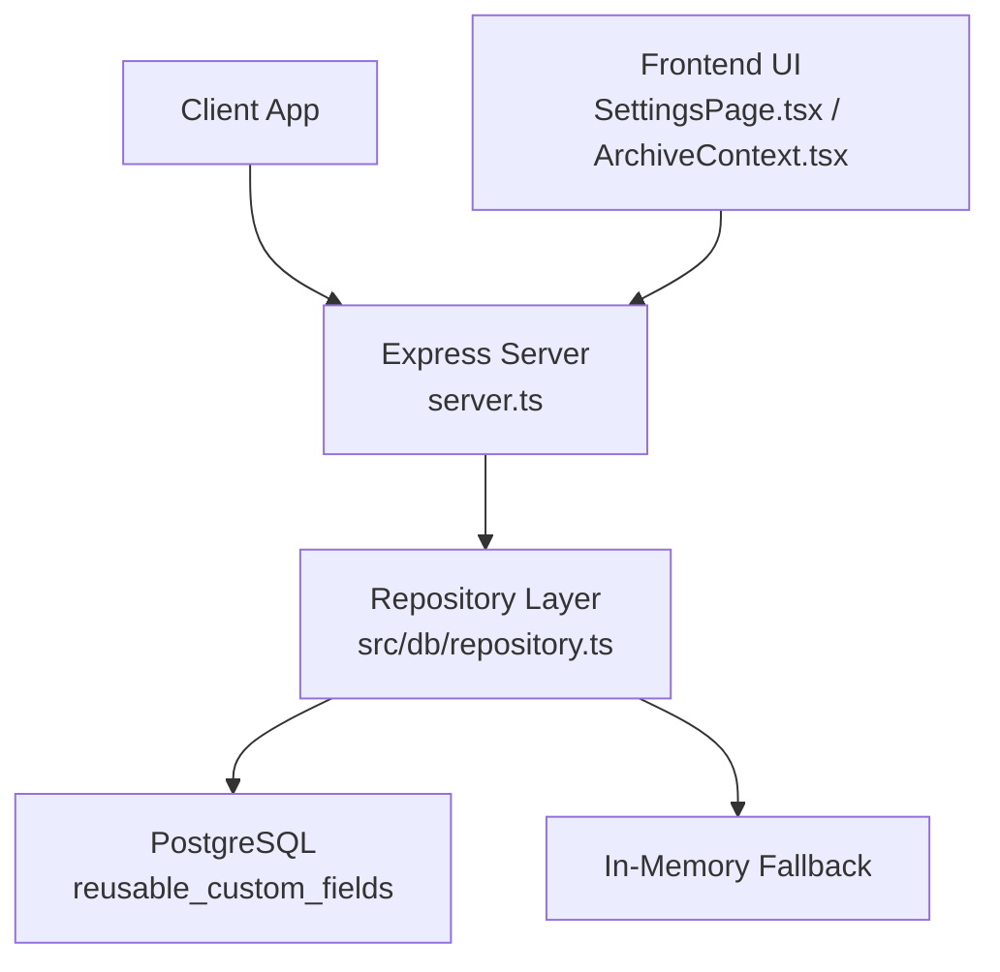
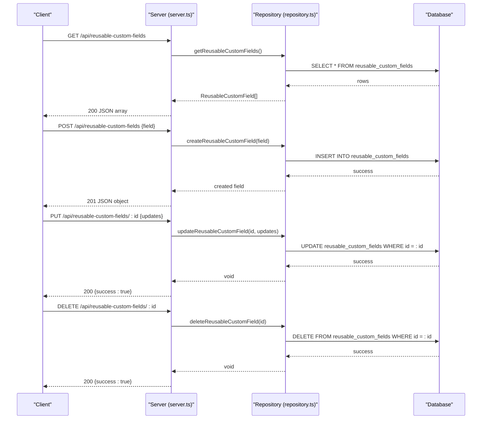
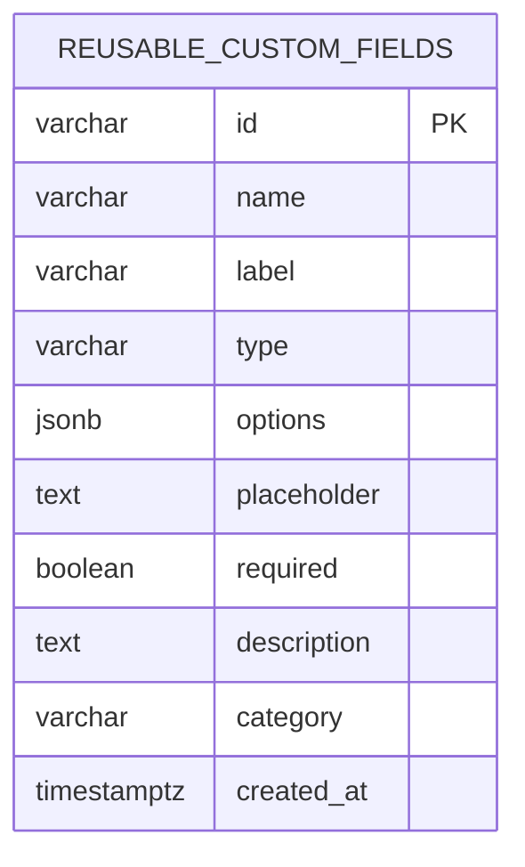
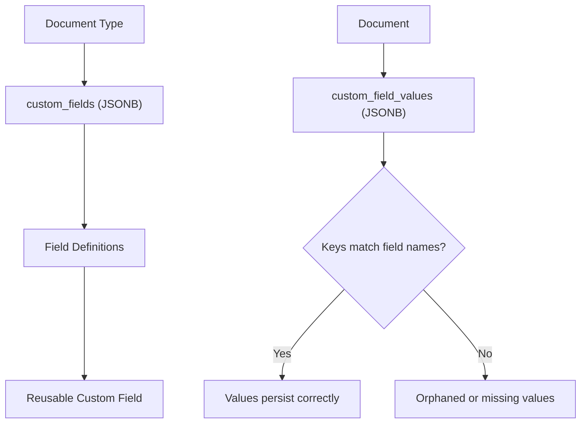
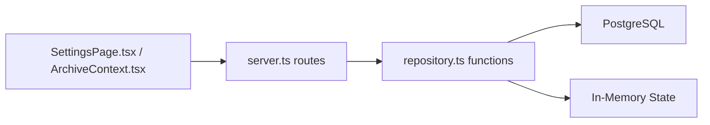

# Custom Field Endpoints

<cite>
**Referenced Files in This Document**
- [server.ts](file://server.ts)
- [repository.ts](file://src/db/repository.ts)
- [types.ts](file://src/types.ts)
- [schema.ts](file://src/db/schema.ts)
- [migrate.ts](file://src/db/migrate.ts)
- [ArchiveContext.tsx](file://src/context/ArchiveContext.tsx)
- [SettingsPage.tsx](file://src/pages/SettingsPage.tsx)
</cite>

## Table of Contents
1. [Introduction](#introduction)
2. [Project Structure](#project-structure)
3. [Core Components](#core-components)
4. [Architecture Overview](#architecture-overview)
5. [Detailed Component Analysis](#detailed-component-analysis)
6. [Dependency Analysis](#dependency-analysis)
7. [Performance Considerations](#performance-considerations)
8. [Troubleshooting Guide](#troubleshooting-guide)
9. [Conclusion](#conclusion)
10. [Appendices](#appendices)

## Introduction
This document provides detailed API documentation for ArchiveHub’s reusable custom field management endpoints that enable dynamic extension of document metadata. It covers:
- GET /api/reusable-custom-fields: retrieve all available custom field definitions with their configurations
- POST /api/reusable-custom-fields: create new custom fields with type, validation rules, default values, and display configuration
- PUT /api/reusable-custom-fields/:id: update custom field definitions while considering backward compatibility with existing instances
- DELETE /api/reusable-custom-fields/:id: remove custom fields with impact analysis on documents using those fields

It also explains supported field types, validation schemas, inheritance patterns between reusable fields and document types, and migration strategies when changing field definitions.

## Project Structure
The reusable custom fields feature spans server routes, repository logic, data models, and UI integration:
- Server routes define the REST endpoints and delegate to repository functions
- Repository functions implement persistence (PostgreSQL or in-memory fallback) and return typed entities
- Types define the shape of reusable custom fields and related structures
- Migration creates the database table for reusable custom fields
- UI components consume these APIs to manage fields and apply them to document types



**Diagram sources**
- [server.ts:482-517](file://server.ts#L482-L517)
- [repository.ts:1267-1360](file://src/db/repository.ts#L1267-L1360)
- [migrate.ts:231-245](file://src/db/migrate.ts#L231-L245)

**Section sources**
- [server.ts:482-517](file://server.ts#L482-L517)
- [repository.ts:1267-1360](file://src/db/repository.ts#L1267-L1360)
- [migrate.ts:231-245](file://src/db/migrate.ts#L231-L245)

## Core Components
- ReusableCustomField model defines the schema for reusable fields used across document types
- Repository functions provide CRUD operations with PostgreSQL and memory fallback
- Server routes expose REST endpoints for clients
- UI integrates creation, editing, and usage of reusable fields in document type schemas

Key responsibilities:
- GET returns a list of reusable custom field definitions
- POST creates a new definition and persists it
- PUT updates an existing definition with partial fields
- DELETE removes a definition; current implementation deletes from storage without explicit impact checks

**Section sources**
- [types.ts:74-98](file://src/types.ts#L74-L98)
- [repository.ts:1267-1360](file://src/db/repository.ts#L1267-L1360)
- [server.ts:482-517](file://server.ts#L482-L517)

## Architecture Overview
The endpoints follow a thin controller pattern: Express routes call repository methods which handle persistence and error handling. The system supports a PostgreSQL backend with automatic migrations and seed on startup, and falls back to in-memory state if the database is unavailable.



**Diagram sources**
- [server.ts:482-517](file://server.ts#L482-L517)
- [repository.ts:1267-1360](file://src/db/repository.ts#L1267-L1360)

## Detailed Component Analysis

### Data Model: ReusableCustomField
- Fields include identifier, label, type, options, placeholder, required flag, description, category, and creation timestamp
- Supported types are text, number, date, select; boolean is not present in the type enum but can be modeled via select with two choices
- Options are stored as JSONB for select fields
- Required and placeholder support basic validation and UX hints

```mermaid
classDiagram
class ReusableCustomField {
+string id
+string name
+string label
+CustomFieldType type
+string[] options
+string placeholder
+boolean required
+string description
+string category
+string createdAt
}
class CustomFieldType {
<<enum>>
"text"
"number"
"date"
"select"
}
ReusableCustomField --> CustomFieldType : "uses"
```

**Diagram sources**
- [types.ts:74-98](file://src/types.ts#L74-L98)

**Section sources**
- [types.ts:74-98](file://src/types.ts#L74-L98)

### Database Schema: reusable_custom_fields
- Table includes id, name, label, type, options (JSONB), placeholder, required, description, category, created_at
- Migrations ensure the table exists on startup



**Diagram sources**
- [migrate.ts:231-245](file://src/db/migrate.ts#L231-L245)

**Section sources**
- [migrate.ts:231-245](file://src/db/migrate.ts#L231-L245)

### API Endpoints

#### GET /api/reusable-custom-fields
- Purpose: Retrieve all reusable custom field definitions
- Response: Array of ReusableCustomField objects
- Behavior: Queries PostgreSQL; falls back to in-memory list if DB is unavailable

Request
- Method: GET
- Path: /api/reusable-custom-fields
- Headers: Content-Type: application/json (optional)

Response
- Status: 200 OK
- Body: Array of ReusableCustomField entries

Error Handling
- On failure: 500 Internal Server Error with error message

**Section sources**
- [server.ts:482-490](file://server.ts#L482-L490)
- [repository.ts:1267-1287](file://src/db/repository.ts#L1267-L1287)

#### POST /api/reusable-custom-fields
- Purpose: Create a new reusable custom field definition
- Request body: Partial ReusableCustomField excluding id and createdAt
- Response: Created ReusableCustomField object

Validation and Rules
- Type must be one of text, number, date, select
- For type select, options should be provided as an array of strings
- required defaults to false if omitted
- placeholder and description are optional
- category defaults to "General" if omitted

Request
- Method: POST
- Path: /api/reusable-custom-fields
- Headers: Content-Type: application/json
- Body: { name, label, type, options?, placeholder?, required?, description?, category? }

Response
- Status: 201 Created
- Body: ReusableCustomField with generated id and createdAt

Error Handling
- On failure: 500 Internal Server Error with error message

**Section sources**
- [server.ts:492-499](file://server.ts#L492-L499)
- [repository.ts:1289-1317](file://src/db/repository.ts#L1289-L1317)
- [types.ts:74-98](file://src/types.ts#L74-L98)

#### PUT /api/reusable-custom-fields/:id
- Purpose: Update an existing reusable custom field definition
- Path parameter: id of the field to update
- Request body: Partial ReusableCustomField with fields to update

Behavior
- Updates only provided fields
- Persists changes to PostgreSQL; falls back to in-memory update if DB unavailable

Request
- Method: PUT
- Path: /api/reusable-custom-fields/:id
- Headers: Content-Type: application/json
- Body: { name?, label?, type?, options?, placeholder?, required?, description?, category? }

Response
- Status: 200 OK
- Body: { success: true }

Error Handling
- On failure: 500 Internal Server Error with error message

Backward Compatibility Notes
- Changing type or options may affect forms bound to this field; consider versioning or migration steps to preserve existing values
- Updating required flag does not retroactively validate existing document instances unless re-saved

**Section sources**
- [server.ts:501-508](file://server.ts#L501-L508)
- [repository.ts:1319-1347](file://src/db/repository.ts#L1319-L1347)

#### DELETE /api/reusable-custom-fields/:id
- Purpose: Remove a reusable custom field definition
- Path parameter: id of the field to delete

Behavior
- Deletes the field from PostgreSQL; falls back to in-memory deletion if DB unavailable
- Current implementation does not perform impact analysis on documents using this field

Request
- Method: DELETE
- Path: /api/reusable-custom-fields/:id

Response
- Status: 200 OK
- Body: { success: true }

Error Handling
- On failure: 500 Internal Server Error with error message

Impact Analysis Recommendation
- Before deleting, check for references in document type schemas and existing document custom_field_values
- If referenced, either block deletion or migrate values to a new field key

**Section sources**
- [server.ts:510-517](file://server.ts#L510-L517)
- [repository.ts:1349-1360](file://src/db/repository.ts#L1349-L1360)

### Relationship Between Custom Fields and Document Types
- Document types store an array of custom field definitions in JSONB
- Reusable fields can be added to document types to standardize metadata across documents
- When a document is created or edited, its custom_field_values map stores values keyed by field name



**Diagram sources**
- [schema.ts:37-46](file://src/db/schema.ts#L37-L46)
- [schema.ts:67-116](file://src/db/schema.ts#L67-L116)

**Section sources**
- [schema.ts:37-46](file://src/db/schema.ts#L37-L46)
- [schema.ts:67-116](file://src/db/schema.ts#L67-L116)

### Field Types, Validation, and Display Configuration
- Supported types: text, number, date, select
- Validation:
  - required enforces presence at form level
  - For select, options constrain allowed values
  - Number and date types rely on browser input constraints; additional server-side validation can be added
- Display:
  - placeholder guides user input
  - label is user-facing; name is internal key
  - description provides context
  - category groups fields for UI organization

Usage in UI
- Forms render inputs based on field.type and options
- Required fields show visual indicators

**Section sources**
- [types.ts:74-98](file://src/types.ts#L74-L98)
- [EditDocumentModal.tsx:338-359](file://src/components/documents/EditDocumentModal.tsx#L338-L359)
- [DocumentsPage.tsx:900-922](file://src/pages/DocumentsPage.tsx#L900-L922)

### Inheritance Patterns and Field Reuse Mechanisms
- Reusable fields act as templates that can be included in multiple document types
- Changes to a reusable field propagate to all document types that reference it by name
- To avoid breaking changes:
  - Prefer additive changes (e.g., adding options) over destructive ones (e.g., renaming keys)
  - Use versioning or migration scripts to rename keys and copy values when necessary

Migration Strategies
- Renaming a field:
  - Add new field with updated name
  - Copy values from old key to new key in existing documents
  - Deprecate old key after verification
- Changing type:
  - Validate existing values against new type
  - Provide conversion logic if needed (e.g., string to number)
- Removing options:
  - Ensure existing values remain valid or migrate to new set

**Section sources**
- [SettingsPage.tsx:139-166](file://src/pages/SettingsPage.tsx#L139-L166)
- [ArchiveContext.tsx:561-579](file://src/context/ArchiveContext.tsx#L561-L579)

### Usage Statistics
- Current implementation does not expose per-field usage statistics (e.g., how many documents use a field)
- To add usage stats:
  - Track counts in a separate table or compute on-the-fly by scanning documents’ custom_field_values
  - Expose via a new endpoint or extend GET response with usage metrics

[No sources needed since this section proposes enhancements not implemented]

## Dependency Analysis
- Server routes depend on repository functions for data operations
- Repository depends on PostgreSQL pool and optionally in-memory state
- UI depends on server endpoints to manage fields and apply them to document types



**Diagram sources**
- [server.ts:482-517](file://server.ts#L482-L517)
- [repository.ts:1267-1360](file://src/db/repository.ts#L1267-L1360)
- [ArchiveContext.tsx:561-579](file://src/context/ArchiveContext.tsx#L561-L579)

**Section sources**
- [server.ts:482-517](file://server.ts#L482-L517)
- [repository.ts:1267-1360](file://src/db/repository.ts#L1267-L1360)
- [ArchiveContext.tsx:561-579](file://src/context/ArchiveContext.tsx#L561-L579)

## Performance Considerations
- GET lists all fields; consider pagination or filtering if the library grows large
- PUT updates only specified fields to minimize write overhead
- DELETE currently lacks impact checks; adding pre-checks could prevent accidental deletions affecting many documents
- PostgreSQL queries are simple; ensure indexes on frequently filtered fields (e.g., category) if needed

[No sources needed since this section provides general guidance]

## Troubleshooting Guide
Common issues and resolutions:
- Database connection errors:
  - System falls back to in-memory state; verify .env DATABASE_URL and service connectivity
- Validation errors:
  - Ensure type matches supported values; for select, provide options array
  - Required fields must be set if marked required
- Deletion side effects:
  - Deleting a field used by documents may leave orphaned values; plan migrations before deletion
- UI inconsistencies:
  - If field type changes, existing forms may need updates to handle new input types or options

**Section sources**
- [server.ts:482-517](file://server.ts#L482-L517)
- [repository.ts:1267-1360](file://src/db/repository.ts#L1267-L1360)

## Conclusion
ArchiveHub’s reusable custom field endpoints provide a flexible mechanism to extend document metadata. The API supports creating, reading, updating, and deleting field definitions with robust persistence and fallback behavior. While the current implementation lacks usage statistics and impact analysis on deletion, the architecture allows straightforward enhancements. Careful migration planning ensures backward compatibility when modifying field definitions.

[No sources needed since this section summarizes without analyzing specific files]

## Appendices

### Endpoint Summary
- GET /api/reusable-custom-fields
  - Returns: Array of ReusableCustomField
- POST /api/reusable-custom-fields
  - Accepts: ReusableCustomField (excluding id, createdAt)
  - Returns: Created ReusableCustomField
- PUT /api/reusable-custom-fields/:id
  - Accepts: Partial ReusableCustomField
  - Returns: { success: true }
- DELETE /api/reusable-custom-fields/:id
  - Returns: { success: true }

**Section sources**
- [server.ts:482-517](file://server.ts#L482-L517)

### Field Type Reference
- text: Free-form text input
- number: Numeric input with browser validation
- date: Date picker input
- select: Dropdown with constrained options

**Section sources**
- [types.ts:74-98](file://src/types.ts#L74-L98)