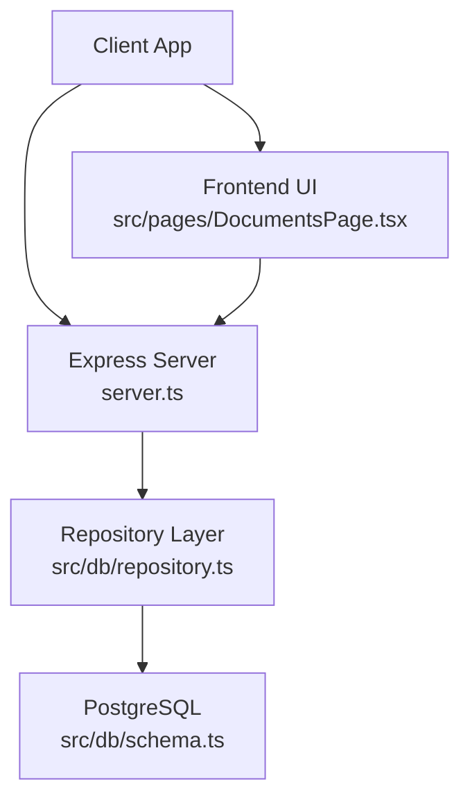
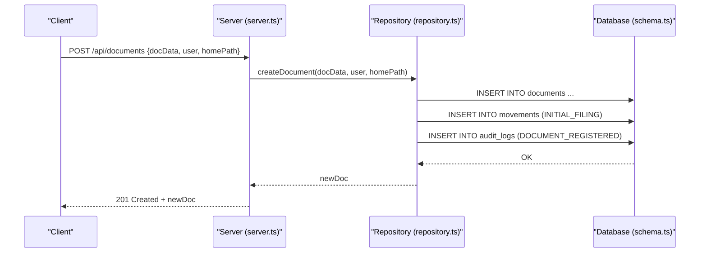
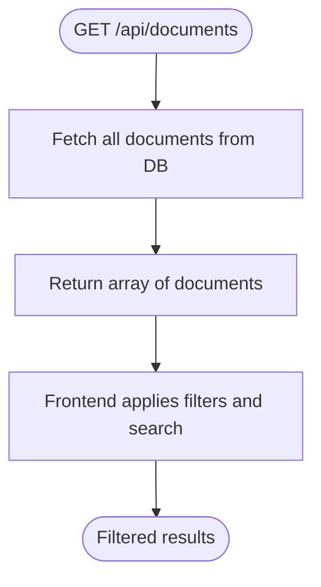
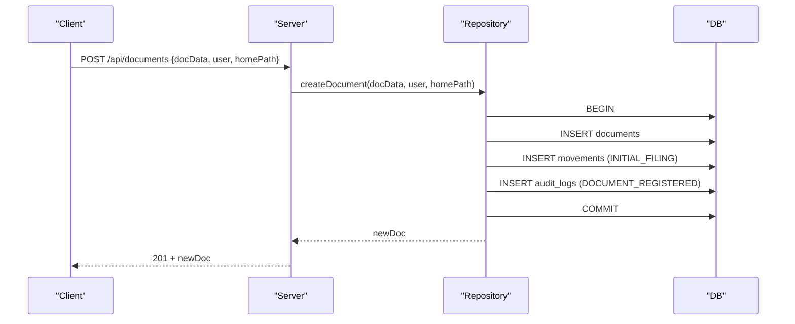
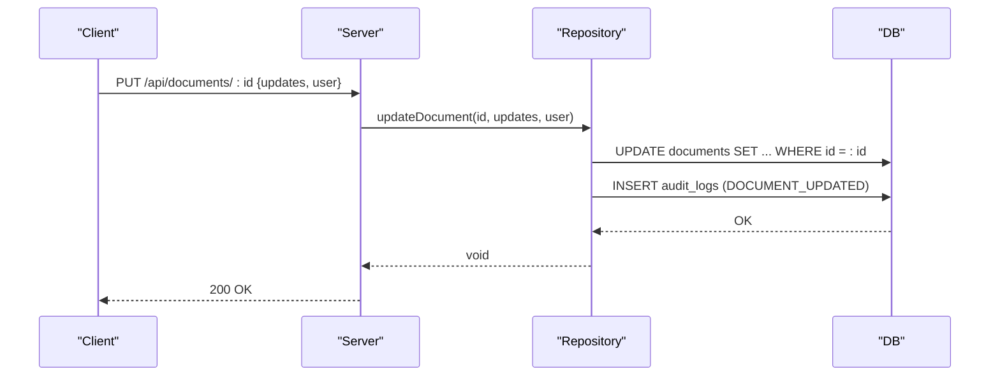
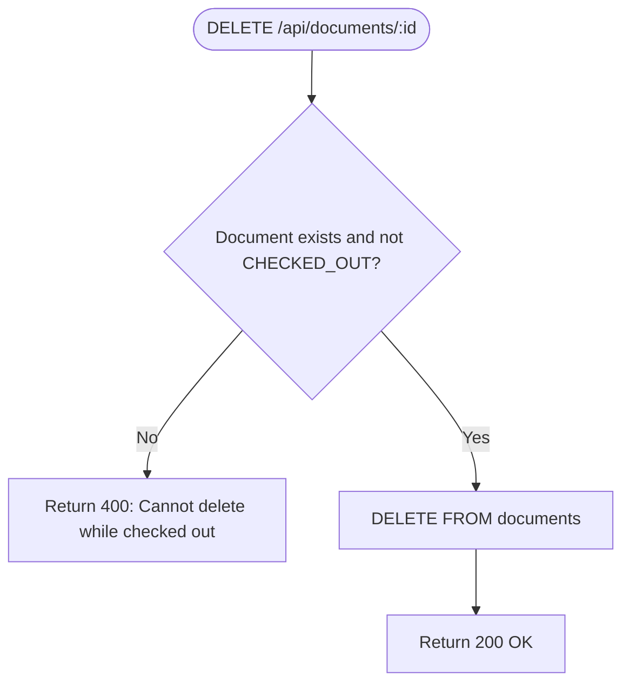
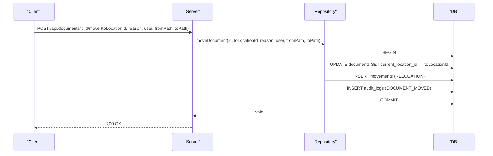
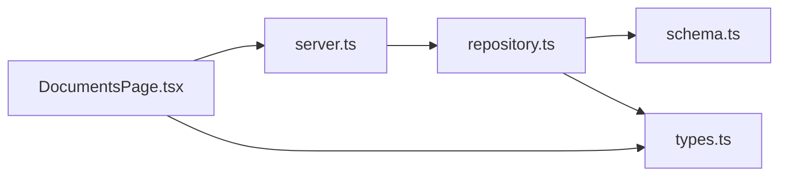

# Document Endpoints

<cite>
**Referenced Files in This Document**
- [server.ts](file://server.ts)
- [repository.ts](file://src/db/repository.ts)
- [schema.ts](file://src/db/schema.ts)
- [types.ts](file://src/types.ts)
- [DocumentsPage.tsx](file://src/pages/DocumentsPage.tsx)
</cite>

## Table of Contents
1. Introduction
2. Project Structure
3. Core Components
4. Architecture Overview
5. Detailed Component Analysis
6. Dependency Analysis
7. Performance Considerations
8. Troubleshooting Guide
9. Conclusion

## Introduction
This document provides detailed API documentation for ArchiveHub’s document management endpoints that cover the complete document lifecycle: retrieval, creation, update, deletion, and relocation. It specifies HTTP methods, URL patterns, request/response schemas, validation rules, authentication requirements, and business logic constraints such as checkout status checks and location capacity considerations.

## Project Structure
The document endpoints are implemented in the Express server and delegate to a repository layer that persists data to PostgreSQL (with an in-memory fallback). The frontend consumes these endpoints via fetch calls and manages client-side filtering/search.

**Diagram sources**
- [server.ts:298-361](file://server.ts#L298-L361)
- [repository.ts:521-804](file://src/db/repository.ts#L521-L804)
- [schema.ts:67-116](file://src/db/schema.ts#L67-L116)
- [DocumentsPage.tsx:217-262](file://src/pages/DocumentsPage.tsx#L217-L262)

**Section sources**
- [server.ts:298-361](file://server.ts#L298-L361)
- [repository.ts:521-804](file://src/db/repository.ts#L521-L804)
- [schema.ts:67-116](file://src/db/schema.ts#L67-L116)
- [DocumentsPage.tsx:217-262](file://src/pages/DocumentsPage.tsx#L217-L262)

## Core Components
- GET /api/documents: Returns all documents; filtering and search are performed on the frontend using the global search query and filter selections.
- POST /api/documents: Creates a new document with metadata including title, description, document type, home location assignment, custom fields, and retention policy dates.
- PUT /api/documents/:id: Updates document properties with audit trail tracking.
- DELETE /api/documents/:id: Deletes a document with checkout validation.
- POST /api/documents/:id/move: Relocates a document between locations with movement tracking, reason logging, and path history maintenance.

Authentication is not enforced at the route level in the provided code. Business logic relies on user context passed in request bodies where applicable.

**Section sources**
- [server.ts:298-361](file://server.ts#L298-L361)
- [repository.ts:521-804](file://src/db/repository.ts#L521-L804)
- [types.ts:135-183](file://src/types.ts#L135-L183)

## Architecture Overview
The document endpoints follow a layered architecture:
- Express routes parse requests and call repository functions.
- Repository functions perform database operations and enforce business rules (e.g., checkout status checks).
- Data models are defined in schema and types files.

**Diagram sources**
- [server.ts:308-316](file://server.ts#L308-L316)
- [repository.ts:521-633](file://src/db/repository.ts#L521-L633)
- [schema.ts:67-116](file://src/db/schema.ts#L67-L116)

## Detailed Component Analysis

### GET /api/documents
- Method: GET
- URL: /api/documents
- Purpose: Retrieve all documents. Filtering and search are handled by the frontend using the global search query and filter selections.
- Request: None required.
- Response: Array of DocumentItem objects.
- Validation: No server-side validation for this endpoint.
- Authentication: Not enforced at route level.
- Business Logic:
  - Returns all documents ordered by creation time.
  - Frontend applies filters by department, document type, status, confidentiality, and bundle membership, plus a global text search across identifiers, titles, subjects, departments, paths, and custom field values.

**Diagram sources**
- [server.ts:298-306](file://server.ts#L298-L306)
- [repository.ts:471-518](file://src/db/repository.ts#L471-L518)
- [DocumentsPage.tsx:217-262](file://src/pages/DocumentsPage.tsx#L217-L262)

**Section sources**
- [server.ts:298-306](file://server.ts#L298-L306)
- [repository.ts:471-518](file://src/db/repository.ts#L471-L518)
- [DocumentsPage.tsx:217-262](file://src/pages/DocumentsPage.tsx#L217-L262)

### POST /api/documents
- Method: POST
- URL: /api/documents
- Purpose: Create a new document record and perform initial filing.
- Request Body:
  - docData: Partial DocumentItem excluding id, createdAt, updatedAt, qrCode, barcode, status, currentLocationId.
  - user: User object used for audit and movement records.
  - homePath: String representing the target home archive path for initial filing.
- Response: Newly created DocumentItem (201 Created).
- Validation:
  - Required fields enforced by schema: document_number, title, document_type_id, document_type_name, department_id, department_name, custodian_name, home_location_id, current_location_id, status, confidentiality, condition, qr_code, barcode, document_date, etc.
  - Status defaults to AVAILABLE; currentLocationId set to homeLocationId on creation.
- Authentication: Not enforced at route level.
- Business Logic:
  - Generates unique id, qrCode, and barcode.
  - Inserts document into the database.
  - Records an INITIAL_FILING movement from staging to the home archive path.
  - Creates an audit log entry documenting registration.

**Diagram sources**
- [server.ts:308-316](file://server.ts#L308-L316)
- [repository.ts:521-633](file://src/db/repository.ts#L521-L633)
- [schema.ts:67-116](file://src/db/schema.ts#L67-L116)

**Section sources**
- [server.ts:308-316](file://server.ts#L308-L316)
- [repository.ts:521-633](file://src/db/repository.ts#L521-L633)
- [schema.ts:67-116](file://src/db/schema.ts#L67-L116)
- [types.ts:135-183](file://src/types.ts#L135-L183)

### PUT /api/documents/:id
- Method: PUT
- URL: /api/documents/:id
- Purpose: Update document properties with audit trail tracking.
- Request Body:
  - updates: Partial DocumentItem fields to update.
  - user: User object for audit logging.
- Response: Success indicator (200 OK).
- Validation:
  - Only specified fields are updated; timestamps updated automatically.
- Authentication: Not enforced at route level.
- Business Logic:
  - Dynamically builds UPDATE statement for provided fields.
  - Creates an audit log entry documenting the update action.

**Diagram sources**
- [server.ts:318-326](file://server.ts#L318-L326)
- [repository.ts:635-715](file://src/db/repository.ts#L635-L715)

**Section sources**
- [server.ts:318-326](file://server.ts#L318-L326)
- [repository.ts:635-715](file://src/db/repository.ts#L635-L715)

### DELETE /api/documents/:id
- Method: DELETE
- URL: /api/documents/:id
- Purpose: Delete a document record with checkout validation.
- Request Body:
  - user: User object (for potential audit/logging in other flows).
- Response:
  - 200 OK with success indicator if deleted.
  - 400 Bad Request with message when deletion is blocked due to checkout status.
- Validation:
  - Deletion is blocked if document status is CHECKED_OUT.
- Authentication: Not enforced at route level.
- Business Logic:
  - Checks document existence and status before deletion.
  - Performs DELETE operation if allowed.

**Diagram sources**
- [server.ts:328-344](file://server.ts#L328-L344)
- [repository.ts:717-740](file://src/db/repository.ts#L717-L740)

**Section sources**
- [server.ts:328-344](file://server.ts#L328-L344)
- [repository.ts:717-740](file://src/db/repository.ts#L717-L740)

### POST /api/documents/:id/move
- Method: POST
- URL: /api/documents/:id/move
- Purpose: Relocate a document between locations with movement tracking, reason logging, and path history maintenance.
- Request Body:
  - toLocationId: Target location identifier.
  - reason: Reason for movement.
  - user: User performing the move.
  - fromPath: Source path string for movement record.
  - toPath: Destination path string for movement record.
- Response: Success indicator (200 OK).
- Validation:
  - Requires valid document ID and target location.
- Authentication: Not enforced at route level.
- Business Logic:
  - Updates document’s currentLocationId.
  - Records a RELOCATION movement with source/destination paths and reason.
  - Creates an audit log entry documenting the move.

**Diagram sources**
- [server.ts:346-361](file://server.ts#L346-L361)
- [repository.ts:742-804](file://src/db/repository.ts#L742-L804)

**Section sources**
- [server.ts:346-361](file://server.ts#L346-L361)
- [repository.ts:742-804](file://src/db/repository.ts#L742-L804)

## Dependency Analysis
- Routes depend on repository functions for persistence and business rules.
- Repository depends on database schema definitions and types for consistent data modeling.
- Frontend uses the same types and performs client-side filtering/search.

**Diagram sources**
- [server.ts:298-361](file://server.ts#L298-L361)
- [repository.ts:521-804](file://src/db/repository.ts#L521-L804)
- [schema.ts:67-116](file://src/db/schema.ts#L67-L116)
- [types.ts:135-183](file://src/types.ts#L135-L183)
- [DocumentsPage.tsx:217-262](file://src/pages/DocumentsPage.tsx#L217-L262)

**Section sources**
- [server.ts:298-361](file://server.ts#L298-L361)
- [repository.ts:521-804](file://src/db/repository.ts#L521-L804)
- [schema.ts:67-116](file://src/db/schema.ts#L67-L116)
- [types.ts:135-183](file://src/types.ts#L135-L183)
- [DocumentsPage.tsx:217-262](file://src/pages/DocumentsPage.tsx#L217-L262)

## Performance Considerations
- All document queries return full sets; consider adding pagination or server-side filtering if dataset grows large.
- Database transactions are used for critical operations (create, move), ensuring consistency.
- In-memory fallback ensures availability when PostgreSQL is unavailable; however, it does not persist changes across restarts.

[No sources needed since this section provides general guidance]

## Troubleshooting Guide
Common issues and their handling:
- Deletion blocked: If a document is CHECKED_OUT, deletion returns 400 with a descriptive message.
- Database connectivity: Repository falls back to memory mode when PostgreSQL is unavailable; operations continue without persistence.
- Audit logs: Ensure audit log insertion succeeds; failures may indicate database issues.

**Section sources**
- [server.ts:328-344](file://server.ts#L328-L344)
- [repository.ts:717-740](file://src/db/repository.ts#L717-L740)
- [repository.ts:521-633](file://src/db/repository.ts#L521-L633)

## Conclusion
ArchiveHub’s document endpoints provide a robust foundation for managing physical records throughout their lifecycle. They support creation with initial filing, flexible updates with audit trails, safe deletion with checkout protection, and relocation with comprehensive movement tracking. While authentication is not enforced at the route level, the system integrates user context for auditing and movement records. Frontend capabilities enable powerful filtering and search over the returned datasets.

[No sources needed since this section summarizes without analyzing specific files]