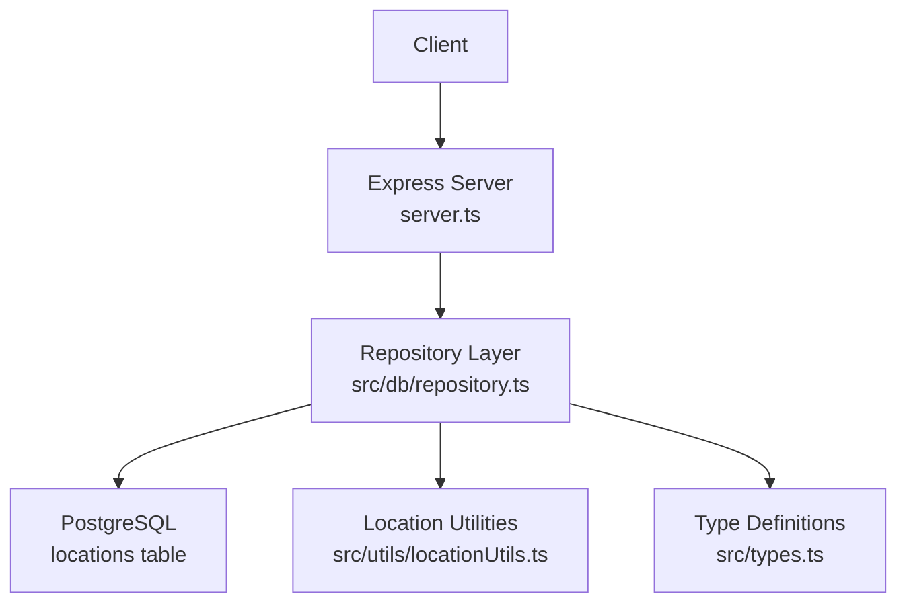
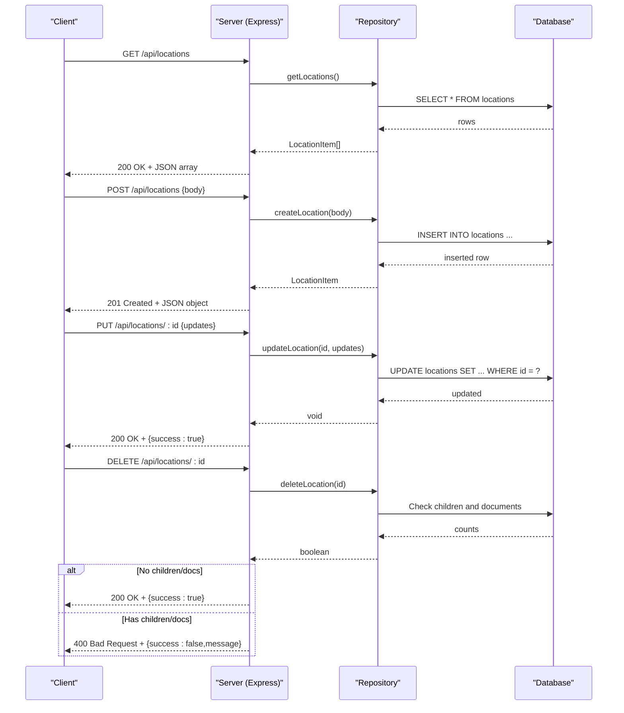
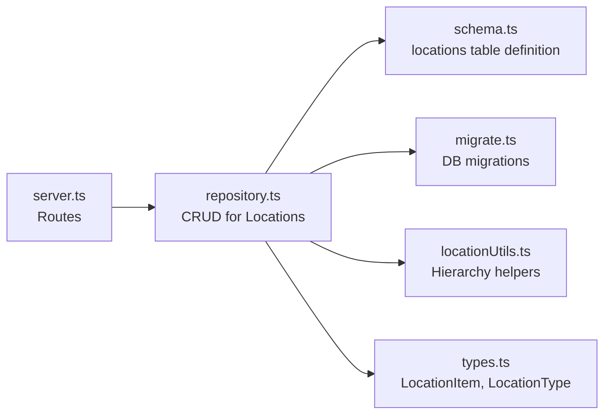
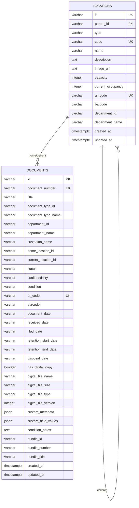

# Location Endpoints

<cite>
**Referenced Files in This Document**
- [server.ts](file://server.ts)
- [repository.ts](file://src/db/repository.ts)
- [schema.ts](file://src/db/schema.ts)
- [migrate.ts](file://src/db/migrate.ts)
- [types.ts](file://src/types.ts)
- [locationUtils.ts](file://src/utils/locationUtils.ts)
- [ArchiveContext.tsx](file://src/context/ArchiveContext.tsx)
</cite>

## Table of Contents
1. [Introduction](#introduction)
2. [Project Structure](#project-structure)
3. [Core Components](#core-components)
4. [Architecture Overview](#architecture-overview)
5. [Detailed Component Analysis](#detailed-component-analysis)
6. [Dependency Analysis](#dependency-analysis)
7. [Performance Considerations](#performance-considerations)
8. [Troubleshooting Guide](#troubleshooting-guide)
9. [Conclusion](#conclusion)

## Introduction
This document provides comprehensive API documentation for ArchiveHub’s hierarchical location management endpoints. It covers:
- GET /api/locations: Retrieve the complete set of locations with parent-child relationships and capacity information.
- POST /api/locations: Create new locations with hierarchical positioning, capacity limits, QR code generation, and type classification.
- PUT /api/locations/:id: Update location properties while maintaining hierarchy integrity.
- DELETE /api/locations/:id: Remove a location with validation to prevent deletion when sub-locations or documents exist.

It also explains the hierarchical data model, capacity tracking mechanisms, QR code integration, business rules, request/response schemas, validation constraints, and error handling.

## Project Structure
The location endpoints are implemented as Express routes that delegate to repository functions, which interact with PostgreSQL (or an in-memory fallback). The schema defines the locations table and related fields. Utility functions provide hierarchical path calculations and ancestor/descendant traversal.

**Diagram sources**
- [server.ts:252-296](file://server.ts#L252-L296)
- [repository.ts:345-468](file://src/db/repository.ts#L345-L468)
- [schema.ts:48-65](file://src/db/schema.ts#L48-L65)
- [locationUtils.ts:1-96](file://src/utils/locationUtils.ts#L1-L96)
- [types.ts:24-52](file://src/types.ts#L24-L52)

**Section sources**
- [server.ts:252-296](file://server.ts#L252-L296)
- [repository.ts:345-468](file://src/db/repository.ts#L345-L468)
- [schema.ts:48-65](file://src/db/schema.ts#L48-L65)
- [migrate.ts:67-87](file://src/db/migrate.ts#L67-L87)
- [locationUtils.ts:1-96](file://src/utils/locationUtils.ts#L1-L96)
- [types.ts:24-52](file://src/types.ts#L24-L52)

## Core Components
- Express route handlers for locations:
  - GET /api/locations returns all locations.
  - POST /api/locations creates a new location and returns it.
  - PUT /api/locations/:id updates a location by id and returns success.
  - DELETE /api/locations/:id deletes a location if no children or documents reference it; otherwise returns a 400 error.
- Repository layer:
  - getLocations(): reads from database or memory.
  - createLocation(): generates id, code, qrCode, barcode, capacity defaults, timestamps; persists to DB or memory.
  - updateLocation(): partial update of name, type, code, description, image_url, capacity, parent_id; updates timestamp.
  - deleteLocation(): validates no child locations and no documents referencing the location before deletion.
- Data model:
  - locations table includes hierarchical fields (parent_id), type enumeration, unique identifiers (code, qr_code), capacity and occupancy counters, department association, and timestamps.
- Utilities:
  - calculateLocationPath(), getLocationAncestors(), getChildrenLocations(), getAllDescendantIds() support hierarchical navigation and path rendering.

**Section sources**
- [server.ts:252-296](file://server.ts#L252-L296)
- [repository.ts:345-468](file://src/db/repository.ts#L345-L468)
- [schema.ts:48-65](file://src/db/schema.ts#L48-L65)
- [locationUtils.ts:1-96](file://src/utils/locationUtils.ts#L1-L96)

## Architecture Overview
The endpoint flow is straightforward: client requests hit Express routes, which call repository methods. Repository methods perform persistence operations and return results. Error handling wraps each route in try/catch and returns standardized error objects.

**Diagram sources**
- [server.ts:252-296](file://server.ts#L252-L296)
- [repository.ts:345-468](file://src/db/repository.ts#L345-L468)

## Detailed Component Analysis

### GET /api/locations
- Purpose: Retrieve all locations to build the full tree structure.
- Behavior: Returns an array of LocationItem objects including id, parentId, type, code, name, description, imageUrl, capacity, currentOccupancy, qrCode, barcode, departmentId, departmentName, createdAt, updatedAt.
- Hierarchy: Clients can reconstruct parent-child relationships using parentId. Use utility functions to compute paths and descendants.
- Response: 200 OK with JSON array. Errors: 500 with { error: message }.

Request
- Method: GET
- Path: /api/locations
- Headers: None required
- Body: N/A

Response
- Status: 200
- Body: Array of LocationItem

Error Handling
- On server error: 500 with { error: string }

**Section sources**
- [server.ts:252-260](file://server.ts#L252-L260)
- [repository.ts:345-370](file://src/db/repository.ts#L345-L370)
- [types.ts:24-52](file://src/types.ts#L24-L52)

### POST /api/locations
- Purpose: Create a new location with hierarchical positioning and capacity limits. Supports type classification and optional metadata.
- Input fields:
  - Required: type, name
  - Optional: parentId, code, description, imageUrl, capacity, departmentId, departmentName
- Defaults and generation:
  - id: generated as loc-{type}-{timestamp}
  - code: provided or auto-generated from name prefix and random number
  - capacity: default 20 if not provided
  - currentOccupancy: initialized to 0
  - qrCode: generated as LOC-{code}
  - barcode: randomly generated numeric string
  - timestamps: createdAt, updatedAt set to current date
- Validation:
  - Unique constraints enforced at DB level for code and qrCode
  - Type must be one of the allowed values defined in types
- Response: 201 Created with the newly created LocationItem
- Errors: 500 with { error: message } on failure

Request Schema
- body.type: string, one of BUILDING, FLOOR, ROOM, STORAGE_AREA, CABINET, RACK, SHELF, BOX, FOLDER, OTHER
- body.name: string, non-empty
- body.parentId: string | null (optional)
- body.code: string | null (optional)
- body.description: string | null (optional)
- body.imageUrl: string | null (optional)
- body.capacity: number | undefined (default 20)
- body.departmentId: string | null (optional)
- body.departmentName: string | null (optional)

Response Schema
- 201 Created: LocationItem object

Error Handling
- 500 Internal Server Error: { error: string }

**Section sources**
- [server.ts:262-269](file://server.ts#L262-L269)
- [repository.ts:372-408](file://src/db/repository.ts#L372-L408)
- [schema.ts:48-65](file://src/db/schema.ts#L48-L65)
- [types.ts:24-52](file://src/types.ts#L24-L52)

### PUT /api/locations/:id
- Purpose: Update location properties while maintaining hierarchy integrity.
- Supported updates: name, type, code, description, imageUrl, capacity, parentId
- Behavior:
  - Partial updates applied to matching fields
  - updated_at timestamp refreshed
  - Parent changes allowed but must respect DB constraints (e.g., unique code/qrCode)
- Response: 200 OK with { success: true }
- Errors: 500 with { error: message }

Request Schema
- path.id: string (location id)
- body: Partial<LocationItem> with any subset of updatable fields

Response Schema
- 200 OK: { success: boolean }

Error Handling
- 500 Internal Server Error: { error: string }

**Section sources**
- [server.ts:271-278](file://server.ts#L271-L278)
- [repository.ts:410-439](file://src/db/repository.ts#L410-L439)

### DELETE /api/locations/:id
- Purpose: Remove a location safely.
- Business rules:
  - Cannot delete if the location has child locations (parent_id references)
  - Cannot delete if any documents have home_location_id or current_location_id equal to this location
- Response:
  - 200 OK with { success: true } on successful deletion
  - 400 Bad Request with { success: false, message: "Cannot delete location containing sub-locations or documents." } if blocked
- Errors: 500 with { error: message } on server-side failures

Request Schema
- path.id: string (location id)

Response Schema
- 200 OK: { success: boolean }
- 400 Bad Request: { success: boolean, message: string }

Error Handling
- 500 Internal Server Error: { error: string }

**Section sources**
- [server.ts:280-296](file://server.ts#L280-L296)
- [repository.ts:441-468](file://src/db/repository.ts#L441-L468)

## Dependency Analysis
- Routes depend on repository methods for data access and business logic.
- Repository depends on database connection pool and performs SQL queries.
- Schema defines table structure and constraints.
- Utilities provide hierarchical computations used by UI and potentially future features.
- Types define shared interfaces ensuring consistency across layers.

**Diagram sources**
- [server.ts:252-296](file://server.ts#L252-L296)
- [repository.ts:345-468](file://src/db/repository.ts#L345-L468)
- [schema.ts:48-65](file://src/db/schema.ts#L48-L65)
- [migrate.ts:67-87](file://src/db/migrate.ts#L67-L87)
- [locationUtils.ts:1-96](file://src/utils/locationUtils.ts#L1-L96)
- [types.ts:24-52](file://src/types.ts#L24-L52)

**Section sources**
- [server.ts:252-296](file://server.ts#L252-L296)
- [repository.ts:345-468](file://src/db/repository.ts#L345-L468)
- [schema.ts:48-65](file://src/db/schema.ts#L48-L65)
- [migrate.ts:67-87](file://src/db/migrate.ts#L67-L87)
- [locationUtils.ts:1-96](file://src/utils/locationUtils.ts#L1-L96)
- [types.ts:24-52](file://src/types.ts#L24-L52)

## Performance Considerations
- GET /api/locations returns all locations; consider pagination or filtering if the dataset grows large.
- Database queries are simple selects/inserts/updates/deletes; ensure indexes on frequently queried columns like parent_id and code if needed.
- Memory fallback mode exists; in production, rely on PostgreSQL for durability and performance.
- Avoid unnecessary updates; use partial updates via PUT to minimize payload size.

[No sources needed since this section provides general guidance]

## Troubleshooting Guide
Common issues and resolutions:
- 400 Bad Request on DELETE: Indicates the location still contains sub-locations or documents. Resolve by moving or deleting referenced items first.
- 500 Internal Server Error: Indicates server-side failure; check logs and database connectivity. Ensure migrations have run and database is reachable.
- Unique constraint violations on POST: Occur if code or qrCode already exists. Provide unique values or allow auto-generation.
- Invalid type: Ensure type matches allowed values in types.ts.

**Section sources**
- [server.ts:280-296](file://server.ts#L280-L296)
- [repository.ts:441-468](file://src/db/repository.ts#L441-L468)

## Conclusion
ArchiveHub’s location endpoints provide robust CRUD operations for managing hierarchical physical storage units. They enforce business rules to maintain data integrity, generate identifiers and QR codes automatically, and support capacity tracking. Clients can build complete trees using parentId relationships and leverage utility functions for path computation and descendant queries.

[No sources needed since this section summarizes without analyzing specific files]

## Appendices

### Hierarchical Data Model
- locations table supports self-referencing via parent_id to form trees.
- Fields include type classification, unique identifiers (code, qr_code), capacity and occupancy counters, department association, and timestamps.

**Diagram sources**
- [schema.ts:48-65](file://src/db/schema.ts#L48-L65)
- [schema.ts:67-116](file://src/db/schema.ts#L67-L116)

### Capacity Tracking Mechanisms
- capacity: maximum number of child items or units a location can hold.
- currentOccupancy: tracks how many items are currently stored under the location.
- Initialization: currentOccupancy starts at 0; capacity defaults to 20 if not specified.
- Updates: capacity can be adjusted via PUT; occupancy should be managed alongside document movements.

**Section sources**
- [schema.ts:48-65](file://src/db/schema.ts#L48-L65)
- [repository.ts:372-408](file://src/db/repository.ts#L372-L408)

### QR Code Integration
- Each location receives a unique qrCode derived from its code (LOC-{code}).
- Barcode is randomly generated for scanning workflows.
- These identifiers enable quick identification and linking to physical assets.

**Section sources**
- [repository.ts:372-408](file://src/db/repository.ts#L372-L408)
- [schema.ts:48-65](file://src/db/schema.ts#L48-L65)

### Business Rules for Location Organization
- Hierarchy: parent_id establishes parent-child relationships; root locations have null parent_id.
- Deletion safety: cannot delete locations with children or documents referencing them.
- Type classification: restricts to predefined categories to standardize organization.
- Uniqueness: code and qrCode must be unique across all locations.

**Section sources**
- [repository.ts:441-468](file://src/db/repository.ts#L441-L468)
- [types.ts:24-52](file://src/types.ts#L24-L52)
- [schema.ts:48-65](file://src/db/schema.ts#L48-L65)