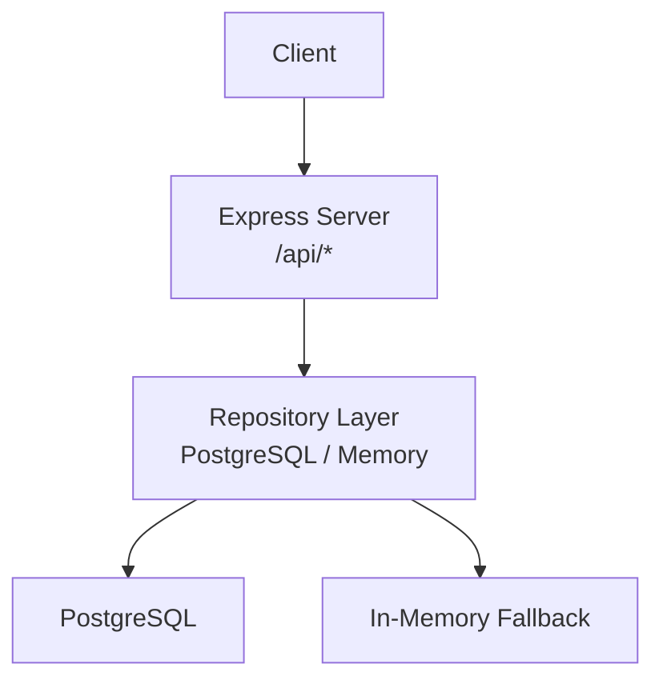
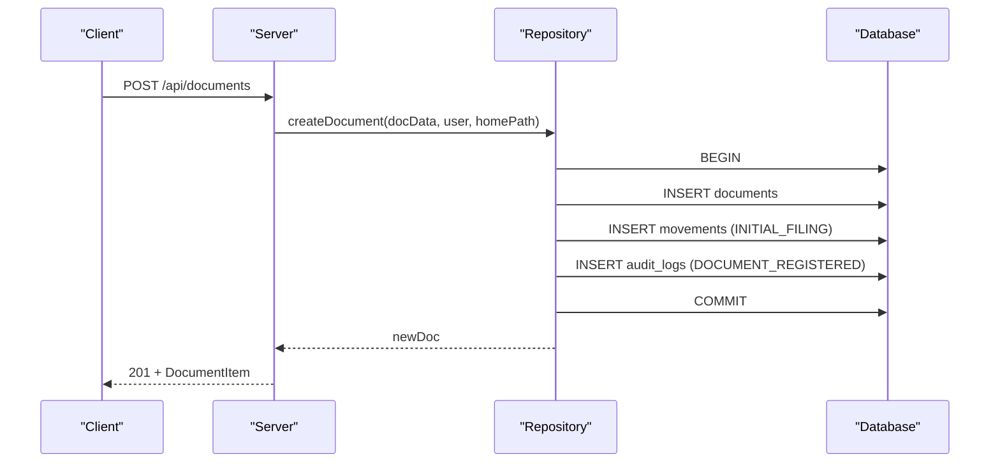
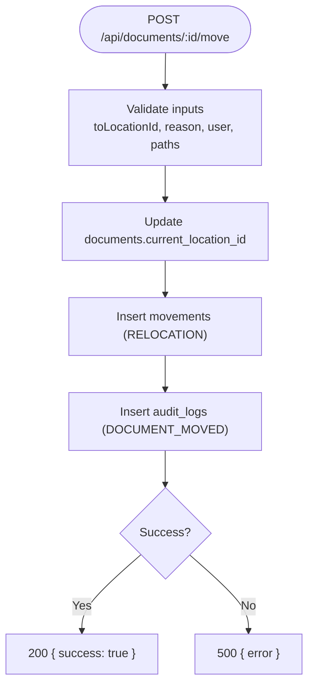
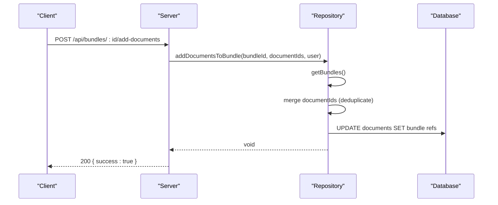
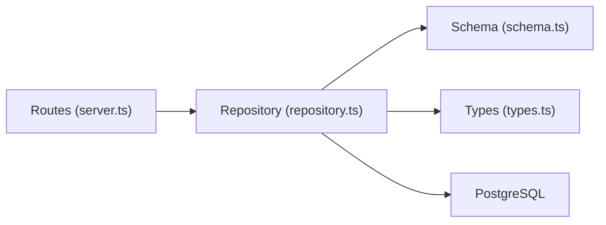

# Resource Endpoints

<cite>
**Referenced Files in This Document**
- [server.ts](file://server.ts)
- [repository.ts](file://src/db/repository.ts)
- [schema.ts](file://src/db/schema.ts)
- [types.ts](file://src/types.ts)
</cite>

## Table of Contents
1. [Introduction](#introduction)
2. [Project Structure](#project-structure)
3. [Core Components](#core-components)
4. [Architecture Overview](#architecture-overview)
5. [Detailed Component Analysis](#detailed-component-analysis)
6. [Dependency Analysis](#dependency-analysis)
7. [Performance Considerations](#performance-considerations)
8. [Troubleshooting Guide](#troubleshooting-guide)
9. [Conclusion](#conclusion)

## Introduction
This document provides detailed API documentation for ArchiveHub’s resource management endpoints covering CRUD operations for core entities: documents, locations, document types, bundles/dossiers, and reusable custom fields. It specifies HTTP methods, URL patterns, request/response schemas, validation rules, and business logic constraints derived from the server routes and repository implementations.

## Project Structure
ArchiveHub exposes a REST API via an Express server that delegates data operations to a repository layer backed by PostgreSQL (with in-memory fallback). The schema defines tables for departments, users, document types, locations, documents, checkouts, movements, retention policies, disposal records, bundles, audit logs, and reusable custom fields. Types define TypeScript interfaces used across the application.

**Diagram sources**
- [server.ts:13-596](file://server.ts#L13-L596)
- [repository.ts:106-1597](file://src/db/repository.ts#L106-L1597)
- [schema.ts:12-228](file://src/db/schema.ts#L12-L228)

**Section sources**
- [server.ts:13-596](file://server.ts#L13-L596)
- [schema.ts:12-228](file://src/db/schema.ts#L12-L228)
- [types.ts:1-283](file://src/types.ts#L1-L283)

## Core Components
- Documents: Create with metadata, update with audit trail, delete with checkout validation, move with movement tracking.
- Locations: Hierarchical structure with capacity and occupancy tracking; parent-child relationships enforced at deletion.
- Document Types: Custom field definitions and retention policy associations.
- Bundles/Dossiers: Grouping documents with add/remove operations and lifecycle updates.
- Reusable Custom Fields: Dynamic field definitions for flexible metadata capture.

**Section sources**
- [server.ts:215-578](file://server.ts#L215-L578)
- [repository.ts:259-1597](file://src/db/repository.ts#L259-L1597)
- [schema.ts:37-228](file://src/db/schema.ts#L37-L228)
- [types.ts:74-183](file://src/types.ts#L74-L183)

## Architecture Overview
The API follows a thin controller pattern: routes parse requests and delegate to repository functions. Repository functions implement business logic, enforce constraints, and persist changes to PostgreSQL or in-memory storage. Audit logs and movement records are created automatically for key actions.

**Diagram sources**
- [server.ts:308-316](file://server.ts#L308-L316)
- [repository.ts:521-633](file://src/db/repository.ts#L521-L633)

**Section sources**
- [server.ts:308-316](file://server.ts#L308-L316)
- [repository.ts:521-633](file://src/db/repository.ts#L521-L633)

## Detailed Component Analysis

### Documents API
Endpoints:
- GET /api/documents
- POST /api/documents
- PUT /api/documents/:id
- DELETE /api/documents/:id
- POST /api/documents/:id/move

HTTP Methods and Behavior:
- GET returns all documents.
- POST creates a document with metadata; sets status to AVAILABLE; initializes current location to home location; generates QR/barcode; records initial filing movement and audit log.
- PUT updates document attributes; writes audit log on change.
- DELETE removes a document only if not checked out; otherwise returns 400 with message.
- POST moves a document to a new location; updates current location; records movement and audit log.

Request Schemas:
- POST /api/documents body:
  - docData: DocumentItem fields excluding id, timestamps, qrCode, barcode, status, currentLocationId
  - user: User object (for audit and movement attribution)
  - homePath: string path describing the destination location path
- PUT /api/documents/:id body:
  - updates: Partial<DocumentItem>
  - user: User object
- DELETE /api/documents/:id body:
  - user: User object
- POST /api/documents/:id/move body:
  - toLocationId: string
  - reason: string
  - user: User object
  - fromPath: string
  - toPath: string

Response Schemas:
- GET: Array<DocumentItem>
- POST: DocumentItem (201)
- PUT: { success: boolean }
- DELETE: { success: boolean } or 400 { success: false, message: "Cannot delete record while checked out." }
- MOVE: { success: boolean }

Validation Rules and Business Logic:
- Creation enforces required document fields per schema; sets defaults for status, identifiers, and timestamps.
- Deletion blocked when document status is CHECKED_OUT.
- Movement updates current location and persists movement type RELOCATION with reason and user context.
- All mutations write audit logs with action types like DOCUMENT_REGISTERED, DOCUMENT_UPDATED, DOCUMENT_MOVED.

Error Handling:
- 500 on repository errors; 400 for business rule violations (e.g., deletion while checked out).

**Section sources**
- [server.ts:298-361](file://server.ts#L298-L361)
- [repository.ts:470-804](file://src/db/repository.ts#L470-L804)
- [schema.ts:67-116](file://src/db/schema.ts#L67-L116)
- [types.ts:135-183](file://src/types.ts#L135-L183)

#### Document Move Flow

**Diagram sources**
- [server.ts:346-361](file://server.ts#L346-L361)
- [repository.ts:742-804](file://src/db/repository.ts#L742-L804)

### Locations API
Endpoints:
- GET /api/locations
- POST /api/locations
- PUT /api/locations/:id
- DELETE /api/locations/:id

HTTP Methods and Behavior:
- GET returns all locations.
- POST creates a hierarchical location with code, capacity defaults, QR/barcode generation, and zero occupancy.
- PUT updates name, type, code, description, image, capacity, and parent relationship; updates timestamp.
- DELETE prevents removal if sub-locations or documents reference the location; returns 400 with explanatory message.

Request Schemas:
- POST /api/locations body:
  - parentId?: string | null
  - type: LocationType
  - code: string
  - name: string
  - description?: string
  - imageUrl?: string
  - capacity?: number
  - departmentId?: string | null
  - departmentName?: string | null
- PUT /api/locations/:id body:
  - Partial<LocationItem> fields to update
- DELETE /api/locations/:id body: none

Response Schemas:
- GET: Array<LocationItem>
- POST: LocationItem (201)
- PUT: { success: boolean }
- DELETE: { success: boolean } or 400 { success: false, message: "Cannot delete location containing sub-locations or documents." }

Validation Rules and Business Logic:
- Capacity defaults to 20 if not provided; currentOccupancy starts at 0.
- Parent-child hierarchy supported via parentId; deletion checks for children and associated documents.
- Unique codes enforced at database level.

Error Handling:
- 500 on repository errors; 400 for deletion constraint violations.

**Section sources**
- [server.ts:252-296](file://server.ts#L252-L296)
- [repository.ts:344-468](file://src/db/repository.ts#L344-L468)
- [schema.ts:48-65](file://src/db/schema.ts#L48-L65)
- [types.ts:24-52](file://src/types.ts#L24-L52)

### Document Types API
Endpoints:
- GET /api/document-types
- POST /api/document-types
- PUT /api/document-types/:id
- DELETE /api/document-types/:id

HTTP Methods and Behavior:
- GET returns all document types including custom fields and optional department association.
- POST creates a document type with code, name, retention years, description, custom fields, and optional department scope.
- PUT updates any subset of fields; supports updating custom fields JSON.
- DELETE removes a document type.

Request Schemas:
- POST /api/document-types body:
  - code: string
  - name: string
  - retentionYears: number
  - description?: string
  - customFields?: CustomFieldDefinition[]
  - departmentId?: string | null
  - departmentName?: string | null
- PUT /api/document-types/:id body:
  - Partial<DocumentTypeInfo>

Response Schemas:
- GET: Array<DocumentTypeInfo>
- POST: DocumentTypeInfo (201)
- PUT: { success: boolean }
- DELETE: { success: boolean }

Validation Rules and Business Logic:
- Unique code enforced at database level.
- Custom fields stored as JSON array of definitions.
- Optional department scoping allows universal or department-specific types.

Error Handling:
- 500 on repository errors.

**Section sources**
- [server.ts:215-250](file://server.ts#L215-L250)
- [repository.ts:259-342](file://src/db/repository.ts#L259-L342)
- [schema.ts:37-46](file://src/db/schema.ts#L37-L46)
- [types.ts:118-127](file://src/types.ts#L118-L127)

### Bundles/Dossiers API
Endpoints:
- GET /api/bundles
- POST /api/bundles
- PUT /api/bundles/:id
- DELETE /api/bundles/:id
- POST /api/bundles/:id/add-documents
- POST /api/bundles/:id/remove-document

HTTP Methods and Behavior:
- GET returns all bundles with document IDs and tags.
- POST creates a bundle dossier; optionally links documents; generates QR/barcode; updates linked documents’ bundle references; writes audit log.
- PUT updates title, description, department, location, document list, status, tags; updates timestamp.
- DELETE dissolves bundle; unlinks documents; writes audit log.
- POST add-documents merges document IDs into bundle and updates linked documents.
- POST remove-document removes a single document from the bundle and clears its bundle references.

Request Schemas:
- POST /api/bundles body:
  - bundleData: DocumentBundle fields excluding id, timestamps, qrCode, barcode
  - user?: User
- PUT /api/bundles/:id body:
  - updates: Partial<DocumentBundle>
  - user?: User
- DELETE /api/bundles/:id body:
  - user?: User
- POST /api/bundles/:id/add-documents body:
  - documentIds: string[]
  - user?: User
- POST /api/bundles/:id/remove-document body:
  - documentId: string
  - user?: User

Response Schemas:
- GET: Array<DocumentBundle>
- POST: DocumentBundle (201)
- PUT: { success: boolean }
- DELETE: { success: boolean }
- ADD/REMOVE: { success: boolean }

Validation Rules and Business Logic:
- Bundle numbers unique; QR/barcode generated automatically.
- Adding documents deduplicates IDs and updates both bundle and document records.
- Removing a document clears bundle linkage on the document.
- Audit logs created on create/delete with details about operation.

Error Handling:
- 500 on repository errors; add-documents throws if bundle not found.

**Section sources**
- [server.ts:519-578](file://server.ts#L519-L578)
- [repository.ts:1362-1597](file://src/db/repository.ts#L1362-L1597)
- [schema.ts:194-211](file://src/db/schema.ts#L194-L211)
- [types.ts:100-116](file://src/types.ts#L100-L116)

#### Bundle Add Documents Sequence

**Diagram sources**
- [server.ts:559-567](file://server.ts#L559-L567)
- [repository.ts:1528-1561](file://src/db/repository.ts#L1528-L1561)

### Reusable Custom Fields API
Endpoints:
- GET /api/reusable-custom-fields
- POST /api/reusable-custom-fields
- PUT /api/reusable-custom-fields/:id
- DELETE /api/reusable-custom-fields/:id

HTTP Methods and Behavior:
- GET returns all reusable custom fields with options, placeholders, required flags, categories, and creation time.
- POST creates a field with name, label, type, options (for select), placeholder, required flag, description, category.
- PUT updates any subset of fields.
- DELETE removes a field.

Request Schemas:
- POST /api/reusable-custom-fields body:
  - name: string
  - label: string
  - type: CustomFieldType
  - options?: string[]
  - placeholder?: string
  - required?: boolean
  - description?: string
  - category?: string
- PUT /api/reusable-custom-fields/:id body:
  - Partial<ReusableCustomField>

Response Schemas:
- GET: Array<ReusableCustomField>
- POST: ReusableCustomField (201)
- PUT: { success: boolean }
- DELETE: { success: boolean }

Validation Rules and Business Logic:
- Options serialized as JSON for select-type fields.
- Category defaults to "General".
- Required flag controls UI behavior for form validation.

Error Handling:
- 500 on repository errors.

**Section sources**
- [server.ts:482-517](file://server.ts#L482-L517)
- [repository.ts:1266-1360](file://src/db/repository.ts#L1266-L1360)
- [schema.ts:12-228](file://src/db/schema.ts#L12-L228)
- [types.ts:74-98](file://src/types.ts#L74-L98)

## Dependency Analysis
- Server routes depend on repository functions for all data operations.
- Repository functions depend on PostgreSQL pool with in-memory fallback; they also maintain consistency between documents, bundles, movements, and audit logs.
- Schema defines table structures and relationships; types provide compile-time contracts.

**Diagram sources**
- [server.ts:13-596](file://server.ts#L13-L596)
- [repository.ts:106-1597](file://src/db/repository.ts#L106-L1597)
- [schema.ts:12-228](file://src/db/schema.ts#L12-L228)
- [types.ts:1-283](file://src/types.ts#L1-L283)

**Section sources**
- [server.ts:13-596](file://server.ts#L13-L596)
- [repository.ts:106-1597](file://src/db/repository.ts#L106-L1597)
- [schema.ts:12-228](file://src/db/schema.ts#L12-L228)
- [types.ts:1-283](file://src/types.ts#L1-L283)

## Performance Considerations
- Transactions are used for multi-step operations (document creation, movement, checkout flows) to ensure consistency.
- In-memory fallback ensures availability when PostgreSQL is unavailable; however, production should rely on database persistence.
- Bulk updates (e.g., adding multiple documents to a bundle) use array parameters to minimize round trips.
- Avoid excessive payload sizes; JSON parsing limit set to 10mb.

[No sources needed since this section provides general guidance]

## Troubleshooting Guide
Common issues and resolutions:
- Cannot delete document while checked out: Ensure document status is not CHECKED_OUT; complete return flow before deletion.
- Cannot delete location with sub-locations or documents: Remove child locations or relocate documents before deletion.
- Database connection failures: Repository falls back to memory mode; verify environment configuration for PostgreSQL connectivity.
- Bundle operations failing: Confirm bundle exists before adding/removing documents; handle 500 responses appropriately.

**Section sources**
- [server.ts:328-344](file://server.ts#L328-L344)
- [server.ts:280-296](file://server.ts#L280-L296)
- [repository.ts:441-468](file://src/db/repository.ts#L441-L468)
- [repository.ts:717-740](file://src/db/repository.ts#L717-L740)

## Conclusion
ArchiveHub’s resource endpoints provide comprehensive CRUD capabilities for documents, locations, document types, bundles, and reusable custom fields. Business rules enforce integrity through checkout validations, hierarchical location constraints, movement tracking, and audit logging. The repository layer ensures consistent state across PostgreSQL and in-memory modes, supporting robust operations and resilience.

[No sources needed since this section summarizes without analyzing specific files]