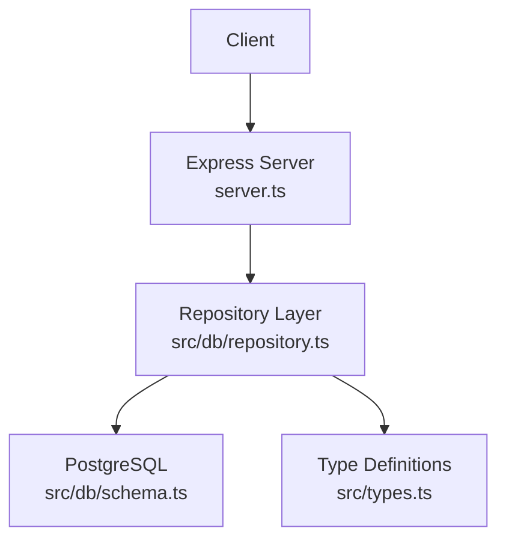
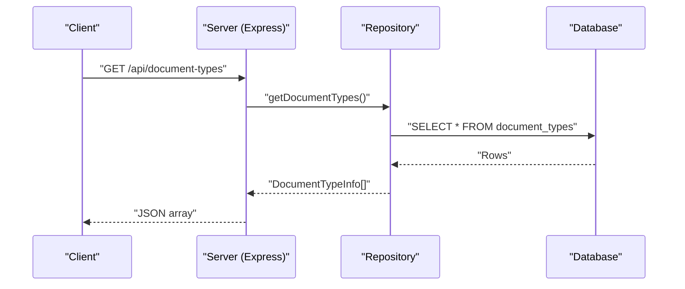
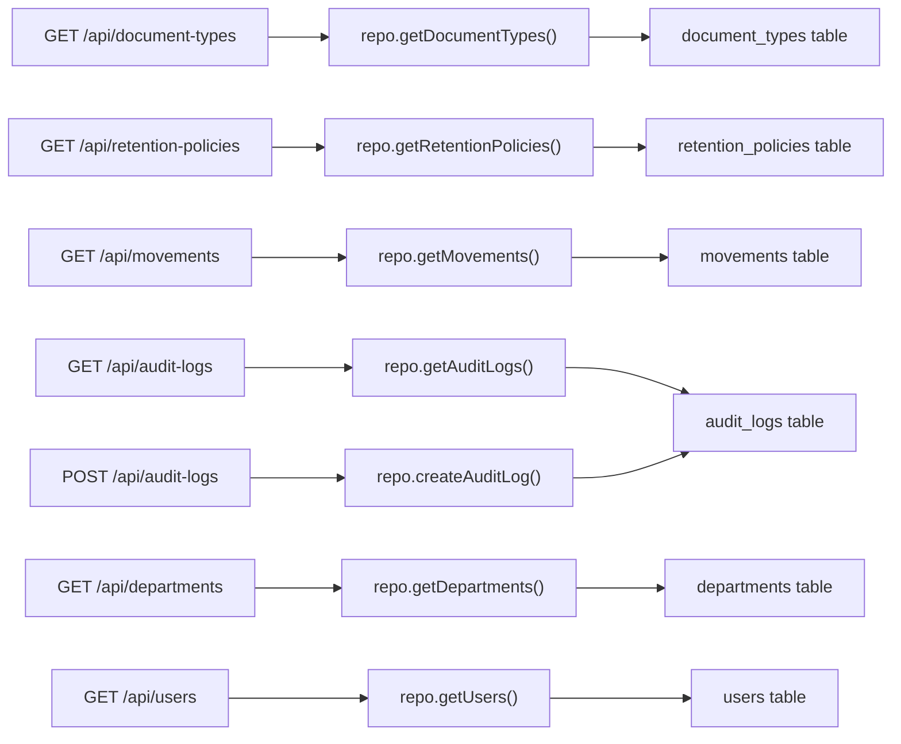

# Supporting Endpoints

<cite>
**Referenced Files in This Document**
- [server.ts](file://server.ts)
- [repository.ts](file://src/db/repository.ts)
- [schema.ts](file://src/db/schema.ts)
- [types.ts](file://src/types.ts)
</cite>

## Table of Contents
1. [Introduction](#introduction)
2. [Project Structure](#project-structure)
3. [Core Components](#core-components)
4. [Architecture Overview](#architecture-overview)
5. [Detailed Component Analysis](#detailed-component-analysis)
6. [Dependency Analysis](#dependency-analysis)
7. [Performance Considerations](#performance-considerations)
8. [Troubleshooting Guide](#troubleshooting-guide)
9. [Conclusion](#conclusion)

## Introduction
This document provides comprehensive API documentation for ArchiveHub’s supporting endpoints that expose system functionality and reference data. It covers:
- GET /api/document-types: Retrieve available document type definitions with associated custom fields and retention policy linkage.
- GET /api/retention-policies: Access retention policy configurations including duration rules and disposal methods.
- GET /api/movements: Retrieve document movement history with timestamps, users, and location changes.
- GET /api/audit-logs: Access comprehensive audit trails with action types, user attribution, and change details.
- POST /api/audit-logs: Create custom audit entries with structured data and categorization.
- GET /api/departments: Retrieve organizational units.
- GET /api/users: Access the user directory.

For each endpoint, this document specifies request/response schemas, filtering options, pagination support, and security considerations, and explains how these entities relate to the overall archive management workflow.

## Project Structure
ArchiveHub exposes REST endpoints via an Express server. Each route delegates to repository functions that query a PostgreSQL database (with an in-memory fallback when the database is unavailable). Data models are defined as TypeScript interfaces and mapped to database tables.

**Diagram sources**
- [server.ts:84-102](file://server.ts#L84-L102)
- [server.ts:216-223](file://server.ts#L216-L223)
- [server.ts:444-480](file://server.ts#L444-L480)
- [repository.ts:242-278](file://src/db/repository.ts#L242-L278)
- [repository.ts:1125-1169](file://src/db/repository.ts#L1125-L1169)
- [repository.ts:1172-1217](file://src/db/repository.ts#L1172-L1217)
- [schema.ts:13-20](file://src/db/schema.ts#L13-L20)
- [schema.ts:38-46](file://src/db/schema.ts#L38-L46)
- [schema.ts:151-167](file://src/db/schema.ts#L151-L167)
- [schema.ts:169-177](file://src/db/schema.ts#L169-L177)
- [schema.ts:214-227](file://src/db/schema.ts#L214-L227)
- [types.ts:118-127](file://src/types.ts#L118-L127)
- [types.ts:185-203](file://src/types.ts#L185-L203)
- [types.ts:237-244](file://src/types.ts#L237-L244)
- [types.ts:260-274](file://src/types.ts#L260-L274)
- [types.ts:276-282](file://src/types.ts#L276-L282)

**Section sources**
- [server.ts:1-600](file://server.ts#L1-L600)
- [repository.ts:1-1597](file://src/db/repository.ts#L1-L1597)
- [schema.ts:1-228](file://src/db/schema.ts#L1-L228)
- [types.ts:1-283](file://src/types.ts#L1-L283)

## Core Components
- Server routes define HTTP endpoints and delegate to repository functions.
- Repository functions implement data access with PostgreSQL queries and provide in-memory fallbacks.
- Type definitions describe the shape of responses returned by endpoints.
- Database schema defines table structures used by repository queries.

Key supporting endpoints covered here:
- Departments: GET /api/departments
- Users: GET /api/users
- Document Types: GET /api/document-types
- Retention Policies: GET /api/retention-policies
- Movements: GET /api/movements
- Audit Logs: GET /api/audit-logs, POST /api/audit-logs

**Section sources**
- [server.ts:84-102](file://server.ts#L84-L102)
- [server.ts:216-223](file://server.ts#L216-L223)
- [server.ts:444-480](file://server.ts#L444-L480)
- [repository.ts:242-278](file://src/db/repository.ts#L242-L278)
- [repository.ts:1125-1169](file://src/db/repository.ts#L1125-L1169)
- [repository.ts:1172-1217](file://src/db/repository.ts#L1172-L1217)

## Architecture Overview
The supporting endpoints follow a consistent pattern:
- The Express server receives a request.
- It calls a repository function to fetch or create data.
- The repository queries PostgreSQL (or uses in-memory state if the database is unavailable).
- Results are mapped to TypeScript-defined response shapes and returned as JSON.

**Diagram sources**
- [server.ts:216-223](file://server.ts#L216-L223)
- [repository.ts:260-278](file://src/db/repository.ts#L260-L278)
- [schema.ts:38-46](file://src/db/schema.ts#L38-L46)
- [types.ts:118-127](file://src/types.ts#L118-L127)

## Detailed Component Analysis

### GET /api/document-types
Purpose: Retrieve available document type definitions, including custom field definitions and department association.

- Method: GET
- Path: /api/document-types
- Request: None
- Response: Array of DocumentTypeInfo
  - Fields: id, code, name, retentionYears, description, departmentId, departmentName, customFields
- Filtering: Not implemented on the server; returns all document types.
- Pagination: Not supported.
- Security: No explicit authentication/authorization middleware on this route.
- Error handling: On error, returns 500 with { error }.

Response schema (from types):
- DocumentTypeInfo: id, code, name, retentionYears, description, departmentId, departmentName, customFields

Relationships:
- Links to retention policies via documentTypeId for lifecycle management.
- Custom fields can be reused across documents of this type.

**Section sources**
- [server.ts:216-223](file://server.ts#L216-L223)
- [repository.ts:260-278](file://src/db/repository.ts#L260-L278)
- [schema.ts:38-46](file://src/db/schema.ts#L38-L46)
- [types.ts:118-127](file://src/types.ts#L118-L127)

### GET /api/retention-policies
Purpose: Access retention policy configurations tied to document types, including duration rules and disposal methods.

- Method: GET
- Path: /api/retention-policies
- Request: None
- Response: Array of RetentionPolicy
  - Fields: id, documentTypeId, documentTypeName, retentionYears, disposalMethod, description
- Filtering: Not implemented on the server; returns all policies.
- Pagination: Not supported.
- Security: No explicit authentication/authorization middleware on this route.
- Error handling: On error, returns 500 with { error }.

Response schema (from types):
- RetentionPolicy: id, documentTypeId, documentTypeName, retentionYears, disposalMethod, description

Relationships:
- Tied to document types via documentTypeId.
- Disposal method indicates end-of-life handling (e.g., shredding, permanent archive).

**Section sources**
- [server.ts:454-461](file://server.ts#L454-L461)
- [repository.ts:1153-1169](file://src/db/repository.ts#L1153-L1169)
- [schema.ts:169-177](file://src/db/schema.ts#L169-L177)
- [types.ts:237-244](file://src/types.ts#L237-L244)

### GET /api/movements
Purpose: Retrieve document movement history with timestamps, performing users, and location changes.

- Method: GET
- Path: /api/movements
- Request: None
- Response: Array of MovementRecord
  - Fields: id, documentId, documentNumber, documentTitle, fromLocationId, fromLocationPath, toLocationId, toLocationPath, movementType, performedByUserId, performedByUserName, authorizedByUserName, reason, timestamp, notes
- Filtering: Not implemented on the server; returns all movements.
- Pagination: Not supported.
- Security: No explicit authentication/authorization middleware on this route.
- Error handling: On error, returns 500 with { error }.

Response schema (from types):
- MovementRecord: id, documentId, documentNumber, documentTitle, fromLocationId, fromLocationPath, toLocationId, toLocationPath, movementType, performedByUserId, performedByUserName, authorizedByUserName, reason, timestamp, notes

Movement types include INITIAL_FILING, CHECKOUT, CHECKIN, RELOCATION, TRANSFER, AUDIT_CORRECTION.

**Section sources**
- [server.ts:444-451](file://server.ts#L444-L451)
- [repository.ts:1125-1150](file://src/db/repository.ts#L1125-L1150)
- [schema.ts:151-167](file://src/db/schema.ts#L151-L167)
- [types.ts:185-203](file://src/types.ts#L185-L203)

### GET /api/audit-logs
Purpose: Access comprehensive audit trails capturing actions, user attribution, and change details.

- Method: GET
- Path: /api/audit-logs
- Request: None
- Response: Array of AuditLogRecord
  - Fields: id, userId, userName, userRole, action, entityType, entityId, entityName, timestamp, details, beforeValue, afterValue
- Filtering: Not implemented on the server; returns all logs.
- Pagination: Not supported.
- Security: No explicit authentication/authorization middleware on this route.
- Error handling: On error, returns 500 with { error }.

Response schema (from types):
- AuditLogRecord: id, userId, userName, userRole, action, entityType, entityId, entityName, timestamp, details, beforeValue, afterValue

Entity types include DOCUMENT, LOCATION, CHECKOUT, USER, RETENTION.

**Section sources**
- [server.ts:464-471](file://server.ts#L464-L471)
- [repository.ts:1172-1194](file://src/db/repository.ts#L1172-L1194)
- [schema.ts:214-227](file://src/db/schema.ts#L214-L227)
- [types.ts:260-274](file://src/types.ts#L260-L274)

### POST /api/audit-logs
Purpose: Create custom audit entries with structured data and categorization.

- Method: POST
- Path: /api/audit-logs
- Request body: Omit<AuditLogRecord, 'id' | 'timestamp'>
  - Required fields: userId, userName, userRole, action, entityType, entityId, entityName, details
  - Optional fields: beforeValue, afterValue
- Response: Created AuditLogRecord with generated id and timestamp
- Filtering: N/A (write operation)
- Pagination: N/A
- Security: No explicit authentication/authorization middleware on this route.
- Error handling: On error, returns 500 with { error }.

Validation and behavior:
- The repository generates a unique id and timestamp.
- If the database is unavailable, the entry is stored in memory and still returned.

**Section sources**
- [server.ts:473-480](file://server.ts#L473-L480)
- [repository.ts:1196-1217](file://src/db/repository.ts#L1196-L1217)
- [types.ts:260-274](file://src/types.ts#L260-L274)

### GET /api/departments
Purpose: Retrieve organizational units for use in document ownership and user assignment.

- Method: GET
- Path: /api/departments
- Request: None
- Response: Array of Department
  - Fields: id, code, name, headName, documentCount
- Filtering: Not implemented on the server; returns all departments.
- Pagination: Not supported.
- Security: No explicit authentication/authorization middleware on this route.
- Error handling: On error, returns 500 with { error }.

Response schema (from types):
- Department: id, code, name, headName, documentCount

**Section sources**
- [server.ts:84-92](file://server.ts#L84-L92)
- [repository.ts:242-257](file://src/db/repository.ts#L242-L257)
- [schema.ts:13-20](file://src/db/schema.ts#L13-L20)
- [types.ts:276-282](file://src/types.ts#L276-L282)

### GET /api/users
Purpose: Access the user directory for administrative and UI purposes.

- Method: GET
- Path: /api/users
- Request: None
- Response: Array of User
  - Fields: id, email, fullName, role, departmentId, departmentName, avatarUrl, title, approvalStatus, createdAt
- Filtering: Not implemented on the server; returns all users.
- Pagination: Not supported.
- Security: No explicit authentication/authorization middleware on this route.
- Error handling: On error, returns 500 with { error }.

Response schema (from types):
- User: id, email, password (optional), fullName, role, departmentId, departmentName, avatarUrl, title, approvalStatus, createdAt

Note: Password may be present in responses depending on implementation; consider restricting exposure in production.

**Section sources**
- [server.ts:95-102](file://server.ts#L95-L102)
- [repository.ts:111-120](file://src/db/repository.ts#L111-L120)
- [schema.ts:23-35](file://src/db/schema.ts#L23-L35)
- [types.ts:10-22](file://src/types.ts#L10-L22)

## Dependency Analysis
These supporting endpoints depend on:
- Repository layer for data access and mapping.
- Database schema for table structure.
- Type definitions for response shapes.

**Diagram sources**
- [server.ts:84-102](file://server.ts#L84-L102)
- [server.ts:216-223](file://server.ts#L216-L223)
- [server.ts:444-480](file://server.ts#L444-L480)
- [repository.ts:242-278](file://src/db/repository.ts#L242-L278)
- [repository.ts:1125-1169](file://src/db/repository.ts#L1125-L1169)
- [repository.ts:1172-1217](file://src/db/repository.ts#L1172-L1217)
- [schema.ts:13-20](file://src/db/schema.ts#L13-L20)
- [schema.ts:38-46](file://src/db/schema.ts#L38-L46)
- [schema.ts:151-167](file://src/db/schema.ts#L151-L167)
- [schema.ts:169-177](file://src/db/schema.ts#L169-L177)
- [schema.ts:214-227](file://src/db/schema.ts#L214-L227)

**Section sources**
- [server.ts:84-102](file://server.ts#L84-L102)
- [server.ts:216-223](file://server.ts#L216-L223)
- [server.ts:444-480](file://server.ts#L444-L480)
- [repository.ts:242-278](file://src/db/repository.ts#L242-L278)
- [repository.ts:1125-1169](file://src/db/repository.ts#L1125-L1169)
- [repository.ts:1172-1217](file://src/db/repository.ts#L1172-L1217)
- [schema.ts:13-20](file://src/db/schema.ts#L13-L20)
- [schema.ts:38-46](file://src/db/schema.ts#L38-L46)
- [schema.ts:151-167](file://src/db/schema.ts#L151-L167)
- [schema.ts:169-177](file://src/db/schema.ts#L169-L177)
- [schema.ts:214-227](file://src/db/schema.ts#L214-L227)

## Performance Considerations
- All listed endpoints return full datasets without pagination or filtering, which can lead to large payloads and slow responses as data grows.
- In-memory fallbacks are used when the database is unavailable; this avoids downtime but may not reflect persisted state.
- Consider adding:
  - Query parameters for filtering (e.g., by documentTypeId, departmentId, date ranges).
  - Pagination (limit/offset or cursor-based).
  - Indexes on frequently queried columns (e.g., document_type_id, timestamp).
  - Caching for reference data (document types, departments, retention policies).

[No sources needed since this section provides general guidance]

## Troubleshooting Guide
Common issues and behaviors:
- Database connectivity: If PostgreSQL is not connected, repository functions fall back to in-memory arrays. Responses will still succeed but may not reflect persisted changes.
- Errors: Routes catch exceptions and respond with 500 status and an error message object.
- Clearing operational data: Use /api/clear-data to reset operational tables (checkouts, movements, disposal records, retention policies, audit logs, documents, locations, bundles). This does not affect seed/reference data unless re-seeded.

Operational endpoints:
- Health check: GET /api/health
- Seed/reset: POST /api/seed
- Clear data: POST /api/clear-data

Security note:
- These supporting endpoints currently lack authentication/authorization middleware. Restrict access in production environments using appropriate guards.

**Section sources**
- [server.ts:19-38](file://server.ts#L19-L38)
- [server.ts:43-82](file://server.ts#L43-L82)
- [repository.ts:106-119](file://src/db/repository.ts#L106-L119)
- [repository.ts:1219-1264](file://src/db/repository.ts#L1219-L1264)

## Conclusion
ArchiveHub’s supporting endpoints provide essential reference and system data for the archive management workflow:
- Document types define metadata schemas and link to retention policies.
- Retention policies govern lifecycle durations and disposal methods.
- Movements track physical and logical location changes over time.
- Audit logs capture actions and changes for compliance and traceability.
- Departments and users enable organizational context and accountability.

To improve scalability and security, consider implementing filtering, pagination, caching, and authentication/authorization controls on these endpoints.

[No sources needed since this section summarizes without analyzing specific files]