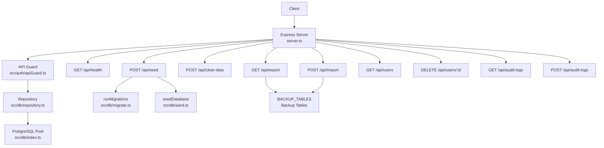
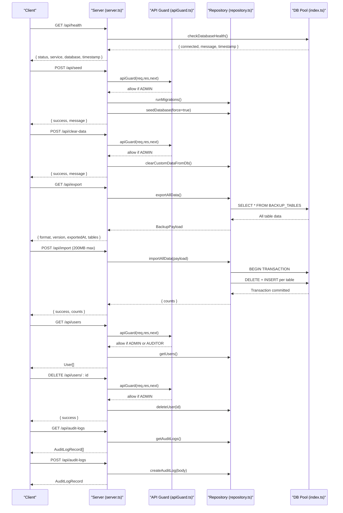
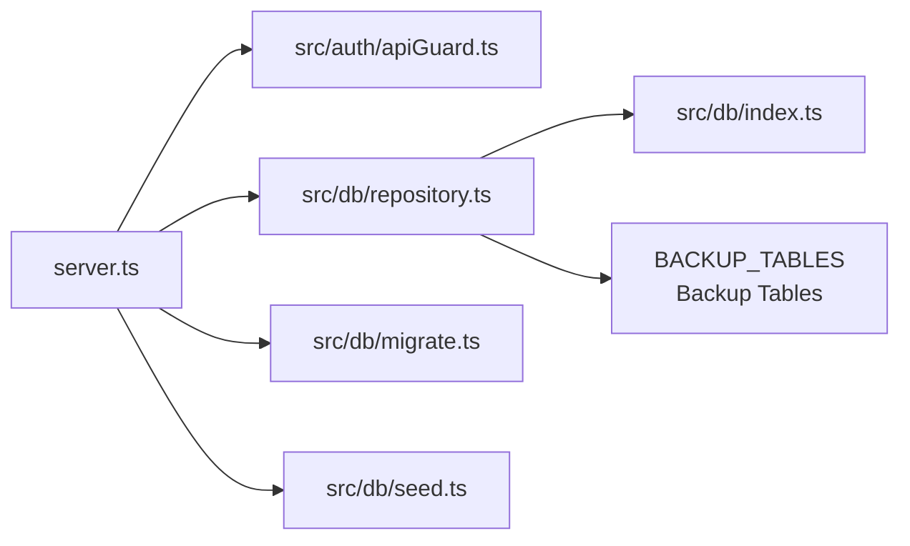

# System Endpoints

<cite>
**Referenced Files in This Document**
- [server.ts](file://server.ts)
- [apiGuard.ts](file://src/auth/apiGuard.ts)
- [index.ts](file://src/db/index.ts)
- [repository.ts](file://src/db/repository.ts)
- [migrate.ts](file://src/db/migrate.ts)
- [seed.ts](file://src/db/seed.ts)
- [types.ts](file://src/types.ts)
</cite>

## Update Summary
**Changes Made**
- Added new Database Backup & Restore section documenting /api/export and /api/import endpoints
- Updated Project Structure diagram to include new backup/restore endpoints
- Enhanced Architecture Overview sequence diagram with export/import workflow
- Added comprehensive documentation for full database backup and restore functionality

## Table of Contents
1. [Introduction](#introduction)
2. [Project Structure](#project-structure)
3. [Core Components](#core-components)
4. [Architecture Overview](#architecture-overview)
5. [Detailed Component Analysis](#detailed-component-analysis)
6. [Dependency Analysis](#dependency-analysis)
7. [Performance Considerations](#performance-considerations)
8. [Troubleshooting Guide](#troubleshooting-guide)
9. [Conclusion](#conclusion)

## Introduction
This document provides API documentation for ArchiveHub's system administration and monitoring endpoints. It covers:
- Health check endpoint GET /api/health for service status monitoring, including database connectivity checks and timestamp reporting.
- Database management endpoints POST /api/seed for initial data seeding and migration execution, and POST /api/clear-data for operational data cleanup.
- **New**: Full database backup and restore endpoints GET /api/export for exporting complete database backups and POST /api/import for restoring from backup files with 200MB payload support.
- Audit log endpoints GET /api/audit-logs for compliance monitoring and POST /api/audit-logs for logging significant actions.
- User management endpoints GET /api/users for user listing and DELETE /api/users/:id for user removal.

For each endpoint, this document specifies request/response formats, error handling behavior, and administrative access requirements.

## Project Structure
The server exposes REST endpoints under the /api prefix. Authentication and authorization are enforced by a middleware guard that validates tokens and role-based permissions. Data operations are implemented via repository functions that interact with PostgreSQL when available or fall back to in-memory state otherwise.

**Diagram sources**
- [server.ts:18-29](file://server.ts#L18-L29)
- [server.ts:43-82](file://server.ts#L43-L82)
- [server.ts:145-153](file://server.ts#L145-L153)
- [server.ts:464-480](file://server.ts#L464-L480)
- [apiGuard.ts:11-17](file://src/auth/apiGuard.ts#L11-L17)
- [apiGuard.ts:27-97](file://src/auth/apiGuard.ts#L27-L97)
- [index.ts:97-135](file://src/db/index.ts#L97-L135)
- [migrate.ts:3-278](file://src/db/migrate.ts#L3-L278)
- [seed.ts:3-23](file://src/db/seed.ts#L3-L23)
- [repository.ts:1736-1749](file://src/db/repository.ts#L1736-L1749)

**Section sources**
- [server.ts:18-29](file://server.ts#L18-L29)
- [server.ts:43-82](file://server.ts#L43-L82)
- [server.ts:145-153](file://server.ts#L145-L153)
- [server.ts:464-480](file://server.ts#L464-L480)
- [apiGuard.ts:11-17](file://src/auth/apiGuard.ts#L11-L17)
- [apiGuard.ts:27-97](file://src/auth/apiGuard.ts#L27-L97)
- [index.ts:97-135](file://src/db/index.ts#L97-L135)
- [migrate.ts:3-278](file://src/db/migrate.ts#L3-L278)
- [seed.ts:3-23](file://src/db/seed.ts#L3-L23)
- [repository.ts:1736-1749](file://src/db/repository.ts#L1736-L1749)

## Core Components
- Health Check: Returns service status, database health, and timestamp.
- Database Management:
  - Seed: Runs migrations and seeds default data if permitted.
  - Clear Data: Truncates operational tables (cascade) or deletes records as fallback.
  - **New**: Export: Creates full database backup with all tables as raw rows.
  - **New**: Import: Restores database from backup file with transactional integrity.
- Audit Logs:
  - Get: Retrieves audit logs ordered by timestamp.
  - Post: Creates an audit log entry.
- User Management:
  - List: Returns users from the repository.
  - Delete: Removes a user by ID.

Access control:
- Public endpoints: GET /api/health is public; other admin endpoints require authentication and appropriate roles.
- Role enforcement:
  - /api/users and /api/seed and /api/clear-data require ADMIN role.
  - POST /api/audit-logs is allowed without additional role checks beyond authentication.
  - **New**: /api/export and /api/import endpoints are publicly accessible for backup/restore operations.

**Section sources**
- [server.ts:18-29](file://server.ts#L18-L29)
- [server.ts:43-82](file://server.ts#L43-L82)
- [server.ts:145-153](file://server.ts#L145-L153)
- [server.ts:464-480](file://server.ts#L464-L480)
- [apiGuard.ts:11-17](file://src/auth/apiGuard.ts#L11-L17)
- [apiGuard.ts:64-66](file://src/auth/apiGuard.ts#L64-L66)
- [apiGuard.ts:88-90](file://src/auth/apiGuard.ts#L88-L90)

## Architecture Overview
The server defines Express routes that call repository functions. Repository functions use a PostgreSQL pool when configured; otherwise they operate on in-memory arrays. The API guard enforces authentication and role-based authorization for protected endpoints.

**Diagram sources**
- [server.ts:18-29](file://server.ts#L18-L29)
- [server.ts:43-82](file://server.ts#L43-L82)
- [server.ts:145-153](file://server.ts#L145-L153)
- [server.ts:464-480](file://server.ts#L464-L480)
- [apiGuard.ts:27-97](file://src/auth/apiGuard.ts#L27-L97)
- [index.ts:97-135](file://src/db/index.ts#L97-L135)
- [repository.ts:1758-1839](file://src/db/repository.ts#L1758-L1839)

## Detailed Component Analysis

### Health Check: GET /api/health
- Purpose: Service status monitoring including database connectivity checks and timestamp reporting.
- Access: Public (no authentication required).
- Request: None.
- Response:
  - status: string ("ok")
  - service: string ("ArchiveHub PDAMS Backend API")
  - database: object with fields:
    - connected: boolean
    - message: string
    - timestamp: string (ISO 8601)
  - timestamp: string (ISO 8601)
- Error Handling:
  - If database connection fails, database.connected will be false and database.message describes the issue.
- Notes:
  - On startup, the server attempts migrations and seeding if connected; failures are logged but do not block server start.

**Section sources**
- [server.ts:57-65](file://server.ts#L57-L65)
- [index.ts:97-135](file://src/db/index.ts#L97-L135)
- [server.ts:19-38](file://server.ts#L19-L38)

### Database Management: POST /api/seed
- Purpose: Execute schema migrations and load initial seed data.
- Access: Requires ADMIN role.
- Request: None.
- Response:
  - success: boolean
  - message: string
- Behavior:
  - Checks database connectivity; returns 400 with error if not connected.
  - Executes migrations then seeds with force flag to ensure defaults are loaded.
- Errors:
  - 400: Database not connected.
  - 500: Internal error during migration/seed.

**Section sources**
- [server.ts:68-86](file://server.ts#L68-L86)
- [migrate.ts:3-278](file://src/db/migrate.ts#L3-L278)
- [seed.ts:3-23](file://src/db/seed.ts#L3-L23)
- [apiGuard.ts:64-66](file://src/auth/apiGuard.ts#L64-L66)

### Database Management: POST /api/clear-data
- Purpose: Operational data cleanup by truncating or deleting operational tables.
- Access: Requires ADMIN role.
- Request: None.
- Response:
  - success: boolean
  - message: string
- Behavior:
  - Clears in-memory operational datasets.
  - Attempts TRUNCATE CASCADE on PostgreSQL; falls back to transactional DELETE queries if needed.
- Errors:
  - 500: Internal error; response includes error message.

**Section sources**
- [server.ts:89-96](file://server.ts#L89-L96)
- [repository.ts:1219-1264](file://src/db/repository.ts#L1219-L1264)
- [apiGuard.ts:64-66](file://src/auth/apiGuard.ts#L64-L66)

### Database Backup & Restore: GET /api/export
- Purpose: Create a full database backup containing all critical tables as raw row data.
- Access: Public (no authentication required).
- Request: None.
- Response:
  - format: string ("archivehub-export")
  - version: number (currently 1)
  - exportedAt: string (ISO 8601 timestamp)
  - tables: Record<string, any[]> containing all data from backup tables:
    - departments, users, document_types, reusable_custom_fields, locations, documents, bundles, checkouts, movements, retention_policies, disposal_records, audit_logs
- Error Handling:
  - 500: Internal error; response includes error message.
  - Requires connected PostgreSQL database; fails in memory fallback mode.
- Notes:
  - Exports complete database snapshot suitable for backup and migration purposes.
  - Large datasets may result in substantial JSON payloads.

**Section sources**
- [server.ts:145-153](file://server.ts#L145-L153)
- [repository.ts:1758-1775](file://src/db/repository.ts#L1758-L1775)
- [repository.ts:1736-1749](file://src/db/repository.ts#L1736-L1749)

### Database Backup & Restore: POST /api/import
- Purpose: Restore database from a previously exported backup file with transactional integrity.
- Access: Public (no authentication required).
- Request Body: BackupPayload object conforming to archivehub-export format:
  - format: string ("archivehub-export")
  - version: number (must match supported version)
  - exportedAt: string (ISO 8601 timestamp)
  - tables: Record<string, any[]> with backup data
- Response:
  - success: boolean
  - counts: Record<string, number> showing rows restored per table
- Error Handling:
  - 400: Invalid backup file format or structure
  - 500: Internal error; response includes error message
  - Requires connected PostgreSQL database; fails in memory fallback mode
- Behavior:
  - Validates backup file format and structure
  - Runs entire restore operation in single transaction for atomicity
  - Deletes existing data in target tables before inserting backup data
  - Handles JSON/JSONB column serialization automatically
  - Uses chunked inserts (500 rows per batch) to handle large datasets efficiently
  - Supports payloads up to 200MB for large database backups

**Section sources**
- [server.ts:18-29](file://server.ts#L18-L29)
- [repository.ts:1777-1839](file://src/db/repository.ts#L1777-L1839)

### Audit Logs: GET /api/audit-logs
- Purpose: Compliance monitoring by retrieving audit log entries.
- Access: Requires authentication; no specific role restriction beyond auth.
- Request: None.
- Response: Array of audit log records with fields:
  - id: string
  - userId: string
  - userName: string
  - userRole: string
  - action: string
  - entityType: string
  - entityId: string
  - entityName: string
  - timestamp: string (ISO 8601)
  - details: string
  - beforeValue?: string
  - afterValue?: string
- Errors:
  - 500: Internal error; response includes error message.

**Section sources**
- [server.ts:585-592](file://server.ts#L585-L592)
- [repository.ts:1172-1194](file://src/db/repository.ts#L1172-L1194)
- [apiGuard.ts:88-90](file://src/auth/apiGuard.ts#L88-L90)

### Audit Logs: POST /api/audit-logs
- Purpose: Log significant actions for compliance.
- Access: Requires authentication; no additional role restriction beyond auth.
- Request Body: Object conforming to AuditLogRecord excluding id and timestamp:
  - userId: string
  - userName: string
  - userRole: string
  - action: string
  - entityType: string
  - entityId: string
  - entityName: string
  - details: string
  - beforeValue?: string
  - afterValue?: string
- Response:
  - 201: Created with full AuditLogRecord including generated id and timestamp.
- Errors:
  - 500: Internal error; response includes error message.

**Section sources**
- [server.ts:594-601](file://server.ts#L594-L601)
- [repository.ts:1196-1217](file://src/db/repository.ts#L1196-L1217)
- [apiGuard.ts:88-90](file://src/auth/apiGuard.ts#L88-L90)
- [types.ts:260-274](file://src/types.ts#L260-L274)

### User Management: GET /api/users
- Purpose: List users for administrative review.
- Access: Requires ADMIN role or AUDITOR role (read-only).
- Request: None.
- Response: Array of User objects with fields:
  - id: string
  - email: string
  - fullName: string
  - role: string
  - departmentId: string
  - departmentName: string
  - avatarUrl?: string
  - title?: string
  - approvalStatus?: string
  - createdAt?: string
- Errors:
  - 500: Internal error; response includes error message.

**Section sources**
- [server.ts:136-143](file://server.ts#L136-L143)
- [repository.ts:111-120](file://src/db/repository.ts#L111-L120)
- [apiGuard.ts:53-58](file://src/auth/apiGuard.ts#L53-L58)
- [types.ts:10-22](file://src/types.ts#L10-L22)

### User Management: DELETE /api/users/:id
- Purpose: Remove a user by ID.
- Access: Requires ADMIN role.
- Request: Path parameter id (string).
- Response:
  - success: boolean
- Errors:
  - 500: Internal error; response includes error message.

**Section sources**
- [server.ts:298-305](file://server.ts#L298-L305)
- [repository.ts:226-239](file://src/db/repository.ts#L226-L239)
- [apiGuard.ts:64-66](file://src/auth/apiGuard.ts#L64-L66)

## Dependency Analysis
- Server routes depend on repository functions for data operations.
- Repository functions depend on PostgreSQL pool availability; if unavailable, they operate on in-memory arrays.
- API guard enforces authentication and role-based access for protected endpoints.
- Migration and seed functions are invoked by the seed endpoint and at server startup.
- **New**: Export/import endpoints depend on BACKUP_TABLES constant defining which tables are included in backups.

**Diagram sources**
- [server.ts:18-29](file://server.ts#L18-L29)
- [server.ts:43-82](file://server.ts#L43-L82)
- [server.ts:145-153](file://server.ts#L145-L153)
- [server.ts:464-480](file://server.ts#L464-L480)
- [apiGuard.ts:27-97](file://src/auth/apiGuard.ts#L27-L97)
- [repository.ts:1758-1839](file://src/db/repository.ts#L1758-L1839)
- [index.ts:97-135](file://src/db/index.ts#L97-L135)
- [migrate.ts:3-278](file://src/db/migrate.ts#L3-L278)
- [seed.ts:3-23](file://src/db/seed.ts#L3-L23)
- [repository.ts:1736-1749](file://src/db/repository.ts#L1736-L1749)

**Section sources**
- [server.ts:18-29](file://server.ts#L18-L29)
- [server.ts:43-82](file://server.ts#L43-L82)
- [server.ts:145-153](file://server.ts#L145-L153)
- [server.ts:464-480](file://server.ts#L464-L480)
- [apiGuard.ts:27-97](file://src/auth/apiGuard.ts#L27-L97)
- [repository.ts:1758-1839](file://src/db/repository.ts#L1758-L1839)
- [index.ts:97-135](file://src/db/index.ts#L97-L135)
- [migrate.ts:3-278](file://src/db/migrate.ts#L3-L278)
- [seed.ts:3-23](file://src/db/seed.ts#L3-L23)
- [repository.ts:1736-1749](file://src/db/repository.ts#L1736-L1749)

## Performance Considerations
- Health checks perform a lightweight database probe; avoid excessive polling to reduce load.
- Clear-data performs cascade truncation or multiple delete statements; consider scheduling during low-traffic windows.
- **New**: Export endpoint reads all data from backup tables; large databases may produce substantial JSON responses.
- **New**: Import endpoint uses transactional restore with chunked inserts (500 rows per batch) to handle large datasets efficiently.
- **New**: Import endpoint supports 200MB payload size for large database backups.
- Audit log writes are simple inserts; high-frequency logging should be batched at the client layer if necessary.
- Repository functions fall back to in-memory mode when database is unavailable; this can affect consistency and durability.

## Troubleshooting Guide
Common issues and responses:
- Health check reports database disconnected:
  - Ensure DATABASE_URL is configured and valid; check .env parsing and placeholder password detection.
- Seed endpoint returns 400:
  - Database not connected; configure DATABASE_URL and verify connectivity.
- Clear-data returns failure:
  - TRUNCATE may fail due to constraints; the function attempts transactional deletes as fallback. Review error message for specifics.
- **New**: Export endpoint returns 500:
  - Database not connected; export requires active PostgreSQL connection.
- **New**: Import endpoint returns 400:
  - Invalid backup file format; ensure file was created by ArchiveHub's export functionality.
- **New**: Import endpoint returns 500:
  - Database write failed; check PostgreSQL connectivity and table schema compatibility.
- User endpoints return 401/403:
  - Missing or invalid token; account not approved; insufficient role (ADMIN required for user deletion and list where applicable).
- Audit log endpoints return 500:
  - Database write failed; check PostgreSQL connectivity and table schema.

**Section sources**
- [index.ts:16-34](file://src/db/index.ts#L16-L34)
- [index.ts:97-135](file://src/db/index.ts#L97-L135)
- [server.ts:68-86](file://server.ts#L68-L86)
- [server.ts:89-96](file://server.ts#L89-L96)
- [server.ts:145-153](file://server.ts#L145-L153)
- [server.ts:18-29](file://server.ts#L18-L29)
- [apiGuard.ts:27-48](file://src/auth/apiGuard.ts#L27-L48)
- [repository.ts:1219-1264](file://src/db/repository.ts#L1219-L1264)
- [repository.ts:1758-1839](file://src/db/repository.ts#L1758-L1839)

## Conclusion
ArchiveHub's system endpoints provide essential administrative capabilities:
- Health monitoring with database connectivity checks and timestamps.
- Database lifecycle management through seeding and clearing operational data.
- **New**: Complete database backup and restore functionality with transactional integrity and large payload support.
- Audit logging for compliance and accountability.
- User management for listing and removing users.

Administrative endpoints enforce strict role-based access, while health checks and backup/restore operations remain publicly accessible for monitoring and maintenance purposes. Proper configuration of DATABASE_URL and adherence to role requirements are critical for reliable operation. The new backup/restore endpoints enable comprehensive database portability and disaster recovery capabilities with support for large datasets up to 200MB.