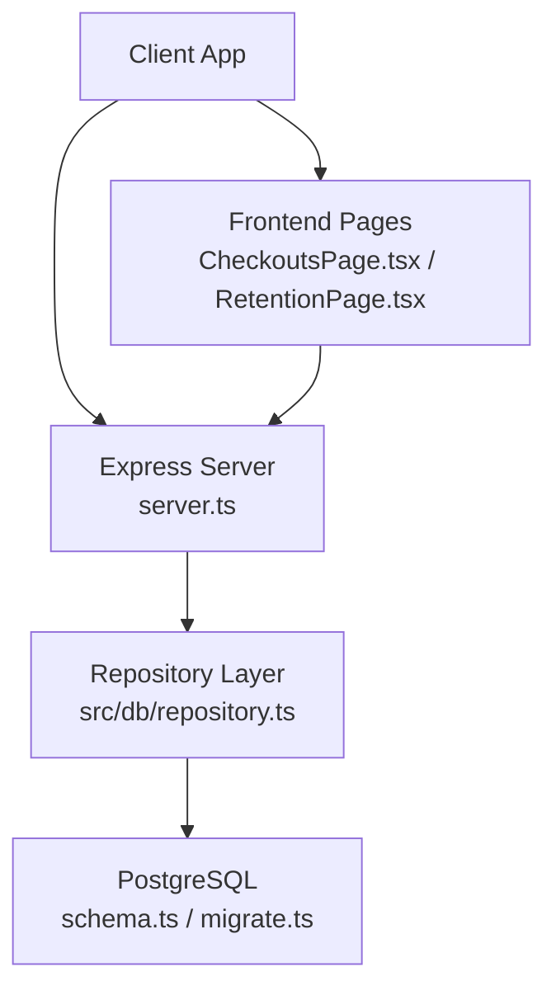
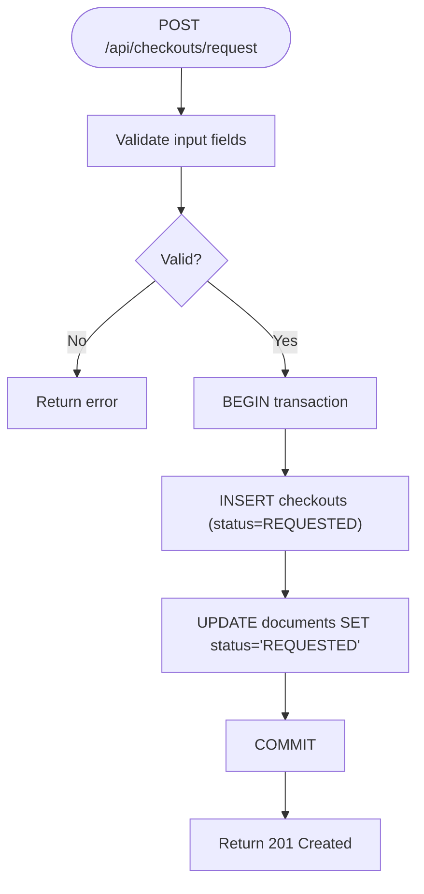
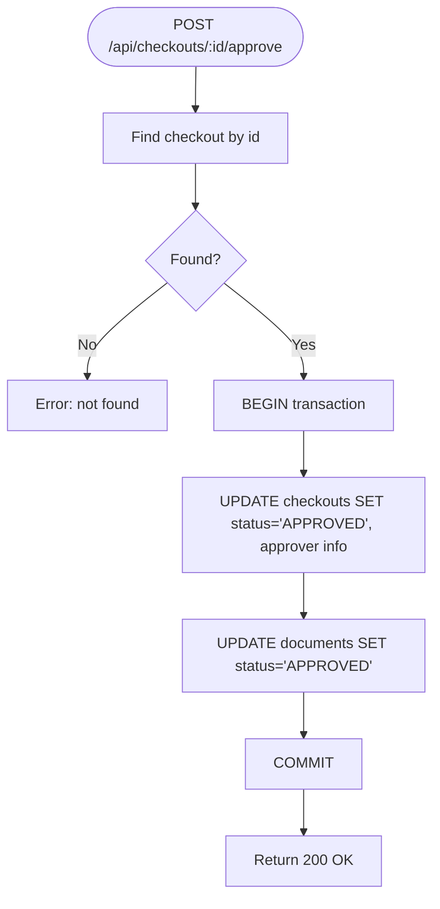
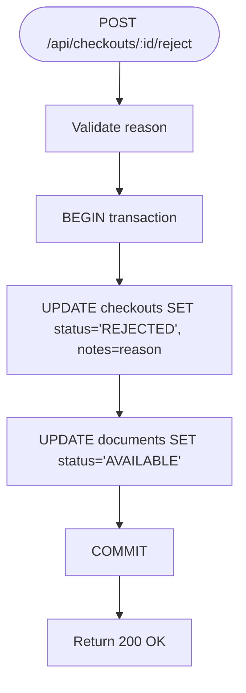
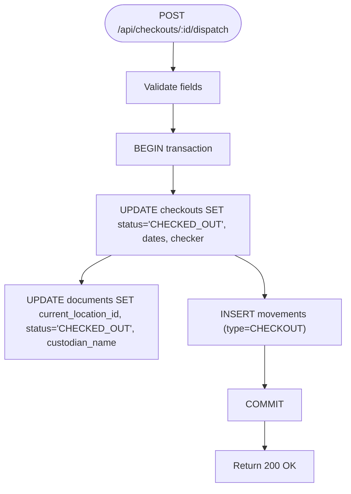
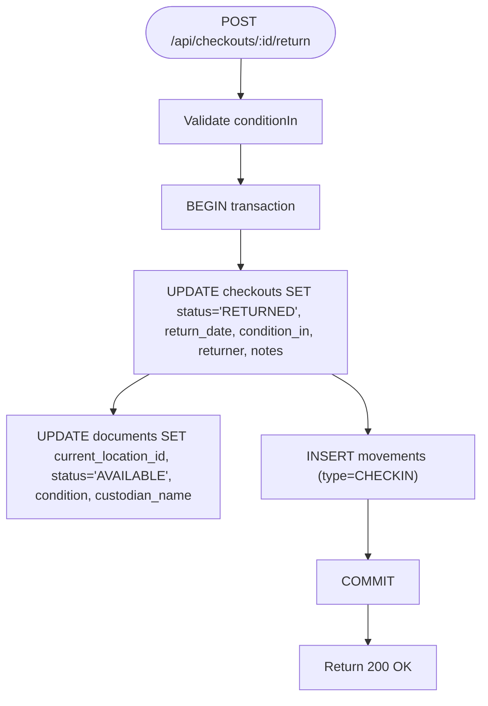
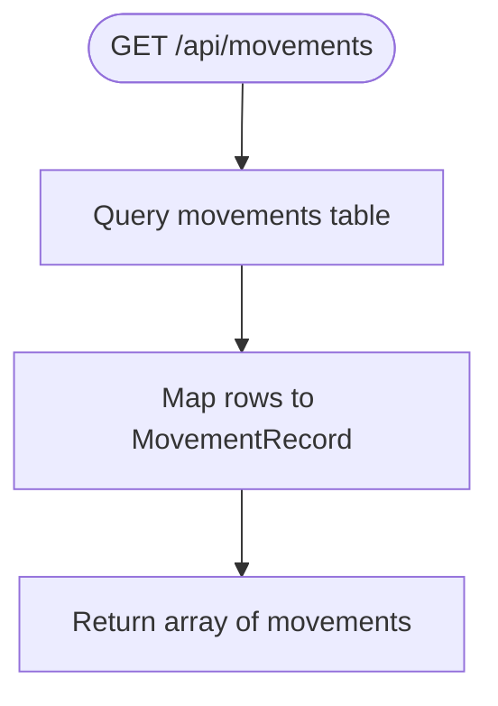
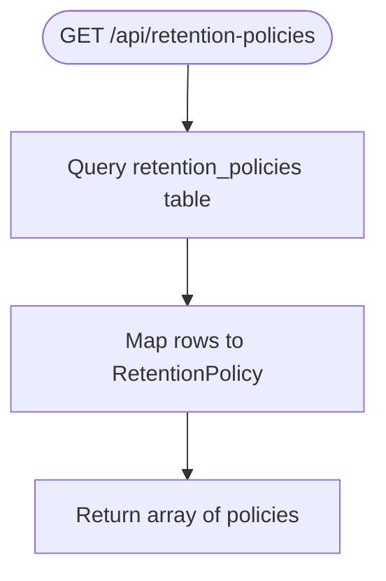
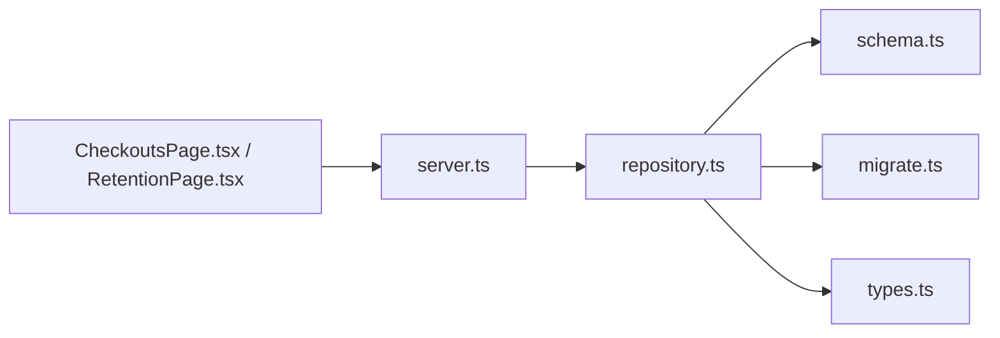

# Workflow Endpoints

<cite>
**Referenced Files in This Document**
- [server.ts](file://server.ts)
- [repository.ts](file://src/db/repository.ts)
- [schema.ts](file://src/db/schema.ts)
- [migrate.ts](file://src/db/migrate.ts)
- [types.ts](file://src/types.ts)
- [ArchiveContext.tsx](file://src/context/ArchiveContext.tsx)
- [CheckoutsPage.tsx](file://src/pages/CheckoutsPage.tsx)
- [RetentionPage.tsx](file://src/pages/RetentionPage.tsx)
</cite>

## Table of Contents
1. [Introduction](#introduction)
2. [Project Structure](#project-structure)
3. [Core Components](#core-components)
4. [Architecture Overview](#architecture-overview)
5. [Detailed Component Analysis](#detailed-component-analysis)
6. [Dependency Analysis](#dependency-analysis)
7. [Performance Considerations](#performance-considerations)
8. [Troubleshooting Guide](#troubleshooting-guide)
9. [Conclusion](#conclusion)

## Introduction
This document provides comprehensive API documentation for ArchiveHub’s workflow management endpoints focused on checkout processes and retention policies. It covers:
- Checkout lifecycle endpoints for requesting, approving, rejecting, dispatching, and returning physical documents
- Retention policy retrieval endpoint for automated retention period calculation and disposal workflow initiation
- Movement tracking endpoint for audit trail maintenance
It also specifies state transitions, permission requirements, and business rule enforcement for each workflow step based on the server routes, repository logic, database schema, and frontend usage patterns.

## Project Structure
The workflow endpoints are defined in the Express server and implemented via a repository layer that persists changes to PostgreSQL (with an in-memory fallback). The data model is defined in schema files, and types define contracts across layers. Frontend pages call these APIs to drive user workflows.



**Diagram sources**
- [server.ts:363-461](file://server.ts#L363-L461)
- [repository.ts:850-1100](file://src/db/repository.ts#L850-L1100)
- [schema.ts:141-194](file://src/db/schema.ts#L141-L194)
- [migrate.ts:168-205](file://src/db/migrate.ts#L168-L205)

**Section sources**
- [server.ts:363-461](file://server.ts#L363-L461)
- [repository.ts:850-1100](file://src/db/repository.ts#L850-L1100)
- [schema.ts:141-194](file://src/db/schema.ts#L141-L194)
- [migrate.ts:168-205](file://src/db/migrate.ts#L168-L205)

## Core Components
- Checkout workflow endpoints: request, approve, reject, dispatch, return
- Retention policies endpoint: read active retention schedules
- Movements endpoint: read movement audit trail
- Repository functions: implement state transitions, persistence, and audit entries
- Types: enforce status enums and data contracts

Key responsibilities:
- server.ts defines HTTP routes and delegates to repository functions
- repository.ts enforces business rules, updates statuses, records movements, and handles DB transactions with memory fallback
- schema.ts and migrate.ts define tables for checkouts, movements, retention_policies, and disposal_records
- types.ts defines status enums used throughout workflows

**Section sources**
- [server.ts:363-461](file://server.ts#L363-L461)
- [repository.ts:850-1100](file://src/db/repository.ts#L850-L1100)
- [schema.ts:141-194](file://src/db/schema.ts#L141-L194)
- [types.ts:54-72](file://src/types.ts#L54-L72)
- [types.ts:185-235](file://src/types.ts#L185-L235)

## Architecture Overview
The checkout workflow follows a strict state machine enforced by repository logic and persisted via PostgreSQL. Each transition updates related entities (documents, checkouts) and records a movement for auditability.

```mermaid
sequenceDiagram
participant UI as "CheckoutsPage"
participant API as "Server Routes"
participant Repo as "Repository"
participant DB as "PostgreSQL"
UI->>API : POST /api/checkouts/request {documentId, purpose, dueDate, user}
API->>Repo : requestCheckout(...)
Repo->>DB : BEGIN; INSERT checkouts; UPDATE documents.status='REQUESTED'; COMMIT
DB-->>Repo : success
Repo-->>API : created checkout
API-->>UI : 201 Created
UI->>API : POST /api/checkouts/ : id/approve {user}
API->>Repo : approveCheckout(...)
Repo->>DB : BEGIN; UPDATE checkouts.status='APPROVED'; UPDATE documents.status='APPROVED'; COMMIT
DB-->>Repo : success
Repo-->>API : ok
API-->>UI : 200 OK
UI->>API : POST /api/checkouts/ : id/dispatch {tempLocationId, user, fromPath, toPath}
API->>Repo : processCheckoutDispatch(...)
Repo->>DB : BEGIN; UPDATE checkouts.status='CHECKED_OUT'; UPDATE documents.current_location_id,status,custodian_name; INSERT movements; COMMIT
DB-->>Repo : success
Repo-->>API : ok
API-->>UI : 200 OK
UI->>API : POST /api/checkouts/ : id/return {conditionIn, returnLocationId, notes, user, fromPath, toPath}
API->>Repo : processCheckInReturn(...)
Repo->>DB : BEGIN; UPDATE checkouts.status='RETURNED'; UPDATE documents.current_location_id,status,condition,custodian_name; INSERT movements; COMMIT
DB-->>Repo : success
Repo-->>API : ok
API-->>UI : 200 OK
```

**Diagram sources**
- [server.ts:373-441](file://server.ts#L373-L441)
- [repository.ts:850-1100](file://src/db/repository.ts#L850-L1100)
- [schema.ts:141-167](file://src/db/schema.ts#L141-L167)

## Detailed Component Analysis

### Checkout Request: POST /api/checkouts/request
- Purpose: Initiate a checkout request for a document with a specified purpose and due date.
- Request body fields:
  - documentId: string
  - purpose: string
  - dueDate: string (date)
  - user: object (contains id, fullName, departmentName)
- Behavior:
  - Creates a checkout record with status REQUESTED
  - Sets document status to REQUESTED
  - Persists via transaction; falls back to in-memory if DB unavailable
- Response:
  - 201 Created with the new checkout record
- State transition:
  - Document: AVAILABLE → REQUESTED
  - Checkout: created with status REQUESTED
- Permission requirements:
  - Requires authenticated user context (passed in request body)
- Business rules:
  - Due date must be provided
  - Purpose is mandatory
  - Document condition at checkout time is captured from current document condition



**Diagram sources**
- [server.ts:373-386](file://server.ts#L373-L386)
- [repository.ts:850-896](file://src/db/repository.ts#L850-L896)

**Section sources**
- [server.ts:373-386](file://server.ts#L373-L386)
- [repository.ts:850-896](file://src/db/repository.ts#L850-L896)
- [types.ts:205-235](file://src/types.ts#L205-L235)

### Approve Checkout: POST /api/checkouts/:id/approve
- Purpose: Administrator approval of a pending checkout request.
- Request body fields:
  - user: object (approver identity)
- Behavior:
  - Updates checkout status to APPROVED and records approver details
  - Updates document status to APPROVED
  - Transactional update with rollback on failure
- Response:
  - 200 OK with success indicator
- State transition:
  - Checkout: REQUESTED → APPROVED
  - Document: REQUESTED → APPROVED
- Permission requirements:
  - Requires authenticated user acting as approver (e.g., Records Officer/Admin)
- Business rules:
  - Only applicable when checkout status is REQUESTED



**Diagram sources**
- [server.ts:388-396](file://server.ts#L388-L396)
- [repository.ts:898-934](file://src/db/repository.ts#L898-L934)

**Section sources**
- [server.ts:388-396](file://server.ts#L388-L396)
- [repository.ts:898-934](file://src/db/repository.ts#L898-L934)

### Reject Checkout: POST /api/checkouts/:id/reject
- Purpose: Deny a checkout request with reason tracking.
- Request body fields:
  - reason: string
  - user: object (rejector identity)
- Behavior:
  - Updates checkout status to REJECTED and stores reason in notes
  - Resets document status to AVAILABLE
  - Transactional update with rollback on failure
- Response:
  - 200 OK with success indicator
- State transition:
  - Checkout: REQUESTED → REJECTED
  - Document: REQUESTED → AVAILABLE
- Permission requirements:
  - Requires authenticated user acting as approver (e.g., Records Officer/Admin)
- Business rules:
  - Reason is required and recorded



**Diagram sources**
- [server.ts:398-406](file://server.ts#L398-L406)
- [repository.ts:936-969](file://src/db/repository.ts#L936-L969)

**Section sources**
- [server.ts:398-406](file://server.ts#L398-L406)
- [repository.ts:936-969](file://src/db/repository.ts#L936-L969)

### Dispatch Checkout: POST /api/checkouts/:id/dispatch
- Purpose: Physically dispatch an approved checkout to a temporary location.
- Request body fields:
  - tempLocationId: string (temporary storage location)
  - user: object (dispatcher identity)
  - fromPath: string (source path)
  - toPath: string (destination path)
- Behavior:
  - Updates checkout status to CHECKED_OUT and records checkout date and checker
  - Updates document current location, status to CHECKED_OUT, and custodian name
  - Inserts a movement record with type CHECKOUT
  - Transactional update with rollback on failure
- Response:
  - 200 OK with success indicator
- State transition:
  - Checkout: APPROVED → CHECKED_OUT
  - Document: APPROVED → CHECKED_OUT
- Permission requirements:
  - Requires authenticated user performing dispatch
- Business rules:
  - Must have an approved checkout before dispatch
  - Movement audit entry is mandatory



**Diagram sources**
- [server.ts:408-422](file://server.ts#L408-L422)
- [repository.ts:971-1052](file://src/db/repository.ts#L971-L1052)
- [schema.ts:151-167](file://src/db/schema.ts#L151-L167)

**Section sources**
- [server.ts:408-422](file://server.ts#L408-L422)
- [repository.ts:971-1052](file://src/db/repository.ts#L971-L1052)
- [schema.ts:151-167](file://src/db/schema.ts#L151-L167)

### Return Checkout: POST /api/checkouts/:id/return
- Purpose: Check-in processing with condition assessment.
- Request body fields:
  - conditionIn: enum (EXCELLENT|GOOD|FAIR|DAMAGED|MISSING)
  - returnLocationId: string (where the document is returned to)
  - notes: string (optional)
  - user: object (returner identity)
  - fromPath: string (source path)
  - toPath: string (destination path)
- Behavior:
  - Updates checkout status to RETURNED, records return date, condition, and returner
  - Updates document current location, status to AVAILABLE, condition, and custodian name
  - Inserts a movement record with type CHECKIN
  - Transactional update with rollback on failure
- Response:
  - 200 OK with success indicator
- State transition:
  - Checkout: CHECKED_OUT → RETURNED
  - Document: CHECKED_OUT → AVAILABLE
- Permission requirements:
  - Requires authenticated user performing return
- Business rules:
  - Condition assessment is mandatory on return
  - Movement audit entry is mandatory



**Diagram sources**
- [server.ts:424-441](file://server.ts#L424-L441)
- [repository.ts:1054-1100](file://src/db/repository.ts#L1054-L1100)
- [schema.ts:151-167](file://src/db/schema.ts#L151-L167)

**Section sources**
- [server.ts:424-441](file://server.ts#L424-L441)
- [repository.ts:1054-1100](file://src/db/repository.ts#L1054-L1100)
- [schema.ts:151-167](file://src/db/schema.ts#L151-L167)

### Movements: GET /api/movements
- Purpose: Retrieve the full audit trail of document movements.
- Behavior:
  - Returns all movement records ordered by timestamp descending
  - Falls back to in-memory state if DB unavailable
- Response:
  - Array of movement records including document identifiers, paths, movement type, performer, authorizer, reason, timestamp, and notes
- Use cases:
  - Audit reviews, compliance reporting, traceability checks



**Diagram sources**
- [server.ts:444-451](file://server.ts#L444-L451)
- [repository.ts:1128-1150](file://src/db/repository.ts#L1128-L1150)
- [schema.ts:151-167](file://src/db/schema.ts#L151-L167)

**Section sources**
- [server.ts:444-451](file://server.ts#L444-L451)
- [repository.ts:1128-1150](file://src/db/repository.ts#L1128-L1150)
- [schema.ts:151-167](file://src/db/schema.ts#L151-L167)

### Retention Policies: GET /api/retention-policies
- Purpose: Retrieve active statutory retention schedules for document types.
- Behavior:
  - Returns retention policies sorted by document type name
  - Used to calculate retention end dates and inform disposal workflows
- Response:
  - Array of retention policies including document type mapping, retention years, disposal method, and description
- Integration:
  - Frontend uses this to display active schedules and compute expiry windows



**Diagram sources**
- [server.ts:454-461](file://server.ts#L454-L461)
- [repository.ts:1153-1161](file://src/db/repository.ts#L1153-L1161)
- [schema.ts:169-177](file://src/db/schema.ts#L169-L177)

**Section sources**
- [server.ts:454-461](file://server.ts#L454-L461)
- [repository.ts:1153-1161](file://src/db/repository.ts#L1153-L1161)
- [schema.ts:169-177](file://src/db/schema.ts#L169-L177)

### Disposal Workflow Initiation
- Purpose: Automated retention period calculation and disposal workflow initiation based on retention policies.
- Data model:
  - retention_policies table defines retention years and disposal methods per document type
  - disposal_records table captures disposal execution details including certificate numbers and witnesses
- Behavior:
  - While no explicit disposal endpoint is exposed in server routes, the schema supports recording disposal events and certificates
  - Frontend displays retention schedules and can trigger disposal workflows using available UI flows
- Notes:
  - Disposal records include requested_by_user_name, approved_by_user_name, disposal_date, disposal_method, certificate_number, witness_name, and notes

**Section sources**
- [migrate.ts:184-205](file://src/db/migrate.ts#L184-L205)
- [schema.ts:169-194](file://src/db/schema.ts#L169-L194)
- [RetentionPage.tsx:15-62](file://src/pages/RetentionPage.tsx#L15-L62)

## Dependency Analysis
- server.ts routes depend on repository functions for all workflow operations
- repository functions depend on PostgreSQL pool and fall back to in-memory arrays when DB is unavailable
- schema.ts and migrate.ts define the underlying tables for checkouts, movements, retention_policies, and disposal_records
- types.ts defines shared contracts for statuses and entities used across layers
- Frontend pages call server routes to execute workflows and reflect state changes



**Diagram sources**
- [server.ts:363-461](file://server.ts#L363-L461)
- [repository.ts:850-1100](file://src/db/repository.ts#L850-L1100)
- [schema.ts:141-194](file://src/db/schema.ts#L141-L194)
- [migrate.ts:168-205](file://src/db/migrate.ts#L168-L205)
- [types.ts:54-72](file://src/types.ts#L54-L72)

**Section sources**
- [server.ts:363-461](file://server.ts#L363-L461)
- [repository.ts:850-1100](file://src/db/repository.ts#L850-L1100)
- [schema.ts:141-194](file://src/db/schema.ts#L141-L194)
- [migrate.ts:168-205](file://src/db/migrate.ts#L168-L205)
- [types.ts:54-72](file://src/types.ts#L54-L72)

## Performance Considerations
- All critical workflow steps use database transactions to ensure consistency and atomicity
- In-memory fallback ensures availability during DB outages but may reduce durability
- Movement records are inserted for every dispatch and return to maintain audit trails; consider indexing timestamp and document_id for query performance
- Large datasets of movements or checkouts should leverage pagination or filtering in future enhancements

[No sources needed since this section provides general guidance]

## Troubleshooting Guide
Common issues and resolutions:
- Checkout not found: Ensure the checkout ID exists and is in the expected state before calling approve/reject/dispatch/return
- DB connection failures: Repository falls back to memory mode; verify environment configuration for PostgreSQL connectivity
- Missing fields: Requests require specific fields (e.g., purpose, dueDate, reason, conditionIn); validate payloads before sending
- Permission errors: Ensure user context is included in request bodies; some actions require approver roles

Operational checks:
- Health endpoint: GET /api/health returns service and database status
- Seed/Clear endpoints: POST /api/seed and POST /api/clear-data assist in setup and testing

**Section sources**
- [server.ts:43-82](file://server.ts#L43-L82)
- [repository.ts:850-1100](file://src/db/repository.ts#L850-L1100)

## Conclusion
ArchiveHub’s workflow endpoints provide a robust, auditable system for managing physical document checkouts and retention policies. The server routes delegate to repository functions that enforce state transitions, persist changes via transactions, and record movements for compliance. Retention policies support automated lifecycle calculations and disposal workflows through well-defined schema structures. Proper authentication and role-based permissions are enforced via user context passed in requests, ensuring secure and controlled operations.

[No sources needed since this section summarizes without analyzing specific files]