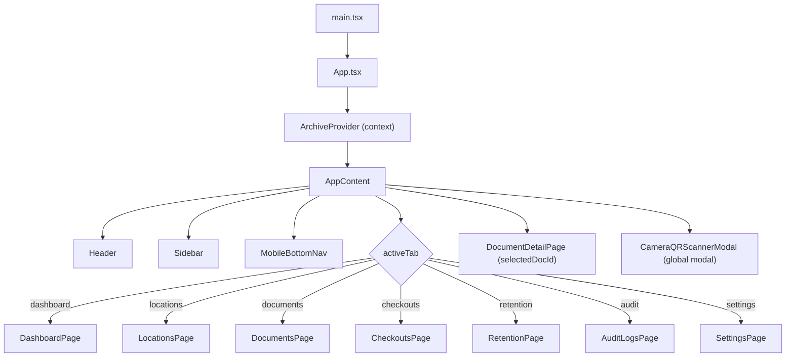
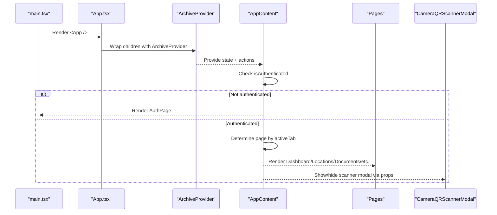
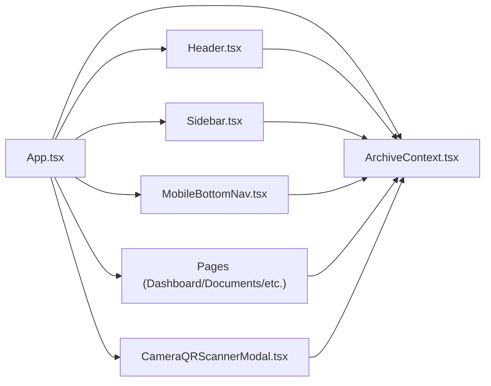

# Application Root & State Management

<cite>
**Referenced Files in This Document**
- [main.tsx](file://src/main.tsx)
- [App.tsx](file://src/App.tsx)
- [ArchiveContext.tsx](file://src/context/ArchiveContext.tsx)
- [types.ts](file://src/types.ts)
- [AuthPage.tsx](file://src/components/auth/AuthPage.tsx)
- [Header.tsx](file://src/components/layout/Header.tsx)
- [Sidebar.tsx](file://src/components/layout/Sidebar.tsx)
- [MobileBottomNav.tsx](file://src/components/layout/MobileBottomNav.tsx)
- [CameraQRScannerModal.tsx](file://src/components/scanner/CameraQRScannerModal.tsx)
- [DashboardPage.tsx](file://src/pages/DashboardPage.tsx)
- [DocumentsPage.tsx](file://src/pages/DocumentsPage.tsx)
</cite>

## Table of Contents
1. [Introduction](#introduction)
2. [Project Structure](#project-structure)
3. [Core Components](#core-components)
4. [Architecture Overview](#architecture-overview)
5. [Detailed Component Analysis](#detailed-component-analysis)
6. [Dependency Analysis](#dependency-analysis)
7. [Performance Considerations](#performance-considerations)
8. [Troubleshooting Guide](#troubleshooting-guide)
9. [Conclusion](#conclusion)

## Introduction
This document explains ArchiveHub’s application root and state management architecture. It focuses on how the app bootstraps, how global state is provided via a context provider, and how authentication, tab-based navigation, and modal states are coordinated across components. It also details the context API surface used to manage active tabs, user authentication, selected documents, and global modals, with examples of how components consume and update state.

## Project Structure
At runtime, React renders the root component from the entry file, which wraps the entire UI with a provider that centralizes state and side effects. The root component then decides whether to show an authentication screen or the main application shell based on authentication status. Inside the main shell, a header, sidebar, mobile bottom nav, and a content area render pages conditionally based on the active tab. Global modals (e.g., QR scanner) are rendered at the root level for consistent overlay behavior.

**Diagram sources**
- [main.tsx:6-10](file://src/main.tsx#L6-L10)
- [App.tsx:166-172](file://src/App.tsx#L166-L172)
- [App.tsx:19-164](file://src/App.tsx#L19-L164)

**Section sources**
- [main.tsx:1-11](file://src/main.tsx#L1-L11)
- [App.tsx:1-173](file://src/App.tsx#L1-L173)

## Core Components
- App (root): Wraps the application with ArchiveProvider to supply global state and actions to all descendants.
- AppContent: Orchestrates authentication gating, tab routing, selected document view, and global modal visibility.
- ArchiveProvider: Centralizes state for users, documents, locations, checkouts, audit logs, notifications, database health, and UI flags like activeTab and globalSearchQuery. Exposes CRUD operations, auth flows, and helper lookups.
- AuthPage: Handles sign-in and sign-up flows using context auth methods; supports pending approval messaging.
- Header, Sidebar, MobileBottomNav: Navigation and controls that read/write shared state (activeTab, currentUser, search, notifications).
- CameraQRScannerModal: Global modal for scanning QR/barcodes and navigating to documents or locations.

Key responsibilities:
- Authentication gating and session persistence
- Tab-driven page rendering without traditional router
- Selected document detail view
- Global modals and notifications
- Data synchronization with backend APIs

**Section sources**
- [App.tsx:166-172](file://src/App.tsx#L166-L172)
- [App.tsx:19-164](file://src/App.tsx#L19-L164)
- [ArchiveContext.tsx:115-297](file://src/context/ArchiveContext.tsx#L115-L297)
- [AuthPage.tsx:21-120](file://src/components/auth/AuthPage.tsx#L21-L120)
- [Header.tsx:26-42](file://src/components/layout/Header.tsx#L26-L42)
- [Sidebar.tsx:27-44](file://src/components/layout/Sidebar.tsx#L27-L44)
- [MobileBottomNav.tsx:18-28](file://src/components/layout/MobileBottomNav.tsx#L18-L28)
- [CameraQRScannerModal.tsx:28-43](file://src/components/scanner/CameraQRScannerModal.tsx#L28-L43)

## Architecture Overview
The application uses a single-page, tab-based routing model driven by a shared activeTab state. Authentication is enforced at the root level: if not authenticated, only the authentication screen is shown. Once authenticated, the main layout renders pages based on activeTab. Global modals are controlled by local state in AppContent but can be triggered from anywhere via callbacks passed down to child components.

**Diagram sources**
- [main.tsx:6-10](file://src/main.tsx#L6-L10)
- [App.tsx:166-172](file://src/App.tsx#L166-L172)
- [App.tsx:19-164](file://src/App.tsx#L19-L164)

## Detailed Component Analysis

### App.tsx: Main Entry and Routing Logic
- Wraps the app with ArchiveProvider to enable global state access.
- Renders AuthPage when not authenticated.
- Maintains local state for:
  - selectedDocId: drives the detail view overlay within the main content area.
  - isMobileMenuOpen: controls mobile drawer visibility.
  - showScannerModal, triggerRegisterDoc, triggerCreateLoc: control global modals and direct modal triggers.
- Provides handlers:
  - handleSelectDocument: sets selectedDocId to open detail view.
  - handleSelectTab: clears selection, updates activeTab, closes mobile menu.
  - handleNavigateLocation: navigates to locations tab and clears selection.
- Conditional rendering:
  - If selectedDocId exists, shows DocumentDetailPage.
  - Else, renders page based on activeTab values: dashboard, locations, documents, checkouts, retention, audit, settings.
- Global modal:
  - CameraQRScannerModal is mounted at root level and receives callbacks to navigate after scan.

Examples of state propagation:
- Header/Sidebar/MobileBottomNav call onSelectTab to update activeTab via AppContent.
- Scanner modal selects a document or location and updates selectedDocId or navigates to locations tab.

**Section sources**
- [App.tsx:19-164](file://src/App.tsx#L19-L164)
- [App.tsx:166-172](file://src/App.tsx#L166-L172)

### ArchiveContext.tsx: Global State and Actions
State managed includes:
- User and authentication:
  - currentUser, isAuthenticated, setCurrentUser, loginUser, signupUser, logoutUser, approveUser, rejectUser, deleteUser.
  - Session persistence via localStorage key for cross-session login.
- Data collections:
  - departments, documentTypes, reusableCustomFields, bundles, locations, documents, checkouts, movements, auditLogs.
- UI globals:
  - globalSearchQuery, activeTab, setActiveTab, notifications, dbHealth.
- Operations:
  - Add/update/delete for locations, documents, bundles, custom fields, document types.
  - Checkout lifecycle: request, approve/reject, process checkout/return.
  - Helpers: lookupByQR, calculatePath.
- Backend sync:
  - fetchAllFromBackend loads data from multiple endpoints and refreshes current user if present.
  - reseedDatabase seeds initial dataset and refreshes state.

Authentication flow highlights:
- On login success, sets currentUser and isAuthenticated, persists session, and notifies user.
- On network failure or offline fallback, attempts local matching against availableUsers and enforces approval status checks.
- Signup creates a pending user and adds an audit log entry.

Navigation and modal integration:
- activeTab drives page rendering in AppContent.
- Notifications are surfaced in Header dropdowns and updated via addNotification/dismissNotification.

Complexity notes:
- Many async operations use optimistic updates followed by server calls; errors fall back to local state changes and user feedback via notifications.

**Section sources**
- [ArchiveContext.tsx:16-109](file://src/context/ArchiveContext.tsx#L16-L109)
- [ArchiveContext.tsx:115-297](file://src/context/ArchiveContext.tsx#L115-L297)
- [ArchiveContext.tsx:300-514](file://src/context/ArchiveContext.tsx#L300-L514)
- [ArchiveContext.tsx:516-800](file://src/context/ArchiveContext.tsx#L516-L800)

### AuthPage.tsx: Authentication Flow
- Uses context auth methods to sign in or sign up.
- Supports pending approval messaging and returns to sign-in mode after registration submission.
- Displays role descriptions and department selection during signup.

Integration points:
- Calls loginUser/signupUser from context.
- Updates UI state for errors, loading, and confirmation screens.

**Section sources**
- [AuthPage.tsx:21-120](file://src/components/auth/AuthPage.tsx#L21-L120)
- [AuthPage.tsx:122-472](file://src/components/auth/AuthPage.tsx#L122-L472)

### Header.tsx: Navigation and Notifications
- Reads currentUser, availableUsers, notifications, globalSearchQuery, and checkouts from context.
- Allows switching persona (current user), opening scanner, dismissing notifications, and navigating to settings or documents via setActiveTab.
- Shows overdue count badge and notification list.

State updates propagated:
- setGlobalSearchQuery updates search input and may switch to documents tab.
- setActiveTab navigates between pages.
- logoutUser signs out and clears session.

**Section sources**
- [Header.tsx:26-42](file://src/components/layout/Header.tsx#L26-L42)
- [Header.tsx:92-119](file://src/components/layout/Header.tsx#L92-L119)
- [Header.tsx:145-208](file://src/components/layout/Header.tsx#L145-L208)
- [Header.tsx:210-302](file://src/components/layout/Header.tsx#L210-L302)
- [Header.tsx:308-338](file://src/components/layout/Header.tsx#L308-L338)

### Sidebar.tsx: Desktop and Mobile Navigation
- Lists navigation items with badges derived from context data (documents, checkouts, pending approvals).
- Updates activeTab via setActiveTab and closes mobile drawer when needed.
- Persona switcher allows changing currentUser from availableUsers.

**Section sources**
- [Sidebar.tsx:27-44](file://src/components/layout/Sidebar.tsx#L27-L44)
- [Sidebar.tsx:53-83](file://src/components/layout/Sidebar.tsx#L53-L83)
- [Sidebar.tsx:146-229](file://src/components/layout/Sidebar.tsx#L146-L229)
- [Sidebar.tsx:235-259](file://src/components/layout/Sidebar.tsx#L235-L259)

### MobileBottomNav.tsx: Mobile Navigation Bar
- Provides quick access to overview, vault tree, catalogue, circulation, and scanner.
- Highlights active tab and shows alert badges for overdue/pending items.

**Section sources**
- [MobileBottomNav.tsx:18-28](file://src/components/layout/MobileBottomNav.tsx#L18-L28)
- [MobileBottomNav.tsx:29-134](file://src/components/layout/MobileBottomNav.tsx#L29-L134)

### CameraQRScannerModal.tsx: Global Scanner Modal
- Manages camera/manual input modes and processes codes via lookupByQR.
- Displays results for documents or locations and provides actions to navigate to detail or explore storage unit.
- Integrates with context helpers to compute location paths and identify records.

**Section sources**
- [CameraQRScannerModal.tsx:28-43](file://src/components/scanner/CameraQRScannerModal.tsx#L28-L43)
- [CameraQRScannerModal.tsx:46-96](file://src/components/scanner/CameraQRScannerModal.tsx#L46-L96)
- [CameraQRScannerModal.tsx:100-121](file://src/components/scanner/CameraQRScannerModal.tsx#L100-L121)
- [CameraQRScannerModal.tsx:123-391](file://src/components/scanner/CameraQRScannerModal.tsx#L123-L391)

### Page Components: Consumption of Context
- DashboardPage reads metrics from context (documents, locations, checkouts, movements) and triggers actions like opening scanner or navigating to checkouts.
- DocumentsPage consumes context for filtering, registration, and bulk operations; integrates with modals for editing, bundling, and printing.

**Section sources**
- [DashboardPage.tsx:23-50](file://src/pages/DashboardPage.tsx#L23-L50)
- [DashboardPage.tsx:50-125](file://src/pages/DashboardPage.tsx#L50-L125)
- [DocumentsPage.tsx:39-87](file://src/pages/DocumentsPage.tsx#L39-L87)
- [DocumentsPage.tsx:147-200](file://src/pages/DocumentsPage.tsx#L147-L200)

## Dependency Analysis
Components depend on the context for shared state and actions. The following diagram shows key relationships:

**Diagram sources**
- [App.tsx:19-164](file://src/App.tsx#L19-L164)
- [ArchiveContext.tsx:115-297](file://src/context/ArchiveContext.tsx#L115-L297)
- [Header.tsx:26-42](file://src/components/layout/Header.tsx#L26-L42)
- [Sidebar.tsx:27-44](file://src/components/layout/Sidebar.tsx#L27-L44)
- [MobileBottomNav.tsx:18-28](file://src/components/layout/MobileBottomNav.tsx#L18-L28)
- [CameraQRScannerModal.tsx:28-43](file://src/components/scanner/CameraQRScannerModal.tsx#L28-L43)

**Section sources**
- [App.tsx:19-164](file://src/App.tsx#L19-L164)
- [ArchiveContext.tsx:115-297](file://src/context/ArchiveContext.tsx#L115-L297)

## Performance Considerations
- Batched data fetching: The provider uses parallel requests to load multiple datasets efficiently.
- Optimistic updates: Many mutations update local state immediately and then attempt server sync, improving perceived performance.
- Localized modal state: Modals are controlled locally in AppContent to avoid unnecessary re-renders across unrelated components.
- Notification limits: Notifications are capped to recent entries to prevent unbounded growth.

[No sources needed since this section provides general guidance]

## Troubleshooting Guide
Common issues and where to inspect:
- Authentication failures:
  - Check loginUser logic and error handling in context; verify backend responses and local fallback behavior.
  - Inspect pending approval messages and rejection states.
- Data sync problems:
  - Review fetchAllFromBackend and refreshDbHealth for network errors and fallbacks.
  - Use reseedDatabase to reset to known state if needed.
- Navigation glitches:
  - Ensure activeTab is consistently updated via handleSelectTab and that setSelectedDocId is cleared appropriately.
- Scanner modal not showing:
  - Verify showScannerModal state and prop passing from AppContent to CameraQRScannerModal.

**Section sources**
- [ArchiveContext.tsx:300-350](file://src/context/ArchiveContext.tsx#L300-L350)
- [ArchiveContext.tsx:257-297](file://src/context/ArchiveContext.tsx#L257-L297)
- [App.tsx:145-160](file://src/App.tsx#L145-L160)

## Conclusion
ArchiveHub’s root structure centers around a provider-driven global state model. App serves as the entry point, wrapping everything with ArchiveProvider to coordinate authentication, tab-based navigation, selected document views, and global modals. Components consume and update state through the context API, enabling consistent behavior across the application. The separation between authenticated and unauthenticated states ensures secure access, while the activeTab-driven routing offers a simple, effective navigation model without external routing libraries.