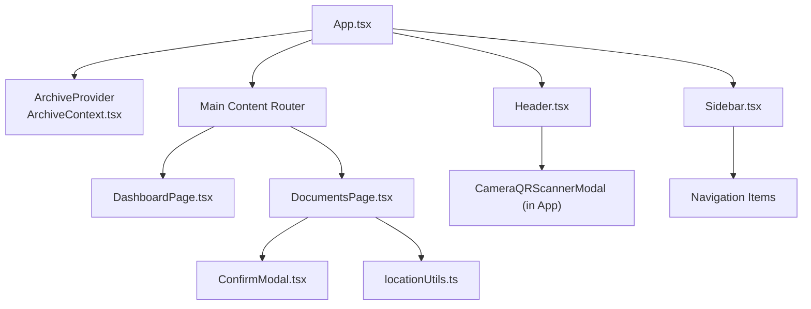
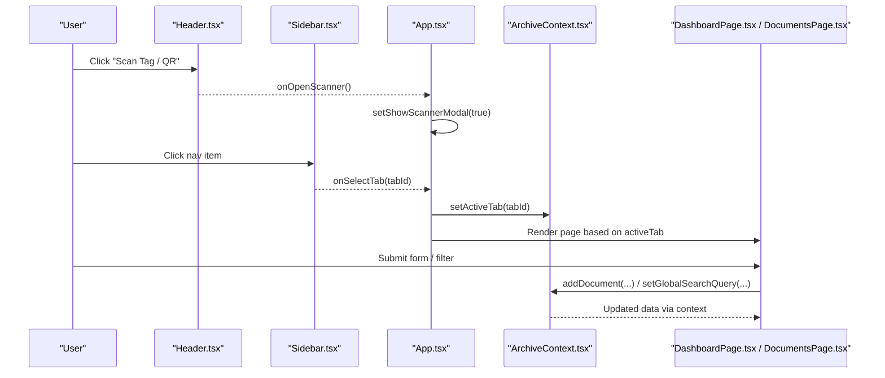
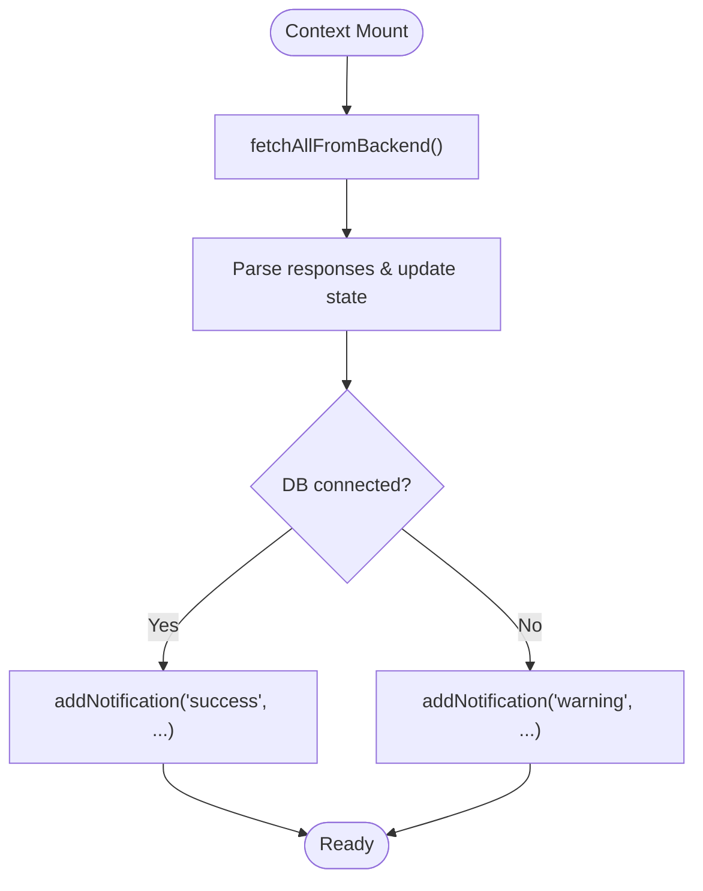
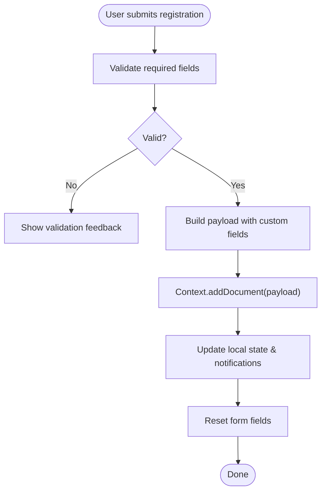
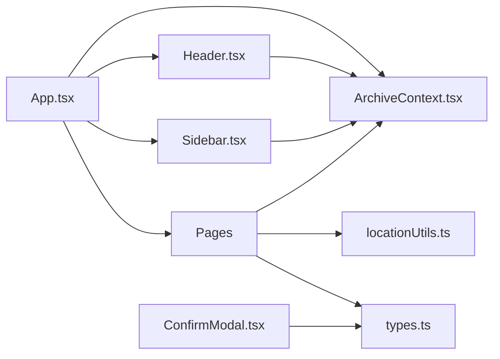

# Component Architecture

<cite>
**Referenced Files in This Document**
- [App.tsx](file://src/App.tsx)
- [ArchiveContext.tsx](file://src/context/ArchiveContext.tsx)
- [Header.tsx](file://src/components/layout/Header.tsx)
- [Sidebar.tsx](file://src/components/layout/Sidebar.tsx)
- [MobileBottomNav.tsx](file://src/components/layout/MobileBottomNav.tsx)
- [DashboardPage.tsx](file://src/pages/DashboardPage.tsx)
- [DocumentsPage.tsx](file://src/pages/DocumentsPage.tsx)
- [ConfirmModal.tsx](file://src/components/common/ConfirmModal.tsx)
- [locationUtils.ts](file://src/utils/locationUtils.ts)
- [types.ts](file://src/types.ts)
</cite>

## Table of Contents
1. Introduction
2. Project Structure
3. Core Components
4. Architecture Overview
5. Detailed Component Analysis
6. Dependency Analysis
7. Performance Considerations
8. Troubleshooting Guide
9. Conclusion

## Introduction
This document explains the component architecture of ArchiveHub’s React application. It covers the hierarchy from the root App component through layout components (Header, Sidebar, MobileBottomNav), feature pages (Dashboard, Documents, and others), reusable UI components, and utilities. It also documents context-based global state via ArchiveContext, separation of concerns, composition patterns, prop interfaces, event handling strategies, responsive design, accessibility considerations, performance techniques, and navigation patterns.

## Project Structure
The application is organized by feature and layer:
- Root entry and provider: App.tsx wraps the app with ArchiveProvider for global state.
- Layout components: Header, Sidebar, MobileBottomNav provide consistent chrome and navigation.
- Feature pages: DashboardPage, DocumentsPage, and other pages render domain-specific views.
- Reusable UI: Common modals and shared widgets under components/common.
- Utilities: Pure functions for location path calculation and helpers.
- Types: Centralized TypeScript definitions for entities and enums.

**Diagram sources**
- [App.tsx:1-173](file://src/App.tsx#L1-L173)
- [ArchiveContext.tsx:115-180](file://src/context/ArchiveContext.tsx#L115-L180)
- [Header.tsx:20-45](file://src/components/layout/Header.tsx#L20-L45)
- [Sidebar.tsx:21-45](file://src/components/layout/Sidebar.tsx#L21-L45)
- [DashboardPage.tsx:23-37](file://src/pages/DashboardPage.tsx#L23-L37)
- [DocumentsPage.tsx:39-61](file://src/pages/DocumentsPage.tsx#L39-L61)
- [ConfirmModal.tsx:4-13](file://src/components/common/ConfirmModal.tsx#L4-L13)
- [locationUtils.ts:7-14](file://src/utils/locationUtils.ts#L7-L14)

**Section sources**
- [App.tsx:1-173](file://src/App.tsx#L1-L173)
- [ArchiveContext.tsx:115-180](file://src/context/ArchiveContext.tsx#L115-L180)

## Core Components
- App.tsx: Orchestrates authentication gating, active tab routing, selected document view, mobile drawer state, scanner modal, and renders layout + pages.
- ArchiveContext.tsx: Provides global state (users, documents, locations, checkouts, audit logs, bundles), actions (CRUD, auth, notifications), and helper lookups.
- Header.tsx: Top bar with branding, global search, QR scanner trigger, notifications dropdown, user persona switcher, and settings/logout.
- Sidebar.tsx: Desktop sidebar and mobile slide-over drawer with navigation items, badges, user card, and quick actions.
- MobileBottomNav.tsx: Fixed bottom navigation on small screens with primary tabs and a prominent scan action.
- DashboardPage.tsx: KPIs, alerts, recent movements, department breakdown, and quick actions.
- DocumentsPage.tsx: Full catalogue with filters, bulk selection, registration modal, edit/delete flows, and bundle operations.
- ConfirmModal.tsx: Generic confirmation dialog with variants and accessible controls.
- locationUtils.ts: Pure functions to compute hierarchical location paths and query descendants.

Key responsibilities and separation of concerns:
- Pages own business logic for their domain (filters, selections, forms).
- Layout components manage chrome and navigation events.
- Context centralizes cross-cutting state and side effects (API sync, notifications).
- Utilities remain pure and testable.

**Section sources**
- [App.tsx:19-163](file://src/App.tsx#L19-L163)
- [ArchiveContext.tsx:32-109](file://src/context/ArchiveContext.tsx#L32-L109)
- [Header.tsx:20-45](file://src/components/layout/Header.tsx#L20-L45)
- [Sidebar.tsx:21-45](file://src/components/layout/Sidebar.tsx#L21-L45)
- [MobileBottomNav.tsx:12-23](file://src/components/layout/MobileBottomNav.tsx#L12-L23)
- [DashboardPage.tsx:23-37](file://src/pages/DashboardPage.tsx#L23-L37)
- [DocumentsPage.tsx:39-61](file://src/pages/DocumentsPage.tsx#L39-L61)
- [ConfirmModal.tsx:4-13](file://src/components/common/ConfirmModal.tsx#L4-L13)
- [locationUtils.ts:7-14](file://src/utils/locationUtils.ts#L7-L14)

## Architecture Overview
The app uses a single-context state model. App provides the provider and composes layout and pages. Pages consume context to read data and dispatch actions. Layout components emit events upward to App, which updates context or local UI state. Utilities are invoked within pages or context to transform data.

**Diagram sources**
- [Header.tsx:134-143](file://src/components/layout/Header.tsx#L134-L143)
- [App.tsx:57-61](file://src/App.tsx#L57-L61)
- [App.tsx:41-45](file://src/App.tsx#L41-L45)
- [ArchiveContext.tsx:176-179](file://src/context/ArchiveContext.tsx#L176-L179)
- [DocumentsPage.tsx:147-199](file://src/pages/DocumentsPage.tsx#L147-L199)

## Detailed Component Analysis

### App.tsx
- Responsibilities:
  - Wraps the app with ArchiveProvider.
  - Manages authentication gate, active tab, selected document, mobile menu, and scanner modal.
  - Composes Header, Sidebar, main content area, and MobileBottomNav.
  - Routes to specific pages based on activeTab and selectedDocId.
- Composition pattern:
  - Conditional rendering for pages vs detail view.
  - Event handlers passed down to layout and pages.
- Navigation pattern:
  - Tab-based routing without client-side router; activeTab drives page selection.
- Responsive behavior:
  - Uses Tailwind breakpoints to show/hide elements and adjust padding.

**Section sources**
- [App.tsx:19-163](file://src/App.tsx#L19-L163)
- [App.tsx:166-173](file://src/App.tsx#L166-L173)

### ArchiveContext.tsx
- Global state includes:
  - Auth: currentUser, isAuthenticated, availableUsers, pending users.
  - Data: departments, documentTypes, reusableCustomFields, bundles, locations, documents, checkouts, movements, auditLogs.
  - UI: globalSearchQuery, activeTab, notifications.
- Actions:
  - CRUD for locations, documents, bundles, custom fields, document types.
  - Checkout lifecycle: request, approve/reject, process checkout/return.
  - Helpers: lookupByQR, calculatePath.
  - Notifications and database health management.
- Side effects:
  - fetchAllFromBackend synchronizes with server endpoints on mount.
  - LocalStorage persistence for session.
- Error handling:
  - Graceful fallbacks when API fails; notifications inform users.

**Diagram sources**
- [ArchiveContext.tsx:197-255](file://src/context/ArchiveContext.tsx#L197-L255)
- [ArchiveContext.tsx:257-278](file://src/context/ArchiveContext.tsx#L257-L278)

**Section sources**
- [ArchiveContext.tsx:32-109](file://src/context/ArchiveContext.tsx#L32-L109)
- [ArchiveContext.tsx:115-180](file://src/context/ArchiveContext.tsx#L115-L180)
- [ArchiveContext.tsx:197-255](file://src/context/ArchiveContext.tsx#L197-L255)
- [ArchiveContext.tsx:257-278](file://src/context/ArchiveContext.tsx#L257-L278)

### Header.tsx
- Props:
  - onOpenScanner, onOpenMobileMenu, onSelectTab.
- Features:
  - Branding and logo click navigates to dashboard.
  - Global search input triggers tab change to documents and updates context search query.
  - QR scanner trigger opens modal via App state.
  - Notifications dropdown with dismiss actions and overdue count badge.
  - User persona switcher dropdown to change current user and navigate to settings or logout.
- Accessibility:
  - aria-label on interactive controls.
  - Keyboard-friendly buttons and focus styles via Tailwind.

**Section sources**
- [Header.tsx:20-45](file://src/components/layout/Header.tsx#L20-L45)
- [Header.tsx:57-119](file://src/components/layout/Header.tsx#L57-L119)
- [Header.tsx:145-208](file://src/components/layout/Header.tsx#L145-L208)
- [Header.tsx:210-302](file://src/components/layout/Header.tsx#L210-L302)
- [Header.tsx:308-338](file://src/components/layout/Header.tsx#L308-L338)

### Sidebar.tsx
- Props:
  - onSelectTab, isMobileOpen, onCloseMobile.
- Features:
  - Navigation items with icons, labels, and dynamic badges.
  - Active tab highlighting.
  - Mobile drawer with backdrop and close button.
  - User card with persona switcher and quick actions (logout, reset demo data).
- Accessibility:
  - aria-label on close button.
  - Focusable buttons with clear visual states.

**Section sources**
- [Sidebar.tsx:21-45](file://src/components/layout/Sidebar.tsx#L21-L45)
- [Sidebar.tsx:53-83](file://src/components/layout/Sidebar.tsx#L53-L83)
- [Sidebar.tsx:85-144](file://src/components/layout/Sidebar.tsx#L85-L144)
- [Sidebar.tsx:146-232](file://src/components/layout/Sidebar.tsx#L146-L232)
- [Sidebar.tsx:235-258](file://src/components/layout/Sidebar.tsx#L235-L258)

### MobileBottomNav.tsx
- Props:
  - onOpenScanner, onOpenMobileMenu, onSelectTab.
- Features:
  - Primary tabs: Overview, Vault Tree, Catalogue, Circulation.
  - Centered Scan action with prominent styling.
  - Badge indicators for overdue/pending circulation.
  - Menu button opens mobile drawer via App.

**Section sources**
- [MobileBottomNav.tsx:12-23](file://src/components/layout/MobileBottomNav.tsx#L12-L23)
- [MobileBottomNav.tsx:29-133](file://src/components/layout/MobileBottomNav.tsx#L29-L133)

### DashboardPage.tsx
- Props:
  - onOpenScanner, onOpenRegisterDoc, onOpenCreateLocation, onSelectDocument.
- Features:
  - KPI cards for total docs, available, checked out, storage nodes.
  - Overdue alert banner with quick action to manage checkouts.
  - Recent movements list with navigation to document details.
  - Department distribution visualization.
  - Quick links to retention policies.

**Section sources**
- [DashboardPage.tsx:23-37](file://src/pages/DashboardPage.tsx#L23-L37)
- [DashboardPage.tsx:50-125](file://src/pages/DashboardPage.tsx#L50-L125)
- [DashboardPage.tsx:127-197](file://src/pages/DashboardPage.tsx#L127-L197)
- [DashboardPage.tsx:199-321](file://src/pages/DashboardPage.tsx#L199-L321)

### DocumentsPage.tsx
- Props:
  - onSelectDocument, openRegisterModalDirectly, onClearTrigger.
- Features:
  - Filters: keyword search, department, type, status, confidentiality, bundle filter.
  - View modes: table and grid.
  - Bulk selection banner with print tags and bundle grouping.
  - Registration modal with dynamic custom fields based on document type.
  - Edit and delete flows using ConfirmModal.
  - Integration with context for adding documents and updating lists.

**Diagram sources**
- [DocumentsPage.tsx:147-199](file://src/pages/DocumentsPage.tsx#L147-L199)

**Section sources**
- [DocumentsPage.tsx:39-61](file://src/pages/DocumentsPage.tsx#L39-L61)
- [DocumentsPage.tsx:70-132](file://src/pages/DocumentsPage.tsx#L70-L132)
- [DocumentsPage.tsx:147-199](file://src/pages/DocumentsPage.tsx#L147-L199)
- [DocumentsPage.tsx:217-262](file://src/pages/DocumentsPage.tsx#L217-L262)
- [DocumentsPage.tsx:427-475](file://src/pages/DocumentsPage.tsx#L427-L475)
- [DocumentsPage.tsx:477-777](file://src/pages/DocumentsPage.tsx#L477-L777)
- [DocumentsPage.tsx:779-800](file://src/pages/DocumentsPage.tsx#L779-L800)

### ConfirmModal.tsx
- Props:
  - isOpen, onClose, onConfirm, title, message, confirmText, cancelText, variant.
- Features:
  - Variant-driven styling (danger/warning/info).
  - Accessible overlay and keyboard-friendly actions.
  - Prevents closing on background click unless intended.

**Section sources**
- [ConfirmModal.tsx:4-13](file://src/components/common/ConfirmModal.tsx#L4-L13)
- [ConfirmModal.tsx:15-101](file://src/components/common/ConfirmModal.tsx#L15-L101)

### Utility: locationUtils.ts
- Functions:
  - calculateLocationPath: builds human-readable path string.
  - getLocationAncestors: resolves ancestor chain.
  - getChildrenLocations: direct children of a node.
  - getAllDescendantIds: recursive descendant IDs.
  - getDocumentsInLocation: filter documents by location mode.
  - getLocationIconName: maps location type to icon name.
- Complexity:
  - Path building is O(n) over ancestors; descendant traversal is O(k) where k is subtree size.

**Section sources**
- [locationUtils.ts:7-14](file://src/utils/locationUtils.ts#L7-L14)
- [locationUtils.ts:19-40](file://src/utils/locationUtils.ts#L19-L40)
- [locationUtils.ts:45-61](file://src/utils/locationUtils.ts#L45-L61)
- [locationUtils.ts:66-80](file://src/utils/locationUtils.ts#L66-L80)
- [locationUtils.ts:82-95](file://src/utils/locationUtils.ts#L82-L95)

## Dependency Analysis
- App depends on ArchiveProvider for global state and composes layout and pages.
- Layout components depend on ArchiveContext for activeTab, notifications, and user state.
- Pages depend on ArchiveContext for data and actions, and on utilities for path calculations.
- ConfirmModal is independent and reused across pages.
- Types define contracts used throughout the app.

**Diagram sources**
- [App.tsx:1-173](file://src/App.tsx#L1-L173)
- [ArchiveContext.tsx:1-180](file://src/context/ArchiveContext.tsx#L1-L180)
- [Header.tsx:1-45](file://src/components/layout/Header.tsx#L1-L45)
- [Sidebar.tsx:1-45](file://src/components/layout/Sidebar.tsx#L1-L45)
- [DashboardPage.tsx:1-37](file://src/pages/DashboardPage.tsx#L1-L37)
- [DocumentsPage.tsx:1-61](file://src/pages/DocumentsPage.tsx#L1-L61)
- [ConfirmModal.tsx:1-13](file://src/components/common/ConfirmModal.tsx#L1-L13)
- [locationUtils.ts:1-14](file://src/utils/locationUtils.ts#L1-L14)
- [types.ts:1-283](file://src/types.ts#L1-L283)

**Section sources**
- [App.tsx:1-173](file://src/App.tsx#L1-L173)
- [ArchiveContext.tsx:1-180](file://src/context/ArchiveContext.tsx#L1-L180)
- [types.ts:1-283](file://src/types.ts#L1-L283)

## Performance Considerations
- Context batching:
  - Use memoization (e.g., useMemo, useCallback) for derived data and expensive computations in pages to avoid unnecessary re-renders.
- Search optimization:
  - Debounce global search input changes to reduce filtering overhead.
- List rendering:
  - Virtualize large tables/lists if datasets grow significantly.
- Network efficiency:
  - Batch initial fetches (already done in context) and consider incremental updates or polling intervals for real-time features like checkouts.
- Modal and drawer overlays:
  - Ensure z-index stacking and minimal DOM depth to keep interactions snappy.
- Image and media:
  - Lazy-load images and use appropriate sizes to reduce bandwidth.

[No sources needed since this section provides general guidance]

## Troubleshooting Guide
- Authentication issues:
  - If login fails due to network errors, context falls back to local user list and validates passwords locally. Check localStorage for session integrity.
- Database connectivity:
  - Health endpoint failures produce warnings; verify environment configuration for database URL.
- Data synchronization:
  - If data appears stale, trigger refreshDbHealth or reseedDatabase to reload from backend.
- Form validation:
  - Ensure required fields are present before submission; review error messages and console logs for validation failures.
- Notification noise:
  - Dismiss notifications as needed; excessive notifications can be reduced by consolidating messages.

**Section sources**
- [ArchiveContext.tsx:300-350](file://src/context/ArchiveContext.tsx#L300-L350)
- [ArchiveContext.tsx:257-278](file://src/context/ArchiveContext.tsx#L257-L278)
- [ArchiveContext.tsx:280-293](file://src/context/ArchiveContext.tsx#L280-L293)

## Conclusion
ArchiveHub employs a clean separation of concerns with a single-context state model. Layout components handle chrome and navigation, pages encapsulate domain logic, and utilities provide pure transformations. The context orchestrates data synchronization, notifications, and global UI state, enabling consistent behavior across components. Responsive design and accessibility are integrated via Tailwind classes and ARIA attributes. Performance can be further optimized with memoization, debouncing, and virtualization as data scales.

[No sources needed since this section summarizes without analyzing specific files]