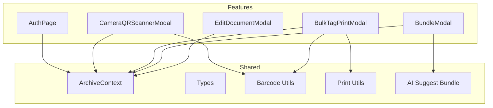
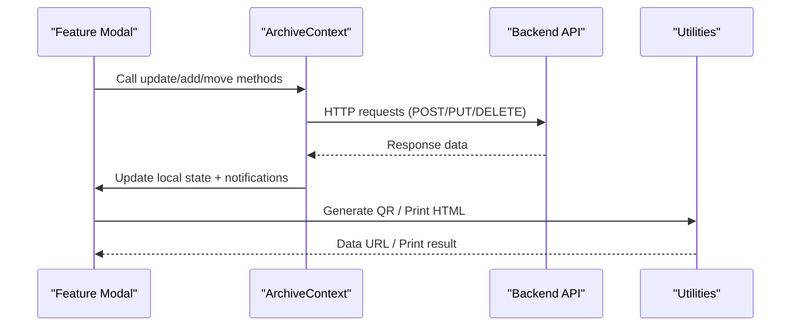
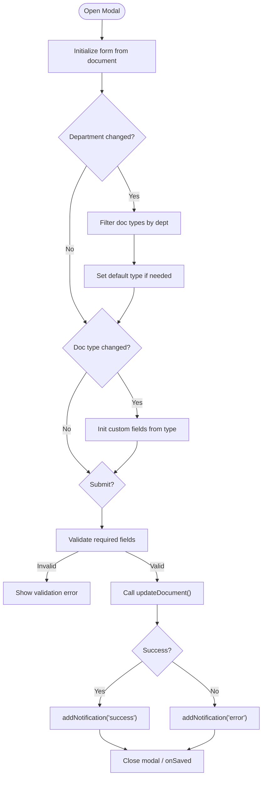
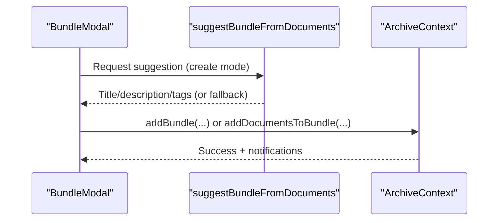
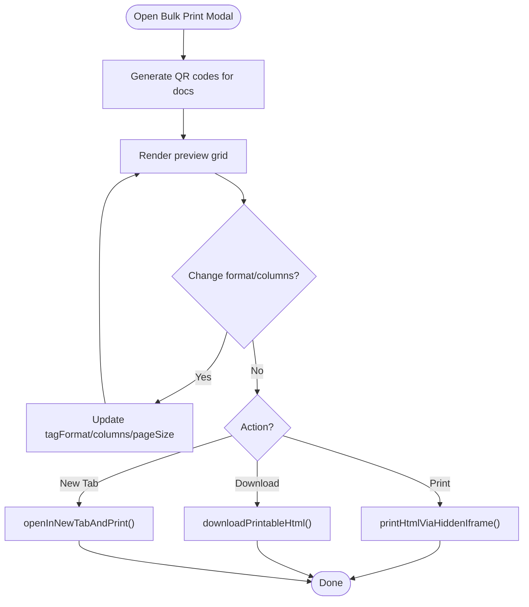
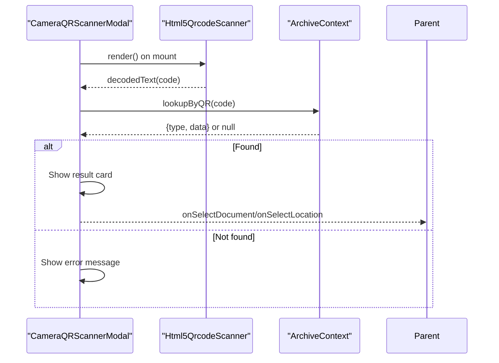
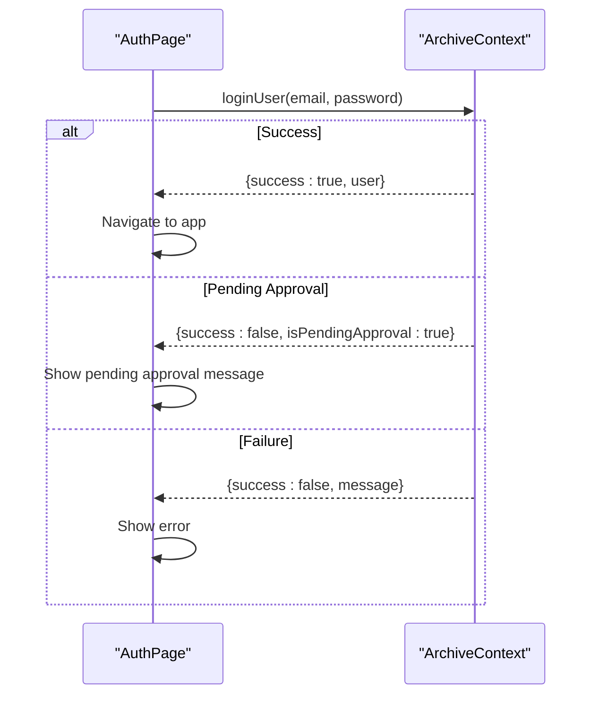
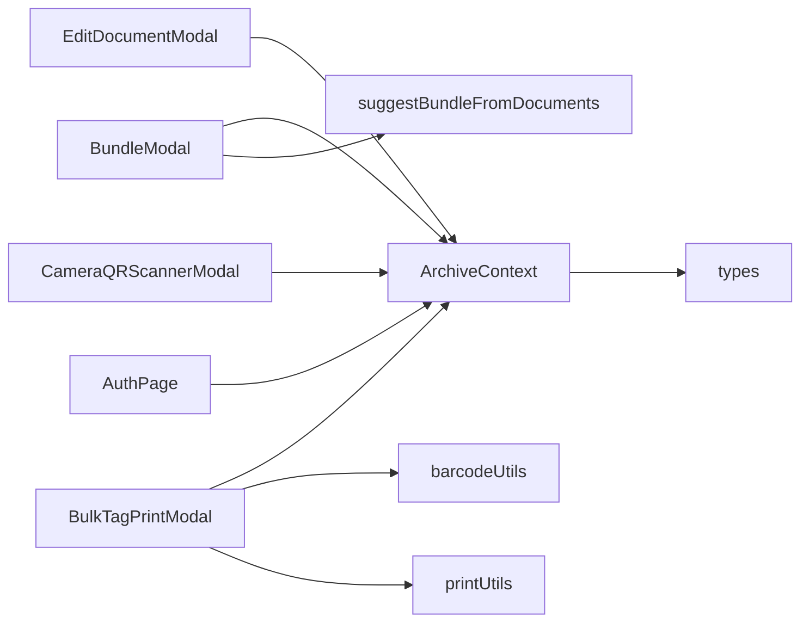

# Feature-Specific Modules

<cite>
**Referenced Files in This Document**
- [EditDocumentModal.tsx](file://src/components/documents/EditDocumentModal.tsx)
- [BundleModal.tsx](file://src/components/documents/BundleModal.tsx)
- [BulkTagPrintModal.tsx](file://src/components/documents/BulkTagPrintModal.tsx)
- [CameraQRScannerModal.tsx](file://src/components/scanner/CameraQRScannerModal.tsx)
- [AuthPage.tsx](file://src/components/auth/AuthPage.tsx)
- [ArchiveContext.tsx](file://src/context/ArchiveContext.tsx)
- [types.ts](file://src/types.ts)
- [barcodeUtils.ts](file://src/utils/barcodeUtils.ts)
- [printUtils.ts](file://src/utils/printUtils.ts)
- [suggestBundle.ts](file://src/ai/suggestBundle.ts)
</cite>

## Table of Contents
1. [Introduction](#introduction)
2. [Project Structure](#project-structure)
3. [Core Components](#core-components)
4. [Architecture Overview](#architecture-overview)
5. [Detailed Component Analysis](#detailed-component-analysis)
6. [Dependency Analysis](#dependency-analysis)
7. [Performance Considerations](#performance-considerations)
8. [Troubleshooting Guide](#troubleshooting-guide)
9. [Conclusion](#conclusion)

## Introduction
This document explains ArchiveHub’s feature-specific module components that separate concerns by functional domains: document management, location operations, scanning capabilities, and authentication flows. It focuses on the EditDocumentModal (document metadata editing), BundleModal (dossier creation), BulkTagPrintModal (mass printing), CameraQRScannerModal (barcode/QR scanning), and AuthPage (user authentication). For each component, we detail lifecycle, state management, communication with parent components and global state via ArchiveContext, complex workflows, error handling strategies, and integrations with external services such as camera APIs and file print systems.

## Project Structure
The application organizes features into domain-scoped modules under src/components, with shared utilities and a central context for state and API orchestration.

**Diagram sources**
- [EditDocumentModal.tsx:1-10](file://src/components/documents/EditDocumentModal.tsx#L1-L10)
- [BundleModal.tsx:1-12](file://src/components/documents/BundleModal.tsx#L1-L12)
- [BulkTagPrintModal.tsx:1-22](file://src/components/documents/BulkTagPrintModal.tsx#L1-L22)
- [CameraQRScannerModal.tsx:1-20](file://src/components/scanner/CameraQRScannerModal.tsx#L1-L20)
- [AuthPage.tsx:1-20](file://src/components/auth/AuthPage.tsx#L1-L20)
- [ArchiveContext.tsx:1-15](file://src/context/ArchiveContext.tsx#L1-L15)
- [types.ts:1-10](file://src/types.ts#L1-L10)
- [barcodeUtils.ts:1-10](file://src/utils/barcodeUtils.ts#L1-L10)
- [printUtils.ts:1-10](file://src/utils/printUtils.ts#L1-L10)
- [suggestBundle.ts:1-10](file://src/ai/suggestBundle.ts#L1-L10)

**Section sources**
- [ArchiveContext.tsx:1-110](file://src/context/ArchiveContext.tsx#L1-L110)
- [types.ts:1-283](file://src/types.ts#L1-L283)

## Core Components
- EditDocumentModal: Full-featured form to edit document metadata, classification fields, home location assignment, bundle association, confidentiality, condition, dates, and digital surrogate copy flags. Communicates updates through ArchiveContext.updateDocument and notifies via addNotification.
- BundleModal: Creates new bundles or adds selected documents to existing bundles; supports AI-powered suggestions for title/description/tags. Persists via ArchiveContext.addBundle/addDocumentsToBundle.
- BulkTagPrintModal: Generates printable sticker sheets (standard, compact, spine) with QR codes and layout options; prints via hidden iframe or opens in new tab; uses barcode utils for QR generation.
- CameraQRScannerModal: Scans QR/barcodes using html5-qrcode or accepts manual input; resolves records via ArchiveContext.lookupByQR; displays results and navigates to document/location pages.
- AuthPage: Sign-in/sign-up UI with role selection, department binding, pending approval flow, and integration with ArchiveContext.loginUser/signupUser.

**Section sources**
- [EditDocumentModal.tsx:25-107](file://src/components/documents/EditDocumentModal.tsx#L25-L107)
- [BundleModal.tsx:13-77](file://src/components/documents/BundleModal.tsx#L13-L77)
- [BulkTagPrintModal.tsx:23-74](file://src/components/documents/BulkTagPrintModal.tsx#L23-L74)
- [CameraQRScannerModal.tsx:21-45](file://src/components/scanner/CameraQRScannerModal.tsx#L21-L45)
- [AuthPage.tsx:21-50](file://src/components/auth/AuthPage.tsx#L21-L50)

## Architecture Overview
All feature components consume a centralized ArchiveContext that manages user session, data state (departments, locations, documents, bundles), and side effects (API calls, notifications). Utilities encapsulate cross-cutting concerns like QR generation and printing. The AI suggestion utility is optional and falls back gracefully when unavailable.

**Diagram sources**
- [ArchiveContext.tsx:197-255](file://src/context/ArchiveContext.tsx#L197-L255)
- [ArchiveContext.tsx:300-350](file://src/context/ArchiveContext.tsx#L300-L350)
- [ArchiveContext.tsx:604-690](file://src/context/ArchiveContext.tsx#L604-L690)
- [BulkTagPrintModal.tsx:76-110](file://src/components/documents/BulkTagPrintModal.tsx#L76-L110)
- [printUtils.ts:7-64](file://src/utils/printUtils.ts#L7-L64)
- [barcodeUtils.ts:7-21](file://src/utils/barcodeUtils.ts#L7-L21)

## Detailed Component Analysis

### EditDocumentModal
Purpose: Edit document metadata, classification, location, and bundle association; manage digital surrogate copy flags.

Lifecycle and State
- Initializes form state from props.document when opened; resets on close.
- Maintains local state for all editable fields, including dynamic custom classification fields derived from document types.
- Submits updates via ArchiveContext.updateDocument and triggers onSaved callback if provided.

Communication Patterns
- Reads departments, documentTypes, locations, bundles from ArchiveContext.
- Uses calculatePath to display location hierarchy and addNotification for feedback.
- Updates related fields (e.g., documentTypeName, departmentName) based on selections.

Error Handling
- Validates required fields before submission.
- Wraps updateDocument call in try/catch; shows error notification on failure.

Integration Points
- Optional digital copy metadata fields are prepared for upload elsewhere in the app.
- Dynamic custom fields adapt to selected document type configuration.

Complex Workflow Example
- User selects a department; available document types filter accordingly.
- Selecting a document type initializes custom fields with defaults.
- Choosing a bundle auto-fills bundleNumber/title on the document.
- Saving updates persists changes and refreshes UI via context.

**Diagram sources**
- [EditDocumentModal.tsx:81-141](file://src/components/documents/EditDocumentModal.tsx#L81-L141)
- [EditDocumentModal.tsx:147-197](file://src/components/documents/EditDocumentModal.tsx#L147-L197)

**Section sources**
- [EditDocumentModal.tsx:25-107](file://src/components/documents/EditDocumentModal.tsx#L25-L107)
- [EditDocumentModal.tsx:147-197](file://src/components/documents/EditDocumentModal.tsx#L147-L197)
- [ArchiveContext.tsx:779-800](file://src/context/ArchiveContext.tsx#L779-L800)

### BundleModal
Purpose: Create new bundles or add selected documents to existing ones; optionally suggest titles/tags via AI.

Lifecycle and State
- Mode toggle between create and existing-bundle selection.
- On open in create mode, triggers AI suggestion for title/description/tags.
- Maintains form state for bundle number, title, department, location, description, tags.

Communication Patterns
- Uses ArchiveContext.addBundle and addDocumentsToBundle to persist changes.
- Leverages calculatePath to show location hierarchy.
- Notifies users via addNotification.

Error Handling
- Validates required inputs before submission.
- Catches errors during API calls and logs them; maintains optimistic UI where possible.

Integration Points
- AI suggestion utility suggests bundle metadata; falls back locally if API key missing.

Complex Workflow Example
- User selects multiple documents; modal pre-fills suggested title and tags.
- User chooses an existing bundle or creates a new one; system groups documents and updates their bundle references.

**Diagram sources**
- [BundleModal.tsx:61-77](file://src/components/documents/BundleModal.tsx#L61-L77)
- [BundleModal.tsx:79-131](file://src/components/documents/BundleModal.tsx#L79-L131)
- [suggestBundle.ts:19-55](file://src/ai/suggestBundle.ts#L19-L55)
- [ArchiveContext.tsx:604-690](file://src/context/ArchiveContext.tsx#L604-L690)

**Section sources**
- [BundleModal.tsx:13-77](file://src/components/documents/BundleModal.tsx#L13-L77)
- [BundleModal.tsx:79-131](file://src/components/documents/BundleModal.tsx#L79-L131)
- [suggestBundle.ts:1-56](file://src/ai/suggestBundle.ts#L1-L56)
- [ArchiveContext.tsx:604-690](file://src/context/ArchiveContext.tsx#L604-L690)

### BulkTagPrintModal
Purpose: Generate and print physical archive tags/stickers in multiple layouts and column densities; includes QR codes and metadata.

Lifecycle and State
- Computes optimal columns based on selected format; allows override.
- Generates QR code images for all documents asynchronously; stores in qrCodeMap.
- Renders live preview grid reflecting current settings.

Communication Patterns
- Uses ArchiveContext.calculatePath to compute storage paths for labels.
- Utilizes barcodeUtils.generateQRCodeDataUrl for QR image generation.
- Uses printUtils to print via hidden iframe, download HTML, or open in new tab.

Error Handling
- Gracefully handles QR generation failures by rendering empty placeholders.
- Falls back to window.print() if iframe printing fails.

Integration Points
- Integrates with browser printing APIs and QR generation libraries.

Complex Workflow Example
- User selects standard/compact/spine layout and column count; preview updates instantly.
- Clicking Print triggers hidden iframe print; success/failure notifications guide next steps.

**Diagram sources**
- [BulkTagPrintModal.tsx:40-74](file://src/components/documents/BulkTagPrintModal.tsx#L40-L74)
- [BulkTagPrintModal.tsx:76-110](file://src/components/documents/BulkTagPrintModal.tsx#L76-L110)
- [printUtils.ts:7-64](file://src/utils/printUtils.ts#L7-L64)
- [barcodeUtils.ts:7-21](file://src/utils/barcodeUtils.ts#L7-L21)

**Section sources**
- [BulkTagPrintModal.tsx:23-74](file://src/components/documents/BulkTagPrintModal.tsx#L23-L74)
- [BulkTagPrintModal.tsx:76-110](file://src/components/documents/BulkTagPrintModal.tsx#L76-L110)
- [printUtils.ts:1-93](file://src/utils/printUtils.ts#L1-L93)
- [barcodeUtils.ts:1-41](file://src/utils/barcodeUtils.ts#L1-L41)

### CameraQRScannerModal
Purpose: Scan QR/barcodes via camera or accept manual input; resolve to document or location; navigate to details.

Lifecycle and State
- Initializes Html5QrcodeScanner when camera tab is active and modal is open; cleans up on unmount.
- Tracks scanResult and scanError states; supports manual key-in and sample scans.

Communication Patterns
- Resolves scanned codes via ArchiveContext.lookupByQR.
- Displays computed location paths using calculatePath.
- Emits onSelectDocument/onSelectLocation callbacks to parent navigation.

Error Handling
- Shows “Record Not Recognized” message when lookup fails.
- Safely clears scanner instance to avoid leaks.

Integration Points
- Integrates with camera APIs via html5-qrcode library.

Complex Workflow Example
- User switches to camera tab; scanner starts automatically.
- Scanning a document QR yields a result card showing home vs current location; user can view record master page.
- Manual entry provides same resolution path for non-camera scenarios.

**Diagram sources**
- [CameraQRScannerModal.tsx:46-96](file://src/components/scanner/CameraQRScannerModal.tsx#L46-L96)
- [CameraQRScannerModal.tsx:100-121](file://src/components/scanner/CameraQRScannerModal.tsx#L100-L121)
- [ArchiveContext.tsx:96-99](file://src/context/ArchiveContext.tsx#L96-L99)

**Section sources**
- [CameraQRScannerModal.tsx:21-45](file://src/components/scanner/CameraQRScannerModal.tsx#L21-L45)
- [CameraQRScannerModal.tsx:46-96](file://src/components/scanner/CameraQRScannerModal.tsx#L46-L96)
- [CameraQRScannerModal.tsx:100-121](file://src/components/scanner/CameraQRScannerModal.tsx#L100-L121)
- [CameraQRScannerModal.tsx:250-384](file://src/components/scanner/CameraQRScannerModal.tsx#L250-L384)

### AuthPage
Purpose: Provide sign-in and sign-up experiences with role-based registration and pending approval workflow.

Lifecycle and State
- Toggles between sign-in and sign-up modes; tracks form state and errors.
- After successful signup, shows pending approval confirmation screen.

Communication Patterns
- Calls ArchiveContext.loginUser and signupUser to authenticate/register.
- Uses departments from context to bind department selection during signup.
- Displays notifications via context’s notification system.

Error Handling
- Handles login failures and pending approval states distinctly.
- Validates required fields before submission; surfaces errors inline.

Integration Points
- Integrates with backend auth endpoints via context; supports offline fallback logic within context.

Complex Workflow Example
- User signs up with role and department; account marked PENDING_APPROVAL.
- Admin approves; user returns to sign-in and authenticates successfully.

**Diagram sources**
- [AuthPage.tsx:51-72](file://src/components/auth/AuthPage.tsx#L51-L72)
- [AuthPage.tsx:74-120](file://src/components/auth/AuthPage.tsx#L74-L120)
- [ArchiveContext.tsx:300-350](file://src/context/ArchiveContext.tsx#L300-L350)

**Section sources**
- [AuthPage.tsx:21-50](file://src/components/auth/AuthPage.tsx#L21-L50)
- [AuthPage.tsx:51-72](file://src/components/auth/AuthPage.tsx#L51-L72)
- [AuthPage.tsx:74-120](file://src/components/auth/AuthPage.tsx#L74-L120)
- [ArchiveContext.tsx:300-350](file://src/context/ArchiveContext.tsx#L300-L350)

## Dependency Analysis
Components depend on:
- ArchiveContext for state and API orchestration.
- Types for consistent data contracts across modules.
- Utilities for QR generation and printing.
- AI suggestion utility for optional intelligent bundling.

**Diagram sources**
- [EditDocumentModal.tsx:1-10](file://src/components/documents/EditDocumentModal.tsx#L1-L10)
- [BundleModal.tsx:1-12](file://src/components/documents/BundleModal.tsx#L1-L12)
- [BulkTagPrintModal.tsx:1-22](file://src/components/documents/BulkTagPrintModal.tsx#L1-L22)
- [CameraQRScannerModal.tsx:1-20](file://src/components/scanner/CameraQRScannerModal.tsx#L1-L20)
- [AuthPage.tsx:1-20](file://src/components/auth/AuthPage.tsx#L1-L20)
- [ArchiveContext.tsx:1-15](file://src/context/ArchiveContext.tsx#L1-L15)
- [types.ts:1-10](file://src/types.ts#L1-L10)
- [barcodeUtils.ts:1-10](file://src/utils/barcodeUtils.ts#L1-L10)
- [printUtils.ts:1-10](file://src/utils/printUtils.ts#L1-L10)
- [suggestBundle.ts:1-10](file://src/ai/suggestBundle.ts#L1-L10)

**Section sources**
- [ArchiveContext.tsx:1-110](file://src/context/ArchiveContext.tsx#L1-L110)
- [types.ts:1-283](file://src/types.ts#L1-L283)

## Performance Considerations
- QR Generation: BulkTagPrintModal generates QR codes per document; consider batching or lazy loading for large sets to avoid UI jank.
- Printing: Hidden iframe printing isolates styles; ensure minimal DOM size and efficient CSS for faster print dialog rendering.
- Scanner Lifecycle: CameraQRScannerModal initializes scanner only when needed and clears it on unmount to prevent memory leaks.
- Context Updates: ArchiveContext performs optimistic updates and then syncs with backend; network failures fall back to local state to keep UI responsive.

[No sources needed since this section provides general guidance]

## Troubleshooting Guide
Common issues and resolutions:
- QR Code Generation Failures: If QR generation throws, BulkTagPrintModal renders placeholders; verify input strings and library availability.
- Printing Fails: printHtmlViaHiddenIframe falls back to window.print(); check browser permissions and popup blockers.
- Scanner Not Starting: Ensure camera permission granted; confirm #qr-reader element exists; clear scanner on cleanup.
- Authentication Errors: Login may return pending approval; handle distinct messages and guide users to wait for admin action.

**Section sources**
- [BulkTagPrintModal.tsx:52-74](file://src/components/documents/BulkTagPrintModal.tsx#L52-L74)
- [printUtils.ts:7-64](file://src/utils/printUtils.ts#L7-L64)
- [CameraQRScannerModal.tsx:46-96](file://src/components/scanner/CameraQRScannerModal.tsx#L46-L96)
- [AuthPage.tsx:51-72](file://src/components/auth/AuthPage.tsx#L51-L72)
- [ArchiveContext.tsx:300-350](file://src/context/ArchiveContext.tsx#L300-L350)

## Conclusion
ArchiveHub’s feature-specific modules are cleanly separated by domain and communicate through a centralized context that orchestrates state and API interactions. Each modal implements robust lifecycle management, clear state transitions, and resilient error handling. Integrations with camera APIs, QR generation, and printing utilities enable practical workflows for physical archive management. The modular design supports scalability and maintainability while providing a cohesive user experience across document management, bundling, scanning, and authentication.

[No sources needed since this section summarizes without analyzing specific files]