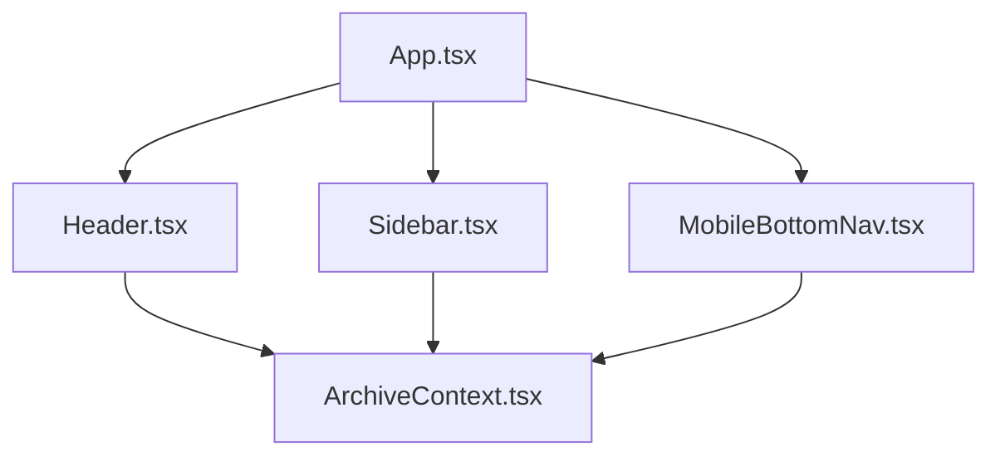
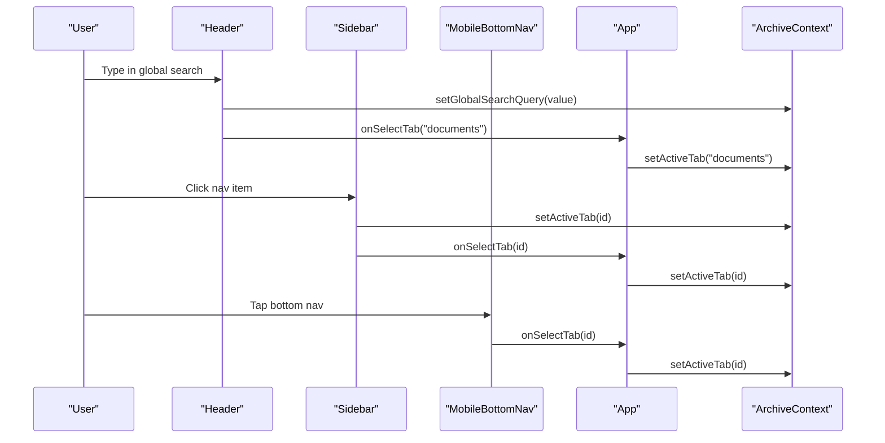

# Layout Components

<cite>
**Referenced Files in This Document**
- [App.tsx](file://src/App.tsx)
- [Header.tsx](file://src/components/layout/Header.tsx)
- [Sidebar.tsx](file://src/components/layout/Sidebar.tsx)
- [MobileBottomNav.tsx](file://src/components/layout/MobileBottomNav.tsx)
- [ArchiveContext.tsx](file://src/context/ArchiveContext.tsx)
</cite>

## Table of Contents
1. Introduction
2. Project Structure
3. Core Components
4. Architecture Overview
5. Detailed Component Analysis
6. Dependency Analysis
7. Performance Considerations
8. Troubleshooting Guide
9. Conclusion

## Introduction
This document explains ArchiveHub’s layout component system with a focus on three key UI building blocks: Header, Sidebar, and MobileBottomNav. It covers their responsibilities, prop interfaces, event handling patterns, responsive behavior, accessibility considerations, and how they communicate with the parent App via callbacks and shared context. The goal is to help developers understand how top navigation, search, user actions, hierarchical navigation, mobile drawer, and touch-optimized bottom navigation work together to deliver a consistent experience across screen sizes.

## Project Structure
The layout components live under src/components/layout and are orchestrated by the root App component. Shared state (active tab, global search query, notifications, current user, etc.) is provided through a context provider.

**Diagram sources**
- [App.tsx:53-143](file://src/App.tsx#L53-L143)
- [Header.tsx:1-42](file://src/components/layout/Header.tsx#L1-L42)
- [Sidebar.tsx:1-44](file://src/components/layout/Sidebar.tsx#L1-L44)
- [MobileBottomNav.tsx:1-23](file://src/components/layout/MobileBottomNav.tsx#L1-L23)
- [ArchiveContext.tsx:32-109](file://src/context/ArchiveContext.tsx#L32-L109)

**Section sources**
- [App.tsx:53-143](file://src/App.tsx#L53-L143)
- [ArchiveContext.tsx:32-109](file://src/context/ArchiveContext.tsx#L32-L109)

## Core Components
- Header: Top bar providing brand identity, global search, QR scanner trigger, notifications center, and user role switcher. On mobile, it exposes a hamburger menu to open the sidebar drawer and a toggleable search input.
- Sidebar: Hierarchical navigation for main sections with badges and quick actions. Renders as a sticky desktop sidebar and as a slide-over drawer on mobile when opened.
- MobileBottomNav: Touch-optimized bottom navigation for small screens with primary actions and a prominent scan button.

These components receive props from App and use callbacks to update shared state via ArchiveContext.

**Section sources**
- [Header.tsx:20-42](file://src/components/layout/Header.tsx#L20-L42)
- [Sidebar.tsx:21-44](file://src/components/layout/Sidebar.tsx#L21-L44)
- [MobileBottomNav.tsx:12-23](file://src/components/layout/MobileBottomNav.tsx#L12-L23)
- [App.tsx:53-143](file://src/App.tsx#L53-L143)

## Architecture Overview
The layout follows a unidirectional data flow pattern:
- App owns activeTab and modal states and passes callback handlers down to layout components.
- Layout components read shared state from ArchiveContext (e.g., activeTab, globalSearchQuery, currentUser, checkouts).
- User interactions trigger callbacks that update App state or directly call context setters (e.g., setActiveTab, setGlobalSearchQuery).
- Notifications and user session management are centralized in ArchiveContext.

**Diagram sources**
- [Header.tsx:92-119](file://src/components/layout/Header.tsx#L92-L119)
- [Sidebar.tsx:75-83](file://src/components/layout/Sidebar.tsx#L75-L83)
- [MobileBottomNav.tsx:33-128](file://src/components/layout/MobileBottomNav.tsx#L33-L128)
- [App.tsx:41-45](file://src/App.tsx#L41-L45)
- [ArchiveContext.tsx:72-76](file://src/context/ArchiveContext.tsx#L72-L76)

## Detailed Component Analysis

### Header
Responsibilities:
- Brand area with clickable logo to navigate to dashboard.
- Global search input on desktop; expandable search on mobile.
- QR scanner trigger to open CameraQRScannerModal.
- Notifications dropdown with dismiss actions and overdue alerts.
- User persona switcher dropdown with sign out and settings navigation.

Prop interface:
- onOpenScanner: opens the scanner modal.
- onOpenMobileMenu: optional; opens the mobile sidebar drawer.
- onSelectTab: optional; delegates tab selection to App.

Event handling patterns:
- Search input updates globalSearchQuery and navigates to documents when non-empty.
- Logo click sets activeTab to dashboard and calls onSelectTab if provided.
- Notification items can be dismissed via context.
- Persona switcher updates current user and navigates to settings or logs out.

Responsive design:
- Desktop: persistent search bar and full header controls.
- Mobile: hamburger menu to open sidebar, compact search toggle, and condensed controls.

Accessibility:
- Buttons include aria-labels for screen readers.
- Focus management for mobile search input uses autoFocus when expanded.

Performance:
- Lightweight local state for dropdown visibility and mobile search toggle.
- Computed values like overdueCount derived from context data.

Styling consistency:
- Uses Tailwind utility classes for spacing, colors, and dark mode support.
- Sticky positioning ensures header remains visible during scroll.

**Section sources**
- [Header.tsx:20-42](file://src/components/layout/Header.tsx#L20-L42)
- [Header.tsx:50-119](file://src/components/layout/Header.tsx#L50-L119)
- [Header.tsx:121-208](file://src/components/layout/Header.tsx#L121-L208)
- [Header.tsx:210-302](file://src/components/layout/Header.tsx#L210-L302)
- [Header.tsx:308-338](file://src/components/layout/Header.tsx#L308-L338)

### Sidebar
Responsibilities:
- Primary navigation with icons, labels, and dynamic badges.
- Active tab highlighting based on context.
- Quick user card with persona switcher, sign out, and reset demo data.
- Mobile drawer with backdrop overlay and close action.

Prop interface:
- onSelectTab: optional; delegates tab selection to App.
- isMobileOpen: controls visibility of mobile drawer.
- onCloseMobile: closes the mobile drawer.

Navigation structure:
- Dashboard & Overview
- Physical Storage Tree
- Document Catalogue
- Circulation Desk (with badge logic for overdue/pending/checked-out counts)
- Retention & Disposal
- Audit Trail Ledger
- System Settings (with pending users badge for admin)

Event handling patterns:
- Clicking a nav item sets activeTab via context and optionally calls onSelectTab.
- Mobile drawer closes automatically after selection.
- Persona switcher updates current user within the sidebar.

Responsive design:
- Desktop: fixed-width sticky sidebar.
- Mobile: slide-in drawer with backdrop; hidden on larger screens.

Accessibility:
- Navigation buttons have clear labels and roles.
- Drawer includes an explicit close button with aria-label.

Performance:
- Badge computations derive from context arrays without heavy operations.
- Drawer rendering is conditional to avoid unnecessary DOM.

Styling consistency:
- Dark-themed sidebar with consistent typography and spacing.
- Consistent active state styling across all navigation items.

**Section sources**
- [Sidebar.tsx:21-44](file://src/components/layout/Sidebar.tsx#L21-L44)
- [Sidebar.tsx:53-83](file://src/components/layout/Sidebar.tsx#L53-L83)
- [Sidebar.tsx:85-144](file://src/components/layout/Sidebar.tsx#L85-L144)
- [Sidebar.tsx:146-233](file://src/components/layout/Sidebar.tsx#L146-L233)
- [Sidebar.tsx:235-258](file://src/components/layout/Sidebar.tsx#L235-L258)

### MobileBottomNav
Responsibilities:
- Touch-optimized bottom navigation for small screens.
- Prominent center scan button for QR/barcode scanning.
- Quick access to overview, vault tree, catalogue, circulation, and more menu.

Prop interface:
- onOpenScanner: opens the scanner modal.
- onOpenMobileMenu: opens the mobile sidebar drawer.
- onSelectTab: delegates tab selection to App.

Event handling patterns:
- Each tab button calls onSelectTab with the corresponding tab id.
- Center scan button triggers onOpenScanner.
- More button opens the mobile drawer via onOpenMobileMenu.

Responsive design:
- Fixed at bottom on small screens; hidden on medium+ screens.
- Large tap targets and visual feedback for active state.

Accessibility:
- Buttons include aria-labels for clarity.
- Visual indicators (badges) for circulation desk alerts.

Performance:
- Minimal local state; reads activeTab and counts from context.
- Compact DOM structure optimized for mobile performance.

Styling consistency:
- Uses consistent color palette and spacing with other layout components.
- Backdrop blur and border styles match app theme.

**Section sources**
- [MobileBottomNav.tsx:12-23](file://src/components/layout/MobileBottomNav.tsx#L12-L23)
- [MobileBottomNav.tsx:29-133](file://src/components/layout/MobileBottomNav.tsx#L29-L133)

### Parent App Integration
The App component orchestrates layout components and manages:
- Authentication gating (shows AuthPage when not authenticated).
- Tab routing and selected document detail view.
- Mobile drawer state and scanner modal visibility.
- Passing callbacks to Header, Sidebar, and MobileBottomNav.

Key integration points:
- Header receives onOpenScanner, onOpenMobileMenu, onSelectTab.
- Sidebar receives onSelectTab, isMobileOpen, onCloseMobile.
- MobileBottomNav receives onOpenScanner, onOpenMobileMenu, onSelectTab.
- Scanner modal is controlled by showScannerModal state and handles document/location selection.

**Section sources**
- [App.tsx:19-51](file://src/App.tsx#L19-L51)
- [App.tsx:53-143](file://src/App.tsx#L53-L143)
- [App.tsx:145-160](file://src/App.tsx#L145-L160)

## Dependency Analysis
Layout components depend on:
- ArchiveContext for shared state (activeTab, globalSearchQuery, currentUser, notifications, checkouts).
- App for callback-driven navigation and modal control.
- Tailwind CSS utilities for responsive and themed styling.

Coupling and cohesion:
- Low coupling between layout components; they communicate primarily via props and context.
- High cohesion within each component around its specific UI responsibility.

External dependencies:
- Icons from lucide-react.
- Context-based state management centralizes side effects and persistence.

Potential circular dependencies:
- None observed; layout components do not import each other.

Interface contracts:
- onSelectTab(tabId: string): standardized navigation contract used by multiple components.
- onOpenScanner(): standardized scanner trigger contract.
- onOpenMobileMenu()/onCloseMobile(): standardized drawer control contract.

**Section sources**
- [ArchiveContext.tsx:32-109](file://src/context/ArchiveContext.tsx#L32-L109)
- [App.tsx:53-143](file://src/App.tsx#L53-L143)

## Performance Considerations
- Conditional rendering: Mobile drawer and mobile search are only rendered when needed, reducing DOM overhead.
- Local state for UI toggles: Dropdowns and mobile search use lightweight React state to avoid re-renders of entire trees.
- Derived computations: Overdue counts and badges are computed from context arrays; keep these lists reasonably sized to maintain responsiveness.
- Avoid unnecessary re-renders: Use memoization in future enhancements if large datasets cause performance issues.
- Efficient navigation: Callbacks delegate tab changes to App, which updates context once, minimizing redundant updates.

[No sources needed since this section provides general guidance]

## Troubleshooting Guide
Common issues and resolutions:
- Mobile drawer does not close: Ensure onCloseMobile is passed to Sidebar and invoked on backdrop click or nav item selection.
- Bottom nav not visible: Confirm media queries hide/show correctly; MobileBottomNav should be hidden on md+ screens.
- Search not navigating: Verify onSelectTab is wired in Header and App; ensure setActiveTab is called in both Header and App.
- Notifications not updating: Check dismissNotification usage and notification array limits in context.
- Persona switcher not reflecting: Ensure setCurrentUser is called and availableUsers list is populated.

Debugging tips:
- Inspect activeTab in context to confirm navigation state.
- Log callback invocations in App to trace event propagation.
- Validate that scanner modal isOpen matches showScannerModal state.

**Section sources**
- [ArchiveContext.tsx:176-195](file://src/context/ArchiveContext.tsx#L176-L195)
- [App.tsx:53-143](file://src/App.tsx#L53-L143)

## Conclusion
ArchiveHub’s layout system delivers a cohesive, responsive navigation experience across devices. The Header provides global search, user actions, and scanner access; the Sidebar offers hierarchical navigation with badges and mobile drawer support; the MobileBottomNav ensures touch-friendly navigation on small screens. All components communicate through well-defined callbacks and a centralized context, ensuring consistent state and styling. Accessibility features such as aria-labels and keyboard-friendly inputs enhance usability. With careful attention to performance and responsive design, the layout scales effectively for large navigation trees and diverse screen sizes.

[No sources needed since this section summarizes without analyzing specific files]