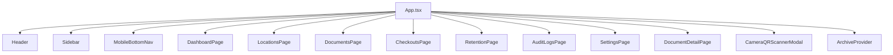
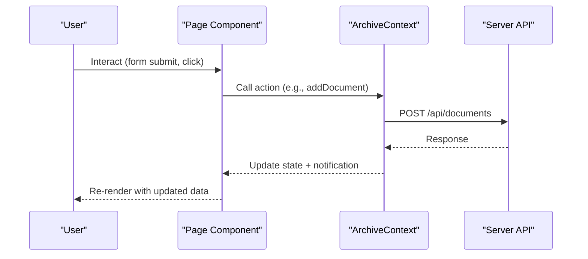
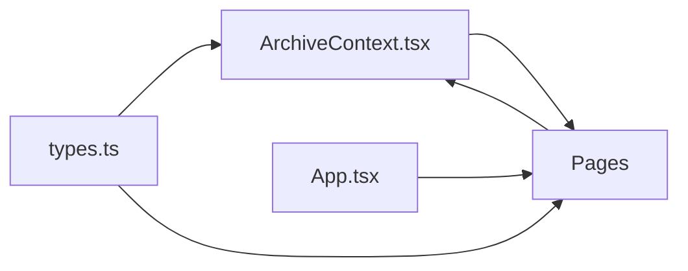

# Page Components

<cite>
**Referenced Files in This Document**
- [App.tsx](file://src/App.tsx)
- [ArchiveContext.tsx](file://src/context/ArchiveContext.tsx)
- [types.ts](file://src/types.ts)
- [DashboardPage.tsx](file://src/pages/DashboardPage.tsx)
- [DocumentsPage.tsx](file://src/pages/DocumentsPage.tsx)
- [LocationsPage.tsx](file://src/pages/LocationsPage.tsx)
- [DocumentDetailPage.tsx](file://src/pages/DocumentDetailPage.tsx)
- [CheckoutsPage.tsx](file://src/pages/CheckoutsPage.tsx)
- [AuditLogsPage.tsx](file://src/pages/AuditLogsPage.tsx)
- [RetentionPage.tsx](file://src/pages/RetentionPage.tsx)
- [SettingsPage.tsx](file://src/pages/SettingsPage.tsx)
- [ConfirmModal.tsx](file://src/components/common/ConfirmModal.tsx)
</cite>

## Update Summary
**Changes Made**
- Enhanced SettingsPage with comprehensive backup management interface including export/import capabilities
- Added validation for backup file format and structure
- Implemented confirmation modals for destructive backup restore operations
- Integrated progress indicators for export and import operations
- Updated database metrics section with backup management controls

## Table of Contents
1. Introduction
2. Project Structure
3. Core Components
4. Architecture Overview
5. Detailed Component Analysis
6. Dependency Analysis
7. Performance Considerations
8. Troubleshooting Guide
9. Conclusion

## Introduction
This document explains ArchiveHub's page component architecture and how each page implements domain-specific functionality while maintaining a consistent application structure. It covers:
- The props interface pages receive from the parent App component (navigation, modal triggers, document selection)
- Common patterns for data fetching, state management, form handling, and user interactions
- Integration with ArchiveContext for global state access
- Loading states, error handling, and user feedback strategies
- Responsive design and mobile-first approaches used across pages

## Project Structure
The application is organized around a central App component that renders layout chrome and routes to page components based on active tabs. Pages consume shared state and actions via ArchiveContext and compose reusable UI components for modals, badges, breadcrumbs, and scanners.

**Diagram sources**
- [App.tsx:19-163](file://src/App.tsx#L19-L163)

**Section sources**
- [App.tsx:1-173](file://src/App.tsx#L1-L173)

## Core Components
- App orchestrates routing by tab, manages selected document detail view, and wires up global modals (scanner). It passes navigation callbacks and modal triggers down to pages.
- ArchiveContext provides centralized state (documents, locations, checkouts, movements, audit logs), CRUD operations, notifications, and helper utilities like path calculation and QR lookup.
- Pages are presentational and interactive components that:
  - Consume context via useArchive()
  - Manage local UI state (modals, filters, forms)
  - Call context actions to mutate data or trigger side effects
  - Render responsive layouts using Tailwind classes

**Section sources**
- [App.tsx:19-163](file://src/App.tsx#L19-L163)
- [ArchiveContext.tsx:32-109](file://src/context/ArchiveContext.tsx#L32-L109)

## Architecture Overview
Pages follow a consistent pattern:
- Data source: ArchiveContext (synchronized with backend via fetchAllFromBackend)
- State mutations: Context methods (e.g., addDocument, updateLocation, moveDocument)
- User feedback: Notifications via addNotification
- Navigation: Props from App (onSelectDocument, setActiveTab via context)
- Modals: Local page state toggles for forms and confirmations

**Diagram sources**
- [ArchiveContext.tsx:197-255](file://src/context/ArchiveContext.tsx#L197-L255)
- [DocumentsPage.tsx:147-199](file://src/pages/DocumentsPage.tsx#L147-L199)

**Section sources**
- [ArchiveContext.tsx:197-255](file://src/context/ArchiveContext.tsx#L197-L255)
- [DocumentsPage.tsx:147-199](file://src/pages/DocumentsPage.tsx#L147-L199)

## Detailed Component Analysis

### App Component (Routing and Global State Wiring)
- Maintains activeTab and selectedDocId
- Renders page components conditionally based on activeTab
- Provides onSelectDocument callback to open DocumentDetailPage
- Opens CameraQRScannerModal and handles selection outcomes
- Wraps app in ArchiveProvider for global state

Key responsibilities:
- Tab-based routing
- Detail view gating
- Modal orchestration
- Mobile menu state

**Section sources**
- [App.tsx:19-163](file://src/App.tsx#L19-L163)

### DashboardPage
- Displays KPIs, recent movements, department distribution, and quick actions
- Uses ArchiveContext for documents, locations, checkouts, movements, departments
- Navigates to other tabs via setActiveTab
- Triggers scanner and creation flows via props

Common patterns:
- Metrics computed from context arrays
- Action buttons call prop callbacks to open modals or navigate
- Responsive grid layout

**Section sources**
- [DashboardPage.tsx:23-35](file://src/pages/DashboardPage.tsx#L23-L35)
- [DashboardPage.tsx:36-49](file://src/pages/DashboardPage.tsx#L36-L49)
- [DashboardPage.tsx:50-326](file://src/pages/DashboardPage.tsx#L50-L326)

### DocumentsPage
- Implements filtering, search, bulk selection, and dual view modes (table/grid)
- Registration form with dynamic custom fields based on document type
- Integrates with ArchiveContext for documents, departments, documentTypes, bundles, and location paths
- Uses modals for registration, editing, deletion confirmation, and bundling

Data flow:
- Filters derive from globalSearchQuery and local selections
- Form submission calls addDocument with computed retention dates and metadata
- Bulk actions integrate with BundleModal and tag printing

Responsive behavior:
- Collapsible filter toolbar
- Grid/table toggle
- Mobile-friendly table scrolling and card views

**Section sources**
- [DocumentsPage.tsx:39-88](file://src/pages/DocumentsPage.tsx#L39-L88)
- [DocumentsPage.tsx:147-199](file://src/pages/DocumentsPage.tsx#L147-L199)
- [DocumentsPage.tsx:217-262](file://src/pages/DocumentsPage.tsx#L217-L262)
- [DocumentsPage.tsx:266-800](file://src/pages/DocumentsPage.tsx#L266-L800)

### LocationsPage
- Hierarchical tree explorer with expand/collapse and search
- Node details panel showing children, contained documents, and actions
- Create/Edit storage units with validation and photo support
- Uses ArchiveContext for locations, documents, and calculatePath

Patterns:
- Recursive rendering for tree nodes
- Mobile view switcher between tree and details
- Photo uploader integration and default images per location type

**Section sources**
- [LocationsPage.tsx:40-84](file://src/pages/LocationsPage.tsx#L40-L84)
- [LocationsPage.tsx:146-166](file://src/pages/LocationsPage.tsx#L146-L166)
- [LocationsPage.tsx:188-255](file://src/pages/LocationsPage.tsx#L188-L255)
- [LocationsPage.tsx:257-800](file://src/pages/LocationsPage.tsx#L257-L800)

### DocumentDetailPage
- Shows full document record with home vs current location emphasis
- Tabs for movement history, checkout ledger, and audit trail
- Actions: request borrowing, relocate, return processing, edit, delete
- Uses ArchiveContext for documents, locations, movements, checkouts, auditLogs, currentUser, bundles

Flow highlights:
- Borrowing request creates checkout via requestCheckout
- Return processing uses processCheckInReturn
- Relocation updates current location via moveDocument
- Delete uses deleteDocument with confirmation modal

**Section sources**
- [DocumentDetailPage.tsx:36-86](file://src/pages/DocumentDetailPage.tsx#L36-86)
- [DocumentDetailPage.tsx:115-137](file://src/pages/DocumentDetailPage.tsx#L115-137)
- [DocumentDetailPage.tsx:139-556](file://src/pages/DocumentDetailPage.tsx#L139-556)
- [DocumentDetailPage.tsx:558-809](file://src/pages/DocumentDetailPage.tsx#L558-809)

### CheckoutsPage
- Lists circulation records filtered by status (pending, active, overdue, returned)
- Quick KPI cards to navigate filters
- Actions to approve/reject/dispatch returns via context

Patterns:
- Status-based filtering
- Inline navigation to document detail via onSelectDocument
- Compact list layout optimized for scanning

**Section sources**
- [CheckoutsPage.tsx:19-51](file://src/pages/CheckoutsPage.tsx#L19-L51)
- [CheckoutsPage.tsx:53-200](file://src/pages/CheckoutsPage.tsx#L53-L200)

### AuditLogsPage
- Immutable ledger view with search filtering
- Displays timestamp, action, user, entity, and details

Patterns:
- Simple client-side filtering over auditLogs
- Read-only presentation

**Section sources**
- [AuditLogsPage.tsx:5-95](file://src/pages/AuditLogsPage.tsx#L5-L95)

### RetentionPage
- Displays active retention policies per document type
- Highlights records approaching expiry and allows scheduling review

Patterns:
- Computed lists based on retentionEndDate
- Non-destructive scheduling messages

**Section sources**
- [RetentionPage.tsx:15-123](file://src/pages/RetentionPage.tsx#L15-L123)

### SettingsPage
- Manages document types, reusable custom fields, users, and database health
- Creates/updates/deletes document types and custom fields
- Approves/rejects users and re-seeds database
- **Enhanced**: Comprehensive backup management interface with export/import capabilities

**Updated** The SettingsPage now includes a complete backup and restore system with the following features:

#### Backup Management Interface
- **Export Full Backup**: Downloads complete database snapshot as JSON file with timestamped filename
- **Import/Restore Backup**: Validates and restores from previously exported backup files
- **Database Metrics**: Real-time display of catalog records, storage hierarchy, and circulation ledger counts

#### Validation and Safety Features
- **File Format Validation**: Ensures imported files match ArchiveHub export format (`archivehub-export`)
- **Structure Validation**: Verifies backup contains required `tables` object structure
- **Confirmation Modals**: Destructive restore operations require explicit user confirmation
- **Progress Indicators**: Visual feedback during export/import operations with disabled button states

#### Implementation Details
- Uses `exportAllData()` and `importAllData()` context methods for backup operations
- File input validation with proper error handling and user feedback
- Confirmation modal integration using shared ConfirmModal component
- Progress tracking with `isExporting` and `isImporting` state flags
- Automatic database resync after successful imports

**Section sources**
- [SettingsPage.tsx:36-168](file://src/pages/SettingsPage.tsx#L36-L168)
- [SettingsPage.tsx:325-377](file://src/pages/SettingsPage.tsx#L325-L377)
- [SettingsPage.tsx:497-573](file://src/pages/SettingsPage.tsx#L497-L573)
- [SettingsPage.tsx:1489-1498](file://src/pages/SettingsPage.tsx#L1489-L1498)

## Dependency Analysis
- All pages depend on ArchiveContext for data and actions
- App composes pages and injects navigation/modal props
- Types define contracts for entities consumed across pages and context

**Diagram sources**
- [types.ts:10-283](file://src/types.ts#L10-L283)
- [ArchiveContext.tsx:32-109](file://src/context/ArchiveContext.tsx#L32-L109)
- [App.tsx:9-17](file://src/App.tsx#L9-L17)

**Section sources**
- [types.ts:10-283](file://src/types.ts#L10-L283)
- [ArchiveContext.tsx:32-109](file://src/context/ArchiveContext.tsx#L32-L109)
- [App.tsx:9-17](file://src/App.tsx#L9-L17)

## Performance Considerations
- Filtering and search are performed client-side; consider memoization for large datasets
- Batch operations (bulk print/bundle) reduce repeated network calls
- Use of calculatePath avoids redundant computations by leveraging cached location paths
- Avoid unnecessary re-renders by keeping local state minimal and derived values memoized where appropriate
- **Backup Operations**: Export/import operations handle large datasets efficiently with streaming responses and proper memory management

## Troubleshooting Guide
- Backend sync failures: fetchAllFromBackend catches errors and logs warnings; check server endpoints and network connectivity
- Database health: refreshDbHealth provides status and notifications; reseedDatabase can restore sample data
- Auth session issues: localStorage persistence may fail; verify storage availability and parsing logic
- Missing document detail: DocumentDetailPage shows a not-found state when documentId is invalid
- **Backup Issues**: 
  - Invalid backup files: Ensure files are exported from ArchiveHub and contain proper format structure
  - Import failures: Verify backup file integrity and ensure all required tables are present
  - Network timeouts: Large backups may require longer timeout periods for import/export operations

**Section sources**
- [ArchiveContext.tsx:197-255](file://src/context/ArchiveContext.tsx#L197-L255)
- [ArchiveContext.tsx:257-293](file://src/context/ArchiveContext.tsx#L257-L293)
- [DocumentDetailPage.tsx:86-103](file://src/pages/DocumentDetailPage.tsx#L86-L103)
- [SettingsPage.tsx:349-364](file://src/pages/SettingsPage.tsx#L349-L364)

## Conclusion
ArchiveHub's page components share a consistent architecture:
- Centralized state and actions via ArchiveContext
- Clear separation of concerns between routing (App) and domain features (pages)
- Robust patterns for forms, modals, filtering, and user feedback
- Responsive, mobile-first UI built with utility classes
- **Enhanced**: Comprehensive backup management system with validation, confirmation workflows, and progress indicators

This structure enables scalable addition of new pages while preserving consistency in data access, user interactions, and presentation.