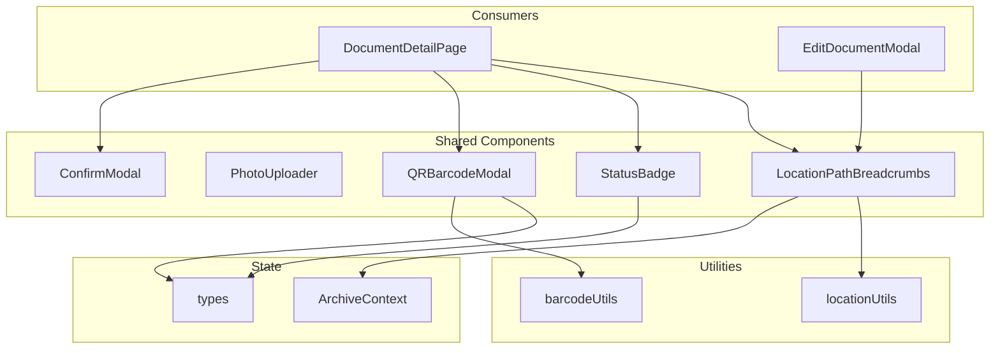
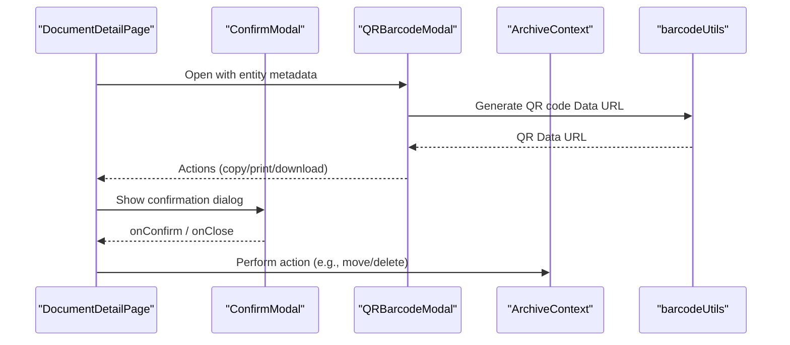

# Shared UI Components

<cite>
**Referenced Files in This Document**
- [ConfirmModal.tsx](file://src/components/common/ConfirmModal.tsx)
- [PhotoUploader.tsx](file://src/components/common/PhotoUploader.tsx)
- [QRBarcodeModal.tsx](file://src/components/common/QRBarcodeModal.tsx)
- [StatusBadge.tsx](file://src/components/common/StatusBadge.tsx)
- [LocationPathBreadcrumbs.tsx](file://src/components/common/LocationPathBreadcrumbs.tsx)
- [barcodeUtils.ts](file://src/utils/barcodeUtils.ts)
- [locationUtils.ts](file://src/utils/locationUtils.ts)
- [ArchiveContext.tsx](file://src/context/ArchiveContext.tsx)
- [types.ts](file://src/types.ts)
- [DocumentDetailPage.tsx](file://src/pages/DocumentDetailPage.tsx)
- [EditDocumentModal.tsx](file://src/components/documents/EditDocumentModal.tsx)
</cite>

## Table of Contents
1. Introduction
2. Project Structure
3. Core Components
4. Architecture Overview
5. Detailed Component Analysis
6. Dependency Analysis
7. Performance Considerations
8. Troubleshooting Guide
9. Conclusion

## Introduction
This document describes ArchiveHub’s reusable UI component library located under the shared components directory. It focuses on five core components: ConfirmModal, PhotoUploader, QRBarcodeModal, StatusBadge, and LocationPathBreadcrumbs. For each component, we explain purpose, props interface, default values, customization options, event handling, composition patterns, accessibility considerations, responsive behavior, styling consistency, and integration with application state via context and utilities. Practical usage examples are referenced from real pages and modals where these components are used.

## Project Structure
The shared components live under src/components/common and integrate with:
- Application state via ArchiveContext (for location data and actions)
- Utilities for barcode/QR generation and location path resolution
- Page-level components that consume these shared primitives



**Diagram sources**
- [LocationPathBreadcrumbs.tsx:1-95](file://src/components/common/LocationPathBreadcrumbs.tsx#L1-L95)
- [QRBarcodeModal.tsx:1-272](file://src/components/common/QRBarcodeModal.tsx#L1-L272)
- [StatusBadge.tsx:1-177](file://src/components/common/StatusBadge.tsx#L1-L177)
- [barcodeUtils.ts:1-41](file://src/utils/barcodeUtils.ts#L1-L41)
- [locationUtils.ts:1-96](file://src/utils/locationUtils.ts#L1-L96)
- [ArchiveContext.tsx:1-800](file://src/context/ArchiveContext.tsx#L1-L800)
- [types.ts:1-283](file://src/types.ts#L1-L283)
- [DocumentDetailPage.tsx:1-200](file://src/pages/DocumentDetailPage.tsx#L1-L200)
- [EditDocumentModal.tsx:400-599](file://src/components/documents/EditDocumentModal.tsx#L400-L599)

**Section sources**
- [LocationPathBreadcrumbs.tsx:1-95](file://src/components/common/LocationPathBreadcrumbs.tsx#L1-L95)
- [QRBarcodeModal.tsx:1-272](file://src/components/common/QRBarcodeModal.tsx#L1-L272)
- [StatusBadge.tsx:1-177](file://src/components/common/StatusBadge.tsx#L1-L177)
- [barcodeUtils.ts:1-41](file://src/utils/barcodeUtils.ts#L1-L41)
- [locationUtils.ts:1-96](file://src/utils/locationUtils.ts#L1-L96)
- [ArchiveContext.tsx:1-800](file://src/context/ArchiveContext.tsx#L1-L800)
- [types.ts:1-283](file://src/types.ts#L1-L283)
- [DocumentDetailPage.tsx:1-200](file://src/pages/DocumentDetailPage.tsx#L1-L200)
- [EditDocumentModal.tsx:400-599](file://src/components/documents/EditDocumentModal.tsx#L400-L599)

## Core Components
- ConfirmModal: A controlled confirmation dialog with variant-based styling and customizable labels.
- PhotoUploader: A dual-mode image input supporting local file upload (with compression) and URL entry, plus preset selection.
- QRBarcodeModal: Generates and displays QR code and barcode visuals, supports copying, downloading, and printing a printable tag.
- StatusBadge: Renders contextual status indicators for documents, checkouts, confidentiality levels, and conditions.
- LocationPathBreadcrumbs: Displays hierarchical navigation for physical storage locations using context-provided location data.

**Section sources**
- [ConfirmModal.tsx:1-102](file://src/components/common/ConfirmModal.tsx#L1-L102)
- [PhotoUploader.tsx:1-286](file://src/components/common/PhotoUploader.tsx#L1-L286)
- [QRBarcodeModal.tsx:1-272](file://src/components/common/QRBarcodeModal.tsx#L1-L272)
- [StatusBadge.tsx:1-177](file://src/components/common/StatusBadge.tsx#L1-L177)
- [LocationPathBreadcrumbs.tsx:1-95](file://src/components/common/LocationPathBreadcrumbs.tsx#L1-L95)

## Architecture Overview
The shared components follow a consistent pattern:
- Controlled interfaces: Parent components manage open/close states and data; components emit events via callbacks.
- Context-driven data: LocationPathBreadcrumbs reads location hierarchy from ArchiveContext.
- Utility-backed rendering: QRBarcodeModal uses barcodeUtils to generate QR and barcode assets.
- Type safety: StatusBadge consumes typed enums from types.ts to render correct visual states.



**Diagram sources**
- [DocumentDetailPage.tsx:1-200](file://src/pages/DocumentDetailPage.tsx#L1-L200)
- [ConfirmModal.tsx:1-102](file://src/components/common/ConfirmModal.tsx#L1-L102)
- [QRBarcodeModal.tsx:1-272](file://src/components/common/QRBarcodeModal.tsx#L1-L272)
- [barcodeUtils.ts:1-41](file://src/utils/barcodeUtils.ts#L1-L41)
- [ArchiveContext.tsx:1-800](file://src/context/ArchiveContext.tsx#L1-L800)

## Detailed Component Analysis

### ConfirmModal
Purpose
- Presents a user confirmation dialog with clear messaging and variant-based emphasis.

Props Interface
- isOpen: boolean — controls visibility
- onClose: () => void — dismisses modal
- onConfirm: () => void — executes confirmed action
- title: string — modal heading
- message: string — descriptive text
- confirmText?: string — defaults to “Confirm”
- cancelText?: string — defaults to “Cancel”
- variant?: 'danger' | 'warning' | 'info' — affects icon background and confirm button color

Default Values
- confirmText = "Confirm"
- cancelText = "Cancel"
- variant = "danger"

Event Handling
- Close via overlay or close button triggers onClose
- Confirm triggers onConfirm then onClose

Accessibility
- Modal is focusable via keyboard interactions typical for dialogs; ensure parent manages focus trap if needed
- Uses semantic buttons and headings

Responsive Behavior
- Fixed overlay with centered card; adapts padding and sizing across breakpoints

Styling Consistency
- Tailwind utility classes for rounded corners, shadows, dark mode support, and consistent typography

Usage Examples
- Triggered from page actions such as delete or destructive operations
- See usage references in page-level components that import ConfirmModal

**Section sources**
- [ConfirmModal.tsx:4-24](file://src/components/common/ConfirmModal.tsx#L4-L24)
- [ConfirmModal.tsx:27-47](file://src/components/common/ConfirmModal.tsx#L27-L47)
- [ConfirmModal.tsx:49-101](file://src/components/common/ConfirmModal.tsx#L49-L101)
- [DocumentDetailPage.tsx:1-200](file://src/pages/DocumentDetailPage.tsx#L1-L200)

### PhotoUploader
Purpose
- Provides an accessible, flexible way to attach images either by uploading from device or entering a URL, with preview and presets.

Props Interface
- value: string — current image source (base64 Data URL or web URL)
- onChange: (value: string) => void — updates parent state
- label?: string — defaults to “Storage Unit Photo”
- presets?: Array<{ label: string; url: string }> — quick-select sample URLs

Default Values
- label = "Storage Unit Photo"
- presets = []

Processing Logic
- Local uploads are validated as images, compressed on canvas to reduce size while preserving quality, then emitted as base64 Data URL
- URL mode accepts direct input; no validation beyond basic type

Event Handling
- Drag-and-drop zone toggles drag state and processes dropped files
- File input change triggers processing pipeline
- Preset buttons set value via onChange

Accessibility
- Label associates with interactive area
- Buttons have descriptive text; preview includes alt text

Responsive Behavior
- Compact layout with small controls; preview scales appropriately

Styling Consistency
- Consistent border styles, hover states, and dark mode variants

Integration Notes
- Emits base64 Data URLs suitable for local storage or display without server upload

**Section sources**
- [PhotoUploader.tsx:4-14](file://src/components/common/PhotoUploader.tsx#L4-L14)
- [PhotoUploader.tsx:16-60](file://src/components/common/PhotoUploader.tsx#L16-L60)
- [PhotoUploader.tsx:62-114](file://src/components/common/PhotoUploader.tsx#L62-L114)
- [PhotoUploader.tsx:116-283](file://src/components/common/PhotoUploader.tsx#L116-L283)

### QRBarcodeModal
Purpose
- Generates and displays QR and barcode graphics for entities (documents or locations), enabling copy, download, and print workflows.

Props Interface
- isOpen: boolean
- onClose: () => void
- title: string
- subtitle?: string
- qrValue: string
- barcodeValue: string
- entityType: 'DOCUMENT' | 'LOCATION'
- entityCode: string
- pathString?: string

Default Values
- None specified beyond required props

Processing Logic
- On open, generates QR Data URL via utility and renders barcode onto a canvas element
- Builds printable HTML template including entity info, path, and QR image

Event Handling
- Copy code to clipboard with temporary feedback
- Download standalone HTML tag
- Print via hidden iframe with fallback to window.print

Accessibility
- Images include alt attributes; printable content is semantic HTML

Responsive Behavior
- Modal adapts to viewport; printable layout optimized for tags

Styling Consistency
- Matches app’s design tokens and dark mode support

Integration Points
- Uses barcodeUtils for QR and barcode generation
- Consumes types for entity labeling

**Section sources**
- [QRBarcodeModal.tsx:6-16](file://src/components/common/QRBarcodeModal.tsx#L6-L16)
- [QRBarcodeModal.tsx:18-46](file://src/components/common/QRBarcodeModal.tsx#L18-L46)
- [QRBarcodeModal.tsx:50-172](file://src/components/common/QRBarcodeModal.tsx#L50-L172)
- [QRBarcodeModal.tsx:174-271](file://src/components/common/QRBarcodeModal.tsx#L174-L271)
- [barcodeUtils.ts:1-41](file://src/utils/barcodeUtils.ts#L1-L41)

### StatusBadge
Purpose
- Renders standardized badges for document status, checkout status, confidentiality level, and condition.

Props Interface
- type: 'status' | 'confidentiality' | 'condition' | 'checkout'
- value: string — must match one of the enum values defined in types.ts
- size?: 'sm' | 'md' | 'lg' — defaults to 'md'

Default Values
- size = "md"

Behavior
- Maps value to specific visual style and icon per type
- Unknown values fall back to neutral badge

Accessibility
- Uses semantic spans with icons; consider adding aria-labels when needed for screen readers

Responsive Behavior
- Size prop adjusts padding and font size consistently

Styling Consistency
- Consistent color palette and borders across all badge types

Integration Points
- Relies on types.ts enums for strict value sets

**Section sources**
- [StatusBadge.tsx:16-23](file://src/components/common/StatusBadge.tsx#L16-L23)
- [StatusBadge.tsx:25-86](file://src/components/common/StatusBadge.tsx#L25-L86)
- [StatusBadge.tsx:89-122](file://src/components/common/StatusBadge.tsx#L89-L122)
- [StatusBadge.tsx:125-175](file://src/components/common/StatusBadge.tsx#L125-L175)
- [types.ts:54-72](file://src/types.ts#L54-L72)
- [types.ts:205-205](file://src/types.ts#L205-L205)

### LocationPathBreadcrumbs
Purpose
- Displays a navigable breadcrumb trail representing the hierarchical path to a physical storage location.

Props Interface
- locationId: string | null
- onNodeClick?: (locationId: string) => void
- showIcon?: boolean — defaults to true
- className?: string
- badgeSize?: 'sm' | 'md' — defaults to 'md'

Default Values
- showIcon = true
- className = ""
- badgeSize = "md"

Processing Logic
- Reads locations from ArchiveContext
- Resolves ancestors using locationUtils.getLocationAncestors
- Renders clickable nodes with icons based on location type

Event Handling
- Optional onNodeClick allows parent to handle navigation or selection

Accessibility
- Uses nav with aria-label for semantic structure
- Each node is a button with title describing type and code

Responsive Behavior
- Wraps flexibly; truncates long names; icons scale with badgeSize

Styling Consistency
- Consistent borders, hover states, and dark mode variants

Integration Points
- Depends on ArchiveContext for locations
- Uses locationUtils for ancestor resolution

**Section sources**
- [LocationPathBreadcrumbs.tsx:19-33](file://src/components/common/LocationPathBreadcrumbs.tsx#L19-L33)
- [LocationPathBreadcrumbs.tsx:34-44](file://src/components/common/LocationPathBreadcrumbs.tsx#L34-L44)
- [LocationPathBreadcrumbs.tsx:46-60](file://src/components/common/LocationPathBreadcrumbs.tsx#L46-L60)
- [LocationPathBreadcrumbs.tsx:62-93](file://src/components/common/LocationPathBreadcrumbs.tsx#L62-L93)
- [locationUtils.ts:1-40](file://src/utils/locationUtils.ts#L1-L40)
- [ArchiveContext.tsx:1-800](file://src/context/ArchiveContext.tsx#L1-L800)

## Dependency Analysis
Component relationships and external dependencies:

```mermaid
classDiagram
class ConfirmModal {
+isOpen : boolean
+onClose() : void
+onConfirm() : void
+title : string
+message : string
+confirmText? : string
+cancelText? : string
+variant? : "danger"|"warning"|"info"
}
class PhotoUploader {
+value : string
+onChange(value) : void
+label? : string
+presets? : {label,url}[]
}
class QRBarcodeModal {
+isOpen : boolean
+onClose() : void
+title : string
+subtitle? : string
+qrValue : string
+barcodeValue : string
+entityType : "DOCUMENT"|"LOCATION"
+entityCode : string
+pathString? : string
}
class StatusBadge {
+type : "status"|"confidentiality"|"condition"|"checkout"
+value : string
+size? : "sm"|"md"|"lg"
}
class LocationPathBreadcrumbs {
+locationId : string|null
+onNodeClick?(id) : void
+showIcon? : boolean
+className? : string
+badgeSize? : "sm"|"md"
}
class BarcodeUtils {
+generateQRCodeDataUrl(text) : Promise<string>
+renderBarcodeOnCanvas(canvas,text) : void
}
class LocationUtils {
+getLocationAncestors(locations,targetId) : LocationItem[]
+calculateLocationPath(locations,locationId) : string
}
QRBarcodeModal --> BarcodeUtils : "uses"
LocationPathBreadcrumbs --> LocationUtils : "uses"
StatusBadge --> Types : "consumes enums"
```

**Diagram sources**
- [ConfirmModal.tsx:4-24](file://src/components/common/ConfirmModal.tsx#L4-L24)
- [PhotoUploader.tsx:4-14](file://src/components/common/PhotoUploader.tsx#L4-L14)
- [QRBarcodeModal.tsx:6-16](file://src/components/common/QRBarcodeModal.tsx#L6-L16)
- [StatusBadge.tsx:16-23](file://src/components/common/StatusBadge.tsx#L16-L23)
- [LocationPathBreadcrumbs.tsx:19-33](file://src/components/common/LocationPathBreadcrumbs.tsx#L19-L33)
- [barcodeUtils.ts:1-41](file://src/utils/barcodeUtils.ts#L1-L41)
- [locationUtils.ts:1-40](file://src/utils/locationUtils.ts#L1-L40)
- [types.ts:54-72](file://src/types.ts#L54-L72)

**Section sources**
- [ConfirmModal.tsx:4-24](file://src/components/common/ConfirmModal.tsx#L4-L24)
- [PhotoUploader.tsx:4-14](file://src/components/common/PhotoUploader.tsx#L4-L14)
- [QRBarcodeModal.tsx:6-16](file://src/components/common/QRBarcodeModal.tsx#L6-L16)
- [StatusBadge.tsx:16-23](file://src/components/common/StatusBadge.tsx#L16-L23)
- [LocationPathBreadcrumbs.tsx:19-33](file://src/components/common/LocationPathBreadcrumbs.tsx#L19-L33)
- [barcodeUtils.ts:1-41](file://src/utils/barcodeUtils.ts#L1-L41)
- [locationUtils.ts:1-40](file://src/utils/locationUtils.ts#L1-L40)
- [types.ts:54-72](file://src/types.ts#L54-L72)

## Performance Considerations
- PhotoUploader compresses large images before emitting base64 to avoid memory bloat and improve performance.
- QRBarcodeModal defers barcode rendering slightly after mount to ensure DOM readiness.
- StatusBadge avoids heavy computations; it maps simple enums to styled elements.
- LocationPathBreadcrumbs builds ancestor paths efficiently using a map and visited set to prevent cycles.

[No sources needed since this section provides general guidance]

## Troubleshooting Guide
Common issues and resolutions:
- PhotoUploader rejects non-image files: Ensure selected files are valid images; errors are handled with alerts and console logs.
- QR code not generating: Verify qrValue is non-empty; check network and browser capabilities for QR generation.
- Barcode not rendering: Ensure canvas ref exists and barcodeValue is provided; errors are logged.
- Breadcrumbs show unknown location: Validate locationId exists in context and has ancestors; otherwise shows fallback message.

**Section sources**
- [PhotoUploader.tsx:73-88](file://src/components/common/PhotoUploader.tsx#L73-L88)
- [QRBarcodeModal.tsx:34-46](file://src/components/common/QRBarcodeModal.tsx#L34-L46)
- [QRBarcodeModal.tsx:26-40](file://src/utils/barcodeUtils.ts#L26-L40)
- [LocationPathBreadcrumbs.tsx:36-44](file://src/components/common/LocationPathBreadcrumbs.tsx#L36-L44)

## Conclusion
ArchiveHub’s shared UI components provide a cohesive, type-safe, and accessible foundation for common interactions:
- ConfirmModal standardizes confirmation flows with clear semantics and styling.
- PhotoUploader simplifies image attachment with robust local and URL modes.
- QRBarcodeModal streamlines identity tagging with QR and barcode generation and print workflows.
- StatusBadge ensures consistent visual communication of state and sensitivity.
- LocationPathBreadcrumbs offers intuitive navigation through hierarchical storage structures.

These components integrate cleanly with application state and utilities, ensuring scalability and maintainability across the application.

[No sources needed since this section summarizes without analyzing specific files]