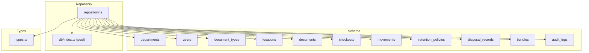
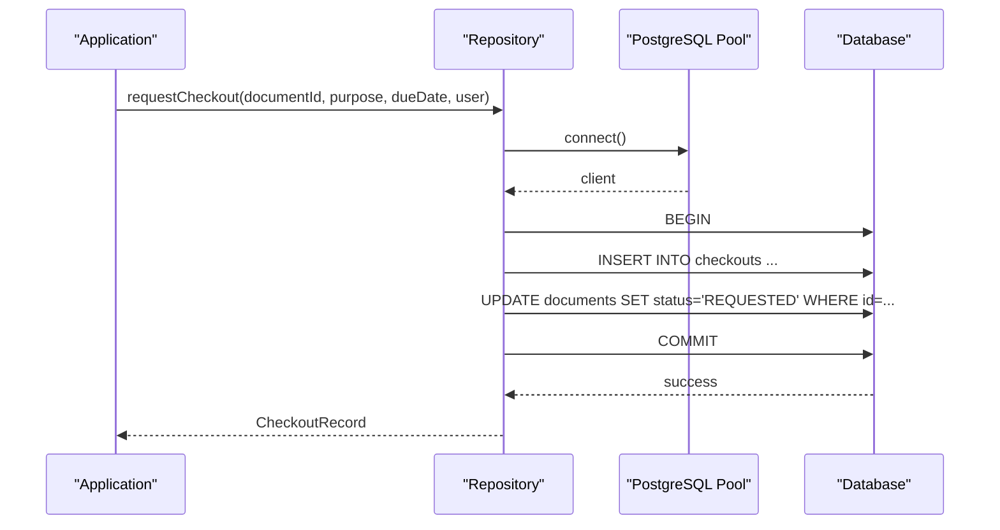
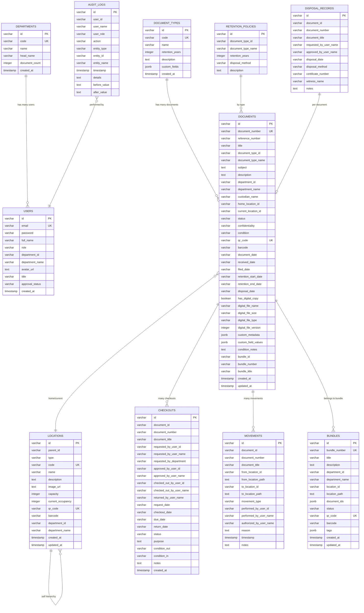
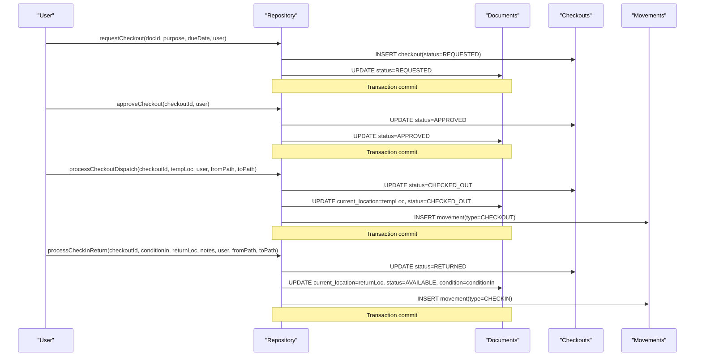
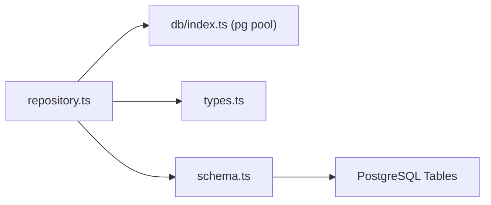

# Data Relationships

<cite>
**Referenced Files in This Document**
- [schema.ts](file://src/db/schema.ts)
- [repository.ts](file://src/db/repository.ts)
- [types.ts](file://src/types.ts)
- [index.ts](file://src/db/index.ts)
</cite>

## Table of Contents
1. Introduction
2. Project Structure
3. Core Components
4. Architecture Overview
5. Detailed Component Analysis
6. Dependency Analysis
7. Performance Considerations
8. Troubleshooting Guide
9. Conclusion

## Introduction
This document explains the data relationships in ArchiveHub’s database entities and how the repository layer manages them. It covers:
- User–department associations
- Document-type mappings
- Location hierarchies
- Checkout workflows linking documents to users
- Movement tracking for physical location changes
- Referential integrity constraints, cascade behaviors, and consistency mechanisms
- How queries across multiple tables are abstracted by the repository

## Project Structure
ArchiveHub defines its relational model in a schema module and implements data access with a repository that provides both PostgreSQL-backed operations and an in-memory fallback when the database is unavailable. Types define the domain models used throughout the application.

**Diagram sources**
- [schema.ts:12-228](file://src/db/schema.ts#L12-L228)
- [repository.ts:1-1597](file://src/db/repository.ts#L1-L1597)
- [index.ts:1-136](file://src/db/index.ts#L1-L136)
- [types.ts:10-283](file://src/types.ts#L10-L283)

**Section sources**
- [schema.ts:12-228](file://src/db/schema.ts#L12-L228)
- [repository.ts:1-1597](file://src/db/repository.ts#L1-L1597)
- [types.ts:10-283](file://src/types.ts#L10-L283)
- [index.ts:1-136](file://src/db/index.ts#L1-L136)

## Core Components
The system centers on these entities and their relationships:
- Departments and Users: Many-to-one from users to departments via department_id; denormalized department_name stored on users for display.
- Document Types and Documents: One-to-many from document_types to documents via document_type_id; denormalized document_type_name stored on documents.
- Locations (Hierarchical): Self-referencing parent_id enables tree structures (building/floor/room/cabinet/rack/shelf/box/folder).
- Documents and Locations: Many-to-one via home_location_id and current_location_id; current reflects transient state (e.g., checked out), home reflects permanent archive placement.
- Checkouts: Link documents to requesting/approving/checking-out users; update document status through workflow states.
- Movements: Immutable audit trail of document location changes and checkout events.
- Bundles: Group documents into dossiers; many-to-one from documents to bundles via bundle_id.
- Retention Policies and Disposal Records: Govern lifecycle and disposal of documents based on type.
- Audit Logs: Record user actions across all entities.

Key design notes:
- Denormalization: Several foreign key columns store human-readable names alongside IDs (e.g., department_name, document_type_name, performed_by_user_name) to simplify reads and reporting.
- Status-driven consistency: Document status transitions are enforced within repository transactions during checkouts and returns.
- Transactions: Critical multi-step operations use explicit BEGIN/COMMIT/ROLLBACK to maintain consistency between related tables.

**Section sources**
- [schema.ts:12-228](file://src/db/schema.ts#L12-L228)
- [repository.ts:521-633](file://src/db/repository.ts#L521-L633)
- [repository.ts:840-1122](file://src/db/repository.ts#L840-L1122)
- [repository.ts:1374-1456](file://src/db/repository.ts#L1374-L1456)

## Architecture Overview
The repository layer abstracts database interactions behind typed functions. It uses a PostgreSQL pool when available and falls back to in-memory arrays otherwise, ensuring resilience during development or connectivity issues.

**Diagram sources**
- [repository.ts:840-896](file://src/db/repository.ts#L840-L896)
- [index.ts:36-95](file://src/db/index.ts#L36-L95)

**Section sources**
- [repository.ts:840-896](file://src/db/repository.ts#L840-L896)
- [index.ts:36-95](file://src/db/index.ts#L36-L95)

## Detailed Component Analysis

### Entity Relationship Model

**Diagram sources**
- [schema.ts:12-228](file://src/db/schema.ts#L12-L228)

**Section sources**
- [schema.ts:12-228](file://src/db/schema.ts#L12-L228)

### User–Department Associations
- Relationship: Many-to-one from users to departments via department_id. The schema also stores department_name on users for convenience.
- Repository behavior:
  - Creating users persists department_id and department_name.
  - Reading users maps database rows to typed User objects including department fields.
- Integrity considerations:
  - No explicit foreign key constraint is defined in the schema; referential integrity relies on application logic and consistent writes.
  - Deleting a department does not automatically cascade to users in this implementation.

**Section sources**
- [schema.ts:12-35](file://src/db/schema.ts#L12-L35)
- [repository.ts:151-189](file://src/db/repository.ts#L151-L189)
- [repository.ts:111-149](file://src/db/repository.ts#L111-L149)

### Document-Type Mappings
- Relationship: One-to-many from document_types to documents via document_type_id; document_type_name is denormalized on documents.
- Repository behavior:
  - Creating/updating documents includes document_type_id and document_type_name.
  - Retrieval maps raw rows to typed DocumentItem including type metadata.
- Integrity considerations:
  - No explicit foreign key constraint; consistency ensured by application-level validation and updates.

**Section sources**
- [schema.ts:37-116](file://src/db/schema.ts#L37-L116)
- [repository.ts:470-519](file://src/db/repository.ts#L470-L519)
- [repository.ts:635-715](file://src/db/repository.ts#L635-L715)

### Location Hierarchies
- Relationship: Self-referencing locations table via parent_id supports hierarchical storage units (building → floor → room → cabinet → rack → shelf → box → folder).
- Repository behavior:
  - Create/update support parentId and other attributes.
  - Deletion checks for child locations and references in documents before allowing removal.
- Integrity considerations:
  - Application-level checks prevent deletion if children exist or if documents reference the location.

**Section sources**
- [schema.ts:48-65](file://src/db/schema.ts#L48-L65)
- [repository.ts:344-468](file://src/db/repository.ts#L344-L468)

### Document–Location Relationships
- Relationships:
  - Home location: home_location_id indicates where a document normally belongs.
  - Current location: current_location_id tracks transient physical location (e.g., checked out, in transit).
- Repository behavior:
  - On creation, current_location_id is initialized to home_location_id.
  - Moving documents updates current_location_id and records a movement.
- Integrity considerations:
  - No explicit foreign keys; consistency maintained by repository logic and movement logging.

**Section sources**
- [schema.ts:67-116](file://src/db/schema.ts#L67-L116)
- [repository.ts:521-633](file://src/db/repository.ts#L521-L633)
- [repository.ts:742-804](file://src/db/repository.ts#L742-L804)

### Checkout Workflows (Documents ↔ Users)
- Entities involved:
  - checkouts: links a document to requesting/approving/checkout users and captures dates, status, conditions, and notes.
  - documents: status transitions through REQUESTED → APPROVED → CHECKED_OUT → RETURNED.
- Workflow:
  - Request: Inserts checkout record and sets document status to REQUESTED.
  - Approve: Updates checkout status to APPROVED and document status to APPROVED.
  - Dispatch: Marks checkout as CHECKED_OUT, moves document to a temporary location, updates custodian, and logs movement.
  - Return: Marks checkout as RETURNED, restores document to return location, updates condition and custodian, and logs movement.
- Consistency:
  - All steps executed within explicit transactions to ensure atomicity across checkouts and documents.

**Diagram sources**
- [repository.ts:840-1122](file://src/db/repository.ts#L840-L1122)

**Section sources**
- [schema.ts:118-148](file://src/db/schema.ts#L118-L148)
- [repository.ts:840-1122](file://src/db/repository.ts#L840-L1122)

### Movement Tracking
- Purpose: Immutable log of every physical change to a document’s location and checkout events.
- Fields capture from/to locations (IDs and paths), movement type, performing user, authorization, reason, and timestamp.
- Repository behavior:
  - Initial filing, relocations, checkouts, and check-ins each insert a movement record.
  - Movements are recorded within the same transaction as related updates to ensure consistency.

**Section sources**
- [schema.ts:150-167](file://src/db/schema.ts#L150-L167)
- [repository.ts:521-633](file://src/db/repository.ts#L521-L633)
- [repository.ts:742-804](file://src/db/repository.ts#L742-L804)
- [repository.ts:971-1122](file://src/db/repository.ts#L971-L1122)

### Bundles and Documents
- Relationship: Many-to-one from documents to bundles via bundle_id; bundles store an array of document_ids for grouping.
- Repository behavior:
  - Creating a bundle can link multiple documents atomically.
  - Updating/removing documents from a bundle updates both bundle and document records.
- Integrity considerations:
  - No explicit foreign key; consistency managed by repository updates.

**Section sources**
- [schema.ts:194-211](file://src/db/schema.ts#L194-L211)
- [repository.ts:1374-1456](file://src/db/repository.ts#L1374-L1456)
- [repository.ts:1528-1596](file://src/db/repository.ts#L1528-L1596)

### Retention Policies and Disposal Records
- Retention policies define retention years and disposal methods per document type.
- Disposal records capture the execution of disposal actions against specific documents.
- Repository behavior:
  - Read-only accessors provided for policies and disposal records.
  - Disposal records include approvers, method, certificate number, and witnesses.

**Section sources**
- [schema.ts:169-192](file://src/db/schema.ts#L169-L192)
- [repository.ts:1152-1169](file://src/db/repository.ts#L1152-L1169)

### Audit Logs
- Captures user actions across entities with before/after values when applicable.
- Repository behavior:
  - Automatically inserted for key operations like document registration, updates, moves, and bundle management.
  - Provides read accessors for auditing and compliance.

**Section sources**
- [schema.ts:213-227](file://src/db/schema.ts#L213-L227)
- [repository.ts:521-633](file://src/db/repository.ts#L521-L633)
- [repository.ts:635-715](file://src/db/repository.ts#L635-L715)
- [repository.ts:1374-1456](file://src/db/repository.ts#L1374-L1456)

## Dependency Analysis

- Coupling:
  - repository.ts depends on db/index.ts for connection pooling and on types.ts for domain models.
  - schema.ts defines table structures consumed by repository SQL statements.
- Cohesion:
  - Each repository function encapsulates a single entity’s CRUD or workflow operation, improving cohesion.
- External dependencies:
  - PostgreSQL via pg.Pool; optional Drizzle ORM instance is created but repository uses raw SQL.

**Diagram sources**
- [repository.ts:1-1597](file://src/db/repository.ts#L1-L1597)
- [index.ts:1-136](file://src/db/index.ts#L1-L136)
- [schema.ts:12-228](file://src/db/schema.ts#L12-L228)
- [types.ts:10-283](file://src/types.ts#L10-L283)

**Section sources**
- [repository.ts:1-1597](file://src/db/repository.ts#L1-L1597)
- [index.ts:1-136](file://src/db/index.ts#L1-L136)
- [schema.ts:12-228](file://src/db/schema.ts#L12-L228)
- [types.ts:10-283](file://src/types.ts#L10-L283)

## Performance Considerations
- Connection pooling: Uses pg.Pool with configurable timeouts and SSL handling for remote databases.
- In-memory fallback: When the database is unavailable, repository functions operate on in-memory arrays to keep the UI responsive during development or outages.
- Transactional operations: Critical workflows (create document, move document, checkouts) use explicit transactions to reduce lock contention and ensure consistency.
- Denormalized fields: Storing names alongside IDs reduces joins for common reads, improving query performance at the cost of write-time duplication.

[No sources needed since this section provides general guidance]

## Troubleshooting Guide
Common issues and resolutions:
- Database connectivity:
  - If DATABASE_URL is missing or invalid, getPool returns null and repository falls back to memory mode. Use health check to diagnose.
- Transaction failures:
  - Any error in a transaction triggers rollback; repository logs warnings and may revert to memory state. Inspect logs for the failing step.
- Deletion constraints:
  - Deleting a location fails if it has child locations or referenced by documents; remove children or reassign documents first.
- Checkout conflicts:
  - Ensure document status transitions follow the expected sequence; repository enforces transitions within transactions.

Operational tips:
- Use clearCustomDataFromDb to reset operational datasets safely with cascading deletes when supported.
- Validate inputs before calling repository functions to avoid unnecessary transaction retries.

**Section sources**
- [index.ts:16-69](file://src/db/index.ts#L16-L69)
- [index.ts:97-136](file://src/db/index.ts#L97-L136)
- [repository.ts:441-468](file://src/db/repository.ts#L441-L468)
- [repository.ts:1219-1264](file://src/db/repository.ts#L1219-L1264)

## Conclusion
ArchiveHub’s data model emphasizes clarity and operational resilience:
- Clear one-to-many and many-to-one relationships between core entities, with denormalized fields optimizing read performance.
- Robust checkout and movement workflows backed by explicit transactions to maintain consistency across related tables.
- Flexible location hierarchy enabling precise physical tracking.
- Comprehensive audit logging and retention/disposal support for compliance.
The repository layer abstracts complex multi-table operations behind simple functions, providing both PostgreSQL-backed persistence and resilient in-memory fallbacks.

[No sources needed since this section summarizes without analyzing specific files]